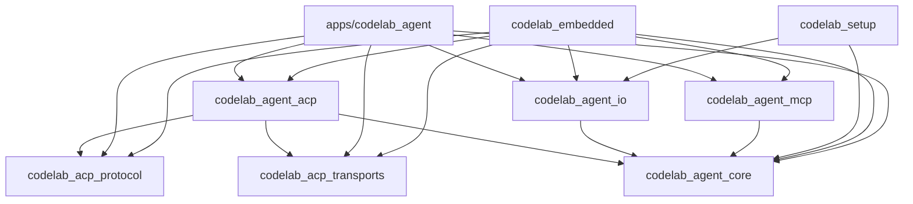
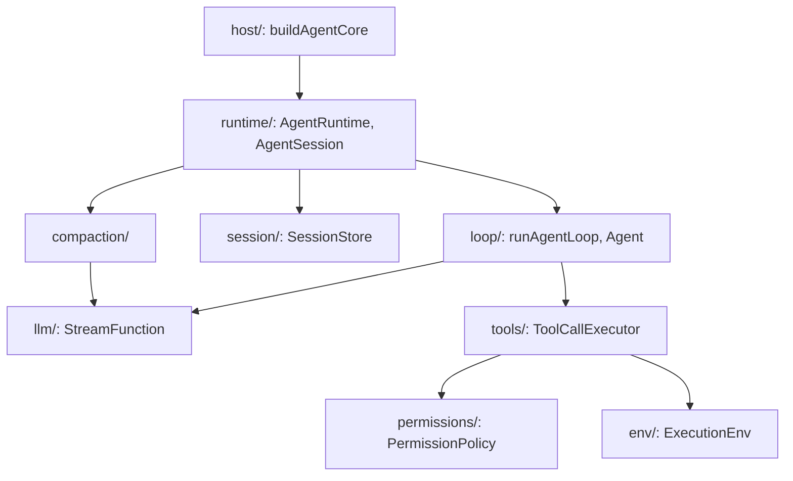

# Обзор: понятия, пакеты, карта кода

Глава даёт общую картину ядра агента: из каких частей оно состоит, где в коде живёт каждая, какие пакеты вокруг него и как они зависят друг от друга. Остальные главы руководства подробно разбирают эти части; читать их удобнее, когда карта уже в голове. Оглавление руководства — [README](README.md).

## Что такое ядро

`codelab_agent_core` — это агент без внешнего мира. Он умеет вызвать модель, исполнить инструменты из её ответа, спросить разрешение, записать журнал сессии и сжать контекст. Но он не знает, где лежат файлы, как запускать процессы, откуда берутся ключи и как говорить с клиентом. Всё это приходит снаружи, от хоста, через порты — интерфейсы, которые ядро описывает, а хост реализует.

Поэтому ядро написано на чистом Dart: без `dart:io`, `dart:isolate`, `dart:ffi`, `dart:html`, без Flutter и без пакетов протокола ACP (PKG-1). Один и тот же код работает в процессе `codelab-agent`, внутри приложения и CLI как встроенный агент и в браузере (проверяет `melos run web-compile`, см. [`../AGENTS.md`](../AGENTS.md)).

Зависимости ядра ограничены allowlist PKG-2: `async`, `collection`, `crypto`, `http`, `meta` (`pubspec.yaml`). `http` нужен только ради интерфейса `Client`: само ядро клиент не создаёт, как и часы, случайность и идентификаторы (PKG-6).

## Шесть понятий и где они в коде

Агент — это модель плюс обвязка. Проект раскладывает обвязку на шесть понятий (проектный документ [`00-six-concepts.md`](../../../../docs/architecture/proposals/agent-core/00-six-concepts.md)). Таблица показывает, в каких каталогах `lib/src/` каждое понятие реализовано сейчас, и какая глава руководства его разбирает.

| Понятие | Что делает обвязка | Где в коде | Глава |
|---|---|---|---|
| Цикл агента | вызывает модель, исполняет инструменты, возвращает результаты, останавливается: ответ готов, исчерпан бюджет или отмена | `loop/` (`runAgentLoop`, `Agent`, `TurnBudget`, `AgentEvent`) | [04](04-turn-loop.md) |
| Вызов инструментов | модель просит действие по имени и аргументам; обвязка проверяет, исполняет, возвращает результат | `tools/` (`AgentTool`, `ToolRegistry`, `ToolCallExecutor`), `env/` | [06](06-tools.md) |
| Управление контекстом | контекст шага = инструкции + история + результаты; при заполнении окна старое сжимается | `prompts/`, `project/`, `loop/payload_builder.dart`, `compaction/`, `tools/truncate.dart` | [08](08-sessions-and-compaction.md), [09](09-config-prompts-commands.md) |
| Сохранение состояния | состояние лежит вне модели, после сбоя работа продолжается с сохранённого места | `session/` (журнал записей, `SessionStore`), `usage/` | [08](08-sessions-and-compaction.md) |
| Разрешения и границы | обвязка решает, какие инструменты, файлы и действия доступны; запрещённое блокируется, агент продолжает | `permissions/` (`PermissionPolicy`, `PermissionGate`), `env/bounded_env.dart`, `host/` | [07](07-permissions.md), [06](06-tools.md), [02](02-assembly-and-hosts.md) |
| Защитные проверки | проверка входа, ответа и действия; пауза до решения человека | действие — политика и критические шаблоны команд (`permissions/critical_patterns.dart`); человек — `PermissionGate`; вход — ограда недоверенного вывода (`tools/fence.dart`); ответ — хук `beforeFinalResponse`: интерфейс есть в `loop/loop_config.dart`, а рантайм хук не регистрирует (LOOP-13) | [07](07-permissions.md), [06](06-tools.md), [04](04-turn-loop.md) |

Ни одна проверка не ловит всё, они дополняют друг друга: ограда снижает риск prompt injection, а одобрение остаётся последним рубежом для опасных действий. Песочницы уровня ОС в ядре нет: её роль выполняют `BoundedEnv` (путь не выходит за рабочую папку сессии), политика разрешений и профили хостов.

Нормы каждого понятия записаны инвариантами и спецификациями:

| Область | Инварианты | Спецификация |
|---|---|---|
| цикл | `LOOP-1…16` | [`agent-loop`](../../../../openspec/specs/agent-loop/spec.md) |
| инструменты | `TOOL-1…11` | [`agent-tools`](../../../../openspec/specs/agent-tools/spec.md) |
| разрешения | `PERM-*` | [`agent-permissions`](../../../../openspec/specs/agent-permissions/spec.md) |
| сессии | `SES-*` | [`agent-sessions`](../../../../openspec/specs/agent-sessions/spec.md) |
| сборка и профили | `HOST-1…7` | [`agent-runtime`](../../../../openspec/specs/agent-runtime/spec.md), [`agent-core-ports`](../../../../openspec/specs/agent-core-ports/spec.md) |
| пакет | `PKG-1…6`, `CFG-5` | [`AGENTS.md`](../AGENTS.md) пакета |

## Пакеты агентской стороны

Вокруг ядра стоят пакеты, которые реализуют его порты и подключают к нему внешний мир. Имена подчиняются правилу `codelab_<сторона>_<слой>` (ADR-0002): `core` — логика без IO, `io` — адаптеры `dart:io`, `acp` — проекция в протокол.

| Пакет | Ответственность | Зависит от (`dependencies`) |
|---|---|---|
| `codelab_agent_core` | ядро: модель, цикл, инструменты, разрешения, сессии, сжатие, конфигурация как данные, порты | `async`, `collection`, `crypto`, `http`, `meta` |
| `codelab_agent_io` | реализации портов на `dart:io`: `LocalExecutionEnv`, `JsonlSessionStore`, `ConfigLoader` и `FileConfigSource`, хранилища секретов, `ProjectFilesLoader`, stdio-транспорт MCP; общие подкоманды `config`, `provider`, `mcp`, `secret` | ядро, `yaml`, `yaml_edit`, `async`, `meta` |
| `codelab_agent_mcp` | MCP-клиент без `dart:io`: JSON-RPC, streamable HTTP на внедрённом `http.Client`, проекция MCP-инструментов в инструменты ядра (`McpClientConnector`) | ядро, `http`, `async`, `meta` |
| `codelab_agent_acp` | ACP-сервер: проекция `AgentRuntime` в протокол (`AcpAgentServer`), клиентские реализации `ExecutionEnv` и `PermissionGate` | ядро, `codelab_acp_protocol`, `codelab_acp_transports`, `async`, `meta` |
| `codelab_embedded` | мост встроенного агента: собирает ядро и ACP-сервер и соединяет их с клиентом парой `InProcessAcpLink` в одном процессе | ядро, `codelab_agent_io`, `codelab_agent_acp`, `codelab_agent_mcp`, протокол и транспорты ACP, `http` |
| `codelab_setup` | мост настроек агента для клиентов: чистые типы конфигурации ядра, запись конфигурации, мастер провайдера, подкоманды `config` | ядро, `codelab_agent_io`, `http`, `meta` |
| `apps/codelab_agent` | бинарь `codelab-agent`: `serve --stdio`, `serve --ws`, подкоманды `config`, `provider`, `mcp`, `secret` | ядро, `io`, `acp`, `mcp`, протокол и транспорты ACP, `args`, `http`, `async`, `meta` |

Источник колонки зависимостей — `pubspec.yaml` каждого пакета. Клиенты (`apps/codelab_desktop`, `apps/codelab_cli`) пакеты `codelab_agent_*` не импортируют: агента они получают только через мосты `codelab_embedded` и `codelab_setup` (PKG-4, проверяет `melos run guard`).

Что из схемы важно запомнить:

- Все стрелки к ядру односторонние: ядро ни от кого из них не зависит.
- `codelab_agent_acp` и `codelab_agent_mcp` не импортируют `dart:io` (PKG-3). Процесс stdio-сервера MCP запускает `codelab_agent_io`, а `codelab_agent_mcp` получает его как порт `McpTransportFactory`.
- Стрелки на `codelab_acp_protocol` и `codelab_acp_transports` есть только у `codelab_agent_acp` (и у хостов, которым нужен транспорт). Ядро протокола не знает.
- Мост `codelab_embedded` и бинарь делают одно и то же — собирают ядро. Различаются только профилем, транспортом и окружением (подробно — в [главе 02](02-assembly-and-hosts.md)).

В проектных документах (`01-layers-and-packages.md`) перечислены ещё пакеты `codelab_agent_lsp`, `codelab_agent_a2a`, `codelab_agent_images` и `codelab_agent_web`. В репозитории их нет: это планы после первого выпуска, и руководство их не описывает.

## Карта `lib/src/`

Публичное API ядра экспортирует один файл, `lib/codelab_agent_core.dart`; всё остальное лежит в `lib/src/` и снаружи не видно. Отдельный барель `lib/testing.dart` отдаёт детерминированные порты для тестов (`FakeClock`, `RecordingLogger`, `ScriptedStreamFunction`, `SequentialIdGenerator`). Адаптеры провайдеров моделей (`lib/src/llm/providers/`) намеренно не экспортируются (PKG-5): наружу идут только фабрики `createStreamFunction` и `createRoutedStreamFunction`.

Каталоги сгруппированы по роли; порядок — от фундамента к сборке.

### Основа

| Каталог | Ответственность |
|---|---|
| `util/` | `Clock`, `IdGenerator`, `Logger`, `Result` (`Ok`/`Err`), канонический JSON, POSIX-пути. Внедряемые часы, идентификаторы и журнал — единственные источники времени и случайности ядра |
| `cancel/` | кооперативная отмена: `CancelTokenSource` у владельца операции, `CancelToken` у исполнителя; причины отмены (`UserCancel`, `WatchdogFired`, `StorageFailure`, `ShutdownCancel`) |
| `env/` | порт `ExecutionEnv` (файлы и процессы), `BoundedEnv` (ограничение рабочей папкой), `MemoryExecutionEnv`, `ListingOverlayEnv` (листинг каталога из другого окружения) |

### Модель

| Каталог | Ответственность |
|---|---|
| `llm/` | контракт `StreamFunction`, сообщения и события потока, каталог моделей (`StaticModelCatalog`, `FixedModelCatalog`), ссылки `ModelRef`, учёт `Usage`, SSE, признаки переполнения контекста; `decorators/` — watchdog, повтор, fallback; `providers/` — адаптеры (не экспортируются) |

### Ход и действия

| Каталог | Ответственность |
|---|---|
| `loop/` | `runAgentLoop` — один ход; `Agent` — состояние между ходами, очереди steering и follow-up; события `AgentEvent`; бюджет `TurnBudget`; сборка запроса к модели `payload_builder.dart` |
| `tools/` | контракт `AgentTool`, `ToolRegistry`, единая точка исполнения `ToolCallExecutor`, проверка аргументов, блокировки путей, усечение вывода, ограда недоверенного текста; `builtin/` — `read`, `write`, `edit`, `ls`, `search`, `exec`, `skill`; `tasks/` — список задач и инструменты `task_*` |
| `permissions/` | `PermissionPolicy` (первый хук `beforeToolCall`), режимы и уровни инструментов, `PermissionGate`, шаблоны путей и команд, защита файлов конфигурации агента |
| `subagents/` | инструмент `agent`: потомок — обычная сессия со своим журналом и лимитами; `SubagentPermissionGate` ведёт его вопросы в шлюз корня |
| `skills/` | каталог навыков (`SKILL.md`), активные навыки сессии, команды `skill:*` |
| `mcp/` | только порты и данные MCP: `McpConnector`, `McpServerConfig`, правило имён инструментов, `McpStatusPort`; протокол MCP — в `codelab_agent_mcp` |
| `commands/` | слэш-команды: встроенные (`/compact`, `/mode`, `/model`, `/status`, `/usage`, `/config`, `/mcp`, `/help`), шаблоны проекта, разбор аргументов |

### Состояние

| Каталог | Ответственность |
|---|---|
| `session/` | журнал как дерево записей (`records.dart`), `SessionWriter`, порт `SessionStore`, `MemorySessionStore`, разбор и ремонт журнала, проекции (контекст модели, реплей, сводка) |
| `compaction/` | сжатие контекста: оценка размера, точка среза, резюме региона моделью, запись `ContextCompacted` |
| `usage/` | журнал расхода токенов сессии (`usage.json`): порт `UsageLedgerStore`, свёртка, отчёт `/usage` |

### Контекст промпта и конфигурация

| Каталог | Ответственность |
|---|---|
| `prompts/` | шаблоны и сборка системного промпта по секциям; `prompts.g.dart` генерируется из `prompts/**/*.md` скриптом `tool/gen_prompts.dart` |
| `project/` | порт файлов проекта (`ProjectFilesSource`): `AGENTS.md`, шаблоны команд, определения агентов; сборка контекста проекта для промпта |
| `agents/` | определение агента (`AgentDefinition`): разбор файла с frontmatter |
| `config/` | модель конфигурации как данные: `CoreConfig`, схема ключей, слияние слоёв, проверка, доверие проектам, перезагрузка; без файлов и разборщиков YAML (CFG-5) |
| `secrets/` | порт `SecretStore` и `SecretResolver` — единственный путь к значению секрета; `${secret:…}` в конфигурации |

### Сборка

| Каталог | Ответственность |
|---|---|
| `host/` | `buildAgentCore`, `HostProfile`, `HostCapability`, `AgentCoreServices`, `LastModelStore` — единственная дорога сборки ядра (HOST-6) |
| `runtime/` | `AgentRuntime` и `AgentSession`: создание, загрузка и список сессий, перезагрузка конфигурации; выбор модели новой сессии |
| `testing/` | реализации для тестов, экспортируются только через `lib/testing.dart` |

Верхний уровень — `runtime/` и `host/`: они знают обо всех остальных каталогах и склеивают их. Остальные каталоги зависят друг от друга по направлению «от фундамента»: `loop/` вызывает `tools/` и `llm/`, `tools/` использует `env/`, `permissions/` встаёт в `tools/` как хук, а не наоборот.

## Как части ядра связаны между собой

Схема показывает, кто кого вызывает в рабочем ходе. Стрелка «A → B» значит «A использует B».

Путь одного хода подробно разобран в [главе 03](03-request-flow.md) (от запроса клиента) и [главе 04](04-turn-loop.md) (внутри цикла).

## Словарь терминов

| Термин | Значение |
|---|---|
| хост | процесс или модуль, который собирает ядро и реализует его порты: `apps/codelab_agent`, `codelab_embedded` |
| порт | интерфейс ядра для внешнего мира (`ExecutionEnv`, `SessionStore`, `PermissionGate`, `McpConnector`, `SecretStore` и др.) |
| сервисы | `AgentCoreServices` — набор портов, который хост передаёт в `buildAgentCore` |
| профиль | `HostProfile` — именованное состояние всех capabilities хоста (`agent-serve`, `embedded-cli`, `embedded-app-desktop`) |
| capability | `HostCapability` — возможность платформы: `shellExec`, `fileListing`, `interactiveApproval`, `compaction`, `sessionPersistence`, `mcp`, `skills`; включённая, выключенная или ограниченная набором транспортов |
| рантайм | `AgentRuntime` — владелец сессий процесса, результат `buildAgentCore` |
| сессия | `AgentSession` — один разговор: журнал, история, режим, модель, инструменты; ходы идут по одному |
| ход | один запуск `prompt`: от пользовательского сообщения до `TurnEnded` |
| шаг | один запрос к модели внутри хода вместе с исполнением вызванных им инструментов |
| событие хода | `AgentEvent` — запечатанная иерархия (`TurnStarted`, `MessageDelta`, `ToolCallStarted`, `TurnEnded` и др.), по ней клиенты строят интерфейс |
| инструмент | `AgentTool` — действие, которое модель вызывает по имени: `read`, `write`, `edit`, `exec`, `ls`, `search`, `skill`, `agent`, `task_*`, инструменты MCP |
| уровень инструмента | `ToolTier`: `read`, `write`, `network`, `exec`; по нему режим решает, нужен ли вопрос пользователю |
| режим | `ModeId`: `plan`, `ask`, `standard`, `accept-edits`, `bypass`; `autopilot` включается только флагом запуска |
| шлюз | `PermissionGate` — порт, через который политика задаёт вопрос человеку |
| журнал | файл сессии: дерево записей, одна запись — одна строка JSONL |
| сжатие | `compaction/`: замена старой истории краткой выжимкой записью `ContextCompacted` |
| слой конфигурации | один источник значений: умолчания, пользовательский файл, проектный, локальный проектный, `--config`, переменные `CODELAB_*`, флаги; для мобильных и web-хостов есть ещё слой настроек из хранилища приложения, `appStorage` (`ConfigLayerKind`) |

## Куда читать дальше

- Как хост собирает ядро и чем различаются хосты — [глава 02](02-assembly-and-hosts.md).
- Путь запроса от клиента до модели и обратно — [глава 03](03-request-flow.md).
- Как расширить агента: [глава 11](11-extending.md).
- Решения и их обоснование — проектный документ [`agent-core-architecture`](../../../../docs/architecture/proposals/agent-core-architecture.md). Он писался до кода: если он расходится с кодом, прав код.
