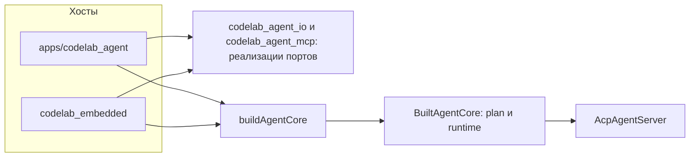
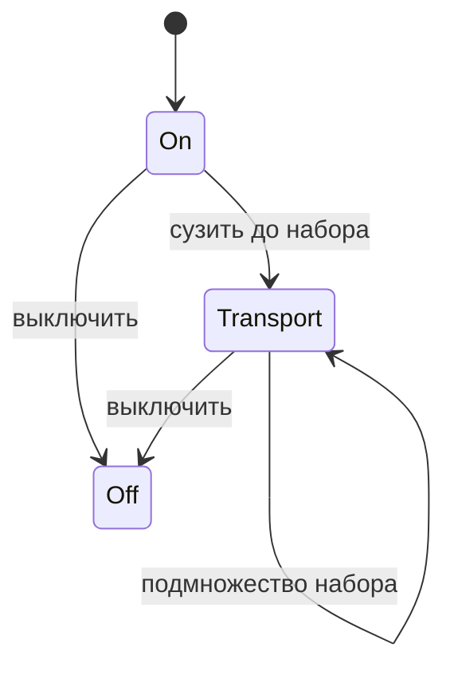
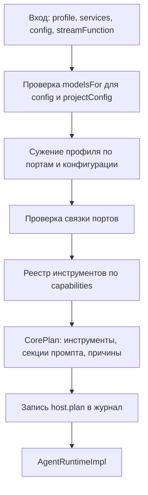
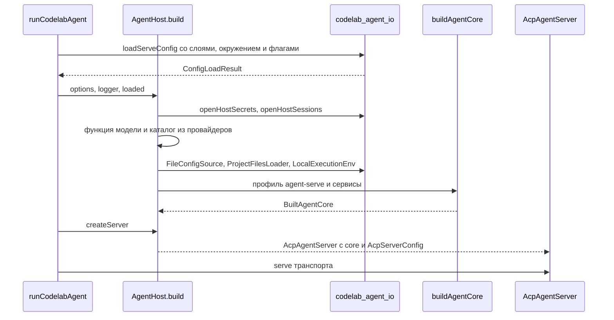

# Сборка ядра и хосты

Глава объясняет, как из ядра получается работающий агент: что хост передаёт в `buildAgentCore`, что функция проверяет и что возвращает, и как эту сборку делают хосты репозитория — бинарь `codelab-agent` и встроенный агент — с помощью пакетов `codelab_agent_io` и `codelab_setup`. Перед чтением полезна [глава 01](01-overview.md): в ней введены порты, профили и пакеты агентской стороны. Дальше по руководству — [путь запроса](03-request-flow.md).

## Одна точка сборки

Ядро не создаёт ничего внешнего: файлы, процессы, HTTP-клиент, время, случайность, хранилища и вопрос пользователю приходят от хоста (PKG-6). Хост передаёт всё одним объектом `AgentCoreServices` в функцию `buildAgentCore`. Другой дороги нет: хосты не собирают `ToolRegistry`, `Agent` и `AgentRuntime` вручную (HOST-6). Это не просто договорённость: сторож репозитория (`melos run guard`) падает, если в `lib/` бинаря `apps/codelab_agent` или пакета `codelab_embedded` встречается `ToolRegistry(`, `Agent(` или `AgentRuntime(` (спецификация [`workspace-architecture`](../../../../openspec/specs/workspace-architecture/spec.md)).

Почему одна точка. Сужение профиля по сервисам и конфигурации, реестр инструментов по capabilities, политика разрешений первым хуком каждой сессии и план включённого должны получаться одинаково у `codelab-agent`, встроенного агента CLI и встроенного агента приложения. Если бы каждый хост собирал их сам, у профилей появились бы расхождения, которые видны только в бою.



Хосты берут реализации портов в `codelab_agent_io` и `codelab_agent_mcp` (стрелки к блоку реализаций), собирают ядро и отдают `BuiltAgentCore` серверу `AcpAgentServer` из `codelab_agent_acp` (глава [03](03-request-flow.md)). Ядро при этом ничего не знает ни о хосте, ни о сервере.

## Сигнатура `buildAgentCore`

Функция лежит в `lib/src/host/build_agent_core.dart`:

| Параметр | Что это |
|---|---|
| `profile` | `HostProfile`: возможности платформы хоста |
| `services` | `AgentCoreServices`: порты |
| `config` | `CoreConfig`: снимок конфигурации на старте |
| `streamFunction` | функция вызова модели начального снимка |
| `modelsFor` | `ConfiguredModels Function(CoreConfig)?`: строит функцию модели и каталог по новому снимку; нужна, если передан `services.config` или `services.projectConfig` |
| `configCommand` | `false` не объявляет и не исполняет встроенную `/config`; так делает `serve --ws` |

`ConfiguredModels` — пара `(stream, catalog)` (`lib/src/host/services.dart`). Причина `modelsFor` в том, что `http.Client` и сервисы LLM принадлежат хосту (PKG-6), а при перезагрузке конфигурации функцию модели и каталог нужно пересобрать. Хост с источником конфигурации строит начальную пару тем же замыканием, которое потом отдаёт в `modelsFor`: так старт и перезагрузка разойтись не могут.

Результат — `BuiltAgentCore`: `plan` (`CorePlan`) и `runtime` (`AgentRuntime`).

## `AgentCoreServices`

Поля описаны в `lib/src/host/services.dart`.

Обязательные:

| Поле | Тип порта | Для чего |
|---|---|---|
| `baseEnv` | `ExecutionEnv` | файлы и процессы; сессия оборачивает его в `BoundedEnv` с корнем `cwd`, если хост не дал сессии своё окружение |
| `logger` | `Logger` | журнал диагностики; значения секретов в него не попадают |
| `clock` | `Clock` | время и таймеры; в тестах — `FakeClock` |
| `ids` | `IdGenerator` | идентификаторы сессий и записей журнала |
| `sessions` | `SessionStore` | хранилище журнала; обязательно, журнал пишется всегда |

Необязательные. `null` выключает возможность или оставляет поведение по умолчанию:

| Поле | Что даёт, если задано |
|---|---|
| `gate` (`PermissionGate`) | интерактивные вопросы пользователю; без него capability `interactiveApproval` выключена, любой вопрос — отказ (PERM-5) |
| `platform` | строка (`linux`, `macos`, `windows`, `web`) для системного промпта; по умолчанию `unknown`. Ядро не читает `Platform.operatingSystem`, поэтому хост на `dart:io` передаёт его сам |
| `models` (`ModelCatalog`) | каталог моделей; иначе каталог из одной `CoreConfig.defaultModel` |
| `mcp` (`McpConnector`) | подключение MCP-серверов; без него capability `mcp` выключена |
| `projectFiles` (`ProjectFilesSource`), `skillFiles` (`SkillFilesSource`) | `AGENTS.md`/`CLAUDE.md`, шаблоны команд, определения агентов и навыки; у обоих портов в монорепозитории одна реализация, `ProjectFilesLoader` |
| `hostFiles` (`ExecutionEnv`) | файловая система процесса агента для корней навыков вне рабочей папки, только чтение |
| `secrets` (`SecretResolver`) | разбор ссылок `${secret:…}` в `env` и заголовках MCP-серверов; тот же резолвер хост отдаёт и в функцию модели |
| `config` (`ConfigSource`) | источник для перезагрузки конфигурации работающего агента: сигнал `changes`, `load`, `initial` |
| `projectConfig` (`ProjectConfigLoader`) | конфигурация папки сессии, если она не совпадает с корнем запуска |
| `agentConfigPaths` | пути конфигурации агента, которые модель не правит без человека (PERM-11); хост строит значение функцией `agentConfigPathsFor` из `codelab_agent_io` |
| `lastModel` (`LastModelStore`) | память последней явно выбранной модели; реализация — `FileLastModelStore` |
| `usageLedger` (`UsageLedgerStore`) | файл журнала расхода; без него отчёт `/usage` строится в памяти |

Два поля легко перепутать. `config` перезагружает корень запуска, а `projectConfig` даёт сессии другой папки её собственный `CoreConfig` и функцию модели (`CoreConfig.withoutProject` — если порта нет). Одно бывает без другого, поэтому это два поля; оба требуют `modelsFor`. Устройство слоёв и перезагрузки — в [главе 09](09-config-prompts-commands.md).

Решение по конкретному полю — не придирка к стилю, а граница: `secrets` приходит от хоста, потому что для переменных `CODELAB_SECRET_*` нужно окружение процесса, которого у ядра нет; `hostFiles` — потому что окружение сессии может быть клиентским, а читать навыки агента нужно с его собственного диска.

## Профиль и capabilities

`HostProfile` (`lib/src/host/host_profile.dart`) задаёт, что умеет платформа хоста: явное состояние каждой `HostCapability` (HOST-1) и режим разрешений по умолчанию. Состояние — одно из трёх:

- `CapabilityOn` — включена без ограничений;
- `CapabilityOff(reason)` — выключена, причина обязательна;
- `CapabilityTransport(transports, reason)` — включена, но только для набора транспортов (`acp-terminal`, `local`, `jsonl-file` и т. п.); набор и причина попадают в журнал и сообщения об ошибках.

Capabilities:

| Capability | Что включает |
|---|---|
| `shellExec` | инструмент `exec` |
| `fileListing` | инструменты `ls` и `search` |
| `interactiveApproval` | вопрос пользователю через `PermissionGate` |
| `compaction` | автоматическое и аварийное сжатие контекста ([глава 08](08-sessions-and-compaction.md)) |
| `sessionPersistence` | журнал на постоянном носителе, `session/load`, `session/list` |
| `mcp` | подключение MCP-серверов сессии; транспорты `stdio` и `http` |
| `skills` | `SKILL.md` из корней проекта и пользователя, секция каталога, инструмент `skill`, команды `skill:*` |

Встроенных профилей три: `HostProfile.of(name)` знает `agent-serve`, `embedded-cli` и `embedded-app-desktop`; другое имя — `ArgumentError`. Режим по умолчанию у всех трёх — `ModeId.standard` (HOST-7: `permissions.mode` из конфигурации заменяет его, `autopilot` включается только флагом запуска).

| Capability | `agent-serve` | `embedded-cli`, `embedded-app-desktop` |
|---|---|---|
| `shellExec` | транспорт `acp-terminal`, `local`: клиент объявил `terminal` или задан `--local-exec` | транспорт `local`: процессы хоста |
| `fileListing` | транспорт `local`: stdio-клиент всегда на той же машине | транспорт `local`: файлы хоста |
| `interactiveApproval` | транспорт `acp`: вопрос через `session/request_permission` | транспорт `acp`: вопрос через встроенный ACP-клиент |
| `compaction` | включена | включена |
| `sessionPersistence` | транспорт `jsonl-file`: `$CODELAB_HOME/sessions` | то же |
| `mcp` | транспорты `stdio`, `http` | то же |
| `skills` | включена | включена |

Профили `embedded-cli` и `embedded-app-desktop` совпадают по состояниям: разные имена нужны, чтобы в конфигурации сужать их по-разному (`profile.<name>.*`) и различать в записи `host.plan` журнала. Паритет закреплён тестом `test/host/host_profile_test.dart`.

### Сужать можно, расширять нельзя

`HostProfile.narrowed(overrides)` возвращает новый профиль, в котором состояние части capabilities заменено. Допустимы только переходы вниз (HOST-2):



Любая попытка расширить (`Off` → `On`, `Transport` → более широкий набор) — `HostWiringException` с именем capability. 
Сужение приходит из трёх мест, и они накладываются друг на друга:

1. Конфигурация: ключи `profile.<name>.<capability>` (`off` или список транспортов). Их проверяет загрузчик и складывает в `HostSettings.profileNarrowing`; расширение там — проблема конфигурации, а не исключение сборки. Хост применяет `profile.<name>` первым.
2. Хост: сужение по обстоятельствам запуска (например, WebSocket или `--llm-script`). Применяется вторым.
3. Сама `buildAgentCore` сужает профиль по переданным портам и конфигурации; об этом — следующий раздел.

## Что делает `buildAgentCore`



1. Если передан `services.config` или `services.projectConfig`, а `modelsFor` нет, — `HostWiringException`: перезагрузка и сессия другой папки не смогут построить функцию модели.
2. Сужение профиля (`profile.narrowed`):
   - `interactiveApproval` выключается, если `services.gate == null`;
   - `fileListing` выключается, если `baseEnv` не реализует `DirectoryListing`;
   - `compaction` выключается при `compaction.enabled: false` в `CoreConfig`;
   - `mcp` выключается, если `services.mcp == null`.
   
   Навыки по конфигурации не сужаются. Ключ `skills.enabled` принадлежит папке сессии: рантайм читает его из конфигурации сессии и для сессии с `enabled: false` отдаёт пустой каталог, не вызывая порт. Если бы `buildAgentCore` выключала capability по конфигурации корня запуска, сессия доверенной папки с `enabled: true` навыков не получила бы. Capability `skills` сужает только профиль (`profile.<name>.skills: off`, HOST-4); отсутствие порта `skillFiles` её не выключает, сессия просто без навыков.
3. Проверка связки портов (HOST-3) — ошибки находятся при сборке, а не посреди хода:
   - `sessionPersistence` включена, а `sessions` — `MemorySessionStore`: журнал теряется при выходе процесса;
   - `mcp` включена с набором транспортов, а `McpConnector.transports` не покрывает набор;
   - `shellExec` включена, а `baseEnv` — `MemoryExecutionEnv`: у него нет настоящего `Shell.exec`.
4. Реестр инструментов (`ToolRegistry`). Регистрация с проверкой дубля имени (HOST-5):
   - всегда: `read`, `write`, `edit`, `task_create`, `task_update`, `task_list`, `task_get`;
   - при `shellExec`: `exec`;
   - при `fileListing`: `ls` и `search`.
   
   Инструменты сессии (`skill`, `agent`, MCP) добавляет рантайм при создании сессии, не эта функция.
5. План `CorePlan`: итоговый профиль, имена инструментов в порядке регистрации, id секций системного промпта для режима из конфигурации или режима профиля по умолчанию, причины выключенного (`offReasons`). Секции выключенных capabilities в промпт не попадают (HOST-4).
6. Запись `host.plan` в журнал: профиль, инструменты, выключенные capabilities с причинами. Диагностика «почему у агента нет `exec`» начинается с неё.
7. `AgentRuntimeImpl` создаётся с суженным профилем, сервисами, конфигурацией, реестром, функцией модели и `modelsFor` — последний передаётся рантайму, только если задан `config` или `projectConfig`. `buildAgentCore` возвращает `BuiltAgentCore`.

Нет листинга у `baseEnv` — это не ошибка: `ls` и `search` просто не регистрируются.

Политика разрешений в сборке не создаётся: рантайм ставит `PermissionPolicy` первым хуком `beforeToolCall` каждой сессии, а хуки хоста (`SessionSpec.extraBeforeToolCall`) идут после неё ([глава 07](07-permissions.md)).

## Порты сессии: что хост может подменить

Сервисы общие на процесс, но у сессии свой набор портов. `SessionSpec.ports` (`SessionHostPorts`, `lib/src/runtime/agent_session.dart`) для одной сессии подменяет часть сервисов:

| Поле `SessionHostPorts` | Подмена |
|---|---|
| `env` | окружение этой сессии вместо `services.baseEnv` |
| `gate` | шлюз этой сессии вместо `services.gate` |
| `logger` | журнал этой сессии |
| `extraBeforeToolCall`, `extraAfterToolCall` | хуки хоста для загруженной сессии |
| `execOnHost` | `env` исполняет команды на машине агента, а не у клиента |

Это ключ к устройству хостов. В `services.gate` бинарь и встроенный агент кладут заглушку (`_ConnectionGate`), единственная задача которой — оставить capability `interactiveApproval` включённой. Настоящий шлюз `AcpPermissionGate` создаёт ACP-сервер для каждой сессии и передаёт его через `SessionHostPorts.gate`; заглушка при вызове бросает `StateError`. Окружение устроено так же: сервер собирает его для сессии (клиентское `AcpClientExecutionEnv` или локальное хоста) и передаёт в `SessionHostPorts.env`. Поэтому `services.baseEnv` у ACP-хостов — запасное окружение, а настоящее окружение инструментов приходит с сессией.

Рантайм оборачивает окружение сессии в `BoundedEnv.wrap(...)` с корнем `cwd`: путь модели за пределами рабочей папки возвращается как `Err(FileError(FileErrorCode.outsideWorkspace, …))` ([глава 06](06-tools.md)).

## Функция модели

`streamFunction` — контракт `StreamFunction` (`lib/src/llm/stream_function.dart`): вернуть поток синхронно и не бросать исключений, любой сбой — событие `ErrorEvent`; у потока ровно одно завершающее событие; отмена даёт `ErrorEvent` с `stopReason: aborted`. Подробно — в [главе 05](05-llm.md).

Для настоящих провайдеров хост вызывает `createStreamFunction(config, services)` или `createRoutedStreamFunction`, либо, как оба хоста репозитория, `createConfiguredStreamFunction(coreConfig, CoreLlmServices(...), secrets: …)`, который строит функцию по всем провайдерам конфигурации. `CoreLlmServices` собирает `httpClient`, `clock`, `random` и `logger`: `http.Client` создаёт хост. Каталог моделей при этом — `StaticModelCatalog(core.providers)`.

В тестах и в режиме `--llm-script` функцию модели заменяет сценарий: `ScriptedStreamFunction` из `package:codelab_agent_core/testing.dart` (n-й запрос получает n-й шаг сценария; расхождения копятся, `verify()` бросает `ScriptedLlmFailure` со всеми) или `LlmScript` из `codelab_agent_io/testing.dart`.

## Реализации портов в монорепозитории

| Порт | Реализация | Пакет |
|---|---|---|
| `ExecutionEnv` | `LocalExecutionEnv` | `codelab_agent_io` |
| `ExecutionEnv` | `AcpClientExecutionEnv`: файлы и терминал через клиента | `codelab_agent_acp` |
| `SessionStore` | `JsonlSessionStore`; `MemorySessionStore` — в ядре | `codelab_agent_io` |
| `PermissionGate` | `AcpPermissionGate` | `codelab_agent_acp` |
| `ConfigSource`, `ProjectConfigLoader` | `FileConfigSource` | `codelab_agent_io` |
| `ProjectFilesSource`, `SkillFilesSource` | `ProjectFilesLoader` | `codelab_agent_io` |
| `McpConnector` | `McpClientConnector` | `codelab_agent_mcp` |
| `McpTransportFactory` (stdio) | `StdioMcpTransportFactory` | `codelab_agent_io` |
| `SecretStore` | `FileSecretStore`, `EnvSecretStore`; фабрика `openHostSecrets` | `codelab_agent_io` |
| `UsageLedgerStore` | `JsonlUsageLedgerStore` | `codelab_agent_io` |
| `LastModelStore` | `FileLastModelStore` | `codelab_agent_io` |

`McpClientConnector` собирается из `McpTransports(stdio: …, http: …)`: процесс stdio-сервера запускает `StdioMcpTransportFactory` из `codelab_agent_io`, streamable HTTP — `StreamableHttpTransportFactory` из `codelab_agent_mcp` на HTTP-клиенте хоста. Так `codelab_agent_mcp` остаётся без `dart:io`.

## Хост 1: бинарь `codelab-agent`

Код — `apps/codelab_agent/lib/src/`. Подробности эксплуатации — [README приложения](../../../../apps/codelab_agent/README.md), [разработка](../../../../apps/codelab_agent/doc/development.md) и [эксплуатация](../../../../apps/codelab_agent/doc/operations.md); здесь только то, что касается сборки.

`runCodelabAgent` (`lib/src/run.dart`) разбирает командную строку, а подкоманды `config`, `provider`, `mcp` и `secret` исполняет до загрузки конфигурации `serve`: серверу, транспорту и логам они не нужны. Для `serve` порядок такой: флаги, загрузка конфигурации (`loadServeConfig`), логгер, `AgentHost.build`, транспорт, завершение. Невалидная конфигурация завершает процесс кодом `64` до старта транспорта.



`AgentHost.build` (`lib/src/host/agent_host.dart`):

1. `loaded.orThrow()` — невалидный конфиг даёт исключение конфигурации (`ConfigException`) со всеми проблемами, без значений секретов (CFG-2).
2. Резолвер секретов `openHostSecrets` по `secrets.backend` конфигурации. Со сценарием `--llm-script` бэкенд всегда `env`: сценарий не читает `$CODELAB_HOME`.
3. Один `http.Client` на процесс. Его закрывает `shutdown`.
4. Модель и журнал. Обычный запуск: `CoreLlmServices`, замыкание `reloadModels` (`createConfiguredStreamFunction` + `StaticModelCatalog`), журнал `openHostSessions`, `JsonlUsageLedgerStore`. `--llm-script`: `LlmScript`, `FixedModelCatalog`, журнал в памяти или в каталоге `--sessions-dir`, `sessionPersistence` сужается, если каталога нет.
5. Профиль: `HostProfile.of('agent-serve')`, затем сужения из `profile.agent-serve.*` конфигурации и сужения транспорта.
6. `FileConfigSource` создаётся последним перед сборкой: его конструктор запускает наблюдатель за файлами, и всё, что может бросить раньше, не должно оставить его работающим. Со сценарием источника нет.
7. `buildAgentCore` с `gate: const _ConnectionGate()`, `baseEnv: LocalExecutionEnv`, `config: source`, `projectConfig: stdio ? source : null`, `agentConfigPaths: agentConfigPathsFor(...)`, `lastModel: FileLastModelStore`, `mcp: McpClientConnector(...)`, `projectFiles`/`skillFiles`/`hostFiles` — и `configCommand: stdio`. Если сборка бросила исключение, источник закрывается до проброса.
8. `AcpServerConfig`: `agentInfo` (`codelab-agent`), `detachGrace: Duration.zero` (отсоединение отменяет ход), `localListing` — только по stdio.

Сервер создаёт `createServer()`; `shutdown()` останавливает серверы, затем `runtime.dispose()`, затем закрывает источник конфигурации и в `finally` — HTTP-клиент. Порядок «источник после рантайма» важен: рантайм владеет подпиской на `changes` и отменяет её сам, а закрытый раньше источник оборвал бы перезагрузку, идущую во время остановки.

### Что меняет транспорт

| | `serve --stdio` | `serve --ws` |
|---|---|---|
| соединений | одно: stdin и stdout процесса | много: каждое подключение — отдельное соединение одного сервера |
| `fileListing` | остаётся, листинг локальный | выключена: клиент может быть на другой машине |
| `mcp` | остаётся (`stdio` и `http`) | выключена: описание stdio-сервера пришло бы из сети, а процессы запускались бы на машине агента |
| файлы проекта, навыки, `hostFiles` | читаются с локальной ФС процесса | не читаются: `cwd` приходит из сети |
| `projectConfig` | источник конфигурации | `null`: сессия вне корня остаётся на `withoutProject` |
| `/config` | есть | нет (`configCommand: false`): ответ `/config check` содержит пути и проблемы машины агента |
| защита соединения | процесс принадлежит клиенту | Bearer-токен при upgrade, из переменной окружения; без токена сервер не стартует |

Выход: `0` — клиент закрыл сеанс (EOF stdin), `1` — сбой, `64` — ошибка использования или конфигурации, `130` и `143` — `SIGINT` и `SIGTERM` (`lib/src/serve/exit_codes.dart`).

## Хост 2: `codelab_embedded`

Мост встроенного агента: клиенты получают агента отсюда, а не из `package:codelab_agent_*` (PKG-4). Агент работает в процессе клиента и разговаривает с ним по ACP через пару `InProcessAcpLink` — две стороны одного канала в памяти. Правила — [`AGENTS.md`](../../codelab_embedded/AGENTS.md) и [README](../../codelab_embedded/README.md) пакета, норма — спецификация [`embedded-agent`](../../../../openspec/specs/embedded-agent/spec.md).

Три точки входа:

| Барель | Для кого | Что содержит |
|---|---|---|
| `package:codelab_embedded/codelab_embedded.dart` | клиентский код; web-безопасен | `createEmbeddedAgent`, `EmbeddedAgent`, `EmbeddedAgentOpener`, `EmbeddedAgentConfig`, `EmbeddedHostServices`, `embeddedAgentVersion` |
| `package:codelab_embedded/io.dart` | composition root клиента | `localEmbeddedAgentOpener` — настольный открыватель на `codelab_agent_io`; движок переноса секретов |
| `package:codelab_embedded/testing.dart` | тесты и драйвер `codelab test-scenario` | `scriptedEmbeddedAgentOpener`, `FakeMcpHttpHost`, `FakeMcpServer` |

Почему три. Основной барель обязан собираться для web: он не импортирует `dart:io`, `package:codelab_agent_io` и IO-транспорты (проверяет сторож). `io.dart` вынесен, чтобы IO-реализации не попали в web-сборку. `testing.dart` вынесен, чтобы сценарий модели структурно не мог попасть в релизную сборку приложения: его импорт в `lib/` `apps/codelab_desktop` запрещён.

Сборка устроена в два слоя:

```mermaid
sequenceDiagram
  participant cli as Клиент
  participant open as localEmbeddedAgentOpener
  participant create as createEmbeddedAgent
  participant asm as assembleEmbeddedAgent
  participant core as buildAgentCore

  cli->>open: cwd и hostProfile
  open->>open: ConfigLoader.load, openHostSecrets, openHostSessions
  open->>open: FileConfigSource, ProjectFilesLoader, McpClientConnector
  open->>create: EmbeddedAgentConfig и EmbeddedHostServices
  create->>create: modelsFor и начальные stream и catalog
  create->>asm: те же config, services, stream, catalog
  asm->>core: профиль embedded и AgentCoreServices
  core-->>asm: BuiltAgentCore
  asm->>asm: AcpAgentServer и InProcessAcpLink
  asm-->>cli: EmbeddedAgent с clientTransport
```

- `localEmbeddedAgentOpener(...)` (`lib/src/io/local_opener.dart`) — это IO-часть. Порядок важен: профиль проверяется до чтения конфигурации; конфигурация грузится `ConfigLoader().load` (невалидная — `EmbeddedAgentConfigException` с проблемами без значений секретов); затем секреты, журналы и только после этого создаётся HTTP-клиент: невалидный конфиг не оставляет ни сокетов, ни процессов. Источник `FileConfigSource` создаётся последним внутри `try`, любой срыв закрывает его перед пробросом.
- `createEmbeddedAgent` (`lib/src/create_embedded_agent.dart`) принимает только профили `embedded-app-desktop` и `embedded-cli` (иначе `HostWiringException`) и строит функцию модели из провайдеров конфигурации.
- `assembleEmbeddedAgent` (`lib/src/assemble.dart`) — внутренняя функция, в барель не экспортируется. Её используют `createEmbeddedAgent` и сценарный открыватель; она принимает функцию модели и каталог извне. Поэтому публичный API сценарий модели не принимает.

`EmbeddedHostServices` — аналог `AgentCoreServices` на стороне моста: `baseEnv`, `localEnv`, `sessions`, `secrets`, `http`, `logger`, `clock`, `ids`, `random`, `platform` и необязательные порты. Лишние для ядра поля: `localEnv` (фабрика окружения по `cwd` для ACP-сервера), `random` (джиттер повторов провайдеров), `closeHttpOnDispose` и `closeConfigSource` (хост закрывает то, что создал).

Отличия от бинаря, которые видны в коде:

- Профиль `embedded-*`: ACP-сервер получает `AcpServerConfig.localEnv`. Это значит, что файлы и команды исполняет сам хост, а `fs/*` и `terminal/*` клиенту не уходят, даже если клиент их объявил; `execOnHost: true` позволяет `exec` с `cwd` в корне навыка. У `agent-serve` (только в `testing.dart`) вместо этого `localListing`, как у бинаря по stdio.
- Шлюз разрешений тот же: `_ConnectionGate` включает capability, а вопросы идут клиенту по `session/request_permission` через `AcpPermissionGate` и пару `InProcessAcpLink`. Пакет не принимает извне `PermissionGate` и режим разрешений.
- Один агент обслуживает одно соединение: клиент закрыл свой конец — агент останавливается. `detachGrace: Duration.zero`.
- Ядро живёт в процессе клиента, поэтому необработанная асинхронная ошибка в нём не должна дойти до обработчика ошибок приложения. `serve` запускается в `runZonedGuarded`; ошибка зоны или `serve` — fail-stop: событие `embedded.agent.failed` (только класс ошибки, не текст), закрытие агентского конца, `dispose`. Клиент видит обрыв соединения так же, как смерть stdio-процесса.
- `EmbeddedAgent.dispose()` идемпотентен и каждый шаг в своём `try`: сервер (`shutdown`, пять секунд), рантайм, источник конфигурации, агентский конец, HTTP-клиент (если создан хостом). Сбой шага пишется как `embedded.agent.dispose_failed` с именем шага, `closed` завершается всегда.
- Если сборка упала после `buildAgentCore`, `_releaseCore` освобождает рантайм, источник и HTTP-клиент, иначе они утекли бы.
- `EmbeddedAgent.mcpStatus(sessionId)` отдаёт хосту `McpStatusPort` сессии: приложению нужна живая таблица состояния MCP-серверов, а `package:codelab_agent_*` оно импортировать не вправе.

Сценарный открыватель (`lib/src/testing/scripted_opener.dart`) собирает того же агента без сети и ключей: сценарий вместо провайдеров, `MockClient`, который бросает при любом запросе, `$CODELAB_HOME` не читается, секреты — `env`. Проводка MCP там нарочно продублирована: без коннектора capability `mcp` выключается, и `initialize` перестаёт объявлять `mcpCapabilities.http`, чего ждёт корпус фикстур.

## Мост настроек: `codelab_setup`

`codelab_setup` ядро не собирает. Это мост второго рода: клиентам нужны настройки агента, а `package:codelab_agent_*` им импортировать нельзя. Пакет:

- реэкспортирует чистые типы конфигурации ядра (`ConfigIssue`, `ConfigLoadResult` и др.);
- даёт доступ к настройкам, снимок и запись конфигурации (`AgentConfigStore`, файловая реализация `FileAgentConfigStore` в `lib/io.dart`), мастер подключения провайдера, проверку `/models`, работу с MCP-серверами, секреты и страницу навыков;
- в `lib/io.dart` отдаёт те же подкоманды `config` из `codelab_agent_io` (`ConfigCommands`), чтобы `codelab config check` и `codelab-agent config check` печатали одно и то же.

Границы: основной барель web-безопасен (ни `dart:io`, ни `codelab_agent_io`); `package:codelab_agent_io/` разрешён только в `lib/io.dart` и `lib/src/io/` (правило сторожа). Состав и правила — [README](../../codelab_setup/README.md) и [`AGENTS.md`](../../codelab_setup/AGENTS.md) пакета. К сборке ядра пакет относится так: клиент записывает конфигурацию через него, а встроенный агент подхватывает её через `FileConfigSource` перезагрузкой, без пересборки (глава [09](09-config-prompts-commands.md)).

## Поставщик портов: `codelab_agent_io`

`codelab_agent_io` не хост, а набор реализаций портов `dart:io`, из которых хосты собирают сервисы. Функции, которые хосты вызывают при сборке:

| Что | Функция или класс | Зачем |
|---|---|---|
| Загрузка конфигурации | `ConfigLoader().load(cwd:, environment:, flags:, …)` | читает слои (`user`, `project`, `projectLocal`, `extra` из `--config` или `CODELAB_CONFIG`, переменные `CODELAB_*`, флаги) и отдаёт `ConfigLoadResult`: либо `config` и `host`, либо `issues` |
| Каталог состояния | `codelabHomeOf(environment)` | `$CODELAB_HOME` с раскрытием `~` |
| Источник перезагрузки | `FileConfigSource` | порты `ConfigSource` и `ProjectConfigLoader` на файлах плюс наблюдатель `ConfigWatcher` |
| Секреты | `openHostSecrets(codelabHome:, environment:, backend:, debug:, logger:)` | `SecretResolver` над выбранным бэкендом (`env` или `file`) |
| Журнал сессий | `openHostSessions(codelabHome:, settings:, clock:, logger:)` | `JsonlSessionStore` в `sessions.dir` или `$CODELAB_HOME/sessions`, политика `fsync` из `sessions.fsync` |
| Файлы проекта | `ProjectFilesLoader(home:, userHome:, local:)` | `AGENTS.md`, шаблоны команд, определения агентов, навыки; один объект на два порта |
| Пути PERM-11 | `agentConfigPathsFor(cwd:, environment:, …)` | какие файлы конфигурации модель не правит без человека |
| Журнал расхода | `JsonlUsageLedgerStore` | `usage.json` рядом с журналом сессии |
| Последняя модель | `FileLastModelStore` | файл под `$CODELAB_HOME` |
| Окружение | `LocalExecutionEnv(cwd:, hostEnvironment:)` | файлы и процессы; `hostEnvironment` — словарь окружения; без аргумента берётся `Platform.environment`. Бинарь его не передаёт, явный словарь передаёт только встроенный агент |
| MCP stdio | `StdioMcpTransportFactory` | запуск процесса сервера, окружение по allowlist, завершение дерева процессов |

Почему это общий пакет, а не код каждого хоста. Бинарь, CLI и приложение должны одинаково читать `sessions.dir` и `secrets.backend`: ключ, который пользователь сохранил `codelab secret set`, обязан быть виден встроенному агенту, а журнал одного хоста — лежать там, где его ищет другой. Своих загрузчика, хранилища секретов и формата журнала у `codelab_embedded` нет.

Эти функции принимают словарь окружения и пути аргументами, а не читают глобальное состояние: тест подставляет временный `CODELAB_HOME`, а хост с ядром в отдельном isolate вызывает `openHostSecrets` внутри isolate из сериализуемых данных. Значения секретов через границу isolate не передаются.

Загрузка конфигурации, слои и их доверие, секреты и журналы разобраны в главах [08](08-sessions-and-compaction.md) и [09](09-config-prompts-commands.md). `codelab_agent_io` отдельно экспортирует `lib/testing.dart` — `LlmScript`, `CwdTrackingStore`, `withScriptedProviders`: сценарий модели вынесен из основного бареля, чтобы он не попал в граф импортов клиентов. Импортировать его можно только `apps/codelab_agent`, `codelab_embedded/lib/src/testing/` и тестам.

## Сравнение хостов

| | `apps/codelab_agent` | `codelab_embedded` (`io.dart`) | `codelab_embedded` (`testing.dart`) |
|---|---|---|---|
| профиль | `agent-serve` | `embedded-cli`, `embedded-app-desktop` | любой, в т. ч. `agent-serve` |
| транспорт ACP | stdio или WebSocket | `InProcessAcpLink` в памяти | `InProcessAcpLink` |
| функция модели | провайдеры конфигурации или `--llm-script` | провайдеры конфигурации | сценарий `LlmScript` |
| окружение инструментов | локальное или клиентское (`terminal/*`) | локальное (`localEnv`) | как у профиля |
| журнал | `JsonlSessionStore`; со сценарием — память | `JsonlSessionStore` | память или `sessionsDir` |
| секреты | `secrets.backend` конфигурации; со сценарием `env` | `secrets.backend` конфигурации | `env` |
| конфигурация | слои + флаги + `--config` | слои + `CODELAB_*` | без файлов (`scripted: true`) |
| жизнь | процесс | соединение с клиентом | тест |

## Тестовая сборка ядра

Ядро можно собрать без хоста: `lib/testing.dart` даёт `FakeClock`, `RecordingLogger`, `SequentialIdGenerator`, `ScriptedStreamFunction`, а ядро — `MemoryExecutionEnv` и `MemorySessionStore`. Минимальный пример из `test/web_smoke/main.dart`:

```dart
final clock = FakeClock();
final env = MemoryExecutionEnv(cwd: '/web', clock: clock);

final core = buildAgentCore(
  profile: HostProfile.of('agent-serve').narrowed(const {
    HostCapability.shellExec: CapabilityOff('браузер без shell'),
    HostCapability.sessionPersistence: CapabilityOff('журнал в памяти'),
  }),
  services: AgentCoreServices(
    baseEnv: env,
    logger: RecordingLogger(),
    clock: clock,
    ids: SequentialIdGenerator(),
    sessions: MemorySessionStore(),
  ),
  config: config,
  streamFunction: model.call,
);
```

Профиль сужен вручную: `MemoryExecutionEnv` не умеет `Shell.exec`, а `MemorySessionStore` не переживает процесс, и без сужения сборка бросила бы `HostWiringException` (шаг 3 выше). Тот же код проходит `melos run web-compile` в JavaScript и WebAssembly. Тесты сборки лежат в `test/host/` (`build_agent_core_test.dart`, `host_profile_test.dart`, `host_wiring_guard_test.dart`, `profile_event_parity_test.dart`).

## Если вы пишете новый хост

1. Выберите профиль или заведите новый в `HostProfile.of` (состояние каждой capability и режим по умолчанию, HOST-1; golden-тест профиля). Новый хост без новых возможностей платформы использует существующий профиль.
2. Реализуйте порты, которые нужны включённым capabilities (HOST-3): `ExecutionEnv` с `Shell.exec` — для `shellExec`, `DirectoryListing` — для `fileListing`, постоянный `SessionStore` — для `sessionPersistence`, `McpConnector` с нужными транспортами — для `mcp`, `PermissionGate` — для `interactiveApproval`.
3. Создайте `http.Client`, `Clock`, `Random`, `IdGenerator` на стороне хоста (PKG-6) и передайте их через сервисы и `CoreLlmServices`.
4. Постройте функцию модели и каталог одним замыканием и дайте его в `modelsFor`, если хост поддерживает перезагрузку конфигурации.
5. Вызовите `buildAgentCore` один раз на процесс. Не создавайте `ToolRegistry`, `Agent`, `AgentRuntime` — сторож это запретит.
6. Закрывайте ресурсы в обратном порядке: серверы и соединения, `runtime.dispose()`, источник конфигурации, HTTP-клиент.
7. Добавьте хост в правила сторожа (`packages/dart/codelab_architecture_tests/test/support/rules.dart`) вместе с кодом: новое правило границы приходит с новым пакетом.

Расширение самого ядра — новый инструмент, провайдер, команда, настройка — описано в [главе 11](11-extending.md).
