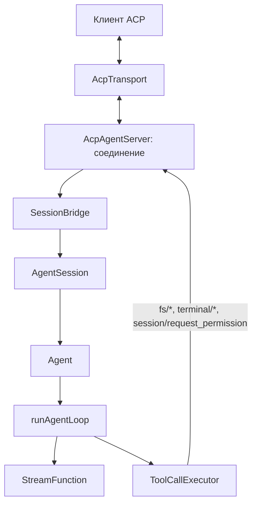
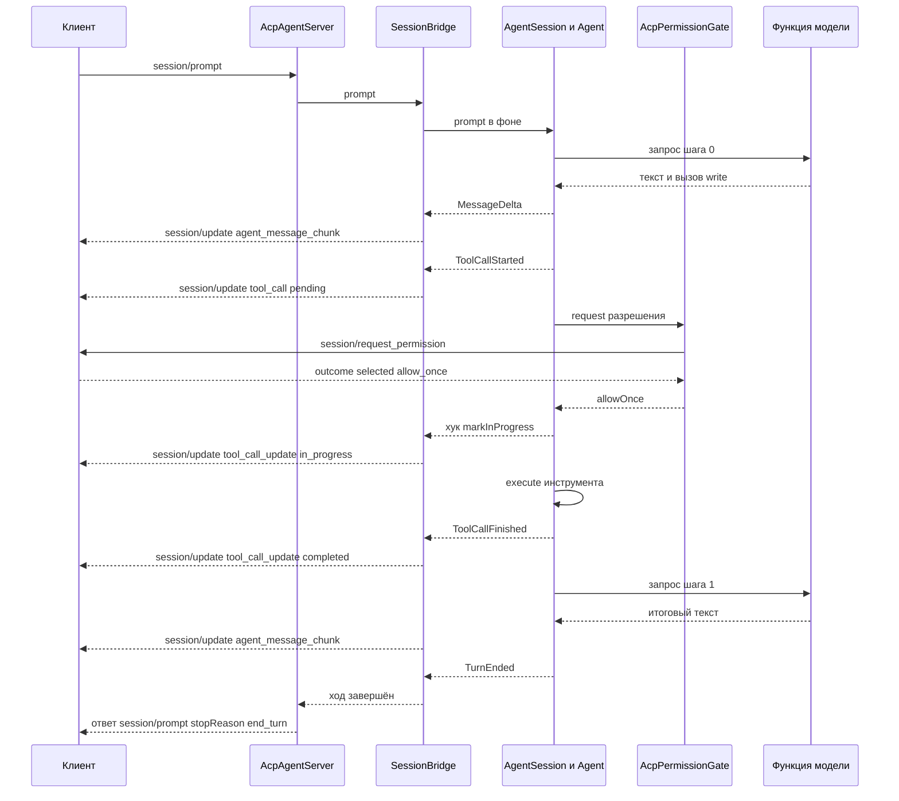
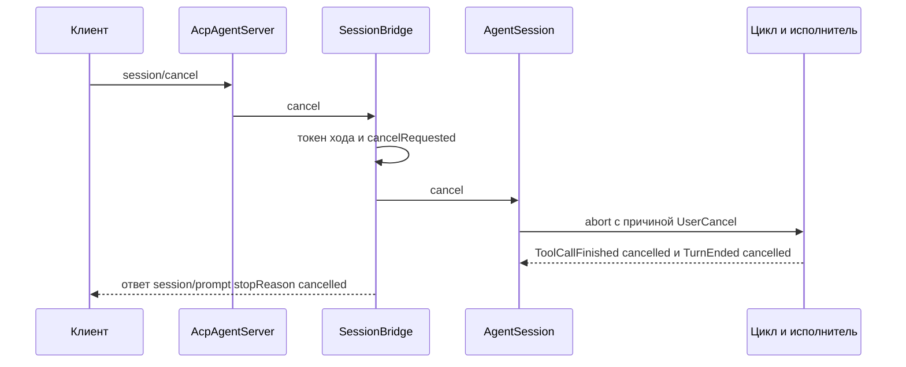

# Сквозной путь запроса

Глава проводит один запрос клиента через весь агент: от кадра `session/prompt` в транспорте до `session/update` в клиенте. Она показывает, какие классы какого пакета участвуют, в каком порядке идут события, как агент спрашивает разрешение и как работает отмена. Сначала стоит прочитать [обзор](01-overview.md) и [главу про сборку](02-assembly-and-hosts.md): там объяснено, что такое хост и кто собирает ядро.

ACP (Agent Client Protocol) — протокол, по которому клиент и агент обмениваются сообщениями JSON-RPC. Методы протокола описаны в `docs/protocols/acp/protocol/` (ход — `05-Prompt Turn.md`, вызовы инструментов — `08-Tool Calls.md`). Этот документ методы не придумывает: методы стандарта взяты из пакета `codelab_acp_protocol` (`lib/src/acp/acp_method_codec.dart`). Расширения CodeLab `_codelab/session/usage/ledger` и `_codelab/session/usage` в нём не определены: их имена заданы в `codelab_agent_acp/lib/src/usage_accounting.dart` (`usageLedgerMethod`, `usageNotificationMethod`).

## Кто участвует

Путь запроса проходит через три пакета. Ядро `codelab_agent_core` ничего не знает о протоколе (`PKG-1`: нет импорта пакетов ACP; цикл — `LOOP-6`). Пакет `codelab_agent_acp` переводит кадры ACP в вызовы ядра, а события ядра — в кадры ACP. Транспорт приносит кадры от клиента.



Стрелка вниз — вызов. Событие идёт обратно по тому же пути: ядро эмитит `AgentEvent`, `SessionBridge` переводит его в `session/update`, соединение ставит кадр в очередь и отправляет в транспорт. Последняя стрелка показывает, что исполнитель инструментов и политика разрешений тоже обращаются к клиенту — запросами агента: чтение и запись файлов, терминал и вопрос о разрешении.

| Участник | Пакет, файл | Ответственность |
|---|---|---|
| `AcpTransport` | `codelab_acp_transports` | доставляет JSON-RPC-кадры: stdio, WebSocket или пара в памяти |
| `AcpAgentServer`, `_Connection` | `codelab_agent_acp`, [`agent_server.dart`](../../codelab_agent_acp/lib/src/agent_server.dart) | обслуживает соединения, маршрутизирует методы ACP |
| `InboundRouter`, `OutboundQueue`, `PendingRequests`, `ClientRequests` | `codelab_agent_acp`, `lib/src/connection/` | чтение кадров, единая очередь вывода, запросы агента к клиенту |
| `SessionBridge` | `codelab_agent_acp`, [`session_bridge.dart`](../../codelab_agent_acp/lib/src/session_bridge.dart) | состояние ACP-сессии над `AgentSession`: ход, отмена, отсоединение, проекция событий |
| `projectEvent` | `codelab_agent_acp`, [`event_projection.dart`](../../codelab_agent_acp/lib/src/event_projection.dart) | переводит `AgentEvent` в `session/update` |
| `AcpPermissionGate` | `codelab_agent_acp`, [`acp_permission_gate.dart`](../../codelab_agent_acp/lib/src/acp_permission_gate.dart) | реализует `PermissionGate` через `session/request_permission` |
| `AcpClientExecutionEnv` | `codelab_agent_acp`, [`acp_client_env.dart`](../../codelab_agent_acp/lib/src/acp_client_env.dart) | реализует `ExecutionEnv` через `fs/*` и `terminal/*` клиента |
| `AgentRuntime`, `AgentSession` | `codelab_agent_core`, `lib/src/runtime/` | создаёт и ведёт сессии, держит журнал |
| `Agent`, `runAgentLoop` | `codelab_agent_core`, `lib/src/loop/` | исполняют ход ([глава 4](04-turn-loop.md)) |

## Соединение

`AcpAgentServer.serve(transport)` создаёт для транспорта объект `_Connection` и ждёт, пока соединение не закроется. Хост вызывает `serve` для каждого соединения: бинарь по stdio обслуживает одно, сервер WebSocket — по одному на клиента.

Внутри соединения три части:

- **`InboundRouter`** читает входящие кадры. Каждый запрос он обрабатывает в своей задаче и сразу идёт читать следующий кадр. Это важно: во время хода соединение должно принимать `session/cancel`, ответы клиента на `session/request_permission` и запросы других сессий. Ответ клиента на запрос агента он отдаёт в `PendingRequests` по id. Ошибки обработчика превращаются в ответы JSON-RPC, а сам цикл чтения от плохого кадра не умирает (`ACP-4`).
- **`OutboundQueue`** — единая очередь исходящих кадров. Все ответы и уведомления соединения идут через неё, поэтому порядок задаёт конструкция, а не дисциплина обработчиков: ответ на `session/prompt` встаёт после последнего `session/update` хода, ответ на `session/load` — после реплея (`ACP-1`, `ACP-3`).
- **`ClientRequests`** отправляет в ту же очередь запросы агента к клиенту (`fs/*`, `terminal/*`, `session/request_permission`) и ждёт ответ в `PendingRequests`. Id таких запросов имеют префикс `perm`, `fs`, `term` и не пересекаются с id клиента. Ожидание прекращает таймаут, отмена или разрыв соединения (`ClientCallFailure`).

Метод запроса выбирает `_Connection._onRequest`: `initialize`, `session/new`, `session/load`, `session/list`, `session/prompt`, `session/set_config_option`, `session/set_mode`, `session/cancel` (с терпимостью: запрос вместо уведомления тоже получает ответ) и расширение CodeLab `_codelab/session/usage/ledger`. До `initialize` любой метод `session/*` отклоняется как `-32600`. Когда сервер останавливается (`shutdown`), новые запросы получают `-32603`.

## `initialize`

Ответ на `initialize` описывает возможности агента. Версия протокола всегда `1`. Остальное зависит от плана ядра (`BuiltAgentCore.plan.profile`, [глава 2](02-assembly-and-hosts.md)):

- `loadSession` и `sessionCapabilities.list` объявляются, только если у профиля есть capability `sessionPersistence`;
- `mcpCapabilities.http` — если capability `mcp` разрешает транспорт `http`; `sse` не объявляется никогда;
- `promptCapabilities`: `image` и `embeddedContext`.

Расширения CodeLab (`_meta.codelab`: `subagents`, `subagentToolCalls`, `tasks`, `usage`, `usageLedger`) уходят только клиенту, который сам прислал `clientCapabilities._meta.codelab`. Сторонний клиент получает ровно поля стандарта. Согласие клиента на расширения мост читает в момент события, а не при создании сессии: после переподключения оно может смениться.

## `session/new`

Обработчик `_sessionNew` делает пять шагов:

1. Проверяет `cwd`: путь абсолютный, а если хост дал локальный листинг (`localListing` или `localEnv`), это существующий каталог. Без листинга проверять нечем: в ACP нет `stat` каталога.
2. Отображает `mcpServers` запроса в `McpServerConfig` с `origin: session`. Серверы `sse` и неизвестного типа пропускаются с записью `mcp.server.skipped`: это не ошибка запроса. Остальные правила (capability, дубликаты имён) применяет ядро.
3. Собирает порты сессии (`_wire`). Здесь два варианта.
   - Обычный (процесс `codelab-agent`): окружение `AcpClientExecutionEnv` — файлы и команды идут клиенту через `fs/*` и `terminal/*`; листинг, если он есть, — локальный (`ListingOverlayEnv`).
   - Встроенный (хост передал `AcpServerConfig.localEnv`): окружение — `localEnv(cwd)`, запросы `fs/*` и `terminal/*` клиенту не уходят, а команды исполняются на машине агента (`execOnHost: true`).
   В обоих вариантах шлюз разрешений — `AcpPermissionGate`, а последним в `beforeToolCall` стоит `bridge.markInProgress`.
4. Вызывает `AgentRuntime.createSession(SessionSpec(cwd, ports, mcpServers))`. Ошибка конфигурации проекта становится `-32603` с `data.codelab.reason: "projectConfigInvalid"`.
5. Привязывает мост к сессии (`bridge.attach`), регистрирует его в `AcpAgentServer._sessions` по id и отвечает `NewSessionResponse`: `sessionId`, режимы и `configOptions`. Уведомление `available_commands_update` с командами сессии идёт **после** ответа — в `Reply.after`: до ответа клиент не знает `sessionId`, и присылать ему уведомления нельзя (`ACP-8`).

Что делает `createSession` внутри — выбирает модель, загружает файлы проекта и навыки, подключает MCP, собирает инструменты, политику разрешений, `Agent` и журнал — описывают главы [2](02-assembly-and-hosts.md), [6](06-tools.md), [8](08-sessions-and-compaction.md) и [9](09-config-prompts-commands.md).

## `session/prompt`

Обработчик `_sessionPrompt` ищет мост по `sessionId` (неизвестный id — `-32002`), переводит блоки промпта в блоки ядра (`promptContent`: текст и картинки как есть, встроенный текстовый ресурс в тег `<resource>`, бинарный ресурс и ссылка — в текстовую пометку; пустой промпт и аудио — `-32602`) и проверяет, что ход не идёт. Второй `session/prompt` на той же сессии — `-32602` с `data.codelab.reason: "turnActive"`.

Дальше работает `SessionBridge.prompt`. Его устройство — главная хитрость пути:

1. Мост создаёт `Completer<TurnEnded>` и запускает `AgentSession.prompt` **в фоне** вместе со своим `CancelTokenSource`. Обработчик ждёт не возврата `prompt`, а завершителя.
2. События хода приходят мосту подпиской на `AgentSession.events` (`_onEvent`). Мост проецирует каждое событие в `session/update` и ставит кадры в очередь соединения. Кадры идут строго в порядке событий ядра.
3. Событие `TurnEnded` запоминается. Когда `AgentSession.prompt` вернулся, мост завершает ход. К этому моменту все события хода доставлены подписчику: сессия гарантирует, что к возврату `prompt` события вместе с `TurnEnded` уже у подписчиков (`ACP-3`), а автозаголовок `session_info_update` идёт до ответа.
4. Ответ строит `turnResponse` по `TurnEnded` и ставится в очередь **после** всех `session/update` хода.

Соответствие причины завершения хода и ответа ACP:

| `TurnEnded` | Ответ на `session/prompt` |
|---|---|
| `completed`, лимит не исчерпан | `stopReason: end_turn` |
| `completed`, `budgetExceeded: <лимит>` | `stopReason: max_turn_requests`, `_meta.codelab.budgetExceeded` |
| `maxTokens` | `stopReason: max_tokens` |
| `refused` | `stopReason: refusal` |
| `cancelled`, а также любая отмена запросом клиента | `stopReason: cancelled` (`ACP-5`) |
| `failed` | ошибка JSON-RPC `-32603` `Turn failed: …` с `data.codelab.errorClass`, `message`, `retryable` (`ACP-7`) |

Ошибка хода не маскируется под `end_turn`. Класс ошибки берётся из последнего `AgentError` без повтора; `retryable` истинно для сетевых сбоев, таймаутов, лимитов частоты и ошибок сервера провайдера.

### Что делает `AgentSession.prompt`

Внутри ядра `_Session.prompt` (`lib/src/runtime/agent_runtime.dart`) готовит ход:

- ждёт фоновое сжатие предыдущего хода, если оно идёт, и применение смены набора MCP-серверов;
- проверяет слот: ход или встроенная команда уже идут — `StateError` (`LOOP-10`);
- встроенная команда (`/compact`, `/mode`…) исполняется здесь же без модели;
- сбрасывает разрешения «на ход» (`clearTurnGrants`, `PERM-8`) и счётчик ожидания одобрения;
- перечитывает бюджет и параметры сжатия из применённой конфигурации;
- если токен вызывающего отменяется, отменяет токен хода агента;
- разворачивает шаблон команды проекта в сообщение и вызывает `Agent.prompt`.

После хода с причиной `completed` или `maxTokens` сессия проверяет, не пора ли сжать контекст в фоне (`_compactAfterTurn`).

Подписчиков у `Agent` несколько. Первым стоит `_Session._onEvent`: он пишет событие в журнал и только потом публикует его в `AgentSession.events`, откуда его читает мост. Запись в журнал поэтому опережает проекцию в протокол ([глава 8](08-sessions-and-compaction.md)).

## Полный ход с вызовом инструмента и запросом разрешения

Схема показывает самый содержательный случай: модель отвечает текстом, зовёт инструмент записи файла, политика спрашивает человека, клиент разрешает, инструмент исполняется, модель завершает ход. Кадры клиента подписаны методами ACP.



Что важно в этой последовательности:

- **`tool_call` раньше `request_permission`.** Событие `ToolCallStarted` эмитит исполнитель на фазе `announce`, до хуков. Политика готова спросить раньше, чем событие дойдёт до проекции. Поэтому `AcpPermissionGate` перед запросом ждёт `bridge.announced(toolCallId)` — пока кадр `tool_call` не окажется в очереди. Без этого клиент получил бы вопрос про вызов, которого ещё не видел (раздел «Статусы вызова» в [`13-acp-adapter.md`](../../../../docs/architecture/proposals/agent-core/13-acp-adapter.md)).
- **`in_progress` ставит хук, а не событие.** Статус `in_progress` значит «вызов прошёл разрешения и вот-вот исполняется». Его отправляет `markInProgress` — последний хук `beforeToolCall`. Если хук сработал раньше проекции `tool_call`, мост откладывает кадр (`_earlyInProgress`).
- **Клиент видит один `ToolCallStarted` и один `ToolCallFinished`.** Проекция `ToolCallFinished` даёт `completed` только для исхода `completed`; `failed`, `cancelled`, `rejected` и прерванный вызов реплея дают `failed`, а детали исхода идут в `_meta.codelab.outcome` ("cancelled", "rejected", "interrupted").
- **Ответ на `session/prompt` — после `TurnEnded`.** Он приходит последним кадром хода (`ACP-3`).

### Кадры хода на проводе

Ниже — настоящие кадры хода из схемы выше. Источник — golden-фикстура [`prompt-tool-permission-allow.json`](../../codelab_acp_testing/fixtures/acp/prompt-tool-permission-allow.json): модель по сценарию просит `edit` файла `README.md`, политика режима `standard` спрашивает разрешение, клиент выбирает «разрешить один раз». Кадры сняты драйвером фикстур на агенте `AcpAgentServer` с обычным (не встроенным) окружением: каждое направление помечено `c2a` (клиент → агент) или `a2c` (агент → клиент). Кадры `initialize` и `session/new` опущены, остальное идёт в порядке, в каком кадры вышли из транспорта. Замаскированы идентификатор сессии (`<session-id>`) и временный рабочий каталог (`/work/demo`); текст JSON не менялся.

```text
c2a {"jsonrpc":"2.0","id":"fixture-promptId","method":"session/prompt","params":{"sessionId":"<session-id>","prompt":[{"type":"text","text":"Замени в README.md слово foo на bar"}]}}
a2c {"jsonrpc":"2.0","method":"session/update","params":{"sessionId":"<session-id>","update":{"sessionUpdate":"agent_message_chunk","content":{"type":"text","text":"Заменю слово."}}}}
a2c {"jsonrpc":"2.0","id":"fs-1","method":"fs/read_text_file","params":{"sessionId":"<session-id>","path":"/work/demo/README.md"}}
c2a {"jsonrpc":"2.0","id":"fs-1","result":{"content":"# foo\n"}}
a2c {"jsonrpc":"2.0","method":"session/update","params":{"sessionId":"<session-id>","update":{"sessionUpdate":"tool_call","toolCallId":"call_1","title":"Edit README.md","kind":"edit","status":"pending","locations":[{"path":"/work/demo/README.md","line":1}],"rawInput":{"path":"README.md","oldText":"foo","newText":"bar"}}}}
a2c {"jsonrpc":"2.0","id":"perm-2","method":"session/request_permission","params":{"sessionId":"<session-id>","toolCall":{"toolCallId":"call_1","title":"Edit README.md","kind":"edit","status":"pending","content":[{"type":"diff","path":"/work/demo/README.md","oldText":"# foo\n","newText":"# bar\n"}],"locations":[{"path":"/work/demo/README.md","line":1}],"rawInput":{"path":"README.md","oldText":"foo","newText":"bar"}},"options":[{"optionId":"allow_once","name":"Allow once","kind":"allow_once"},{"optionId":"allow_always","name":"Always allow README.md","kind":"allow_always"},{"optionId":"reject_once","name":"Reject","kind":"reject_once"},{"optionId":"reject_always","name":"Always reject README.md","kind":"reject_always"}]}}
c2a {"jsonrpc":"2.0","id":"perm-2","result":{"outcome":{"outcome":"selected","optionId":"allow_once"}}}
a2c {"jsonrpc":"2.0","method":"session/update","params":{"sessionId":"<session-id>","update":{"sessionUpdate":"tool_call_update","toolCallId":"call_1","status":"in_progress"}}}
a2c {"jsonrpc":"2.0","id":"fs-3","method":"fs/read_text_file","params":{"sessionId":"<session-id>","path":"/work/demo/README.md"}}
c2a {"jsonrpc":"2.0","id":"fs-3","result":{"content":"# foo\n"}}
a2c {"jsonrpc":"2.0","id":"fs-4","method":"fs/write_text_file","params":{"sessionId":"<session-id>","path":"/work/demo/README.md","content":"# bar\n"}}
c2a {"jsonrpc":"2.0","id":"fs-4","result":null}
a2c {"jsonrpc":"2.0","method":"session/update","params":{"sessionId":"<session-id>","update":{"sessionUpdate":"tool_call_update","toolCallId":"call_1","status":"completed","content":[{"type":"content","content":{"type":"text","text":"Edited README.md: replaced lines 1-1.\n@@ -1,1 +1,1 @@\n-# foo\n+# bar"}},{"type":"diff","path":"/work/demo/README.md","oldText":"# foo\n","newText":"# bar\n"}]}}}
a2c {"jsonrpc":"2.0","method":"session/update","params":{"sessionId":"<session-id>","update":{"sessionUpdate":"agent_message_chunk","content":{"type":"text","text":"Готово: README.m"}}}}
a2c {"jsonrpc":"2.0","method":"session/update","params":{"sessionId":"<session-id>","update":{"sessionUpdate":"agent_message_chunk","content":{"type":"text","text":"d обновлён."}}}}
a2c {"jsonrpc":"2.0","method":"session/update","params":{"sessionId":"<session-id>","update":{"sessionUpdate":"session_info_update","title":"Замени в README.md слово foo на bar","updatedAt":"2026-01-01T00:00:00.000Z"}}}
a2c {"jsonrpc":"2.0","id":"fixture-promptId","result":{"stopReason":"end_turn"}}
```

Что видно в трассе:

- `tool_call` (`pending`) идёт раньше `session/request_permission`, а `in_progress` — после ответа клиента; это порядок из раздела выше.
- Запрос разрешения самодостаточен: в нём `rawInput`, `locations` и `diff` (`PERM-6`), а четыре варианта ответа имеют `optionId`, равный виду варианта.
- Агент запрашивает `fs/read_text_file` дважды: первый раз — чтобы показать diff в вопросе, второй — когда `edit` перечитывает файл под блокировкой пути перед записью. Идентификаторы запросов агента (`fs-1`, `perm-2`, `fs-3`, `fs-4`) выдаёт общий счётчик соединения.
- Ответ клиента на `fs/write_text_file` — `null`; агент принимает и `null`, и `{}`.
- Строка «Готово: README.md обновлён.» пришла двумя дельтами: границы дельт задаёт сценарная модель фикстуры, у настоящего провайдера они другие.
- Ответ на `session/prompt` — последний кадр хода, после `session_info_update` с автозаголовком (`ACP-3`).

## Проекция событий в `session/update`

`projectEvent` — чистая функция с исчерпывающим `switch` по запечатанному `AgentEvent` (`ACP-6`): новое событие ядра не скомпилируется, пока для него не выбрано соответствие. Таблица `projectionTable` в том же файле хранит это соответствие в виде текста; её полноту проверяют тесты `test/projection/` пакета.

| Событие ядра | Что уходит клиенту |
|---|---|
| `MessageDelta` | `session/update` `agent_message_chunk` |
| `ThoughtDelta` | `agent_thought_chunk` |
| `ToolCallStarted` | `tool_call`, статус `pending`, с `rawInput`, `kind`, `locations` |
| `ToolCallProgress` | `tool_call_update`, статус `in_progress`, содержимое: текст, diff или встроенный терминал |
| `ToolCallFinished` | `tool_call_update`: `completed` или `failed`, содержимое, diff, `_meta.codelab.outcome` |
| `TaskListChanged` | `plan`, `_meta.codelab.task` у пунктов |
| `ModeChanged` | `current_mode_update` и `config_option_update` |
| `ModelOptionsChanged` | `config_option_update` |
| `SessionTitleChanged` | `session_info_update` |
| `StepEnded`, `ContextCompacted`, `CompactionDiscarded`, `TurnEnded` | не `session/update`: учёт usage идёт уведомлением `_codelab/session/usage` соединению, которое объявило расширение `usage` |
| `TurnStarted`, `StepStarted`, `ModelRequested`, `MessageStarted`, `MessageEnded`, `ToolPairingRepaired`, `AgentError`, `SubagentStarted`, `SubagentProgress`, `SubagentFinished` | ничего |
| `SubagentActivity` | вызовы потомка с цепочкой `toolCallId` и `_meta.codelab.parentToolCallId`, только клиенту с согласием `subagentToolCalls` (`SUB-12`) |

Две неочевидные детали:

- Клиент не получает `MessageStarted` и `MessageEnded`: весь текст ответа уже ушёл дельтами.
- `AgentError` тоже не уходит отдельным кадром: сбой хода сообщает ответ на `session/prompt`. Мост запоминает последний `AgentError` без повтора и использует его при `failed`.

Мост держит и дополнительное состояние: цепочки вызовов потомков (`SubagentChains`), итоги детей до `ToolCallFinished` вызова `agent`, терминалы, встроенные в вызов, агрегаты usage с порядковым номером `seq`. Подробнее об этом в `codelab_agent_acp/AGENTS.md`; о субагентах — [глава 6](06-tools.md), об учёте usage — [глава 9](09-config-prompts-commands.md).

## Запрос разрешения через ACP

Политика разрешений — первый хук `beforeToolCall` каждой сессии ([глава 7](07-permissions.md)). Когда режим и правила требуют спросить человека, политика вызывает `PermissionGate.request(PermissionRequest, CancelToken)`. Ядро не знает, как шлюз доставит вопрос. ACP-хост подставляет `AcpPermissionGate`:

1. Ждёт, пока клиент увидит `tool_call` этого вызова (см. выше). Если клиент не согласился на вызовы потомков, у вопроса потомка ждёт вызов `agent` корня. Ожидание гонится с отменой токена: отменённый ход не оставляет висящий future.
2. Отправляет `session/request_permission` с `toolCall` (`ToolCallUpdate`, статус `pending`, `rawInput`, `locations`, причина первым текстовым блоком, diff на каждый изменяемый файл) и вариантами ответа: `allow_once`, `allow_always` (если политика его предлагает), `reject_once`, `reject_always`. `optionId` совпадает с видом варианта.
3. Разбирает ответ. `selected` с известным вариантом — `PermissionDecision` (`allowOnce`, `allowAlways`, `rejectOnce`, `rejectAlways`). `cancelled` — `cancelled`. Вариант, которого агент не предлагал, — `rejectOnce` с записью `acp.permission.unknown_option`.
4. Любой сбой — отказ, а не разрешение: ошибка JSON-RPC от клиента, неверный ответ дают `rejectOnce` и запись `acp.permission.failed`.

Отмена хода прекращает ожидание: токен снимает запрос в `PendingRequests`, решение — `cancelled`, а поздний ответ клиента попадает в «неизвестный id» и игнорируется (`PERM-4`). Если соединение пропало во время вопроса, шлюз не отказывает сразу: он ждёт переподключения (`bridge.waitForReconnect`) и задаёт вопрос заново новому соединению с тем же `toolCallId` и новым id запроса (`PERM-4`, «Отсоединение» ниже).

Время, пока человек думает, не засчитывается в длительность хода: политика отмечает начало и конец ожидания в `ApprovalWaitMeter`, и цикл вычитает его при проверке `maxDuration` ([глава 4](04-turn-loop.md)).

## Файлы и терминалы через клиента

Файловая система и терминал в обычном режиме принадлежат клиенту. `AcpClientExecutionEnv` реализует `ExecutionEnv` (порт ядра, [глава 6](06-tools.md)) запросами агента к клиенту: `fs/read_text_file`, `fs/write_text_file`, `terminal/create`, `terminal/output`, `terminal/wait_for_exit`, `terminal/kill`, `terminal/release`. Таймауты (`AcpTimeouts`) заданы для `fs/*`, `terminal/create` и `terminal/output` (по умолчанию 30 с), `terminal/kill` и `terminal/release` (10 с). У `terminal/wait_for_exit` собственного таймаута нет, как и у `session/request_permission`: их ожидание прекращает только отмена или разрыв соединения. Ограничение рабочей папкой даёт `BoundedEnv` ядра, поэтому путь вне `cwd` отклоняется до запроса к клиенту. Вопрос «можно ли» решает политика разрешений. Правило про ACP-методы `fs/*` и `terminal/*` (отдельный клиентский шлюз для них не вводится) — в `AGENTS.md` репозитория, §10.

Терминал показывается клиенту так: инструмент `exec` сообщает `terminalId`, мост эмитит `tool_call_update` с содержимым-терминалом и только потом позволяет `terminal/wait_for_exit` — клиент к этому моменту уже привязал терминал к вызову.

## Отмена

Отмену запускает уведомление `session/cancel`. Цепочка вызовов такая:



Что делает `SessionBridge.cancel`:

- ставит флаг `_cancelRequested`: ответ на `session/prompt` будет `stopReason: cancelled`, даже если отмена вызвала ошибки провайдера или инструментов (`ACP-5`);
- отменяет свой токен хода — тот самый, что передан в `AgentSession.prompt(cancel:)`, — и вызывает `session.cancel()`, то есть `Agent.abort(UserCancel)`;
- прерывает незавершённые запросы `fs/*` и терминалов (`AcpClientExecutionEnv.abortPending`).

Дальше работает кооперативная отмена ядра ([глава 4](04-turn-loop.md)): токен доходит до HTTP-запроса к модели, до ожидания блокировок путей, до запроса разрешения и до самих инструментов. Каждый вызов, начатый до отмены, получает `ToolCallFinished` с исходом `cancelled`; следующий запрос к модели не начинается. Если хода нет, `session/cancel` только пишется в лог (`acp.cancel.no_turn`).

## Встроенный режим

Встроенный агент — тот же `AcpAgentServer`, только соединённый с клиентом не по stdio, а парой транспортов в памяти. Пара `InProcessAcpLink` лежит в `codelab_acp_transports` (`lib/src/in_process_acp_transport.dart`): у неё два конца, `client` и `agent`, и всё, что отправлено в один, приходит в `inbound` другого. Доставка асинхронна и упорядочена; кадры не кодируются в текст, но копируются, поэтому ошибки сериализации видны так же, как на проводе. Оба конца реализуют `AcpTransport`, и ни клиент, ни сервер не отличают их от stdio.

Сборку делает `codelab_embedded` (`lib/src/assemble.dart`, [глава 2](02-assembly-and-hosts.md)):

1. `buildAgentCore` собирает ядро по профилю `embedded-*` и функции модели.
2. Создаётся `InProcessAcpLink`, затем `AcpAgentServer` с `AcpServerConfig`: `localEnv` задан для профилей `embedded-*`, `detachGrace` равен нулю — переподключаться к прежнему агенту некому.
3. Агентский конец запускается (`link.agent.start()`), а `server.serve(link.agent)` работает в охраняемой зоне `runZonedGuarded`: необработанная ошибка в агенте останавливает его целиком, а не отдаётся обработчику ошибок приложения. Клиент видит это как обрыв соединения и показывает `ConnectionLost`.
4. Клиент получает `EmbeddedAgent.clientTransport` — клиентский конец пары — и работает с агентом как с любым ACP-агентом.

Путь запроса от этого не меняется: те же `session/new`, `session/prompt`, тот же `SessionBridge` и тот же цикл. Отличаются только окружение сессии (`localEnv`) и то, что вместо процессов и сокетов используется очередь микрозадач.

## Отсоединение и переподключение

Если соединение закрылось, а ход идёт, сессия не умирает сразу. `_Connection.run` по концу входного потока вызывает `AcpAgentServer._detach`: мост получает `detach(grace)` и перестаёт слать кадры. Ход живёт ещё `detachGrace`, события остаются в журнале. 30 с — только умолчание `AcpServerConfig`: оба хоста (`apps/codelab_agent` и `codelab_embedded`) ставят `Duration.zero`, и тогда `detach` сразу вызывает `_expire` — разрыв соединения отменяет ход без ожидания. Если за это время клиент вызвал `session/load` с тем же `sessionId`, мост передаётся новому соединению (`reattach`), сервер отдаёт реплей журнала, а ожидающие вопросы разрешения возобновляются через `resume`. Иначе срабатывает `_expire` и ход отменяется как обычная отмена. Второй живой клиент идущего хода не допускается: его `session/load` получает `-32602` с `reason: "sessionBusy"`.

Подробности `session/load` — восстановление сессии, реплей, переподключение — в [главе 8](08-sessions-and-compaction.md).

## Ошибки запроса

Обработчики запросов бросают `AcpRequestError`, а `InboundRouter` превращает его в ответ JSON-RPC (`lib/src/connection/acp_error.dart`):

| Код | Когда |
|---|---|
| `-32600` | повторный `initialize`, `session/*` до `initialize` |
| `-32601` | неизвестный метод |
| `-32602` | параметры не прошли проверку: относительный `cwd`, пустой промпт, неизвестный режим, идущий ход (`turnActive`), занятая сессия (`sessionBusy`) |
| `-32002` | неизвестный `sessionId` |
| `-32603` | внутренняя ошибка, сбой хода (`failed`), ошибка конфигурации проекта, остановка сервера |

Остальные исключения обработчика (не `AcpRequestError`) превращаются в `-32603 Internal error` без деталей, а полные данные идут в журнал агента (`acp.handler.failed`). Если `AgentSession.prompt` сам бросает исключение, а не завершает ход через `TurnEnded`, мост пишет `acp.turn.failed` и отвечает ошибкой. Подробно о журнале и о пути ошибки к клиенту — [глава 10](10-observability-and-errors.md).

## Нормы и спецификации

| Что | Где |
|---|---|
| ACP-сервер агента, `ACP-1…11`; `ACP-12` (слэш-команды) — в [`agent-slash-commands`](../../../../openspec/specs/agent-slash-commands/spec.md) | [`agent-acp-server`](../../../../openspec/specs/agent-acp-server/spec.md) |
| отмена хода | [`agent-cancellation`](../../../../openspec/specs/agent-cancellation/spec.md) |
| встроенный агент | [`embedded-agent`](../../../../openspec/specs/embedded-agent/spec.md) |
| разрешения, `PERM-4` | [`agent-permissions`](../../../../openspec/specs/agent-permissions/spec.md) |
| проектное описание адаптера | [`13-acp-adapter.md`](../../../../docs/architecture/proposals/agent-core/13-acp-adapter.md) |
| правила пакета проекции | [`AGENTS.md`](../../codelab_agent_acp/AGENTS.md) |
| граница ACP в клиентах | [`acp-boundary.md`](../../../../docs/architecture/acp-boundary.md) |

Дальше: как работает цикл внутри хода — [глава 4](04-turn-loop.md); как политика решает, спрашивать ли человека, — [глава 7](07-permissions.md).
