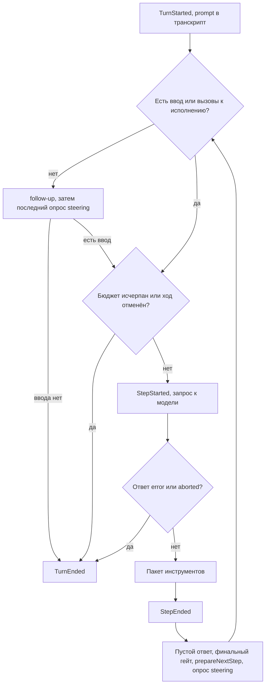
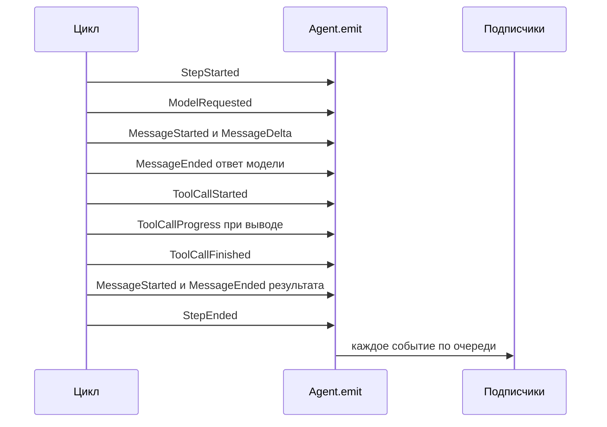

# Цикл хода

Глава разбирает сердце ядра: функцию `runAgentLoop`, которая проводит один ход агента, класс `Agent`, который хранит состояние между ходами, события `AgentEvent`, бюджет и завершение хода. Перед ней стоит прочитать [обзор](01-overview.md): там объяснено, что такое ход и шаг. Как запрос клиента доходит до цикла, описывает [глава 3](03-request-flow.md); как цикл обращается к модели — [глава 5](05-llm.md); как исполняются инструменты пакета — [глава 6](06-tools.md).

## Термины

- **Ход** (turn) — всё, что агент делает в ответ на одно сообщение пользователя. В ACP ход соответствует запросу `session/prompt`.
- **Шаг** (step) — один запрос к модели вместе с исполнением вызовов инструментов из её ответа. Ход состоит из одного или нескольких шагов: пока модель зовёт инструменты, шаги идут друг за другом.
- **Транскрипт** — список сообщений `Message` (`UserMessage`, `AssistantMessage`, `ToolResultMessage`), который видит модель.
- **Пакет** — все вызовы инструментов из одного ответа модели.

## Что где лежит

| Файл (`lib/src/loop/`) | Что в нём |
|---|---|
| [`agent_loop.dart`](../lib/src/loop/agent_loop.dart) | функция `runAgentLoop`, итог `TurnOutput`, закрытый класс `_Turn` с логикой хода |
| [`agent.dart`](../lib/src/loop/agent.dart) | `Agent`: транскрипт, подписчики, очереди steering и follow-up, токен отмены |
| [`loop_config.dart`](../lib/src/loop/loop_config.dart) | `AgentLoopConfig` и типы хуков, `LoopContext`, `StepUpdate`, `StepResult`, очереди `MessageQueue` |
| [`agent_events.dart`](../lib/src/loop/agent_events.dart) | запечатанная иерархия `AgentEvent`, `TurnEndReason`, `ToolOutcome`, `MessageOrigin` |
| [`turn_budget.dart`](../lib/src/loop/turn_budget.dart) | `TurnBudget`, `BudgetProgress`, `BudgetLimit` |
| [`payload_builder.dart`](../lib/src/loop/payload_builder.dart) | сборка запроса к модели `buildPayload`, проверка пустого ответа |
| [`../cancel/cancel_token.dart`](../lib/src/cancel/cancel_token.dart) | `CancelToken`, `CancelTokenSource`, причины отмены |

Цикл не знает ни хранилища, ни протокола (`LOOP-6`). Поэтому одну и ту же функцию исполняют `Agent` корневой сессии, `Agent` потомка-субагента и тесты на сценарной модели. Всё внешнее приходит в `AgentLoopConfig`: функция модели, исполнитель инструментов, часы, генератор id, хуки.

## Agent: состояние между ходами

`runAgentLoop` — функция без собственного состояния. Всё, что должно жить дольше одного хода, держит `Agent`:

- транскрипт `_messages` (снаружи — `messages`, неизменяемая копия);
- список подписчиков и общую очередь событий;
- очереди `steering` и `followUp` (`ListMessageQueue`);
- источник токена отмены `CancelTokenSource` текущего хода;
- изменяемые между ходами `config`, `systemPrompt` и `tools`.

Агент создаёт сессия: `AgentRuntimeImpl._open` собирает `AgentLoopConfig` и `Agent` в `lib/src/runtime/agent_runtime.dart`. Сразу после создания сессия подписывается первой — `_agent.subscribe(_onEvent)`. Обработчик `_onEvent` пишет событие в журнал (`SessionWriter.handle`) и только потом публикует подписчикам `AgentSession.events`. Поэтому запись в журнал всегда опережает любой другой подписчик (`SES-8`, см. [главу 8](08-sessions-and-compaction.md)).

Метод `Agent.prompt` запускает ход:

1. Если ход уже идёт, бросает `StateError` (`LOOP-10`). Сессия проверяет то же самое раньше и для встроенных команд.
2. Создаёт `CancelTokenSource` и передаёт его токен в `runAgentLoop`.
3. Копия транскрипта уходит в цикл. Сам `_messages` во время хода не меняется: цикл ведёт свою копию, а `Agent` забирает результат после возврата.
4. Из `TurnOutput` берёт `history` (если аварийное сжатие заменило историю посреди хода) и `added` — сообщения хода — и дописывает их в `_messages`.
5. Ждёт, пока подписчики обработают все события (`_tail`), и освобождает слот хода.

Остальные методы: `abort([reason])` отменяет токен идущего хода, `waitForIdle` ждёт конца хода и подписчиков, `replaceTranscript` меняет транскрипт между ходами (после сжатия), `emit` ставит событие в общую очередь.

### Одна очередь событий

Все события — от цикла и от служб сессии вроде списка задач — идут через `Agent.emit`. Метод цепляет доставку к концу очереди `_tail`: следующее событие не уходит, пока все подписчики по порядку подписки не обработали предыдущее. Цикл `await`-ит каждый `emit` (`LOOP-2`). Из этого следует порядок событий, одинаковый для всех подписчиков, и естественный backpressure: медленный подписчик (например, запись журнала) притормаживает цикл, а не копит очередь.

Ошибка подписчика не теряется: `emit` пробрасывает её цикл, а тот превращает в `AgentError` класса `hook` и завершает ход как `failed` (см. ниже). Хвост очереди `_tail` ошибку глотает, чтобы одно падение не сломало все следующие события.

## Устройство одного хода

Схема ниже показывает один проход цикла в `_Turn.run`. Ромбы — проверки, прямоугольники — действия; события названы так, как их видит подписчик.

Пошагово, по коду `_Turn.run`:

1. **Начало.** Цикл создаёт `TurnId`, обнуляет собственный usage (`onOwnUsage(Usage.zero)`), эмитит `TurnStarted` с входными сообщениями и добавляет каждое входное сообщение в транскрипт (`_append`: `MessageStarted` и `MessageEnded`). Затем опрашивает очередь steering: сообщения, которые пришли до начала хода, тоже считаются вводом.
2. **Условие продолжения.** Цикл идёт дальше, если есть что делать: предыдущий шаг вызвал инструменты (`pending`) или появился новый ввод (`newInput`). Иначе наступает естественная остановка: цикл берёт одно сообщение из очереди follow-up или забирает steering. Нет ни того ни другого — ход запечатан.
3. **Проверки перед шагом.** Сначала бюджет (`_budgetExceeded`): исчерпанный лимит завершает ход причиной `completed` с `budgetExceeded` (`LOOP-12`). Потом токен отмены: отменён — ход завершается причиной отмены.
4. **Запрос к модели** (`_request`, подробнее ниже). Результат — `AssistantMessage`; его usage добавляется к usage хода.
5. **Сбой модели.** Если `stopReason` — `error` или `aborted`, цикл эмитит `AgentError` (для `error`) и `StepEnded`, увеличивает счётчик шагов и выходит из цикла. Причину завершения определяет `_failureReason`.
6. **Пакет инструментов** (`_runBatch`). Результаты добавляются в транскрипт в порядке вызовов ответа. При `stopReason: length` вызовы не исполняются: каждый получает результат-ошибку «аргументы обрезаны, повторите с меньшими» (`truncatedArgumentsText`), потому что обрезанный JSON нельзя исполнять.
7. **`StepEnded`** с `StepResult`, заполнением контекста и прогрессом бюджета, затем `_step++`.
8. **Решение о продолжении.** Если вызовов не было, цикл проверяет пустой ответ или финальный гейт; затем вызывает хук `prepareNextStep`; повторно проверяет отмену; опрашивает steering. Затем возвращается к пункту 2.
9. **Конец.** Цикл вычисляет причину завершения и всегда эмитит `TurnEnded` — последним событием, ровно один раз.

Состояние шага держат поля `_step`, `_usage`, `_steeringSteps`, `_emergencyUsed`; транскрипт хода — `_transcript` (копия) и `_added` (только новые сообщения, они пойдут в `TurnOutput.added`).

## Запрос к модели

`_Turn._request` делает три вещи: собирает запрос, при необходимости сжимает контекст и читает поток ответа.

### Сборка запроса

`buildPayload` (`payload_builder.dart`) строит запрос из транскрипта, не меняя сам транскрипт (`LOOP-7`): модель получает исправленную копию, а транскрипт остаётся фактом разговора. Шаги:

1. Копия транскрипта или результат хука `transformContext`, если он задан.
2. Удаление пустых ответов `assistant` (`isEmptyCompletion`): провайдеры отвергают `assistant` без содержимого, а повторять модели её же пустоту бессмысленно (`LOOP-15`).
3. Ремонт парности вызовов и результатов (`repairToolPairing` из `tools/pairing.dart`): висящий вызов получает синтетический результат, лишний результат удаляется, дубликаты id переименовываются. Если ремонт что-то изменил, цикл эмитит `ToolPairingRepaired` с отчётом.
4. Заметка `Revise`, если финальный гейт попросил пересмотреть ответ: она добавляется последним сообщением `user` только в запрос и в транскрипт не попадает.

Из результата цикл собирает `LlmContext`: системный промпт, сообщения, схемы инструментов шага (`tool.toSchema()`) и `cacheKey` — id сессии для кэша промпта у провайдера.

Если провайдер всё равно ответил `400` с текстом про парность (`isPairingError`: `tool_use`, `tool_result`, `tool_call_id`), цикл один раз пересобирает запрос и повторяет шаг.

### Проверка окна и аварийное сжатие

Когда в конфигурации цикла задан `estimateTokens` (его ставит сессия при включённой capability `compaction`), цикл оценивает размер запроса и сравнивает с эффективным окном модели (`effectiveContextWindow`, `CMP-6`). Запрос больше окна провайдеру не отправляется: цикл вызывает `emergencyCompact` с причиной `preflight`. Если сжатие дало новый контекст, цикл заменяет транскрипт хода и собирает запрос заново. Если нет — возвращает синтетический ответ `overflow` с текстом `context window exhausted`.

Та же защита работает и по ответу провайдера: ошибка с классом `overflow` до первого блока запускает аварийное сжатие с причиной `overflow` и повтор того же шага. Аварийное сжатие — не больше одного раза за ход (`CMP-8`, флаг `_emergencyUsed`). Ответ с ошибкой, после которого был повтор, в транскрипт не попадает. Как устроено само сжатие — [глава 8](08-sessions-and-compaction.md).

После аварийного сжатия история хода — это проекция журнала. Цикл запоминает её в `_history` и позицию `_historyFrom`; `TurnOutput.history` передаёт её `Agent`, и тот заменяет свой транскрипт.

### Чтение потока

Функция `_consume` читает `AssistantMessageEventStream` ([глава 5](05-llm.md)) и переводит события модели в события хода:

| Событие потока | Что делает цикл |
|---|---|
| `StartEvent` | ничего |
| `BlockStartEvent` (первый блок) | кладёт снимок ответа в транскрипт, эмитит `MessageStarted` |
| `BlockDeltaEvent` текста | заменяет снимок, эмитит `MessageDelta` с дельтой и снимком |
| `BlockDeltaEvent` рассуждения | заменяет снимок, эмитит `ThoughtDelta` |
| `BlockDeltaEvent` аргументов вызова, `BlockEndEvent` | игнорируются: итоговые аргументы придут в `DoneEvent` |
| `DoneEvent`, `ErrorEvent` | запоминает итоговое сообщение |

После потока цикл эмитит `MessageEnded` с итоговым сообщением — точкой сохранения для хоста. Если `MessageStarted` ещё не был эмитирован (ошибка до первого блока), он эмитится прямо перед `MessageEnded`.

Идентификаторы вызовов должны быть уникальны во всём транскрипте (`LOOP-11`). Если провайдер повторил id, `_unique` дописывает суффикс `_2`, `_3` уже в первом снимке, пока вызов впервые виден: клиент никогда не видит неуникальный id.

## Пакет инструментов

Цикл не вызывает инструменты сам — он передаёт вызовы исполнителю `ToolCallExecutor` ([глава 6](06-tools.md)) в двух фазах: `announce` объявляет вызов (`ToolCallStarted`, занимает место в очереди блокировок путей), `complete` исполняет его (проверка аргументов, хуки, `execute`, `ToolCallFinished`).

Порядок задаёт `_runBatch` (`LOOP-3`, `LOOP-4`):

1. Пакет делится по порядку ответа на группы. Подряд идущие вызовы с `executionModeOf(args) == parallel` образуют одну параллельную группу. Каждый вызов с `sequential` — отдельная группа из одного вызова и барьер.
2. Группы идут строго одна за другой. Поэтому «`task_update` и три `agent`» не делает дочерние сессии последовательными: барьер отделяет `task_update`, а три `agent` остаются параллельной группой.
3. Внутри группы сначала объявляются все вызовы по порядку ответа, затем `Future.wait` исполняет их одновременно. `ToolCallFinished` параллельных вызовов приходят в порядке завершения.
4. Сообщения-результаты добавляются в транскрипт после всего пакета, в порядке вызовов ответа, независимо от групп.

Если токен отменён после объявления группы, вызовы группы не исполняются: `_abandonCancelled` вызывает `abandon` для каждого. Вызов получает исход `cancelled` с текстом «отменён до старта», а место в очереди путей освобождается. То же происходит, если сам `announce` бросил исключение. Откат `_abandonAll` запускает все `abandon` сразу и только потом ждёт их, чтобы сбой одного вызова не оставил занятыми пути остальных: иначе следующий `write` в тот же путь ждал бы вечно (`TOOL-7`). Исходная ошибка из отката уходит из хода как есть, и ход завершается `failed` (`LOOP-1`).

В начале хода цикл создаёт один `MisuseBreaker` на все вызовы хода (`LOOP-16`): модель, которая повторяет один и тот же неверный вызов, сначала получает предупреждение, а потом вызов блокируется без исполнения. Пределы — `MisuseLimits` (по умолчанию предупреждение с третьего повтора, блокировка с шестого).

## Бюджет хода

`TurnBudget` задаёт лимиты хода:

| Поле | Смысл | По умолчанию |
|---|---|---|
| `maxSteps` | шагов модели за ход (в ACP — `max_turn_requests`) | 50 |
| `maxTokens` | сумма `input + output` всех шагов без кэша | нет |
| `maxCost` | стоимость хода; не проверяется, пока у модели нет цен | нет |
| `maxDuration` | время хода на часах хоста без ожидания одобрения | нет |

Значения берутся из раздела `budget` конфигурации (`budget.max_steps`, `budget.max_tokens`, `budget.max_cost`, `budget.max_duration`; разбор в `lib/src/config/resolve.dart`). Сессия перечитывает их на границе хода (`_Session._refreshSettings`), поэтому перезагрузка конфигурации действует «со следующего хода».

Проверка делается только на границе шага: после `StepEnded` и до следующего запроса (`LOOP-12`). Лимит не прерывает идущий шаг, и исчерпание лимита — не ошибка: ход завершается причиной `completed` и полем `budgetExceeded`. Для клиента это ACP-ответ `max_turn_requests` ([глава 3](03-request-flow.md)).

Единственное место сравнения с лимитами — `BudgetProgress.exceeded`. Тот же объект цикл кладёт в `StepEnded.budget` и `TurnEnded.budget`, поэтому клиент показывает ровно те цифры, по которым цикл принял решение. Порядок проверки: шаги, токены, стоимость, время. В расчёт входят:

- usage потомков хода (`AgentLoopConfig.subagentUsage`, `SUB-11`): родитель не обойдёт бюджет, раздав работу субагентам;
- ожидание одобрения человека: `ApprovalWaitMeter` вычитается из времени хода, потому что пользователь думает не на счёт агента;
- бюджеты предков: у потомка хук `ancestorBudget` проверяет лимиты всей цепочки до корня.

Значение `BudgetLimit.deadline` в перечислении есть, но цикл его не выставляет: оно зарезервировано под пост-MVP.

## Управление ходом

Цикл принимает ввод во время работы двумя очередями (`MessageQueue`). Их наполняет `Agent`:

- `steer(message)` — корректировка текущей работы. Цикл забирает **всю** очередь одним опросом на границе шага, после всего пакета инструментов, и добавляет в транскрипт; это даёт ещё один шаг. Число таких шагов за ход ограничено `maxSteeringSteps` (20, `LOOP-8`). Опрос не происходит, если ход отменён или бюджет исчерпан.
- `followUp(message)` — следующее задание. Цикл берёт одно сообщение за опрос, когда модель закончила без вызовов (естественная остановка), и продолжает тот же ход.

Состояние этих возможностей в коде стоит знать заранее: `Agent.steer` и `Agent.followUp` реализованы, но рантайм сессии их не вызывает, а клиентского ACP-канала для них нет. Работа с очередью ввода — задел; проектное описание — [`17-7-steering.md`](../../../../docs/architecture/proposals/agent-core/17-7-steering.md). Так же обстоят дела с хуками `transformContext` и `beforeFinalResponse`: цикл их поддерживает, но `AgentRuntimeImpl` их не регистрирует, и без хука финальный гейт принимает любой ответ (`LOOP-13`). Когда гейт заработает, он вернёт `Accept`, `Revise(note)` (ещё один шаг с заметкой, не больше `maxResponseRevisions` = 2 раз) или `Hold(reason)` (в `TurnEnded.held` попадает причина; цикл не прерывается сразу, но новый шаг не начнётся, если нет ввода follow-up или steering).

### Пустой ответ

Модель иногда отвечает пусто: `stop` без текста и без вызовов. Цикл не принимает это за ответ (`LOOP-14`, `LOOP-15`):

1. Пока подряд идущих пустых ответов не больше `emptyResponseRetries` (2), цикл добавляет в транскрипт сообщение `user` с подсказкой «ваш прошлый ответ был пуст, продолжайте» (`emptyResponseNudge`, помечено `LoopNudgeOrigin`) и делает ещё один шаг.
2. После исчерпания повторов цикл добавляет видимую заметку `assistant` (`emptyResponseNote`, помечена `LoopNoteOrigin`) и останавливает ход. Заметка — не шаг: `StepStarted` нет, бюджет не тратится.

В запрос к модели пустые ответы не попадают, а подсказки и заметка попадают. Ключ `loop.empty_response_retries` есть в схеме конфигурации, но помечен «потребителя нет» (`applied: false` в `lib/src/config/schema.dart`): рантайм не передаёт его в `AgentLoopConfig`, и действует значение по умолчанию. То же относится к `loop.misuse.*` и `loop.final_response`.

## Хуки цикла

`AgentLoopConfig` — единственное место, где цикл получает поведение снаружи. Что регистрирует сессия (`AgentRuntimeImpl._open`):

| Поле | Тип | Что ставит сессия |
|---|---|---|
| `stream` | `StreamFunction` | вызов `_streamNow`: функция модели читается заново на каждом шаге из применённого снимка конфигурации ([глава 5](05-llm.md)) |
| `executor` | `ToolExecutor` | `ToolCallExecutor` с реестром, окружением и очередью путей сессии |
| `beforeToolCall` | `List<BeforeToolCallHook>` | `[0]` — политика разрешений `policy.asHook`, дальше хуки хоста (`PERM-1`, [глава 7](07-permissions.md)); последним у ACP-хоста — `markInProgress` |
| `afterToolCall` | `List<AfterToolCallHook>` | хуки хоста |
| `prepareNextStep` | `PrepareNextStepHook` | `_takeStepUpdate`: новая модель, обновление MCP-инструментов, выбор агента применяются со следующего запроса |
| `estimateTokens`, `emergencyCompact` | оценка и аварийное сжатие | только при capability `compaction` |
| `contextEstimator`, `compaction`, `contextWindowCap` | заполнение контекста в `StepEnded.context` | оценщик всегда, порог автосжатия — при `compaction` |
| `budget`, `approvalWait`, `subagentUsage`, `onOwnUsage`, `ancestorBudget` | бюджет | из конфигурации и менеджера субагентов |

Хук `prepareNextStep` стоит на границе шага, и именно поэтому смена модели во время хода (`session/set_config_option`) не прерывает идущий запрос: сессия запоминает `_pendingModel`, а цикл применяет её после `StepEnded`. Хуки `beforeToolCall` и `afterToolCall` — расширение «хук» из [главы 11](11-extending.md): первый вернувший `Block` останавливает цепочку, и вызов получает результат-ошибку.

## События

События хода образуют запечатанную иерархию `AgentEvent`: каждое несёт `sessionId`. Подписчик разбирает их исчерпывающим `switch`, поэтому новое событие — это новая ветка иерархии, а не флаг в существующем событии. Что куда входит:

| Группа | События | Кто эмитит |
|---|---|---|
| ход | `TurnStarted`, `TurnEnded` | цикл (`TurnEnded` для встроенных команд — сессия) |
| шаг | `StepStarted`, `ModelRequested`, `StepEnded` | цикл |
| сообщения | `MessageStarted`, `MessageDelta`, `ThoughtDelta`, `MessageEnded` | цикл |
| инструменты | `ToolCallStarted`, `ToolCallProgress`, `ToolCallFinished`, `ToolPairingRepaired` | исполнитель и цикл |
| ошибки | `AgentError` | цикл, сессия |
| сжатие | `ContextCompacted`, `CompactionDiscarded` | компактор сессии |
| задачи и субагенты | `TaskListChanged`, `SubagentStarted`, `SubagentProgress`, `SubagentFinished`, `SubagentActivity` | службы сессии |
| сессия | `ModeChanged`, `SessionTitleChanged`, `ModelOptionsChanged` | сессия |

Порядок событий одного шага с вызовом инструмента такой:

Подписчиков здесь несколько: писатель журнала, публикация в `AgentSession.events`, а у ACP-хоста — проекция в `session/update` ([глава 3](03-request-flow.md)). Цикл ждёт, пока последний обработает событие, и только потом эмитит следующее.

Пара `ToolCallStarted` и `ToolCallFinished` у каждого вызова одна (`LOOP-9`). Событие `TurnEnded` — последнее событие хода и единственное с причиной завершения; поэтому его не надо путать с `StepEnded`.

## Завершение и ошибки

Ход заканчивается одной из пяти причин `TurnEndReason`:

| Причина | Когда |
|---|---|
| `completed` | естественная остановка; также исчерпан бюджет (тогда задан `budgetExceeded`) |
| `maxTokens` | последний ответ модели оборван по лимиту вывода (`stopReason: length`) |
| `refused` | провайдер отказал в ответе: `errorClass: terminalFinish` (`content_filter`, `refusal`) |
| `cancelled` | отменён токен хода: `session/cancel`, закрытие сессии, остановка хоста |
| `failed` | ошибка провайдера после повторов, исключение в хуке или подписчике, сбой журнала |

Откуда берутся ошибки:

- **Сбой модели.** Ответ со `stopReason: error` цикл превращает в `AgentError` с `cls: provider` и классом `LlmErrorClass`, затем завершает ход `failed` (или `refused`, если класс `terminalFinish`). Повторы и переключение модели уже отработали внутри декораторов потока ([глава 5](05-llm.md)).
- **Исключение в хуке или подписчике.** Любое исключение в `run` перехватывается: цикл эмитит `AgentError` с `cls: hook` и завершает ход `failed`. Если сам этот эмит бросает, исключение игнорируется, потому что `TurnEnded` обязан выйти в любом случае (`LOOP-1`).
- **Сбой журнала.** Писатель журнала — подписчик событий, а исключение подписчика цикл принял бы за ошибку хука. Поэтому писатель сообщает о сбое иначе: сессия отменяет токен хода причиной `StorageFailure` (`SES-8`). Цикл останавливается на ближайшей границе, а `_cancelledReason` выбирает `failed`, а не `cancelled`: ход нельзя сохранить, значит, продолжать его нельзя.
- **Отмена.** Отмену цикл проверяет на границах шагов, а вниз она передаётся токеном: функция модели закрывает HTTP-запрос (`LLM-7`), исполнитель инструментов прекращает ожидание блокировок путей, шлюз разрешений снимает запрос с исходом `cancelled` (`PERM-4`). Вызов, уже начавший исполняться, получает исход `cancelled` от самого инструмента или исполнителя.

`TurnEnded` несёт `usage` хода — сумму собственных шагов и потомков (`subagentUsage` — только часть потомков, она уже входит в сумму), `budgetExceeded`, `held`, итоговый `BudgetProgress`. Из него `AgentSession.prompt` собирает `TurnResult`, а ACP-мост строит ответ на `session/prompt` ([глава 3](03-request-flow.md)). Подробно о типах ошибок и пути ошибки к клиенту — [глава 10](10-observability-and-errors.md).

## Отмена и токены

Отмена в ядре кооперативная (`agent-cancellation`): владелец операции держит `CancelTokenSource`, вниз передаётся только читающая сторона `CancelToken`. Гарантии:

- слушатели `onCancel` никогда не вызываются синхронно внутри `cancel()` (`CAN-1`);
- отменённый токен не возвращается в неотменённое состояние, а первая причина побеждает (`CAN-2`);
- дочерний токен `CancelTokenSource(parent: …)` отменяется вместе с родителем с его причиной (`CAN-3`).

Токен хода создаёт `Agent.prompt`. Если вызывающий передал свой токен в `AgentSession.prompt(cancel:)` (так делает ACP-мост), сессия связывает его с агентом: `cancel?.onCancel.then((_) => _agent.abort(cancel.reason))`. Причины отмены — отдельные типы: `UserCancel` (по умолчанию, `session/cancel` или `AgentSession.cancel()`), `WatchdogFired` (сторожевой таймер запроса), `StorageFailure`, `ShutdownCancel`. По типу причины код решает, как называть исход: например, `cancelled` или `failed`.

Помощники `raceCancel(work, cancel)` и `delayCancellable(clock, duration, cancel)` решают две типовые задачи: дождаться результата, но не дольше отмены, и подождать паузу, которую отмена прерывает. Поздний результат брошенной операции они глотают — он не станет необработанной ошибкой, а владелец операции сам освобождает ресурсы по `onCancel`.

## Встроенные слэш-команды и слот хода

Сессия исполняет встроенные команды (`compact`, `mode`, `model`, `status`, `usage`, `config`, `mcp`, `help`) прямо в `AgentSession.prompt`, без модели и без записи промпта в журнал. Но они занимают слот хода: пока идёт команда, второй `prompt` получает `StateError` (`LOOP-10`). События такой команды — `TurnStarted`, одно сообщение агента, `TurnEnded` — публикуются мимо цикла. Подробнее о командах — [глава 9](09-config-prompts-commands.md), о доставке событий до возврата `prompt` — [глава 3](03-request-flow.md).

## Субагенты используют тот же цикл

Дочерняя сессия — обычная сессия со своим `Agent` и своим `AgentLoopConfig` (`AgentRuntimeImpl._createChildSession`). Особых случаев для потомков в цикле нет. Отличия — только в конфигурации: свой бюджет из `subagents.*`, режим не мягче родительского, шлюз разрешений, который перенаправляет вопросы корню, и хук `ancestorBudget`, который заставляет потомка остановиться, когда исчерпан лимит предка (`SUB-11`). Подробнее — [глава 6](06-tools.md).

## Нормы и спецификации

| Что | Где |
|---|---|
| инварианты цикла `LOOP-1…16` | [`agent-loop`](../../../../openspec/specs/agent-loop/spec.md) |
| кооперативная отмена `CAN-1`, `CAN-2`, `CAN-3` (там же), `CAN-5` (в `agent-subagents`), `CAN-6` (в `agent-loop`) | [`agent-cancellation`](../../../../openspec/specs/agent-cancellation/spec.md) |
| прогресс бюджета в событиях | раздел «Прогресс бюджета хода в событиях шага и хода» спецификации `agent-loop` |
| проектное описание (контекст решений) | [`05-agent-loop.md`](../../../../docs/architecture/proposals/agent-core/05-agent-loop.md), [`03-cancellation.md`](../../../../docs/architecture/proposals/agent-core/03-cancellation.md) |

Проектные документы описывают и то, чего в коде ещё нет: остановка по сроку (`deadline`), настоящий финальный гейт, пользовательский steering. Для фактов опирайтесь на код этой главы.

Куда дальше: как исполняется каждый вызов пакета — [глава 6](06-tools.md); как цикл общается с моделью — [глава 5](05-llm.md); как добавить событие или хук — [глава 11](11-extending.md).
