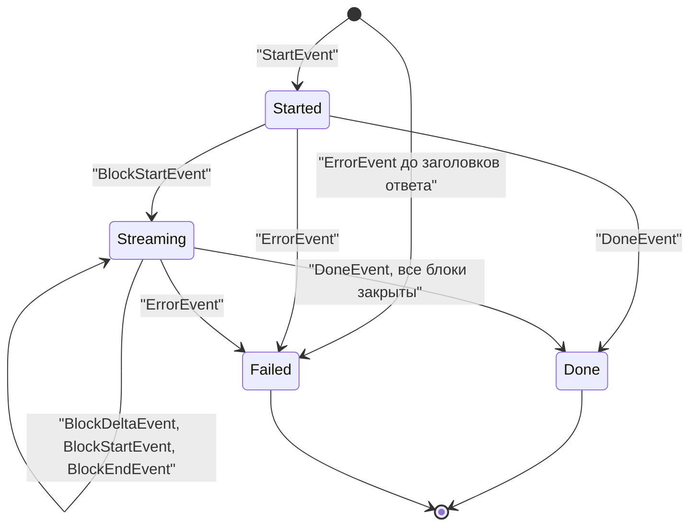
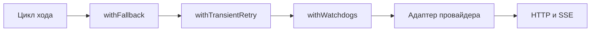

# Модель: контракт, провайдеры, декораторы

Глава описывает слой вызова языковой модели в `lib/src/llm/`: единый контракт `StreamFunction`, поток событий ответа, сообщения транскрипта, адаптеры провайдеров, декораторы надёжности, маршрутизацию по провайдерам, каталог моделей и учёт токенов. Сначала стоит прочитать [главу 4](04-turn-loop.md): там видно, как цикл читает поток и что делает с результатом, а в [главе 2](02-assembly-and-hosts.md) — кто создаёт функцию модели при сборке ядра.

## Зачем отдельный контракт

Провайдеры говорят на разных диалектах: OpenAI Chat Completions, Anthropic Messages. У них разные тела запросов, форматы потока, коды ошибок и способы сообщить о расходе токенов. Цикл хода не должен знать об этом. Поэтому ядро вводит один тип функции, который реализуют и адаптеры провайдеров, и все декораторы:

```dart
typedef StreamFunction = AssistantMessageEventStream Function(
  ModelRef model,
  LlmContext context, {
  CancelToken? cancel,
});
```

Цикл получает такую функцию в `AgentLoopConfig.stream` и вызывает на каждом шаге. Что внутри — один провайдер, цепочка декораторов, маршрутизатор по нескольким провайдерам или сценарная заглушка теста — цикл не различает.

## Карта `lib/src/llm/`

| Файл | Что в нём |
|---|---|
| `stream_function.dart` | `StreamFunction`, `LlmContext`, `ToolSchema` |
| `events.dart`, `event_stream.dart` | события потока и `AssistantMessageEventStream` |
| `messages.dart` | `Message`, `ContentBlock`, `StopReason` и каноническая JSON-форма |
| `usage.dart` | `Usage`, `UsageCost`, `calculateCost` |
| `errors.dart` | `LlmErrorClass` |
| `stream_state.dart` | `runProvider`, `ProviderStreamState`: общая рамка адаптера |
| `providers/openai_compatible.dart`, `providers/anthropic.dart` | адаптеры диалектов |
| `providers/http_support.dart` | HTTP-слой: ошибки, редиректы, отмена, чтение тела |
| `sse.dart` | разбор Server-Sent Events (`SseDecoder`) |
| `decorators/watchdog.dart`, `retry.dart`, `fallback.dart` | сторожевые таймеры, повторы, переключение моделей |
| `provider_config.dart`, `provider_factory.dart` | `ProviderConfig`, `createStreamFunction`, `createRoutedStreamFunction`, `createConfiguredStreamFunction` |
| `model_ref.dart`, `model_catalog.dart`, `builtin_models.dart` | `ModelRef`, каталог моделей, встроенная таблица |
| `overflow.dart` | признаки переполнения контекста |

Публично из этого каталога экспортируются контракт, типы сообщений и событий, фабрики и декораторы. Сами адаптеры закрыты (`PKG-5`): хост получает функцию модели через `createStreamFunction`, `createRoutedStreamFunction` или `createConfiguredStreamFunction`, но не классы `_OpenAiTurn` и `_AnthropicTurn`.

## Контракт `StreamFunction`

Правила для каждой реализации, будь то адаптер или декоратор (`LLM-1`, `LLM-2`, `LLM-7`):

1. Функция возвращает поток **синхронно** и никогда не бросает исключение — ни сразу, ни через `result`. Любой сбой становится `ErrorEvent`.
2. Работа начинается не раньше следующей микрозадачи: потребитель успевает подписаться до первого события.
3. В потоке ровно одно терминальное событие — `DoneEvent` или `ErrorEvent`, и оно последнее.
4. Отмена через `cancel` даёт `ErrorEvent` со `stopReason: aborted` в пределах одного оборота цикла событий после отмены.

`LlmContext` — вход запроса: системный промпт, неизменяемый список сообщений, схемы инструментов (`ToolSchema`: имя, описание, JSON Schema параметров) и `cacheKey` — ключ кэша промпта, в цикле это id сессии. Параметры модели (окно, максимум вывода, уровень рассуждения) приходят отдельным аргументом `ModelRef`.

## Сообщения

Транскрипт состоит из трёх видов сообщений (`messages.dart`):

| Тип | Содержимое | Откуда |
|---|---|---|
| `UserMessage` | `TextContent`, `ImageContent` | пользователь, служебные сообщения цикла |
| `AssistantMessage` | `TextContent`, `ThinkingContent`, `ToolCall` | ответ модели |
| `ToolResultMessage` | `TextContent`, `ImageContent`, флаг `isError`, `toolCallId` | результат инструмента |

Все типы неизменяемы, списки в них — неизменяемые копии. Поля `AssistantMessage`, которые стоит знать:

- `model` — `ModelRef` того, кто **фактически** ответил (после переключения моделей это может быть не запрошенная);
- `usage` — токены и стоимость;
- `stopReason` — `stop`, `length`, `toolUse`, `error`, `aborted`; `rawStopReason` хранит причину провайдера как есть;
- `errorMessage` и `errorClass` — для `error` и `aborted`, а также заметки о проблемах (например, аргументы вызова не распарсились);
- `ToolCall.arguments` — **всегда** разобранный JSON-объект, а не строка (`LLM-6`); `ToolCall.id` уникален в транскрипте (`LOOP-11`).

`ThinkingContent` хранит рассуждение модели с подписью `signature` и диалектом `api`, который её выдал: подпись отправляется обратно только тому же диалекту. Блок с `redacted: true` содержит непрозрачные данные провайдера.

У сообщений есть каноническая JSON-форма (`toJson` и `Message.fromJson`): это формат записей журнала сессии ([глава 8](08-sessions-and-compaction.md)). Пустые поля при записи опускаются, при чтении недостающее поле становится `null` или значением по умолчанию, неизвестные поля игнорируются. В JSON ответа хранятся только провайдер и id модели, поэтому для чтения нужен `ModelResolver`, который восстановит `ModelRef`.

## События потока

Ответ модели приходит как последовательность `AssistantMessageEvent`. Грамматика такая:



- `BlockStartEvent` открывает блок с индексом и видом `BlockKind`: `text`, `thinking` или `toolCall`. Одновременно могут быть открыты несколько блоков.
- `BlockDeltaEvent` добавляет к блоку фрагмент: текст, рассуждение или сырой фрагмент JSON аргументов вызова.
- `BlockEndEvent` закрывает блок и несёт его готовое значение. У вызова инструмента аргументы к этому моменту разобраны (`LLM-6`).
- `DoneEvent` приходит, когда все блоки закрыты (`LLM-5`). `ErrorEvent` несёт частичный ответ, полученный до сбоя, и `retryAfter` — паузу из заголовков `429` и `503`.

Каждое событие несёт снимок `partial` — ответ на момент события (`LLM-4`). Снимок строится лениво при первом обращении и кэшируется, так что потребитель, которому нужна только дельта, не платит за копирование.

`AssistantMessageEventStream` — поток с ожидаемым результатом. Его читают один раз (`listen` — одиночная подписка: производитель может отправить события раньше подписки, и ничего не потеряется), а `result` завершается значением терминального события либо `StateError`, если поток закрылся без него; он не превращается в необработанную ошибку (`LLM-3`).

Метод `AssistantMessageEvent.withPartial` возвращает то же событие с изменённым снимком. Декораторы используют его, чтобы добавить к итоговому ответу расход токенов неудавшихся попыток.

## Общая рамка адаптера: `runProvider`

Каждый адаптер строится на `runProvider` и `ProviderStreamState` (`stream_state.dart`). Это рамка, которая заранее обеспечивает контракт:

- запускает тело адаптера в микрозадаче; отменённый токен сразу даёт `ErrorEvent(aborted)` без вызова тела;
- `CancelledException` из тела тоже становится `aborted`, любое другое исключение — `ErrorEvent` с классом от функции `classify` (или `unknown`);
- если тело завершилось без терминального события, рамка добавляет его (`failUnexpectedEnd`, класс `network`).

Текст ошибки очищается: URL заменяются на `<url>`, известные секреты — на `[REDACTED]`, сетевой сбой называется только типом исключения (`connection failed: <тип>`), а ошибка недопустимого заголовка — типом без значения, потому что заголовок мог цитировать ключ.

`ProviderStreamState` — накопитель одного ответа. Адаптер вызывает `start`, `openBlock`, `append`, `closeBlock`, `setUsage`, `finish` или `fail`; каждый вызов, который что-то меняет, публикует одно событие. Реализация избегает квадратичной стоимости снимков: фрагменты блоков лежат в растущих списках, событие запоминает только длины, а `partial` склеивает их при первом обращении. Дополнительно `ProviderStreamState`:

- при закрытии блока вызова разбирает аргументы один раз: пустая строка — `{}`, ошибка разбора — `{}` и заметка в `errorMessage` (аргументы вызова не являются корректным JSON);
- в `finish` считает стоимость (`calculateCost`) и проверяет «тихое» переполнение контекста (см. ниже): если оно найдено, вместо `DoneEvent` выходит `ErrorEvent` класса `overflow`;
- после терминального события игнорирует любые вызовы.

## Адаптеры диалектов

Сейчас в коде два адаптера. Выбор делает `createStreamFunction` по `ProviderConfig.api`: `ProviderApi.openaiChat` и `ProviderApi.anthropicMessages`. Для `ProviderApi.gemini` адаптера нет: любой запрос получает `ErrorEvent` класса `badRequest` с текстом `provider api gemini is not supported yet`.

### OpenAI-совместимый (`providers/openai_compatible.dart`)

Работает с `POST {baseUrl}/chat/completions` и потоком SSE: OpenAI, OpenRouter, Ollama, LM Studio, llama.cpp server, LiteLLM и любой совместимый сервер. Что нужно знать:

- Ключ уходит в заголовок `Authorization: Bearer …`; для другого имени заголовка (`authHeader`) ключ идёт как есть. Заголовки провайдера добавляются после.
- Тело (`buildOpenAiBody`) строится детерминированно: порядок ключей фиксирован, `jsonEncode` не пишет пробелов, поэтому одинаковый снимок даёт побайтово одинаковый запрос (`LLM-11`). Это нужно кэшу промпта у провайдера.
- Поле максимума вывода — `max_completion_tokens` (настраивается `maxTokensField`, можно отключить); `stream_options.include_usage` включён по умолчанию — без него usage не приходит.
- Уровень рассуждения отправляется только моделям с `supportsReasoning`: `reasoning_effort` для OpenAI и `reasoning: {effort}` для OpenRouter (`ReasoningFormat`). По умолчанию формат OpenRouter выбирается по хосту `openrouter.ai`.
- `prompt_cache_key` отправляется, если включён `promptCacheKey`; по умолчанию — только для хоста `api.openai.com`.
- Рассуждение приходит в `delta.reasoning_content` или `delta.reasoning`, текст — в `delta.content`, вызовы — в `delta.tool_calls`. Вызовы собираются по индексу и id провайдера; пустой id заменяется на `call_<n>`.
- Причины завершения: `stop`, `eos`, `end_turn`, `stop_sequence` — `stop` (или `toolUse`, если были вызовы); `length`, `max_tokens` — `length`; `tool_calls`, `function_call` — `toolUse`; `content_filter`, `refusal`, `safety` — `ErrorEvent` класса `terminalFinish`; неизвестная причина — `unknown` с записью `llm.finish_reason.unknown`.
- Поток без `finish_reason` не считается ошибкой, если в нём есть контент: ответ закрывается с заметкой «возможно, обрезан». Если вызов оборвался на середине аргументов, причина — `length`. Пустой поток — ошибка `network` с подсказкой проверить `baseUrl` и id модели.

### Anthropic Messages (`providers/anthropic.dart`)

Работает с `POST {baseUrl}/v1/messages`. Заголовки: `anthropic-version`, при необходимости `anthropic-beta`, ключ в `x-api-key`. Особенности:

- Блоки провайдера (`content_block_start/delta/stop`) отображаются на блоки ядра: `text`, `thinking`, `redacted_thinking`, `tool_use`.
- Кэш промпта: в запрос ставится не больше трёх меток `cache_control: ephemeral` — на системный промпт, на последний инструмент и на последний блок последнего сообщения пользователя.
- Рассуждение: для режима `ThinkingMode.adaptive` — `thinking: {type: adaptive}` и `output_config.effort`; для `ThinkingMode.budget` — `thinking: {type: enabled, budget_tokens}`, где бюджет зависит от уровня (2048, 8192, 16384, но не больше `maxOutputTokens − 1024`).
- Причины завершения: `end_turn`, `stop_sequence` — `stop`; `tool_use` — `toolUse`; `max_tokens` — `length`; `model_context_window_exceeded` — `overflow`; `refusal` — `terminalFinish`.
- Событие `error` внутри потока классифицируется по типу ошибки Anthropic (`rate_limit_error`, `overloaded_error`, `authentication_error` и другие).

Обе реализации заменяют изображение текстовой пометкой `[image omitted: the current model does not accept images]`, если у модели нет `supportsImages`.

### SSE

Оба адаптера читают тело ответа как текст UTF-8 (`Utf8Decoder(allowMalformed: true)`), затем `SseDecoder` превращает текст в `ServerSentEvent`: правила разбора строк, комментарии keep-alive, `\r\n` на границе кусков, последние `id` и `retry`. Тот же разборщик использует MCP-клиент ([глава 6](06-tools.md)): второй реализации SSE в монорепозитории нет. Незаконченное событие в конце потока отбрасывается.

## HTTP-слой

`providers/http_support.dart` — общий код провайдеров:

- **Запрос** (`sendStreaming`) идёт через `http.Client` хоста: ядро клиент не создаёт (`LLM-10`, `PKG-6`). Редиректы обрабатываются вручную: только на тот же origin (схема, хост и порт), не больше пяти; иначе — ошибка `badRequest`. Запрос гонится с токеном отмены (`raceCancel`): отмена побеждает в пределах одного оборота цикла событий, даже если клиент хоста игнорирует `abortTrigger`; поздний ответ сливается, чтобы освободить соединение.
- **Тело** читает `responseText`: подписка на тело отменяется вместе с токеном, а ошибка тела при уже отменённом токене подменяется отменой. Иначе отмена выглядела бы как сетевой сбой, и ход завершился бы `failed`, а не `cancelled` (`LLM-7`).
- **Ошибки**: ответ не `200` или не `text/event-stream` превращается в `ErrorEvent` (`acceptEventStream`). Текст ошибки — `<провайдер> <статус>: <сообщение>`, тело обрезается до 2000 символов, секреты заменяются на `[REDACTED]`.
- **`Retry-After`** (`parseRetryAfter`): `retry-after-ms` приоритетнее `retry-after` (секунды или HTTP-дата); отрицательное значение — ноль.

## Классы ошибок

Класс `LlmErrorClass` задаётся один раз, на границе адаптера, и дальше решения принимаются только по нему, а не по тексту ошибки. Классификация HTTP-ответа (`classifyHttpError`):

| Класс | Откуда |
|---|---|
| `rateLimited` | статус `429`, `rate_limit` в потоке |
| `overflow` | `400`, `413`, `422` с признаком переполнения; Anthropic `model_context_window_exceeded` |
| `auth` | `401`, `403`, `authentication_error`, нет ключа |
| `badRequest` | прочие `4xx`, `501`, `505`, редирект на чужой origin, неизвестный провайдер |
| `timeout` | `408`, сторожевой таймер |
| `server` | `5xx`, `overloaded_error`, `api_error`, ошибка разбора JSON потока |
| `network` | разрыв соединения, пустой поток |
| `terminalFinish` | отказ модели (`content_filter`, `refusal`) |
| `aborted` | отмена токена |
| `unknown` | всё остальное |

Правило для декораторов: **что повторять и когда переключать модель, решает класс**. Он же определяет судьбу ошибки в цикле: `terminalFinish` даёт ход `refused`, `aborted` — `cancelled`, остальные — `failed` ([глава 4](04-turn-loop.md)).

## Декораторы

Три декоратора оборачивают `StreamFunction` и сами возвращают `StreamFunction`. `createStreamFunction` складывает их изнутри наружу в таком порядке:



Сторожевой таймер ближе всех к сети: он ограничивает одну попытку. Повторы стоят над ним, поэтому каждая попытка получает свои таймеры. Переключение моделей — снаружи всего.

### Сторожевые таймеры (`withWatchdogs`)

Каждая попытка получает дочерний токен отмены и два таймера:

- `connect` — от вызова до первого события; по умолчанию 30 с;
- `idle` — между событиями; по умолчанию 120 с. Его сбрасывают `StartEvent` и каждое событие блока любого вида, включая рассуждение; keep-alive сервера событий не порождает и таймер не сбрасывает (`LLM-16`).

У модели со скрытым рассуждением (`ModelRef.hiddenReasoning`) до первого блока контента вместо `idle` действует `idleReasoning` — 600 с: такая модель молча думает до ответа. Срабатывание отменяет только попытку, а получившийся `aborted` переписывается в `ErrorEvent` класса `timeout` с текстом `connect_stall`, `first_byte_stall` или `mid_stream_idle`. Отмена пользователем остаётся `aborted`.

### Повторы (`withTransientRetry`)

Повторяет запрос **только до фиксации**: до первого `BlockStartEvent` или `DoneEvent`. `StartEvent` до этого момента удерживается и выходит наружу один раз. После фиксации ничего не повторяется (`LLM-8`): клиент уже видел часть ответа, и повтор показал бы второй, другой ответ.

Классы `aborted`, `overflow`, `auth`, `badRequest`, `terminalFinish` не повторяются никогда (`LLM-9`). Остальные идут по двум бюджетам (`RetryPolicy`), но номер попытки общий: он растёт и на повторах после `429`, поэтому `maxAttempts` ограничивает все попытки подряд, а `rateLimitRetries` — только повторы после `429`:

| Бюджет | Значение по умолчанию | Задержка |
|---|---|---|
| временные сбои (`network`, `timeout`, `server`, `unknown`) | `maxAttempts` 4 — три повтора | от 1 с до 30 с, экспонента с «равным джиттером» |
| `429` (`rateLimited`) | три повтора | от 2 с до 60 с; если сервер прислал `Retry-After`, ждёт его плюс до 250 мс; если он больше `maxRetryAfter` (120 с) — не повторяет |

Пауза прерывается отменой токена. Если попытки кончились, в итоговую ошибку включается история попыток («запрос не удался после N попыток за T с: …»). Расход токенов неудавшихся попыток складывается в итоговый ответ: счёт провайдера идёт за все попытки. Ключи конфигурации провайдера: `providers.<id>.transient_retries`, `providers.<id>.rate_limit_retries`, `providers.<id>.connect_timeout`, `idle_timeout`, `idle_timeout_reasoning` (`lib/src/config/resolve.dart`).

### Переключение моделей (`withFallback`)

`withFallback(chain, forModel, onNotice)` по очереди пробует модели цепочки. `ErrorEvent` до фиксации с переключающим классом (`rateLimited`, `server`, `network`, `timeout`, `auth`, `unknown`) переводит запрос к следующей модели без паузы и вызывает `onNotice(FallbackNotice)`. Ошибки «запрос плох» (`badRequest`, `overflow`) модель не меняют. После фиксации ошибка идёт потребителю как есть (`LLM-8`). Итоговый ответ несёт модель, которая ответила, и сумму usage всех попыток.

В проводке ядра сейчас используется цепочка из одной модели: `createStreamFunction` вызывает `withFallback([model], …)`, и декоратор прозрачен. Переключения по `ModelRoleResolver` в коде нет, класс `AgentErrorClass.fallback` в событиях не выставляется. Это заготовка: проектное описание — [`02-llm-contract.md`](../../../../docs/architecture/proposals/agent-core/02-llm-contract.md) и [`17-10-providers.md`](../../../../docs/architecture/proposals/agent-core/17-10-providers.md).

## Маршрутизация по провайдерам

В конфигурации провайдеров несколько, у каждого свой адрес, ключ и таймауты. `ModelRef.provider` называет провайдера модели, поэтому ядро само направляет запрос.

`createRoutedStreamFunction(providers, services, …)` возвращает одну `StreamFunction`, которая по `model.provider` выбирает цепочку этого провайдера. Алгоритм (`target`):

1. Провайдер из списка `unavailable` (например, не задана переменная ключа) отвечает `ErrorEvent` класса `auth` с причиной, **без HTTP-запроса**.
2. Провайдер вне списка — `badRequest` с текстом `unknown provider <имя>`.
3. Готовая цепочка берётся из кэша `chains`.
4. Иначе ключ и значения заголовков со ссылками на секреты читаются через `SecretResolver` **при первом запросе**, а не при загрузке конфигурации: загрузка — чистая функция, секреты не читает. Ожидание гонится с отменой хода. Секрет не задан или хранилище недоступно — `auth` без запроса и с подсказкой (`codelab secret set <имя>`). Цепочка кэшируется только при успехе, поэтому следующий запрос попробует снова.
5. Для провайдера строится цепочка `createStreamFunction(config, services)`.

Значение секрета маршрутизатор кладёт в `ProviderConfig.apiKey`, а потому оно попадает в список для очистки текстов ошибок. Ключ из закоммиченного `config.yaml` проекта не может уйти на чужой адрес: загрузка конфигурации кладёт такого провайдера в `unavailable`, и сеть не используется ([глава 9](09-config-prompts-commands.md)).

`createConfiguredStreamFunction(config, services, secrets: …)` — тонкая обёртка: берёт из `CoreConfig` провайдеров, их ключи и шаблоны заголовков и проблемы, и передаёт в `createRoutedStreamFunction`. Через неё одинаково проводят конфигурацию бинарь `codelab-agent` и встроенный агент, чтобы две копии проводки не разошлись. Порты LLM — `CoreLlmServices` (`http.Client`, `Clock`, `Random`, `Logger`) — приходят от хоста.

Сессия вызывает функцию модели через `_Session._streamNow`: на каждом шаге она берёт функцию из применённого снимка конфигурации (или закреплённую за сессией, чья модель исчезла из каталога). Поэтому перезагрузка конфигурации действует «со следующего шага», а идущий запрос не прерывается ([глава 9](09-config-prompts-commands.md)).

## Каталог моделей

`ModelRef` — разрешённая модель со всем, что нужно адаптеру: провайдер, id, диалект `ProviderApi`, `baseUrl`, окно контекста, максимум вывода, цены `ModelCost` (доллары за миллион токенов), флаги `supportsImages`, `supportsReasoning`, `hiddenReasoning`, режим рассуждения `ThinkingMode`, текущий `reasoningEffort`.

Порт `ModelCatalog` — единственный источник `ModelRef` для ядра: список моделей для опции `model` (`models`), разрешение по `ModelId` вида `provider/model` (`resolve`, с уровнем рассуждения), поток изменений и фоновое обновление. Две реализации:

- `StaticModelCatalog` — каталог из конфигурации без сети. Метаданные модели берутся по порядку: явные значения в `providers.<id>.models.<модель>`, встроенная таблица `builtinModels`, безопасные умолчания (окно 32 000, вывод 4096, без изображений и рассуждения, неизвестные цены). Источник каждого поля записывается в `ModelEntry.provenance` для `/status` и тестов. Если поле взято из умолчаний, пишется предупреждение `llm.catalog.default_used`. Максимум вывода ограничивается окном минус 1024 токена. Встроенная таблица ищет id по точному совпадению или по самому длинному ключу-префиксу, после последнего `/` для шлюзов вида `anthropic/модель`.
- `FixedModelCatalog` — готовые `ModelRef` от хоста: для тестов и хостов без конфигурации провайдеров.

Метаданные из `/models` провайдера и удалённого каталога в коде ещё нет: значения `endpoint`, `remoteCatalog`, `role` в перечислении `ModelInfoSource` зарезервированы, а `refresh()` статического каталога ничего не делает. Уровень рассуждения применяется только к модели с `supportsReasoning`: у остальных `reasoningEffort` в разрешённой ссылке `null`. Подробнее о выборе модели сессией и `/model` — [глава 8](08-sessions-and-compaction.md) и [глава 9](09-config-prompts-commands.md).

## Переполнение контекста

Переполнение — особая ошибка: повторять тот же запрос бесполезно, поможет только сжатие. Ядро распознаёт его в нескольких местах (`overflow.dart`):

1. Адаптер выставил `errorClass: overflow`: код провайдера `context_length_exceeded`, ответ `400`, `413` или `422` с фразой вроде `prompt is too long` и без признаков лимита частоты (`rate limit`, `quota`), `stop_reason` Anthropic.
2. «Тихое» переполнение: ответ `stop`, где `input + cacheRead` больше окна (`silentOverflow`). `ProviderStreamState.finish` превращает такой ответ в `ErrorEvent` класса `overflow` с пояснением.
3. `length` без вывода при заполнении окна на 99 % и больше — тоже переполнение.

Публичный `isContextOverflow(message, contextWindow:)` собирает эти правила в одну проверку, но цикл смотрит просто на `errorClass`. Класс `overflow` не повторяется (`LLM-9`) и не переключает модель; цикл перехватывает его и запускает аварийное сжатие, а до запроса оценивает размер payload и сравнивает с окном ([глава 4](04-turn-loop.md), [глава 8](08-sessions-and-compaction.md)).

## Учёт токенов из потока

`Usage` — расход одного ответа: `input` (токены входа **без** прочитанных из кэша), `output` (включая рассуждение), `cacheRead`, `cacheWrite`, необязательное `reasoning` (часть `output`) и стоимость `UsageCost` в долларах. Сложение `+` объединяет все поля; `total` — сумма четырёх счётчиков.

Путь расхода от провайдера до клиента:

1. **Адаптер** берёт usage из потока и кладёт в `ProviderStreamState.setUsage`.
   - OpenAI-совместимый: usage приходит в последнем чанке при `include_usage`. `input = prompt_tokens − cacheRead − cacheWrite`, где `cacheRead` — `prompt_tokens_details.cached_tokens` (или `prompt_cache_hit_tokens`), `reasoning` — `completion_tokens_details.reasoning_tokens`.
   - Anthropic: вход и кэш — из `message_start.message.usage`, выход — из `message_delta.usage.output_tokens`.
2. **`ProviderStreamState`** при `finish` и `fail` считает стоимость: `calculateCost(usage, model.cost)`. Цена за миллион токенов умножается на счётчики; рассуждение отдельно не тарифицируется. Без цен стоимость нулевая.
3. **Декораторы** суммируют расход неудавшихся попыток и переключений в итоговый ответ (`addUsage`).
4. **Цикл** складывает `usage` каждого ответа в расход хода и показывает его в `StepEnded.result.usage` и `TurnEnded.usage`; usage субагентов входит в сумму отдельным слагаемым ([глава 4](04-turn-loop.md)). Лимиты бюджета `maxTokens` и `maxCost` считаются по этой сумме.
5. **Журнал сессии** хранит usage в записи ответа; из него строится отчёт расхода `UsageLedger` (`lib/src/usage/`), который используют `/usage` и расширение ACP. Как устроены счётчики сессии и файл `usage.json`, описывает [глава 9](09-config-prompts-commands.md).
6. **ACP-хост** (`codelab_agent_acp`) отправляет клиентам уведомления `_codelab/session/usage` ([глава 3](03-request-flow.md)).

Если провайдер не прислал usage, все счётчики нулевые; журнал usage помечает такой шаг признаком `noUsage`. Пока у модели нет цен (`ModelRef.cost == null`), стоимость хода считается неизвестной (`null`) и лимит `maxCost` не проверяется.

## Что не реализовано

В коде есть заготовки, которые не стоит принимать за работающие возможности:

- адаптер Gemini: диалект есть в перечислении, адаптера нет;
- цепочка fallback из нескольких моделей: декоратор написан, но проводка передаёт ему одну модель;
- метаданные моделей из `/models` и удалённого каталога, дисковый кэш и фоновое обновление каталога;
- вызов инструментов через промпт для моделей с `supportsTools: false`: поле в `ModelRef` есть, но обработки нет.

Проектный документ [`02-llm-contract.md`](../../../../docs/architecture/proposals/agent-core/02-llm-contract.md) описывает и эти части как задуманные. Для фактов опирайтесь на этот текст и на код.

## Нормы и спецификации

| Что | Где |
|---|---|
| контракт, события, адаптеры, декораторы, инварианты `LLM-*` | [`agent-llm`](../../../../openspec/specs/agent-llm/spec.md) |
| отмена и сторожевые таймеры | [`agent-cancellation`](../../../../openspec/specs/agent-cancellation/spec.md) |
| ядро без `dart:io` и своих HTTP-клиентов, `PKG-5`, `PKG-6` | [`AGENTS.md`](../AGENTS.md) пакета |

Как добавить провайдера или декоратор — рецепт в [главе 11](11-extending.md). Как цикл использует поток и ошибки — [глава 4](04-turn-loop.md).
