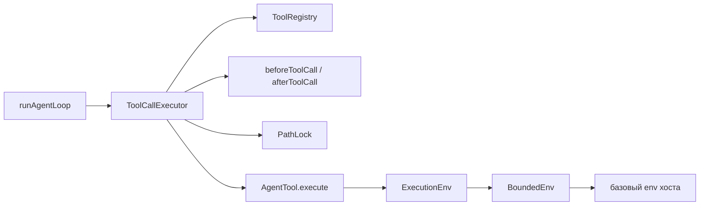
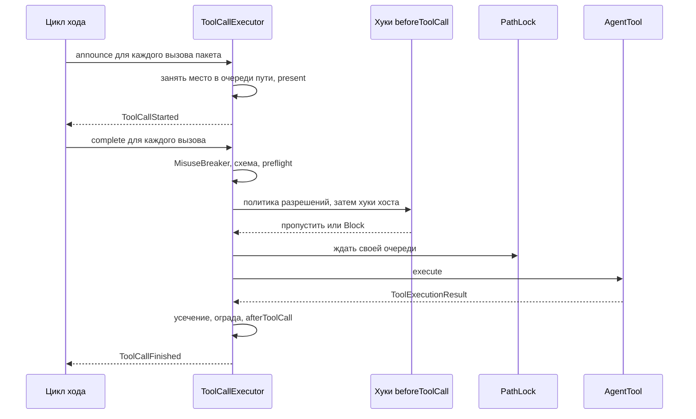
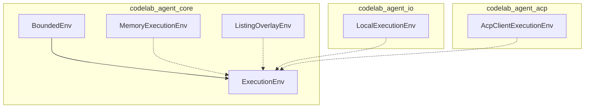
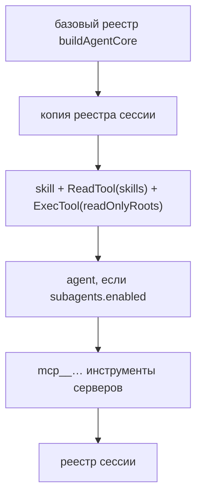
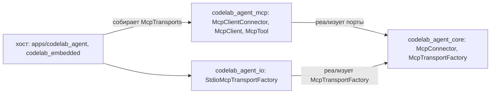

# Инструменты

Глава о том, как модель действует в мире: контракт `AgentTool`, реестр, единая точка исполнения `ToolCallExecutor`, окружение `ExecutionEnv` с границей рабочей папки и инструменты сессии (навыки, субагенты, MCP, список задач). Перед ней прочитайте [цикл хода](./04-turn-loop.md): здесь описано то, что цикл вызывает на шаге «исполнить вызовы». Решение о разрешении вызова — в [главе о разрешениях](./07-permissions.md).

Нормы заданы спецификациями [`agent-tools`](../../../../openspec/specs/agent-tools/spec.md), [`agent-execution-env`](../../../../openspec/specs/agent-execution-env/spec.md), [`agent-skills`](../../../../openspec/specs/agent-skills/spec.md), [`agent-subagents`](../../../../openspec/specs/agent-subagents/spec.md) и [`agent-mcp-client`](../../../../openspec/specs/agent-mcp-client/spec.md). Здесь они не пересказываются: дана ссылка и объяснено, как код держит норму.

## Из чего состоит слой инструментов

Инструмент ничего не знает ни о разрешениях, ни о клиенте, ни о журнале. Он описывает себя для модели и выполняет действие над портом `ExecutionEnv`. Всё общее делает единая точка исполнения.

Цикл (`lib/src/loop/agent_loop.dart`) вызывает только `ToolCallExecutor`. Исполнитель находит инструмент в реестре, прогоняет хуки (первый из них — политика разрешений), берёт блокировку пути и вызывает `execute`. Инструмент работает с `ExecutionEnv`, и этот env всегда обёрнут в `BoundedEnv`. Базовый env (`LocalExecutionEnv`, клиент ACP, память) лежит под границей и инструментам напрямую не достаётся (ENV-2).

## Контракт `AgentTool`

`AgentTool` (`lib/src/tools/agent_tool.dart`) — абстрактный класс. Подкласс обязан задать три члена: `name`, `description`, `parameters` (JSON Schema объекта) и метод `execute`. Остальное имеет безопасные умолчания.

| Член | Умолчание | Зачем |
|---|---|---|
| `tier` | `ToolTier.exec` | уровень опасности для политики; неизвестное считается самым опасным (TOOL-5) |
| `kind` | `ToolKind.other` | вид вызова для клиента (совпадает с ACP `ToolKind`) |
| `outputTrust(args)` | `untrusted` | доверять ли выводу; недоверенный вывод огораживается |
| `executionMode` | `null` | `sequential` делает вызов барьером внутри пакета, остальные параллельны |
| `present(args, ctx)` | заголовок = имя | заголовок, места (`Location`) и diff для клиента и для запроса разрешения |
| `permissionPattern(args, cwd)` | канонический JSON аргументов | ключ «разрешить всегда», см. [главу 07](./07-permissions.md) |
| `preflight(args)` | `null` | проверка аргументов до разрешений, без побочных эффектов (PERM-1) |
| `lockPath(args)` | `null` | путь, который держит `PathLock` на время `execute` (TOOL-7) |
| `truncatesOutput` | `false` | инструмент усекает вывод сам; иначе это делает исполнитель (TOOL-9) |
| `tierOf`, `kindOf`, `executionModeOf`, `offersAllowAlways` | возвращают `tier`, `kind` и т. д. | то же, но по аргументам вызова |

Четыре уровня `ToolTier` — `read`, `write`, `network`, `exec`. Ни один встроенный инструмент и ни один MCP-инструмент сейчас не имеет уровня `network`: он зарезервирован под инструменты «адрес выбирает модель». Строка таблицы режимов для него в политике есть (см. [главу 07](./07-permissions.md#режимы-и-уровни)).

`execute` получает `ToolContext` (`lib/src/tools/agent_tool.dart`): ограниченный `env`, токен отмены `cancel`, `onUpdate` для частичного результата (`ToolCallProgress`), `onTerminal` для встраивания терминала клиента, `toolCallId`, сервисы сессии `ToolServices` (часы, логгер, счётчик ожидания человека `ApprovalWaitMeter`, список задач `tasks`), имена схем текущего шага `stepTools` и признак `supportsImages`. Контекст создаёт только исполнитель, на один вызов.

Результат — `ToolExecutionResult`: блоки `content` (`TextContent`, `ImageContent`), `diffs` и флаг `isError`. Ожидаемая ошибка возвращается значением (`isError: true`), а не исключением. Исключение из `execute` исполнитель превращает в результат-ошибку с исходом `failed` (TOOL-3). Исключение `ToolCancelled` позволяет инструменту отдать собственный текст при отмене (так делает `exec`).

### Реестр

`ToolRegistry` (`lib/src/tools/registry.dart`) хранит инструменты в порядке регистрации. Порядок `schemas` стабилен: он сохраняет кэш промпта у провайдера модели. Имя должно подходить под `^[a-zA-Z0-9_-]{1,64}$`, иначе `register` бросает `ArgumentError`. Повторная регистрация имени заменяет инструмент на месте и вызывает `onDuplicate` (TOOL-4), поэтому позиция в схемах не меняется.

## Встроенные инструменты

Базовый реестр собирает `buildAgentCore` (`lib/src/host/build_agent_core.dart`, порядок «§10.7, шаг 5»): базовые инструменты, затем включённые capability профиля хоста. Состав профилей и сужение — в [главе 02](./02-assembly-and-hosts.md).

| Имя | Уровень | Когда включён | Файл |
|---|---|---|---|
| `read` | `read` | всегда | `lib/src/tools/builtin/read.dart` |
| `write` | `write` | всегда | `lib/src/tools/builtin/write.dart` |
| `edit` | `write` | всегда | `lib/src/tools/builtin/edit.dart` |
| `task_create`, `task_update`, `task_list`, `task_get` | `read` | всегда | `lib/src/tools/tasks/task_tools.dart` |
| `exec` | `exec` | capability `shellExec` | `lib/src/tools/builtin/exec.dart` |
| `ls`, `search` | `read` | capability `fileListing` | `lib/src/tools/builtin/ls.dart`, `search.dart` |
| `skill` | `read` | сессия, если у каталога навыков есть видимые модели навыки | `lib/src/tools/builtin/skill.dart` |
| `agent` | `read` | сессия, если `subagents.enabled` | `lib/src/subagents/subagent_tool.dart` |
| `mcp__<сервер>__<инструмент>` | `exec` | сессия, по числу подключённых MCP-серверов | `packages/dart/codelab_agent_mcp/lib/src/mcp_tool.dart` |

Ограничения профиля действуют жёстко: `buildAgentCore` бросает `HostWiringException`, если включён `shellExec`, а `baseEnv` — `MemoryExecutionEnv` без настоящей оболочки. Два встроенных инструмента с одним именем тоже дают `HostWiringException`.

Что важно знать о каждом встроенном инструменте:

- **`read`** — вид `read`. Выводит строки `<номер>| <текст>`, умеет `offset` и `limit`, сам усекает вывод. Вывод недоверенный, если путь лежит в каталоге `node_modules`, `.dart_tool` или `vendor` (`defaultUntrustedPaths`, `lib/src/tools/fence.dart`). Когда у сессии есть навыки, рантайм заменяет его экземпляром `ReadTool(skills:, root:)`, который читает файлы из каталогов навыков вне рабочей папки.
- **`write`** и **`edit`** — вид `edit`, вывод доверенный. Оба переопределяют `lockPath`, поэтому параллельные правки одного файла идут по очереди. `edit` меняет единственное точное совпадение, ноль или несколько совпадений — ошибка, файл не меняется (TOOL-8); сохраняет CRLF и BOM. Оба строят diff в `present`, и политика берёт его для запроса разрешения.
- **`exec`** — вид `execute`. Ненулевой код выхода — не сбой инструмента, а данные для модели: результат помечен `isError`, но содержит вывод. Тайм-аут по умолчанию 120 с, максимум 3600 с. Вывод недоверенный, если команда сетевая (`isNetworkCommand`: `curl`, `wget`, `git clone`, `npm install`, `dart pub get` и другие префиксы): уровень при этом остаётся `exec`, меняется только доверие к выводу. Если у сессии есть корни навыков только для чтения и команды идут не на машине агента, `exec` сам отклоняет `cwd` внутри каталога навыка и подсказывает путь к скрипту.
- **`ls`** и **`search`** — вид `search`; требуют, чтобы env реализовывал `DirectoryListing`, поэтому зависят от capability `fileListing`. `ls` — один уровень, не больше 500 записей. `search` — `RegExp` Dart или литерал, не больше 100 совпадений и 10 000 просмотренных файлов.
- **`task_*`** — вид `think`, уровень `read`, шаблон разрешения `*`. Подробности — в разделе про список задач ниже.

Точные тексты вывода и ошибок зафиксированы golden-тестом `builtin_tools_golden_test.dart` (требование «Встроенные инструменты MVP» спецификации `agent-tools`). Тексты описаний для модели лежат в `prompts/tool_descriptions/*.md` (см. [главу 09](./09-config-prompts-commands.md)).

## Единая точка исполнения

`ToolExecutor` (интерфейс) и `ToolCallExecutor` (реализация, `lib/src/tools/executor.dart`) — единственный код, вызывающий `AgentTool.execute` (TOOL-1). Это проверяет тест ядра `test/tools/tool_executor_guard_test.dart` (не сторож `melos run guard`): вызовы `.execute(` у `AgentTool` допустимы только в `executor.dart`. Так любой инструмент, зарегистрированный любым способом, проходит одну дорогу.

Вызов идёт двумя фазами. Параллельный пакет сначала объявляет все вызовы по порядку ответа модели, и только затем исполняет их одновременно. Иначе асинхронный `present` одного вызова мог бы обогнать другой, и `ToolCallStarted` пришли бы не по порядку.

Шаги `announce`: проверить, что имя есть в схемах текущего шага (`stepTools`), найти инструмент, создать `ToolContext`, **занять место в очереди пути** по `lockPath`, построить `present` и отправить `ToolCallStarted`. Если `announce` упал, исполнитель сам освобождает занятый путь, иначе он остался бы занят до конца сессии.

Шаги `complete`, в порядке кода:

1. **Предохранитель.** Если ключ вызова (имя плюс канонический JSON сырых аргументов) заблокирован `MisuseBreaker`, вызов не проверяется и не исполняется (шаг 1a, TOOL-11).
2. **Поиск инструмента.** Нет в схемах шага — результат «`Tool "…" is not available`». Если ядро знает причину недоступности (`unavailableText`: набор инструментов выбранного агента), используется её текст. Проверка идёт до политики, поэтому пользователя не спрашивают о вызове, который всё равно не исполнится.
3. **Валидация и приведение аргументов** (`validateArguments`, `lib/src/tools/validator.dart`). Подмножество JSON Schema: `type`, `properties`, `required`, `items`, `enum`, `default`. Несовпавший тип приводится, когда смысл однозначен (`"42"` → `42`). Исключение в валидаторе — сбой инструмента, а не ошибка модели: он не считается предохранителем (TOOL-3). Форму схемы проверяет общая функция `lib/src/tools/schema_shape.dart`, её же использует `McpTool` при регистрации.
4. **`preflight`.**
5. **Хуки `beforeToolCall`** по порядку; первый `Block` прекращает вызов с исходом из `Block.outcome`. Первый хук сессии — политика разрешений (PERM-1), хуки хоста идут после неё.
6. **Проверка отмены**, затем **ожидание очереди пути.** Ожидание гоняется с отменой хода (`Future.any`), но тикет остаётся в очереди до своего часа, чтобы прерванное ожидание не впустило следующего вызова раньше предыдущего держателя.
7. **`execute`.**
8. **Обработка результата:** страховочное усечение для инструмента, который не усекает сам (`truncateHead`: 2000 строк и 50 КиБ, TOOL-9); огораживание недоверенного вывода; хуки `afterToolCall`.
9. **`ToolCallFinished`** и результат для модели.

Предохранитель считает только **неверные** вызовы: упавшие на шагах 2–4. Отказ разрешения, отмена и ошибки исполнения сюда не попадают, поэтому повтор упавшего `exec dart test` после правки — нормальная работа. Пределы по умолчанию — предупреждение с третьего неверного вызова, блокировка с шестого (`MisuseLimits`, `lib/src/tools/misuse.dart`); один `MisuseBreaker` создаёт цикл на ход.

Блокировка пути (`PathLock`, `lib/src/tools/path_lock.dart`) — асинхронный mutex по нормализованному абсолютному пути. Без неё два параллельных `edit` одного файла прочитали бы одно содержимое, и вторая запись затёрла бы первую. Место в очереди занимается при `announce`, в порядке ответа модели, а не в порядке ответов хуков разрешений — иначе результат зависел бы от того, кто быстрее ответил в диалоге. Итог равен последовательному применению вызовов (TOOL-7). Очередь одна на дерево сессий: потомок получает очередь корня (`ChildSessionSpec.locks`), и правки одного файла упорядочены между родителем и всеми детьми.

### Недоверенный вывод и усечение

Текст из файлов, команд и серверов — данные, которым модель не обязана подчиняться. `fenceUntrusted` (`lib/src/tools/fence.dart`) оборачивает каждый текстовый блок такого результата в `<untrusted-content source="…">…</untrusted-content>` и экранирует маркеры внутри текста, чтобы вывод не закрыл ограду сам (TOOL-10). Картинки остаются как есть.

Правило ограды двойное. Недоверенным считается вывод, у которого `outputTrust` вернул `untrusted`. Кроме того, исполнитель **всегда** огораживает результат инструмента с именем `mcp__…` независимо от `outputTrust`: MCP-сервер не может объявить себя доверенным (защита в глубину).

Инструменты, усекающие сами (`read`, `exec`, `ls`, `search`), делают это со своим уведомлением — например, `exec` оставляет хвост вывода, потому что ошибка обычно в конце. Остальным помогает исполнитель: он оставляет голову и дописывает уведомление.

### Парность вызовов

Провайдеры требуют, чтобы в запросе не было результата без вызова и вызова без результата. `lib/src/tools/pairing.dart` чинит это в **payload** запроса, а не в журнале и не в транскрипте (TOOL-6, LOOP-7): недостающему результату подставляется текст «Tool call was interrupted before it produced a result.». Это нужно, например, после прерванного хода или восстановления журнала.

## Окружение `ExecutionEnv`

Ядро касается файлов и процессов только через порт `ExecutionEnv` (`lib/src/env/execution_env.dart`). Он состоит из `FileSystem` (`readText`, `writeText`, `stat`, `cwd`) и `Shell` (`exec`). Встроенные инструменты написаны один раз и работают над любой реализацией: локальной, через клиента ACP и в памяти. Ожидаемые сбои — значения `Err(FileError)` и `Err(ExecError)`, а не исключения (ENV-1). Ненулевой код выхода команды — не `Err`, а `Ok(ExecResult(exitCode: N))`: проваленная команда — данные для модели.

Опциональные возможности проверяются через `is`: `DirectoryListing` (`listDir`), `BinaryFiles` (`readBytes`), `PathResolver` (`realpath`). Их наличие определяет, какие инструменты доступны: например, без `DirectoryListing` нет `ls` и `search`.

Сплошная стрелка — «оборачивает», пунктирная — «реализует». Каждая реализация живёт в том пакете, которому позволены её зависимости:

| Реализация | Пакет | Для чего |
|---|---|---|
| `MemoryExecutionEnv` | `codelab_agent_core`, `lib/src/env/memory_env.dart` | файлы в памяти под абсолютными POSIX-путями; умолчание тестов и основа web-окружения. Ссылок нет (`PathResolver` не реализован), `exec` отвечает `shellUnavailable` |
| `LocalExecutionEnv` | `codelab_agent_io`, `lib/src/env/local_execution_env.dart` | файлы и процессы машины агента; реализует `DirectoryListing`, `BinaryFiles`, `PathResolver`. Команда получает минимальное окружение из allowlist плюс явные переменные (ENV-6); после тайм-аута или отмены `exec` возвращается не позже чем через 5 с (ENV-5) |
| `AcpClientExecutionEnv` | `codelab_agent_acp`, `lib/src/acp_client_env.dart` | файлы и команды исполняет клиент ACP: `readText` → `fs/read_text_file`, `writeText` → `fs/write_text_file`, `exec` → `terminal/*`. Терминал всегда освобождается через `terminal/release` (ENV-7). `listDir`, `readBytes`, `realpath` не реализует: в ACP таких методов нет |
| `ListingOverlayEnv` | `codelab_agent_core`, `lib/src/env/listing_overlay_env.dart` | листинг и `stat` берутся из локального env, всё остальное — от клиента. Так `ls` и `search` работают с клиентом ACP, когда он на той же машине (stdio) |

Какую реализацию получает сессия, решает хост: ACP-сервер `codelab_agent_acp` по `AcpServerConfig.localEnv` и `localListing` собирает порты сессии. Встроенный режим (`codelab_embedded`) идёт локально, `codelab-agent serve --stdio` — через клиента с наложением локального листинга. Подробности — в [главе 02](./02-assembly-and-hosts.md) и [главе 03](./03-request-flow.md); какая сторона что исполняет при каждом способе подключения — в [алгоритме исполнения](./algorithms/execution-sides.md).

### `BoundedEnv`

`BoundedEnv.wrap(inner, root, …)` (`lib/src/env/bounded_env.dart`) — декоратор, который отклоняет любой путь вне корня сессии **до** того, как внутренний env увидит операцию (ENV-3). Результат — `Err(FileError(FileErrorCode.outsideWorkspace, …))`, а не исключение. Почему так важно: пути приходят от модели, и `../../etc` или ссылка наружу не должны выводить агента за рабочую папку. Политика разрешений решает, *можно ли* действие, а `BoundedEnv` — *где* оно возможно. Это два независимых рубежа.

Как он проверяет путь:

- нормализует путь от корня и сравнивает **по сегментам**, поэтому `/proj_evil` не лежит в `/proj`;
- если внутренний env умеет `PathResolver`, раскрывает самый длинный существующий префикс: ссылка наружу ловится, а новый файл за ссылкой внутрь корня принимается;
- передаёт внутреннему env нормализованный, а не раскрытый путь, чтобы сообщения показывали путь так, как его видит пользователь.

`BoundedEnv.wrap` возвращает один из восьми внутренних классов (`_Bounded`, `_BoundedL`, `_BoundedLBR` и т. д.) — по сочетанию опциональных возможностей внутреннего env. Так обёртка реализует `DirectoryListing`, `BinaryFiles` или `PathResolver` только тогда, когда их реализует `inner`, и каждую проверяет по пути (ENV-4).

**Корни только для чтения** (`readOnlyRoots`, SKL-9). Каталоги загруженных навыков могут лежать вне рабочей папки (`~/.agents/skills`). Чтение из них разрешено и идёт не во внутренний env, а в `readOnlyFs` — файловую систему процесса агента: клиент ACP этого каталога может не видеть. Запись туда всегда `outsideWorkspace`, до обращения к любому env. `ExecOptions.cwd` в таком корне допустим только при `execInReadOnlyRoots`, то есть когда команды исполняются на той же машине.

## Инструменты сессии

Базовый реестр общий для процесса, а сессия копирует его в свой и добавляет инструменты, которые зависят от неё. Это делает `AgentRuntime` при создании или загрузке сессии (`lib/src/runtime/agent_runtime.dart`, метод открытия сессии):

Порядок значим: `register` заменяет одноимённый инструмент на месте, и порядок схем не меняется (кэш промпта). Инструмент хоста другого типа с тем же именем не заменяется: рантайм подменяет `read` только если он `ReadTool`, `exec` — только если он `ExecTool`. Чужие сессии MCP-инструментов этой сессии не видят.

### Навыки

Навык — каталог с `SKILL.md`: инструкция, которую модель подгружает по необходимости. Нормы — спецификация [`agent-skills`](../../../../openspec/specs/agent-skills/spec.md).

- **Откуда файлы.** Ядро не читает диск (PKG-1). Порт `SkillFiles` (`lib/src/skills/skill_files.dart`, поле `AgentCoreServices.skillFiles`) отдаёт хост: его реализует `ProjectFilesLoader` из `codelab_agent_io`. Корни навыков, приоритеты и согласие на проектные навыки — в [главе 09](./09-config-prompts-commands.md).
- **Каталог.** `parseSkills` (`lib/src/skills/skill_catalog.dart`) — чистая функция: проверяет поля `SKILL.md` мягко (по спецификации Agent Skills), применяет приоритет, `disabled`, предел и сортировку и строит неизменяемый `SkillCatalog`. Снимок живёт всю сессию (SKL-4).
- **Что видит модель.** Строки каталога (имя, описание) идут в системный промпт под бюджетом `skills.catalog_max_chars`. Тело навыка подгружает инструмент `skill` (`name` из `enum` видимых навыков). Результат строится из снимка, файл не перечитывается. `renderSkillBlock` (`lib/src/skills/skill_block.dart`) даёт один вид блока и для инструмента, и для команды `/skill:<name>`, и для повторного приложения после сжатия; теги `skill` в теле экранируются. Инструмент доверенный: тело навыка прошло гейты доверия.
- **Повтор активации.** Какие навыки сейчас в контексте, выводит чистая функция `activeSkills` (`lib/src/skills/active_skills.dart`) из активной ветки журнала, отдельных записей для этого нет. Если навык уже в контексте целиком, `skill` отвечает строкой повтора, а не вставляет тело второй раз.
- **После сжатия.** `reattachSkills` (`lib/src/skills/reattach.dart`) решает, какие навыки приложить к резюме целиком, усечённо или не приложить. Это часть [сжатия контекста](./08-sessions-and-compaction.md).
- **Права.** `skill` — уровень `read`, шаблон разрешения — имя навыка. Правки каталогов навыков критические для политики (PERM-11), а запуск скрипта навыка через `exec` имеет отдельное исключение: см. [главу 07](./07-permissions.md#правка-конфигурации-агента).

Инструмент регистрируется, только если `modelVisible` не пуст (SKL-5). У навыка с `disable-model-invocation: true` команда `/skill:<name>` остаётся.

### Субагенты

Субагент — дочерний агент с отдельным контекстом, который возвращает один итоговый отчёт. Нормы — спецификация [`agent-subagents`](../../../../openspec/specs/agent-subagents/spec.md).

Главное решение: **особых случаев для детей нет** ни в цикле, ни в исполнителе, ни в политике. Субагент запускает инструмент `agent` (`lib/src/subagents/subagent_tool.dart`) — обычный инструмент уровня `read`. Потомок — обычная сессия со своим журналом, набором инструментов и режимом не мягче родительского (SUB-2).

- **Регистрация.** Инструмент `agent` регистрируется, если `subagents.enabled` в конфигурации сессии на момент создания. Схема дальше не меняется (кэш промпта). Видимость на шаге зависит от окна модели: `subagentWindowOk` скрывает его, если эффективное окно меньше порога (`CompactionSettings.minSubagentContextWindow`).
- **Вызов.** Параметры `description` (3–60 символов), `prompt` (до 32 768), `type`, а у корня ещё `task` (пункт списка задач). Проверки лежат в `execute`; ошибка вызова — `SubagentCallError` и результат `failed` без ограды `untrusted-content`. `permissionPattern` — имя типа, так что «разрешить всегда» для `explore` не разрешает `general`.
- **Типы.** Встроенные `general`, `explore`, `review`, `plan` (`lib/src/subagents/subagent_types.dart`). `explore` и `plan` — режим `plan` и инструменты `read`, `ls`, `search`; `review` добавляет `exec`; `general` — все инструменты. Определения агентов проекта и пользователя (см. [главу 09](./09-config-prompts-commands.md)) с областью `subagent` или `both` дополняют список и могут заменить встроенный тип. Снимок типов строится один раз при открытии сессии.
- **Набор инструментов ребёнка.** `selectChildTools` (`lib/src/subagents/child_tools.dart`) — чистая функция: набор потомка — это `инструменты родителя на шаге ∩ инструменты типа`. Так потомок не может получить инструмент шире предка (SUB-1). `agent` входит, только пока глубина меньше `subagents.max_depth`; `task_create` ребёнок не получает, остальные `task_*` получает в детском варианте; `skill` входит, только если ребёнку передан снимок каталога.
- **Менеджер.** `SubagentManager` (`lib/src/subagents/subagent_manager.dart`) создаёт детей через фабрику дочерней сессии, считает слоты и лимиты дерева (`SubagentTree`: глубина, одновременные потомки, запуски за ход, шаги, время), ведёт `SubagentHandle`. Лимиты читаются из `SubagentsConfig` при каждом запуске, поэтому перезагрузка конфигурации действует со следующего запуска.
- **Разрешения ребёнка.** Вопрос потомка идёт в gate корневой сессии через `SubagentPermissionGate` и очередь `SubagentQuestionQueue`: пользователь видит запросы по одному. Хранилище «разрешить всегда» одно на дерево. Подробнее — в [главе 07](./07-permissions.md#разрешения-субагентов).
- **Отчёт.** `wrapSubagentReport` (`lib/src/subagents/subagent_report.dart`) оборачивает итог в `<subagent-report …>` с атрибутами `id`, `agent`, `status`, `steps`, `tool_calls`; вхождения закрывающего тега экранируются (SUB-7). Результат `agent` недоверенный, поэтому исполнитель огораживает его ещё раз: `untrusted-content source="agent"`.
- **Параллельность.** У `agent` нет `executionMode`, поэтому несколько вызовов в одном ответе идут параллельно. Они делят очередь `PathLock` корня.

### Список задач

Список задач — способ, которым модель ведёт план. Он заменил инструмент `update_plan`, которого в ядре нет. Состояние лежит в порте `TaskList` (`lib/src/tools/tasks/task_list.dart`), реализация сессии — `SessionTaskList`: один список на дерево сессий, замок на операции, `TaskListChanged` на каждое изменение.

- **Инструменты.** Четыре: `task_create`, `task_update`, `task_list`, `task_get`. Модель создаёт пункт, меняет статус или зависимость, не переписывая весь план. Все четыре — уровень `read`, вид `think`, вывод доверенный, шаблон разрешения `*`: список не трогает файлы, команды и сеть.
- **Порядок.** Они `sequential`: каждый вызов — барьер внутри пакета. Это сериализует проверки (цикл зависимостей, лимит видят состояние после предыдущей операции) и держит `TaskListChanged` между началом и концом вызова, по которому клиент связывает `plan` с вызовом (TSK-1; барьерные группы в `_runBatch`, `lib/src/loop/agent_loop.dart`).
- **Ребёнок.** У потомка тот же список, но `SubagentTaskList` (`lib/src/subagents/subagent_task_list.dart`) выполняет операции от имени субагента и проверяет владельца пункта (TSK-4). `task_update` получает детское описание.
- **Состояние и журнал.** Список восстанавливается из журнала корневой сессии при загрузке и смене ветки; счётчик id не убывает (TSK-3). Подробности записей — в [главе 08](./08-sessions-and-compaction.md).

Нормы списка задач — требование «Инструменты списка задач» спецификации [`agent-tools`](../../../../openspec/specs/agent-tools/spec.md).

### MCP

MCP (Model Context Protocol) — протокол, по которому агент подключает инструменты внешних серверов. Нормы — [`agent-mcp-client`](../../../../openspec/specs/agent-mcp-client/spec.md). Ядро MCP не знает: оно держит только порты, а клиент живёт в пакете `codelab_agent_mcp`.

Разделение вызвано графом пакетов. Запуск stdio-процесса — `dart:io`, а ни ядро, ни `codelab_agent_mcp` его не импортируют (PKG-1, PKG-3). Поэтому:

- порты `McpConnector`, `McpSessionTools`, `McpTransport` и `McpTransportFactory` лежат в ядре (`lib/src/mcp/`): ядро знает только «строки туда и обратно»;
- `McpClientConnector` (`packages/dart/codelab_agent_mcp/lib/src/connector.dart`) реализует `McpConnector`: он содержит MCP-клиент (`McpClient`, JSON-RPC, эпохи протокола) и streamable HTTP на внедрённом `http.Client`;
- stdio-транспорт даёт `StdioMcpTransportFactory` из `codelab_agent_io`; хост собирает `McpTransports(stdio: …, http: …)` и передаёт коннектор в `AgentCoreServices.mcp` (см. `apps/codelab_agent/lib/src/host/agent_host.dart`, `packages/dart/codelab_embedded/lib/src/io/local_opener.dart`).

**Какие серверы подключаются.** `_planMcp` в `agent_runtime.dart` сливает серверы конфигурации и серверы клиента (`session/new`). Сервер клиента заменяет сервер конфигурации с тем же именем; пустые и повторные имена пропускаются. Потом список фильтруется по capability `mcp` профиля: выключенная capability или транспорт, которого нет, дают лог `mcp.server.skipped` с причиной. Профиль без `mcp` отключает MCP целиком.

**Подключение.** `McpConnector.connect` подключает серверы параллельно, каждый в своём `connectTimeout`; сбой сервера — лог `mcp.server.failed` и отсутствие его инструментов, а не исключение. Инструменты регистрируются строго в порядке списка, поэтому при коллизии имён побеждает сервер, стоящий раньше. Секреты `${secret:…}` раскрываются замыканием `McpSecretExpander` перед каждой попыткой, значение в коннекторе не хранится.

**Имя инструмента.** `mcpToolName(server, tool)` (`lib/src/mcp/mcp_tool_name.dart`) даёт `mcp__<server>__<tool>`: недопустимые символы заменяются на `_`, имя длиннее 64 символов сокращается до 56 символов, `_` и семи hex-символов SHA-256 от исходного имени. Имя детерминировано между запусками, иначе ломались бы кэш промпта и решения «разрешить всегда». Коллизии имён разбираются на двух уровнях (HOST-5). Первый — коннектор (`_resolve`, `codelab_agent_mcp/lib/src/connector.dart`): имя может совпасть со встроенным инструментом, с инструментом другого сервера или с другим инструментом того же сервера. Тогда отключается **весь сервер**: состояние `disabled`, `lastError` равен `tool name collision: <имя>`, в журнал уходит `mcp.server.failed` с причиной. Серверы проходят в порядке списка, поэтому при коллизии между серверами проигрывает более поздний; при обновлении набора (`tools/list_changed`, новое подключение) такой сервер занимает имена последним, и проигрывает сервер, приславший обновление. Второй уровень — защита в глубину в рантайме (`_McpState._replace`, `agent_runtime.dart`): порт открыт для других реализаций, поэтому отдельный инструмент без префикса `mcp__` или с именем встроенного отбрасывается с логом `mcp.tool.invalid`, остальные регистрируются. Инструмент сервера не может подменить встроенный.

**`McpTool`.** `McpTool` (`packages/dart/codelab_agent_mcp/lib/src/mcp_tool.dart`) — `AgentTool`, поэтому идёт через ту же точку исполнения. Три свойства защищают от недоверенного сервера:

- `tier` всегда `exec`: политика спрашивает о вызове в режимах `ask`, `standard` и `accept-edits`, а в `plan` отклоняет без вопроса;
- `kind` всегда `other`: аннотации сервера (`readOnlyHint` и подобные) — подсказки недоверенной стороны и на решение не влияют;
- `outputTrust` всегда `untrusted`, плюс исполнитель огораживает любой `mcp__…` результат.

Описание инструмента обрезается до 2048 рун; кривую схему отсеивает `schema_shape.dart`, а коннектор пишет `mcp.tool.invalid` и регистрирует остальные инструменты сервера. Блоки результата (`text`, `image`, `audio`, `resource`) сводятся в один `TextContent`, чтобы весь результат попал в одну ограду; картинки отдаются, только если модель их принимает.

**Живая сессия.** Коннектор сессии — супервизор серверов: автомат `connecting`, `connected`, `failed`, `disabled`, повтор с растущей задержкой до 30 с. Инструменты упавшего сервера остаются в реестре, чтобы схемы не менялись под моделью; во время простоя вызов отвечает `is not connected (retry in <n>s)`. Изменения набора доходят до реестра только на границе шага: цикл зовёт `prepareNextStep`, сессия забирает `takeUpdate()` и перестраивает реестр, видимые инструменты и системный промпт (секция `mcp`). Статус для UI отдаёт порт `McpStatusPort` (`runtime.mcpStatus(sessionId)`), управление — слэш-команда `/mcp` ([глава 09](./09-config-prompts-commands.md)).

Правила пакета и автомата — `packages/dart/codelab_agent_mcp/AGENTS.md`.

## Как инструмент попадает к модели

Модель видит не весь реестр, а схемы текущего шага (`stepTools`). Их задают режим агента, набор инструментов выбранного агента и окно модели. Вызов инструмента вне набора получает ошибку «не доступен» на шаге поиска инструмента — до политики. Системный промпт упоминает только те инструменты, которые модель может вызвать (`ToolContext.stepTools`). Как расширить набор — в [главе 11](./11-extending.md).

## Что не реализовано

В ядре нет инструментов `web_fetch`, `web_search`, LSP, фоновых команд и выноса вывода на диск (`spill`): это проектные документы `docs/architecture/proposals/agent-core/17-*.md`. Поля `ToolServices` для них не заведены.
