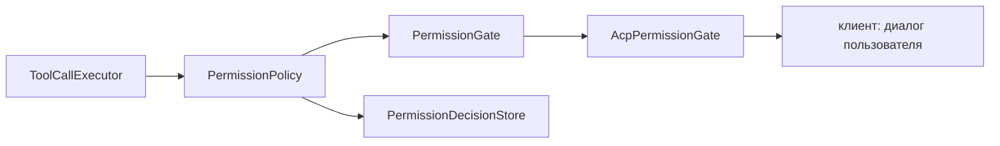
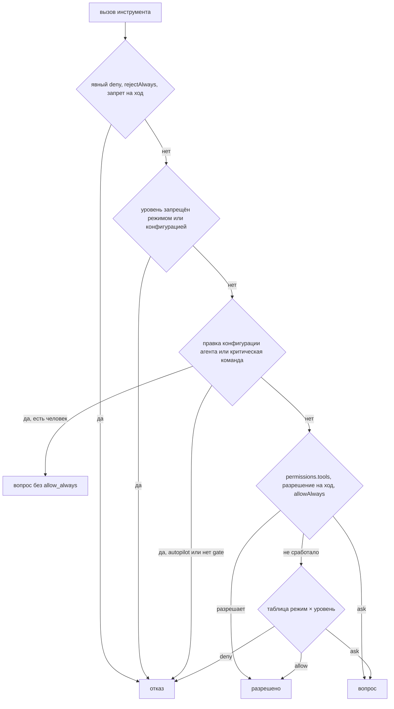
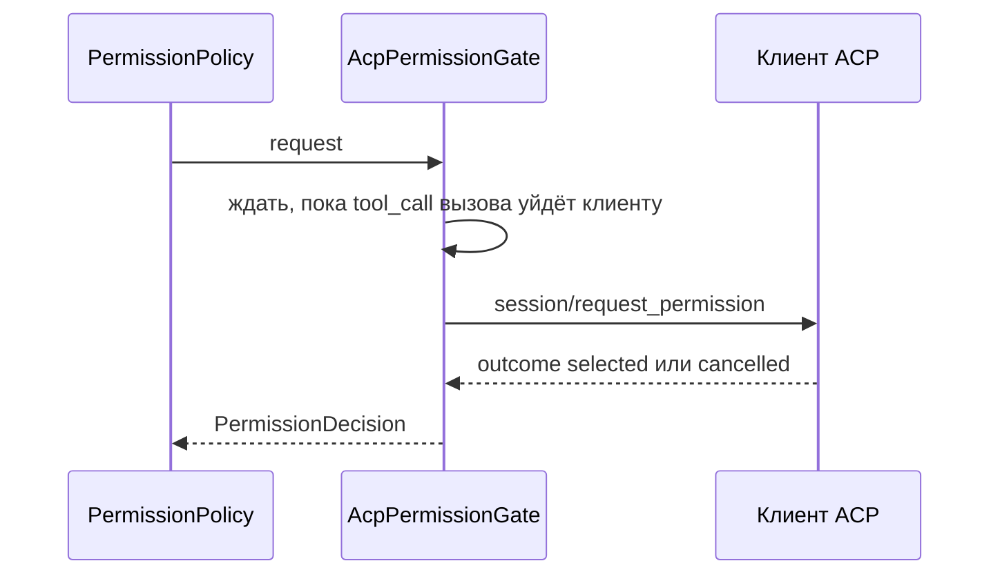

# Разрешения

Глава о том, кто и как решает, можно ли исполнить вызов инструмента: политика `PermissionPolicy`, режимы и уровни, критические команды, защита конфигурации агента, порт `PermissionGate` и путь вопроса до пользователя. Перед ней прочитайте [главу об инструментах](./06-tools.md): политика — первый хук `beforeToolCall` единой точки исполнения.

Нормы заданы спецификацией [`agent-permissions`](../../../../openspec/specs/agent-permissions/spec.md); продуктовые правила и место решения в системе — в [`docs/architecture/permissions.md`](../../../../docs/architecture/permissions.md). Здесь описано, как их держит код ядра.

## Принцип

Модель присылает вызов, но разрешает его не модель, не сервер и не клиентский слой протокола, а политика в ядре. Решение одно на вызов, принимается до любого побочного эффекта (PERM-1). Ядро не знает, как задаётся вопрос человеку: у него есть только порт `PermissionGate`. Реализует порт хост. В процессе агента это `AcpPermissionGate` из `codelab_agent_acp`, который превращает вопрос в ACP-запрос `session/request_permission`.

Исполнитель зовёт политику как хук. Политика при необходимости спрашивает порт, а ответы «всегда» запоминает в хранилище сессии. Дальше порт уходит в ACP, а диалог показывает клиент ([глава 03](./03-request-flow.md)).

## Что где лежит

| Файл (`lib/src/permissions/`) | Что в нём |
|---|---|
| `policy.dart` | `PermissionPolicy`, `PolicyRules`, `PolicyOutcome` (`Allowed`, `Denied`), `decide`, хук `asHook` |
| `modes.dart` | `PermissionMode`, `ModeId`, `ToolPolicy`, таблица `tierDecision`, функция сужения `narrow` |
| `gate.dart` | порт `PermissionGate`, `PermissionRequest`, `PermissionDecision` |
| `pattern.dart` | `PermissionKey`, `PermissionDecisionStore` |
| `critical_patterns.dart` | таблица критических команд `exec`, `findCritical` |
| `shell_lexer.dart`, `shell_glob.dart`, `command_args.dart` | разбор команды: лексер, маски, аргументы |
| `agent_config_rules.dart`, `agent_config_paths.dart` | защита файлов конфигурации агента (PERM-11) |

## Режимы и уровни

У каждого инструмента есть уровень (`ToolTier`: `read`, `write`, `network`, `exec`), у сессии — режим. Таблицу «режим × уровень» задаёт функция `tierDecision` (`modes.dart`).

| Режим (`PermissionMode`) | `read` | `write` | `network` | `exec` |
|---|---|---|---|---|
| `alwaysAsk` | вопрос | вопрос | вопрос | вопрос |
| `write` | разрешено | вопрос | вопрос | вопрос |
| `acceptEdits` | разрешено | разрешено | вопрос | вопрос |
| `yolo` | разрешено | разрешено | вопрос | разрешено |
| `autopilot` | разрешено | разрешено | запрет | разрешено |

Порядок значений `PermissionMode` — порядок мягкости: `alwaysAsk < write < acceptEdits < yolo < autopilot`. Им пользуется и сужение режима потомков (требование «Режимы и уровни» спецификации `agent-permissions`). «Вопрос» значит вызов `PermissionGate`; «запрет» в `autopilot` — отказ без вопроса, потому что некому спросить.

Клиент видит не `PermissionMode`, а `ModeId` (`modes.dart`):

| `ModeId` | `PermissionMode` | Особенность |
|---|---|---|
| `plan` | `write` | запрещает уровни `write` и `exec` без вопроса, причина `plan mode: changes are not allowed` |
| `ask` | `alwaysAsk` | |
| `standard` | `write` | режим новой сессии по умолчанию в профилях хостов |
| `accept-edits` | `acceptEdits` | |
| `bypass` | `yolo` | |

`autopilot` режимом сессии не является. Его включает только флаг запуска (`--permission-mode autopilot`), он приходит в политику как `modeOverride` из `PermissionsConfig` и перекрывает режим сессии. Ни слой конфигурации, ни переменная окружения, ни ACP его не включают (CFG-4). У `modeOverride` есть следствие: при нём не действуют ни запреты уровней режима `plan`, ни `extraDeniedTiers` из конфигурации (оба проверяются, только если `modeOverride == null`).

`ModeId.tryParse` принимает и устаревшие синонимы (`architect`, `debug`, `acceptEdits`, `code`), наружу всегда уходит основной идентификатор. `ModeId.softness` и `fitsFloor` нужны выбору агента: определение агента не может сделать режим мягче режима конфигурации; неизвестный режим не подходит никогда (fail closed). Подробности про агентов — в [главе 09](./09-config-prompts-commands.md).

Смену режима (`session/set_mode`, слэш-команда `/mode`, выбор агента) сессия применяет методом `_applyMode`: поле `PermissionPolicy.mode` меняется сразу, а при выборе агента во время хода — на границе шага. Решение действует со следующего вызова инструмента.

## Порядок решения

`PermissionPolicy.asHook(lookup)` возвращает хук `beforeToolCall`. `buildAgentCore` и рантайм ставят его **первым** в цепочку сессии, хуки хоста (`SessionSpec.extraBeforeToolCall`) идут после. Хук находит инструмент и зовёт `decide`; отказ превращается в `Block` с текстом `Permission denied for <tool>: <reason>. Do not retry the same call; choose another approach or ask the user.` и исходом `rejected` (или `cancelled`, если отменён ход, пока шёл вопрос). Отказ — данные для модели: ход продолжается (PERM-7).

Правила `decide` применяются строго по порядку и останавливаются на первом сработавшем. Схема показывает один вызов.

Схема сжата: правка конфигурации агента и критическая команда показаны одним узлом, а решения из `permissions.tools`, «на ход» и «всегда» — другим. Любой «вопрос» идёт через `_ask` (раздел ниже). Что стоит знать:

1. **Явные запреты первыми.** `permissions.tools.<tool>: deny`, ключ в `permissions.deny` (`PolicyRules.denyPatterns`) или ключ в `rejectAlways` дают отказ. Запрет сильнее любого разрешения (PERM-2). Запрет «на ход» (`grantForTurn(deny:)`) тоже здесь. `grantForTurn` и `clearTurnGrants` (вызывается в начале каждого `prompt()`, PERM-8) — API политики для хостов и тестов; в `lib/` ядра `grantForTurn` сейчас никто не вызывает.
2. **Запрет уровня.** Режим `plan` и `extraDeniedTiers` из конфигурации (сочетание `ask` и `plan` слоёв конфигурации даёт `ask` с запретом `write` и `exec`) отклоняют вызов без вопроса. Смена режима сессии (`set_mode`) дополнительные запреты не снимает: они приходят из проекта, а не из режима. Снимает их только `modeOverride` (`autopilot`).
3. **Правка конфигурации агента** — критическая всегда (раздел ниже).
4. **Критическая команда `exec`** сильнее политики `allow`, разрешения на ход и `allowAlways` (PERM-2). В `autopilot` — отказ `critical command blocked in autopilot: <метка>`, иначе вопрос без варианта `allow_always` (PERM-9).
5. **Политика инструмента** `permissions.tools.<tool>`: `allow` разрешает, `ask` спрашивает; `deny` уже обработан на шаге 1.
6. **Разрешения «на ход» и «всегда»** — `allowAlways` ищется по `PermissionKey`, см. раздел ниже.
7. **Таблица `tierDecision`** — последнее слово по умолчанию.

Источник правил конфигурации — слои `permissions.*` (`CoreConfig.permissions`, разбор в `lib/src/config/resolve.dart`). Проектный слой может только ужесточать режим и запреты, независимо от доверия проекту; подробности — в [главе 09](./09-config-prompts-commands.md).

### Что ядро не решает

- Метод ACP `fs/*` и `terminal/*` (агент → клиент) ядро не проверяет: инструменты работают через `ExecutionEnv`, а containment рабочей папки держит `BoundedEnv` ([глава 06](./06-tools.md#boundedenv)). Это сознательное исключение из общего правила, описанное в `AGENTS.md` репозитория, §10.
- Неизвестный инструмент не опасен по умолчанию, а запрещён: уровень по умолчанию — `exec` (TOOL-5). Поэтому MCP-инструмент с уровнем `exec` в `plan` отклоняется без вопроса, а в `standard` и `accept-edits` спрашивается.
- Вызов MCP-инструмента доходит до сервера (`tools/call`) только после решения политики. Аннотации сервера на решение не влияют (требование «MCP-вызов только после решения политики» спецификации).

## Вопрос пользователю

`PermissionPolicy._ask` формирует `PermissionRequest` и ждёт ответа от `PermissionGate`.

Поля запроса (`gate.dart`):

| Поле | Содержание |
|---|---|
| `toolCallId`, `tool`, `kind`, `tier`, `title` | какой вызов и как его показать |
| `rawInput` | **приведённые** аргументы, которые будут исполнены, а не сырые (PERM-6) |
| `locations`, `diffs` | места и diff каждого изменяемого файла; берутся из `ToolContext.presentation`, уже построенной `present` |
| `pattern` | шаблон «разрешить всегда» (`AgentTool.permissionPattern`), им клиент подписывает варианты |
| `reason`, `criticalLabel` | причина вопроса и метка критического правила |
| `allowAlwaysOffered` | предлагать ли `allow_always`: ложь для критических команд и конфигурации |
| `subagent` | сведения о потомке, чей вопрос; пусто у корня |

Заголовок и diff политика не строит заново: берёт `ctx.presentation`, построенную при `announce`. Иначе каждый вызов через ACP-клиента добавил бы лишний кадр `fs/read_text_file`.

Ответ — `PermissionDecision`:

| Решение | Что делает политика |
|---|---|
| `allowOnce` | `Allowed('user')` |
| `allowAlways` | кладёт `PermissionKey` в `allowAlways` (если вариант предлагался; иначе как `allowOnce`) и разрешает |
| `rejectOnce` | `Denied('rejected by the user')` |
| `rejectAlways` | кладёт ключ в `rejectAlways` и отказывает |
| `cancelled` | `Denied('permission request was cancelled')` |

Три свойства вопроса:

- **Нет gate — нет разрешения** (PERM-5). Без порта любое «спросить» превращается в отказ `no approval interface is available`. Порт приходит от хоста: сессия берёт `ports.gate ?? services.gate`, но только если в профиле включена capability `interactiveApproval`, иначе `gate` равен `null`. Это не `autopilot`: без gate отклоняется всё, что требует вопроса.
- **Ожидание человека не входит в время хода.** Перед запросом политика зовёт `ApprovalWaitMeter.begin`, а `end` — в `finally`, в том числе при отмене. Счётчик суммирует длину объединения интервалов, поэтому одновременные вопросы параллельного пакета считаются один раз. Бюджет хода читает это значение ([глава 04](./04-turn-loop.md)).
- **Отмена прекращает ожидание.** Запрос гоняется с токеном хода (`raceCancel`); при отмене решение — `cancelled`, поздний ответ клиента игнорируется (PERM-4).

Политика пишет в журнал `permission.asked` (с уровнем и признаком критичности), `permission.decided` и `permission.denied` (с причиной). Значения аргументов в них не попадают ([глава 10](./10-observability-and-errors.md)).

## «Разрешить всегда»

Решения «всегда» хранит `PermissionDecisionStore` — два множества `PermissionKey(tool, pattern)` в памяти сессии. Ключ состоит из имени инструмента и шаблона аргументов, а не из вида инструмента (PERM-3): решение для одного ключа не действует на другой. Шаблон строит сам инструмент методом `permissionPattern`:

| Инструмент | Шаблон |
|---|---|
| `write`, `edit` | путь относительно корня после нормализации |
| `read`, `ls`, `search` | нормализованный путь, по умолчанию `.` |
| `exec` | строка команды без пробелов по краям |
| `task_*` | `*` |
| `agent` | имя типа субагента |
| `skill` | имя навыка |
| остальные, в том числе MCP | канонический JSON аргументов |

Поэтому `exec dart test` не разрешает `exec dart test --update-goldens`. Хранилище живёт до закрытия сессии и в журнал не пишется: после `session/load` агент спросит снова. У дерева субагентов хранилище одно, корневое: решение потомка действует на всё дерево и наоборот. Поэтому `rejectAlways`, выбранный в корне, нельзя обойти через ребёнка.

## Критические команды

Некоторые команды необратимы или уводят агента из-под контроля человека: `rm -rf /`, `curl … | sh`, `git push --force`. Для них вопрос задаётся в любом режиме, даже после «разрешить всегда», а в `autopilot` — отказ (PERM-2, PERM-9).

`defaultCriticalFinder` (`policy.dart`) применяется только к инструменту `exec` и зовёт `findCritical` (`critical_patterns.dart`). Он возвращает метки совпавших строк таблицы (одна команда может совпасть с несколькими); `reason` перечисляет их через `; `:

- рекурсивное удаление защищённого пути, удаление `.git`, `find -delete` и рекурсивная смена прав защищённого пути;
- привилегированные команды, fork-бомба, запись в диск, форматирование, перезапись системных файлов учётных записей, запись в конфигурацию SSH;
- «скачать и выполнить», остановка и перезагрузка хоста, `kill` init и всех процессов;
- запись в конфигурацию агента (ниже);
- force push и удаление удалённой ветки, переписывание истории git.

Точная таблица с примерами срабатываний — в [`docs/architecture/proposals/agent-core/07-permissions.md`](../../../../docs/architecture/proposals/agent-core/07-permissions.md) §7.6 и тесте `critical_patterns_test.dart`.

Искать совпадения подстрокой нельзя: `git commit -m "rm -rf /"` безопасна, а `sh -c 'rm -rf ~'` опасна. Поэтому команда разбирается лексером `parseShell` (`shell_lexer.dart`). Он понимает кавычки и `\`, операторы `&&`, `||`, `;`, `|`, `&`, подоболочки и группы, подстановки `$( … )` и обратные кавычки как вложенные команды, аргумент `-c` у оболочек и `eval` как вложенную команду, here-document как данные, лаунчеры (`sudo`, `env`, `nohup`, `timeout`, `xargs` и другие) и перенаправления. Это не интерпретатор: переменные не раскрываются, `cd` каталог не меняет (кроме правил конфигурации агента). Готовый парсер shell не подходит: allowlist зависимостей PKG-2 закрыт.

Команда, которую не удалось разобрать, — незакрытая кавычка или вложенность глубже `maxShellNesting` — получает метку `unparsable command` и считается критической. Это fail closed: ошибка разбора не должна превращаться в разрешение.

### Правка конфигурации агента

Агент перечитывает свою конфигурацию на лету, поэтому то, что он перечитывает, модель не должна править без человека (PERM-11). Критическими считаются:

- вызовы `write` и `edit`, цель которых — файл из списка `.codelab/config.yaml`, `.codelab/config.local.yaml`, `.codelab/cli.yaml`, `.codelab/agents/**`, `.codelab/skills/**`, `.codelab/prompts/**`, `.codelab/hooks/**`, `.agents/skills/**` (`isAgentConfigPath`); проектное правило покрывает любой `.codelab/config*.yaml`. К списку добавляются корни навыков сессии, которые зависят от `cwd` (рантайм передаёт их через `AgentConfigPaths.withSession`);
- пути, которые хост передаёт полем `AgentCoreServices.agentConfigPaths` (`AgentConfigPaths`): глобальный `$CODELAB_HOME/config.yaml`, файл `--config`, конфиг корня запуска, `secrets.yaml`, каталоги `agents`, `prompts`, `skills`, а также `$CODELAB_HOME/state` с `state/last-model.json`, корень навыков `~/.agents/skills` и дополнительные корни навыков из `skills.extra_roots`. Ядро само их узнать не может — у него нет ни окружения, ни файловой системы (PKG-1); список строит хост функцией `agentConfigPathsFor` (`codelab_agent_io`, [глава 02](./02-assembly-and-hosts.md));
- команды `exec`, пишущие в эти пути или в их каталоги-предки: перенаправление, `tee`, `cp`, `mv`, `ln`, `sed -i`, `dd of=` и другие (`agent_config_rules.dart`).

Правило для `exec` устроено как «белый список чтения»: команда с таким путём в аргументе критична, кроме команд только чтения (`cat`, `grep`, `ls`, `git diff` и подобных, без опций записи). Чтение файлов конфигурации не ограничено.

Для `write` и `edit` политика узнаёт правку по `lockPath`: путь блокируют именно инструменты, которые меняют файл. Ссылки политика раскрывает сама: `PermissionPolicy.pathResolver` — окружение сессии, если оно реализует `PathResolver`, иначе `baseEnv` хоста. У сессии `serve` окружение сессии — клиент ACP, он ссылок не раскрывает, а защищаемые пути — пути хоста. Каноническая форма защищаемых путей пересчитывается на каждой проверке: каталог, ставший ссылкой после старта, не выводит путь из-под защиты.

Для таких вызовов вопрос задаётся в любом режиме, включая `bypass`, и без `allow_always`; ранее выданные «всегда» не действуют. В `autopilot` и без gate — отказ `Editing agent configuration requires a human: <path>`.

Исключения E1–E3 для навыков (запуск скрипта из `scripts/` каталога загруженного навыка, рабочий каталог навыка, ресурс из `assets/` как аргумент скрипта) описаны в спецификации; они дают обычную политику уровня `exec`, в том числе с `allow_always`. Ядро реализует их в `agent_config_rules.dart`, а каталоги навыков сессии добавляет рантайм методом `AgentConfigPaths.withSession`.

## Разрешения субагентов

Потомок — обычная сессия, и у него обычная `PermissionPolicy` (`lib/src/runtime/agent_runtime.dart`, фабрика дочерней сессии). Отличия задаются данными, а не веткой кода:

- **Режим не мягче родительского.** Политика потомка получает `modeOf`: функцию, которая при каждом решении вычисляет `narrow(родитель, тип)` (`modes.dart`). Берётся меньший по порядку `PermissionMode`, запреты уровней объединяются. Родитель `ask` и тип `plan` дают `alwaysAsk` с запретом `write` и `exec`. Для внука сужение идёт по всей цепочке. Смена режима родителя посреди работы ребёнка действует со следующего вызова (SUB-2).
- **Общие правила и хранилище.** `PolicyRules` и `PermissionDecisionStore` одни на дерево.
- **Вопрос потомка идёт в gate корня.** `SubagentPermissionGate` (`lib/src/subagents/subagent_permission_gate.dart`) переписывает запрос под сессию корня: `toolCallId` становится цепочкой через `/` от вызова `agent` корня (`call_3/call_1`), `title` получает префикс `[<тип>: <описание>]`, поле `subagent` заполняется. Клиент знает только корневую сессию, поэтому уникальность `toolCallId` внутри корня обязательна (PERM-4).
- **Очередь.** `SubagentQuestionQueue` пропускает к gate корня один вопрос за раз, остальные ждут в порядке прихода. Запрос самого корня очередь не использует. Отмена потомка снимает ждущий запрос без кадра клиенту. Пока вопрос ждёт, хэндл потомка в состоянии `waiting` с причиной `approval`.
- **Нет gate у корня — нет вопроса:** запрос потомка становится отказом `no approval interface is available` (PERM-5).

Остальное про субагентов — в [главе 06](./06-tools.md#субагенты).

## Как вопрос доходит до пользователя

Путь вопроса — сквозной, поэтому подробная последовательность сообщений ведётся в [главе 03](./03-request-flow.md). Здесь — роль адаптера.

`AcpPermissionGate` (`packages/dart/codelab_agent_acp/lib/src/acp_permission_gate.dart`) создаётся соединением на сессию и передаётся в порты сессии (`SessionHostPorts.gate`, `agent_server.dart`). Для встроенного агента клиентский слой отвечает по `InProcessAcpLink`; отдельного обхода одобрения у встроенного режима нет.

Что делает адаптер:

1. **Ждёт объявления вызова.** Запрос разрешения не должен опередить `tool_call` этого же вызова, иначе клиент не привяжет вопрос к строке вызова. Для потомка без согласия клиента `subagentToolCalls` ждёт вызов `agent` корня.
2. **Строит запрос.** `ToolCallUpdate` со статусом `pending`, `rawInput`, `locations`, причиной первым текстовым блоком и `diff` на каждый файл. Варианты: `allow_once`, `allow_always` (если предложен, с шаблоном в подписи), `reject_once`, `reject_always`. `optionId` совпадает с видом варианта. Для критической команды и потомка в `_meta.codelab` кладутся `critical`, `label` и `subagent`.
3. **Читает ответ.** `selected` с `optionId` превращается в решение; `cancelled` и отмена хода — в `cancelled`. Неизвестный `optionId` и `allow_always`, которого не предлагали, — не разрешение, а `rejectOnce` с записью `acp.permission.unknown_option`.
4. **Любой сбой — отказ**, никогда не разрешение: ошибка клиента, недекодируемый ответ, обрыв соединения. Исключение — переподключение: с `waitForReconnect` обрыв не отказ, вопрос ждёт нового соединения и задаётся заново с тем же `toolCallId`.

Клиентская сторона — диалог, варианты, хранение стабильных разрешений — в `codelab_client_core` и клиентах и сюда не входит ([`docs/architecture/permissions.md`](../../../../docs/architecture/permissions.md)).

## Инварианты

| Инвариант | Где держится в коде |
|---|---|
| PERM-1: политика первая, до неё нет побочных эффектов | порядок хуков в сборке сессии; единственный вызов `execute` — в `executor.dart` |
| PERM-2: явный запрет и критическая команда сильнее разрешений | порядок правил в `PermissionPolicy._decide` |
| PERM-3: «всегда» только по ключу | `PermissionKey`, `PermissionDecisionStore` |
| PERM-4: решение на один `toolCallId`, поздний ответ игнорируется | `raceCancel` в `_ask`; цепочка id в `SubagentPermissionGate` |
| PERM-5: нет gate — отказ | ветка `gate == null` в `_ask` |
| PERM-6: запрос несёт приведённые аргументы и diff | `PermissionRequest.rawInput`, `ToolContext.presentation` |
| PERM-7: отказ и `cancelled` не завершают ход | `asHook` возвращает `Block`, цикл идёт дальше |
| PERM-8: grants на ход очищаются | `clearTurnGrants` в начале `prompt()` |
| PERM-9: критическая команда без `allow_always`, в `autopilot` отказ | ветки `criticalLabel` в `_decide` |
| PERM-11: конфигурация агента только с человеком | `_agentConfigTarget`, `agent_config_rules.dart` |

Тесты нормы — каталог `test/permissions/` ядра: `policy_order_test.dart`, `no_bypass_test.dart`, `allow_always_scope_test.dart`, `critical_patterns_test.dart`, `agent_config_paths_test.dart`. Как добавить режим или правило, — в [главе 11](./11-extending.md).

## Что не реализовано

Уровень `network` зарезервирован: строка таблицы режимов для него есть, но ни один встроенный и ни один MCP-инструмент им не пользуется. «Всегда» между сессиями ядро не хранит: стабильные разрешения на стороне клиента — тема клиентского слоя.
