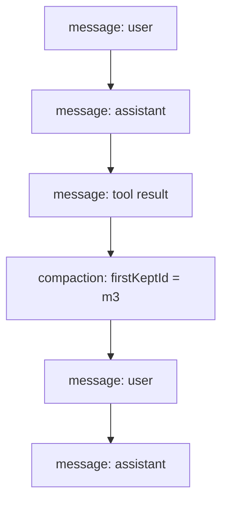
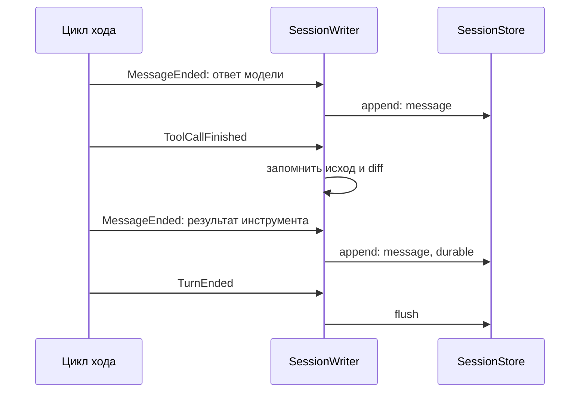
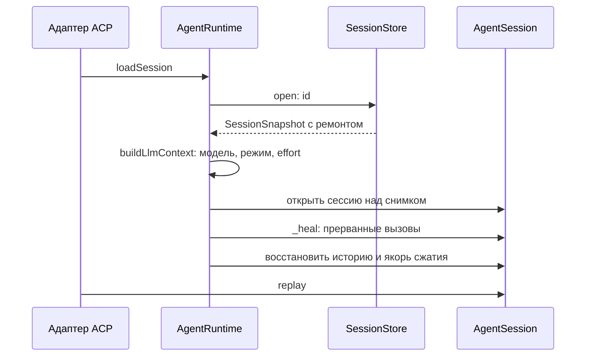

# Сессии, журнал и сжатие контекста

Глава про то, как ядро хранит историю сессии и как не даёт ей перерасти окно модели. Перед ней прочитайте [04-turn-loop.md](04-turn-loop.md): журнал пишется из событий цикла хода, а сжатие запускается вокруг хода.

Оба механизма держатся на одной идее: журнал сессии — единственный источник истины. Контекст модели, события для `session/load` и строка в списке сессий не хранятся отдельно. Их каждый раз строят из журнала чистыми функциями (`lib/src/session/projections.dart`, SES-7).

Нормы — в спецификациях [`agent-sessions`](../../../../openspec/specs/agent-sessions/spec.md) и [`agent-compaction`](../../../../openspec/specs/agent-compaction/spec.md). Здесь описано, как их выполняет код.

## Что где лежит

| Каталог | Ответственность |
|---|---|
| `lib/src/session/` | записи журнала, дерево, разбор и ремонт, писатель, проекции, порт `SessionStore`, `MemorySessionStore` |
| `lib/src/compaction/` | оценка токенов, пороги, точка среза, суммаризатор, компактор |
| `packages/dart/codelab_agent_io/lib/src/session/` | `JsonlSessionStore`: файлы на диске, очередь записи, `fsync`, карантин, индекс списка |

Деление на пакеты нарочное. Разбор журнала, дерево, ремонт «в памяти» и проекции живут в чистом ядре. Хранилище отвечает только за байты: дописать строку, прочитать всё, перечислить журналы. Поэтому файл на диске, `MemorySessionStore` и будущие хранилища (документы мобильного приложения, IndexedDB) ведут себя одинаково и проходят один контрактный набор тестов.


Стрелка от хранилища к `parseSessionLines` показывает, где проходит граница: хранилище отдаёт текст, а снимок строит ядро.

## Формат журнала

Журнал — UTF-8 файл JSON Lines: одна запись на строку, разделитель `\n`. Первая строка — заголовок `SessionHeader` (`{"type":"session","version":1,…}`), он не входит в дерево. Версия формата — `sessionFormatVersion` в `lib/src/session/records.dart`. Журнал неизвестной версии не открывается: `SessionOpenException(unsupportedVersion)`, файл не меняется (SES-2). Иначе старое ядро могло бы потерять данные новой версии при дописывании.

Остальные строки — наследники `sealed class SessionRecord`. Общие поля есть у каждой: `id`, `parentId`, `timestamp`. Неизвестные поля известной записи сохраняются в `extra` и пишутся обратно. Запись неизвестного `type` читается как `CustomRecord("unknown:<type>")` и не теряется.

| `type` | Класс | Что хранит |
|---|---|---|
| `message` | `MessageRecord` | сообщение транскрипта и поля для реплея: `outcome`, `diff`, `toolMeta`, `origin`, `nudge`, `attempt`, `command` |
| `model_change` | `ModelChangeRecord` | провайдер, id модели, `baseUrl` |
| `mode_change` | `ModeChangeRecord` | режим разрешений |
| `config_change` | `ConfigChangeRecord` | смена опции сессии (`effort`, `agent`): `optionId` и `value` |
| `compaction` | `CompactionRecord` | резюме, `firstKeptId`, оценки токенов до и после, `details`, `skills` |
| `task` | `TaskRecord` | операция над списком задач |
| `subagent` | `SubagentRecord` | связь с журналом ребёнка и итог его работы |
| `session_info` | `SessionInfoRecord` | заголовок сессии |
| `custom` | `CustomRecord` | служебные записи: `codelab.cwd_changed`, учёт отброшенного сжатия |
| `leaf`, `label` | `LeafRecord`, `LabelRecord` | перемотка ветки и метка |
| `plan` | `PlanRecord` | запись старого формата: читается, новые журналы её не пишут |

Поля `outcome`, `diff`, `toolMeta` лежат на верхнем уровне записи, а не внутри сообщения: модель видит только `MessageRecord.message`. `ToolMeta` хранит заголовок, вид и места вызова, чтобы реплей не вызывал `present()` у инструмента повторно.

В журнал не попадают: потоковые дельты, частичные снимки ответа, `ToolCallProgress`, `SubagentProgress`, `SubagentActivity`, решения «разрешить всегда». Всё это либо восстанавливается из записанного, либо не нужно после перезапуска.

Записи `leaf` и `label` формат и дерево понимают, но рантайм их не пишет: ветвление сессий не реализовано, имена `/branch`, `/rewind`, `/fork`, `/label` только зарезервированы в `reservedCommandNames` (`lib/src/commands/command_template.dart`), чтобы шаблон не занял их раньше времени. Проект — в [`proposals/agent-core/17-6-session-management.md`](../../../../docs/architecture/proposals/agent-core/17-6-session-management.md).

## Дерево записей

Журнал — не список, а дерево: у записи есть `parentId`, а «текущая позиция» — лист. Правила в `lib/src/session/tree.dart`:

- новая запись получает `parentId` равным текущему листу, первая — `null`;
- лист после обычной записи — её `id`, после записи `leaf` — её `targetId` (`leafAfter`);
- активная ветка — путь от листа к корню, развёрнутый от корня (`pathToLeaf`).



Пока ветвления нет, путь до листа совпадает с файлом. Дерево нужно, чтобы запись `leaf` и будущий fork работали без миграции формата.

`pathToLeaf` защищается от испорченного или подложенного файла: цикл в `parentId` обрывает обход и пишет `session.cycle`, отсутствующий родитель — `session.broken_link`, а число записей пути не больше числа записей снимка.

Идентификаторы (`lib/src/session/ids.dart`):

- `SessionId` — ULID: 10 символов времени по `Clock` хоста плюс 16 символов Crockford base32 из `IdGenerator`. Время в начале даёт сортировку файлов по созданию. Тот же id уходит в ACP как `sessionId`.
- `RecordId` — 8 символов `0-9a-z`. Уникальность нужна только внутри файла, поэтому id короткий. При совпадении id выдаётся заново до 16 раз, затем 12 символов (SES-3).

Время и случайность приходят от хоста (`Clock`, `IdGenerator`), поэтому на `FakeClock` и `SequentialIdGenerator` один и тот же сценарий даёт побайтово одинаковый журнал (PKG-6).

## Запись: `SessionWriter`

Цикл хода журнал не знает: он только публикует события (LOOP-6, «хост сохраняет, цикл эмитит»). Запись ведёт `SessionWriter` (`lib/src/session/session_writer.dart`) — первый подписчик `Agent`. Цикл ждёт каждого подписчика (LOOP-2), поэтому сообщение записано до следующего действия цикла (SES-8).



Что писатель делает с событиями:

| Событие | Запись |
|---|---|
| `MessageEnded` | `message`; для результата инструмента — с `outcome`, `diff` и `toolMeta`, помеченная `durable` (SES-9) |
| `ModeChanged` | `mode_change` |
| `TaskListChanged` | `task` (операцию `restore` не пишет: список выводится из ветки журнала) |
| `SubagentStarted`, `SubagentFinished` | `subagent`, обе `durable`; итог пишется до `ToolCallFinished(agent)` (SUB-10) |
| `SessionTitleChanged` | `session_info` с `source: auto` |
| `TurnEnded` | ничего, но `flush` последней записи хода |

`model_change`, `config_change`, `compaction` и служебные `custom` пишут не события, а сама сессия и компактор через `append` и `appendWith`.

Три неочевидных решения.

**Очередь записей (SES-16).** Запись ждёт хранилище, а родитель берётся из листа снимка. Если две записи стартуют одновременно (смена режима во время хода или фонового сжатия), обе получили бы один родитель, и вторая ушла бы на боковую ветку, невидимую для `buildLlmContext`. Поэтому `append`, `appendBuilt`, `appendWith` и записи из `handle` встают в одну цепочку: родитель, id и время вычисляются, когда до записи дошла очередь. Сбой одного звена очередь не рвёт, а ошибку получает только вызывающий.

**Снимок меняется после файла.** `_commit` сначала вызывает `store.append`, и только потом обновляет снимок в памяти. Если запись не удалась, снимок остаётся прежним.

**Сбой записи завершает ход.** Ошибка `handle` не вылетает наружу: писатель логирует `session.append.failed`, зовёт `onFailure`, и сессия отменяет ход причиной `StorageFailure` (`lib/src/cancel/cancel_token.dart`). Цикл завершает ход как `TurnEnded(failed)` с `AgentError(cls: storage)`. До следующего `TurnStarted` писатель молчит, иначе в журнале появилась бы запись с пропуском посередине. Ход, который нельзя сохранить, не продолжается.

### Точки восстановления

`append(durable: true)` — точка, которая должна пережить падение процесса. `JsonlSessionStore` сбрасывает файл на носитель по политике `FsyncPolicy` (`sessions.fsync`):

- `checkpoints` (по умолчанию) — только записи с `durable` и `flush` в конце хода;
- `always` — после каждой записи;
- `never` — решает ОС.

Падение процесса при любой политике ничего не теряет: строка уже отдана ОС. `fsync` защищает от отключения питания, и платить за него на каждой дельте ответа модели незачем.

## Хранилище на диске: `JsonlSessionStore`

Реализация порта для настольных хостов (`packages/dart/codelab_agent_io/lib/src/session/jsonl_session_store.dart`). Хост создаёт одно хранилище на процесс функцией `openHostSessions` (`host_sessions.dart`): корень — `sessions.dir` или `$CODELAB_HOME/sessions`, политика — `sessions.fsync`. Пользовательский смысл этих ключей и раскладка `CODELAB_HOME` — в [`apps/codelab_agent/doc/operations.md`](../../../../apps/codelab_agent/doc/operations.md) и [`docs/ops/codelab-home.md`](../../../../docs/ops/codelab-home.md).

Раскладка:

```text
<sessions>/
  index.json                              кэш списка сессий
  <cwdSlug>/
    <created>_<sessionId>.jsonl           журнал корневой сессии
    <created>_<sessionId>.jsonl.corrupt   карантин битых строк
    <created>_<sessionId>/
      usage.json                          журнал расхода
      subagents/<created>_<childId>.jsonl журналы субагентов
```

`cwdSlug(cwd)` (`lib/src/session/slug.dart`) — два последних сегмента пути плюс хеш FNV-1a полного пути. Человек находит каталог глазами, хеш исключает коллизии `/a/b-c` и `/a-b/c`. Слаг необратим, истинный `cwd` хранится в заголовке. Журналы субагентов любой глубины лежат плоско в `subagents/` корня: вложенные каталоги дали бы путь длиннее 260 символов Windows.

Остальное:

- **Очередь на путь** (`write_queue.dart`). Одна цепочка `Future` на файл, общая для процесса, чтобы байты двух строк не перемешались (SES-4). Межпроцессной блокировки нет: одна сессия — один процесс-писатель.
- **Индекс списка.** `list` не разбирает все журналы заново: `index.json` хранит сводку и ключ свежести `(size, mtime)`. Индекс — производный файл: нечитаемый игнорируется с `session.index.ignored`. Страницы идут от новых к старым, курсор — base64 от времени и id (`pageOf` в `session_store.dart`).
- **Containment.** Файл, чей `realpath` вне корня хранилища, не читается и не переписывается: подложенная ссылка не должна вывести ремонт за `sessions/`.

## Открытие и ремонт

`SessionStore.open(id)` читает файл как текст (`utf8.decode(..., allowMalformed: true)`) и отдаёт его `parseSessionLines` (`lib/src/session/parse.dart`). Ремонт делится на две части: что исправить в памяти (делает ядро) и что исправить на носителе (делает хранилище по отчёту `ParsedJournal`).

| Ситуация | Что делает разбор | Что делает хранилище |
|---|---|---|
| нет заголовка | синтезирует его в памяти, `headerMissing` | в файл не дописывает |
| строка не разбирается: обрыв, мусор, не объект, нет `id` | отправляет в `quarantine` | пишет `{line, text, reason, at}` в `.corrupt` |
| дубликат `id` | в карантин, `reason: duplicate id` | так же |
| оборвана только последняя строка | `onlyTailBroken` | усекает файл до конца последней целой строки |
| иной карантин | `keptLines` — уцелевшие строки как были | переписывает файл через `.tmp` и `rename` |
| последняя строка целая, но без `\n` | `missingFinalNewline` | дописывает `\n`, иначе две записи склеятся |
| лист указывает на несуществующий id | лист — последняя уцелевшая запись не `leaf`, `healedLeafFrom`, лог `session.leaf.healed` | в файл ничего не пишет |
| `parentId` указывает в пустоту | считает `brokenLinks` | — |

Переписывание при карантине — единственное, что меняет существующие строки журнала (SES-1). Оборванная последняя строка не мешает открыть сессию (SES-5): падение посреди записи — обычный случай, а не авария.

Итог ремонта — `RepairReport` в снимке (`quarantinedLines`, `headerMissing`, `healedLeafFrom`, `brokenLinks`, `interruptedToolCalls`); `isClean` истинно, когда чинить было нечего.

## Прерванный ход

Если процесс упал между вызовом инструмента и записью результата, в последнем ответе ассистента остаются вызовы без `toolResult`. Модель с таким хвостом не примут многие провайдеры, а повторять вызов нельзя: `exec` или `write` могли выполниться наполовину.

`_Session._heal` (`lib/src/runtime/agent_runtime.dart`) вызывается сразу после `open()`, до реплея и до первого нового шага:

1. `findInterruptedCalls` находит вызовы последнего ответа ветки без результата.
2. `healInterruptedTurn` строит для каждого синтетическую запись `toolResult` с `outcome: interrupted`, `isError: true` и фиксированным текстом `interruptedResultText` (он просит перечитать состояние перед повтором).
3. Сессия пишет записи с `durable`; их `toolCallId` попадают в `RepairReport.interruptedToolCalls` (SES-10).

Вызов `agent` — исключение: если итоговая запись `subagent` уже есть, отчёт ребёнка не теряется и становится результатом вызова. Дети в статусе `running` получают итоговую запись `failed` с причиной `interrupted`, а их собственные журналы лечатся тем же способом рекурсивно, не глубже трёх уровней (`_maxHealDepth`). Ничего не перезапускается: сессия после загрузки — в `idle`.

## Проекции

Проекции — чистые функции над `SessionSnapshot` в `lib/src/session/`.

**`buildLlmContext`** (`projections.dart`) — сообщения для модели. Идёт по активной ветке и собирает также последние `model_change`, `mode_change` и `config_change` по `optionId`: так сессия при загрузке знает, какой была модель, режим и `effort`. Если на ветке есть `compaction`, записи до `firstKeptId` заменяет резюме (подробности — в разделе про сжатие ниже). Результат — `LlmContextProjection`.

**`buildReplay`** — события для `session/load`: клиент получает ту же последовательность событий, что видел вживую. Записи до сжатия реплей показывает, журнал их хранит. Служебные user-сообщения (подсказки цикла, уведомления) пропускаются: клиент не должен показывать их репликой человека. Вызов `agent` реплей собирает из записи `subagent`.

**`buildReplayTree`** (`replay_tree.dart`) — то же с потомками. Журналы детей читаются асинхронно через `openChildReadOnly`: без записи и без захвата дескриптора, поэтому живой потомок, переживший `cancel_grace`, не страдает. Глубина не больше `replayTreeMaxDepth` (3), посещённые адреса запоминаются (цикл в подложенных ссылках). Журнал ребёнка, который не открылся, даёт `subagent.replay_failed`, и `session/load` не падает.

**`summarize`** (`summary.dart`) — строка списка: заголовок, `cwd`, время, число сообщений, признак `lastTurnFailed`. Заголовок — последний `session_info` непустой, иначе первые слова пользователя (`sessionTitleFrom`: до 80 символов, обрезка по границе слова). Сводку строят и хранилища, поэтому она входит в публичный API порта.

**Слова пользователя** (`user_words.dart`). Решение «это написал человек» принимает только `isUserWords` (по записи) и `isUserWordsEvent` (по событию) (SES-14). Запись `user` без `origin` — слова человека. Известный `origin` классифицирует `classifyOrigin`: `steer` и `parent_message` — слова пользователя, остальные (`loop_nudge`, `loop_note`, `deadline_notice`, `subagent_notice`, `job_notice`, `subagent_resume`) служебные. `switch` без `default` делает новое значение ошибкой компиляции, а не молчаливо служебным (SES-15). Неизвестный `origin` из журнала более новой версии не слова пользователя, но остаётся в контексте модели; предупреждение `session.origin.unknown` пишется один раз на значение. От этого решения зависят заголовок, счёт сообщений, реплей и срез при сжатии.

## Создание, загрузка и список сессий

`AgentRuntime` (`lib/src/runtime/agent_runtime.dart`) предоставляет три операции: `createSession`, `loadSession` и `listSessions` (страница `SessionPage` с курсором, фильтр по `cwd`). `createSession` создаёт журнал (`store.create` с заголовком), пишет первую запись `model_change` и возвращает `AgentSession`. `loadSession` (`lib/src/runtime/agent_runtime.dart`) делает обратное:



Порядок значим. Модель из журнала побеждает, если её знает каталог; иначе берётся модель конфигурации, пишется лог `session.model.not_restored` и новая запись `model_change`. Если сессию открыли в другой папке, чем записана в заголовке, пишется `custom` с типом `codelab.cwd_changed`. Конфигурацию папки сессии читает порт `ProjectConfigLoader` — см. [09-config-prompts-commands.md](09-config-prompts-commands.md).

Сессия без постоянного хранилища (`MemorySessionStore`) допустима только при выключенной capability `sessionPersistence`: `buildAgentCore` отвергает другую связку `HostWiringException` — см. [02-assembly-and-hosts.md](02-assembly-and-hosts.md).

## Сжатие контекста

Окно модели конечно, а сессия растёт. Сжатие заменяет старую часть ветки кратким резюме, которое пишет та же модель. Включено, если у профиля хоста включена capability `compaction`; `buildAgentCore` выключает её, когда `compaction.enabled: false`. Выключено — ни один триггер не срабатывает.

Главное правило: сжатие только добавляет запись `compaction` (CMP-2). Исходные записи остаются в файле и в реплее, а контекст модели строит проекция. Неудача и отмена ничего не пишут (CMP-3).

### Оценка размера

Точного токенайзера для всех провайдеров нет, поэтому `lib/src/compaction/estimate.dart` оценивает приблизительно и якорится на точных данных провайдера:

- **Эвристика** `estimateTokens`: 4 символа UTF-16 за токен, картинка — константа `imageTokens` (1200), `+4` на сообщение, системный промпт и схемы инструментов — по длине текста.
- **Якорь на usage** в `estimateContextTokens`: берётся последний ответ с ненулевым `input + cacheRead + cacheWrite`. Его `usage` уже включает промпт, схемы и всё до него, поэтому оценивается только хвост после него.
- **Якорь на сжатие.** Сразу после сжатия в проекции нет ответа с usage: у ответов до сжатия usage обнулён (`Usage.zero`), иначе оценка оставалась бы старой и сжатие запускалось бы снова и снова. Тогда оценка = `tokensAfter + эвристика − raw`, где `raw` — эвристика по тому, что `tokensAfter` покрывает. Якорь — `CompactionAnchor` (`tokens`, `raw`), его строит `compactionAnchorOf` по `LlmContextProjection.compactionCovered` (CMP-11).
- **Окно** считает одна функция `effectiveContextWindow`: `min(model.contextWindow, compaction.context_window_cap)`. Порог, проверка перед запросом и `ModelRequested.estimatedTokens` обязаны её использовать (CMP-6).

### Пороги

`CompactionSettings.forWindow(window, overrides:)` (`settings.dart`) выводит пороги из доли окна, потому что значения для окна 200 000 бессмысленны для модели на 8 000:

| Параметр | Значение по умолчанию | Предел сверху |
|---|---|---|
| `reserveTokens` — запас под ответ и служебный текст | `window/4`, но в пределах 1024…16384 | `max(128, window/4)` |
| `keepRecentTokens` — свежий хвост дословно | `window/2`, но в пределах 2048…20000 | `max(256, window/2)` |
| `keepRecentUserTurns` — минимум последних ходов человека в хвосте | 1 | — |

Ключи `compaction.reserve_tokens`, `compaction.keep_recent_tokens`, `compaction.keep_recent_user_turns`, `compaction.context_window_cap` заменяют вычисленное, но проходят те же верхние пределы. Порог `afterTurn` — `window − reserveTokens` (`shouldCompact`: строго выше). Ключи действуют со следующего хода: `_refreshSettings` берёт их из применённого снимка конфигурации на границе хода (CFG-16).

Сессия с окном меньше `minSubagentContextWindow` (32768) инструмента `agent` не видит: его схема и отчёты детей занимали бы окно целиком.

### Когда запускается

`CompactionTrigger` (`compactor.dart`) — четыре точки:

| Триггер | Когда | Где вызывается |
|---|---|---|
| `afterTurn` | после `TurnEnded` со `completed` или `maxTokens`, если оценка выше порога | `_Session._compactAfterTurn`: в фоне, следующий `prompt()` дожидается завершения |
| `preflight` | оценка payload шага выше самого окна | аварийный путь цикла, `_emergency` |
| `overflow` | провайдер ответил `errorClass: overflow` | то же, затем один повтор шага |
| `manual` | команда `/compact [focus]` | `_compactNow`, вне хода; `focus` только здесь |

После `cancelled` и `failed` фоновое сжатие не запускается. В одном ходу `preflight` и `overflow` вместе вызывают сжатие не больше одного раза (CMP-8): второе переполнение завершает ход `TurnEnded(failed)`. Ошибка фонового сжатия не теряется: `compaction.failed` в лог и `AgentError(cls: compaction)` в события: ошибки фоновых операций не теряются (`AGENTS.md` §12).

### Точка среза

`compactionRegion` (`cut_point.dart`) берёт записи активной ветки от `firstKeptId` последнего сжатия (или с начала), без самих записей `compaction`: прошлое резюме идёт отдельно как `previousSummary` (CMP-9). `findCutPoint` по шагам выбирает первую запись хвоста:

1. Хвост копится с конца, пока не наберётся `keepRecentTokens`.
2. Срез сдвигается вперёд до границы: перед user- или assistant-сообщением. Так вызов не отделяется от результата (CMP-1).
3. Последние `keepRecentUserTurns` ходов человека (по `isUserWords`) остаются в хвосте целиком (CMP-7).
4. Служебные записи прямо перед срезом (`model_change`, `mode_change`, `config_change`, `plan`, `task`, `subagent`, `session_info`, `label`) уходят в хвост.
5. Если срез попал внутрь хода, `splitTurn = true`: начало хода резюмируется отдельно, а слова человека цитируются дословно.

Нечего сжимать — `null`.

### Резюме

`modelSummarizer` (`summarizer.dart`) вызывает ту же `StreamFunction` и модель сессии без инструментов, с системным промптом `compaction/system` и `cacheKey` `<sessionId>:summary`. Регион сериализуется в текст с заголовками сообщений (`serializeRegion`), а не уходит историей: получив историю, модель продолжила бы разговор вместо пересказа. Результаты инструментов длиннее 4000 символов сокращаются, самые старые сообщения отбрасываются, пока текст не уложится в бюджет `max(window − reserve, window/2)`.

Запрос строится по шаблонам: `compaction/summary` при первом сжатии, `compaction/summary_update` — когда есть прошлое резюме (его обновляют, а не пишут заново: открытые просьбы пользователя не теряются), `compaction/focus` — при `/compact <текст>`, `compaction/turn_context` — для начала разрезанного хода. В запрос входят списки прочитанных и изменённых файлов региона (`FileOps`). Ошибка модели и пустой ответ — `CompactionFailure`, отмена — `CancelledException` (CMP-4). Результат — `SummaryResult` с текстом, суммой usage всех запросов прохода и моделью ответа: токены суммаризатора тратятся вне хода и должны попасть в сумму сессии.

### Запись и проходы

`compact` (`compactor.dart`) делает до `maxCompactionPasses` (3) проходов, пока согласованная оценка «после» выше порога (CMP-5). Исход — `CompactionOutcome`:

| Исход | Значение |
|---|---|
| `Compacted` | запись `compaction` сделана; несёт `tokensBefore` и `tokensAfter` |
| `NothingToCompact` | `no cut point`, `no reduction` или `stale`; причина — в логе `compaction.skipped` |
| `CompactionFailed` | ошибка суммаризатора |

Две защиты стоят за номерами:

- **CMP-10, нет выигрыша.** «После» считается от той же базы, что и «до» (`estimateAfterCompaction`: `before + rawAfter − rawBefore`), иначе эвристика, завышающая постоянную часть, дала бы «после» выше «до» при уменьшившемся контексте. Если после прохода оценка не меньше прежней, запись `compaction` не пишется.
- **CMP-12, запись ложится на текущий лист.** Пока суммаризатор отвечал, сессия могла записать смену режима, модели или `effort`. Запись сжатия идёт через `SessionWriter.appendWith`: если между листом начала прохода и текущим лишь записи состояния (`_isStateRecord`), она перестраивается с актуальным `parentId`; иначе исход `stale` и ничего не пишется.

Суммаризатор в исходах `no reduction` и `stale` уже оплачен, поэтому вместо `compaction` пишется служебная `custom` с типом `compactionDiscardedCustomType` и эмитится `CompactionDiscarded` (CMP-13). Расход виден в журнале usage и в `/usage`.

Успешный проход пишет `CompactionRecord` и вызывает `onCompacted`: сессия подменяет транскрипт агента и якорь сжатия синхронно, без `await` между ними. Затем эмитится `ContextCompacted` (`tokensBefore`, `tokensAfter`, usage и модель суммаризатора).

### Как контекст выглядит после сжатия

`buildLlmContext` для ветки с записью `compaction` собирает:

1. резюме в обёртке `compaction/summary_wrapper` как одно user-сообщение;
2. сообщение «навыки после сжатия», если в записи есть `skills` (имя и отпечаток без тела) и каталог навыков сессии их знает; расхождение отпечатка пишет `skills.reattach.changed`;
3. сохранённую часть: записи от `firstKeptId` до сжатия (прошлые записи `compaction` в ней заменены последним резюме);
4. все записи после сжатия.

Потерянный якорь `firstKeptId` пишет `session.compaction.lost_anchor` и оставляет только записи после сжатия: журнал можно испортить руками, и ядро не падает, а теряет только старое.

## Что запомнить

- Журнал — единственный источник истины; всё остальное производно и строится чистыми функциями.
- Запись идёт из событий цикла через очередь писателя; снимок обновляется после файла.
- Ремонт делится: «в памяти» — ядро, «на носителе» — хранилище. Ничего не перезапускается автоматически.
- Сжатие только добавляет запись и никогда не правит историю.
- Расширять журнал нового типа записи — добавить класс в `records.dart`, ветку в `SessionRecord.fromJson`, правило в проекции и golden-фикстуру `test/fixtures/sessions/all_records.jsonl`. Рецепт — в [11-extending.md](11-extending.md).

## Смотрите также

- [04-turn-loop.md](04-turn-loop.md) — события, которые пишет `SessionWriter`.
- [05-llm.md](05-llm.md) — `usage`, `overflow` и `StreamFunction`, на которой работает суммаризатор.
- [09-config-prompts-commands.md](09-config-prompts-commands.md) — ключи `compaction.*`, `sessions.*`, промпты `compaction/*`, команда `/compact`.
- [10-observability-and-errors.md](10-observability-and-errors.md) — события лога `session.*` и `compaction.*`.
- [`docs/architecture/session-lifecycle.md`](../../../../docs/architecture/session-lifecycle.md) — жизненный цикл сессии на стороне клиента.
- Проекты: [`proposals/agent-core/08-sessions.md`](../../../../docs/architecture/proposals/agent-core/08-sessions.md), [`09-compaction.md`](../../../../docs/architecture/proposals/agent-core/09-compaction.md).
