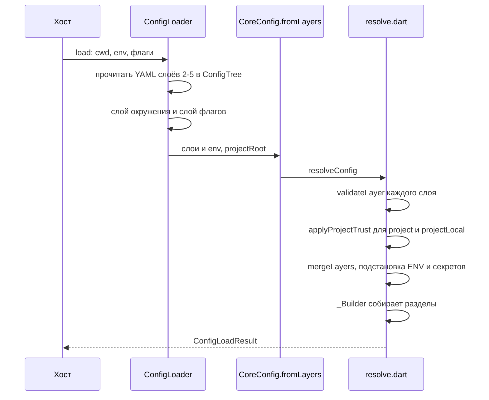
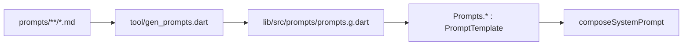
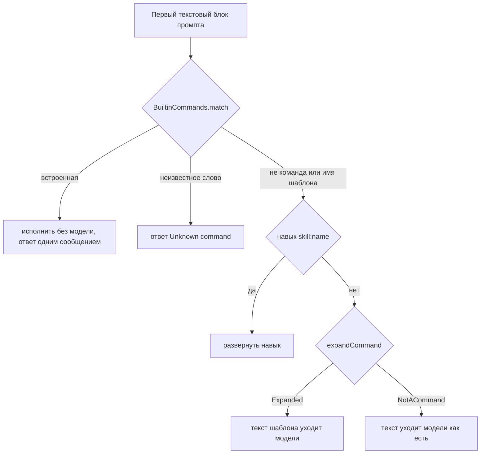

# Конфигурация, файлы проекта, промпты и команды

Глава про всё, что настраивает поведение ядра без правки кода: конфигурация, файлы проекта (`AGENTS.md`, шаблоны, агенты), тексты промптов, слэш-команды, секреты и журнал расхода. Перед ней прочитайте [02-assembly-and-hosts.md](02-assembly-and-hosts.md): большинство того, о чём здесь речь, ядро получает через порты `AgentCoreServices`.

Для пользователя формат конфигурации описан в [`docs/user/configuration.md`](../../../../docs/user/configuration.md) и [`apps/codelab_agent/doc/operations.md`](../../../../apps/codelab_agent/doc/operations.md). Здесь этого нет: только устройство кода.

Сквозной разбор настроек (чьи они, слои, перезагрузка, смена режима и модели по ACP, зависимость от способа подключения) — [алгоритм настроек](algorithms/settings.md); сторона клиента — [настройки на клиенте](../../codelab_client_core/doc/settings-on-client.md).

Общий принцип у всех пяти тем один. Ядро на чистом Dart не читает файлы (PKG-1), поэтому хост (`codelab_agent_io`) читает и разбирает сырое, а ядро проверяет и применяет чистыми функциями. Одинаковые входы дают одинаковый результат на любом хосте, в том числе web.

## Конфигурация: `lib/src/config/`

Самый большой модуль ядра (около 9 тыс. строк). Нормы — [`agent-configuration`](../../../../openspec/specs/agent-configuration/spec.md) (CFG-1…CFG-21).

### Карта файлов

| Группа | Файлы | Что делают |
|---|---|---|
| Вход | `config_tree.dart`, `config_source.dart`, `project_config.dart` | `ConfigTree` и `ConfigLayerKind` — разобранный слой; порты `ConfigSource` (живая перезагрузка корня запуска) и `ProjectConfigLoader` (конфигурация папки сессии) |
| Схема и проверка | `schema.dart`, `validate.dart`, `key_path.dart`, `config_issue.dart` | таблица допустимых ключей, обход слоя по ней, формат пути ключа, `ConfigIssue` и `ConfigLoadResult` |
| Слияние | `merge.dart`, `interpolate.dart` | слияние слоёв, подстановка `${ENV}` |
| Доверие | `trust.dart`, `provider_binding.dart` | что можно брать из репозитория; привязка ключа проектного провайдера к адресу |
| Сборка | `resolve.dart`, `core_config.dart`, `host_settings.dart`, `redact_settings.dart`, `config_values.dart` | `resolveConfig` и `_Builder`, итоговые `CoreConfig` и `HostSettings`, плоская карта `values` |
| Секреты в конфиге | `inline_secrets.dart`, `secret_name_rule.dart`, `secret_references.dart`, `mask_url.dart` | распознавание литеральных секретов, «секретные» имена, ссылки `${secret:…}`, маскирование адресов для показа |
| Правка и перезагрузка | `config_edit.dart`, `settings_registry.dart`, `config_reload_plan.dart`, `folder_session_config.dart` | типы правок, реестр настроек, план применения перезагрузки, конфигурация сессии другой папки |

`resolve.dart` — 2400 строк, из них больше 1800 занимает приватный `_Builder`: по одному методу на раздел схемы (`providers`, `permissions`, `mcp`, `skills`, `subagents`…). Новый раздел конфигурации добавляется в `schema.dart` и в `_Builder`.

### Путь от источников до `CoreConfig`

Читает файлы и собирает слои `ConfigLoader` из `codelab_agent_io` (`lib/src/config/config_loader.dart`). Все слои, от низшего приоритета к высшему:

| № | Слой | `ConfigLayerKind` | Источник |
|---|---|---|---|
| 1 | умолчания | `defaults` | константы конструкторов `CoreConfig` |
| 2 | глобальный | `user` | `$CODELAB_HOME/config.yaml` |
| 3 | проектный | `project` | `<cwd>/.codelab/config.yaml` |
| 4 | локальный проектный | `projectLocal` | `<cwd>/.codelab/config.local.yaml` |
| 5 | явный файл | `extra` | `--config <path>` или `CODELAB_CONFIG` (`.yaml`, `.yml`) |
| 6 | окружение | `environment` | переменные `CODELAB_*` |
| 7 | флаги | `flags` | флаги командной строки; единственный источник `autopilot` (CFG-4) |

Для мобильных и web-хостов есть ещё `appStorage`: дерево из хранилища приложения без позиций в файле.



Что происходит внутри `resolveConfig` (`lib/src/config/resolve.dart`), по порядку:

1. **Проверка каждого слоя до слияния** (`validateLayer`, CFG-1). Неизвестный ключ, неверный тип, значение вне допустимого — `ConfigIssue` с файлом, строкой и столбцом. Слой проверяется отдельно, чтобы проблема называла файл, где она записана, а не итог слияния. Есть проверка `trusted_projects`: список принимается только из глобального слоя и только абсолютные пути.
2. **Доверие** (`applyProjectTrust`, CFG-3). Проектные слои 3–4 пропускаются через правила: недопустимый ключ отбрасывается с предупреждением `config.project.untrusted_key`, а не ошибкой — клонированный репозиторий не должен ломать запуск. Правила — ниже.
3. **Слияние** (`mergeLayers`): отображения сливаются рекурсивно, скаляры и списки заменяются целиком. Исключения: слой `flags` заменяет `providers.cli` целиком; `mcp.servers` сливается по `name`; `tools.disabled` слоёв 2–4 объединяется. Перед слиянием группа «адрес и аутентификация» провайдера отбирается из одного слоя (`applyProviderGroupRule`). Полное описание правил, таблица и пример — [алгоритм настроек, «Слияние конфигов»](algorithms/settings.md#слияние-конфигов).
4. **Подстановка** `${ENV}` (`expandEnvironment`, `interpolate.dart`) только в разрешённых ключах: `${NAME}` раскрывается, `$${` — литерал `${`, незаданная переменная — ошибка, а не пустая строка (иначе тихие отказы авторизации). Ссылки `${secret:<name>}` в строку не раскрываются: результат — `SecretTemplate` из литералов и ссылок, значение читается позже и лениво.
5. **Сборка** `_Builder.build`: из слитого дерева строятся `CoreConfig` (разделы ядра) и `HostSettings` (ключи, которые читает хост: `sessions.*`, `logging.*`, `secrets.*`, `config.*`). Ключи, у которых в схеме `applied: false`, дают `config.key.not_applied`: схема принимает их, но потребителя пока нет.
6. **Два снимка.** Если есть проектные слои, `_resolve` вызывается второй раз без них, и результат кладётся в `CoreConfig.withoutProject`. Сессия, открытая в папке вне корня запуска, не должна получить проектные ключи чужой папки. Какие слои читать для такой папки, решает порт `ProjectConfigLoader`.

Итог — `ConfigLoadResult` (`config_issue.dart`): `config` и `host` равны `null` тогда и только тогда, когда `issues` не пуст. Предупреждения `warnings` запуску не мешают. Хост, для которого ошибка конфигурации — отказ при старте, зовёт `orThrow()` и получает `ConfigException`; `codelab-agent serve` в этом случае печатает проблемы в stderr и выходит с кодом `64`. Поле `values` — плоская карта листьев итогового дерева (путь ключа → значение «как в файлах»): по ней перезагрузка сравнивает снимки.

Одна ошибка не прячет остальные: режим `collectAll` вырезает ключи с ошибками и проходит следующие ступени, чтобы `codelab config check` показал все проблемы разом. Если полную проверку довести нельзя (круги исчерпаны или ничего не вырезано), добавляется служебная проблема `validationIncompleteEvent`: нельзя выдавать неполный набор за полный.

`lib/src/config/schema.dart` — декларативная таблица: «строгий профиль» (CFG-1) и список «ключей без потребителя» выводятся из одного места. Рядом — `SettingsRegistry` (`settings_registry.dart`): плоский список настроек в порядке показа с подписью, разделом, признаком `restartRequired` и допустимыми слоями. Реестр нужен клиентам (`/settings`, страница настроек), `ConfigWriter` и перезагрузке. Согласованность двух таблиц держит тест полноты: ключ схемы без дескриптора роняет сборку.

### Доверие к проекту

Конфиг проекта пишет не пользователь, а репозиторий. `applyProjectTrust` (`lib/src/config/trust.dart`) задаёт границу:

| Ключи проектного слоя | Недоверенный проект | Доверенный проект |
|---|---|---|
| `trusted_projects`, `secrets` | отбрасываются всегда: читаются только из глобального слоя | то же |
| `sessions`, `logging`, `exec`, `config` | отбрасываются: решают, куда агент пишет и как следит за файлами | в `config.yaml` отбрасываются, в `config.local.yaml` читаются |
| `providers`, `model_catalog`, `prompts`, `hooks`, `plugins`, `a2a`, `lsp`, `mcp.servers` | отбрасываются | читаются |
| `permissions`, `redact`, `budget`, `tools.project_context.max_bytes`, `skills.*`, `subagents.*` (кроме `skills.extra_roots`, см. следующую строку) | только ужесточение относительно слоёв ниже (меньше число, `deny` объединяется со списком пользователя) | в границах схемы |
| `skills.extra_roots` | отбрасывается из `config.yaml` проекта всегда; из `config.local.yaml` читается только у доверенного проекта | то же: из `config.yaml` отбрасывается даже у доверенного, потому что согласие на чтение каталога вне проекта даёт пользователь, а не репозиторий |
| `permissions.mode` | не мягче режима нижних слоёв и профиля хоста | не мягче того же при слое 3 |

«Доверенный» — корень проекта есть в `trusted_projects` глобального конфига. Слой `extra`, окружение и флаги правилам не подчиняются: их задаёт тот, кто запускает агента. Решение о доверии принимается до слияния, потому что после слияния отбросить ключи уже нельзя.

Отдельная угроза — ключ API. Проектный провайдер мог бы сослаться на секрет процесса или переменную (`api_key_secret`, `api_key_env`) и указать собственный `base_url`: ключ пользователя ушёл бы на чужой адрес. `provider_binding.dart` закрывает это двумя правилами: группа «адрес и аутентификация» провайдера берётся целиком из одного слоя (`applyProviderGroupRule`), а ссылка на ключ из проектного слоя разрешается только в `config.local.yaml` или при привязке к тому же origin глобальными слоями (`ProviderKeyBinding`). Доверие к проекту «ключей не отдаёт».

### Перезагрузка на лету

Живая перезагрузка включается, если хост положил в `AgentCoreServices.config` порт `ConfigSource` (`FileConfigSource` в `codelab_agent_io`: наблюдатель файлов `ConfigWatcher` с debounce 300 мс и сравнением sha256, переход на опрос раз в `config.poll_interval`, если события каталога недоступны).

`AgentRuntime.reloadConfig` (`lib/src/runtime/agent_runtime.dart`) работает так:

1. `ConfigSource.load` снова читает те же слои. Доверие закреплено на стартовом `initial.config.trustedProjects` (`pinnedTrustedProjects`): новое значение `trusted_projects` в файле не расширяет доверие до перезапуска.
2. Невалидный конфиг — прежний снимок цел, клиентам ничего не уходит (CFG-15); итог `ConfigReloadOutcome.failed`.
3. `planConfigReload` (`config_reload_plan.dart`) сравнивает `values` и делит ключи на применяемые (`changedKeys`) и отложенные до перезапуска (`restartRequiredKeys`). Отложены: ключи с `restartRequired` в реестре и ключи вне реестра; любая правка `permissions.*` и `trusted_projects`, в том числе ужесточение, ждёт перезапуска; смена группы «адрес и аутентификация» провайдера; новый stdio-сервер MCP. Это граница безопасности: смягчение прав и отправка секрета на другой адрес на лету не действуют.
4. `CoreConfig.withDeferred` собирает снимок, подставляя прежние значения отложенных частей (`DeferredConfigParts`: имена серверов и идентификаторы провайдеров берутся из самих снимков, а не из разбора строк ключей). Затем `validateSnapshot` проверяет результат.
5. Одна атомарная замена записи `_Applied` (снимок, `values`, функция модели, каталог). Между чтением и заменой нет `await`, поэтому «двойного снимка» не бывает. Живые сессии получают новые серверы MCP и список моделей; отложенное логируется `config.reload.restart_required`.

Итог для клиента — `ConfigApplyReport` (`applied`, `unchanged`, `failed`; списки ключей без значений). Бюджет и параметры сжатия сессия читает из применённого снимка на границе каждого хода, поэтому они действуют «со следующего хода» (CFG-16). `AgentRuntime.configStatus()` отдаёт `ConfigStatus`: время загрузки, источники, последнюю неудачу и ключи, ждущие перезапуска; его показывают `/config` и `codelab config`.

### Правка файлов

Писатель живёт в `codelab_agent_io` (`ConfigWriter`), а типы правок — в ядре (`config_edit.dart`): клиенты строят и сравнивают правки без зависимости от `dart:io`. `ConfigSnapshot` — прочитанный файл с отпечатком, `ConfigEdit` — `SetValue`, `UnsetValue`, `UpsertMcpServer`, `RemoveMcpServer`, `RemoveTable`. `ConfigWriter.apply` проверяет итоговый текст теми же слоями и `fromLayers` (`ConfigLoader.validateCandidate`), берёт блокировку, пишет через временный файл и `rename`. Устаревшая правка — `ConfigConflictException`: клиент перечитывает файл и повторяет. Какие ключи и в какие слои писать, решает `SettingsRegistry`. Командная сторона (`codelab config get|set|unset|check|path`, `provider`, `mcp`, `secret`) — `ConfigCommands` и соседи в `codelab_agent_io/lib/src/cli/`; клиенты получают их через мост `codelab_setup` (`lib/io.dart`).

## Секреты: `lib/src/secrets/`

Ключи провайдеров и токены MCP-серверов не хранятся в конфиге. Нормы — [`agent-secrets`](../../../../openspec/specs/agent-secrets/spec.md) (CFG-9, CFG-10).

В конфиге пишется ссылка: `api_key_secret: codelab/openai` или `${secret:<name>}` внутри значения. Литеральный секрет в файле ядро распознаёт (`inline_secrets.dart`: префиксы `sk-`, `ghp_`, `AKIA`, JWT, PEM и другие форматы по публичным описаниям) и предупреждает событием `config.secret.in_file`. Ни метка, ни находка не содержат значения. `ConfigWriter` отказывает в записи литерала: `ConfigInlineSecretException` подсказывает имя для `codelab secret set`.

Как значения скрываются при показе (`config get`, список настроек) — в [алгоритме маскирования секретов](algorithms/redaction.md).

Читает значение единственная дорога — `SecretResolver` (`secret_resolver.dart`). Порядок `secret(name)`: кэш, переменная `CODELAB_SECRET_<ИМЯ>` (`SecretNames.envOverride`), хранилище `SecretStore`. Кэшируются только найденные значения, поэтому секрет, записанный после старта, подхватывается следующим запросом; `invalidate()` вызывает перезагрузка конфигурации. Прямой вызов `SecretStore.read` запрещён: так значение не обходит кэш и диагностику без значения. Результат `SecretLookup` различает «не задан» и «хранилище недоступно» — этим людям нужны разные действия. В режиме `--debug-secrets` пишется `secrets.lookup` с именем, назначением и источником, но не значением.

Бэкенды хранилища: `memory` в ядре (`memory_secret_store.dart`: тесты и хосты без файлов), `env` (только чтение, `CODELAB_SECRET_*`) и `file` (`$CODELAB_HOME/secrets.yaml`) в `codelab_agent_io/lib/src/secrets/`. `secrets.backend` принимает `auto`, `env`, `file`; значение `keychain` пока даёт проблему конфигурации «not supported yet». Бэкенды строит одна фабрика `openHostSecrets` (`host_secrets.dart`), чтобы `codelab-agent`, встроенный агент и CLI видели один и тот же ключ. Правила имён — `secret_names.dart` (`SecretNames.problem`: строчные буквы, цифры и `. _ / -`, до 128 символов).

## Файлы проекта: `lib/src/project/`

Рядом с кодом проекта лежат файлы, которые агент читает при открытии сессии: инструкции, шаблоны команд, определения агентов. Читать их должен хост, потому что у ядра нет файловой системы, а ACP не умеет листинг каталога и `stat`. Порт — `ProjectFilesSource` (`project_files.dart`), реализация — `ProjectFilesLoader` в `codelab_agent_io/lib/src/project/project_files_loader.dart`. Читает его рантайм один раз при `createSession` и `loadSession`, до ответа `session/new`.

Запрос `ProjectFilesQuery` несёт всё, что нужно порту: канонический `cwd`, `projectTrusted`, бюджет `contextMaxBytes` и токен отмены. Ответ `ProjectFiles` — «сырые» файлы: `context` (инструкции от общего к частному), `templates` (`prompts/*.md`), `agents` (`agents/*.md`) и `diagnostics`. Порт не бросает исключений на ошибки файлов: недоверенный проект, файл вне корня, слишком большой файл — это записи `ExtensionDiagnostic`. Тексты файлов в диагностику не попадают.

Что и откуда читается:

| Что | Где ищется |
|---|---|
| инструкции | `$CODELAB_HOME/AGENTS.md`, затем `AGENTS.md` или `CLAUDE.md` на каждом уровне от корня git до `cwd`; если на уровне есть оба, читается `AGENTS.md`, а `CLAUDE.md` игнорируется с диагностикой |
| шаблоны команд | `$CODELAB_HOME/prompts/*.md`, `<cwd>/.codelab/prompts/*.md` |
| определения агентов | `$CODELAB_HOME/agents/*.md`, `<cwd>/.codelab/agents/*.md` |
| навыки | отдельный порт `SkillFilesSource`, тот же загрузчик — см. [06-tools.md](06-tools.md) |

Каталоги проекта читает только доверенный проект. Каждое чтение идёт через `BoundedEnv.wrap(local, корень области)`: путь, чей `realpath` вне корня (ссылка наружу), отклоняется до чтения с диагностикой `outside_root`.

### Инструкции проекта

`assembleProjectContext` (`project_context.dart`) превращает прочитанные файлы в `ProjectContext` — чистая функция, одна для всех хостов. Бюджет `tools.project_context.max_bytes` раздаётся от самого частного файла (ближайшего к `cwd`) к общему. Файл, не влезший целиком, усекается по границе строки и получает пометку `[file truncated: showing N of M bytes]`; после усечения бюджет считается исчерпанным. Пустые файлы пропускаются, не вошедшие — `omitted`. Недоверенный проект может только уменьшить бюджет. Событие `project_context.loaded` пишет расход и корень поиска (`ContextRoot.git` или `cwd`).

Результат попадает в системный промпт секцией `project_context`. Рендер экранирует теги `<project-instructions` в тексте файла (`_escapeClosingTag` в `lib/src/prompts/compose.dart`): файл не должен закрыть свой блок и выдать продолжение за текст агента.

## Промпты: `lib/src/prompts/`, `prompts/`

Тексты, которые видит модель, лежат в Markdown: `packages/dart/codelab_agent_core/prompts/**/*.md`. Нормы — [`agent-prompts`](../../../../openspec/specs/agent-prompts/spec.md) (PR-1…PR-6). Тексты английские, написаны для CodeLab; чужие промпты копировать запрещено (корневой `AGENTS.md`, §5).

Каталог `prompts/`:

| Каталог | Назначение |
|---|---|
| `system/` | база (`base.md`: `cwd`, дата, платформа, режим) и правило ограды недоверенного содержимого |
| `modes/plan.md` | добавка режима `plan` |
| `tools/` | правила пользования инструментами: `read`, `edit`, `listing`, `exec`, `tasks` |
| `tool_descriptions/` | описания инструментов для схемы: по файлу на инструмент |
| `compaction/` | промпты суммаризатора — см. [08-sessions-and-compaction.md](08-sessions-and-compaction.md) |
| `skills/`, `mcp.md`, `project_context*.md`, `agent_profile.md` | секции каталога навыков, MCP, инструкций проекта и профиля агента |
| `subagent/` | база ребёнка, назначенная задача, профили типов `general`, `explore`, `review`, `plan` |

У каждого файла frontmatter: `id` (совпадает с путём), `description`, `vars` и, для секций под `tools/`, непустой `tools`. Тело — шаблон без условий и циклов: `{{имя}}` подставляется значением как есть, `\{{` даёт литерал. Логики в шаблонах нет намеренно: шаблонизатор с логикой превращает промпт в программу, которую трудно ревьюить. Необязательные части — отдельные секции, а состав выбирает код.

### Кодогенерация



`tool/gen_prompts.dart` читает все `*.md` в порядке относительного пути и пишет один файл `prompts.g.dart` с константами `PromptTemplate` в классе `Prompts` (`Prompts.systemBase`, `Prompts.toolsRead`, `Prompts.compactionSummary`…). Имя константы — путь в lowerCamelCase. Зачем кодогенерация: промпт ревьюится как документ, а исполняется как константа, потому что на web нет файловой системы, а ядро файлов не читает.

Генератор падает с путём файла, если: нет frontmatter; неизвестный ключ frontmatter; подстановка не объявлена в `vars` или объявлена, но не используется; дубль `id`; файл под `tools/` без `tools`. Запуск из каталога пакета:

```bash
fvm dart run tool/gen_prompts.dart          # переписать prompts.g.dart
fvm dart run tool/gen_prompts.dart --check  # код выхода 1 при расхождении
```

`melos run prompts:check` — тот же `--check`. Сгенерированный файл обязан совпадать с исходниками (PR-1); многострочных строковых литералов с промптами вне `prompts.g.dart` в `lib/` быть не должно (PR-2).

`PromptTemplate.render(values)` (`template.dart`) требует, чтобы набор значений совпадал с `vars`, иначе `ArgumentError` (PR-4). Подстановка не повторяется: значение, содержащее `{{x}}`, не раскрывается второй раз.

### Сборка системного промпта

`composeSystemPrompt(PromptInputs)` (`compose.dart`) собирает секции в фиксированном порядке и соединяет их пустой строкой. Входы `PromptInputs` — всё, от чего зависит текст: `cwd`, `platform`, `today`, режим, суженный профиль хоста, имена инструментов, серверы MCP, `projectContext`, профиль агента, данные субагента, навыки. Одинаковые входы дают побайтово одинаковый текст (PR-3): иначе кэш промптов у провайдера промахивался бы на каждом шаге.

Порядок секций: `system/base`; `system/untrusted`; `modes/plan` (режим `plan`); `tools/read`; `tools/edit`; `tools/listing` (при `fileListing`); `tools/exec` (при `shellExec`); `tools/tasks` (если есть `task_create`); `mcp` (capability `mcp` и хотя бы один сервер с инструментами); `skills/catalog`; `project_context`; `agent_profile`; у потомка — `subagent/system`, профиль типа и `subagent/task`. Секция входит, только если нужные ей инструменты есть в наборе (`PromptTemplate.tools`, PR-6) и capability включена (HOST-4). `systemPromptSections` возвращает id вошедших секций для `CorePlan.promptSections`.

Секции режима разрешений и профиля агента не заменяют базу и правило ограды недоверенного содержимого: профиль агента стоит последним, а его тело вставляется как значение и шаблоном не обрабатывается.

## Слэш-команды: `lib/src/commands/`

Сообщение, начинающееся с `/`, может быть тремя вещами: встроенной командой, шаблоном пользователя или текстом для модели. Разбор строки — `parseCommandLine` (`command_line.dart`) — единственное место: слово команды (`^[A-Za-z0-9][A-Za-z0-9:_-]*$`) и остаток строки. `/usr/bin/foo` или ведущий пробел — не команда. Функция чистая: ничего не исполняет и не читает (SKL-8).

Порядок решения в `AgentSession.prompt` (`lib/src/runtime/agent_runtime.dart`):



**Встроенные команды** — `BuiltinCommands` (`builtin_commands.dart`), один `switch` по имени. Исполняются без модели; тексты ответов фиксированы побайтово. Сессия публикует ответ как одно сообщение агента, ни промпт, ни ответ в журнал не пишутся, а записи состояния самой командой (`mode_change`, `model_change`, `compaction`) пишутся. Слот хода занят на всё время команды.

| Команда | Что делает | Когда объявлена |
|---|---|---|
| `/compact [focus]` | ручное сжатие | capability `compaction` |
| `/mode <режим>` | смена режима | всегда |
| `/model <provider/model>` | смена модели | всегда |
| `/status` | модель, режим, папка, серверы MCP | всегда |
| `/usage [rebuild]` | расход токенов и цена | всегда |
| `/config reload\|check` | перезагрузка или проверка конфигурации | есть `ConfigSource` и хост разрешил команду (`configCommand`); `serve --ws` её выключает |
| `/mcp list\|reload\|enable\|disable` | управление серверами MCP | capability `mcp` |
| `/help` | список команд | всегда |

Необъявленная в сессии команда (`/config` без `ConfigSource` или при выключенном `configCommand`, `/compact` без сжатия) отвечает как неизвестная: ответ не раскрывает конфигурацию, а модель не получает текст, который пользователь набрал как команду.

**Шаблоны** — файлы `*.md` в каталогах `prompts/`. Frontmatter допускает ключи `description` и `argument-hint`. Имя команды — имя файла без `.md`, по правилу `^[a-z0-9][a-z0-9-]{0,63}$`. `parseCommandTemplates` (`command_template.dart`) отбрасывает файл с ошибкой диагностикой, остальные принимает; при совпадении имён проект заменяет пользователя (`shadowed`). Имена встроенных команд и `skill` зарезервированы (`reservedCommandNames`): файл в репозитории не должен менять смысл встроенной команды (SKL-7). В список входят и ещё не реализованные имена (`branch`, `rewind`, `fork`, `label`, `approve`, `timer`, `memory`…), чтобы шаблон не занял их раньше времени.

`expandCommand` подставляет аргументы: `$ARGUMENTS` — вся строка, `$1`…`$9` — слова с учётом кавычек (`arguments.dart`). Развёрнутый текст заменяет первый текстовый блок, остальные блоки идут следом. В журнал пишется и развёрнутое сообщение, и `CommandRef` (источник, имя, сырые аргументы), чтобы реплей показал исходную команду. Лог `command.expanded` содержит имя и размер аргументов, но не их текст: пользователь мог вставить туда секрет.

Клиенту команды объявляет `AgentSession.commands` — список `SlashCommand` (имя, описание, подсказка ввода, источник `builtin`, `template` или `skill`); тело шаблона и пути наружу не идут. Адаптер ACP отправляет его как `available_commands_update`. Нормы — [`agent-slash-commands`](../../../../openspec/specs/agent-slash-commands/spec.md).

## Определения агентов: `lib/src/agents/`

Определение агента — Markdown-файл `agents/<имя>.md`: профиль сессии (опция `agent`) и тип субагента. Frontmatter допускает ключи `name`, `description`, `model`, `mode`, `tools`, `scope`; тело файла — текст, который попадёт в системный промпт секцией `agent_profile`.

`parseAgentDefinitions` проверяет файлы один раз при загрузке и возвращает `AgentParseResult`: принятые `AgentDefinition` и диагностики. Правила: имя `^[a-z][a-z0-9-]{0,47}$` и не `default`; `model` обязана быть в каталоге моделей сборки (иначе диагностика `invalid_value` с текстом `agentDefinitionModelNotInCatalogMessage`); `mode` — известный `ModeId`; `tools` сужает набор, `*` в конце — префиксный шаблон, `null` — все инструменты, пустой список — ни одного (CFG-7); `scope` — `session`, `subagent` или `both` (`AgentScope`). `sessionAgents` и `subagentAgents` разделяют определения по области.

Агент только сужает: `AgentDefinition.allowsTool` убирает инструменты, но разрешения проверяет политика отдельно, а режим определения применяется, лишь если он не мягче режима конфигурации. Выбранный агент записывается в журнал как `config_change` с `optionId: agent`, и `loadSession` его восстанавливает. Нормы — [`agent-definitions`](../../../../openspec/specs/agent-definitions/spec.md).

## Журнал расхода: `lib/src/usage/`

Сколько токенов и денег потратила сессия — отдельная производная от журнала. Нормы — [`agent-sessions`](../../../../openspec/specs/agent-sessions/spec.md), требования «Журнал usage сессии» (OBS-10).

`buildUsageLedger(snapshot)` (`usage_ledger.dart`) — чистая функция записей журнала: ни файлов, ни часов. Свёртка по шагам, ходам, моделям, прогонам субагентов и вызовам суммаризатора. Шаг без `usage` от провайдера помечается `noUsage`; учёт отброшенных сжатий берётся из служебных `custom`-записей. `UsageLedger.serialize` даёт `usage.json` версии 1 побайтово воспроизводимо: одинаковые записи — одинаковый файл, времени построения в нём нет.

Файл — кэш, а не источник: ядро не читает его для решений. `UsageLedgerKeeper` (`usage_ledger_keeper.dart`) сравнивает `source` файла (число записей и `lastRecordId`) с журналом и пересчитывает устаревший, отсутствующий или нечитаемый файл (`UsageLedgerRebuildReason`: `missing`, `invalid`, `stale`, `explicit`). Одна операция с записью на сессию. Файл пишет порт `UsageLedgerStore` (`JsonlUsageLedgerStore` рядом с журналом: `<журнал без .jsonl>/usage.json`); хост без файлов оставляет порт `null`, и отчёт строится в памяти (`usageLedgerInMemory`). Сбой записи не роняет сессию: статус `notSaved` и предупреждение `usage.ledger.write_failed`.

Показывают расход `/usage` (`formatUsageReport` в `usage_report_text.dart`: фиксированный текст с правилом цены `$`, `~$`, `cost unknown`) и ACP-адаптер (`codelab_agent_acp/lib/src/usage_accounting.dart`, расширение `usage`).

## Что запомнить

- Хост читает, ядро проверяет. Любой новый источник данных — порт в ядре и реализация в `codelab_agent_io`.
- Проект ничего не получает «бесплатно»: доверие решается до слияния, а секреты привязаны к адресу.
- Новый ключ конфигурации — строка в `schema.dart`, дескриптор в `settings_registry.dart` и поле в `_Builder`; без потребителя ключ остаётся `applied: false`. Рецепт — в [11-extending.md](11-extending.md).
- Новый промпт — файл в `prompts/` и перегенерация; текст в код не вставляется.

## Смотрите также

- [02-assembly-and-hosts.md](02-assembly-and-hosts.md) — `AgentCoreServices` и профили.
- [06-tools.md](06-tools.md) — навыки и субагенты.
- [07-permissions.md](07-permissions.md) — режимы и правила разрешений, которые задаёт `permissions.*`.
- [08-sessions-and-compaction.md](08-sessions-and-compaction.md) — `sessions.*`, `compaction.*`, журнал.
- [10-observability-and-errors.md](10-observability-and-errors.md) — события `config.*`, `project_files.*`, `secrets.*`.
- [`docs/user/configuration.md`](../../../../docs/user/configuration.md), [`apps/codelab_agent/doc/operations.md`](../../../../apps/codelab_agent/doc/operations.md) — формат для пользователя и администратора.
- Проекты: [`proposals/agent-core/15-configuration.md`](../../../../docs/architecture/proposals/agent-core/15-configuration.md), [`11-prompts.md`](../../../../docs/architecture/proposals/agent-core/11-prompts.md).
