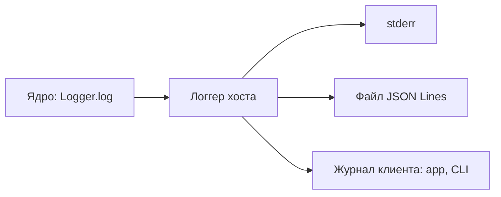
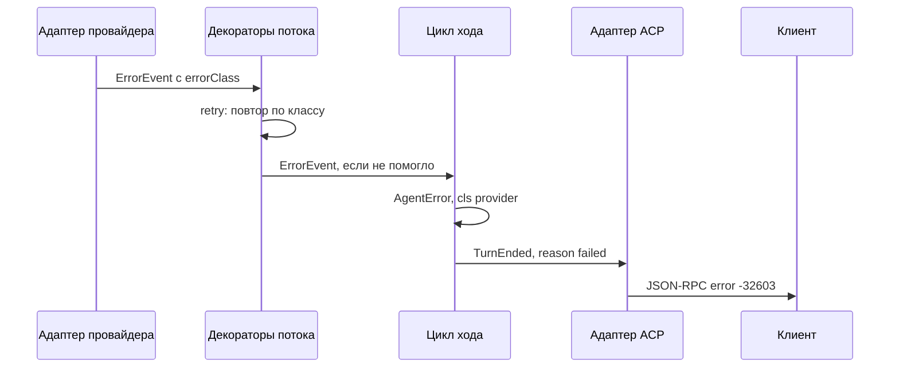

# Журнал диагностики и ошибки

Глава про два сквозных механизма ядра: как оно пишет диагностику (порт `Logger`) и как обращается с ошибками (`Result`, события, исключения). Читать её удобно после [04-turn-loop.md](04-turn-loop.md) и [03-request-flow.md](03-request-flow.md): путь ошибки идёт через цикл хода и адаптер ACP.

Требования — в спецификациях [`agent-loop`](../../../../openspec/specs/agent-loop/spec.md), [`agent-acp-server`](../../../../openspec/specs/agent-acp-server/spec.md) и [`agent-runtime`](../../../../openspec/specs/agent-runtime/spec.md). Правила для всего репозитория — [`docs/architecture/observability.md`](../../../../docs/architecture/observability.md) и [`docs/architecture/error-handling.md`](../../../../docs/architecture/error-handling.md). Спека [`structured-logging`](../../../../openspec/specs/structured-logging/spec.md) описывает журнал клиентов на `structured_log`: у агента свой порт `Logger`, и связывает их только то, что клиент маскирует записи встроенного агента на своей стороне (см. раздел про маскирование).

## Журнал диагностики

### Порт `Logger`

`lib/src/util/logger.dart`. Ядро пишет только сюда и не решает, куда пойдут записи: это дело хоста.

```dart
abstract interface class Logger {
  bool isEnabled(LogLevel level);
  void log(LogLevel level, String event,
      {Map<String, Object?> fields = const {}, Object? error, StackTrace? stack});
}
```

Договорённости:

- Уровни `LogLevel`: `trace`, `debug`, `info`, `warning`, `error`. Уровня `critical`, как у клиентов, нет.
- `event` — стабильное имя вида `<область>.<действие>` или `<область>.<объект>.<действие>`: `llm.retry`, `permission.denied`, `session.append.failed`. На имя опираются тесты и фильтры, поэтому оно не меняется без причины.
- Ключи `fields` — `snake_case`. Значения — простые типы и списки.
- Тексты сообщений и аргументы инструментов на уровнях `info` и выше не пишутся. Полный текст — только в `debug`.
- `stdout` не пишется никогда: в режиме `serve --stdio` по нему идёт ACP. Это правило хоста, но ядро его не нарушает, потому что вообще не знает про stdout.

`LogRecord` — то, что получает приёмник хоста: время, уровень, событие, поля, текст ошибки и стек. `Logger.log` принимает `Object? error` и `StackTrace? stack`; в запись они попадают строками.

`BoundLogger` — обёртка с постоянными полями: `BoundLogger(logger, {'session_id': id.value})`. Ядро использует её там, где код не знает сессию (журнал ребёнка-субагента, транспорт MCP). Поля вызова `log` перекрывают связанные при совпадении ключей. В остальных местах `session_id` ядро добавляет в `fields` явно. Подменить логгер на одну сессию можно через `SessionHostPorts.logger` (`lib/src/runtime/agent_session.dart`); иначе берётся `AgentCoreServices.logger`.

Для тестов есть `RecordingLogger` (`lib/src/testing/recording_logger.dart`): копит записи в памяти, `eventsOf(event)` возвращает записи по имени. Тест на журнал выглядит как проверка события по имени и полей, а не строки текста.

### Куда идут записи



Реализации логгера живут в хостах:

| Хост | Реализация | Куда пишет |
|---|---|---|
| `codelab-agent` | `HostLogger` (`apps/codelab_agent/lib/src/log/host_logger.dart`) | `StderrLogSink` всегда; `FileLogSink` (JSON Lines) при `--log-file`, `CODELAB_LOG_FILE` или `logging.file` |
| встроенный агент в `codelab` | `CliEmbeddedLogger` (`apps/codelab_cli/lib/src/embedded_logger.dart`) | stderr только с `--verbose`; исключение — `secrets.lookup` при `--debug-secrets`, он пишется и без `--verbose` |
| встроенный агент в app | `CodeLabEmbeddedLogger` (`apps/codelab_desktop/lib/app/embedded_logger.dart`) | журнал приложения |
| тесты | `RecordingLogger`; `SilentLogger` в `codelab_agent_io` | память; никуда |

`HostLogger` фильтрует по уровню (`--log-level`, `CODELAB_LOG_LEVEL`, `logging.level`; по умолчанию `info`) и раздаёт запись всем приёмникам. Сбой приёмника не должен ронять агента: если файл не пишется, он отключается до конца процесса, а в основной приёмник уходит одна запись `log.file.write_failed`. Файл создаётся с правами `0600`, ротации нет. Пути к stdout отклоняются кодом выхода `64`. Подробности для эксплуатации — в [`apps/codelab_agent/doc/operations.md`](../../../../apps/codelab_agent/doc/operations.md#логи-и-диагностика).

### Что пишет ядро

События сгруппированы по областям. Таблица — по коду; в проекте [`proposals/agent-core/12-observability-and-errors.md`](../../../../docs/architecture/proposals/agent-core/12-observability-and-errors.md) перечень шире, о расхождениях — ниже.

| Область | События | Где пишутся |
|---|---|---|
| `host` | `host.plan` | `lib/src/host/build_agent_core.dart`: профиль, инструменты, что выключено и почему |
| `session` | `session.append.failed`, `session.leaf.healed`, `session.cycle`, `session.broken_link`, `session.compaction.lost_anchor`, `session.origin.unknown`, `session.model.selected`, `session.model.not_restored` | `lib/src/session/`, `lib/src/runtime/` |
| `compaction` | `compaction.done`, `compaction.skipped`, `compaction.failed`, `compaction.anchor` | `lib/src/compaction/`, `agent_runtime.dart` |
| `llm` | `llm.retry`, `llm.stream.failed`, `llm.finish_reason.unknown`, `llm.stream.event_ignored`, `llm.catalog.default_used` | `lib/src/llm/` |
| `loop`, `tool` | `loop.empty_response`, `loop.empty_response.stopped`, `tool.validate.error`, `tool.present.error`, `tool.misuse.warned`, `tool.misuse.blocked`, `tool.lock.wait` (`debug`), `tool.lock.cancelled`, `tool.abandon.error` | `lib/src/loop/`, `lib/src/tools/executor.dart` |
| `permission` | `permission.asked` (`debug`), `permission.decided` (`debug`), `permission.denied` (`info`) | `lib/src/permissions/policy.dart` |
| `config` | `config.reload.applied`, `config.reload.noop`, `config.reload.failed`, `config.reload.restart_required`, `config.key.not_applied`, `config.project.untrusted_key`, `config.secret.in_file`, `config.provider.key_missing`, `config.session.*` | `lib/src/config/`, `agent_runtime.dart` |
| `secrets` | `secrets.lookup`, `secrets.backend.unavailable` | `lib/src/secrets/secret_resolver.dart` |
| проект | `project_context.loaded`, `project_files.diagnostic`, `commands.loaded`, `command.expanded`, `command.builtin`, `command.unknown`, `agents.loaded`, `agent.selected`, `skills.loaded`, `skill.activated` | `agent_runtime.dart`, `lib/src/tools/builtin/skill.dart` |
| `subagent` | `subagent.spawn`, `subagent.start`, `subagent.end`, `subagent.failed`, `subagent.heal_failed`, `subagent.replay_failed`, `subagent.slot.*` | `lib/src/subagents/`, `lib/src/session/replay_tree.dart` |
| `usage` | `usage.ledger.write_failed`, `usage.ledger.rebuild` | `lib/src/usage/` |
| `acp` | `acp.turn.failed`, `acp.handler.failed`, `acp.frame.bad`, `acp.cancel.no_turn`, `acp.prompt.rejected`, `acp.usage.*`, `acp.session.*` | `packages/dart/codelab_agent_acp/lib/src/` |
| `mcp` | `mcp.server.connect`, `mcp.server.failed`, `mcp.server.skipped`, `mcp.tools.changed`, `mcp.call.timeout` и другие | `packages/dart/codelab_agent_mcp/lib/src/` |
| `serve` | `serve.stdio.start`, `serve.ws.listening`, `serve.stop`, `serve.config.invalid` | `apps/codelab_agent/lib/src/` |

Новое событие нужно называть по этой схеме, поля брать из имён, которые уже есть (`session_id`, `tool_call_id`, `tool`, `provider`, `model`, `trigger`), и не писать в поля значения секретов, тексты промптов и аргументы вызовов.

### Корреляция

Связывают записи поля `session_id`, `tool_call_id` и, у вызовов инструментов, `tool`. Запросы `request_id` и номер поколения соединения `connection_generation` живут на стороне клиента ([`docs/architecture/observability.md`](../../../../docs/architecture/observability.md)): у агента один запрос идёт в одном соединении, и ход определяется `session_id`. Записи о вызове инструмента (`permission.*`, `tool.*`) несут `tool_call_id`; вызов потомка получает составной id с префиксом цепочки (`<префикс>/<id>`), по нему видно, чей вызов.

### Пример: журнал одного хода

Ниже — записи, которые пишет хост `codelab-agent` на одном ходе: модель сначала отвечает ошибкой сервера, цикл повторяет запрос, затем модель зовёт `edit`, политика спрашивает разрешение, шлюз разрешает. Записи получил временный тест: он собирает ядро через `buildAgentCore` (профиль `embedded-cli`, сценарная модель `ScriptedStreamFunction` под `withTransientRetry`) и подставляет настоящий `HostLogger` с уровнем `debug`, `StderrLogSink` и `FileLogSink` из `apps/codelab_agent/lib/src/log/`. Это тот же код, что пишет лог бинаря; запись ведёт не процесс `codelab-agent`, а тест. Запись `host.plan` опущена, идентификатор сессии заменён на `<session-id>`, остальное записано как есть.

Основной приёмник — stderr, одна строка на запись:

```text
2026-11-24T14:04:11.896580Z info session.model.selected {session_id: <session-id>, model: test/model-1, source: config}
2026-11-24T14:04:11.931694Z info llm.retry {attempt: 1, class: server, delay_ms: 789, provider: test, model: model-1}
2026-11-24T14:04:12.747704Z debug permission.asked {tool_call_id: c1, tool: edit, tier: write, critical: false}
2026-11-24T14:04:12.748424Z debug permission.decided {tool_call_id: c1, decision: allowOnce}
2026-11-24T14:04:12.748621Z debug tool.lock.wait {tool: edit, tool_call_id: c1}
```

Те же записи в файле `--log-file` (JSON Lines; `ts`, `level`, `event` и поля записи на одном уровне):

```jsonl
{"ts":"2026-11-24T14:04:11.896580Z","level":"info","event":"session.model.selected","session_id":"<session-id>","model":"test/model-1","source":"config"}
{"ts":"2026-11-24T14:04:11.931694Z","level":"info","event":"llm.retry","attempt":1,"class":"server","delay_ms":789,"provider":"test","model":"model-1"}
{"ts":"2026-11-24T14:04:12.747704Z","level":"debug","event":"permission.asked","tool_call_id":"c1","tool":"edit","tier":"write","critical":false}
{"ts":"2026-11-24T14:04:12.748424Z","level":"debug","event":"permission.decided","tool_call_id":"c1","decision":"allowOnce"}
{"ts":"2026-11-24T14:04:12.748621Z","level":"debug","event":"tool.lock.wait","tool":"edit","tool_call_id":"c1"}
```

Что здесь видно:

- Событие `llm.*` в этом ходе одно: `llm.retry` с номером попытки, классом ошибки (`server`), задержкой и моделью. Записи об успешном запросе к модели ядро не пишет: ход и шаги видны в событиях `AgentEvent`, а не в логе.
- `permission.asked` и `permission.decided` — события `debug`: при уровне `info` по умолчанию их нет. Они связаны полем `tool_call_id`; в `asked` — уровень вызова (`tier`) и признак критичной команды (`critical`), в `decided` — решение (`allowOnce`).
- `tool.lock.wait` (`debug`) — вызов дошёл до захвата пути; та же пара `tool` и `tool_call_id` позволяет связать запись с `permission.*` и с `tool_call` в ACP. Путь в поля не пишется.
- Поле `session_id` есть не у каждой записи: его несут события сессии (`session.model.selected`), а `llm.retry`, `permission.*` и `tool.*` связываются с вызовом через `tool_call_id`. `llm.retry` принадлежит запросу к модели, а не вызову, поэтому корреляционных идентификаторов у него нет: его связывает с ходом только время.

### Маскирование

Самое важное, что нужно знать при добавлении записи: **логгер ядра не маскирует ничего**. `HostLogger` пишет поля как есть. Защита — дисциплина вызывающего кода:

- значения секретов, ключи API и заголовки авторизации не пишутся ни в одно поле и на любом уровне; в лог идут имена секретов, источники и пути ключей, а не значения (`secrets.lookup` называет секрет, назначение и источник и никогда не значение, в том числе при `--debug-secrets`);
- тексты сообщений и аргументы инструментов — только `debug`;
- текст исключения из внешней библиотеки в поля не кладут: пишут `runtimeType` (так делают, например, `acp.usage.seed_failed` и `subagent.replay_failed`) или очищенное сообщение;
- `ConfigIssue` и отчёты перезагрузки несут пути ключей, но не значения.

Единственное маскирование на стороне ядра — вычистка известных значений секретов из текста ошибки провайдера: `redactSecrets` (`lib/src/llm/providers/http_support.dart`) заменяет каждое значение из `ProviderConfig.secrets` на `[REDACTED]` в сообщении об HTTP-ошибке.

Универсального редактора (ключи `redact.*`) пока нет. Схема принимает раздел `redact`, `RedactSettings` его читает, но потребителя нет: явно заданный ключ даёт предупреждение `config.key.not_applied`. То же с `logging.trace` и `logging.trace_payload`: протокольной трассы агента нет. Пользователю это объяснено в [`docs/user/configuration.md`](../../../../docs/user/configuration.md#что-попадает-в-логи-и-журналы): до выпуска 1.0 тексты промптов и вывод инструментов в журналах сессий и логах не редактируются.

Клиенты встроенного агента маскируют записи сами: `CliEmbeddedLogger` прогоняет поля через `SecretRedactor` клиента и чистит управляющие символы терминала; `CodeLabEmbeddedLogger` ничего не добавляет: журнал приложения маскирует процессор `secretRedactionProcessor`, а от ошибки адаптер берёт только `error_class`, без текста и стека. Журнал `codelab-agent` такой защиты не имеет, поэтому его нельзя публиковать без просмотра.

## Ошибки

### Три класса

Ядро различает три вида сбоев; у каждого своя форма и свой путь к пользователю.

| Класс | Источник | Форма | Что видит пользователь |
|---|---|---|---|
| ожидаемый сбой работы | провайдер модели, сеть, инструмент, сжатие, запись журнала | события: `AgentError`, `ToolCallFinished(failed)`, `TurnEnded(failed)` | ошибку в клиенте; ход завершён штатно |
| ожидаемый сбой окружения | файл, процесс, `fs/*` и `terminal/*` клиента | значение `Result.Err(FileError \| ExecError)` | вызов инструмента со статусом `failed` и текстом причины |
| ошибка программиста или конфигурации | неверный профиль, нет сервиса, нарушение контракта, неверный конфиг | исключение: `HostWiringException`, `ConfigException`, `StateError`, `ArgumentError` | ошибку запуска или ответа API |

Правила, которые из этого следуют:

1. Ожидаемые сбои не бросаются через публичный API ядра (OBS-1). `AgentSession.prompt()` возвращает `TurnResult`, а не бросает исключение, когда провайдер недоступен: ход завершается с `reason: failed`.
2. Исключение внутри инструмента, хука или подписчика ловится в одной точке и становится ожидаемым сбоем работы (TOOL-3, LOOP-1).
3. Ошибки конфигурации проявляются при старте: конфигурация проверяется до создания рантайма, а `buildAgentCore` проверяет связку сервисов.
4. Текст, который видит модель, — фиксированная английская строка из кода ядра. Локализуется только то, что видит человек, и делает это клиент.

### `Result`

`Result<T, E>` (`lib/src/util/result.dart`) — собственный запечатанный тип ядра с вариантами `Ok(value)` и `Err(error)`. Ядро не зависит от `fpdart`, которым пользуются клиенты (`docs/architecture/error-handling.md`), чтобы остаться на чистом Dart с минимумом зависимостей.

```dart
final text = switch (await env.readText(path)) {
  Ok(:final value) => value,
  Err(:final error) => handle(error),
};
```

Где применяется. Порты окружения возвращают `Result` вместо исключений (ENV-1): `ExecutionEnv.readText`, `writeText`, `stat` и `DirectoryListing.listDir` — `Result<_, FileError>`, `exec` — `Result<ExecResult, ExecError>` (`lib/src/env/execution_env.dart`). Валидатор аргументов инструмента (`lib/src/tools/validator.dart`) тоже. Причины — перечисления `FileErrorCode` (`notFound`, `permissionDenied`, `isDirectory`, `outsideWorkspace`, `tooLarge`, `notText`, `io`…) и `ExecErrorCode` (`aborted`, `timeout`, `shellUnavailable`, `spawnFailed`, `outsideWorkspace`…). Инструмент превращает `Err` в результат-ошибку с понятным моделью текстом (`File not found: lib/x.dart`), и ход продолжается.

Выход за рабочую папку — тоже `Err`, а не исключение: `BoundedEnv` отвечает `FileErrorCode.outsideWorkspace` или `ExecErrorCode.outsideWorkspace` до выполнения операции.

Зачем не исключения: отсутствие файла или код возврата `exec` — штатный исход, который инструмент обязан обработать явно, и компилятор должен проверять, что `Err` не забыт.

### Типизированные исключения

Исключения остаются для ошибок программиста и конфигурации, а также для границ, где значение вернуть нельзя. Основные типы в `lib/src/`:

| Тип | Файл | Когда |
|---|---|---|
| `HostWiringException` | `host/host_profile.dart` | хост собрал ядро неверно; бросается при `buildAgentCore`, агент не стартует |
| `ConfigException`, `ConfigInlineSecretException` | `config/config_issue.dart` | `ConfigLoadResult.orThrow()`; ошибка конфигурации при старте |
| `ProjectConfigException` | `config/project_config.dart` | конфигурация папки сессии невалидна |
| `ConfigConflictException` | `config/config_edit.dart` | правка конфига устарела |
| `SessionOpenException`, `SessionNotFound`, `InvalidCursor` | `session/` | журнал нельзя открыть, нет сессии, плохой курсор |
| `SecretStoreUnavailableException` | `secrets/secret_store.dart` | хранилище секретов недоступно; текст без значения |
| `CompactionFailure` | `compaction/summarizer.dart` | суммаризатор не дал резюме |
| `McpTransportException`, `McpSecretsException` | `mcp/` | сбой MCP-транспорта или разрешения секретов |
| `CancelledException` | `cancel/cancel_token.dart` | отмена как поток управления: не ошибка, а штатный выход |
| `UsageLedgerStoreException` | `usage/usage_ledger_store.dart` | сбой файла журнала расхода |

Правила: не бросать `String` и общий `Exception`; тип исключения называет причину; текст не содержит значений секретов (поле `reason` у `SecretStoreUnavailableException` — «наш текст на английском, без значения и без stderr внешних утилит»).

`StorageFailure` (`lib/src/cancel/cancel_token.dart`) — не исключение, а причина отмены: писатель журнала не может бросить из подписчика (цикл принял бы это за ошибку хука), поэтому сообщает отменой с этой причиной, и ход завершается `failed`, а не `cancelled`.

### Путь ошибки модели

Сбой запроса к модели — самый частый ожидаемый сбой. Класс ошибки задаётся один раз на границе адаптера, и дальше решения принимаются только по нему, а не по тексту сообщения (`LlmErrorClass`, `lib/src/llm/errors.dart`: `network`, `timeout`, `rateLimited`, `overflow`, `auth`, `badRequest`, `server`, `terminalFinish`, `aborted`, `unknown`).



Звенья:

1. **Адаптер провайдера** (`lib/src/llm/providers/`) превращает HTTP-статус и тело в `LlmErrorClass`: `classifyHttpError` (429 — `rateLimited`; переполнение окна — `overflow`; тип ошибки Anthropic в теле перекрывает статус; иначе 408 — `timeout`, 401 и 403 — `auth`, 501 и 505 — `badRequest`, остальные 5xx — `server`, остальные 4xx — `badRequest`). Сообщение чистится от значений секретов (`redactSecrets`) и укорачивается. Поток завершается событием `ErrorEvent` с `errorClass`, а не исключением.
2. **Повторы** (`withTransientRetry`, `decorators/retry.dart`). По классу решает, повторять ли запрос, и сколько ждать; `auth`, `badRequest`, `overflow`, `aborted`, `terminalFinish` не повторяются. Каждый повтор пишет `llm.retry` с попыткой, классом и задержкой. Пользователь видит только паузу.
3. **Запасные модели** (`withFallback`, `decorators/fallback.dart`) умеют переключаться на следующую модель цепочки при `rateLimited`, `server`, `network`, `timeout`, `auth`, `unknown`. Но `provider_factory.dart` всегда собирает цепочку из одной модели (`withFallback([model], …)`, `onNotice: (_) {}`), а ключ конфигурации `fallback` не применяется: переключения моделей сейчас нет, ошибка идёт дальше.
4. **Сторож** (`decorators/watchdog.dart`) превращает зависание в `ErrorEvent` класса `timeout`. Отмена пользователем остаётся `aborted`.
5. **Цикл** (`lib/src/loop/agent_loop.dart`): ответ с `StopReason.error` даёт `AgentError(cls: provider, errorClass, message)`, затем завершается шаг и ход — `TurnEnded(reason: failed)`. Остановка по `aborted` события `AgentError` не создаёт.
6. **Адаптер ACP** (`packages/dart/codelab_agent_acp/lib/src/event_projection.dart`, `turnResponse`) запоминает последний окончательный `AgentError` хода и при `TurnEndReason.failed` бросает `AcpRequestError` кода `-32603` (internal error) с текстом `Turn failed: <сообщение>` и данными:

   ```json
   {"codelab": {"errorClass": "auth", "message": "…", "retryable": false}}
   ```

   Поле `retryable` истинно для `network`, `timeout`, `rateLimited`, `server`. Если ход отменил клиент (`session/cancel`), ответ всегда `cancelled`, даже когда отмена вызвала ошибки (ACP-5). Сбой хода — ошибка JSON-RPC, а не `end_turn` (ACP-7). События `AgentError` отдельным кадром клиенту не уходят: `event_projection.dart` явно помечает их «not sent: the turn result carries the failure».

Диспетчер запросов (`connection/inbound_router.dart`) различает три вида ошибок ответа: `AcpRequestError` с кодом и данными (неверные параметры `-32602`, неизвестная сессия `-32002`, метод не найден `-32601`), `JsonRpcProtocolException` от декодера (`-32602`, `Invalid params: …`) и любое иное исключение. Последнее пишет `acp.handler.failed` на уровне `error` со стеком и отвечает клиенту безликим `Internal error`: детали остаются в журнале, а не уходят по проводу. Ошибка конфигурации папки сессии при `session/new` и `session/load` отвечает `-32603` с `data.codelab.reason: "projectConfigInvalid"`.

Во встроенном режиме тот же путь проходит через `InProcessAcpLink` ([03-request-flow.md](03-request-flow.md)): клиент видит те же ошибки JSON-RPC.

### Путь ошибки инструмента

Ошибка инструмента не прерывает ход: она становится результатом вызова, который видит модель. `ToolCallExecutor` (`lib/src/tools/executor.dart`) оборачивает все фазы вызова:

| Что случилось | Результат модели | `ToolOutcome` |
|---|---|---|
| неверные аргументы | текст с описанием проблемы схемы, учитывается в счётчике злоупотреблений | `failed` |
| исключение валидатора схемы (например, MCP-сервера) | текст исключения без префиксов Dart | `failed`, в счётчик не идёт (TOOL-3) |
| хук `beforeToolCall` заблокировал | причина из хука | `failed` или `rejected` |
| исключение хука или `execute` | `errorText(error)` | `failed` |
| ход отменён | фиксированный текст об отмене | `cancelled` |
| `Err` порта окружения | сообщение, сформированное инструментом | `failed` |

`errorText` убирает служебные префиксы Dart (`Exception: `, `Bad state: `, `Invalid argument(s): `), а стек уходит только в лог (`tool.validate.error`, `tool.present.error` на `debug`). Сбой отката при отмене пишется `tool.abandon.error`. Повторяющиеся неверные вызовы ограничивает `MisuseBreaker`: предупреждение `tool.misuse.warned`, затем блокировка `tool.misuse.blocked`.

Исключение подписчика события (журнал, хост) цикл не пропускает наружу: ход всё равно завершается `TurnEnded` (LOOP-1), а цикл эмитит `AgentError(cls: hook)`.

### Классы `AgentError`

| `cls` | Когда эмитится |
|---|---|
| `provider` | сбой запроса к модели в цикле |
| `hook` | исключение в цикле, хуке или подписчике |
| `compaction` | сбой сжатия (компактор или фоновое `afterTurn`) |
| `storage` | сбой записи журнала (`StorageFailure`) |
| `fallback` | объявлен, но в коде `lib/` не создаётся |

Поле `retrying` у `AgentError` тоже объявлено, но не используется: повторы запросов к модели видны только в логе `llm.retry`. Проект предполагал событие `AgentError(retrying: true)` для каждого повтора; код его не создаёт. Клиент, которому нужна индикация повторов, пока может опираться лишь на задержку ответа.

### Ошибки конфигурации

Невалидная конфигурация — ошибка программиста или пользователя, не работы. `ConfigLoadResult.issues` — список `ConfigIssue` с видом (`syntax`, `profile`, `unknownKey`, `type`, `value`, `inlineSecret`, `semantic`), путём ключа и позицией `источник:строка:столбец`. Хост получает их либо списком (для `codelab config check`: показать все сразу), либо исключением `ConfigException` (для `serve`: stderr и код выхода `64` до старта транспорта). Предупреждения идут отдельным списком `warnings` и в лог по `ConfigIssue.event`. При перезагрузке на лету невалидный файл не ломает агента: прежний снимок цел, итог `ConfigReloadOutcome.failed` (CFG-15) — [09-config-prompts-commands.md](09-config-prompts-commands.md).

## Расхождения с проектом

Это не дефекты документа, а места, где [проект](../../../../docs/architecture/proposals/agent-core/12-observability-and-errors.md) описывает больше, чем есть в коде:

| В проекте | В коде |
|---|---|
| события `turn.start`, `turn.end`, `llm.request.start`, `llm.request.end`, `llm.fallback`, `tool.start`, `tool.end`, `session.create`, `session.open`, `session.repair` | не пишутся; ход виден по событиям `AgentEvent` и по `TurnEnded` |
| `permission.request`, `permission.decision` | пишутся как `permission.asked`, `permission.decided` |
| протокольная трасса ACP, `acp.frame.in`, `acp.frame.out` | нет; из `acp.frame.*` есть только `acp.frame.bad`; ключи `logging.trace*` не применяются |
| универсальная редакция секретов (`redact.*`) | нет; действует только дисциплина вызывающего кода и `redactSecrets` для ошибок провайдера |
| `AgentError(retrying: true)` и `AgentError(cls: fallback)` | не создаются |

Если вы добавляете недостающее, это изменение поведения: нужен OpenSpec change, а не правка документа.

## Что запомнить

- Ядро пишет только в `Logger`; куда — решает хост; stdout не трогает.
- Логгер ничего не маскирует. Значения секретов в записи не попадают по соглашению, и это проверяется на ревью.
- Ожидаемый сбой — значение (`Result.Err`, событие), а не исключение. Исключение — для ошибки программиста и конфигурации.
- Ошибка модели доходит до клиента как JSON-RPC `-32603` с `data.codelab.errorClass` и `retryable`; ошибка инструмента — как результат вызова, который читает модель.
- Новое событие лога — имя `<область>.<действие>`, поля `snake_case`, никаких значений секретов; рецепт — в [11-extending.md](11-extending.md).

## Смотрите также

- [03-request-flow.md](03-request-flow.md) — путь `session/prompt`, встроенный режим.
- [04-turn-loop.md](04-turn-loop.md) — `AgentEvent`, `TurnEnded`, обработка ошибок цикла.
- [05-llm.md](05-llm.md) — провайдеры, декораторы повтора и запасных моделей.
- [06-tools.md](06-tools.md) — исполнитель инструментов и окружение.
- [08-sessions-and-compaction.md](08-sessions-and-compaction.md) — сбой записи журнала и ремонт.
- [`docs/architecture/observability.md`](../../../../docs/architecture/observability.md), [`docs/architecture/error-handling.md`](../../../../docs/architecture/error-handling.md) — правила для клиентов и агента.
