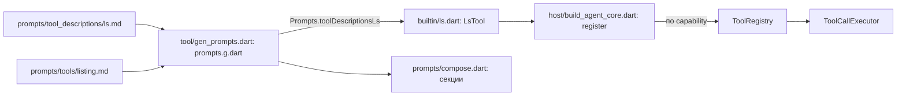

# Расширение агента: рецепты

Глава о том, как добавить в агента новую часть: инструмент, провайдера модели, команду, хук, правило разрешений, ключ конфигурации, промпт, событие хода, MCP-сервер, навык или субагента. Перед ней прочитайте [02-assembly-and-hosts.md](02-assembly-and-hosts.md) (сборка ядра и порты), [06-tools.md](06-tools.md) (инструменты) и [07-permissions.md](07-permissions.md) (разрешения): рецепты на них опираются и их не повторяют.

Каждый рецепт построен по существующему примеру из кода. Пример показывает, где лежит класс, где он регистрируется, какие тесты есть у соседа. Копируйте не текст примера, а его устройство: список файлов, порядок шагов, набор тестов.

## Общие правила

Ядро расширяется в заранее заданных точках, а не условиями в существующем коде. Критерий готовности итерации (г) в [`AGENTS.md`](../AGENTS.md) пакета (раздел 3) называет эти точки: `ToolRegistry`, порты `AgentCoreServices`, capabilities `HostProfile`, ветка sealed-иерархии `AgentEvent`, ключ схемы конфигурации, фабрика провайдеров. Если ваше изменение не встаёт ни в одну из них, остановитесь: скорее всего, нужен архитектурный разбор (`codelab-architect`), а не ещё одна ветка в цикле.

Три правила действуют для любого рецепта ниже.

1. **Тест раньше кода.** Правила TDD — в [`AGENTS.md`](../AGENTS.md) пакета, раздел 2: сначала красный тест из критерия приёмки, потом минимальный код. Коммит красного теста делается только по явной просьбе пользователя (корневой [`AGENTS.md`](../../../../AGENTS.md) §19).
2. **Ядро остаётся чистым.** Файлы `lib/**` не импортируют `dart:io` и другие запрещённые пакеты (PKG-1), `dependencies` не выходят за allowlist (PKG-2), HTTP-клиент, часы, случайность и идентификаторы приходят от хоста (PKG-6). Нужен файл, процесс или сеть — идите через порт, а реализацию кладите в `codelab_agent_io` (см. [02-assembly-and-hosts.md](02-assembly-and-hosts.md)).
3. **Документация меняется вместе с кодом.** Затронули поведение, описанное в `README.md` и `doc/` пакета, в `docs/user/` или `docs/ops/` — правьте документ в том же change. Если изменился контракт документа ядра в `docs/architecture/proposals/agent-core/`, об этом нужно сообщить `codelab-architect`: эти документы вы не правите.

### Сводная таблица

OpenSpec change нужен, когда меняется поведение продукта, контракт ACP, публичное API, хранение данных или безопасность (корневой `AGENTS.md` §17). «Стражи» — правила, которые сработают сами: сторож репозитория ([`codelab_architecture_tests`](../../codelab_architecture_tests/README.md)) и тесты самих пакетов. «Фикстура» — golden-фикстура ACP в [`codelab_acp_testing/fixtures/acp/`](../../codelab_acp_testing/fixtures/acp).

| Рецепт | OpenSpec change | Какие стражи задеты | Фикстура ACP |
|---|---|---|---|
| Встроенный инструмент | да (`agent-tools`) | правило ядра (PKG-1, PKG-2); HOST-6 не задет | нужна, если инструмент меняет кадры ACP |
| Провайдер модели с новым протоколом | да (`agent-llm`, `agent-configuration`) | PKG-5 (`test/public_api_test.dart` ядра) | нет |
| Сервер, совместимый с OpenAI | нет, только конфигурация | ничего | нет |
| Встроенная слэш-команда | да (`agent-slash-commands`) | ничего | `slash-*.json` |
| Команда-шаблон | нет, файл пользователя | ничего | нет |
| Хук `beforeToolCall` / `afterToolCall` | да, если меняется порядок или контракт хуков | HOST-6 для хоста | нет |
| Режим разрешений или критический шаблон | да, всегда (безопасность) | ничего | `set-mode-*.json`, `permission-*.json` |
| Ключ конфигурации | да (`agent-configuration`) | CFG-5 (импорты ядра, сторож); тест полноты реестра | нет |
| Промпт | зависит от эффекта (см. рецепт) | PR-1, PR-2 (тесты пакета) | нет |
| Событие хода | да | ACP-6 (тесты `codelab_agent_acp`) | нужна, если событие уходит клиенту |
| MCP-сервер | нет, конфигурация | ничего | нет |
| Навык, определение агента | нет, файлы | ничего | нет |

Что запускать, зависит от рецепта; общий набор перед pull request — в чек-листе в конце главы.

## Рецепт 1. Встроенный инструмент

Эталон — `ls`: небольшой, без побочных эффектов, с описанием в промпте и секцией правил для модели.

Хост не может подложить свой инструмент: у `AgentCoreServices` нет такого поля, а `ToolRegistry` не входит в публичный барель (`test/public_api_test.dart`). Встроенные инструменты регистрирует `buildAgentCore`. Инструменты других пакетов приходят портом: так `codelab_agent_mcp` отдаёт инструменты MCP-серверов через `McpConnector`.



Описание и секция правил проходят через генератор: сначала Markdown, затем константы Dart. Класс инструмента регистрирует сборка, а исполняет только единая точка `ToolCallExecutor` (TOOL-1).

### Шаги

1. **Класс.** Файл `lib/src/tools/builtin/ls.dart`, `final class LsTool extends AgentTool`. Обязательны `name`, `description`, `parameters` и `execute`. Остальное меняйте осознанно:
   - `tier` — уровень разрешения: `read`, `write`, `network` или `exec`. По умолчанию `exec` (TOOL-5): инструмент, у которого уровень не задан, считается самым опасным. `LsTool` объявляет `read`.
   - `kind` — вид вызова для клиента. Значение попадает в ACP по имени (`acp.ToolKind.values.byName`, `codelab_agent_acp/lib/src/event_projection.dart`), поэтому нового значения `ToolKind` без парного значения в ACP быть не может (`test/projection/tool_kind_mapping_test.dart` в `codelab_agent_acp`).
   - `outputTrust` — доверие к выводу. По умолчанию `untrusted`: вывод огораживается (TOOL-10). `ls` отдаёт `trusted`, потому что имена файлов не инструкции, а `search` решает по пути: совпадения из `node_modules` и подобных каталогов недоверенные.
   - `permissionPattern` — шаблон «разрешить всегда»; у `ls` это `pathPattern(...)` из `builtin/common.dart`.
   - `lockPath` — путь, который точка исполнения держит под замком на время `execute` (TOOL-7); переопределяют только `write` и `edit`.
   - `truncatesOutput` — инструмент усекает вывод сам и сам сообщает об этом (TOOL-9).
   - `executionMode` — по умолчанию `null`: вызовы идут параллельной группой, а `sequential` делает вызов барьером (`agent_loop.dart`). Инструмент с побочными эффектами без `sequential` или `lockPath` исполняется параллельно с соседями.
   - `preflight` — проверка аргументов до разрешений, английский текст ошибки для модели; без побочных эффектов (PERM-1).
   - `present` — заголовок и места вызова для клиента и для запроса разрешения.
2. **Описание для модели.** Файл `prompts/tool_descriptions/ls.md` с frontmatter `id`, `description`, `vars`. Класс берёт текст из `Prompts.toolDescriptionsLs.render(const {})`. Текст на английском: это текст для модели. Многострочных литералов промпта в `lib/` быть не должно (PR-2, `test/prompts/no_prompt_literals_test.dart`).
3. **Секция правил (если нужна).** Файл в `prompts/tools/`, например `listing.md`, с `tools: [ls, search]`. Секция входит в системный промпт, только если включены все перечисленные инструменты (PR-6). Раздел `tools/` без строки `tools:` генератор отвергает. Новую секцию нужно подключить веткой в `_sections` файла `lib/src/prompts/compose.dart` в порядке §11.5; ветка `if (listing && on(Prompts.toolsListing))` — образец. Устройство промптов — [09-config-prompts-commands.md](09-config-prompts-commands.md).
4. **Генерация.** Из каталога пакета:

   ```bash
   fvm dart run tool/gen_prompts.dart
   ```

   Скрипт `melos run prompts:check` запускает тот же генератор с флагом `--check` и падает, если `prompts.g.dart` расходится с Markdown (PR-1, `test/prompts/prompts_sync_test.dart`).
5. **Регистрация.** В `buildAgentCore` (`lib/src/host/build_agent_core.dart`) добавьте вызов `register('ls', () => registry.register(LsTool()))` в нужное место. Порядок регистрации — порядок схем в запросе, он стабилен ради кэша промпта провайдера, поэтому новый инструмент ставьте в конец своей группы. Дубликат имени — `HostWiringException` (HOST-5). Если инструменту нужна возможность хоста, вынесите её в `HostCapability`: `ls` и `search` включаются при `fileListing`, и эта возможность выключается, когда `baseEnv` не реализует `DirectoryListing`. Выключенная возможность не оставляет следов у модели: ни схемы, ни секции (HOST-4).
6. **Инструмент сессии.** Если инструменту нужно состояние сессии (снимок каталога, журнал, дерево субагентов), `buildAgentCore` его не создаёт: так регистрируются `skill` и `agent`. Рантайм делает это при открытии сессии в `agent_runtime.dart` (`sessionRegistry.register(SkillTool(...))`, `SubagentTool(...)`); `register` заменяет одноимённый инструмент на месте.
7. **Исполнение через порты.** Инструмент работает только через `ctx.env` (`ExecutionEnv`, всегда за `BoundedEnv`, ENV-2). Прямой доступ к файловой системе в ядре запрещён PKG-1. Ошибка, которую должна прочитать модель, — это `ToolExecutionResult` с `isError: true` (`errorResult(...)` из `common.dart`), а не исключение. Исключение тоже не ломает ход, оно даёт `ToolCallFinished(outcome: failed)` (TOOL-3).

### Тесты

Образец — набор у `ls`:

- `test/tools/builtin/ls_test.dart` — поведение на `MemoryExecutionEnv` через `ExecutorHarness.create([LsTool()])` и `h.run('ls', {...})`: схема, уровень и вид, порядок, пустой каталог, предел и уведомление об усечении;
- `test/tools/builtin_tools_golden_test.dart` и `test/tools/golden/ls.txt` — golden-вывод для модели; добавьте инструмент в `_cases`, обновите файлы командой `UPDATE_GOLDEN=1 fvm dart test test/tools/builtin_tools_golden_test.dart` и внимательно прочитайте разницу в ревью: текст ответов — часть контракта;
- `test/host/build_agent_core_test.dart` — порядок `CorePlan.toolNames` и схемы запроса по профилям; сюда нужно добавить новый инструмент;
- `test/prompts/compose_test.dart` (множество `allTools`) и golden-файлы `test/prompts/golden/*.txt` — системный промпт; обновляются так же, `UPDATE_GOLDEN=1 fvm dart test test/prompts`;
- тест разрешений: ваш уровень должен вести себя по таблице режимов, см. `test/permissions/mode_table_test.dart` и [07-permissions.md](07-permissions.md).

Общие стражи, которые сработают сами: `test/tools/tool_executor_guard_test.dart` (вызов `.execute(` только из `executor.dart`, TOOL-1) и `test/prompts/no_prompt_literals_test.dart`.

### Что проверить

`fvm dart test` в пакете, `melos run prompts:check`, `melos run guard`, `melos run web-compile` (ядро остаётся web-безопасным). Ядро — основа встроенного агента, поэтому по §21 добавьте `melos run conformance:agent` и `conformance:embedded`; если затронут бинарь или CLI — `test:e2e:cli:dart-agent`.

### Фикстура ACP

Если инструмент использует уже существующие кадры (`tool_call`, `tool_call_update` с текстом), новая фикстура не нужна: образцы — `tool-list-dir.json`, `tool-search-content.json`, `prompt-parallel-tool-calls.json`. Если инструмент выдаёт новый вид содержимого (diff, терминал, ссылка на место), добавьте фикстуру по образцу `tool-exec-terminal-embed.json` и `tool-write-permission-diff.json`. Правила — в [README `codelab_acp_testing`](../../codelab_acp_testing/README.md#как-добавить-фикстуру): поле `spec` ссылается на `docs/protocols/acp/`, ожидаемые кадры нельзя подгонять под реализацию.

## Рецепт 2. Провайдер модели

Сначала проверьте, нужен ли код. Серверы с протоколом OpenAI Chat Completions (OpenAI, OpenRouter, Ollama, LM Studio, llama.cpp, LiteLLM Proxy) работают через существующий адаптер: достаточно записи в конфигурации.

### Вариант А. Сервер, совместимый с OpenAI

Кода нет, OpenSpec change не нужен. Запись `providers.<id>` с `kind: openai-compatible`, `base_url`, ссылкой на ключ (`api_key_env` или `api_key_secret`) и списком `models`. Допустимые ключи записи — `_providerSchema` в `lib/src/config/schema.dart`. Записать провайдера можно командой `codelab provider add` или `codelab-agent provider add`. Расположение файлов и слои конфигурации описаны в [configuration.md](../../../../docs/user/configuration.md), как работают ключи и секреты — в [09-config-prompts-commands.md](09-config-prompts-commands.md).

### Вариант Б. Новый протокол

Эталон — `lib/src/llm/providers/anthropic.dart`. Контракт `StreamFunction` и события потока — [05-llm.md](05-llm.md). Заготовка уже есть: значение `ProviderApi.gemini` объявлено, а `createStreamFunction` пока отвечает ошибкой «not supported yet» (`_unsupported` в `provider_factory.dart`). Реализация Gemini была бы заменой этой ветки.

Нужен OpenSpec change: добавляется значение `kind` в конфигурацию (публичный контракт) и поведение запросов.

Шаги:

1. **Значение перечисления.** `ProviderApi` в `lib/src/llm/model_ref.dart` (для нового протокола) или готовое значение.
2. **Адаптер.** Файл `lib/src/llm/providers/<имя>.dart` с функцией вида `anthropicStreamFunction(ProviderConfig config, CoreLlmServices services) => StreamFunction`. Скелет у всех адаптеров один: `runProvider(model, cancel, services.clock, (state) => ..., classify: classifyException, secrets: config.secrets)`. Внутри:
   - запрос — `sendStreaming(...)` из `providers/http_support.dart` (он закрывает HTTP-запрос по отмене и сам следит за перенаправлениями);
   - чтение потока — `SseDecoder` из `lib/src/llm/sse.dart`: второго декодера SSE не заводите;
   - ошибки — `classifyHttpError`, `classifyStreamError` и `describeHttpError`: они дают класс ошибки (`LlmErrorClass`) и текст без значений секретов (`redactSecrets`);
   - события — через `ProviderStreamState` (`lib/src/llm/stream_state.dart`): он копит блоки и снимки `partial` (LLM-4) и помнит, что терминальное событие уже отправлено (`isTerminated`; LLM-2).
   Адаптер не бросает исключений наружу (LLM-1) и не создаёт `http.Client` (LLM-10, PKG-6): клиент берётся из `services.httpClient`.
3. **Фабрика.** Добавьте ветку в `switch (config.api)` функции `createStreamFunction` (`lib/src/llm/provider_factory.dart`). Switch исчерпывающий: без ветки код не соберётся. Таймауты, повтор при временных сбоях и запасная модель добавляются автоматически декораторами (`decorators/`), их в адаптер не вставляют.
4. **Конфигурация.** Добавьте значение в `providerKinds` (`lib/src/config/schema.dart`), в разбор `kind` в `resolve.dart` (`_provider`) и в `enumValues` дескриптора `providers.<id>.kind` в `lib/src/config/settings_registry.dart`. Ещё три места компилятор не проверит: `base_url` по умолчанию в `resolve.dart` (`switch (kind)` около строки 919), `_defaultBase` в `lib/src/config/provider_binding.dart` (на нём держится привязка ключа к origin, то есть безопасность) и, если протокол называет заголовок ключа иначе, `authHeader` в конструкторе `ProviderConfig` (`provider_config.dart`; сейчас особый случай только у `anthropicMessages`). Опасная ловушка: в разборе `kind` стоит `_ => ProviderApi.openaiChat`, поэтому забытая ветка молча превратит новый `kind` в OpenAI-адаптер, и ошибки компиляции не будет.
5. **Публичный барель.** Адаптер в барель не экспортируется (PKG-5): хост получает функцию модели только через `createStreamFunction`, `createRoutedStreamFunction` или `createConfiguredStreamFunction`. Проверяет `test/public_api_test.dart`.

Тесты по образцу `test/llm/anthropic_test.dart`: `http.Client` подменяется `MockClient.streaming`, ответы берутся из SSE-фикстур `test/fixtures/sse/<провайдер>/*.sse` (файлы читает `readSseFixture` из `test/support/provider_harness.dart`), нарезка тела — `Chunking.whole`, `byChar`, `random`. Ожидаемые случаи: обычный текст, вызовы инструментов (в том числе по частям), рассуждение, лимиты, ошибки провайдера, потеря потока, отмена. Фикстуры сверяйте с настоящим потоком вручную: `tool/llm_smoke.dart` и команда в `AGENTS.md` пакета (раздел 4); в CI скрипт не запускается, ему нужен ключ. Не копируйте чужие фикстуры (корневой `AGENTS.md` §5).

Проверки: `fvm dart test` в пакете, `melos run guard`, `melos run web-compile`, `fvm dart analyze` в пакетах, которые зависят от ядра (`codelab_agent_io`, `codelab_agent_acp`, `codelab_setup`, `codelab_embedded`), если изменён публичный API, и `melos run conformance:agent`. Фикстура ACP не нужна: провайдер за ACP не виден.

## Рецепт 3. Слэш-команда

Команды бывают двух видов, и для них нужны разные действия. Устройство команд — [09-config-prompts-commands.md](09-config-prompts-commands.md).

### Команда-шаблон

Это файл, а не код. Положите `<имя>.md` в `$CODELAB_HOME/prompts` (для пользователя) или `<проект>/.codelab/prompts` (только доверенный проект). Правила файла проверяет `parseCommandTemplates` (`lib/src/commands/command_template.dart`):

- имя файла без `.md` соответствует `^[a-z0-9][a-z0-9-]{0,63}$` и не входит в `reservedCommandNames` (встроенные имена зарезервированы целиком, SKL-7);
- frontmatter допускает только `description` (до 200 символов) и `argument-hint` (до 80);
- тело не пустое и не больше 32 КиБ; плейсхолдеры — `$ARGUMENTS` и `$1`…`$9`.

Ошибка файла не ломает загрузку: файл пропускается, а причина попадает в диагностику (`codelab config check` покажет её). Фикстура — `prompt-template-command.json`, тесты — `test/commands/template_parse_test.dart`, `test/runtime/command_expansion_test.dart`.

### Встроенная команда

Образец — `/usage` (`lib/src/commands/builtin_commands.dart`). Нужен OpenSpec change `agent-slash-commands`: у команды фиксированные тексты ответов и место в списке для клиента.

1. Значение в `enum BuiltinName` и ветка `changesState` (команда меняет состояние сессии — журнал, режим, модель — или нет).
2. Объявление в `BuiltinCommands.declare` в порядке §13.4 и условие, при котором команда видна (как `config` и `mcp` скрыты без своих возможностей). Необъявленная команда отвечает «Unknown command», а не уходит модели.
3. Слово в `switch` метода `match` и ветка в `switch` метода `run`. Исчерпывающий только `run` (и `switch` по подкомандам). `match` кончается веткой `_ => null`: забытое слово компилятор не покажет, команда ответит «Unknown command», поэтому тест на `match` обязателен.
4. Если команде нужен доступ к сессии, добавьте порт-функцию в конструктор `BuiltinCommands` и подключите её в `agent_runtime.dart` при создании `BuiltinCommands`. Команда не знает ни очередь замен MCP-серверов, ни писатель журнала: она получает только порты.
5. Имя уже может быть зарезервировано в `reservedCommandNames` (там есть имена на вырост: `rename`, `branch`, `rewind`). Новое имя добавьте в этот список, иначе шаблон сможет его занять.
6. Строки `/help` строятся из того же списка (`_help()`), отдельно их править не нужно.

Тесты: `test/commands/builtin_commands_test.dart`, `test/runtime/builtin_slash_commands_test.dart`. Фикстуры — образцы `slash-help.json`, `slash-usage.json`, `slash-mode-plan.json`: клиенту команда видна как `available_commands_update`, и это проверяют обе стороны. Скрипты: `conformance:agent`, `conformance:embedded`, `conformance:client` (если фикстура новая).

## Рецепт 4. Хук `beforeToolCall` и `afterToolCall`

Хуки — это способ хоста вмешаться в вызов инструмента, не меняя ядро. Хуки нужны хосту, а не модели: правил, которые пользователь пишет сам, в ядре нет (возможность `user_hooks` в конфигурации помечена «после MVP»).

Типы `BeforeToolCallHook`, `AfterToolCallHook`, `Block` и `ResultOverride` объявлены в `lib/src/loop/loop_config.dart` и экспортируются барелем. Хуки передаются при открытии сессии: `SessionSpec.extraBeforeToolCall`, `SessionSpec.extraAfterToolCall` или те же поля `SessionHostPorts` (для сессии, загруженной с диска).

Правила порядка, которые нельзя обойти:

- первым звеном `beforeToolCall` всегда стоит проверка разрешений (PERM-1), хуки хоста идут после неё. Хук видит только разрешённые вызовы (`test/permissions/hooks_order_test.dart`, `policy_is_first_hook_test.dart`). Смягчить решение политики хук не может, а ужесточить может, вернув `Block(reason)`;
- первый `Block` останавливает цепочку; модель получает `reason` как результат-ошибку, ход продолжается. Исключение внутри хука `before` превращает вызов в `failed`, исполнения нет;
- `afterToolCall` вызываются после усечения и ограды вывода и могут переопределить `content` и `isError` через `ResultOverride`; исключение внутри такого хука превращает результат в ошибку (`lib/src/tools/executor.dart`);
- потомкам (субагентам) корня передаются только хуки `before`, причём вызов приходит с идентификатором-цепочкой `<родитель>/<вызов>`; хуки `after` потомкам не подключаются (`test/subagents/subagent_host_hooks_test.dart`).

Живой пример — ACP-адаптер. Метод `SessionBridge.markInProgress` (`codelab_agent_acp/lib/src/session_bridge.dart`) подключён хуком `before` в `agent_server.dart`: когда вызов разрешён, клиент получает статус `in_progress`. Хуку не нужны ни модель, ни файлы: он получает `ToolCall`, аргументы и `ToolContext`.

Что делать:

1. Напишите функцию нужного типа в хосте или в мосте.
2. Передайте её в `SessionSpec` или `SessionHostPorts`. Хост собирает ядро только через `buildAgentCore` (HOST-6, `host_assembly_guard_test.dart` сторожа): хук не повод создавать `ToolRegistry` или `Agent` вручную.
3. Тест — на `CoreHarness` и `ScriptedStreamFunction` (`test/host/core_harness.dart`), как в `test/permissions/hooks_order_test.dart`.

OpenSpec change нужен, если меняется контракт хуков: порядок, набор параметров, передача потомкам. Новый хук внутри хоста — часть этого хоста. Скрипты: `fvm dart test` в изменённом пакете, `melos run guard`, `conformance:agent` и `conformance:embedded`, если хук виден клиенту.

## Рецепт 5. Режим разрешений и правила

Принципы и таблица «режим × уровень» — в [07-permissions.md](07-permissions.md). Здесь — что менять. Любое из этих изменений касается безопасности, поэтому OpenSpec change обязателен (корневой `AGENTS.md` §2: безопасность — приоритет 1, §10), а ревью проходит через `acp-safety-reviewer`.

### Правило пользователя

Не требует кода: `permissions.tools.<инструмент>: allow | ask | deny` и список `permissions.deny` в конфигурации (`schema.dart`, секция `permissions`). Проект может только ужесточить эти правила (CFG-3, `lib/src/config/trust.dart`).

### Новый режим

Эталон — `plan`. Режим — это `ModeId` и `PermissionMode`.

1. `PermissionMode` в `lib/src/permissions/modes.dart`: порядок значений — порядок мягкости. От него зависит сужение режима субагента (`narrow`, SUB-2), поэтому новое значение вставляйте в нужное место.
2. Таблица `tierDecision` — исчерпывающий `switch` по паре «режим, уровень»: без новой ветки код не соберётся.
3. `ModeId`: константа, список `values`, `permissionMode`, `softness`, `deniedTiers`. `softness` перечисляет идентификаторы явно, без ветки «по умолчанию»; неизвестный режим не получает ранга и не проходит проверку `fitsFloor` (fail-closed).
4. Режим виден клиентам по ACP (`modes` и `configOptions` в `codelab_agent_acp/lib/src/config_options.dart`). Если режим новый для протокола, нужны проверки по `docs/protocols/acp/` и фикстура; придумывать поля ACP нельзя (корневой `AGENTS.md` §3.4).
5. Места вне `modes.dart`, которые компилятор не проверит: `configModeId` в `lib/src/config/validate.dart` (имя режима из конфигурации; ветки по умолчанию нет, новый режим конфигурация не примет); `_strictness` в `lib/src/config/trust.dart` (сужение режима проекта: пропущенный режим ослабляет защиту от проектного конфига, это безопасность); `enumValues` у `permissions.mode` в `settings_registry.dart` и `externalEnums` в `test/config/settings_registry_complete_test.dart`; `inputHint` команды `/mode` в `builtin_commands.dart`.
6. Режим `plan` добавляет в промпт секцию `prompts/modes/plan.md` — если новому режиму нужен свой текст для модели, создайте такой же файл и ветку в `_sections`.

Тесты: `test/permissions/mode_table_test.dart`, `modes_test.dart`, `no_bypass_test.dart` (ни один способ не обходит политику). Фикстуры: `set-mode-plan-rejects-edit.json`, `set-mode-bypass-no-prompt.json`, `permission-*.json`.

### Новый критический шаблон команды

Эталон — таблица в `lib/src/permissions/critical_patterns.dart` (PERM-2, PERM-9). Критическая команда вызывает вопрос в любом режиме, даже после «разрешить всегда», а в `autopilot` ей отказывают.

1. Метка — константа вида `_forkBombLabel` и запись в `_tableOrder`. Порядок записей — порядок меток в причине отказа.
2. Правило разбора команды. Лексер (`shell_lexer.dart`) разбирает команду в слова; команда, которую он не разобрал, получает метку `unparsable command`. Таблицу и правила пишите по собственному документу [07-permissions.md](../../../../docs/architecture/proposals/agent-core/07-permissions.md), §7.6: чужие списки правил не копируются (корневой `AGENTS.md` §5).
3. Тест `test/permissions/critical_patterns_test.dart`: добавьте строки в таблицу срабатывающих команд и команд, которые срабатывать не должны.

## Рецепт 6. Ключ конфигурации

Правило пакета: новый ключ — это строка схемы вместе со своим потребителем (CFG-5 в [`AGENTS.md`](../AGENTS.md); критерий (г) итерации). Ключ без потребителя даёт предупреждение `config.key.not_applied`. Нужен OpenSpec change `agent-configuration`: ключ — публичный контракт.

Эталон — `compaction.keep_recent_tokens`: у него проверка `> 0` в `resolve.dart` (`_compaction`) и `min: 1` в дескрипторе. У соседнего `keep_recent_user_turns` проверки нет, брать его за образец не нужно.

1. **Схема.** Строка в `lib/src/config/schema.dart`: `'keep_recent_tokens': _int` в секции `compaction`. Узлы с суффиксом `U` (`_intU`, `_boolU`) и `_opaque` помечены «потребителя нет»; для живого ключа берите без суффикса.
2. **Разбор значения.** В `lib/src/config/resolve.dart` читается типизированно (`_int([...])`), проверяется (`_bad(path, 'must be greater than 0')`) и складывается в поле типизированной настройки: для сжатия это `CompactionOverrides` в `core_config.dart`. Ошибка проверки — `ConfigIssue` с источником, строкой и путём ключа, а не исключение.
3. **Потребитель.** Код, который читает настройку. Сессия берёт её через снимок `CoreConfig` (`settingsOf()` в `agent_runtime.dart`), а не через глобальное состояние: так перезагрузка конфигурации меняет значение на лету.
4. **Дескриптор реестра.** Запись в `lib/src/config/settings_registry.dart` (`_fileOnly(...)` или общая запись): раздел, подпись, тип, минимум, признак `restartRequired`. По дескриптору строятся `config set` и страница настроек приложения; ключ вне реестра `ConfigWriter` отклоняет. Тест `test/config/settings_registry_complete_test.dart` ломает сборку, если у ключа схемы нет дескриптора. Список «ключей только после перезапуска» в этом тесте — внешний: сверьте решение с ним (хост-ключи `sessions.*`, `logging.*`, `profile.*`, `config.*`, `secrets.backend`, `permissions.*`, `trusted_projects`).
5. **Перезагрузка.** Живую перезагрузку планирует `planConfigReload` (`config_reload_plan.dart`). Ключ без дескриптора откладывается до перезапуска (fail-closed). Если потребителю нужна особая обработка, добавляйте её в план, а не в потребитель.
6. **Доверие проекта.** Если значение слабит безопасность, проверьте правила `lib/src/config/trust.dart`: проектный слой не вправе расширять права агента, запускать процессы или менять адреса запросов (CFG-3).
7. **Секреты.** Значение секрета в файле — это предупреждение `config.secret.in_file`; логика распознавания живёт только в `lib/src/config/inline_secrets.dart` (CFG-9): своей копии не заводите.
8. **Импорты.** Ядро не разбирает YAML и TOML (CFG-5). Файлы читает `codelab_agent_io`, ядро получает готовое дерево.

Тесты: `test/config/config_schema_test.dart`, `config_values_test.dart`, `config_not_applied_test.dart`, `settings_registry_complete_test.dart`, `config_reload_plan_test.dart`; рабочие примеры слоёв — `test/config/config_support.dart` (`layer`, `baseValues`). Документы: `docs/user/configuration.md` и, для DevOps, `docs/ops/`.

Скрипты: `fvm dart test` в пакете, анализ и тесты `codelab_agent_io` и `codelab_setup` (они разбирают и записывают конфигурацию), `melos run guard`, `web-compile`. Если ключ показывается в приложении — тесты `apps/codelab_desktop`.

## Рецепт 7. Промпт

Тексты промптов живут в Markdown, а в Dart приходят константами через генератор (PR-1, PR-2). Подробности — [09-config-prompts-commands.md](09-config-prompts-commands.md).

1. Правьте файл в `prompts/**/*.md`. Frontmatter: `id` (совпадает с путём: `tools/listing.md` → `tools.listing`), `description`, `vars`, для секций инструментов — `tools`. Каждая подстановка `{{имя}}` объявлена в `vars` и используется в тексте; лишние и недостающие генератор отвергает (PR-4).
2. Запустите `fvm dart run tool/gen_prompts.dart` в каталоге пакета и закоммитьте и Markdown, и `prompts.g.dart`.
3. Обновите golden-файлы: `UPDATE_GOLDEN=1 fvm dart test test/prompts test/tools test/skills` (golden системных промптов, описаний инструментов и их вывода).
4. Новый файл с ожидаемым именем добавьте в список `test/prompts/prompts_sync_test.dart`, если это встроенная часть MVP.

Нужен ли OpenSpec change — решает эффект. Правка опечатки или формулировки без смены смысла — implementation-only. Новая секция, смена правил для модели, условие включения секции и всё, что меняет поведение инструмента или агента для модели, — это изменение наблюдаемого поведения, и оно оформляется change (корневой `AGENTS.md` §17, спецификации `agent-prompts`, `agent-tools`). Тексты пишутся заново; копировать чужие промпты и описания инструментов запрещено (корневой `AGENTS.md` §5).

Определяющие правила:

- `composeSystemPrompt` детерминирован: одинаковые входы — побайтово одинаковый текст (PR-3, LLM-11). Не вставляйте в промпт время запроса, случайные значения и порядок по хешу. Иначе кэш промптов провайдера промахивается на каждом шаге;
- секции выключенных capability не входят в промпт (HOST-4);
- содержимое файлов проекта и навыков вставляется значением и экранируется (`_escapeClosingTag`): файл не должен закрыть свой блок и выдать продолжение за текст агента.

Скрипты: `melos run prompts:check`, `fvm dart test` в пакете (`test/prompts/`, `test/tools/`, `test/skills/`: golden `catalog_section_golden_test.dart`, и `test/prompts/subagent_prompt_test.dart`, `subagent_prompt_skills_test.dart`), `conformance:agent`, `conformance:embedded` (текст промпта виден в сценарных запросах `expect`).

## Рецепт 8. Событие хода

События хода — закрытая (`sealed`) иерархия `AgentEvent` в `lib/src/loop/agent_events.dart`. Новое событие — новая ветка, а не флаг в существующем. Образец — `CompactionDiscarded`: его завели отдельным событием, потому что флаг в `ContextCompacted` заставил бы ветвиться всех потребителей. Устройство событий — [04-turn-loop.md](04-turn-loop.md).

OpenSpec change нужен всегда: иерархия публична, а событие затрагивает ACP-проекцию.

Что менять:

1. Класс `final class X extends AgentEvent` в `agent_events.dart` с doc-комментарием «почему, для чего, как использовать» (корневой `AGENTS.md` §15).
2. Место, где событие рождается, и порядок: цикл ждёт каждый `emit` (LOOP-2), `TurnEnded` остаётся последним событием хода (LOOP-1).
3. **ACP-проекция.** `projectEvent` в `codelab_agent_acp/lib/src/event_projection.dart` — исчерпывающий `switch` без ветки `default` (ACP-6): без новой ветки пакет не соберётся. Рядом таблица `projectionTable` с описанием, что событие даёт клиенту. Тест `every_agent_event_is_projected_test.dart` сверяет таблицу с подтипами по исходнику. Если событие не уходит клиенту, ветка возвращает `const []` (как `CompactionDiscarded`). Если уходит, нужен кадр ACP, а новых методов ACP придумывать нельзя: используйте существующее обновление или расширение `_meta.codelab.*` с отдельным change (`codelab_agent_acp/AGENTS.md`, раздел 2).
4. **Журнал.** Если состояние надо пережить перезапуск, нужна запись журнала (`lib/src/session/records.dart`) и ветка в `session_writer.dart` / `projections.dart`; реплей строит события заново из записей (глава [08-sessions-and-compaction.md](08-sessions-and-compaction.md)).
5. **Подписчики.** `projectEvent` исчерпывающий без `default`: мост ACP обязан явно обработать новую ветку, а неотправляемое событие получает `const []`. Остальные подписчики `AgentSession.events` проверьте так же: какие из них должны отреагировать, какие явно пропускают ветку.

Тесты: поведение — рядом с источником (образец `test/compaction/compaction_discarded_event_test.dart`, `test/loop/agent_events_test.dart`), проекция — `codelab_agent_acp/test/projection/`, журнал — `test/session/`. Фикстура ACP — если кадр уходит клиенту.

Скрипты: `fvm dart test` в ядре и `codelab_agent_acp`, `conformance:agent`, `conformance:embedded`, `conformance:client` (если фикстура новая), `melos run guard`.

## Рецепт 9. MCP-сервер

Подключить MCP-сервер — задача конфигурации, а не кода. Сервер отдаёт инструменты с именами `mcp__<сервер>__<инструмент>`; они проходят ту же точку исполнения и те же разрешения, что встроенные (TOOL-1, PERM-1). Нормы — спецификация [`agent-mcp-client`](../../../../openspec/specs/agent-mcp-client/spec.md), устройство — [06-tools.md](06-tools.md).

Запись `mcp.servers` в `config.yaml`: поля `name`, `type` (`stdio` или `http`), `command` и `args` (для stdio) или `url` и `headers` (для http), `env`, `enabled`, `connect_timeout`, `call_timeout` (`_mcpServerSchema` в `schema.dart`). Команды `codelab mcp add`, `list`, `remove` пишут её сами; значения секретов команда сохраняет в хранилище секретов, а в файл кладёт ссылку (`--header-stdin`, `--env-stdin`). Клиент ACP может передать серверы и в `session/new`; фикстура — `session-new-with-mcp.json`.

Что знать при подключении:

- инструмент MCP всегда имеет уровень `exec` и недоверенный вывод, аннотации сервера на решения не влияют (`codelab_agent_mcp/lib/src/mcp_tool.dart`, P-16, TOOL-10);
- коллизию имён инструментов ловит коннектор (`codelab_agent_mcp/lib/src/connector.dart`): он отключает целиком более поздний сервер, пишет `mcp.server.failed` и `lastError: tool name collision` (HOST-5, спецификация `agent-runtime`). Проверка рантайма с `mcp.tool.invalid` (имя без префикса `mcp__` или совпадает со встроенным) — только защита в глубину;
- сервер из проектного `config.yaml` читается только у доверенного проекта (CFG-3);
- новый или изменённый `stdio`-сервер появляется после перезапуска агента, а не «на лету» (`planConfigReload`).

Код нужен, только если появляется новый транспорт. Помимо порта, не забудьте места, где транспорты перечислены: `type` в разборе сервера принимает только `stdio` и `http` (`resolve.dart`); `McpTransports` в `connector.dart`; транспорты возможности `mcp` в `host_profile.dart` (HOST-3: коннектор обязан уметь каждый транспорт включённой возможности); правило перезагрузки для `stdio` и `http` в `config_reload_plan.dart`. Реализация идёт портом `McpTransport` из ядра (`lib/src/mcp/mcp_transport.dart`): stdio-реализацию пишет `codelab_agent_io`, потому что ядру `dart:io` запрещён, а протокол MCP живёт в `codelab_agent_mcp`. Правила импортов для этих пакетов — в `rules.dart` (`codelab_agent_mcp` без `dart:io`, ACP и `codelab_agent_io`; `codelab_agent_io` без ACP и клиентов). Тесты — `codelab_agent_mcp/test/` с `FakeMcpServer` из `package:codelab_agent_mcp/testing.dart`; в `codelab_embedded` этот барель разрешён только слою `testing`. Скрипты: тесты `codelab_agent_mcp`, `melos run guard`, `conformance:agent` и фикстуры `mcp-*.json`.

## Рецепт 10. Навык

Навык — каталог с файлом `SKILL.md`; кода не нужно, OpenSpec change не нужен. Формат — [спецификация Agent Skills](../../../../docs/protocols/agent-skills/specification.md) и спецификация [`agent-skills`](../../../../openspec/specs/agent-skills/spec.md).

Где лежит навык (корни перечислены в порядке просмотра; при совпадении имён побеждает навык из более раннего корня, остальные получают предупреждение `shadowed`): `<проект>/.codelab/skills/<имя>/SKILL.md` и `<проект>/.agents/skills/<имя>/SKILL.md` (проект ищется вверх до корня git, только доверенный), `$CODELAB_HOME/skills`, `~/.agents/skills`, корни из `skills.extra_roots`. Загрузку файлов делает `ProjectFilesLoader` из `codelab_agent_io`, проверку полей — `parseSkills` в `lib/src/skills/skill_catalog.dart`.

Поля frontmatter: `name`, `description`, `argument-hint`, `user-invocable`, `disable-model-invocation`, `compatibility`, `metadata` (а также `license` и `allowed-tools` по спецификации Agent Skills). Неверное значение поля даёт предупреждение, и навык загружается; навык без `description` пропускается с ошибкой `missing_description`. Проверьте результат командой `codelab config check`: она печатает диагностику файлов.

Навык виден модели в секции промпта `skills.catalog` и через инструмент `skill`; команда `/skill:<имя>` доступна пользователю, если `user-invocable` не `false`. Каталог навыков сессии — снимок: он не меняется до закрытия сессии (SKL-4), поэтому новый навык подхватывается новой сессией.

Если нужно менять не навык, а механику (новое поле формата, новый корень) — это уже код ядра и OpenSpec change `agent-skills`. Тесты по образцу: `test/skills/skill_parse_test.dart`, `skill_catalog_test.dart`, `skill_tool_test.dart`, golden секции каталога `test/skills/catalog_section_golden_test.dart`; фикстуры `skill-*.json`.

## Рецепт 11. Субагент

Тип субагента — это определение агента: Markdown-файл с frontmatter. Кода не нужно. Субагентов, их лимиты и список задач описывает глава [06-tools.md](06-tools.md); здесь — только как добавить тип.

Файл кладут в `$CODELAB_HOME/agents/<имя>.md` или `<проект>/.codelab/agents/<имя>.md` (проектный каталог читается только у доверенного проекта). Поля frontmatter проверяет `parseAgentDefinitions` (`lib/src/agents/agent_definition.dart`): `name` (`^[a-z][a-z0-9-]{0,47}$`, не `default`), `description` (до 200 символов), `model` (из каталога моделей, `<провайдер>/<модель>`), `mode`, `tools` (имена или префикс с `*`), `scope` (`session`, `subagent`, `both`; по умолчанию `both`). Тело файла — это текст, который попадёт в системный промпт секцией `agent_profile`; для потомка — `subagent.profile`. Лимит тела — 32 КиБ.

Что важно:

- определение может только сузить права. Набор инструментов потомка — пересечение набора родителя и поля `tools` типа (`selectChildTools` в `lib/src/subagents/child_tools.dart`, SUB-1), режим не мягче ни режима родителя, ни режима типа (`narrow`, SUB-2), а поле `mode` определения не может сделать режим сессии мягче режима конфигурации;
- определение проекта заменяет пользовательское с тем же именем; два файла с одним именем в одной области отбрасываются оба;
- встроенные типы — `general`, `explore`, `review`, `plan` (`builtinSubagentTypes`, `lib/src/subagents/subagent_types.dart`); файл с тем же именем заменяет встроенный тип, и это попадает в журнал событием `subagent.type_overridden`.

Новый встроенный тип — уже код: определение в `builtinSubagentTypes()`, тело в `prompts/subagent/types/<имя>.md`, генерация промпта (рецепт 7), тесты `test/subagents/` и `test/prompts/subagent_prompt_test.dart`, OpenSpec change `agent-subagents`. Новые части субагентов встают в точки расширения, а ни цикл, ни политика разрешений особых случаев для детей не получают (раздел 7 [`AGENTS.md`](../AGENTS.md) пакета).

Тексты инструмента `agent` и промптов типов пишутся заново; копировать формулировки Claude Code запрещено (там же).

## Чек-лист перед pull request

Чек-лист перечисляет, куда посмотреть, а не заменяет документы. Пройдите его после всех рецептов.

1. **Spec.** Прочитан раздел `openspec/specs/` по теме и активный change; если поведение, ACP-контракт, публичное API, данные или безопасность меняются, change есть (корневой `AGENTS.md` §17). Спецификация не подогнана под реализацию.
2. **Правила пакета.** Выполнены инварианты PKG-1…PKG-6 и CFG-5 из [`AGENTS.md`](../AGENTS.md) пакета; для других затронутых пакетов — их вложенные `AGENTS.md`.
3. **TDD.** Красный тест предшествует коду, или PR ссылается на критерий, который закрывает. Итерация названа и точка расширения указана (критерии (а)–(е) раздела 3 `AGENTS.md` пакета).
4. **Проверка затронутого.** Состав — по корневому `AGENTS.md` §21 («Проверка перед pull request»): форматирование изменённых файлов, `fvm dart analyze` в изменённых пакетах (и в зависимых, если изменён публичный API), тесты пакета. Скрипты Melos по границе: `guard`; `prompts:check` при правке промптов; `web-compile` при правке web-безопасного кода; `conformance:agent`, `conformance:embedded` и `test:e2e:cli:dart-agent` — если затронуты ядро, ACP-проекция, встроенный агент или бинарь. Полный `melos run check` запускается только по просьбе пользователя, а в `release/*` — всегда (§21).
5. **Фикстуры.** Фикстуры ACP добавлены или изменены только со ссылкой `spec` на `docs/protocols/acp/` (рецепты 1, 3, 5, 8). Ожидаемые кадры не подгоняют под реализацию.
6. **Сторож.** Если изменены импорты между пакетами, `pubspec.yaml` или добавлен пакет — правила в [`rules.dart`](../../codelab_architecture_tests/test/support/rules.dart) и список `*Allowlist` в `pubspec_allowlist_test.dart` меняет тот же change.
7. **Комментарии.** Новые сущности имеют doc-комментарии на русском: почему, для чего, как использовать (корневой `AGENTS.md` §15).
8. **Сторонний код.** Если изменение воспроизводит внешний алгоритм, таблицу или текст, источник указан в документе и в комментарии, а запись внесена в `THIRD_PARTY_NOTICES.md` (корневой `AGENTS.md` §5).
9. **Документы.** Затронутые `README.md` и `doc/` пакета, `docs/user/`, `docs/ops/` обновлены в этом же change. Для опубликованных документов — `cd site && npm ci && npm run verify`, если установлен Node.
10. **Описание PR.** Заполнены разделы [шаблона pull request](../../../../.github/pull_request_template.md): какие проверки запускались локально, что полный `check` не запускался, какая итерация следующая. Коммит, push и PR — только по явной просьбе (корневой `AGENTS.md` §19, §22).

## Смотрите также

- [02-assembly-and-hosts.md](02-assembly-and-hosts.md) — сборка ядра, профили, порты;
- [06-tools.md](06-tools.md), [07-permissions.md](07-permissions.md), [09-config-prompts-commands.md](09-config-prompts-commands.md) — устройство частей, которые расширяются;
- [`docs/architecture/testing.md`](../../../../docs/architecture/testing.md) — уровни и виды тестов;
- [README `codelab_architecture_tests`](../../codelab_architecture_tests/README.md) — что проверяет сторож и как его запустить.
