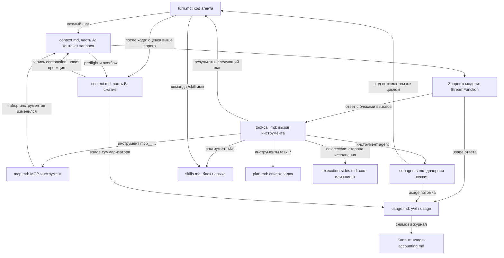

# Алгоритмы ядра агента

Раздел описывает, как работает ядро `codelab_agent_core`, по алгоритмам, а не по пакетам. Справочные главы руководства ([04](../04-turn-loop.md), [06](../06-tools.md), [08](../08-sessions-and-compaction.md) и другие) отвечают на вопрос «что это за класс и где он лежит». Здесь другой вопрос: «что происходит от входа до выхода и в каком порядке». Каждый файл читается подряд, без переходов по ссылкам.

Алгоритмы сверены с кодом и спецификациями `openspec/specs/`. Примеры построены на реальных данных: временных тестах с сценарной моделью и golden-файлах, источник указан рядом с каждым примером.

## Что в разделе

| Файл | Алгоритм | Вход → выход |
|---|---|---|
| [context.md](context.md) | формирование контекста запроса к модели; сжатие контекста | журнал, конфигурация, инструменты → `LlmContext`; история → запись `compaction` и новая проекция |
| [turn.md](turn.md) | ход агента от `AgentSession.prompt` до `TurnEnded` и записи в журнал | сообщение пользователя → `TurnResult`, события, записи журнала |
| [tool-call.md](tool-call.md) | вызов и исполнение инструмента: от блока вызова в ответе модели до результата в транскрипте и `session/update` | `ToolCall` → `ToolResultMessage`, события инструмента |
| [mcp.md](mcp.md) | MCP: от конфигурации сервера до вызова его инструмента моделью и обновления набора | `McpServerConfig` → инструменты `mcp__<сервер>__<имя>` в реестре сессии |
| [subagents.md](subagents.md) | субагенты: от вызова инструмента `agent` до отчёта потомка в результате вызова | вызов `agent` с типом и заданием → дочерняя сессия, её события у родителя, отчёт |
| [skills.md](skills.md) | навыки: от корней на диске до каталога в промпте, вызова моделью или командой `/skill:` и повторного прикрепления после сжатия | каталоги навыков → секция `skills.catalog`, блок навыка в транскрипте |
| [plan.md](plan.md) | планирование: список задач `task_*` и кадр ACP `plan`, режим разрешений `plan`, тип субагента `plan` | вызовы `task_*`, смена режима → список задач в журнале и у клиента, отказы `write` и `exec` |
| [redaction.md](redaction.md) | маскирование секретов на стороне агента: правило секретных имён, литералы в конфиге, адреса, вывод `config get`, тексты ошибок провайдера, правило логгера | имя, значение, адрес, путь ключа → значение или `<redacted>`; тело ошибки, известные секреты → текст с `[REDACTED]` |
| [secrets.md](secrets.md) | хранение и выдача секретов: запись в хранилище, ссылки в конфигурации, чтение резолвером, ключ провайдера, MCP, токен профиля клиента, перенос литералов | имя и значение, ссылка `${secret:…}`, `secrets.backend` → значение в запросе провайдера, MCP-сервера или внешнего агента; отказ без значения |
| [sessions.md](sessions.md) | сессии: создание, запись, список, открытие и ремонт журнала, управление, жизнь в мосте ACP | `session/new`, `session/list`, `session/load`, смена режима и модели → журнал на диске, строка списка, реплей истории, восстановленная сессия |
| [execution-sides.md](execution-sides.md) | кто и где решает, спрашивает, показывает и исполняет: разрешения, `fs/*`, `terminal/*`, листинг, MCP; встроенный агент, `serve --stdio`, `serve --ws`, внешний агент | сборка хоста и вызов инструмента → сторона и компонент каждого действия, кадры `session/request_permission`, `fs/*`, `terminal/*` или их отсутствие |
| [usage.md](usage.md) | учёт usage: токены из ответа провайдера, стоимость, агрегация по шагу, ходу, сессии, субагентам и суммаризатору, `usage.json`, `_codelab/session/usage` и запрос журнала | ответ провайдера и цены модели → `Usage` в журнале, итог хода, снимки и ответ журнала клиенту, файл `usage.json` |
| [settings.md](settings.md) | настройки: чьи они, слои конфигурации агента, слияние слоёв (`mergeLayers`, правила по ключам) и путь до `CoreConfig`, доверие к проекту, живая перезагрузка, смена режима и модели по ACP, запись `config.yaml`, зависимость от способа подключения | файлы `config.yaml`, переменные `CODELAB_*`, флаги `serve`, запросы `session/set_config_option` и `session/set_mode` → `CoreConfig` и `HostSettings`, применённый снимок рантайма, записи журнала сессии, обновлённый файл |

## Как алгоритмы вложены друг в друга

Ход выполняет шаги. На каждом шаге он собирает контекст, зовёт модель и исполняет вызовы инструментов из её ответа. Инструмент MCP — один из инструментов реестра. Сжатие работает вокруг хода и внутри него: после хода по порогу и аварийно, если запрос не помещается в окно.

На схеме стрелки означают «вызывает», «запускает» или поток данных.

Навыки и режим `plan` ещё и меняют контекст: каталог навыков (`skills.catalog`) и секция `modes.plan` входят в системный промпт (`context.md`, часть А), а после сжатия активные навыки прикрепляются заново.

Порядок чтения. Для первого знакомства: `turn.md`, затем `context.md` и `tool-call.md`; `mcp.md` — когда нужны серверы MCP; `subagents.md`, `skills.md` и `plan.md` — когда нужны соответствующие механизмы; `execution-sides.md` — когда нужно понять, на чьей стороне идут разрешения, файлы и команды при данном способе подключения. `usage.md` — когда нужно понять, откуда берутся токены и стоимость, как они складываются и что доходит до клиента. `settings.md` — когда нужно понять, чья это настройка, откуда она берётся, применится ли она на лету и что от неё переживёт перезапуск. Файлы связаны ссылками, но не зависят друг от друга: у каждого свои вход, выход и пример.

## Как читать псевдокод

Каждый алгоритм записан блоком `text` в Dart-подобной нотации. Это не исполняемый код. Он нужен, чтобы увидеть порядок шагов, ветвления и раннюю остановку.

- **Нумерованные шаги** (`1.`, `2.`, `3.`) идут в порядке выполнения. Порядок совпадает с кодом; шаги не переставляются и не выдумываются. Упрощена только запись: служебные вызовы и логирование, которые не меняют результат, могут быть опущены или сведены в одну строку.
- **Комментарий `// файл.dart: Класс.метод`** возле шага — где этот шаг в коде. Пути даны от `lib/src/<каталог>/`, если не сказано иное.
- **`если … : … иначе …`, `для … в …`, `пока …`** — ветвление и циклы. Вложенность показана отступом.
- **`return`** — ранний выход из функции. **`break`**, **`continue`** — выход из цикла и переход к следующему кругу.
- **`await`** — вызов, который ждёт ответа, и во время ожидания могут прийти события или отмена.
- **`emit X`** — событие `AgentEvent` отправлено в очередь агента. Подписчики получают его по порядку; цикл ждёт каждого (LOOP-2).
- **`записать X`**, **`writer.append`** — запись в журнал сессии.
- **`лог имя(поле: значение)`** — запись в логгер с ключом события.
- **`попытка: … при Ошибка: …`** — обработка исключения. `CancelledException` — отмена; она пробрасывается выше, а не превращается в ошибку шага.
- **`-> Тип`** после имени функции — что функция возвращает; `?` у типа означает «может быть `null`».
- **`//` в конце строки** без имени файла — пояснение или номер инварианта: `LOOP-*`, `TOOL-*`, `PERM-*`, `CMP-*`, `HOST-*`, `PR-*`, `SES-*`, `ACP-*`, `CFG-*`, `SUB-*`. `CMP-13` определён в `docs/architecture/proposals/agent-core/09-compaction.md`, а в спецификации на него есть только ссылка. Формулировки остальных — в спецификациях `openspec/specs/` и в проектных документах `docs/architecture/proposals/agent-core/`.

После псевдокода идёт пошаговое пояснение: почему шаг именно такой и какой инвариант он держит. Дальше — таблица граничных случаев «ситуация → что делает алгоритм → где в коде», параметры, которые меняют поведение (с умолчаниями), и ссылки на справочные главы.

## Смежные главы руководства

- [04. Цикл хода](../04-turn-loop.md), [05. Вызов модели](../05-llm.md), [06. Инструменты](../06-tools.md), [07. Разрешения](../07-permissions.md), [08. Сессии и сжатие](../08-sessions-and-compaction.md), [09. Конфигурация, промпты, команды](../09-config-prompts-commands.md).
- MCP-клиент: [руководство `codelab_agent_mcp`](../../../codelab_agent_mcp/doc/README.md).
- Клиентская сторона алгоритма исполнения: [`codelab_client_acp`, исполнение на клиенте](../../../codelab_client_acp/doc/execution-on-client.md).
- Клиентская сторона учёта usage: [`codelab_client_core`, учёт usage на клиенте](../../../codelab_client_core/doc/usage-accounting.md).
- Клиентская сторона настроек: [`codelab_client_core`, настройки на клиенте](../../../codelab_client_core/doc/settings-on-client.md).
- Оглавление всего руководства: [README руководства](../README.md).
