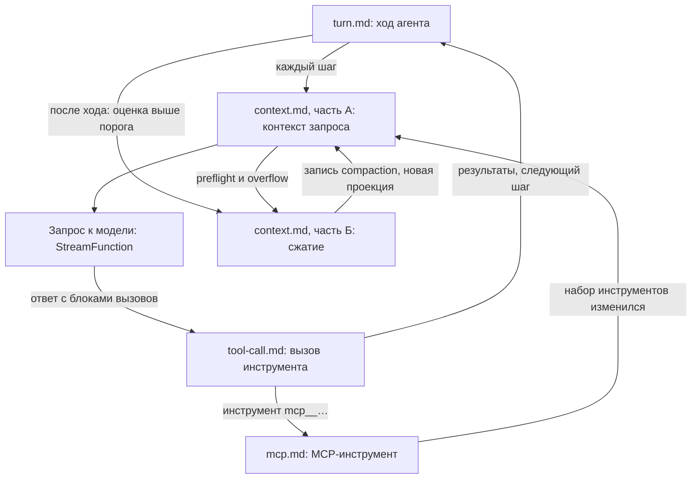

# Алгоритмы ядра агента

Раздел описывает, как работает ядро `codelab_agent_core`, по алгоритмам, а не по пакетам. Справочные главы руководства ([04](../04-turn-loop.md), [06](../06-tools.md), [08](../08-sessions-and-compaction.md) и другие) отвечают на вопрос «что это за класс и где он лежит». Здесь другой вопрос: «что происходит от входа до выхода и в каком порядке». Каждый файл читается подряд, без переходов по ссылкам.

Алгоритмы сверены с кодом и спецификациями `openspec/specs/`. Примеры построены на реальных данных: временных тестах с сценарной моделью и golden-файлах, источник указан рядом с каждым примером.

## Что в разделе

| Файл | Алгоритм | Вход → выход |
|---|---|---|
| [context.md](context.md) | формирование контекста запроса к модели; сжатие контекста | журнал, конфигурация, инструменты → `LlmContext`; история → запись `compaction` и новая проекция |
| [turn.md](turn.md) | ход агента от `AgentSession.prompt` до `TurnEnded` и записи в журнал | сообщение пользователя → `TurnResult`, события, записи журнала |
| [tool-call.md](tool-call.md) | вызов и исполнение инструмента: от блока вызова в ответе модели до результата в транскрипте и `session/update` | `ToolCall` → `ToolResultMessage`, события инструмента |
| [mcp.md](mcp.md) | MCP: от конфигурации сервера до вызова его инструмента моделью и обновления набора | `McpServerConfig` → инструменты `mcp__<сервер>__<имя>` в реестре сессии |

## Как алгоритмы вложены друг в друга

Ход выполняет шаги. На каждом шаге он собирает контекст, зовёт модель и исполняет вызовы инструментов из её ответа. Инструмент MCP — один из инструментов реестра. Сжатие работает вокруг хода и внутри него: после хода по порогу и аварийно, если запрос не помещается в окно.

На схеме стрелки означают «вызывает» или «запускает».

Порядок чтения. Для первого знакомства: `turn.md`, затем `context.md` и `tool-call.md`; `mcp.md` — когда нужны серверы MCP. Файлы связаны ссылками, но не зависят друг от друга: у каждого свои вход, выход и пример.

## Как читать псевдокод

Каждый алгоритм записан блоком `text` в Dart-подобной нотации. Это не исполняемый код. Он нужен, чтобы увидеть порядок шагов, ветвления и раннюю остановку.

- **Нумерованные шаги** (`1.`, `2.`, `3.`) идут в порядке выполнения. Порядок совпадает с кодом; шаги не переставляются и не выдумываются. Упрощена только запись: служебные вызовы и логирование, которые не меняют результат, могут быть опущены или сведены в одну строку.
- **Комментарий `// файл.dart: Класс.метод`** возле шага — где этот шаг в коде. Пути даны от `lib/src/<каталог>/`, если не сказано иное.
- **`если … : … иначе …`, `для … в …`, `пока …`** — ветвление и циклы. Вложенность показана отступом.
- **`return`** — ранний выход из функции. **`break`**, **`continue`** — выход из цикла и переход к следующему кругу.
- **`await`** — вызов, который ждёт ответа, и во время ожидания могут прийти события или отмена.
- **`emit X`** — событие `AgentEvent` отправлено в очередь агента. Подписчики получают его по порядку; цикл ждёт каждого (LOOP-2).
- **`записать X`**, **`writer.append`** — запись в журнал сессии.
- **`лог имя(поле: значение)`** — запись в логгер с ключом события.
- **`попытка: … при Ошибка: …`** — обработка исключения. `CancelledException` — отмена; она пробрасывается выше, а не превращается в ошибку шага.
- **`-> Тип`** после имени функции — что функция возвращает; `?` у типа означает «может быть `null`».
- **`//` в конце строки** без имени файла — пояснение или номер инварианта: `LOOP-*`, `TOOL-*`, `PERM-*`, `CMP-*`, `HOST-*`, `PR-*`, `SES-*`, `ACP-*`, `CFG-*`, `SUB-*`. `CMP-13` определён в `docs/architecture/proposals/agent-core/09-compaction.md`, а в спецификации на него есть только ссылка. Формулировки остальных — в спецификациях `openspec/specs/` и в проектных документах `docs/architecture/proposals/agent-core/`.

После псевдокода идёт пошаговое пояснение: почему шаг именно такой и какой инвариант он держит. Дальше — таблица граничных случаев «ситуация → что делает алгоритм → где в коде», параметры, которые меняют поведение (с умолчаниями), и ссылки на справочные главы.

## Смежные главы руководства

- [04. Цикл хода](../04-turn-loop.md), [05. Вызов модели](../05-llm.md), [06. Инструменты](../06-tools.md), [07. Разрешения](../07-permissions.md), [08. Сессии и сжатие](../08-sessions-and-compaction.md), [09. Конфигурация, промпты, команды](../09-config-prompts-commands.md).
- MCP-клиент: [руководство `codelab_agent_mcp`](../../../codelab_agent_mcp/doc/README.md).
- Оглавление всего руководства: [README руководства](../README.md).
