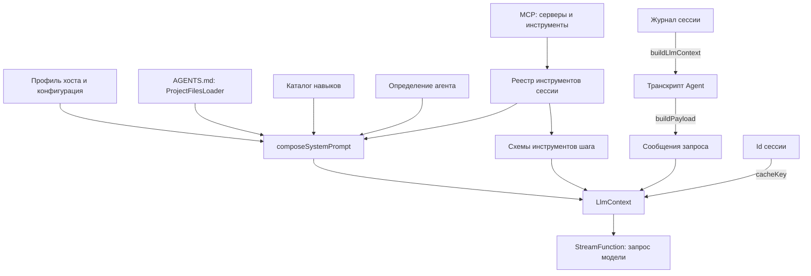
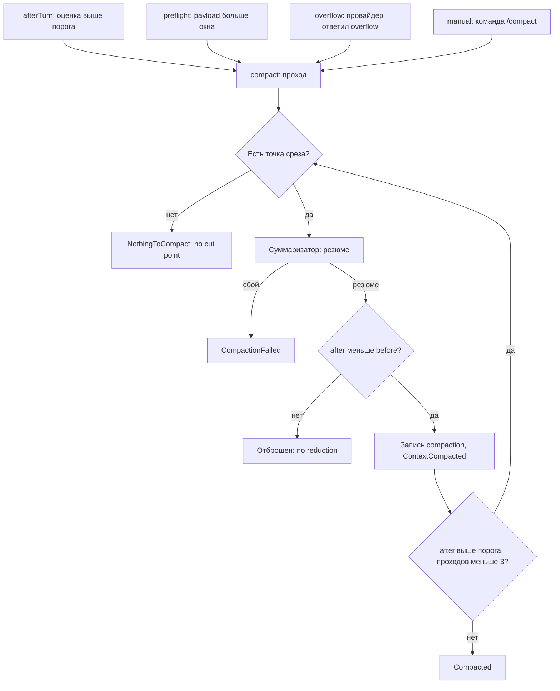
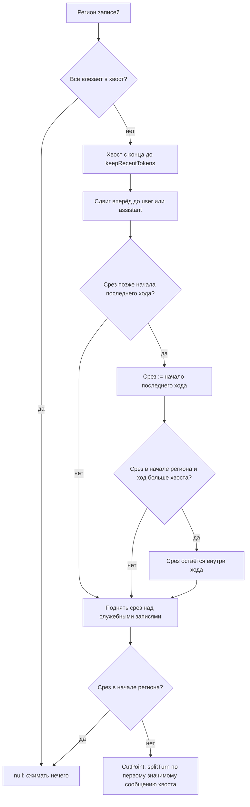

# Контекст запроса и сжатие контекста

Файл описывает два связанных алгоритма ядра `codelab_agent_core`.

- **Часть А — формирование контекста.** Из чего и в каком порядке собирается `LlmContext`, который уходит модели на каждом шаге хода.
- **Часть Б — сжатие контекста.** Что происходит, когда история сессии подходит к границе окна модели: кто и когда запускает сжатие, как выбирается точка среза, как получается резюме и как после него выглядит контекст.

Оба алгоритма работают с одним источником истины: журналом сессии. Контекст модели нигде не хранится отдельно, его каждый раз строят из журнала (`buildLlmContext`), а сжатие только добавляет в журнал запись `compaction` и ничего не стирает (CMP-2). Как читать псевдокод, см. в [README раздела](README.md#как-читать-псевдокод).

## Часть А. Формирование контекста запроса

### Вход и выход

`LlmContext` (`lib/src/llm/stream_function.dart`) состоит из четырёх полей:

| Поле | Что это | Кто задаёт |
|---|---|---|
| `systemPrompt` | системный промпт одной строкой | сессия при открытии; пересборка — таблица ниже |
| `messages` | сообщения запроса: история, ход, заметки | цикл хода на каждом шаге (`buildPayload`) |
| `tools` | схемы инструментов шага: имя, описание, JSON Schema параметров | цикл хода из `_context.tools` |
| `cacheKey` | ключ кэша промптов провайдера | цикл хода: id сессии; у суммаризатора `<id сессии>:summary` |

**Побочные эффекты.** Сам контекст ничего не пишет. Но по пути цикл может эмитить `ToolPairingRepaired` (ремонт парности вызовов), `ModelRequested` (запрос ушёл, с оценкой токенов), а при слишком большом payload — запустить аварийное сжатие (часть Б). Журнал меняют только события, которые получает писатель сессии.

На схеме показано, откуда берётся каждое поле контекста.



Системный промпт и схемы живут в `Agent` (`systemPrompt`, `tools`) и копируются в контекст хода при каждом `Agent.prompt`. Сообщения идут другим путём: транскрипт `Agent` строится из журнала при открытии сессии, растёт во время хода, а в запрос попадает через `buildPayload`.

### Шаг 1. Системный промпт

#### Из чего собирается

Промпт строит чистая функция `composeSystemPrompt(PromptInputs)` (`lib/src/prompts/compose.dart`). Одинаковые входы дают побайтово одинаковый текст (PR-3). Это нужно кэшу промптов провайдера: любое лишнее изменение в начале промпта обнуляет кэш всего запроса.

Входы `PromptInputs` сессия собирает в `_systemPrompt` (`lib/src/runtime/agent_runtime.dart`):

| Вход | Откуда берётся |
|---|---|
| `cwd`, `platform`, `today` | рабочая папка сессии; `services.platform`; `services.clock.now()` (в промпт входит только `yyyy-MM-dd`) |
| `mode` | режим сессии (`ModeId`) |
| `profile` | профиль хоста, уже суженный по сервисам и конфигурации (HOST-4) |
| `toolNames` | имена инструментов реестра сессии, которые разрешает выбранный агент (`agent.allowsTool`) |
| `mcpServers` | `mcp.summaries`: имя сервера и число его включённых инструментов; при ограничении инструментов агентом и у субагента число пересчитывается по видимым именам с префиксом сервера |
| `projectContext` | результат `assembleProjectContext` над `ProjectFiles.context`, прочитанным `ProjectFilesLoader` (`AGENTS.md`/`CLAUDE.md` пользователя и проекта) |
| `skills` | навыки каталога сессии с признаком `modelVisible` |
| `agentProfile` | имя и тело (`AgentDefinition.prompt`) выбранного агента; `null` для агента `default` |
| `subagent` | тип, тело типа и назначенный пункт списка задач; только у потомка |

`projectContext` и каталог навыков читаются один раз, при открытии сессии, в ограниченной по времени фазе (`_boundedPhase`, обе фазы идут параллельно). Таймаут или сбой порта дают сессию без файлов проекта, но не ломают её. `assembleProjectContext` режет файлы по бюджету `tools.project_context.max_bytes`: берёт файлы с конца (самые частные), последний влезший усекает и ставит пометку `[file truncated: showing N of M bytes]`, остальные пропускает.

#### Псевдокод

```text
composeSystemPrompt(inputs) -> String                     // compose.dart: composeSystemPrompt, _sections
  on(t)   = inputs.toolNames содержит все t.tools          // PR-6: секция называет только включённые инструменты
  servers = [s для s в inputs.mcpServers, если s.toolCount > 0]
  parts   = []

  1.  parts += system.base(cwd, date, platform, modeName)            // всегда
  2.  parts += system.untrusted                                      // всегда
  3.  если mode == plan:                         parts += modes.plan
  4.  если on(tools.read):                       parts += tools.read(maxLines, maxKb)   // read
  5.  если on(tools.edit):                       parts += tools.edit                    // write И edit
  6.  если profile.fileListing и on(tools.listing): parts += tools.listing(limit = 500) // ls И search
  7.  если profile.shellExec  и on(tools.exec):  parts += tools.exec(maxLines, defaultTimeout = 120)  // exec
  8.  если on(tools.tasks):                      parts += tools.tasks                   // task_create
  9.  если profile.mcp и servers не пуст:        parts += mcp(строки "- <имя>: N tools, prefix mcp__<имя>__")
  10. если profile.skills и inputs.skills не пуст и on(skills.catalog):
                                                 parts += skills.catalog(entries в бюджете skillsCatalogMaxChars)  // skill
  11. если projectContext != null и files не пуст:
        parts += project_context(files: для каждого файла project_context_file(path, content))
        // path: символы " < > \r \n заменяются на _; в content теги <project-instructions и </project-instructions экранируются
        // (<\project-instructions, <\/project-instructions); регистр не важен, пробелы допускаются
  12. если agentProfile != null:                 parts += agent_profile(name, body.trim())
  13. если subagent != null:                      // только потомок
        parts += subagent.system
        parts += subagent.profile(name, body.trim())
        если subagent.task != null: parts += subagent.task(id, subject)

  return parts.join("\n\n") + "\n"
```

Порядок и условия в коде совпадают с §11.5 архитектуры (в спецификации `agent-prompts` те же пункты нумеруются 1–14 с пунктом `9a` для каталога навыков).

#### Пошагово: почему так

- **Шаги 1–2 идут всегда.** База называет рабочую папку, дату, платформу и режим. Правило ограды (`system.untrusted`) нельзя выключить ни профилем, ни конфигурацией: оно защищает от внедрения инструкций через данные (приоритет 1 из `AGENTS.md`).
- **Шаги 4–8 привязаны к инструментам (PR-6).** Секция с непустым `tools` входит, только если в наборе сессии есть все её инструменты. Без `write` и `edit` секции `tools.edit` нет. Иначе промпт описывал бы инструмент, которого модель не видит. Для `ls` + `search` и `exec` дополнительно нужна включённая capability профиля (HOST-4): выключенная capability не оставляет ни схемы, ни секции.
- **Шаг 9 (`mcp`)** входит только при включённой capability `mcp` и хотя бы одном сервере с инструментами. Строки идут в порядке регистрации серверов.
- **Шаг 10 (каталог навыков)** называет инструмент `skill`, поэтому подчиняется тому же правилу PR-6, плюс нужна capability `skills`. Строки каталога сортируются по имени и укладываются в `skills.catalog_max_chars`.
- **Шаг 11 (инструкции проекта)** стоит после общих секций: файл проекта уточняет общие правила, а не заменяет их. Экранирование тега блока защищает от файла, который пытается закрыть свой блок и выдать продолжение за текст агента.
- **Шаг 12 (профиль агента)** стоит последним среди секций корневой сессии. Тело файла агента не заменяет базу, правило ограды и секции инструментов (CFG-8): оно только дополняет их.
- **Шаг 13 существует только у потомка.** Профиль агента родителя потомку не передаётся.
- **Дата.** Промпт содержит дату на момент сборки. Сессия, которая живёт несколько суток, держит старую дату до следующей пересборки. Это цена стабильного текста для кэша.

#### Когда промпт пересобирается

Промпт не пересобирается на каждом шаге. Сессия собирает его в перечисленных точках и кладёт в `Agent.systemPrompt`.

| Что случилось | Что делает сессия | Когда модель увидит | Где в коде |
|---|---|---|---|
| создание сессии | `_systemPrompt` при сборке `Agent` | первый ход | `agent_runtime.dart`: `_open` |
| загрузка сессии | то же, затем `_restoreAgent` пересобирает промпт для агента из журнала | первый ход после загрузки | `loadSession`, `_restoreAgent` |
| смена режима | `_applyMode` → `_compose(cwd, mode, агент)`; меняется только секция `modes.plan` | следующий ход | `_applyMode` |
| смена агента | `_setAgentNow` → новые `tools` и `_compose`; во время хода ждёт границы шага | следующий ход или граница шага | `_setAgentNow`, `_takeStepUpdate` |
| смена модели | промпт **не пересобирается**: в `PromptInputs` модели нет. Модель влияет на окно и на видимость инструмента `agent` (схемы) | следующий ход или граница шага | `_apply`, `_recheckSubagents` |
| перезагрузка конфигурации | промпт не пересобирается; `compaction.*` и окно подхватываются с границы хода. Файлы проекта и навыки не перечитываются | граница хода | `_refreshSettings`, `_afterSettingsReloaded` |
| изменение набора MCP | `_applyMcpUpdate` / `_mcp.refresh` → `tools` и `_compose` (секция `mcp`) | граница шага; между ходами — перед ходом | `_applyMcpUpdate`, `_takeStepUpdate` |

Если нужное изменение пришло во время хода, оно не вмешивается в идущий запрос. Цикл хода берёт его на границе шага: `prepareNextStep` возвращает `StepUpdate` с моделью, схемами и промптом, а `_Turn._apply` подменяет `_context`. Пока набор инструментов не менялся, `StepUpdate.systemPrompt` пуст, и смена режима посреди хода доходит до модели только со следующего хода.

### Шаг 2. Сообщения

#### Откуда берутся при открытии сессии

Новая сессия начинается с пустой истории: `Agent(history: [])`. Загруженная сессия строит транскрипт из журнала:

```text
loadSession(id)                                           // agent_runtime.dart: loadSession
  1. snapshot = store.open(id)
  2. _open(...)                                           // создаёт Agent, системный промпт и инструменты
  3. _heal()                                              // ремонт прерванного хода: healInterruptedTurn
  4. history = buildLlmContext(snapshot, skills, skillsConfig)   // _restoreHistory
  5. _restoreAgent(agent из config_change)                // может пересобрать промпт и схемы
  6. _adoptProjection(history, transcript: true)          // Agent.replaceTranscript(_withModel(messages)) и якорь сжатия
```

`buildLlmContext` — чистая функция снимка журнала (`lib/src/session/projections.dart`). Она берёт активную ветку и «вырезает» то, что видит модель:

```text
buildLlmContext(snapshot, skillCatalog, skillsConfig) -> LlmContextProjection   // projections.dart: buildLlmContext
  1. path = pathToLeaf(snapshot)                          // записи активной ветки от корня к листу
  2. по path: запомнить последние model_change, mode_change, config_change (по optionId)
              и индекс последней записи compaction (compactionIndex, -1 если сжатий нет)
  3. (compaction, kept) = keptPath(path, compactionIndex)
       если сжатий нет:      kept = path
       иначе:                kept = [compaction]
                                    + path[firstKeptId .. compactionIndex) без записей compaction
                                    + path[compactionIndex + 1 ..]
       если firstKeptId не найден на пути: warning session.compaction.lost_anchor, часть "до" пуста
  4. для каждой записи r из kept:
       MessageRecord:
         assistant, лежавший до записи сжатия -> копия с usage = Usage.zero   // §8.7
         иначе сообщение как есть
       CompactionRecord:
         добавить UserMessage(compaction.summary_wrapper(summary))
         если skillCatalog != null и у записи есть skills:
           result = reattachSkills(skills, catalog, config)
           если result.attached не пуст: добавить UserMessage(renderReattachedMessage(result))
       остальные записи (model_change, mode_change, plan, session_info…): пропустить
  5. compactionCovered = число сообщений до первой записи хвоста (после compaction)
  return LlmContextProjection(messages, config, model, modeId, lastCompaction, compactionCovered)
```

Что важно.

- **Запись сжатия превращается в первое сообщение.** `summary_wrapper` оборачивает текст резюме фразой «The conversation before this point was compacted…» и тегом `<summary>`. Это обычное `user`-сообщение с меткой времени записи. В журнал оно не пишется, его каждый раз строит проекция.
- **Сообщение навыков** (`renderReattachedMessage`) — второе производное сообщение. Оно возвращает в контекст тела навыков, активных на момент сжатия, в бюджете `skills.reattach.*`.
- **Usage старых ответов обнуляется.** Оценка размера якорится на `usage` последнего ответа (шаг 4 ниже). Ответы до сжатия несут размер несжатого контекста, и без обнуления сжатие срабатывало бы снова и снова.
- **Ремонт парности здесь не делается.** Он применяется только к payload запроса, а проекция остаётся фактом разговора (§6.3).
- **Функция детерминирована** (SES-7): один снимок — один список сообщений.

#### Как растёт транскрипт во время хода

Цикл хода (`_Turn` в `lib/src/loop/agent_loop.dart`) копирует историю `Agent` в `_transcript` и дописывает туда всё, что видит модель. Подробный порядок шагов — в [turn.md](turn.md); для контекста важно, что именно добавляется.

| Что | Когда добавляется | Как |
|---|---|---|
| ввод пользователя | начало хода | `_append(prompt)` |
| steering, follow-up | граница шага или естественная остановка | `_pollSteering`, `_append` |
| ответ модели | первый блок ответа | снимок кладётся сразу, дельты заменяют его (`_replaceLast`) |
| результаты инструментов | после всего пакета вызовов шага | `_append(result)` в порядке вызовов |
| подсказка пустого ответа | пустой ответ, повторов меньше `emptyResponseRetries` (2) | `_appendNudge`: служебное `user`-сообщение |
| заметка пустого ответа | повторы исчерпаны | `_appendEmptyNote`: ответ ассистента с текстом `[Stopped: …]` |
| замена всей истории | после аварийного сжатия | `_compactEmergency`: `_transcript` := проекция журнала |

Заметка `Revise` в этой таблице нет: она не входит в транскрипт, а уходит только в payload (ниже).

В конце хода `Agent.prompt` дописывает в свой `_messages` то, что добавил ход (`TurnOutput.added`). Если ход пережил аварийное сжатие, `_messages` сначала заменяется историей из `TurnOutput.history`. Журнал при этом пишет не транскрипт, а события: `SessionWriter.handle` получает каждое `AgentEvent` (`_onEvent`).

#### `buildPayload`: транскрипт → сообщения запроса

Перед каждым запросом цикл строит payload из транскрипта. Транскрипт при этом не меняется (LOOP-7): модель должна получить исправленный запрос, а история остаётся фактом разговора.

```text
buildPayload(transcript, cancel, transform, note) -> PairingRepair     // payload_builder.dart: buildPayload
  1. messages = transform == null
                ? копия(transcript)
                : await transform(неизменяемая копия(transcript), cancel)     // TransformContextHook
  2. messages.removeWhere(m — AssistantMessage и isEmptyCompletion(m))        // §5.4.1, LOOP-15
  3. repaired = repairToolPairing(messages)                                    // TOOL-6, tools/pairing.dart
  4. если note == null: return repaired
  5. return PairingRepair(repaired.messages + [note], repaired.report)         // заметка Revise последней
```

- **Шаг 1.** `transformContext` — хук хоста: отредактировать сообщения перед запросом. Сборка ядра хук не подключает (`AgentLoopConfig.transformContext` остаётся `null`), поэтому в работающей сессии это просто копия транскрипта.
- **Шаг 2.** Пустой ответ — `stop` или `toolUse` без вызовов, у которого каждый текстовый блок пуст после `trim()`. Блоки рассуждений не считаются. Провайдеры отвергают `assistant` без содержимого, а показывать модели её же пустоту бесполезно. Подсказки и заметки цикла в payload остаются (LOOP-15).
- **Шаг 3.** `repairToolPairing` гарантирует, что ни один запрос не содержит результат без вызова и вызов без результата (TOOL-6). Что именно он делает, видно по отчёту `PairingReport.actions`:
  - повторный id вызова получает суффикс `_dup<N>` вместе со своими результатами (`renamed duplicate`);
  - результат, который лежит не сразу за своим вызовом, переносится (`moved`);
  - вызов без результата получает синтетический результат-ошибку «Tool call was interrupted before it produced a result.» (`synthesized`);
  - результат без вызова заменяется служебным сообщением `[Note: a tool result without a matching call was removed: …]` (`dropped orphan`).

  Непустой отчёт цикл превращает в событие `ToolPairingRepaired`.
- **Шаги 4–5.** Заметка `Revise` (`UserMessage` с текстом проверки ответа) ставится в конец payload. Она появляется, когда хук `beforeFinalResponse` вернул `Revise`, и живёт один запрос. В рантайме ядра этот хук не регистрируется, поэтому заметка сейчас не возникает; путь в цикле реализован и проверяется тестами цикла.
- **Повтор после ошибки парности.** Если провайдер ответил `badRequest` с текстом про `tool_use`, `tool_call` или `tool_result` (`isPairingError`), цикл один раз заново строит payload и повторяет запрос.

### Шаг 3. Схемы инструментов и `cacheKey`

```text
// agent_loop.dart: _Turn._request, шаг 3
context = LlmContext(
  systemPrompt: _context.systemPrompt,
  messages:     payload.messages,
  tools:        [tool.toSchema() для tool в _context.tools],     // имя, описание, JSON Schema параметров
  cacheKey:     id сессии,
)
```

- **Набор инструментов шага** — `Agent.tools`, то есть `_visibleTools()` сессии: инструменты реестра в порядке регистрации (встроенные, затем MCP-инструменты `mcp__<сервер>__<имя>`), из которых убраны инструменты вне набора выбранного агента (CFG-7). Инструмент `agent` виден, только если эффективное окно модели не меньше `CompactionSettings.minSubagentContextWindow` (32 768 токенов): схема и отчёты детей не должны занимать окно целиком.
- **Схема не меняется внутри пакета вызовов.** Набор обновляется на границе шага (`StepUpdate.tools`), а не посреди шага.
- **Описание** инструмента берётся из шаблона `tool_descriptions.<имя>` (`lib/src/prompts/prompts.g.dart`), параметры — из самого инструмента.
- **`cacheKey`** — id сессии (§2.12.1). Провайдер использует его, чтобы повторять один и тот же префикс запроса из кэша. У суммаризатора ключ свой: `<id сессии>:summary`, потому что у него другой системный промпт и нет инструментов.

### Шаг 4. Оценка размера и окно модели

Размер контекста нужен четырём потребителям: проверке перед запросом (`preflight`), событию `ModelRequested.estimatedTokens`, заполнению `StepEnded.context` и проверке после хода (`afterTurn`). Все они считают его одной функцией сессии `_estimate`, поэтому числа совпадают (CMP-11).

```text
estimateContextTokens(messages, systemPrompt, tools, compaction?) -> int     // estimate.dart
  1. anchor = индекс последнего AssistantMessage, у которого
              usage.input + usage.cacheRead + usage.cacheWrite > 0
  2. если anchor нет:
       h = estimateTokens(messages, systemPrompt, tools)                     // эвристика
       return compaction == null ? h : max(0, compaction.tokens + h - compaction.raw)
  3. иначе:
       u = messages[anchor].usage
       return u.input + u.cacheRead + u.cacheWrite + u.output
              + estimateTokens(messages после anchor)                        // только хвост, без промпта и схем
```

**Эвристика** (`estimateTokens`): `ceil(длина / 4)` символов UTF-16 на токен.

| Часть | Оценка |
|---|---|
| системный промпт | `ceil(длина / 4)` |
| схемы инструментов | `ceil(длина JSON [{name, description, parameters}] / 4)` |
| сообщение | сумма блоков плюс 4 на служебные поля; у результата инструмента ещё `ceil(длина имени / 4)` |
| текстовый блок | `ceil(длина / 4)` |
| вызов инструмента | `ceil((длина имени + длина JSON аргументов) / 4)` |
| рассуждение | `ceil(длина / 4)`; у скрытого — по длине подписи |
| картинка | константа `imageTokens` = 1200 |

**Якоря** исправляют ошибку эвристики:

- Якорь на `usage` — точная цифра провайдера: его `input` уже включает промпт, схемы и все сообщения до ответа. Оценивается только хвост после ответа.
- Якорь на сжатие (`CompactionAnchor`: `tokens` и `raw`) нужен сразу после сжатия, когда в проекции нет ответа с usage: смещение `tokens − raw` переносит согласованную оценку компактора на новый контекст. Ответ без usage якорь сжатия не снимает.
- Без обоих якорей остаётся чистая эвристика. Она завышает JSON-часть (промпт и схемы), недооценку ловит аварийный путь `overflow` (CMP-8).

**Окно модели** — `effectiveContextWindow(model, cap)` = `min(model.contextWindow, cap)`, а без `cap` окно модели. Это единственная функция окна для порога сжатия, проверки перед запросом и `ModelRequested.estimatedTokens` (CMP-6). `cap` задаёт `compaction.context_window_cap`.

Проверка перед запросом работает только при включённой capability `compaction` (в цикле `estimateTokens != null`) и сравнивает оценку с окном, а не с порогом сжатия. Подробности — в части Б.

### Разобранный пример

Данные получены временным тестом на `CoreHarness` с модель-сценарием `ScriptedStreamFunction`, окном модели 32 768 токенов, профилем `agent-serve` без `exec`, `MemoryExecutionEnv` с файлом `notes.txt` и источником файлов проекта, который отдаёт один `AGENTS.md` из трёх строк (`# Demo`, пустая строка, ``Run tests with `dart test`.``). Сценарий: пользователь просит прочитать `notes.txt`; модель отвечает вызовом `read`, затем текстом. Платформа в тесте — `unknown`. Временный тест удалён.

Запуск: `fvm dart test <временный файл>` в `packages/dart/codelab_agent_core`.

**Системный промпт.** Длина 4 394 символа, оценка 1 099 токенов. Секции в порядке сборки (`systemPromptSections` по данным запроса):

```text
system.base
system.untrusted
tools.read
tools.edit
tools.listing
tools.tasks
project_context
```

`modes.plan` нет (режим `standard`), `tools.exec` нет (capability `shellExec` выключена), `mcp` и `skills.catalog` нет (нет серверов и навыков), `agent_profile` нет (агент `default`). Начало промпта совпадает с golden `test/prompts/golden/agent-serve-standard.txt`, кроме строк `Platform` и `Today` (в golden `linux` и `2026-01-15`):

```text
You are CodeLab, an AI coding agent. You help the user in their project: you read code,
make changes, run commands and explain what you did.

Workspace: /proj
Platform: unknown
Today: 2026-01-01
Mode: standard

# How to work

1. Understand the task first. If the request is ambiguous and a mistake would be costly, ask
   one short clarifying question. If a reasonable assumption is possible, make it and say so.
…
```

Конец промпта — секция `project_context`:

```text
# Project instructions

Below are instruction files of the user and of the project, from the most general to the most
specific; a later file refines an earlier one. Follow these rules when working with the
project's code: they take precedence over general style preferences. They do not override
the safety rules of this prompt or the user's approval decisions.

<project-instructions path="AGENTS.md">
# Demo

Run tests with `dart test`.
</project-instructions>
```

Остальные секции — полный текст golden-файла `agent-serve-standard.txt` (95 строк: `# How to work`, `# Tools`, `# Safety`, `# Answer style`, `# Untrusted content`, `# Reading files`, `# Changing files`, `# Finding files`, `# Running commands`, `# Task list`). В golden есть `# Running commands`, потому что golden собран с включённым `exec`.

**Схемы инструментов.** Десять схем в порядке реестра. Окно 32 768 равно порогу субагентов, поэтому `agent` виден.

| Инструмент | Описание, символов | Параметры (JSON), символов |
|---|---|---|
| `read` | 205 | 320 |
| `write` | 132 | 204 |
| `edit` | 126 | 251 |
| `task_create` | 147 | 257 |
| `task_update` | 214 | 357 |
| `task_list` | 118 | 33 |
| `task_get` | 80 | 73 |
| `ls` | 104 | 190 |
| `search` | 184 | 550 |
| `agent` | 1 128 | 642 |

Вместе схемы дают 1 459 токенов оценки. Схема `read` целиком:

```json
{"name":"read","parameters":{"type":"object","properties":{"path":{"type":"string","description":"File path, relative to the workspace root or absolute."},"offset":{"type":"integer","description":"1-based line number to start from. Default 1."},"limit":{"type":"integer","description":"Maximum number of lines. Default 2000."}},"required":["path"]}}
```

Описание `read`: `Read a text file of the workspace, or an image when the model accepts images. Lines are numbered "<n>| <text>". Output is limited to 2000 lines or 50 KB; use offset and limit to read a part of a long file.`

**Два запроса хода.** `cacheKey` у обоих один: id сессии (`01KDVDNA000000000000000001` в тесте с `SequentialIdGenerator`). Промпт и схемы в обоих запросах те же.

| Запрос | Сообщения | Оценка (`ModelRequested.estimatedTokens`) |
|---|---|---|
| 1 | `user` «Read notes.txt and say how many lines it has.» | 2 574 = промпт 1 099 + схемы 1 459 + сообщение 16 |
| 2 | то же `user`; `assistant` с вызовом `read {"path":"notes.txt"}` (`call_1`); `toolResult` `1\| alpha\n2\| beta\n3\| gamma` | 2 596 = 2 574 + вызов 10 + результат 12 |

Сообщения второго запроса в JSON (сокращено до сути):

```text
user        "Read notes.txt and say how many lines it has."
assistant   toolCall { id: call_1, name: read, arguments: { path: notes.txt } }   stopReason: toolUse
toolResult  toolCallId: call_1, toolName: read, isError: false,
            content: "1| alpha\n2| beta\n3| gamma"
```

Заполнение окна (`StepEnded.context`): после шага 1 (вызов `read`) `used = 2 596`, `window = 32 768`, `compactAt = 24 576` (окно минус резерв 8 192). После шага 2, когда ответ модели добавлен без usage, `used = 2 607`: добавилось 11 токенов за текст ответа.

### Граничные случаи и отказы части А

| Ситуация | Что делает алгоритм | Где в коде |
|---|---|---|
| чтение `AGENTS.md` не уложилось в таймаут или порт упал | сессия создаётся без секции `project_context`; лог `project_files.diagnostic` с кодом `timeout` или `unexpected` | `_boundedPhase`, `_loadProjectFiles` |
| файлы проекта больше бюджета `tools.project_context.max_bytes` | последний влезший файл усекается с пометкой `[file truncated: …]`, более общие файлы пропускаются; лог `project_context.loaded` с `truncated` и `omitted` | `assembleProjectContext` |
| бюджет `0` или файлы пусты | секции `project_context` нет, промпт побайтово прежний (PR-3) | `assembleProjectContext` |
| файл проекта содержит тег `<project-instructions` или `</project-instructions` | оба тега экранируются (`<\project-instructions`, `<\/project-instructions`; без учёта регистра, пробелы допускаются), файл не выходит за свой блок | `_escapeClosingTag` |
| выбранный агент ограничил инструменты | секции инструментов и строки `mcp` считаются по видимому набору (PR-6) | `_systemPrompt` |
| у сервера MCP нет ни одного включённого инструмента | строки сервера в секции `mcp` нет; если таких серверов нет совсем, нет и секции | `_sections` |
| окно модели меньше 32 768 | схемы без инструмента `agent`; набор пересчитывается на границе шага при смене модели или окна | `_recheckSubagents` |
| режим сменился посреди хода | идущий запрос не меняется; промпт со следующего хода | `_applyMode`, `_takeStepUpdate` |
| ответ модели пуст (`stop` или `toolUse` без текста и вызовов; только рассуждения тоже пусты) | в payload не входит, транскрипт сохраняет его; цикл добавляет подсказку или заметку | `isEmptyCompletion`, `buildPayload` |
| вызов без результата, результат без вызова, результат не рядом с вызовом, повтор id | ремонт `repairToolPairing`, событие `ToolPairingRepaired` | `pairing.dart` |
| провайдер ответил `badRequest` про парность | один повтор с заново собранным payload | `_Turn._request` |
| оценка payload больше окна | `preflight`: аварийное сжатие и пересборка контекста; если не помогло или уже было в этом ходе — ответ `overflow` без обращения к провайдеру | `_Turn._request` |
| capability `compaction` выключена | проверки `preflight` нет: `ModelRequested.estimatedTokens = 0` | `_Turn._request` |
| `cap` больше окна модели | действует окно модели | `effectiveContextWindow` |
| в журнале неизвестное значение `origin` | сообщение остаётся в контексте, но считается служебным; лог `session.origin.unknown` один раз | `isUserWords` |
| запись `compaction` без `firstKeptId` на ветке | лог `session.compaction.lost_anchor`; в контексте резюме и записи после сжатия | `keptPath` |
| долгая сессия переходит через полночь | дата в промпте прежняя до следующей пересборки | `_systemPrompt`, `PromptInputs.today` |

### Параметры части А

| Ключ или константа | Умолчание | Что меняет | Применяется |
|---|---|---|---|
| `tools.project_context.max_bytes` | `32768` (0–262144) | бюджет файлов `AGENTS.md` в промпте | да, при открытии сессии |
| `skills.catalog_max_chars` | `8000` (1000–64000) | бюджет строк каталога навыков | да, при открытии сессии |
| `compaction.context_window_cap` | нет | верхняя граница окна | да, со следующего хода |
| `compaction.enabled` | `true` | проверка размера перед запросом и аварийное сжатие | да; ключ процесса |
| `loop.empty_response_retries` | — | число повторов после пустого ответа | нет (`applied: false`); действует `AgentLoopConfig.emptyResponseRetries` = 2 |
| `prompts.system`, `prompts.system_text`, `prompts.append_system`, `prompts.append_system_text`, `prompts.context_files` | — | замена или дополнение системного промпта | нет (`applied: false`) |
| `AgentLoopConfig.transformContext` | `null` | хук хоста над сообщениями перед запросом | параметр цикла; сборка ядра его не задаёт |
| `AgentLoopConfig.maxResponseRevisions` | `2` | число заметок `Revise` за ход | параметр цикла; хук `beforeFinalResponse` в рантайме не задаётся |
| `imageTokens` | `1200` | оценка картинки | константа |

## Часть Б. Сжатие контекста

### Вход и выход

Сжатие заменяет давнюю часть истории резюме. Реализация — `lib/src/compaction/`, вызовы — в `AgentRuntimeImpl` (`lib/src/runtime/agent_runtime.dart`) и в цикле хода (`lib/src/loop/agent_loop.dart`).

| | |
|---|---|
| **Вход** | писатель журнала сессии `SessionWriter`; триггер `CompactionTrigger` (`afterTurn`, `preflight`, `overflow`, `manual`); `Summarizer` (модель сессии); `CompactionSettings`; окно; системный промпт и схемы на момент старта; токен отмены; необязательное указание `focus` (только `manual`) |
| **Выход** | `CompactionOutcome`: `Compacted(record, tokensBefore, tokensAfter)`, `NothingToCompact(reason)` или `CompactionFailed(error)`; отмена — исключение `CancelledException` |
| **В журнале** | запись `compaction` (`summary`, `firstKeptId`, `tokensBefore`, `tokensAfter`, `details`); при отброшенном, но оплаченном проходе — запись `custom` `codelab.compaction_discarded` |
| **События** | `ContextCompacted` (сжатие записано); `CompactionDiscarded` (оплачено, но не записано); `AgentError(cls: compaction)` при сбое |
| **Лог** | `compaction.done`, `compaction.skipped`, `compaction.failed`, `compaction.anchor` (debug), `skills.reattached` |

Журнал только растёт: записи до среза остаются в файле и в реплее `session/load`, а контекст модели строит проекция `buildLlmContext` (CMP-2).

### Когда запускается сжатие

Схема показывает все четыре триггера и один проход.



| Триггер | Условие | Как идёт | Где в коде |
|---|---|---|---|
| `afterTurn` | ход закончился `completed` или `maxTokens`, capability `compaction` включена, оценка больше порога `окно − reserveTokens` | в фоне: `_compactAfterTurn` запускает `_runBackground`; следующий `prompt()` ждёт её; после `cancelled` и `failed` не запускается | `_compactAfterTurn`, `prompt` |
| `preflight` | оценка payload шага больше окна (не порога) | один аварийный вызов за ход; транскрипт хода заменяется проекцией журнала, запрос повторяется | `_Turn._request`, `_emergency` |
| `overflow` | провайдер ответил `errorClass: overflow`, ответ ещё не начался | то же, один повтор того же шага | `_Turn._request` |
| `manual` | `/compact [указание]`, capability включена | вне хода, под слотом хода; указание `focus` попадает в промпт резюме | `_compactNow` |

Правила общие для триггеров:

- В пределах одного хода `preflight` и `overflow` вместе запускают сжатие не больше одного раза (CMP-8): флаг `_emergencyUsed` цикла. Если аварийное сжатие не помогло или флаг уже стоит, `preflight` завершает шаг синтетическим ответом `overflow` с текстом `context window exhausted` (`_exhausted`), а `overflow` проходит как обычная ошибка шага.
- Без capability `compaction` не работает ни один триггер: цикл получает `estimateTokens: null` и `emergencyCompact: null`, а `/compact` не объявлена.
- Хост выключает capability ключом `compaction.enabled: false` (`build_agent_core.dart`).

### Оценка размера

Оценка та же, что в части А (`estimateContextTokens`): якорь на `usage`, якорь на прошлое сжатие или чистая эвристика `ceil(длина / 4)`. Для сжатия добавляются ещё три вещи.

1. **«До» первого прохода** — `estimateContextTokens` по проекции перед проходом с якорем сессии (`anchor`).
2. **«После»** — не пересчёт эвристикой, а `estimateAfterCompaction(before, rawBefore, rawAfter) = max(0, before + rawAfter − rawBefore)`. `rawBefore` и `rawAfter` — чистая эвристика `estimateTokens` по проекции до прохода и по проекции с ещё не записанной записью. Так промпт, схемы и сохранённый хвост входят в обе части одинаково, и оценивается только разница: убранный регион против резюме с обёрткой. Иначе оценка «после» могла бы выйти выше «до», хотя контекст уменьшился.
3. **Якорь на сжатие** — после записи сессия сохраняет `CompactionAnchor(tokens: tokensAfter, raw: эвристика по первым compactionCovered сообщениям)`. Сразу после записи оценка контекста равна `tokensAfter` (CMP-11); следующая оценка отличается только на хвост, который добавился после.

### Пороги: `CompactionSettings`

Пороги зависят от окна, а не заданы константами: значения для окна 200 000 больше целого окна модели на 8 000 токенов. `CompactionSettings.forWindow(window, overrides)` (`lib/src/compaction/settings.dart`):

```text
CompactionSettings.forWindow(w, overrides) -> CompactionSettings          // settings.dart
  reserveCap = max(128, w ~/ 4)
  keepCap    = max(256, w ~/ 2)
  r0 = min(16384, max(1024, w ~/ 4))
  k0 = min(20000, max(2048, w ~/ 2))
  reserveTokens       = min(overrides.reserveTokens    ?? r0, reserveCap)
  keepRecentTokens    = min(overrides.keepRecentTokens ?? k0, keepCap)
  keepRecentUserTurns = overrides.keepRecentUserTurns ?? 1
```

Порог `afterTurn` — `compactionThreshold = window − reserveTokens`; `shouldCompact` истинно, если оценка **строго больше** порога.

| Окно, токенов | `reserveTokens` | `keepRecentTokens` | Порог `afterTurn` |
|---|---|---|---|
| 1 000 | 250 | 500 | 750 |
| 8 192 | 2 048 | 4 096 | 6 144 |
| 16 384 | 4 096 | 8 192 | 12 288 |
| 32 768 | 8 192 | 16 384 | 24 576 |
| 200 000 | 16 384 | 20 000 | 183 616 |

Окно — `effectiveContextWindow(модель сессии, cap: compaction.context_window_cap)`. Параметры сжатия читаются из применённого снимка конфигурации на границе хода (`_refreshSettings`), поэтому изменение действует со следующего хода (CFG-16).

### Сам проход: `compact`

#### Псевдокод

```text
compact(writer, trigger, summarize, settings, window, systemPrompt, tools, ..., focus, anchor) -> CompactionOutcome
                                                                           // compactor.dart: compact
  threshold = window − settings.reserveTokens
  done = null                                                              // последний записанный проход

  для pass = 0, 1, 2:                                                      // maxCompactionPasses = 3 (CMP-5)
    1. snapshot = writer.snapshot
       projectionBefore = buildLlmContext(snapshot, skills)
       before    = done?.tokensAfter ?? estimateContextTokens(projectionBefore, anchor)   // «до»
       rawBefore = estimateTokens(projectionBefore, systemPrompt, tools)
    2. (region, last) = compactionRegion(snapshot)                         // cut_point.dart
       cut = findCutPoint(region, settings)
    3. если cut == null:
         лог compaction.skipped(reason: "no cut point")
         return done ?? NothingToCompact("no cut point")
    4. end        = cut.splitTurn ? cut.turnStartIndex : cut.firstKeptIndex
       summarized = сообщения region[0 .. end)
       prefix     = cut.splitTurn ? сообщения region[turnStartIndex .. firstKeptIndex) : null
       files      = _fileOps(summarized + prefix, last)                    // прочитанные и изменённые файлы
    5. попытка:
         result = await summarize(
           SummaryRequest(region: summarized, previousSummary: last?.summary,
                          turnPrefix: prefix, fileOps: files,
                          focus: trigger == manual ? focus : null), cancel)
       при CompactionFailure:
         лог compaction.failed (warning); emit AgentError(cls: compaction, "compaction failed: …")
         return done ?? CompactionFailed(error)                            // журнал и транскрипт не тронуты (CMP-3)
       при CancelledException: пробросить                                  // записи нет (CMP-3, CMP-4)
    6. cancel.throwIfCancelled()                                           // отмена после ответа модели
    7. firstKeptId = region[cut.firstKeptIndex].id
       details = {readFiles, modifiedFiles, splitTurn, summaryModel, usage}
    8. навыки записи: candidates = активные навыки до сжатия, кроме тех, чья
       последняя активация осталась в хвосте
       estimated = оценка «после» с candidates                             // estimateAfterCompaction
       если оценка выше порога только из-за сообщения навыков:
         выбрасывать навыки с конца, пока не уложится                      // Q49 (б), «M2»
       after = estimated
    9. если after >= before:                                               // CMP-10
         discard(reason: "no reduction")                                   // запись custom + CompactionDiscarded + лог
         return done ?? NothingToCompact("no reduction")
    10. record = await writer.appendWith(durable: true, (current) =>
          если cancel.isCancelled:                         null            // отмена в очереди писателя
          если между листом прохода и current есть не только записи состояния:
                                                           null (stale)    // CMP-12
          иначе CompactionRecord(parentId: current.leafId, summary: result.text,
                                 firstKeptId, tokensBefore: before, tokensAfter: after, details, skills))
    11. если record == null:
          если отмена: throw CancelledException
          иначе: discard(reason: "stale", level: warning); return done ?? NothingToCompact("stale")
    12. onCompacted(buildLlmContext(writer.snapshot))                      // сессия: транскрипт := проекция, якорь := по ней
        emit ContextCompacted(before, after, usage, model)
        если есть навыки: лог skills.reattached
        лог compaction.done(trigger, pass, tokens_before, tokens_after, split_turn)
    13. done = Compacted(record, before, after)
        если after <= threshold: break                                     // уложились
  return done
```

#### Пошагово: почему так

- **Шаг 1.** «До» первого прохода берётся с якорем: на `usage` последнего ответа или на прошлое сжатие. Без якоря шкала рвалась бы на стыке двух сжатий. «До» следующего прохода — это «после» прошлого: в проекции после сжатия нет ответа с usage, и пересчёт дал бы чистую эвристику.
- **Шаг 2.** `compactionRegion` отдаёт записи активной ветки после прошлого сжатия: сохранённые записи до прошлой записи `compaction` и записи после неё, но сами записи `compaction` в регион не входят. Прошлое резюме суммаризатор получает отдельно как `previousSummary` (CMP-9). Если на ветке нет сжатий, регион — вся ветка.
- **Шаг 3.** Нет среза — сжимать нечего. Лог нужен, чтобы оператор отличал пустой регион от сжатия без выигрыша.
- **Шаг 4.** Обычный срез резюмирует всё до `firstKeptIndex`. Срез внутри хода (`splitTurn`) резюмирует регион до начала хода, а начало хода (`turnPrefix`) — отдельным запросом.
- **Шаг 5.** Сбой модели или пустой ответ — `CompactionFailure`. Оба случая не пишут ничего (CMP-3). `focus` передаётся только для `manual`.
- **Шаг 6.** Отмена, пришедшая, пока модель отвечала, не должна оставить запись.
- **Шаги 8–9.** Запись, которая не уменьшает оценку, только заменила бы дословный текст пересказом (CMP-10). Проверка идёт после выбора навыков и до записи; навыки ради выигрыша не выбрасываются. Суммаризатор здесь уже оплачен, поэтому вместо записи `compaction` пишется запись учёта (CMP-13), см. ниже.
- **Шаги 10–11.** Пока суммаризатор отвечал, сессия могла записать смену режима, модели, `effort` или агента. `appendWith` строит запись по текущему листу (CMP-12): записи состояния между листами допустимы (`_isStateRecord`: `model_change`, `mode_change`, `config_change`, `session_info`), любая другая запись даёт `stale`. Сейчас `stale` недостижим, и при появлении пишется `warning` как сигнал о новом пути записи. Запись идёт с `durable: true`, то есть с `fsync`.
- **Шаг 12.** `onCompacted` вызывается до `ContextCompacted`: к моменту, когда подписчик видит событие, транскрипт и якорь сессии уже новые (R3). Транскрипт и якорь меняются в одном синхронном методе `_adoptProjection`.
- **Шаг 13.** Пока `after` выше порога, идёт следующий проход, всего не больше трёх (`maxCompactionPasses`). `NothingToCompact` или `CompactionFailed` следующего прохода не отменяют уже записанное: результатом остаётся `Compacted` прошлого прохода.

#### Точка среза: `findCutPoint`

Срез — чистая функция записей региона и настроек (`lib/src/compaction/cut_point.dart`). Она отвечает на вопрос: с какой записи начинается хвост, который остаётся дословно. Инварианты: срез никогда не отделяет вызов инструмента от его результата (CMP-1), а последние `keepRecentUserTurns` ходов пользователя остаются дословно (CMP-7).

Оценка записи — `recordTokens`: у сообщения `estimateMessageTokens`, у служебной записи (`model_change`, `mode_change`, `config_change`, `plan`, `task`, `subagent`, `session_info`, `label`) 0.

Три предиката:

- **слова пользователя** (`_isUserWords`): `user`-сообщение, написанное человеком (`isUserWords`). Подсказки цикла, заметки и уведомления — служебные;
- **граница** (`_isBoundary`): `user`- или `assistant`-сообщение. Результат инструмента границей не бывает — это и держит парность;
- **открывает хвост** (`_opensTail`): слова пользователя или `assistant`-сообщение.

```text
findCutPoint(region, s) -> CutPoint?                                       // cut_point.dart: findCutPoint
  0. если в region нет ни одного MessageRecord: return null
     userTurns = индексы записей region, которые _isUserWords
     total     = сумма recordTokens(region)
     если userTurns.length <= s.keepRecentUserTurns и total <= s.keepRecentTokens:
        return null                                       // всё помещается в хвост
  3. // хвост с конца до keepRecentTokens
     acc = 0; i = region.length − 1
     пока i >= 0:
        acc += recordTokens(region[i])
        если acc >= s.keepRecentTokens: break
        i -= 1
     если i < 0: return null
  4. // срез только перед user- или assistant-сообщением (CMP-1)
     c = i
     пока c < region.length и не _isBoundary(region[c]): c += 1
     если c == region.length: return null
     inTurn = c
  5. // последние keepRecentUserTurns ходов остаются в хвосте (CMP-7)
     если userTurns не пуст:
        lastUsers = последние keepRecentUserTurns индексов из userTurns
        turnStart = lastUsers.first
        если c > turnStart:
           c = _withService(region, turnStart)            // отодвинуть к служебным записям перед ходом
           turn = recordTokens всех записей начиная с turnStart
           если c == 0 и turn > s.keepRecentTokens:
              c = inTurn                                  // один огромный ход: резать внутри него
  6. // служебные записи прямо перед срезом остаются с хвостом
     c = _withService(region, c)
     если c == 0: return null                             // сжимать нечего
  7. // срез внутри хода?
     m = c
     пока m < region.length и не _opensTail(region[m]): m += 1
     если m == region.length: return null
     splitTurn = не _isUserWords(region[m])
     start     = последний индекс из userTurns, не больший m (иначе 0)
     return CutPoint(firstKeptIndex: c, splitTurn, turnStartIndex: start)

_withService(region, c):                                   // поднять c над служебными записями перед ним
  пока c > 0 и _isService(region[c − 1]): c -= 1
  return c
```

Номера шагов в псевдокоде совпадают с нумерацией комментариев в коде (шаги 1–2 из §9.6 слиты в шаг 0: подготовка и проверка «всё помещается»).

Как читать шаги.

- **Шаг 0.** Пока ходов не больше `keepRecentUserTurns` и весь регион не больше `keepRecentTokens`, резать нечего: вся история и есть хвост.
- **Шаг 3.** Идём с конца и копим токены, пока не наберём `keepRecentTokens`. Запись, на которой остановились, — кандидат в начало хвоста.
- **Шаг 4.** Кандидат сдвигается вперёд до ближайшего `user` или `assistant`. Если он попал на результат инструмента, срез переедет за него: результат остаётся с вызовом в резюмируемой части или целиком в хвосте.
- **Шаг 5.** Если последний ход пользователя начинается раньше среза, срез сдвигается на его начало: слова пользователя нельзя потерять (CMP-7). Если при этом резать нечего (`c == 0`), а ход больше `keepRecentTokens`, срез остаётся внутри хода (`inTurn`), и будет `splitTurn`. Если перед ходом есть что сжать, ход сохраняется целиком, даже если он больше бюджета хвоста.
- **Шаг 6.** Служебные записи (`model_change`, `session_info` и подобные) прямо перед срезом остаются с хвостом: порядок состояния в журнале не рвётся.
- **Шаг 7.** `splitTurn` истинно, если первое значимое сообщение хвоста — не слова пользователя, то есть срез прошёл внутри хода. Тогда суммаризатор получит начало хода отдельно.

Схема принятия решения о срезе.



#### Резюме: `modelSummarizer`

`lib/src/compaction/summarizer.dart`. Суммаризатор создаёт сессия: `modelSummarizer(stream, model, sessionId, settings, clock)` над той же `StreamFunction` и моделью, что у хода. Отдельной «дешёвой» модели нет.

```text
summarize(request, cancel) -> SummaryResult(text, usage, model)            // summarizer.dart: modelSummarizer
  window = effectiveContextWindow(model)                                   // без compaction.context_window_cap
  budget = max(window − settings.reserveTokens, window ~/ 2)               // токены текста региона
  spent  = (usage: нулевое, model: "<provider>/<id>")

  1. values = {
       transcript:    _withinBudget(request.region, budget),
       readFiles:     пути через запятую или "none",
       modifiedFiles: то же,
       focus:         request.focus == null ? "" : compaction.focus(text)
     }
  2. main =
       если request.region пуст:
          request.previousSummary ?? ""                         // модель не вызывается
       иначе:
          ask(request.previousSummary == null
                ? compaction.summary(values)
                : compaction.summary_update(values + previousSummary))
  3. если request.turnPrefix == null: return (main, spent.usage, spent.model)
  4. context = ask(compaction.turn_context(transcript: _withinBudget(turnPrefix, budget)))
     turn = "## Current turn context (split turn)\n\n"
            "User request, verbatim:\n\n" + цитата(первые слова пользователя из turnPrefix, не длиннее 2000 символов)
            + "\n\n" + context
  5. return (main пуст ? turn : main + "\n\n---\n\n" + turn, spent.usage, spent.model)

ask(text, cancel, spent) -> String:
  1. events = stream(model, LlmContext(
        systemPrompt: compaction.system,
        messages: [UserMessage(text)],                          // инструментов нет
        cacheKey: "<id сессии>:summary"), cancel)
  2. прочитать поток до DoneEvent или ErrorEvent: answer
  3. spent.usage += answer.usage; spent.model = "<provider>/<id>" ответа
  4. если answer.stopReason == aborted или cancel.isCancelled: throw CancelledException
  5. если answer.stopReason == error: throw CompactionFailure(answer.errorMessage ?? "summary model failed")
  6. summary = склеить текстовые блоки ответа, trim()
  7. если summary пуст: throw CompactionFailure("empty summary")
  8. return summary
```

Что идёт на вход модели.

- **Системный промпт** — `compaction.system`: суммаризатор не продолжает разговор и не вызывает инструменты.
- **Одно `user`-сообщение**, собранное из шаблона. Историю разговора модели не передают: получив историю, она продолжила бы разговор вместо пересказа.
  - `compaction.summary` — первое резюме: правила и обязательные разделы (`## Open user requests`, `## Goal`, `## Constraints and preferences`, `## Progress` с `Done`/`In progress`/`Blocked`, `## Key decisions`, `## Next steps`, `## Critical context`), строки `Files read:` и `Files modified:`, блок `{{focus}}` и `<transcript>`.
  - `compaction.summary_update` — повторное сжатие: то же плюс блок `<previous-summary>`. Открытые просьбы прошлого резюме сохраняются, пока новый фрагмент их не закрыл (CMP-9).
  - `compaction.turn_context` — начало разрезанного хода: краткие пункты о том, что агент уже сделал, без заголовков.
  - `compaction.focus` — блок `<focus>` с текстом указания пользователя; только у `/compact <текст>`.
- **Текст региона** (`serializeRegion`): записи подряд с заголовками `[user]`, `[notice]` (служебное `user`-сообщение), `[assistant]`, `[tool call <имя>]` с каноническим JSON аргументов (ключи по алфавиту), `[tool result <имя>]` и `[tool result <имя>, error]`. Рассуждения модели и блоки не-текста в резюме не идут, картинка заменяется на `[image]`. Результат инструмента длиннее 4 000 символов сокращается до первых и последних 1 500 с пометкой `[… N characters omitted …]`.
- **Бюджет.** Если текст больше `budget`, самые старые записи отбрасываются с пометкой `[… N earlier messages omitted …]`; хотя бы одна запись остаётся всегда.

Что получается на выходе.

- **Успех** — `SummaryResult(text, usage, model)`. `usage` — сумма всех запросов прохода (разрезанный ход даёт два запроса), `model` — `<provider>/<id>` модели, которая ответила.
- **Сбой** — `CompactionFailure` для ошибки провайдера или пустого резюме. Сжатие не записывается, прошлое резюме и контекст остаются.
- **Отмена** — `CancelledException`. Токены потрачены, но записи нет, и записи учёта тоже нет: результат утерян (CMP-4).

### Как выглядит контекст после сжатия

После записи сжатия `buildLlmContext` собирает контекст так (часть А, шаг `buildLlmContext`):

```text
[user]  compaction.summary_wrapper(summary)                 // резюме в обёртке
[user]  сообщение навыков (если у записи есть skills)       // тела навыков, активных на момент сжатия
        сохранённые сообщения от firstKeptId до записи сжатия
        сообщения после записи сжатия
```

Системный промпт и схемы инструментов при сжатии не меняются. Оценка контекста сразу после записи равна `tokensAfter` (CMP-11); сессия фиксирует её как якорь. Если в журнале уже были сжатия, регион следующего прохода состоит из сохранённой части и записей после прошлой записи сжатия, а прошлое резюме идёт в `previousSummary`.

### Что отбрасывается: `CompactionDiscarded`

Оплаченный вызов суммаризатора не должен пропасть из учёта, даже если запись `compaction` не пишется. Два случая — `reason: "no reduction"` (CMP-10) и `reason: "stale"` (CMP-12):

```text
discard(pass, reason, before, after, result)                                // compactor.dart: discard
  1. writer.append(CustomRecord(customType: "codelab.compaction_discarded",
        data: {reason, trigger, pass, tokensBefore, tokensAfter, summaryModel, usage}))   // не durable
  2. emit CompactionDiscarded(tokensBefore, tokensAfter, usage, model)
  3. лог compaction.skipped(trigger, pass, reason, tokens_before, tokens_after,
        usage_record_id, summary_model)
```

Текста резюме в записи нет. Проекция `buildLlmContext`, транскрипт и якорь остаются прежними. Без среза, при сбое суммаризатора и при отмене запись учёта не пишется: ответа нет или он утерян.

Запись не `durable`: она производна от уже потраченных денег и не точка восстановления. Сбой её записи выходит из `compact`, как сбой записи `compaction` (SES-8).

### Учёт usage суммаризатора

Токены суммаризатора тратятся вне хода, и без отдельного учёта они выпали бы из итога сессии. Поэтому:

- `details.usage` и `details.summaryModel` записи `compaction` хранят сумму usage всех запросов прохода и модель ответа;
- `ContextCompacted` и `CompactionDiscarded` несут `usage` и `model` (`<provider>/<id>`);
- реплей `session/load` берёт их из `details`;
- журнал usage сессии (`usage_ledger.dart`) считает вызовы суммаризатора по записям `compaction` и `codelab.compaction_discarded` и показывает отброшенные проходы отдельным счётчиком.

### Разобранный пример

Данные получены временным тестом на `CoreHarness` с модель-сценарием (`ScriptedStreamFunction`), окном модели 16 384 токенов, настройками по умолчанию и `MemorySessionStore`. Профиль `agent-serve` без `exec`, файл `notes.txt` в `MemoryExecutionEnv`, модель-сценарий отдаёт usage нулевым, поэтому все оценки — эвристика. Сессия идёт тремя ходами; на запросы суммаризатора сценарий отвечает коротким резюме. Временный тест удалён.

Сценарий:

1. Ход 1: пользователь «first task: read notes.txt»; модель вызывает `read notes.txt`, затем отвечает текстом из 8 000 символов `a`.
2. Ход 2: пользователь «second task»; модель отвечает текстом из 36 000 символов `b`.
3. После хода 2 запускается `afterTurn`. Суммаризатор отвечает `## Open user requests\n- third task\n\n## Goal\nFinish the tasks.`
4. Ход 3: пользователь «third task»; модель отвечает `Done.`

**Пороги.** `window=16384 reserve=4096 keep=8192 keepUsers=1 threshold=12288`.

**Оценка перед сжатием.** Промпт 983 токена, схемы 1 002 токена (окно меньше 32 768, поэтому инструмента `agent` нет), сообщения 11 048. Сумма 13 033 больше порога 12 288, поэтому `afterTurn` запускается. Это оценка эвристикой (`estimateContextTokens` без якоря): сценарная модель usage не присылает.

**Регион.** `compactionRegion` берёт записи активной ветки целиком (сжатий в ней ещё не было):

| № | id | Запись | Токены |
|---|---|---|---|
| 0 | `00000002` | `model_change` | 0 |
| 1 | `00000003` | `user` «first task: read notes.txt» | 11 |
| 2 | `00000004` | `assistant`: вызов `read` | 10 |
| 3 | `00000005` | `toolResult` `read` | 12 |
| 4 | `00000006` | `assistant`: 8 000 символов | 2 004 |
| 5 | `00000007` | `session_info` | 0 |
| 6 | `00000008` | `user` «second task» | 7 |
| 7 | `00000009` | `assistant`: 36 000 символов | 9 004 |

Всего 11 048 токенов сообщений.

**Точка среза** (шаги `findCutPoint`):

- Шаг 0: `userTurns = [1, 6]`, ходов 2 больше `keepRecentUserTurns` = 1, регион не помещается в хвост.
- Шаг 3: с конца `acc = 9 004` на записи 7 — это уже ≥ `keepRecentTokens` = 8 192, `i = 7`.
- Шаг 4: запись 7 — `assistant`, граница; `c = 7`, `inTurn = 7`.
- Шаг 5: `turnStart = 6`, `c = 7 > 6`, поэтому `c = _withService(region, 6)`. Перед записью 6 стоит служебная запись 5 (`session_info`), значит `c = 5`. Ход (7 + 9 004 = 9 011) больше `keepRecentTokens`, но `c ≠ 0`, поэтому срез остаётся перед ходом.
- Шаг 6: перед записью 5 стоит `assistant`, `c = 5`.
- Шаг 7: первое значимое сообщение хвоста с записи 5 — запись 6, слова пользователя, значит `splitTurn = false`; начало хода `turnStartIndex = 6`.

Результат: `firstKeptIndex = 5`, `splitTurn = false`. Запись 5 — `session_info`, поэтому `firstKeptId = 00000007`. В резюме идут сообщения записей 0–4: четыре сообщения («first task», вызов `read`, результат, ответ `a`).

**Запрос к суммаризатору.** `cacheKey` — `<id сессии>:summary`, инструментов нет, одно `user`-сообщение длиной 9 500 символов. Оно собрано из `compaction.summary`:

```text
Files read: notes.txt
Files modified: none

<transcript>
[user]
first task: read notes.txt

[tool call read]
{"path":"notes.txt"}

[tool result read]
1| alpha
2| beta
3| gamma

[assistant]
aaaaaaaa…
</transcript>
```

Перед `Files read:` в сообщении стоят правила и список разделов из `prompts/compaction/summary.md`. Бюджет текста региона — `max(16 384 − 4 096, 16 384 ~/ 2) = 12 288` токенов, поэтому регион в бюджет влезает, ничего не отбрасывается.

**Оценка «после».** Проекция с ещё не записанной записью: резюме с обёрткой (288 символов, 76 токенов), «second task» (7), ответ `b` (9 004). Вместе с промптом и схемами `rawAfter = 983 + 1 002 + 76 + 7 + 9 004 = 11 072`. `after = max(0, before + rawAfter − rawBefore) = 13 033 + 11 072 − 13 033 = 11 072`. Это меньше `before` (13 033), поэтому сжатие записывается, и меньше порога 12 288, поэтому второй проход не нужен.

**Запись в журнале** (`id` `0000000a`, `parentId` `00000009`):

```text
0000000a compaction  firstKeptId=00000007  tokensBefore=13033  tokensAfter=11072
  details = {"readFiles":["notes.txt"], "modifiedFiles":[], "splitTurn":false,
             "summaryModel":"test/model-1", "usage":{"input":0,"output":0,…}}
```

Дальше идут записи хода 3 (`0000000b`, `0000000c`). Журнал содержит всё: записи `00000003`–`00000009` не тронуты.

**Проекция после сжатия** (`buildLlmContext`): пять сообщений, `compactionCovered = 3`.

| № | Сообщение | Токены |
|---|---|---|
| 1 | `user`: `The conversation before this point was compacted. …` + резюме | 76 |
| 2 | `user`: «second task» | 7 |
| 3 | `assistant`: 36 000 символов `b` | 9 004 |
| 4 | `user`: «third task» | 7 |
| 5 | `assistant`: «Done.» | 6 |

Якорь сжатия: `tokens = 11 072`, `raw = 11 072` (оценка по первым трём сообщениям вместе с промптом и схемами).

**События и лог.**

```text
TurnStarted   ModelRequested(est=1996, n=1)   ModelRequested(est=2018, n=3)   TurnEnded       // ход 1
TurnStarted   ModelRequested(est=4029, n=5)   TurnEnded                                          // ход 2
ContextCompacted(before=13033, after=11072, model=test/model-1, usage=0/0)                       // afterTurn
TurnStarted   ModelRequested(est=11079, n=4)  TurnEnded                                          // ход 3

compaction.anchor  debug  {tokens: 11072, raw: 11072, source: compaction}
compaction.done    info   {trigger: afterTurn, pass: 1, tokens_before: 13033, tokens_after: 11072, split_turn: false}
```

В ходе 3 `ModelRequested.estimatedTokens = 11 079` — это `tokensAfter` 11 072 плюс 7 токенов за «third task» (CMP-11). Запрос хода 3 содержит четыре сообщения: резюме, «second task», ответ `b` и «third task».

**Разрезанный ход.** Первый пример срез внутри хода не делал. Второй пример взят из теста `test/compaction/cut_point_test.dart` («one huge turn is split inside») и построен `RegionBuilder` из `test/compaction/region.dart`: настройки `reserveTokens = 2048`, `keepRecentTokens = 4096`, `keepRecentUserTurns = 1`. Прогон временным тестом дал:

| № | Запись | Токены |
|---|---|---|
| 0 | `user` | 40 |
| 1 | `assistant`: вызов `c1` | 9 |
| 2 | `toolResult` `c1` | 3 000 |
| 3 | `assistant`: вызов `c2` | 9 |
| 4 | `toolResult` `c2` | 3 000 |
| 5 | `assistant`: вызов `c3` | 9 |
| 6 | `toolResult` `c3` | 3 000 |
| 7 | `assistant` | 50 |

Итого 9 117. Шаги: шаг 3 набирает 50, 3 050, 3 059, 6 059 ≥ 4 096 и останавливается на записи 4; шаг 4 сдвигает срез к ближайшему `assistant` — запись 5, `inTurn = 5`; шаг 5: `turnStart = 0`, `c = 0`, ход (9 117) больше 4 096 и `c == 0`, поэтому `c = inTurn = 5`; шаг 7: запись 5 — `assistant`, значит `splitTurn = true`, `turnStartIndex = 0`. Результат: `firstKeptIndex = 5`, `splitTurn = true`. Суммаризатор получает пустой регион и `turnPrefix` — записи 0–4. Основной запрос (по `compaction.summary`) пропускается: `previousSummary` нет, значит `main` пуст. Единственный запрос — `compaction.turn_context`; итоговое резюме — блок `## Current turn context (split turn)` с дословной цитатой первого запроса пользователя.

### Граничные случаи и отказы

| Ситуация | Что делает алгоритм | Где в коде |
|---|---|---|
| в регионе нет сообщений, всё помещается в хвост, срез попал на конец региона или в начало | `findCutPoint` возвращает `null`; `compact` пишет лог `compaction.skipped(reason: "no cut point")`, результат `NothingToCompact("no cut point")` | `cut_point.dart`, `compactor.dart` |
| срез пришёлся бы на результат инструмента | сдвигается вперёд к ближайшему `user` или `assistant`; пара вызов–результат не разрывается (CMP-1) | `_isBoundary`, шаг 4 |
| последний ход пользователя больше `keepRecentTokens` и перед ним нечего сжимать | срез внутри хода, `splitTurn = true`, слова пользователя цитируются дословно (CMP-7) | шаг 5, `_userText` |
| модель суммаризатора вернула ошибку или пустое резюме | `CompactionFailure` → лог `compaction.failed`, `AgentError(cls: compaction)`; журнал и транскрипт не меняются (CMP-3) | `ask`, `compact` |
| отмена, пока модель отвечает | `CancelledException`; записи нет; фоновое `afterTurn` проглатывает её без ошибки, аварийное сжатие трактует как «не помогло» | `ask`, `_runBackground`, `_compactEmergency` |
| отмена пришла, когда запись стояла в очереди писателя | запись не пишется, `CancelledException`; учёта нет (CMP-3) | `appendWith`, шаг 10 |
| резюме не уменьшает оценку (`after >= before`) | запись `compaction` не пишется; пишется учёт `codelab.compaction_discarded`, событие `CompactionDiscarded`, результат `NothingToCompact("no reduction")` (CMP-10, CMP-13) | `compact`, шаг 9 |
| в журнале появилась запись не состояния, пока шло резюме | `stale`: запись не пишется, учёт пишется; лог `warning` (CMP-12) | `_blockingBetween` |
| оценка «после» всё ещё выше порога | следующий проход, всего не больше трёх; `before` следующего = `tokensAfter` прошлого | `maxCompactionPasses` |
| второй и третий проход не нашли срез, сорвались или не дали выигрыша | уже записанное остаётся, результат — `Compacted` прошлого прохода | `done ?? …` |
| сообщение навыков одно поднимает оценку выше порога | давние навыки выбрасываются из записи с конца, нового прохода нет (Q49 (б)) | шаг 8, `skills.reattached(dropped_window)` |
| аварийное сжатие уже было в этом ходе | `preflight` завершает шаг ответом `overflow` «context window exhausted»; `overflow` остаётся ошибкой шага (CMP-8) | `_compactEmergency`, `_exhausted` |
| capability `compaction` выключена | ни один триггер не работает, `/compact` не объявлена | `build_agent_core.dart`, `agent_runtime.dart` |
| `/compact` без среза, без выигрыша или при `stale` | ответ `Nothing to compact.`; сбой — завершение команды ошибкой | `BuiltinCommands._compact` |
| потерян `firstKeptId` на ветке | проекция пишет `warning session.compaction.lost_anchor` и оставляет только записи после сжатия | `keptPath` |
| файл навыка изменился после сжатия | проекция пишет `skills.reattach.changed`, навык приложен с актуальным телом | `buildLlmContext` |
| `compaction.keep_recent_user_turns: 0` | `findCutPoint` берёт `.first` у пустого списка и бросает `StateError: No element`: ключ не проверяется на минимум (`resolve.dart`, `settings_registry.dart`), отрицательные значения ломаются так же. Последствия: `afterTurn` — `compaction.failed` и `AgentError(compaction)`; `preflight` и `overflow` — `_compactEmergency` ловит только `CancelledException`, поэтому `AgentError(hook)` и `TurnEnded(failed)`, по ACP `-32603`; `/compact` — `command.builtin.failed` и `TurnEnded(failed)` | `cut_point.dart`, шаг 5 |
| `compactionAnchorOf` для записи с `tokensAfter ≤ 0` (ручная правка файла) | якоря нет, оценка — чистая эвристика, завышение поймает аварийный путь | `estimate.dart` |

### Параметры части Б

| Ключ или константа | Умолчание | Что меняет | Применяется |
|---|---|---|---|
| `compaction.enabled` | `true` | включает capability `compaction`: триггеры, команду `/compact`, проверку перед запросом | да; ключ процесса, меняется перезапуском |
| `compaction.context_window_cap` | нет | верхняя граница окна для порога, проверки перед запросом и индикатора; также порог видимости `agent` (32 768) | да; со следующего хода |
| `compaction.reserve_tokens` | `min(16 384, max(1 024, окно / 4))`, не больше `окно / 4` | запас под ответ: порог `окно − reserve` | да; со следующего хода |
| `compaction.keep_recent_tokens` | `min(20 000, max(2 048, окно / 2))`, не больше `окно / 2` | сколько свежего хвоста сохранить дословно | да; со следующего хода |
| `compaction.keep_recent_user_turns` | `1` | сколько последних ходов пользователя всегда остаются в хвосте | да; со следующего хода |
| `skills.reattach.per_skill_tokens` | `5000` | лимит одного навыка в сообщении навыков после сжатия; `0` выключает | да |
| `skills.reattach.total_tokens` | `25000` | общий лимит сообщения навыков; `0` выключает | да |
| `compaction.engine`, `compaction.structured` | — | объявлены в схеме как непрозрачные узлы | нет (`applied: false`) |
| `prompts.compaction.summary`, `prompts.compaction.summary_update` | — | замена промптов резюме файлом | нет (`applied: false`) |
| `maxCompactionPasses` | `3` | число проходов за одно сжатие | константа |
| `_resultLimit` / `_resultKeep` | `4000` / `1500` | сокращение результата инструмента в тексте резюме | константа |
| `_quoteLimit` | `2000` | длина цитаты слов пользователя при разрезанном ходе | константа |
| `CompactionSettings.minSubagentContextWindow` | `32768` | наименьшее окно, при котором модель видит `agent` | константа, ключа нет |

## Смотрите также

- [04. Цикл хода](../04-turn-loop.md) — события цикла, бюджет, steering, где вызывается `buildPayload`.
- [05. Вызов модели](../05-llm.md) — `StreamFunction`, `LlmContext`, переполнение контекста и `usage`.
- [06. Инструменты](../06-tools.md) — реестр, схемы, ремонт парности вызовов.
- [08. Сессии и сжатие](../08-sessions-and-compaction.md) — записи журнала, проекции, справочник по сжатию.
- [09. Конфигурация, промпты, команды](../09-config-prompts-commands.md) — ключи `compaction.*`, промпты, файлы проекта.
- Спецификации: [`agent-compaction`](../../../../../openspec/specs/agent-compaction/spec.md), [`agent-prompts`](../../../../../openspec/specs/agent-prompts/spec.md), [`agent-sessions`](../../../../../openspec/specs/agent-sessions/spec.md).
- Архитектура: [сжатие контекста](../../../../../docs/architecture/proposals/agent-core/09-compaction.md), [промпты](../../../../../docs/architecture/proposals/agent-core/11-prompts.md).
- Соседние алгоритмы: [turn.md](turn.md), [tool-call.md](tool-call.md), [mcp.md](mcp.md).
