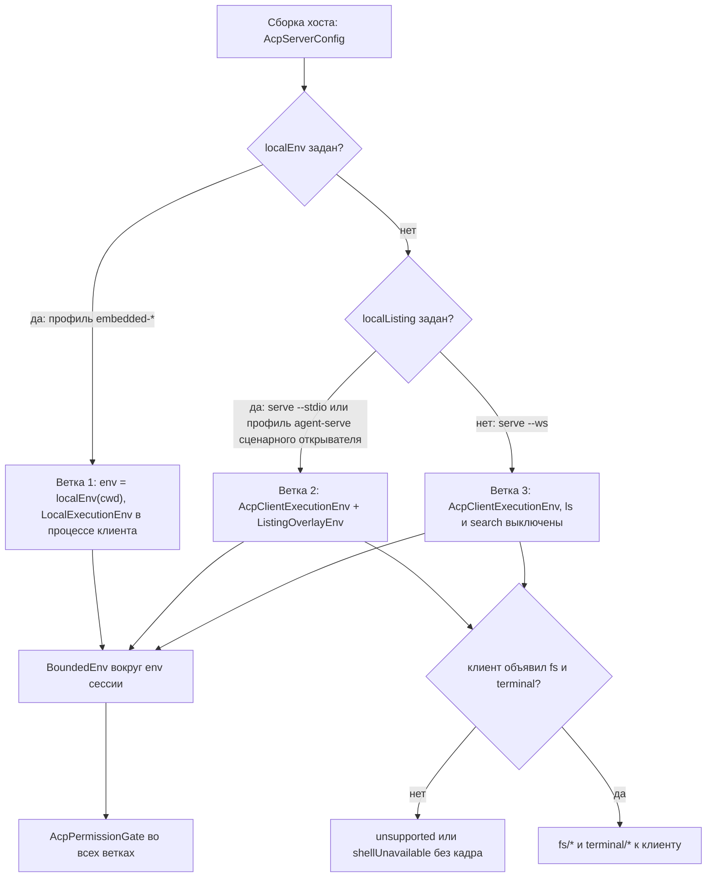
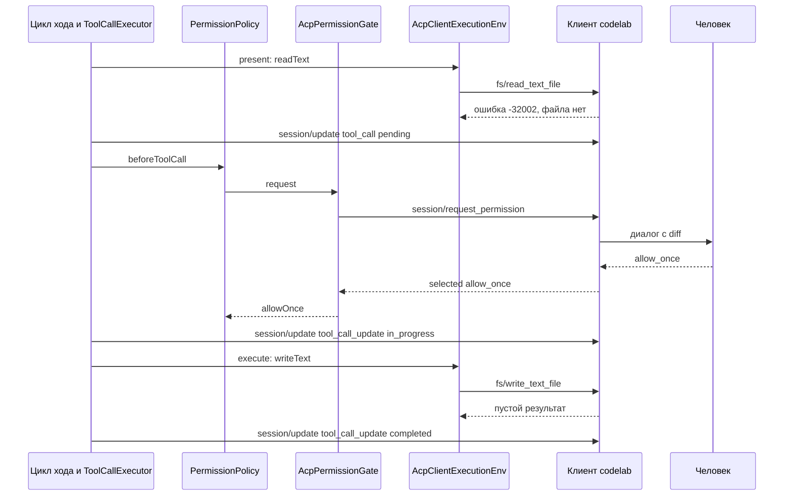
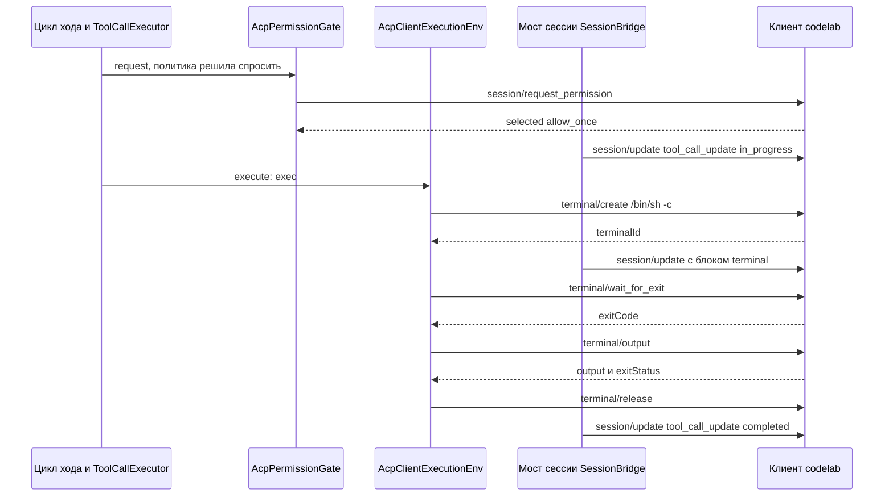
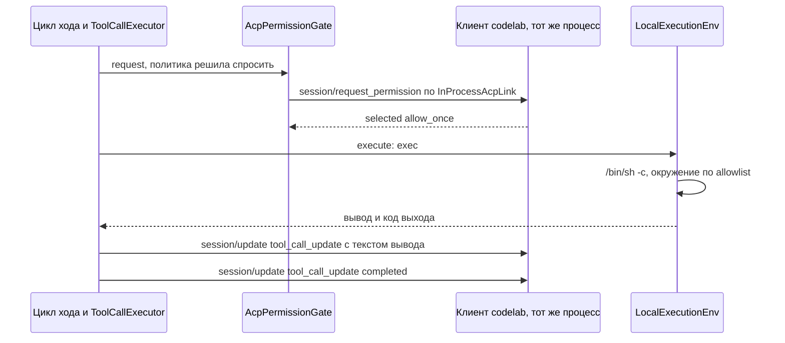

# Алгоритм исполнения: кто решает, спрашивает, показывает и исполняет

Агент вызывает инструмент: читает файл, пишет файл, запускает команду. Документ отвечает на два вопроса. На какой стороне, клиента или агента, происходит каждое действие по пути вызова: решение «нужно ли спрашивать», сам вопрос, диалог, запоминание «разрешить всегда», исполнение, чтение и запись файла, запуск команды, листинг каталога, containment. И как ответ меняется от способа подключения: встроенный агент, `codelab-agent serve --stdio`, `codelab-agent serve --ws`, внешний агент не из этого репозитория.

Документ читается целиком. Справочники по частям существуют, здесь они не пересказываются:

- шаги одного вызова инструмента — [tool-call.md](tool-call.md) (на его шаги `A4`, `X4`, `D…`, `Q…`, `G…`, `E1` ссылаются ниже);
- режимы, правила, «разрешить всегда» — [глава 07 «Разрешения»](../07-permissions.md); окружение `ExecutionEnv` и `BoundedEnv` — [глава 06 «Инструменты»](../06-tools.md#boundedenv);
- `AcpPermissionGate` и `AcpClientExecutionEnv` — [`codelab_agent_acp`, глава 03](../../../codelab_agent_acp/doc/03-projection-and-client-requests.md);
- хосты и что меняет транспорт — [глава 02](../02-assembly-and-hosts.md#что-меняет-транспорт); встроенный режим — [глава 03](../03-request-flow.md#встроенный-режим) и [`codelab_embedded`](../../../codelab_embedded/doc/00-architecture-and-debugging.md);
- клиентская сторона: [execution-on-client.md](../../../codelab_client_acp/doc/execution-on-client.md), [запросы `fs/*` и `terminal/*`](../../../codelab_client_acp/doc/03-agent-requests-fs-terminal.md), [одобрения в `codelab_client_core`](../../../codelab_client_core/doc/08-approvals.md);
- нормы: [`agent-permissions`](../../../../../openspec/specs/agent-permissions/spec.md), [`agent-execution-env`](../../../../../openspec/specs/agent-execution-env/spec.md), [`agent-acp-server`](../../../../../openspec/specs/agent-acp-server/spec.md), [`embedded-agent`](../../../../../openspec/specs/embedded-agent/spec.md), [`acp-fs-client`](../../../../../openspec/specs/acp-fs-client/spec.md), [`acp-terminal-client`](../../../../../openspec/specs/acp-terminal-client/spec.md), исключение для `fs/*` и `terminal/*` — [`AGENTS.md`](../../../../../AGENTS.md) §10 и [`permissions.md`](../../../../../docs/architecture/permissions.md); методы ACP — `docs/protocols/acp/protocol/08-Tool Calls.md`, `09-File System.md`, `10-Terminal.md`.

Пути в псевдокоде даны от `packages/dart/`: `core` — `codelab_agent_core/lib/src/`, `acp` — `codelab_agent_acp/lib/src/`, `embedded` — `codelab_embedded/lib/src/`, `agent-io` — `codelab_agent_io/lib/src/`, `client` — `codelab_client_acp/lib/src/`, `client-io` — `codelab_client_io/lib/src/`; `host` — `apps/codelab_agent/lib/src/host/`.

## Короткий ответ

1. **Решает агент.** Нужно ли спрашивать человека, решает `PermissionPolicy` ядра агента, в любом транспорте и до любого побочного эффекта (PERM-1). Ответ на вопрос даёт клиент: человек или, в headless, правило `--approve` (`apps/codelab_cli/lib/src/headless/approval_policy.dart`: `decideApproval`); ACP это допускает (`MAY`, `08-Tool Calls.md`). Но «нужно ли спрашивать» клиент не определяет.
2. **Спрашивает агент, показывает клиент.** Вопрос всегда один и тот же запрос ACP `session/request_permission`, его отправляет `AcpPermissionGate`. Диалог рисует клиент: REPL и TUI `codelab`, окно app. Во встроенном агенте обхода нет: вопрос идёт по `InProcessAcpLink`, как по проводу.
3. **Запоминает агент.** «Разрешить всегда» и «отклонить всегда» лежат в памяти сессии агента (`PermissionDecisionStore`). Клиент ничего не хранит: он передаёт выбранный вариант.
4. **Исполняет по-разному.** Встроенный агент (`embedded-*`) читает, пишет и запускает команды сам, в процессе клиента (`LocalExecutionEnv`), и `fs/*` с `terminal/*` клиенту не шлёт. `serve --stdio` и `serve --ws` идут через клиента: `fs/read_text_file`, `fs/write_text_file`, `terminal/*`. Внешний агент делает то же, если выберет возможности клиента: это его решение.
5. **Листинг каталога** клиентом не делается: в ACP такого метода нет. Его выполняет сам агент на своей файловой системе: во встроенном режиме и по stdio. По WebSocket инструментов `ls` и `search` нет.
6. **Containment два.** Агент отклоняет путь вне рабочей папки в `BoundedEnv` до обращения к env (всегда). Клиент отклоняет путь и `cwd` вне рабочей папки в запросах `fs/*` и `terminal/create`. Для внешнего агента клиентский рубеж единственный.
7. **MCP исполняет агент** (процесс stdio-сервера или HTTP-клиент агента), и вызов проходит тот же `PermissionPolicy`. По WebSocket MCP выключен.

## Вход и выход

| | Что |
|---|---|
| Вход | Вызов инструмента `ToolCall` в уже собранной сессии; для сборки — хост (`AgentHost.build` бинаря или `assembleEmbeddedAgent` встроенного агента), транспорт и возможности клиента из `initialize` (`clientCapabilities.fs.readTextFile`, `fs.writeTextFile`, `terminal`) |
| Выход | Результат вызова для модели, кадры `session/update`, запросы агента к клиенту `session/request_permission`, `fs/*`, `terminal/*` (только в ветке «через клиента»), действие над файлом или процессом на стороне, которую выбрала сборка |
| Побочные эффекты | Файл или процесс на машине, где исполнение; записи в памяти сессии агента («всегда»); записи лога `permission.*`, `acp.permission.*`, `acp.terminal.*` |
| Гарантии | Решение политики раньше исполнения (PERM-1); любой сбой вопроса — отказ, не разрешение; `terminal/release` уходит на любом пути (ENV-7, ACP-9); путь вне корня сессии не доходит до внутреннего env (ENV-3); у каждого вызова есть результат (TOOL-6) |
| Чего не гарантирует | Что команда оболочки не тронет файлы вне рабочей папки: ограничен только её `cwd`; что клиент раскроет символические ссылки; что запись с таймаутом не состоялась; что запрос клиенту можно отозвать: в ACP его нечем отозвать |

## Матрица: кто и где

Ветка «хост исполняет» — встроенный агент (профили `embedded-cli`, `embedded-app-desktop`). Ветка «через клиента» — `serve --stdio`, `serve --ws` и внешний агент. Агент и клиент встроенного режима живут в одном процессе, но это две стороны с `InProcessAcpLink` между ними, поэтому строки ниже различают их.

| Действие | Встроенный агент | `serve --stdio` | `serve --ws` | Внешний агент (не `codelab-agent`) |
|---|---|---|---|---|
| Решение «нужно ли спрашивать» | агент: `PermissionPolicy._decide` (`core/permissions/policy.dart`) | агент: он же | агент: он же | агент по своим правилам; ACP делает вопрос необязательным (`MAY`, `08-Tool Calls.md`, «Requesting Permission») |
| Отправка вопроса | агент: `AcpPermissionGate.request` (`acp/acp_permission_gate.dart`) по `InProcessAcpLink` | агент: он же по stdio | агент: он же по WebSocket | агент своим кодом, тот же метод `session/request_permission` |
| Показ диалога, выбор человека | клиент: `ApprovalPrompt` (REPL, TUI), `CodeLabApprovalPrompt` (app); без человека `decideApproval` (`codelab -p --approve`) | клиент: то же | клиент: то же | клиент: то же; ACP разрешает клиенту отвечать без человека (`MAY`) |
| Запоминание «всегда» | агент: `PermissionDecisionStore` в памяти сессии; клиент ничего не хранит | агент: то же | агент: то же | агент, как реализует; клиент ничего не хранит |
| Исполнение инструмента: проверки, хуки, `execute` | агент: `ToolCallExecutor` (`core/tools/executor.dart`) | агент: он же | агент: он же | агент |
| `read`, чтение внутри `edit`, `present` для diff | агент-хост: `LocalExecutionEnv.readText` в процессе клиента | клиент: `fs/read_text_file` → `IoTextFileIo.readText` | клиент: то же | агент выбирает: сам или `fs/read_text_file` к клиенту |
| `write`, запись внутри `edit` | агент-хост: `LocalExecutionEnv.writeText` | клиент: `fs/write_text_file` → `IoTextFileIo.writeText` | клиент: то же | агент выбирает: сам или `fs/write_text_file` |
| `exec` | агент-хост: `LocalExecutionEnv.exec`, `/bin/sh -c`, окружение по allowlist (ENV-6) | клиент: `terminal/create` → `IoTerminalProcessRunner`, `/bin/sh -c`, окружение клиента целиком | клиент: то же | агент выбирает: сам или `terminal/*` к клиенту |
| `ls`, `search`: листинг и `stat` | агент-хост: `LocalExecutionEnv.listDir` | агент, на своей ФС: `ListingOverlayEnv` над `LocalExecutionEnv`; содержимое для `search` читает клиент по `fs/read_text_file` | инструментов нет: `fileListing` выключена | агент, свой код; в ACP метода листинга нет |
| Файлы проекта (`AGENTS.md`), навыки | агент-хост: `ProjectFilesLoader`, ФС процесса | агент: `ProjectFilesLoader`, ФС процесса агента | не читаются (`project_files.skipped`) | агент |
| MCP-инструмент | агент: процесс stdio-сервера и HTTP-клиент хоста; тот же `PermissionPolicy` | агент: то же | выключен (`mcp` off); пропускаются серверы клиента и серверы из конфигурации (`agent_host.dart`, `narrowing[mcp]`) | агент, свой код |
| Containment по `cwd` | агент: `BoundedEnv`; клиент `fs/*` не получает | агент: `BoundedEnv`; клиент: `resolveWithinWorkingDirectory` | агент: то же; клиент: то же | клиент: `resolveWithinWorkingDirectory` — единственный рубеж CodeLab |
| Клиент не объявил `fs` или `terminal` | неважно: запросов нет | агент: `unsupported` или `shellUnavailable` без кадра | агент: то же | агент решает сам |

Что следует из матрицы:

- Столбцы различаются только строками исполнения и containment. Строки «решение», «вопрос», «диалог», «запоминание» одинаковы везде: это граница безопасности, и транспорт её не меняет.
- Профиль `embedded-*` — единственный, где агент не обращается к `fs/*` и `terminal/*`. Встроенный агент идёт через клиента только в одном случае: сценарный открыватель `codelab_embedded/testing.dart` принимает ещё профиль `agent-serve` (так `codelab test-scenario` играет фикстуры). `createEmbeddedAgent` и `localEmbeddedAgentOpener` принимают только `embedded-*` (`checkEmbeddedProfile`), поэтому app и CLI до `fs/*` не доходят.
- По WebSocket агент не читает листинг и файлы проекта, потому что `cwd` приходит из сети и клиент может быть на другой машине. Поэтому у модели нет `ls` и `search`, но есть `read`, `write`, `edit` и `exec` через клиента.

## Выбор ветки по транспорту

На схеме — как хост решает, где исполняются файлы и команды. Выбор происходит один раз при сборке сервера и не зависит от модели.



Внешний агент в схему не входит: его сборку CodeLab не контролирует. От клиента CodeLab зависит только нижний узел: объявленные возможности и ответы на запросы.

## Псевдокод

Блоки идут в порядке выполнения: сборка хоста, порты сессии, создание сессии, один вызов инструмента, команда через терминал клиента. Порядок шагов совпадает с кодом; пропущены только логи и защитные проверки.

### А. Сборка хоста: что кладётся в `AcpServerConfig`

```text
buildHost() -> AcpAgentServer
  1. встроенный агент: assembleEmbeddedAgent(config, services, …)
     // embedded/assemble.dart: assembleEmbeddedAgent, _assemble
     // checkEmbeddedProfile (embedded/create_embedded_agent.dart) пускает createEmbeddedAgent
     //   только к профилям embedded-app-desktop и embedded-cli
     embedded = config.hostProfile.startsWith('embedded-')
     AcpServerConfig(
         detachGrace: Duration.zero,                           // переподключаться к прежнему агенту некому
         localEnv:     embedded ? services.localEnv : null,    // LocalExecutionEnv(cwd: sessionCwd)
         localListing: embedded ? null : services.localEnv)    // профиль agent-serve: только сценарный открыватель
  2. бинарь: AgentHost.build(options, …)
     // host/agent_host.dart: AgentHost.build
     stdio = options.transport == stdio
     если !stdio: narrowing[fileListing] = off ; narrowing[mcp] = off       // клиент может быть на другой машине
     projectFiles = stdio ? ProjectFilesLoader : null
     hostFiles    = stdio ? localEnv : null
     AcpServerConfig(
         detachGrace: Duration.zero,
         localListing: stdio ? (cwd) => LocalExecutionEnv(cwd: cwd) : null)   // localEnv не задаётся никогда
  3. AcpAgentServer(core, config, …)
     // acp/agent_server.dart: AcpAgentServer (конструктор)
     если профиль включает fileListing:
         если config.localEnv != null: localEnv('/') обязан быть DirectoryListing, иначе throw HostWiringException
         иначе если config.localListing == null: throw HostWiringException
```

### Б. Порты сессии: `_wire(cwd)`

Вызывается из `session/new` и из `session/load`, когда в памяти сервера нет живого моста этой сессии.

```text
_wire(cwd) -> (link, bridge, ports)
  // acp/agent_server.dart: _Connection._wire
  1. link = ClientLink(requests, capabilities: _client!)        // возможности клиента из initialize
  2. если config.localEnv != null:                              // ветка 1: хост исполняет
         bridge = SessionBridge(…)                              // clientEnv нет: отменять нечего
         ports  = SessionHostPorts(
                      env: localEnv(cwd),
                      gate: AcpPermissionGate(link, waitForReconnect, announced),
                      extraBeforeToolCall: [bridge.markInProgress],
                      execOnHost: true)
         return
  3. clientEnv = AcpClientExecutionEnv(link, cwd, timeouts, clock, logger)   // ветки 2 и 3
  4. listing   = config.localListing
  5. bridge    = SessionBridge(…, clientEnv: clientEnv)
  6. ports     = SessionHostPorts(
                     env: listing == null ? clientEnv : ListingOverlayEnv(clientEnv, listing(cwd)),
                     gate: AcpPermissionGate(link, waitForReconnect, announced),
                     extraBeforeToolCall: [bridge.markInProgress])   // execOnHost остаётся false
  7. clientEnv.terminalShown = bridge.terminalShown
```

### В. Создание сессии: env, gate, политика

```text
createSession(spec) -> AgentSession
  // core/runtime/agent_runtime.dart: AgentRuntimeImpl, создание сессии
  1. execOnHost = hostFiles != null && (ports.env == null || ports.execOnHost)
  2. env = BoundedEnv.wrap(ports.env ?? services.baseEnv, cwd,
                           readOnlyRoots, readOnlyFs: hostFiles, execInReadOnlyRoots: execOnHost)
  3. gate = profile.isOn(interactiveApproval) ? ports.gate ?? services.gate : null
     // services.gate в обоих хостах — заглушка, которая бросает StateError: настоящий gate приходит из ports
  4. policy = PermissionPolicy(mode, modeOverride, gate, rules, extraDeniedTiers, pathResolver, …)
  5. executor = ToolCallExecutor(env: env, …)
     beforeToolCall = [policy.asHook(…), ...ports.extraBeforeToolCall]   // PERM-1: политика первая
```

### Г. Один вызов: что зависит от стороны

Шаги вызова целиком — [tool-call.md](tool-call.md). Здесь только те, где сторона меняет результат.

```text
callTool(call) -> ToolResultMessage
  // шаги tool-call.md: A4, X4, X6, E1
  1. A4 present(args)                                  // заголовок, места, diff
        write, edit читают старое содержимое: ctx.env.readText(path)
        ветка 1: LocalExecutionEnv.readText в процессе агента
        ветки 2, 3: AcpClientExecutionEnv.readText → fs/read_text_file к клиенту
            клиент не объявил fs.readTextFile → Err(unsupported), кадра нет
  2. X4 хук 1: PermissionPolicy.asHook → _decide → при «спросить» _ask   // tool-call.md: D0–D11, Q1–Q7
        gate.request → AcpPermissionGate.request → session/request_permission   // tool-call.md: G1–G4
        // одинаково в трёх ветках
        отказ или cancelled → Block, шаги 3–6 не выполняются
  3. X4 последний хук: bridge.markInProgress → tool_call_update in_progress
  4. X6 очередь блокировок пути (write, edit)
  5. E1 tool.execute(args, ctx)  с ctx.env = BoundedEnv:
        путь вне корня сессии → Err(outsideWorkspace), внутренний env не вызывается   // ENV-3
        иначе операция уходит во внутренний env сессии:
            read, edit        → readText
            write, edit       → writeText
            exec              → exec(command, ExecOptions(cwd, timeout, cancel, onTerminal))
            ls                → listDir
            search            → stat, listDir, readText по найденным файлам
        ветка 1: LocalExecutionEnv                              // процесс клиента, без кадров ACP
        ветки 2, 3: AcpClientExecutionEnv                       // fs/*, terminal/* к клиенту
        ветка 2: listDir и stat — локально, ListingOverlayEnv   // в ACP нет метода листинга
  6. Err(FileError | ExecError) → текст ошибки для модели (core/tools/builtin/common.dart: fileErrorText,
        exec.dart: _failure); вызов завершается failed, ход продолжается
```

### Д. `exec` через терминал клиента: `AcpClientExecutionEnv.exec`

Только ветки 2 и 3. В ветке 1 вместо этого шага `LocalExecutionEnv.exec` запускает `/bin/sh -c` в процессе клиента.

```text
exec(command, options) -> Result<ExecResult, ExecError>
  // acp/acp_client_env.dart: AcpClientExecutionEnv.exec, _awaitTerminal
  1. если !capabilities.terminal:
         return Err(shellUnavailable, 'the client does not support terminals')   // кадра нет
  2. terminal/create(command: '/bin/sh', args: ['-c', command], env, cwd: абсолютный cwd,
                     outputByteLimit)                     // таймаут terminalCreate, отмена options.cancel
         ClientCallCancelled → return Err(aborted)
         ClientCallFailure   → return Err(spawnFailed)
  3. попытка:
         onTerminal(terminalId)                           // ToolCallProgress с терминалом → tool_call_update
         ждать terminalShown гонкой с отменой             // wait_for_exit не опережает кадр с терминалом
         отмена → return Err(aborted)
         _awaitTerminal:
             stop = CancelTokenSource; таймер options.timeout → stop.cancel; options.cancel → stop.cancel
             terminal/wait_for_exit                       // без таймаута у ClientRequests, отмена — stop
                 ClientCallCancelled → terminal/kill      // таймаут terminalKill
                 ClientCallFailure   → waitFailure
             terminal/output                              // таймаут terminalOutput; сбой → output = null
             waitFailure != null → Err(unknown, outputTail)
             wait_for_exit не завершился → Err(timeout | aborted, outputTail)
             иначе Ok(ExecResult(exitCode, signal, output, truncated))
     finally:
         terminal/release                                 // всегда, даже при ошибке и отмене (ENV-7, ACP-9)
```

## Пошаговое пояснение

**А1–А3. Выбор ветки.** Ветку определяет не транспорт сам по себе, а то, что хост положил в `AcpServerConfig`. Встроенный хост кладёт `localEnv`: клиент и агент в одном процессе, и гонять файлы через `fs/*` того же процесса незачем. Объявленные клиентом `fs` и `terminal` разрешают агенту звать эти методы, но не обязывают: по ACP это возможность, а не требование. Поэтому `initialize` не меняется, а `fs/*` просто не уходит (`embedded-agent`, «Локальное исполнение и containment»). Бинарь `serve` не кладёт `localEnv` никогда: он не знает, куда смотрит клиент. По stdio клиент гарантированно на той же машине, потому что процесс агента — его дочерний, и хост добавляет `localListing`. По WebSocket клиент может быть где угодно, и хост отключает листинг и MCP.

**Б2. `execOnHost: true`.** Команды `localEnv` идут на машине агента, и рантайм может разрешить `exec` с `cwd` в каталоге навыка вне рабочей папки. Клиентский терминал каталог навыка агента не видит, поэтому там флаг остаётся `false`.

**Б4–Б6. Оверлей листинга.** `ListingOverlayEnv` берёт у `localListing` только `listDir` и `stat`, всё остальное у `AcpClientExecutionEnv`. `stat` локальный, потому что через клиента его не получить: в ACP нет такого метода, и `search` начинает со `stat` корня. Следствие: `ls` показывает файлы на диске, а `read` и `search` по содержимому видят то, что отдаёт клиент. Если клиент отдаёт несохранённый буфер редактора, `read` его увидит, а `ls` нет.

**В2. `BoundedEnv`.** Оборачивает env любой ветки. Путь вне рабочей папки возвращает `Err(outsideWorkspace)` до обращения к внутреннему env (ENV-3). Поэтому клиент не получит `fs/read_text_file` с путём вне `cwd` от `codelab-agent`: до него этот запрос не доживёт. Клиентская проверка нужна для внешнего агента, у которого такого рубежа может не быть.

**В3. Gate.** `AcpPermissionGate` один на сессию и один класс во всех ветках. Без gate любое «спросить» превращается в отказ `no approval interface is available` (PERM-5). Хосты кладут `services.gate` только затем, чтобы включилась capability `interactiveApproval`: настоящий gate приходит из `ports.gate`.

**Г2. Решение — на стороне агента, вопрос — через ACP.** Политика применяется к приведённым аргументам, до `execute` (PERM-1). Вопрос содержит `toolCallId`, `rawInput`, `locations` и diff (PERM-6): решение пользователя действует на один вызов (PERM-4). «Разрешить всегда» политика кладёт в хранилище сессии по ключу `(инструмент, шаблон)` (PERM-3): `exec dart test` не разрешает `exec dart test --update-goldens`. Критическая команда спрашивается без варианта `allow_always` (PERM-9).

**Г5. Исполнение и ошибки.** Ожидаемые сбои — значения `Err`, а не исключения (ENV-1). Ответ клиента `-32002` — это `notFound`, любая другая ошибка клиента — `io`, клиент без нужной возможности — `unsupported`. Модель видит текст, а не код: `File not found: <путь>`, `This operation is not supported in the current environment.`, `Shell commands are not available in this environment.`.

**Д. Терминал клиента.** `terminal/create` возвращает идентификатор сразу, не дожидаясь конца команды. Агент встраивает терминал в вызов (`tool_call_update` с блоком `terminal`), и только потом ждёт выхода: клиент должен успеть показать терминал. `terminal/release` стоит в `finally` и уходит всегда. Отмена и таймаут команды ведут к `terminal/kill`. Таймаута у `terminal/wait_for_exit` на стороне `ClientRequests` нет: срок команды задаёт аргумент `timeout` инструмента `exec` (по умолчанию 120 с, не больше 3600 с).

**Исполнение в ветке 1.** `LocalExecutionEnv.exec` запускает `/bin/sh -c` в процессе клиента. Окружение команды — allowlist `PATH`, `HOME`, `USER`, `LANG`, `LC_ALL`, `TMPDIR`, `SHELL` плюс явные переменные (ENV-6). Клиентский терминал устроен иначе: `IoTerminalProcessRunner` запускает процесс с окружением самого клиента. Поэтому одна и та же команда `env` во встроенном агенте и через `serve --stdio` покажет разные наборы переменных; подробности — в разделе «Граничные случаи и пределы» [secrets.md](secrets.md).

## Схемы

### `write` с одобрением по stdio

На схеме — вызов `write` в `serve --stdio`: кадры идут клиенту, а решает по-прежнему агент.



`BoundedEnv` стоит между циклом и `AcpClientExecutionEnv` и на схеме не показан: он только пропускает путь внутри рабочей папки. Клиент по ответу `-32002` сообщает «файла нет», и агент строит diff без `oldText`.

### `exec` через `terminal/*`

На схеме — тот же вызов `exec`, если команду исполняет клиент.



Все `session/update` на схеме отправляет мост сессии, а не `AcpClientExecutionEnv`. `in_progress` ставит хук `markInProgress` после решения политики; кадр с блоком `terminal` мост ставит до `wait_for_exit` (`terminalShown`).

### Тот же `exec` во встроенном агенте

Здесь запросов `terminal/*` нет: команду запускает агент в процессе клиента, а клиенту уходит только вопрос и обновления вызова.



Разница видна на клиенте: вместо встроенного терминала он получает текстовые блоки с выводом, а процесс команды принадлежит агенту.

## Разобранные примеры

Данные получены запусками текущей ветки, а не придуманы. Во всех запусках модель — сценарий `{"llm": {...}}`, сети и ключей нет, `CODELAB_HOME` лежал во временном каталоге, `*_API_KEY` сняты через `env -u`. Рабочая папка и идентификаторы заменены: `~/projects/demo`, `<session-id>`, `<ts>`. Кадры `session/update` с `_codelab/session/usage`, `available_commands_update` и `session/list` опущены.

Сценарий модели один для примеров 1–3: шаг 1 — вызов `write` (`NOTES.md`, содержимое `# Notes\n`), шаг 2 — вызов `exec` с `echo hi`, шаг 3 — текст `Готово.`. Режим разрешений — `standard`: оба вызова спрашивают.

### Пример 1. `serve --stdio`: настоящий клиент и настоящий агент

Источник: терминальный клиент `codelab` (собран из ветки) запущен как `codelab -p "Создай NOTES.md и выполни echo hi" -C ~/projects/demo -a "stdio:<прокладка>" --approve allow-all`. Прокладка — скрипт на Python в временном каталоге: запускает `codelab-agent serve --stdio --llm-script llm.json --permission-mode standard` и пишет каждую строку stdin и stdout в журнал с пометкой направления. Агент и клиент — настоящие бинари, кадры — настоящие.

В stderr клиента:

```text
codelab: warning: --approve allow-all allows every permission request except critical ones without asking
codelab: permission "Write NOTES.md": allow_once (policy)
✓ Write NOTES.md
codelab: permission "echo hi": allow_once (policy)
✓ echo hi echo hi
Готово.
```

В `initialize` клиент объявил возможности, на которые агент потом опирается:

```text
C->A {"jsonrpc":"2.0","id":1,"method":"initialize","params":{"protocolVersion":1,"clientCapabilities":{"fs":{"readTextFile":true,"writeTextFile":true},"terminal":true,"_meta":{"codelab":{"tasks":{"version":1},"subagents":{"version":1},"subagentToolCalls":{"version":1},"usage":{"version":1}}}},"clientInfo":{"name":"codelab-cli","version":"0.1.0"}}}
```

Вызов `write` (`A->C` — от агента клиенту, `C->A` — от клиента агенту):

```text
A->C {"jsonrpc":"2.0","id":"fs-1","method":"fs/read_text_file","params":{"sessionId":"<session-id>","path":"~/projects/demo/NOTES.md"}}
C->A {"jsonrpc":"2.0","id":"fs-1","error":{"code":-32002,"message":"Resource not found","data":{"kind":"resourceNotFound","message":"No such file: ~/projects/demo/NOTES.md"}}}
A->C {"jsonrpc":"2.0","method":"session/update","params":{"sessionId":"<session-id>","update":{"sessionUpdate":"tool_call","toolCallId":"call_1","title":"Write NOTES.md","kind":"edit","status":"pending","locations":[{"path":"~/projects/demo/NOTES.md"}],"rawInput":{"path":"NOTES.md","content":"# Notes\n"}}}}
A->C {"jsonrpc":"2.0","id":"perm-2","method":"session/request_permission","params":{"sessionId":"<session-id>","toolCall":{"toolCallId":"call_1","title":"Write NOTES.md","kind":"edit","status":"pending","content":[{"type":"diff","path":"~/projects/demo/NOTES.md","newText":"# Notes\n"}],"locations":[{"path":"~/projects/demo/NOTES.md"}],"rawInput":{"path":"NOTES.md","content":"# Notes\n"}},"options":[{"optionId":"allow_once","name":"Allow once","kind":"allow_once"},{"optionId":"allow_always","name":"Always allow NOTES.md","kind":"allow_always"},{"optionId":"reject_once","name":"Reject","kind":"reject_once"},{"optionId":"reject_always","name":"Always reject NOTES.md","kind":"reject_always"}]}}
C->A {"jsonrpc":"2.0","id":"perm-2","result":{"outcome":{"outcome":"selected","optionId":"allow_once"}}}
A->C {"jsonrpc":"2.0","method":"session/update","params":{"sessionId":"<session-id>","update":{"sessionUpdate":"tool_call_update","toolCallId":"call_1","status":"in_progress"}}}
A->C {"jsonrpc":"2.0","id":"fs-3","method":"fs/read_text_file","params":{"sessionId":"<session-id>","path":"~/projects/demo/NOTES.md"}}
C->A {"jsonrpc":"2.0","id":"fs-3","error":{"code":-32002,"message":"Resource not found","data":{"kind":"resourceNotFound","message":"No such file: ~/projects/demo/NOTES.md"}}}
A->C {"jsonrpc":"2.0","id":"fs-4","method":"fs/write_text_file","params":{"sessionId":"<session-id>","path":"~/projects/demo/NOTES.md","content":"# Notes\n"}}
C->A {"jsonrpc":"2.0","id":"fs-4","result":{}}
A->C {"jsonrpc":"2.0","method":"session/update","params":{"sessionId":"<session-id>","update":{"sessionUpdate":"tool_call_update","toolCallId":"call_1","status":"completed","content":[{"type":"content","content":{"type":"text","text":"Created NOTES.md (8 bytes)."}},{"type":"diff","path":"~/projects/demo/NOTES.md","newText":"# Notes\n"}]}}}
```

Что на кадрах и в каком шаге алгоритма:

| Кадры | Шаг |
|---|---|
| `fs-1`, ответ `-32002` | Г1: `present` читает старое содержимое через клиента; ветка 2 |
| `tool_call` `pending` | A4 [tool-call.md](tool-call.md): `ToolCallStarted` после `present` |
| `perm-2` и ответ клиента | Г2: `_ask` → `AcpPermissionGate` → `session/request_permission`; решает человек за клиентом, спросил агент |
| `tool_call_update` `in_progress` | Г3: `markInProgress` после решения политики |
| `fs-3` | Г5: `write.execute` перечитывает файл уже под блокировкой пути |
| `fs-4` | Г5: `ctx.env.writeText` → `fs/write_text_file`, файл записал клиент |

Вызов `exec` в том же ходе:

```text
A->C {"jsonrpc":"2.0","method":"session/update","params":{"sessionId":"<session-id>","update":{"sessionUpdate":"tool_call","toolCallId":"call_2","title":"echo hi","kind":"execute","status":"pending","rawInput":{"command":"echo hi"}}}}
A->C {"jsonrpc":"2.0","id":"perm-5","method":"session/request_permission","params":{"sessionId":"<session-id>","toolCall":{"toolCallId":"call_2","title":"echo hi","kind":"execute","status":"pending","rawInput":{"command":"echo hi"}},"options":[{"optionId":"allow_once","name":"Allow once","kind":"allow_once"},{"optionId":"allow_always","name":"Always allow echo hi","kind":"allow_always"},{"optionId":"reject_once","name":"Reject","kind":"reject_once"},{"optionId":"reject_always","name":"Always reject echo hi","kind":"reject_always"}]}}
C->A {"jsonrpc":"2.0","id":"perm-5","result":{"outcome":{"outcome":"selected","optionId":"allow_once"}}}
A->C {"jsonrpc":"2.0","method":"session/update","params":{"sessionId":"<session-id>","update":{"sessionUpdate":"tool_call_update","toolCallId":"call_2","status":"in_progress"}}}
A->C {"jsonrpc":"2.0","id":"term-6","method":"terminal/create","params":{"sessionId":"<session-id>","command":"/bin/sh","args":["-c","echo hi"],"env":[],"cwd":"~/projects/demo","outputByteLimit":1048576}}
C->A {"jsonrpc":"2.0","id":"term-6","result":{"terminalId":"term-term-6"}}
A->C {"jsonrpc":"2.0","method":"session/update","params":{"sessionId":"<session-id>","update":{"sessionUpdate":"tool_call_update","toolCallId":"call_2","status":"in_progress","content":[{"type":"terminal","terminalId":"term-term-6"}]}}}
A->C {"jsonrpc":"2.0","id":"term-7","method":"terminal/wait_for_exit","params":{"sessionId":"<session-id>","terminalId":"term-term-6"}}
C->A {"jsonrpc":"2.0","id":"term-7","result":{"exitCode":0}}
A->C {"jsonrpc":"2.0","id":"term-8","method":"terminal/output","params":{"sessionId":"<session-id>","terminalId":"term-term-6"}}
C->A {"jsonrpc":"2.0","id":"term-8","result":{"output":"hi\n","truncated":false,"exitStatus":{"exitCode":0}}}
A->C {"jsonrpc":"2.0","id":"term-9","method":"terminal/release","params":{"sessionId":"<session-id>","terminalId":"term-term-6"}}
C->A {"jsonrpc":"2.0","id":"term-9","result":{}}
A->C {"jsonrpc":"2.0","method":"session/update","params":{"sessionId":"<session-id>","update":{"sessionUpdate":"tool_call_update","toolCallId":"call_2","status":"completed","content":[{"type":"content","content":{"type":"text","text":"hi\n"}}]}}}
```

Идентификатор терминала `term-term-6` собрал клиент: `term-` плюс id JSON-RPC запроса `terminal/create`, а id запроса агент уже сделал из префикса `term` и счётчика. Счётчик общий на соединение: `fs-1`, `perm-2`, `fs-3`, `fs-4`, `perm-5`, `term-6`…

### Пример 2. Встроенный агент: `fs/*` и `terminal/*` на проводе нет

Источник: временный драйвер на Dart в временном каталоге: сценарный открыватель `scriptedEmbeddedAgentOpener` из `package:codelab_embedded/testing.dart` с профилем `embedded-cli`, клиентом на клиентском конце `InProcessAcpLink`. Клиент объявляет `fs.readTextFile`, `fs.writeTextFile` и `terminal: true`, отвечает на `session/request_permission` вариантом `allow_once`, а на любой `fs/*` и `terminal/*` у него заготовлены ответы. Драйвер запускался командой `fvm dart run --packages=<корень>/.dart_tool/package_config.json driver.dart embedded-cli <папка> <home>`.

Результат: `NOTES.md` записан в рабочую папку, а в журнале кадров нет ни одного `fs/*` и ни одного `terminal/*`. Всё, что ушло клиенту:

```text
A->C {"jsonrpc":"2.0","method":"session/update","params":{"sessionId":"<session-id>","update":{"sessionUpdate":"tool_call","toolCallId":"call_1","title":"Write NOTES.md","kind":"edit","status":"pending","locations":[{"path":"~/projects/demo/NOTES.md"}],"rawInput":{"path":"NOTES.md","content":"# Notes\n"}}}}
A->C {"jsonrpc":"2.0","id":"perm-1","method":"session/request_permission","params":{"sessionId":"<session-id>","toolCall":{"toolCallId":"call_1","title":"Write NOTES.md","kind":"edit","status":"pending","content":[{"type":"diff","path":"~/projects/demo/NOTES.md","newText":"# Notes\n"}],"locations":[{"path":"~/projects/demo/NOTES.md"}],"rawInput":{"path":"NOTES.md","content":"# Notes\n"}},"options":[{"optionId":"allow_once","name":"Allow once","kind":"allow_once"},{"optionId":"allow_always","name":"Always allow NOTES.md","kind":"allow_always"},{"optionId":"reject_once","name":"Reject","kind":"reject_once"},{"optionId":"reject_always","name":"Always reject NOTES.md","kind":"reject_always"}]}}
C->A {"jsonrpc":"2.0","id":"perm-1","result":{"outcome":{"outcome":"selected","optionId":"allow_once"}}}
A->C {"jsonrpc":"2.0","method":"session/update","params":{"sessionId":"<session-id>","update":{"sessionUpdate":"tool_call_update","toolCallId":"call_1","status":"in_progress"}}}
A->C {"jsonrpc":"2.0","method":"session/update","params":{"sessionId":"<session-id>","update":{"sessionUpdate":"tool_call_update","toolCallId":"call_1","status":"completed","content":[{"type":"content","content":{"type":"text","text":"Created NOTES.md (8 bytes)."}},{"type":"diff","path":"~/projects/demo/NOTES.md","newText":"# Notes\n"}]}}}
A->C {"jsonrpc":"2.0","method":"session/update","params":{"sessionId":"<session-id>","update":{"sessionUpdate":"tool_call","toolCallId":"call_2","title":"echo hi","kind":"execute","status":"pending","rawInput":{"command":"echo hi"}}}}
A->C {"jsonrpc":"2.0","id":"perm-2","method":"session/request_permission","params":{"sessionId":"<session-id>","toolCall":{"toolCallId":"call_2","title":"echo hi","kind":"execute","status":"pending","rawInput":{"command":"echo hi"}},"options":[{"optionId":"allow_once","name":"Allow once","kind":"allow_once"},{"optionId":"allow_always","name":"Always allow echo hi","kind":"allow_always"},{"optionId":"reject_once","name":"Reject","kind":"reject_once"},{"optionId":"reject_always","name":"Always reject echo hi","kind":"reject_always"}]}}
C->A {"jsonrpc":"2.0","id":"perm-2","result":{"outcome":{"outcome":"selected","optionId":"allow_once"}}}
A->C {"jsonrpc":"2.0","method":"session/update","params":{"sessionId":"<session-id>","update":{"sessionUpdate":"tool_call_update","toolCallId":"call_2","status":"in_progress"}}}
A->C {"jsonrpc":"2.0","method":"session/update","params":{"sessionId":"<session-id>","update":{"sessionUpdate":"tool_call_update","toolCallId":"call_2","status":"in_progress","content":[{"type":"content","content":{"type":"text","text":"hi\n"}}]}}}
A->C {"jsonrpc":"2.0","method":"session/update","params":{"sessionId":"<session-id>","update":{"sessionUpdate":"tool_call_update","toolCallId":"call_2","status":"completed","content":[{"type":"content","content":{"type":"text","text":"hi\n"}}]}}}
```

Вопрос `session/request_permission` по содержимому тот же, что в примере 1 (отличается только `id`: на встроенном соединении счётчик свой, и перед первым вопросом нет `fs-1`). Нет кадров `fs/*` и `terminal/*`, нет блока `terminal` в `tool_call_update`: вывод команды пришёл текстом (`hi\n`) в `in_progress`.

Тот же драйвер с профилем `agent-serve` (его принимает только сценарный открыватель) дал в журнале: два `fs/read_text_file`, один `fs/write_text_file`, `terminal/create`, `terminal/wait_for_exit`, `terminal/output`, `terminal/release` и те же два вопроса `session/request_permission`. Это тот же код `_wire`, ветка 2: сценарный открыватель отдаёт `localEnv` как `localListing` для профиля `agent-serve`, поэтому `ls` и `search` у модели есть, как по stdio.

### Пример 3. `serve --ws`

Источник: `codelab-agent serve --ws --port 18791 --llm-script llm.json --permission-mode standard` с токеном в `CODELAB_AGENT_TOKEN` (значение `<token>`), клиент `codelab -p … -a ws://127.0.0.1:18792 --approve allow-all`, между ними прокладка TCP на Python, которая разбирает кадры WebSocket и печатает текстовые сообщения. Всё на loopback.

Журнал агента при старте (`--log-file`) показывает, что ветка 3 отключила листинг и MCP и не читает файлы проекта:

```text
{"level":"info","event":"host.plan","profile":"agent-serve","tools":["read","write","edit","task_create","task_update","task_list","task_get","exec"],"off":{"fileListing":"WebSocket: клиент может быть не на этой машине","mcp":"stdio MCP servers are disabled over WebSocket"}}
{"level":"info","event":"project_files.skipped","reason":"project files are not read over WebSocket","transport":"ws"}
```

Для сравнения `host.plan` того же агента по `--stdio`:

```text
{"level":"info","event":"host.plan","profile":"agent-serve","tools":["read","write","edit","task_create","task_update","task_list","task_get","exec","ls","search"],"off":{"sessionPersistence":"--llm-script: сессии в памяти"}}
```

Методы кадров по WebSocket, в порядке прихода (`A->C` — от агента, `C->A` — от клиента):

```text
C->A initialize          C->A session/list        C->A session/new         C->A session/prompt
A->C fs/read_text_file   A->C session/request_permission (perm-2)
A->C fs/read_text_file   A->C fs/write_text_file
A->C session/request_permission (perm-5)
A->C terminal/create     A->C terminal/wait_for_exit   A->C terminal/output   A->C terminal/release
```

Последовательность, идентификаторы запросов (`fs-1`, `perm-2`, `fs-3`, `fs-4`, `perm-5`, `term-6`…) и содержимое кадров совпали с примером 1: серверный код один, меняется только транспорт. Файл `NOTES.md` записал клиент по `fs/write_text_file`. В примере клиент и агент на одной машине, поэтому `NOTES.md` оказался рядом с агентом. С удалённым клиентом `fs/*` и `terminal/*` исполнились бы на его машине, а не на машине агента: агент к ним не привязан.

### Пример 4. Отмена во время `exec`

Источник: те же клиент и прокладка по stdio, сценарий — один вызов `exec` с `sleep 30`; клиент запущен с `--approve allow-all --timeout 3s`. Через 3 секунды headless-клиент отменяет ход:

```text
codelab: permission "sleep 30": allow_once (policy)
codelab: timeout after 3s, cancelling the turn
⊘ sleep 30 sleep 30
```

Кадры после `terminal/create` (путь `cwd` и идентификаторы сокращены):

```text
A->C {"jsonrpc":"2.0","id":"term-3","method":"terminal/wait_for_exit","params":{"sessionId":"<session-id>","terminalId":"term-term-2"}}
C->A {"jsonrpc":"2.0","method":"session/cancel","params":{"sessionId":"<session-id>"}}
A->C {"jsonrpc":"2.0","id":"term-4","method":"terminal/kill","params":{"sessionId":"<session-id>","terminalId":"term-term-2"}}
C->A {"jsonrpc":"2.0","id":"term-4","result":{}}
C->A {"jsonrpc":"2.0","id":"term-3","error":{"code":-32603,"message":"Internal error","data":{"kind":"internalError","message":"Failed to wait for terminal exit: AcpTransportException(AcpTransportErrorCode.sendFailed): Failed to send ACP message over stdio."}}}
A->C {"jsonrpc":"2.0","id":"term-5","method":"terminal/output","params":{"sessionId":"<session-id>","terminalId":"term-term-2"}}
C->A {"jsonrpc":"2.0","id":"term-5","result":{"output":"","truncated":false,"exitStatus":{"signal":"SIGTERM"}}}
A->C {"jsonrpc":"2.0","id":"term-6","method":"terminal/release","params":{"sessionId":"<session-id>","terminalId":"term-term-2"}}
C->A {"jsonrpc":"2.0","id":"term-6","result":{}}
A->C {"jsonrpc":"2.0","method":"session/update","params":{"sessionId":"<session-id>","update":{"sessionUpdate":"tool_call_update","toolCallId":"call_1","status":"failed","_meta":{"codelab":{"outcome":"cancelled"}}}}}
A->C {"jsonrpc":"2.0","id":4,"result":{"stopReason":"cancelled"}}
```

Порядок такой, как в псевдокоде Д: отмена прекращает ожидание `wait_for_exit` (`ClientCallCancelled`), агент шлёт `terminal/kill`, забирает вывод и освобождает терминал; вызов закрыт как `failed` с `_meta.codelab.outcome: "cancelled"`, а `session/prompt` отвечает `stopReason: cancelled` (ACP-5). Ответ клиента на `term-3` пришёл ошибкой `sendFailed`; в четырёх запусках из четырёх. Агент её игнорирует: ожидание уже отменено, а поздний ответ попадает в «неизвестный id». Причина и риск — в разделе «Граничные случаи».

### Пример 5. Отказ без человека

Источник: тот же клиент, правило `--approve` не задано (по умолчанию `reject`), сценарий — вызов `write`, затем текст `Не вышло.`:

```text
codelab: permission "Write NOTES.md": reject_once (policy)
✗ Write NOTES.md
Не вышло.
```

Кадры после вопроса:

```text
C->A {"jsonrpc":"2.0","id":"perm-2","result":{"outcome":{"outcome":"selected","optionId":"reject_once"}}}
A->C {"jsonrpc":"2.0","method":"session/update","params":{"sessionId":"<session-id>","update":{"sessionUpdate":"tool_call_update","toolCallId":"call_1","status":"failed","content":[{"type":"content","content":{"type":"text","text":"Permission denied for write: rejected by the user. Do not retry the same call; choose another approach or ask the user."}}],"_meta":{"codelab":{"outcome":"rejected"}}}}}
A->C {"jsonrpc":"2.0","method":"session/update","params":{"sessionId":"<session-id>","update":{"sessionUpdate":"agent_message_chunk","content":{"type":"text","text":"Не вышло."}}}}
A->C {"jsonrpc":"2.0","id":4,"result":{"stopReason":"end_turn"}}
```

Файла нет. Отказ — данные для модели, ход продолжился и закончился `end_turn` (PERM-7). Решил отказать клиент (headless-политика), текст для модели собрал агент.

### Пример 6. Клиент не объявил `fs` и `terminal`

Источник: драйвер из примера 2 с профилем `agent-serve` и `clientCapabilities: {}`. Вопросы `session/request_permission` пришли оба, кадров `fs/*` и `terminal/*` нет, результаты вызовов:

```text
A->C {"jsonrpc":"2.0","method":"session/update","params":{"sessionId":"<session-id>","update":{"sessionUpdate":"tool_call_update","toolCallId":"call_1","status":"failed","content":[{"type":"content","content":{"type":"text","text":"This operation is not supported in the current environment."}}]}}}
A->C {"jsonrpc":"2.0","method":"session/update","params":{"sessionId":"<session-id>","update":{"sessionUpdate":"tool_call_update","toolCallId":"call_2","status":"failed","content":[{"type":"content","content":{"type":"text","text":"Shell commands are not available in this environment."}}]}}}
```

Агент всё равно спросил человека: политика не знает, умеет ли env исполнить вызов, это выясняется на `execute`. Инструменты остаются в схеме модели: `exec` есть в списке, даже если у клиента нет терминала.

### Пример 7. Разрыв во время вопроса

Источник: скрипт на Python в роли клиента запускает `codelab-agent serve --stdio --llm-script … --log-level debug --log-file …`, доходит до `session/request_permission` и закрывает stdin агента. Журнал агента:

```text
{"level":"debug","event":"permission.asked","tool_call_id":"call_1","tool":"write","tier":"write","critical":false}
{"level":"info","event":"acp.session.detached","session_id":"<session-id>","grace_ms":0}
{"level":"info","event":"acp.session.grace_expired","session_id":"<session-id>"}
{"level":"debug","event":"permission.decided","tool_call_id":"call_1","decision":"cancelled"}
{"level":"info","event":"permission.denied","tool_call_id":"call_1","tool":"write","reason":"permission request was cancelled"}
{"level":"info","event":"serve.stop","exit_code":0}
```

`detachGrace` равен нулю, поэтому разрыв отменяет ход сразу, ждать переподключения некому, вопрос закрывается как `cancelled` и становится отказом. Файл не записан.

## Граничные случаи и отказы

| Ситуация | Что происходит | Где в коде |
|---|---|---|
| Клиент не объявил `fs.readTextFile` или `fs.writeTextFile` | `Err(unsupported)` без кадра; модель видит `This operation is not supported in the current environment.`; вопрос пользователю уже задан (пример 6) | `acp/acp_client_env.dart`: `readText`, `writeText`; `core/tools/builtin/common.dart`: `unsupportedText` |
| Клиент не объявил `terminal` | `Err(shellUnavailable)` без кадра; модель видит `Shell commands are not available in this environment.`; в лог идёт `the client does not support terminals` | `acp/acp_client_env.dart`: `exec`; `core/tools/builtin/exec.dart`: `_failure` |
| Путь или `cwd` вне рабочей папки в вызове модели | `BoundedEnv` возвращает `Err(outsideWorkspace)`, кадра клиенту нет; текст `Path is outside the workspace: <путь>` (для файлов) или `Path is outside the workspace: <cwd>` (для `cwd` команды); ход идёт дальше | `core/env/bounded_env.dart` (ENV-3); `core/tools/builtin/common.dart`: `fileErrorText`; `core/tools/builtin/exec.dart`: `_failure` |
| Путь вне рабочей папки в запросе внешнего агента | клиент отвечает `-32602`, порт не вызывается, пишет `warning` | [клиентская сторона](../../../codelab_client_acp/doc/execution-on-client.md): `resolveWithinWorkingDirectory` |
| Пользователь отказал: `reject_once` | `Denied('rejected by the user')`, вызов `failed` с `_meta.codelab.outcome: rejected`, ход продолжается (пример 5) | `core/permissions/policy.dart`: `_ask`, `asHook` (PERM-7) |
| `reject_always` | то же, и ключ `(инструмент, шаблон)` остаётся в хранилище сессии: повторный вызов отклоняется без вопроса `previously rejected by the user` | `core/permissions/policy.dart`: `_ask`, `_decide` (шаг `D2` в [tool-call.md](tool-call.md)); PERM-3 |
| Агент получил `optionId`, которого не предлагал | `rejectOnce` и запись `acp.permission.unknown_option`; `allow_always`, не предложенный политикой, тоже | `acp/acp_permission_gate.dart`: `_decision` |
| Клиент ответил ошибкой на `session/request_permission` или ответ не разбирается | `rejectOnce` и запись `acp.permission.failed`; никогда не разрешение | `acp/acp_permission_gate.dart`: `_failed` |
| Таймаут вопроса | не существует: у `session/request_permission` нет таймаута, ключ `permissions.timeout` не применяется (`applied: false`); ожидание прекращают ответ, отмена хода или разрыв | `acp/connection/client_requests.dart`; `core/config/schema.dart` |
| Таймаут `fs/*` | через 30 с `io` с текстом `client did not answer fs/read_text_file in 30 s (timed out)`; для записи добавляется `; the write may have completed` | `acp/acp_client_env.dart`: `_fsRequest`, `writeText`; `AcpTimeouts.fs` |
| Таймаут `terminal/create` | через 30 с `spawnFailed`; `terminal/output` — результат без вывода `[output unavailable]` | `acp/acp_client_env.dart`: `exec`, `_output` |
| Таймаут команды `exec` | `terminal/kill`, `terminal/output`, `terminal/release`; результат `timeout` с хвостом вывода; срок — аргумент `timeout` модели, 1…3600 с, по умолчанию 120 | `core/tools/builtin/exec.dart`; `acp/acp_client_env.dart`: `_awaitTerminal` |
| Разрыв соединения во время вопроса | ход отменяется (`detachGrace` равен нулю у обоих хостов), вопрос закрывается `cancelled`, поздний ответ игнорируется (пример 7). С `detachGrace` больше нуля вопрос ждёт `session/load` и задаётся заново с тем же `toolCallId` | `acp/session_bridge.dart`: `detach`, `waitForReconnect`; `acp/acp_permission_gate.dart` (PERM-4) |
| Разрыв соединения во время `exec` через клиента | запросы агента завершаются `ClientDisconnected`; ход отменён; процессы клиента завершает сам клиент при закрытии соединения (`_killAllTerminalProcesses`) | `acp/connection/client_requests.dart`; [клиентская сторона](../../../codelab_client_acp/doc/execution-on-client.md) |
| Отмена хода во время вопроса | `raceCancel` даёт `cancelled`, на проводе запрос не отзывается; клиент отвечает `cancelled` на все свои ожидающие вопросы | `core/permissions/policy.dart`: `_ask` (PERM-4); [`codelab_client_core`, глава 08](../../../codelab_client_core/doc/08-approvals.md) |
| Отмена хода во время `exec` через клиента | `terminal/kill`, `terminal/output`, `terminal/release`, вызов `failed/cancelled`, `stopReason: cancelled` (пример 4); `fs/*` в полёте завершаются `aborted` (`abortPending`) | `acp/session_bridge.dart`: `cancel`; `acp/acp_client_env.dart`: `abortPending` (ACP-5) |
| Отмена хода во время `exec` во встроенном агенте | токен хода доходит до `LocalExecutionEnv.exec`, управление возвращается не позже чем через 5 с (ENV-5); кадров `terminal/*` нет | `agent-io/env/local_execution_env.dart`; спецификация `agent-execution-env` |
| Ответ клиента на `terminal/wait_for_exit` во время `terminal/kill` приходит ошибкой `-32603` `sendFailed` | наблюдается в примере 4 на stdio. Механизм по коду: `send` вызывает `writeln`, пока предыдущий `flush` не завершён; `IOSink` бросает `StateError`, его заворачивают в `sendFailed`. Гонка возможна у любых двух одновременных исходящих сообщений клиента, включая `session/cancel` и ответы на `session/request_permission`. `-32603` в примере — повторная отправка из общего `catch` обработчика; если упадёт и она, ответ теряется, а у вопроса таймаута нет. Зависнет ли агент, не проверено. В примере 4 агент ошибку игнорирует: ожидание уже отменено | `codelab_acp_transports`: `StdioAcpTransport.send`; `codelab_client_acp`: `_handleWaitForTerminalExitRequest` (общий `catch`); см. отчёт, дефект |
| «Разрешить всегда» после переподключения | хранилище живёт в памяти `AgentSession`. Сессия того же процесса агента (сервер `--ws`, мост передан новому соединению `reattach`) его сохраняет. Новый процесс (`serve --stdio`, новый встроенный агент) собирает сессию заново: хранилище пусто, агент спросит снова. По коду; запуском не проверялось | `core/permissions/pattern.dart`: `PermissionDecisionStore`; `acp/agent_server.dart`: `_sessionLoad` |
| Headless без интерактива | `--approve reject` по умолчанию отказывает всем (пример 5); `read-only` разрешает только вызовы вида `read` с риском `readOnly`; `allow-all` разрешает всё, кроме критических команд; нет варианта `reject_*` — ход отменяется | `apps/codelab_cli/lib/src/headless/approval_policy.dart`: `decideApproval` |
| У сессии нет gate (`interactiveApproval` выключена) | любое «спросить» — отказ `no approval interface is available` | `core/permissions/policy.dart`: `_ask` (PERM-5) |
| Критическая команда в `autopilot` | отказ без вопроса `critical command blocked in autopilot: <метка>` | `core/permissions/policy.dart`: `_decide` (PERM-9) |
| MCP-вызов | доходит до `tools/call` только после решения политики; уровень `exec`, вид `other`, результат огорожен как недоверенный; containment по `cwd` на него не действует | `codelab_agent_mcp/lib/src/mcp_tool.dart`; `core/tools/executor.dart` (PERM-1, TOOL-10) |

## Параметры

| Ключ, флаг, константа | Значение | Умолчание | Что меняет |
|---|---|---|---|
| `permissions.mode`, `--permission-mode`, `CODELAB_PERMISSION_MODE` | `plan`, `ask`, `standard`, `accept-edits`, `bypass`; `autopilot` — только флагом запуска (CFG-4) | `standard` | режим новой сессии: какие вызовы спрашивают ([глава 07](../07-permissions.md)); одинаково во всех ветках |
| `permissions.tools.<инструмент>` | `allow`, `ask`, `deny` | не задано | правило инструмента; `deny` сильнее всего |
| `permissions.deny` | список строк | пусто | запрет по ключу вызова; формат ключа и сравнение — [глава 07](../07-permissions.md) |
| `permissions.timeout` | длительность | — | **не применяется** (`applied: false`): таймаута вопроса нет |
| `exec.shell`, `exec.default_timeout`, `exec.max_timeout`, `exec.local_fallback`, `exec.secrets`, `exec.env` | — | — | **не применяются** (`applied: false`): загрузка отвечает `config.key.not_applied`. Срок команды задаёт аргумент `timeout` инструмента (1…3600 с, по умолчанию 120) |
| `profile.<имя>.<capability>` | `off` или список транспортов | по профилю | сужение профиля (`shellExec`, `fileListing`, `interactiveApproval`, `mcp`); расширить нельзя (HOST-2) |
| `AcpTimeouts` | `fs` 30 с, `terminalCreate` 30 с, `terminalOutput` 30 с, `terminalKill` 10 с, `terminalRelease` 10 с | как слева | сроки запросов агента к клиенту; задаются в коде хоста, ключа конфигурации нет, ни один хост их не меняет |
| `AcpServerConfig.detachGrace` | длительность | 30 с в типе; 0 у обоих хостов | сколько отсоединённый ход ждёт переподключения |
| `--approve` (`codelab`) | `reject`, `read-only`, `allow-all` | `reject` | как headless-клиент отвечает без человека |
| `ExecOptions.outputByteLimit` | байты | 1 МиБ (`1 << 20`) | хвост вывода, который держит терминал клиента или `LocalExecutionEnv` |

Не реализовано: флаг `codelab-agent serve --local-exec` и ключ `exec.local_fallback` (команды на машине агента по WebSocket) описаны в проектных документах [`docs/architecture/proposals/agent-core/`](../../../../../docs/architecture/proposals/agent-core/10-core-assembly-and-profiles.md), а флага в парсере `serve` нет. Профили `mobile` и `web` (этап 10) тоже не собираются: `HostProfile.of` знает три имени — `agent-serve`, `embedded-cli`, `embedded-app-desktop`.

## Как расширить

**Новый инструмент, которому нужен клиент.** Если инструменту хватает файлов и команд, писать его надо над `ExecutionEnv`: он сам заработает во всех ветках, а клиент увидит те же `fs/*` и `terminal/*`. Шаги — [рецепт 1 в главе 11](../11-extending.md) и [туториал](../tutorial-new-tool.md); дополнительно:

1. Задать уровень `tier` и `permissionPattern`: от них зависят вопрос и «разрешить всегда» (PERM-3).
2. Если инструмент требует нового вида операции у env (как `ls` требует `DirectoryListing`), добавить опциональный интерфейс и реализовать его в `LocalExecutionEnv`, `MemoryExecutionEnv`, `ListingOverlayEnv` и, если ACP это позволяет, в `AcpClientExecutionEnv`. Для `BoundedEnv` это новая комбинация возможностей: сегодня восемь внутренних классов.
3. Если инструмент возможен не везде, ввести `HostCapability` и состояние в трёх профилях `HostProfile.of` (`agent-serve`, `embedded-cli`, `embedded-app-desktop`; паритет двух последних закреплён тестом). Для WebSocket сузить в `AgentHost.build`, как `fileListing` и `mcp`.
4. Если инструменту нужно действие клиента, которого нет среди методов ACP (открыть вкладку, показать панель), сначала нужен метод протокола: придумывать его нельзя (`AGENTS.md` §3.4). Путь — OpenSpec change и расширение `_meta.codelab`/`_codelab/…` по образцу `usage`.

**Новый клиентский метод ACP (агент → клиент).** Порядок: описание в `docs/protocols/acp/` (референс не менять; его обновляют отдельно) и `AcpMethodDefinition` в `codelab_acp_protocol`; поле в `ClientCapabilities`; на стороне агента — запрос через `ClientRequests.request` в env или порту с таймаутом в `AcpTimeouts` и ветка отказа «клиент не объявил»; на стороне клиента — новый `case` в `_handleInboundMessage`, порт в `domain/`, адаптер в `codelab_client_io`, containment, если в запросе есть путь; спецификации `acp-*-client` и `agent-acp-server`. Рецепт клиента — [глава 04 `codelab_client_acp`](../../../codelab_client_acp/doc/04-testing-extending-troubleshooting.md#рецепт-принять-новый-запрос-агента-к-клиенту).

**Новый транспорт.** Реализация `AcpTransport` в `codelab_acp_transports`; в хосте решить три вещи: задаёт ли он `localListing` (клиент гарантированно на той же машине?), отключает ли `fileListing`, `mcp` и чтение файлов проекта (клиент может быть удалённым?) и какая у него защита соединения. `localEnv` транспорт не задаёт: его задаёт тот, кто исполняет в процессе клиента. Обновить таблицу «Что меняет транспорт» в [главе 02](../02-assembly-and-hosts.md#что-меняет-транспорт) и матрицу выше.

**Какие тесты и фикстуры обновить.**

| Что изменилось | Что обновить |
|---|---|
| поведение вопроса, режимы, критические команды | `test/permissions/` ядра; фикстуры `permission-*`, `prompt-tool-permission-*`, `set-mode-*` корпуса `packages/dart/codelab_acp_testing/fixtures/acp/` |
| запросы к клиенту, `AcpClientExecutionEnv`, `AcpPermissionGate` | тесты `codelab_agent_acp`; фикстуры `tool-write-permission-diff`, `tool-exec-terminal-embed`, `prompt-cancel-during-terminal`; `melos run conformance:agent` |
| ответы клиента на `fs/*`, `terminal/*`, `session/request_permission` | тесты `codelab_client_acp`; `melos run conformance:client` |
| ветка встроенного агента | `codelab_embedded/test/embedded_agent_test.dart`; `melos run conformance:embedded`, `melos run test:e2e:cli:embedded` |
| ветка `serve` | `melos run test:e2e:cli:dart-agent`; тесты `apps/codelab_agent` |
| перечень портов `AcpServerConfig`, профили | `packages/dart/codelab_agent_core/test/host/host_profile_test.dart`; сторож `melos run guard` |

## Справочные главы

- [Вызов и исполнение инструмента](tool-call.md), [ход агента](turn.md), [MCP](mcp.md).
- [Глава 06 «Инструменты»](../06-tools.md), [глава 07 «Разрешения»](../07-permissions.md), [глава 02 «Сборка и хосты»](../02-assembly-and-hosts.md), [глава 03 «Путь запроса»](../03-request-flow.md).
- [`codelab_agent_acp`: проекция и запросы к клиенту](../../../codelab_agent_acp/doc/03-projection-and-client-requests.md), [сессионный мост](../../../codelab_agent_acp/doc/02-session-bridge.md).
- [`codelab_embedded`: устройство моста](../../../codelab_embedded/doc/00-architecture-and-debugging.md).
- [`codelab_client_acp`: исполнение на клиенте](../../../codelab_client_acp/doc/execution-on-client.md), [запросы агента: файлы и терминал](../../../codelab_client_acp/doc/03-agent-requests-fs-terminal.md).
- [`codelab_client_core`: одобрения](../../../codelab_client_core/doc/08-approvals.md).
- Для пользователя: [разрешения агента](../../../../../apps/codelab_agent/doc/user/05-permissions.md), [запрос без диалога в `codelab -p`](../../../../../apps/codelab_cli/doc/user/04-headless.md#разрешения-без-человека).
- [Настройки: кто читает конфигурацию при данном подключении](settings.md).
