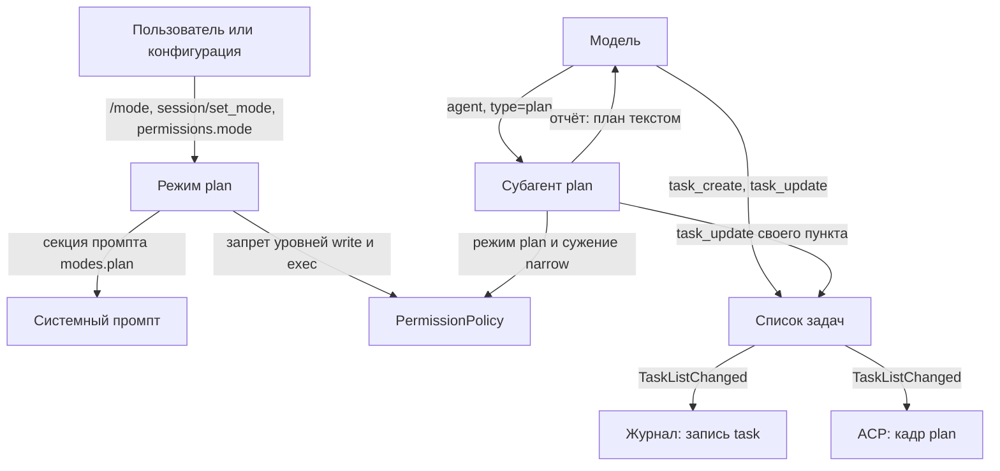
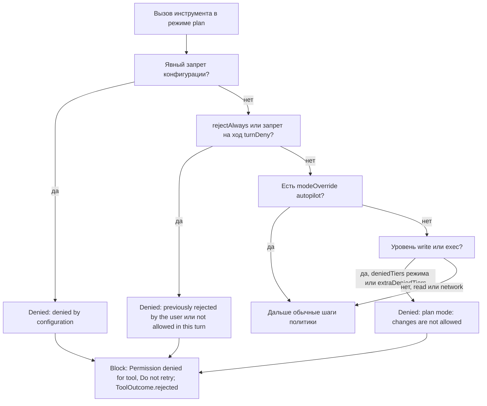
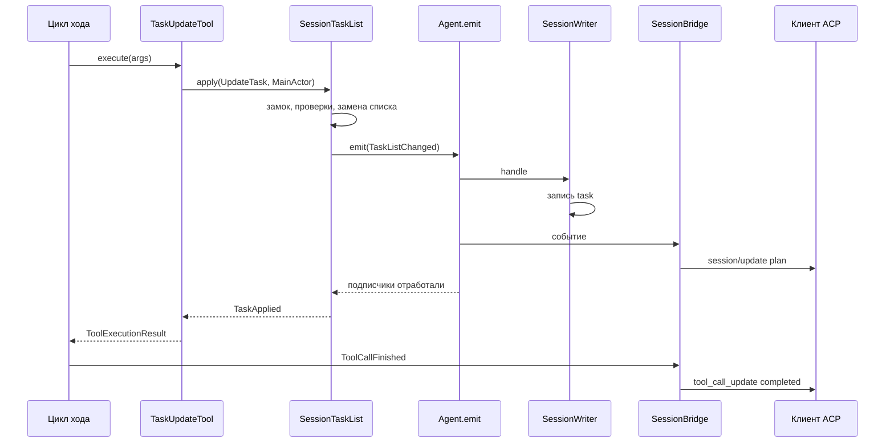

# Алгоритмы планирования агента

Слово «план» в ядре агента означает три разных механизма. Они решают одну задачу — не дать агенту пойти не туда и показать пользователю, что агент собирается делать, — но устроены по-разному и работают независимо. Документ описывает каждый как алгоритм и показывает, как они связаны. Читать его можно подряд, без переходов по ссылкам. Справочные главы собраны в конце.

| Механизм | Что это | Где в коде |
|---|---|---|
| Список задач | Четыре инструмента `task_create`, `task_update`, `task_list`, `task_get`. Модель ведёт список пунктов, клиент показывает его как план | `tools/tasks/task_tools.dart`, `tools/tasks/task_list.dart`, `subagents/subagent_task_list.dart` |
| Режим разрешений `plan` | Режим сессии, в котором запрещены уровни `write` и `exec`. Агент читает код и пишет план текстом, но ничего не меняет | `permissions/modes.dart`, `permissions/policy.dart`, `prompts/modes/plan.md` |
| Тип субагента `plan` | Встроенный тип для инструмента `agent`: отдельная сессия-исследователь, которая возвращает родителю план реализации | `subagents/subagent_types.dart`, `prompts/subagent/types/plan.md` |

Ход агента, в который всё это встроено, описан в [`turn.md`](turn.md), исполнение инструмента — в [`tool-call.md`](tool-call.md), сборка системного промпта — в [`context.md`](context.md). Устройство субагентов — в `subagents.md` в этом же разделе. Здесь они даны одной строкой там, где нужны.

Важное свойство: **в коде нет инструмента выхода из режима `plan`** (`exit_plan` и подобных). Режим включает и выключает пользователь (команда `/mode`, ACP `session/set_mode`, `session/set_config_option`) или конфигурация. Модель сама режим сменить не может. Старого инструмента `update_plan` тоже нет: его заменил список задач, а журналы старого формата читаются (запись `plan`, см. «Граничные случаи»).

## Как три механизма связаны

Связи на схеме — это то, что действительно есть в коде. Список задач и режим не знают друг о друге: `task_*` — инструменты уровня `read`, поэтому режим `plan` их не запрещает, и модель ведёт список и в режиме `plan`. Тип `plan` связывает оба механизма: он работает в режиме `plan` и получает детский вариант списка.



## Вход и выход

| | Список задач | Режим `plan` | Субагент `plan` |
|---|---|---|---|
| Вход | Вызов `task_*` из ответа модели | `ModeId`: `/mode plan`, `session/set_mode`, `session/set_config_option` (`mode`), `permissions.mode`, запись `mode_change` журнала | Вызов `agent` с `type: "plan"` |
| Выход | `ToolResultMessage` с текстом; изменённый список | Решение политики `Denied` для `write` и `exec`; новая секция промпта | Один `ToolResultMessage` с `<subagent-report>` |
| События | `TaskListChanged` (до `ToolCallFinished` вызова) | `ModeChanged` | `SubagentStarted`, `SubagentFinished` и события вызова `agent` |
| Журнал | Запись `task`; результат вызова в записи `message` | Запись `mode_change` | Журнал ребёнка и запись `subagent` в журнале родителя |
| Кадры ACP | `plan` с `_meta.codelab.taskChange` | `current_mode_update`, `config_option_update` | `tool_call` и `tool_call_update` вызова `agent` |
| Лог | `task.op`, `task.rejected`, `task.publish.failed` | `permission.denied` при отказе; `agent.mode.not_applied` при выборе агента | `subagent.type_overridden` и логи субагентов |

## Часть А. Список задач

### Модель задачи

Задача — неизменяемый `TaskItem` (`tools/tasks/task_list.dart`).

| Поле | Тип и правило |
|---|---|
| `id` | Десятичная строка от `1` до `1000000` (`maxTaskIdValue`). Выдаёт список, растёт, не переиспользуется даже после удаления (`TSK-3`) |
| `subject` | 1–200 символов, обязательно |
| `description` | До 4000 символов, необязательно |
| `status` | `pending`, `in_progress`, `completed` (`TaskStatus`; значения совпадают с ACP `PlanEntryStatus`). Статус `deleted` в модели нет: это операция удаления |
| `priority` | `high`, `medium`, `low`; по умолчанию `medium` (`TaskPriority`) |
| `owner` | `main` или id субагента дерева (`TaskOwner`) |
| `blockedBy` | Id пунктов, которые должны завершиться раньше. Хранятся по возрастанию id, без повторов |

В списке не больше 100 живых пунктов (`maxTaskItems`).

**Правил переходов между статусами в коде нет.** Любой статус можно поставить любому пункту, в том числе `completed` → `pending` и `pending` → `completed` минуя `in_progress` (проверено прогоном, пример 1). Инструмент только подсказывает модели: если пункт стал `in_progress` при незавершённых блокерах или `in_progress` сразу у нескольких пунктов, в ответ добавляется строка `[Note: …]`. Правило «держи ровно один `in_progress`» живёт в тексте описания `task_update`, а не в проверках.

Проверки, которые есть, делает `SessionTaskList` под замком, до любого изменения:

| Проверка | Причина отказа (`TaskRejectReason`) |
|---|---|
| Длины `subject` и `description` | `validation` |
| Id нет в списке | `unknown_id` |
| Список полон (100) или счётчик id дошёл до предела | `limit` |
| `owner` не `main` и не id субагента этого дерева | `owner` |
| `blocked_by` ссылается на себя или на несуществующий пункт | `blocked_by` |
| Новые блокеры замыкают цикл | `cycle` |

### Почему инструментов четыре, а не один `update_plan`

Один `update_plan` принимает весь план целиком. Модель, у которой изменился один статус, переписывает весь список: теряет пункты, которые забыла перечислить, и тратит токены на каждом шаге. Четыре операции дают модели менять только то, что она знает: `task_create` добавляет пункт, `task_update` меняет или удаляет один пункт по id, `task_list` и `task_get` читают. Побочная выгода: каждая операция — одно событие и одна запись журнала, поэтому клиент видит, что именно изменилось (`_meta.codelab.taskChange`), а не только новый снимок.

| Инструмент | Что делает | Меняет список |
|---|---|---|
| `task_create` | Добавляет пункт. Обязателен `subject`; необязательны `description`, `priority`, `blocked_by`, `owner` | да |
| `task_update` | Меняет поля пункта `id`; `status: "deleted"` удаляет пункт и убирает его из `blocked_by` остальных; `blocked_by` заменяет список целиком | да |
| `task_list` | Строка на пункт: `#<id> [<статус>] <subject>`; владелец показан, если он не `main`; блокеры показаны, пока не завершены | нет |
| `task_get` | Один пункт целиком: статус, приоритет, владелец, описание, `Blocks`, `Blocked by` | нет |

Все четыре — уровень `read`, вид `think`, вывод доверенный (`ContentTrust.trusted`), шаблон разрешения `*`. Поэтому политика разрешает их в любом режиме, кроме `ask`, где спрашивают всё (`tierDecision`). И все четыре — `ToolExecutionMode.sequential`, то есть барьер в пакете вызовов: вызов начинается после всех вызовов ответа перед ним, а следующие — после него (`LOOP-4`, разбор групп — в [`tool-call.md`](tool-call.md), уровень 2). Это нужно, чтобы проверки операций видели состояние после предыдущей и чтобы `TaskListChanged` пришёл между `ToolCallStarted` и `ToolCallFinished` своего вызова.

### Псевдокод: одна операция над списком

Запись Dart-подобная. Комментарии `//` указывают место в коде: `файл: символ`. Пути относительны `packages/dart/codelab_agent_core/lib/src/`, кроме файлов `codelab_agent_acp`. Исполнение вызова до `execute` (`announce`, схема, `preflight`, политика) описано в [`tool-call.md`](tool-call.md); здесь начинается `execute` инструмента.

```text
// tools/tasks/task_tools.dart: TaskCreateTool.execute / TaskUpdateTool.execute
T1. list   = ctx.services.tasks                      // SessionTaskList корня или SubagentTaskList ребёнка
T2. op     = task_create → CreateTask(subject, description, priority, owner, blockedBy)
             task_update, status == "deleted" → DeleteTask(id)
             task_update, иначе → UpdateTask(id, поля; null = «не менять»)
T3. result = await list.apply(op, MainActor(), toolCallId: ctx.toolCallId)
T4. TaskRejected(message) → return errorResult(message)    // isError: true, список и журнал не менялись
    TaskApplied           → return текст:
        «Created task #N: <subject>.»  | «Updated task #N: <поля>.» | «Deleted task #N.»
        «Unblocked: #K <subject>, …»   // только если операция освободила пункты
        «Task list: N items (a completed, b in progress, c pending).»
        заметки [Note: …]              // in_progress при незавершённых блокерах; больше одного in_progress

// tools/tasks/task_list.dart: SessionTaskList.apply
A1. await _locked(body)                       // цепочка Future: операции идут по одной, в порядке прихода   (TSK-1)
A2. result = precheck?.call(_items)           // проверка владельца у ребёнка; null → дальше
             ?? await _apply(op, actor, toolCallId)
A3. TaskApplied:
        await _publish(snapshot, change)      // publish = agent.emit(TaskListChanged); ждёт всех подписчиков
              // ошибка подписчика: лог task.publish.failed, операция остаётся принятой
        лог task.op(op, ids, actor, tool_call_id)
    TaskRejected:
        лог task.rejected(op, reason, id?, actor)      // тексты пунктов в лог не идут
A4. return result

// tools/tasks/task_list.dart: SessionTaskList._create
C1. _checkTexts(subject, description)    → TaskRejected(validation)
C2. _nextId > maxTaskIdValue             → TaskRejected(limit)
C3. _items.length >= maxTaskItems        → TaskRejected(limit, 'Delete completed items first.')
C4. !_isKnownOwner(owner)                → TaskRejected(owner)
C5. blockedBy = _normalize(ids)          // сортировка, без повторов; null при ссылке на себя или на чужой id
    null → TaskRejected(blocked_by)
C6. item = TaskItem(id: '$_nextId', ...); _nextId++; _items += item
C7. return TaskApplied(change: TaskChange(op: 'create', toolCallId, changed: [item]), snapshot)

// tools/tasks/task_list.dart: SessionTaskList._update
U1. current = _byId(id) ?? TaskRejected(unknown_id, 'Unknown task #N. Known: #1, #2.')
U2. _checkTexts, проверка owner      → TaskRejected(validation | owner)
U3. если blocked_by передан:
        _normalize(…, self: id)      → null: TaskRejected(blocked_by)
        _cycleThrough(id, ids)       → цепочка: TaskRejected(cycle, 'blocked_by would create a cycle: #1 → #2 → #1.')   (TSK-2)
U4. before  = id пунктов с незавершёнными блокерами
    _items  = заменить current на current.copyWith(только переданные поля)
U5. unblocked = пункты, у которых блокеры были и больше нет (кроме самого id)
U6. return TaskApplied(change: op 'update', snapshot, unblocked)

// tools/tasks/task_list.dart: SessionTaskList._delete
D1. _byId(id) == null → TaskRejected(unknown_id)
D2. убрать пункт; у остальных убрать id из blockedBy; они попадают в change.changed
D3. return TaskApplied(change: op 'delete', deleted: [id], snapshot, unblocked)
```

`AssignTask` — четвёртая операция, но модель её не вызывает: её делает менеджер субагентов, когда ребёнок получил слот и пункт назначен ему. Владелец становится ребёнком, а `pending` меняется на `in_progress` (`task_list.dart: _assign`, `subagents/subagent_manager.dart`).

### Псевдокод: что происходит с `TaskListChanged`

`publish` — одна точка: `agent.emit(TaskListChanged(...))` (`runtime/agent_runtime.dart`, где создаётся `SessionTaskList`). Подписчики получают событие по порядку, и `apply` не возвращается, пока все не отработали. Поэтому к моменту результата вызова журнал уже записан, а кадр `plan` уже в очереди клиента.

```text
// runtime/agent_runtime.dart: _Session._onEvent — подписчики Agent.emit по порядку
P1. session/session_writer.dart: SessionWriter.handle(TaskListChanged(change)):
        если change.op != 'restore':
            append TaskRecord(op, actor, items: change.changed, deleted: change.deleted)   // не durable; в контекст модели не входит
        // restore не пишется: список выводится из журнала, запись продублировала бы его   (TSK-1)
P2. _publish(event) → AgentSession.events
P3. codelab_agent_acp/session_bridge.dart: SessionBridge → event_projection.dart: projectEvent
        TaskListChanged(items, change) → один кадр session/update типа plan:
            entries[i] = PlanEntry(
                content:  item.subject,           // description в ACP не уходит
                priority: item.priority,
                status:   item.status,
                _meta.codelab.task: {id, owner, blockedBy})
            _meta.codelab.taskChange = {op, actor, toolCallId?, changed: [id…], deleted: […]}   // D35
```

Кадр `plan` всегда содержит весь список в порядке создания (`TSK-5`). Поле `toolCallId` в `taskChange` — это привязка к вызову: клиент по нему связывает изменение с вызовом `task_*`, а не гадает по порядку кадров. У `restore`, `assign` и изменений не от вызова поля нет. У ребёнка id — цепочка `<вызов agent корня>/<вызов ребёнка>`: сырой `call_1` ребёнка совпал бы с `call_1` корня.

### Где хранится список и как переживает перезагрузку и сжатие

Источник истины — журнал, а не память. В памяти — `SessionTaskList` (`_items`, `_nextId`), но он целиком выводится из журнала. Каждая операция — одна запись `task` с полными снимками изменённых пунктов и списком удалённых id. Запись служебная: в контекст модели она не входит и в сжатие не участвует.

Это даёт два свойства:

- **Перезагрузка сессии.** `loadSession` строит список проекцией `buildTaskList` над активной веткой и ставит его в `SessionTaskList.restore(announce: false)`: ни записи в журнал, ни события.
- **Сжатие контекста.** Сжатие заменяет историю сообщений резюме, но проекция списка идёт по всем записям ветки от корня до листа, а не по сообщениям. Список после сжатия цел. Модель при этом потеряла реплики, где создавала пункты, поэтому описание `task_list` велит звать его после сжатия, чтобы узнать состояние.

```text
// session/projections.dart: buildTaskList(snapshot)
B1. items = {}                                        // словарь с порядком вставки: замена пункта не меняет его место
    для record в pathToLeaf(snapshot):                // активная ветка, от корня к листу
        TaskRecord(changed, deleted): items[id] = item для changed; items.remove(id) для deleted
        PlanRecord(entries):          items.clear(); пункты «1»…«n» из entries   // журнал старого формата
B2. issued = 0
    для record в snapshot.records:                    // ВСЕ ветки журнала
        TaskRecord: issued = max(issued, id из changed и deleted)
        PlanRecord: issued = max(issued, entries.length)
B3. return (items, nextId: issued + 1)                // id покинутой ветки не выдаётся снова   (TSK-3)

// session/projections.dart: replay — после истории
B4. если список непуст или в ветке есть запись task/plan:
        emit TaskListChanged(items, TaskChange(op: 'restore', actor: main, changed: items))
        // ACP: кадр plan без _meta.codelab.taskChange — реплей показывает состояние, а не операцию
```

Инварианты: список после `session/load` равен списку до закрытия (`TSK-6`), после смены ветки он снова выводится из новой ветки (`TSK-7`). Если до или после список непуст или в ветке есть запись `task`, клиент получает `plan` с `op: restore` — иначе клиент, продолжающий показывать старый список, не узнал бы, что новый опустел.

### Секция промпта `tools.tasks`

Секция `tools.tasks` (файл `prompts/tools/tasks.md`) входит в системный промпт, только если в наборе инструментов есть `task_create` (якорь: `PromptTemplate.tools: [task_create]`, `prompts/compose.dart: _sections`). Текст короткий: для работы из трёх и более шагов вести список через `task_create`, отмечать пункт `in_progress` при начале и `completed` при завершении, простым вопросам список не нужен. Подробные правила — в описаниях самих инструментов (`prompts/tool_descriptions/task_*.md`): они часть схем, а не промпта. У ребёнка `task_create` нет, поэтому секции у него нет (см. ниже).

### Список задач у субагентов

Список один на всё дерево сессий и принадлежит корню: ребёнок со своим списком запутал бы клиента, у которого один экран плана. Ребёнок получает **обёртку** `SubagentTaskList` над списком корня (`subagents/subagent_task_list.dart`):

```text
// subagents/subagent_task_list.dart: SubagentTaskList.apply(op, actor, toolCallId)
S1. если op не UpdateTask                  → TaskRejected('Subagents may change only the status of their own tasks.', owner)
S2. onlyStatus = status != null и все остальные поля == null
S3. return root.apply(op, SubagentActor(subagentId),
        toolCallId: parentToolCallId + '/' + toolCallId,        // цепочка D8, чтобы не совпасть с call_1 корня
        precheck: items →                                       // под замком списка, в состоянии применения
            пункт не найден: onlyStatus ? null : denied          // неизвестный id получит обычную ошибку списка
            иначе: (!onlyStatus или item.owner != subagentId) ? denied : null)
// SubagentTaskList.restore → StateError: ребёнок список не восстанавливает
```

Правило `TSK-4`: ребёнок меняет только `status` пунктов, владелец которых он сам. Проверка идёт под замком, потому что корень мог переназначить пункт между проверкой «снаружи» и применением. Набор инструментов ребёнка собирает `selectChildTools` (`subagents/child_tools.dart`): `task_create` ребёнку не даётся, `task_update`, `task_list`, `task_get` даются на любой глубине и независимо от списка `tools` типа, а описание `task_update` у него детское (`TaskUpdateTool(forSubagent: true)`): оно говорит, что менять можно только статус своего пункта. Пункт ребёнку назначает корень: вызов `agent` корня принимает необязательный параметр `task` с id пункта, а менеджер ставит `AssignTask` и добавляет в промпт ребёнка строку `Your task: #<id> <subject>`.

## Часть Б. Режим разрешений `plan`

### Что режим делает

`ModeId.plan` — один из пяти режимов сессии: `plan`, `ask`, `standard`, `accept-edits`, `bypass`. Режим `plan` делает две вещи:

1. **Запрещает уровни `write` и `exec`.** `ModeId.deniedTiers` для `plan` — `{write, exec}`. Политика отклоняет такой вызов без вопроса, причина — `plan mode: changes are not allowed` (`permissions/policy.dart: _decide`, шаг D4 в [`tool-call.md`](tool-call.md)). Уровни `read` и `network` режим не трогает: чтение разрешено, сеть спрашивается по общему правилу. Уровень MCP-инструмента всегда `exec`, поэтому MCP-инструменты в режиме `plan` тоже отклоняются, как бы они ни назвали себя `readOnlyHint` (фикстура `acp/set-mode-plan-rejects-mcp-write`).
2. **Добавляет в системный промпт секцию `modes.plan` (файл `prompts/modes/plan.md`).** Секция входит после `system.untrusted` и перед `tools.read` (`prompts/compose.dart: _sections`). Текст: сессия в режиме `plan`, исследуй код и составь план, ничего не меняй, запись файлов и команды отклоняются; закончи планом — шаги, затрагиваемые файлы, способ проверки; режим пользователь переключит, когда план принят. Модели также сообщается имя режима через переменную `modeName` секции `system.base` (`Mode: plan`).

Остальное в режиме `plan` как в `standard`: `ModeId.plan.permissionMode` — `PermissionMode.write`. Схемы инструментов не меняются: `write`, `edit` и `exec` остаются у модели в списке, но вызов получает отказ. Это сознательно: набор схем стабилен, кэш промпта не рвётся, а граница безопасности — политика, а не скрытие инструмента.

Запрет действует, только пока нет `modeOverride`: флаг запуска `autopilot` перекрывает режим сессии, и запреты `plan` не применяются (`modeOverride == null` в шаге D4). `autopilot` режимом сессии не является и включается только флагом запуска (`CFG-4`).

### Как режим включают и выключают

Путей несколько, и все они сходятся в `AgentSession.setMode`.

| Путь | Что происходит |
|---|---|
| Команда `/mode plan` | Встроенная команда выполняется агентом без модели: `ModeId.tryParse`, затем `setMode`. Ответ — `Mode: plan.`. Без аргумента — `Mode: <текущий>. Available: plan, ask, standard, accept-edits, bypass.`; неизвестное значение — `Unknown mode: …` (`commands/builtin_commands.dart: _mode`) |
| ACP `session/set_mode` | `agent_server.dart: _setMode` → `bridge.setMode`. Ответ `{}` приходит после `current_mode_update` |
| ACP `session/set_config_option` с `configId: "mode"` | Тот же `bridge.setMode`. Ответ — полный список опций; `config_option_update` на эхо запроса не дублируется (`ACP-11`) |
| Конфигурация `permissions.mode` | Режим **новой** сессии. Ключ применяется при открытии сессии (`restartRequired`: на живую сессию перезагрузка конфигурации его не переносит) |
| Флаг `codelab-agent serve --permission-mode <id>` | Задаёт тот же режим при запуске; значение проверяется по `ModeId.values` |
| Журнал | При `loadSession` берётся последняя запись `mode_change` ветки, иначе `permissions.mode`, иначе режим профиля хоста (`standard`) |
| Выбор агента | Определение агента с полем `mode` ставит режим при выборе (`setAgent`), но не мягче режима конфигурации (см. «Мягкость») |

Выключается режим теми же путями: `/mode standard`, `session/set_mode` с другим id. Особый случай: если режим `plan` пришёл из конфигурации проекта в сочетании с `ask` (проект `plan`, пользователь `ask` или наоборот), результат — `ask` плюс запрет `write` и `exec` (`PermissionsConfig.extraDeniedTiers`). Смена режима сессии такие запреты **не снимает**: они пришли из проекта, а не из режима.

**Синонимы.** `ModeId.tryParse` принимает основной id и устаревший синоним: `architect` → `plan`, `debug` → `standard`, `acceptEdits` → `accept-edits`, `code` → `bypass`. Наружу всегда уходит основной id. Таблица одна и у ACP-моста, и у команды `/mode`, чтобы они не расходились. В конфигурации действует другой набор синонимов (`configModeId`): `alwaysAsk` → `ask`, `write` → `standard`, `acceptEdits`, `yolo` → `bypass`; `architect` в конфигурации не принимается.

### Псевдокод: смена режима посреди сессии

```text
// runtime/agent_runtime.dart: _Session.setMode(mode)
M1. await _serial(changeId)                         // смены конфигурации идут по очереди (тот же замок, что у setModel)
M2. await _applyMode(mode, changeId, deferPolicy: false)

// runtime/agent_runtime.dart: _Session._applyMode
Q1. _mode = mode                                    // режим сессии: его видит клиент
Q2. если deferPolicy и _agent.isRunning:            // только выбор агента во время хода (D11)
        _pendingPolicyMode = mode                   // политика сменится на границе шага
    иначе:
        _pendingPolicyMode = null
        _policy.mode = mode                         // политика сменяется сразу: со следующего вызова инструмента
Q3. _agent.systemPrompt = _compose(cwd, mode, _activeAgent)
        // секция modes.plan входит или выходит; промпт пересобирается целиком
Q4. await _sessionEvent(ModeChanged(id, mode, changeId))
        // SessionWriter пишет mode_change; _publish; мост ACP → current_mode_update + config_option_update
Q5. return ConfigChangeResult(changeId, mode)

// loop/agent.dart: Agent.prompt — начало хода
Q6. LoopContext(systemPrompt: systemPrompt, ...)    // промпт читается один раз на ход

// runtime/agent_runtime.dart: _Session._takeStepUpdate — граница шага
Q7. _flushPendingPolicyMode()                       // применяет отложенный режим политики
    если сменились MCP, агент или видимость agent (toolsChanged):
        StepUpdate(model:, tools:, systemPrompt: _agent.systemPrompt)
    иначе если сменилась только модель:
        StepUpdate(model:)                                       // промпт и схемы не обновляются
    иначе: null                                                  // промпт идущего хода не меняется
```

Что это значит для смены режима во время работы:

- **Политика меняется сразу.** `_policy.mode = mode` читается при каждом решении, поэтому вызов, начатый после `setMode`, решается новым режимом. Вызовы текущего пакета, которые уже прошли политику, не отзываются.
- **Промпт меняется со следующего хода.** Идущий ход держит копию промпта, взятую в начале (`Q6`). Новая секция `modes.plan` попадает в запрос только следующего хода либо шага, на границе которого обновился набор инструментов (`Q7`; смена одной модели промпт не обновляет). Значит, пока ход идёт, модель может не знать о режиме `plan`, но попытка записи уже получит отказ — безопасность не зависит от промпта.
- **Смена записывается и показывается всегда:** запись `mode_change` в журнал (не durable), `current_mode_update` клиенту.

### Мягкость режимов и правило для субагентов

У режимов есть порядок мягкости `ModeId.softness`: `plan` 0, `ask` 1, `standard` 2, `accept-edits` 3, `bypass` 4. Чем больше, тем мягче. Он нужен в двух местах:

- **Пол при выборе агента.** `fitsFloor(floor)` — режим агента не мягче режима конфигурации (`permissions.mode`, иначе режим профиля). Неизвестный id получает `null` и не подходит никогда (fail-closed). Агент с режимом мягче пола выбирается, но режим не меняется, в лог идёт `agent.mode.not_applied`.
- **Сужение для субагентов.** Отдельный порядок — по `PermissionMode`: `alwaysAsk < write < acceptEdits < yolo < autopilot`. Функция `narrow(родитель, режим типа)` (`permissions/modes.dart`) берёт меньший из двух и объединяет запреты уровней. Её политика потомка вызывает при **каждом** решении (`PermissionPolicy.modeOf`), поэтому смена режима родителя посреди работы ребёнка действует со следующего вызова, а для внука сужение идёт по всей цепочке (`SUB-2`). Результат для `plan` (проверено прогоном, пример 3): родитель `standard` и тип `plan` дают `write` с запретом `write`, `exec`; родитель `ask` — `alwaysAsk` с тем же запретом; родитель `bypass` — тоже `write` с запретом.

Режим для **промпта** ребёнка выбирается иначе: берётся более строгий по `softness` из режима промпта родителя и режима типа на момент запуска. Промпт при этом стабилен ради кэша, а смена режима родителя действует через политику, не через промпт.

## Часть В. Встроенный тип субагента `plan`

Тип `plan` — одно из четырёх встроенных определений (`general`, `explore`, `review`, `plan`; `subagents/subagent_types.dart: builtinSubagentTypes`). Устройство субагентов — запуск, слоты, бюджет, отчёт, отмена — в `subagents.md`; здесь только то, чем `plan` отличается.

| Свойство | `plan` | `explore` | `review` | `general` |
|---|---|---|---|---|
| `tools` | `read`, `ls`, `search` | `read`, `ls`, `search` | `read`, `ls`, `search`, `exec` | все |
| `mode` типа | `plan` | `plan` | `standard` | не задан |
| Профиль | вернуть план реализации: файлы, порядок шагов, риски; файлы не править | искать и читать, ссылаться на файлы и строки | искать дефекты | общий |

`plan` и `explore` различаются только описанием и профилем: оба получают режим `plan` и инструменты чтения. Профиль `plan` — «You investigate the code and return an implementation plan. Name the files to change, the order of the steps and the risks. Do not edit files.»

Как ограничения складываются у ребёнка типа `plan`:

1. **Набор инструментов** — пересечение набора родителя с `tools` типа (`selectChildTools`): `read`, `ls`, `search`, плюс детские `task_update`, `task_list`, `task_get`. Нет `write`, `edit`, `exec`, `agent`, `skill`, `task_create`. Инструмент, которого нет у родителя, не добавляется.
2. **Режим** — `narrow(parent.mode(), ModeId.plan)` на каждое решение. Даже если бы набор содержал `write`, политика отклонила бы вызов. Два независимых рубежа: набор и режим.
3. **Промпт** — база ребёнка `subagent.system` (работать самостоятельно, не выходить за задание, финальное сообщение — отчёт), профиль `subagent.profile` с телом типа и, если назначен пункт, строка `Your task:`. Так как режим промпта ребёнка — `plan`, в промпт входит и секция `modes.plan`; секции `tools.tasks` нет, потому что у ребёнка нет `task_create`.

**Как план возвращается родителю.** Отдельного канала для плана нет. Ребёнок заканчивает работу финальным сообщением, это сообщение и есть отчёт. Родитель получает его одним результатом вызова `agent`: блок `<subagent-report id=… agent="plan" status="completed" steps=… tool_calls=…>` с текстом отчёта (`subagents/subagent_report.dart: wrapSubagentReport`). Текст отчёта — недоверенный: результат `agent` проходит ограду `<untrusted-content source="agent">` (`SubagentTool.outputTrust`). Ограничение размера — `subagents.report_max_bytes`. Родитель дальше сам решает, что делать с планом: показать пользователю, внести пункты в список задач (`task_create`), или исполнить. Ничего из этого ядро за него не делает.

Пользовательское определение агента с именем `plan` заменяет встроенное; в лог идёт `subagent.type_overridden`.

## Пошаговое пояснение

**T3. Операция уходит в `apply` от `MainActor`.** Права определяются типом актора (`TSK-4`), а не строкой. Инструменты корня передают `MainActor`, ребёнок — `SubagentActor` через обёртку.

**A1. Замок.** Параллельные вызовы пакета и вызовы потомков применяются по одному. Каждая проверка видит состояние после предыдущей (`TSK-1`, `TSK-2`). Без замка два одновременных `task_update` с `blocked_by` могли бы вместе замкнуть цикл, хотя каждый по отдельности его не замыкает.

**A3. Публикация ждётся.** `TaskListChanged` приходит до `ToolCallFinished` вызова, который его породил (`TSK-1`): клиент видит новый список раньше, чем статус вызова `completed`. Отказ подписчика не отменяет принятую операцию: результат модели должен соответствовать списку.

**C3, C4–C5, U3. Проверки до изменения.** Ни одна ошибка не оставляет список наполовину изменённым: сначала проверки, потом замена `_items`. Отклонённая операция не даёт ни `TaskListChanged`, ни записи `task` (`TSK-1`).

**C6. Id выдаёт список.** Модель не выбирает id, поэтому не может переиспользовать удалённый (`TSK-3`). Счётчик не убывает при `restore` — берётся максимум текущего и вычисленного по журналу.

**U3. Граф без циклов.** Модель, получившая ошибку `cycle`, видит цепочку `#1 → #2 → #1` и может исправить `blocked_by` (`TSK-2`).

**D2. Удаление чистит ссылки.** Пункты, ссылавшиеся на удалённый, остаются, а id удалённого пропадает из их `blocked_by`. Они попадают в `change.changed`, поэтому запись `task` содержит их новые снимки и реплей восстановит те же значения.

**P1. Запись `task` идёт без флага `durable`** (как и `mode_change`): `SessionWriter` пишет её через `_write` с умолчанием.

**B1–B3. Две проекции из одного журнала.** `items` — по активной ветке, `nextId` — по всем веткам. Так после ветвления id покинутой ветки не выдаётся снова (`TSK-3`).

**Q2. Политика сразу.** Режим — граница безопасности. Отложить его на границу шага значило бы оставить окно, в котором ход после `/mode plan` ещё пишет файлы. Отложен он только при выборе агента во время хода, потому что вызовы текущего пакета уже решены и должны решаться прежним режимом (D11).

**Q3. Промпт пересобирается, но не рвёт ход.** Секция `modes.plan` — подсказка модели, а не защита. Защита — шаг D4 политики.

**Часть В. Два рубежа.** Тип `plan` ограничен и набором инструментов, и режимом. Эти ограничения проверяются независимо: если пользователь определит свой тип с `tools: ["*"]` и `mode: plan`, запись всё равно будет отклонена политикой.

## Схемы решений

Политика в режиме `plan` — какие вызовы проходят.



Ход одного вызова `task_update` со стороны ядра и ACP.



## Разобранные примеры

Данные получены запусками, а не выдуманы.

- **События, журнал, лог, промпт.** Временные тесты в `packages/dart/codelab_agent_core/test/tmp_algo/` (удалены после прогона): `CoreHarness` с `MemorySessionStore`, `MemoryExecutionEnv(cwd: '/proj')`, `FakeGate`, сценарная модель (`ScriptedStreamFunction`) и `FakeClock` (поэтому во всех записях журнала время `2026-01-01T00:00:00.000Z`, а id последовательные). Команды: `fvm dart test test/tmp_algo/plan_algo_test.dart` и `fvm dart test test/tmp_algo/plan_algo2_test.dart` в `packages/dart/codelab_agent_core`.
- **Кадр `plan`.** Корпус golden-фикстур: `packages/dart/codelab_acp_testing/fixtures/acp/prompt-task-plan.json` (модель три раза зовёт `task_create`, затем `task_update`). Субъекты пунктов в нём русские и отличаются от примера 1; структура кадра та же.
- **Сужение режима и набор инструментов ребёнка.** Тот же второй временный тест: функции `narrow` и `selectChildTools` вызваны напрямую.

### Пример 1. Модель ведёт список задач

Режим `standard`, пользователь просит «Сделай список задач». Сценарная модель по шагам зовёт: `task_create` («Read the test», `priority: high`), `task_create` («Fix the parser», `blocked_by: ["1"]`), `task_update` (`id: 1`, `status: completed`), `task_update` (`id: 1`, `status: pending`), `task_update` (`id: 2`, `blocked_by: ["2"]`), `task_list`, потом текст.

Сборка промпта этого хода: секции `# How to work`, `# Tools`, `# Safety`, `# Answer style`, `# Untrusted content`, `# Reading files`, `# Changing files`, `# Finding files`, `# Task list`. Секции `# Plan mode` нет, `tools.tasks` есть (`task_create` в наборе). Набор схем шага: `read, write, edit, task_create, task_update, task_list, task_get, ls, search, agent`.

События по порядку (только значимые; `ToolCallProgress`, `MessageStarted` и `MessageEnded` опущены):

```text
TurnStarted
ToolCallStarted  call_1 task_create "Create task"
TaskListChanged  op=create actor=main tc=call_1 changed=(1) deleted=[] items=(#1:pending)
ToolCallFinished call_1 completed  Created task #1: Read the test.
                                   Task list: 1 items (0 completed, 0 in progress, 1 pending).
ToolCallStarted  call_2 task_create "Create task"
TaskListChanged  op=create actor=main tc=call_2 changed=(2) deleted=[] items=(#1:pending, #2:pending)
ToolCallFinished call_2 completed  Created task #2: Fix the parser.
                                   Task list: 2 items (0 completed, 0 in progress, 2 pending).
ToolCallStarted  call_3 task_update "Update task #1"
TaskListChanged  op=update actor=main tc=call_3 changed=(1) deleted=[] items=(#1:completed, #2:pending)
ToolCallFinished call_3 completed  Updated task #1: status.
                                   Unblocked: #2 Fix the parser
                                   Task list: 2 items (1 completed, 0 in progress, 1 pending).
ToolCallStarted  call_4 task_update "Update task #1"
TaskListChanged  op=update actor=main tc=call_4 changed=(1) deleted=[] items=(#1:pending, #2:pending)
ToolCallFinished call_4 completed  Updated task #1: status.
                                   Task list: 2 items (0 completed, 0 in progress, 2 pending).
ToolCallStarted  call_5 task_update "Update task #2"
ToolCallFinished call_5 failed     Invalid task: blocked_by must list other existing tasks.
ToolCallStarted  call_6 task_list "List tasks"
ToolCallFinished call_6 completed  #1 [pending] Read the test
                                   #2 [pending] Fix the parser (blocked by #1)
TurnEnded
```

Что видно:

- Между `ToolCallStarted` и `ToolCallFinished` каждого вызова, который менял список, ровно один `TaskListChanged` (`TSK-1`). У `call_5` (ссылка на себя в `blocked_by`) и у `call_6` (`task_list`) события нет.
- `call_4` вернул пункт из `completed` в `pending` без возражений: правил переходов нет.
- Отказ `call_5` — `isError: true`, `outcome: failed`; список и журнал не менялись. В логе это `task.rejected` с `reason: blocked_by`, `id: 2`.

Журнал (записи `task`; в каждой уже есть `id`, `parentId`, `timestamp`). Показаны записи `task` вызовов 1–3 и результат первого вызова; результаты остальных опущены. У отклонённого `call_5` и у `task_list` записи `task` нет, только запись `message` с результатом:

```json
{"type":"task","id":"00000005","parentId":"00000004","timestamp":"2026-01-01T00:00:00.000Z","op":"create","actor":"main","items":[{"id":"1","subject":"Read the test","status":"pending","priority":"high","owner":"main","blockedBy":[]}],"deleted":[]}
{"type":"message","id":"00000006","parentId":"00000005","timestamp":"2026-01-01T00:00:00.000Z","outcome":"completed","toolMeta":{"title":"Create task","kind":"think","locations":[]},"message":{"role":"toolResult","toolCallId":"call_1","toolName":"task_create","content":[{"type":"text","text":"Created task #1: Read the test.\nTask list: 1 items (0 completed, 0 in progress, 1 pending)."}],"isError":false,"timestamp":"2…"}}
{"type":"task","id":"00000008","parentId":"00000007","timestamp":"2026-01-01T00:00:00.000Z","op":"create","actor":"main","items":[{"id":"2","subject":"Fix the parser","status":"pending","priority":"medium","owner":"main","blockedBy":["1"]}],"deleted":[]}
{"type":"task","id":"0000000b","parentId":"0000000a","timestamp":"2026-01-01T00:00:00.000Z","op":"update","actor":"main","items":[{"id":"1","subject":"Read the test","status":"completed","priority":"high","owner":"main","blockedBy":[]}],"deleted":[]}
```

Запись `task` стоит в журнале раньше результата вызова (`00000005` до `00000006`): подписчик записал её, пока `apply` ждал публикации. В записи — полный снимок изменённого пункта, а не разница.

Кадр `plan`, который клиент получил на `call_1` (фикстура `acp/prompt-task-plan`, `frames[3]`; заголовки пунктов в фикстуре русские):

```json
{"jsonrpc":"2.0","method":"session/update","params":{"sessionId":"${sessionId}","update":{
  "sessionUpdate":"plan",
  "entries":[{"content":"Прочитать тесты","priority":"high","status":"pending",
              "_meta":{"codelab":{"task":{"id":"1","owner":"main","blockedBy":[]}}}}],
  "_meta":{"codelab":{"taskChange":{"op":"create","actor":"main","toolCallId":"call_1","changed":["1"],"deleted":[]}}}}}}
```

На четвёртом `plan` той же фикстуры (`call_4`, `op: update`, `changed: ["1"]`) в `entries` уже три пункта: «Прочитать тесты» — `completed`, «Исправить ошибку» и «Запустить тесты» — `pending`. Кадр содержит весь список, а `taskChange` говорит, что изменился пункт `1`. После `task_list` нового кадра нет (`TSK-5`).

### Пример 2. Режим `plan`: `write` получает отказ

Продолжение сессии из примера 1. `session.setMode(ModeId.plan)`, затем пользователь пишет «Запиши файл», модель зовёт `write` (`path: a.txt`, `content: x`), потом отвечает текстом.

События:

```text
ModeChanged      plan changeId=1
TurnStarted
ToolCallStarted  call_7 write "Write a.txt"
ToolCallFinished call_7 rejected   Permission denied for write: plan mode: changes are not allowed.
                                   Do not retry the same call; choose another approach or ask the user.
TurnEnded
```

Промпт хода после смены режима: к списку секций добавилась `# Plan mode` — между `# Untrusted content` и `# Reading files`. Её текст, как он ушёл модели:

```text
# Plan mode

The session is in plan mode. Explore the code and work out a plan, but do not change
anything: writing files and running commands are refused in this mode.

End with the plan: the steps, the files each step touches and how the result will be
verified. The user switches the mode when the plan is accepted.
```

Строка `Mode: plan` в базе промпта тоже обновилась (`modeName`). Набор схем остался прежним: `write` у модели есть, отказ даёт политика.

Журнал:

```json
{"type":"mode_change","id":"0000000m","parentId":"0000000l","timestamp":"2026-01-01T00:00:00.000Z","modeId":"plan"}
{"type":"message","id":"0000000p","parentId":"0000000o","timestamp":"2026-01-01T00:00:00.000Z","outcome":"rejected","toolMeta":{"title":"Write a.txt","kind":"edit","locations":[{"path":"/proj/a.txt"}]},"message":{"role":"toolResult","toolCallId":"call_7","toolName":"write","content":[{"type":"text","text":"Permission denied for write: plan mode: changes are not allowed. Do not retry the same call; choose another appr…
```

Лог: `permission.denied {tool_call_id: call_7, tool: write, reason: plan mode: changes are not allowed}`. `PermissionGate` не вызывался: вопроса пользователю нет. Результат — `isError: true`, `outcome: rejected`; ход продолжился и закончился обычным текстом (`PERM-7`).

В ACP тот же отказ даёт фикстура `acp/set-mode-plan-rejects-edit`: `session/set_mode` → `current_mode_update` `plan` → ответ `{}`; затем вызов `edit` — `tool_call` `pending`, `tool_call_update` со статусом `failed`, текстом с `plan mode` и `_meta.codelab.outcome: "rejected"`. Перед отказом агент успевает запросить у клиента `fs/read_text_file`: инструмент строит diff в `present`, а это чтение, оно в режиме `plan` разрешено. Файл не меняется.

### Пример 3. Перезагрузка, сужение режима, набор ребёнка

Тот же прогон, второй тест. Сессия: `task_create` («Read the test»), `task_create` («Fix the parser»), `task_update` (`id: 2`, `status: deleted`), затем `setMode(plan)`. Сессия закрыта, открыта заново по тому же журналу (`loadSession`):

```text
mode after load: plan; items: [TaskItem(#1 pending Read the test)]
replay TaskListChanged op=restore actor=main tc=null items=[TaskItem(#1 pending Read the test)]
после task_create «Third»: [TaskItem(#1 pending Read the test), TaskItem(#3 pending Third)]
```

Режим `plan` вернулся из записи `mode_change`; список — из записей `task` (пункт `2` удалён); реплей отдал один `restore` без записи в журнал; новый пункт получил `#3`, а не `#2` (`TSK-3`: удалённый id не переиспользуется).

Сужение режима для встроенных типов при родителе `standard` (`PermissionMode.write`):

```text
general: type.mode=null    tools=null                 -> write, запретов нет
explore: type.mode=plan    tools=[read, ls, search]   -> write, запрещены [write, exec]
review:  type.mode=standard tools=[read, ls, search, exec] -> write, запретов нет
plan:    type.mode=plan    tools=[read, ls, search]   -> write, запрещены [write, exec]
родитель ask  + plan -> alwaysAsk, запрещены {write, exec}
родитель yolo + plan -> write,     запрещены {write, exec}
```

Набор инструментов ребёнка типа `plan` при наборе родителя `read, write, task_create, task_update, task_list, task_get, ls, search`: `[read, task_update, task_list, task_get, ls, search]`. `write` отсёк `tools` типа, `task_create` — `selectChildTools`.

Порядок мягкости: `plan` 0, `ask` 1, `standard` 2, `accept-edits` 3, `bypass` 4.

## Граничные случаи и отказы

| Ситуация | Что делает алгоритм | Где в коде |
|---|---|---|
| `task_update` с неизвестным id | `TaskRejected(unknown_id)`: `Unknown task #N. Known: #1, #2.` или `The task list is empty.`; список не меняется | `task_list.dart: _unknown` |
| `subject` пустой или длиннее 200, `description` длиннее 4000 | `TaskRejected(validation)` | `task_list.dart: _checkTexts` |
| В списке уже 100 пунктов | `TaskRejected(limit)`: `Delete completed items first.` | `task_list.dart: _create` |
| `blocked_by` ссылается на себя или на несуществующий пункт | `TaskRejected(blocked_by)` | `task_list.dart: _normalize` |
| `blocked_by` замыкает цикл | `TaskRejected(cycle)` с цепочкой `#1 → #2 → #1` | `task_list.dart: _cycleThrough` |
| `owner` — неизвестный субагент | `TaskRejected(owner)` | `task_list.dart: _isKnownOwner` |
| Статус вне enum, приоритет вне enum, нет `id` | Не доходит до списка: схема инструмента проверяется исполнителем, ошибка аргументов (`TOOL-3`); повтор тех же аргументов на третий раз получает предупреждение, на шестой блокируется | `executor.dart: _checkAndExecute`, [`tool-call.md`](tool-call.md) |
| `task_update` только с `id`, без полей | Операция принимается, пункт не меняется, но событие и запись `task` всё равно уходят; ответ — `Updated task #N: .` (по коду, прогоном не проверялось) | `task_tools.dart: TaskUpdateTool` |
| `task_list` и `task_get` | Список не меняется; события и записи нет, кадра `plan` нет (`TSK-5`) | `task_tools.dart` |
| Подписчик `TaskListChanged` бросил ошибку | Лог `task.publish.failed`; операция остаётся принятой | `task_list.dart: _publish` |
| Старый журнал с записями `plan` (от `update_plan`) | Читается всегда: последняя запись `plan` превращается в пункты «1»…«n» с `owner: main`; новые журналы её не пишут | `projections.dart: buildTaskList`, `records.dart: PlanRecord` |
| Невалидный id в записи журнала (не число, выше `1000000`) | Запись уходит в карантин как нечитаемая | `task_list.dart: parseTaskId` |
| Ребёнок вызывает `task_create` или меняет не `status` | `Subagents may change only the status of their own tasks.` | `subagent_task_list.dart: apply` |
| Ребёнок меняет чужой пункт | То же сообщение; проверка под замком списка | `subagent_task_list.dart: precheck` |
| Ребёнок вызывает `restore` | `StateError`; ребёнок список не восстанавливает | `subagent_task_list.dart: restore` |
| Клиент отправил `session/set_mode` с неизвестным id | `-32602 unknown mode`; режим не меняется | `agent_server.dart: _mode` |
| `/mode` с неизвестным значением | Ответ `Unknown mode: …`; режим не меняется | `builtin_commands.dart: _mode` |
| `/mode` отменён до применения | Ни записи, ни события; после начала смена доводится до конца | `builtin_commands.dart: _mode` |
| `write`, `edit`, `exec` или любой MCP-инструмент в режиме `plan` | `Denied('plan mode: changes are not allowed')` без вопроса; `outcome: rejected` | `policy.dart: _decide` |
| Инструмент уровня `network` в режиме `plan` | Спрашивается по общему правилу, не запрещается | `modes.dart: tierDecision` |
| Режим `autopilot` по флагу запуска | Запреты `plan` не применяются (`modeOverride != null`) | `policy.dart: _decide` |
| Смена режима во время хода | Политика действует со следующего вызова; промпт — со следующего хода | `agent_runtime.dart: _applyMode` |
| Выбор агента с режимом мягче режима конфигурации | Режим не меняется, лог `agent.mode.not_applied` | `agent_runtime.dart: setAgent`, `modes.dart: fitsFloor` |
| Журнал содержит неизвестный `modeId` | Игнорируется; берётся режим конфигурации или профиля | `agent_runtime.dart: loadSession` |
| Модель просит выйти из режима `plan` | Инструмента выхода нет; режим меняет только пользователь или конфигурация | — |
| Родитель в `ask`, тип `plan` | `alwaysAsk` с запретом `write` и `exec` | `modes.dart: narrow` |
| Родитель сменил режим во время работы ребёнка | Новое сужение со следующего вызова ребёнка | `policy.dart: modeOf` |
| Пользовательский тип с именем `plan` | Заменяет встроенный; лог `subagent.type_overridden` | `subagent_types.dart: buildSubagentTypes` |
| Окно модели меньше 32768 токенов | `agent` не показывается совсем, тип `plan` недоступен | `child_tools.dart: subagentWindowOk` |

## Настраиваемые параметры

| Параметр | Что меняет | Умолчание |
|---|---|---|
| `permissions.mode` (`plan`, `ask`, `standard`, `accept-edits`, `bypass`) | Режим новой сессии. Слой проекта может только ужесточить; сочетание `ask` и `plan` даёт `ask` с запретом `write` и `exec`. Требует перезапуска | режим профиля хоста: `standard` |
| `--permission-mode <id>` у `codelab-agent serve` | То же при запуске; `autopilot` включается только этим флагом | не задан |
| `permissions.tools`, `permissions.deny` | Явный запрет сильнее режима и применяется раньше проверки уровня | пусто |
| `subagents.enabled`, `subagents.max_depth`, `subagents.max_concurrent`, `subagents.max_per_turn` | Доступен ли `agent` и сколько детей (в том числе типа `plan`); подробности — [`subagents.md`](subagents.md) | `true`, `3`, `3`, `10` |
| `subagents.report_max_bytes` | Предел отчёта ребёнка, то есть плана, возвращаемого родителю | `16384` байта |
| `maxTaskItems` | Живых пунктов в списке; константа, не настройка | `100` |
| `maxTaskIdValue` | Наибольший id | `1000000` |
| Длины `subject`, `description` | Проверки `SessionTaskList`; константы | `200`, `4000` |
| `CompactionSettings.minSubagentContextWindow` | Наименьшее окно, при котором доступен `agent` | `32768` |

Ключ `permissions.timeout` в реестре помечен как не применяемый в этой версии и режима `plan` не касается.

## Справочные главы

- [04. Цикл хода](../04-turn-loop.md) — барьеры пакета, события.
- [06. Инструменты](../06-tools.md) — `AgentTool`, уровни, реестр.
- [07. Разрешения](../07-permissions.md) — режимы, `narrow`, субагенты и политика.
- [08. Сессии и сжатие](../08-sessions-and-compaction.md) — журнал, записи `task` и `mode_change`, проекции.
- [09. Конфигурация, промпты, команды](../09-config-prompts-commands.md) — `permissions.mode`, секции промпта, команда `/mode`.
- Соседние алгоритмы: [`turn.md`](turn.md), [`tool-call.md`](tool-call.md), [`context.md`](context.md), `subagents.md`.
