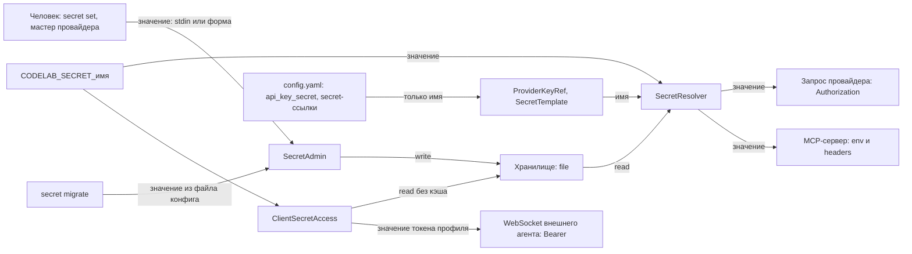

# Алгоритм хранения и выдачи секретов: от `secret set` до запроса провайдера

Секрет здесь — ключ API провайдера модели, токен MCP-сервера или токен внешнего агента. Документ описывает весь путь по шагам: как значение попадает в хранилище, как его адрес записывается в конфигурацию, как оно читается в момент запроса и куда уходит. Маскирование значений в логах и выводе команд — отдельный алгоритм: [redaction.md](redaction.md).

Документ читается целиком. Справочники по частям вынесены отдельно, и здесь они не пересказываются:

- бэкенды, `SecretAdmin`, `ClientSecretAccess`, `SecretMigrator` — [глава 5 `codelab_agent_io`](../../../codelab_agent_io/doc/05-secrets.md);
- токены профилей подключения — [глава 12 `codelab_client_core`](../../../codelab_client_core/doc/12-profiles-and-secrets.md);
- взгляд пользователя — [секреты в `codelab`](../../../../../apps/codelab_cli/doc/user/07-secrets.md) и [настройка агента](../../../../../docs/user/configuration.md#шаг-2-задайте-ключ-api);
- нормы — [`agent-secrets`](../../../../../openspec/specs/agent-secrets/spec.md) (CFG-10), [`agent-configuration`](../../../../../openspec/specs/agent-configuration/spec.md) (CFG-9), CFG-11 в [§17.5 настройки агента](../../../../../docs/architecture/proposals/agent-core/17-5-agent-setup.md) и [design.md change `add-agent-secret-store`](../../../../../openspec/changes/archive/2026-11-01-add-agent-secret-store/design.md) (ссылки `D1`…`D16` ниже — на него, если не сказано иное).

Пути в псевдокоде даны от `packages/dart/`: `core` — `codelab_agent_core/lib/src/`, `io` — `codelab_agent_io/lib/src/`, `client` — `codelab_client_core/lib/src/`, `embedded` — `codelab_embedded/lib/src/`, `setup` — `codelab_setup/lib/src/`.

## Что защищается и от чего

Цель: значение секрета лежит в одном месте, читается в последний момент и уходит ровно тому, кому предназначено — провайдеру, MCP-серверу или внешнему агенту. Остальные места видят только имя секрета.

Куда секрет мог бы утечь и что этому мешает:

| Куда | Чем закрыто |
|---|---|
| `config.yaml`, который коммитят в git | в файле только имя: `api_key_secret: codelab/gw` или ссылка `${secret:codelab/gw}`; литерал в файле загрузка отмечает предупреждением CFG-9, а `secret migrate` переносит его в хранилище |
| история оболочки и список процессов | значение читается только из stdin (в терминале ввод скрыт); аргумент команда отклоняет, но к этому моменту значение уже попало в argv и историю оболочки: такой ключ нужно сменить |
| лог, события, тексты ошибок | значение живёт только в `SecretFound`; `toString` результатов, причин отказа и исходов `SecretAdmin` его не печатает; причины — наши тексты без stderr утилит и строк файла (CFG-10) |
| чужой пользователь той же машины | бэкенд `file` проверяет права файла и каталога перед каждым обращением, пишет через приватный каталог `.secrets-tmp` |
| чужой адрес | ключ пользователя не уходит на адрес из конфига проекта, пока ссылка на ключ не привязана к этому адресу глобальным слоем (`_unboundReferences`, `_keyBinding.isBound`, D23 change `require-project-folder`); непривязанный провайдер недоступен; `${secret:…}` в `url`, `args`, `base_url` — ошибка загрузки |
| дочерние процессы | у агента окружение процессов режется allowlist (`env/host_variables.dart`, `env/local_execution_env.dart`, `mcp/stdio_process_transport.dart`, `secrets/secret_process_runner.dart`); у клиента — нет, см. «Пределы» |
| профиль подключения клиента | в `profiles.json` только ссылка `env:ИМЯ` или `secret:имя`, значение читается при открытии транспорта |

Чего механизм не делает, сказано в разделе «Граничные случаи и пределы»: до 1.0 вывод инструментов, запросы к модели и журналы сессий не очищаются от секретов (`before1Note`), а открытый файл `secrets.yaml` защищён только правами ОС.

## Вход и выход

**Вход.**

- Имя секрета и значение: `codelab secret set <имя>` (значение со stdin), мастер провайдера в app, `secret migrate`.
- Ссылки в конфигурации: `api_key_secret`, `api_key: ${secret:имя}`, `${secret:имя}` в заголовках провайдера, в `env` и `headers` MCP-сервера.
- Переменные `CODELAB_SECRET_<ИМЯ>` в окружении процесса.
- Ключ `secrets.backend` пользовательского слоя конфигурации.

**Выход.**

- Запись в `$CODELAB_HOME/secrets.yaml` (только бэкенд `file`).
- Значение в заголовке `Authorization` запроса к провайдеру, в `env` или заголовках MCP-сервера, в заголовке `Authorization: Bearer` рукопожатия WebSocket внешнего агента.
- Ошибка `auth` хода или состояние `failed` MCP-сервера с текстом без значения, если секрета нет или хранилище недоступно.

**Побочные эффекты.**

- Записи лога `secrets.backend.selected`, `secrets.backend.plaintext`, `secrets.file.refused`, `secrets.backend.unavailable`, `secrets.client.fallback`, а в режиме отладки — `secrets.lookup` (имя, назначение, источник, найдено ли).
- Каталог `.secrets-tmp` остаётся рядом с `secrets.yaml`.

## Общая схема

На схеме — путь секрета от записи до потребителя. Рёбра подписаны тем, что по ним идёт: имя или значение.



Кто чем владеет:

| Часть | Где | Что делает |
|---|---|---|
| Порт `SecretStore`, `DescribedSecretStore` | `core/secrets/secret_store.dart` | `read`, `write`, `delete`, `names`; описание бэкенда `SecretBackendInfo` |
| `SecretNames` | `core/secrets/secret_names.dart` | правило имени, переменная переопределения, подсказка имени |
| `SecretLookup` | `core/secrets/secret_lookup.dart` | три исхода: найден, не задан, хранилище недоступно |
| `SecretResolver` | `core/secrets/secret_resolver.dart` | порядок источников, кэш, диагностика без значения |
| `SecretTemplate` | `core/secrets/secret_template.dart` | значение ключа конфига как список литералов и ссылок |
| `MemorySecretStore` | `core/secrets/memory_secret_store.dart` | бэкенд `memory` для тестов и хостов без постоянного хранилища |
| `before1Note` | `core/secrets/before_1_note.dart` | строка о 1.0 для справок `secret` и `--help` |
| `openSecretStore`, `FileSecretStore`, `EnvSecretStore` | `io/secrets/` | выбор и реализация бэкендов |
| `SecretAdmin`, `SecretMigrator`, `ClientSecretAccess` | `io/secrets/` | запись, перенос, путь клиентов |
| `SecretCommands` | `io/cli/secret_commands.dart` | подкоманды `secret`; общие для `codelab` и `codelab-agent` |
| `ProfileSecrets`, `ProfileTokenRef` | `client/connection/` | токены профилей подключения |

## Модель

**Имя.** Правило одно, его проверяет `SecretNames.problem`: строчные латинские буквы и цифры, затем `.`, `_`, `/`, `-`; до 128 символов; первый символ — буква или цифра; без `..` и без `/` в конце. Одно правило нужно, чтобы в `api_key_secret`, `${secret:…}` и аргументе `secret set` действовала одна проверка, а имя не нормализовалось в два.

**Переменная переопределения.** `SecretNames.envOverride(name)`: префикс `CODELAB_SECRET_`, имя в верхнем регистре, каждый символ вне `[A-Z0-9]` заменён на `_`. Отображение необратимо: `codelab/a-b` и `codelab/a.b` дают одну переменную. Поэтому `secret set` отклоняет второе имя.

**Исход чтения.** `SecretResolver` возвращает `SecretLookup`:

| Исход | Когда | Что делает потребитель |
|---|---|---|
| `SecretFound(value, source)` | значение есть; `source` — `cache`, `env` или id бэкенда | использует значение |
| `SecretMissing(backend)` | секрета нет или он пустой | сообщает «не задан» и команду `codelab secret set` |
| `SecretUnavailable(backend, reason)` | хранилище отказало: права, ссылка, размер, сбой | сообщает «недоступно», называет переменную переопределения |

Два отказа разделены, потому что человеку нужны разные действия: задать секрет или починить хранилище.

**Шаблон.** `SecretTemplate` хранит значение ключа как части: `SecretLiteral` (уже раскрытый текст), `SecretReference(name)` и `UnusableSecretReference` (в скобки вписан сам секрет вместо имени; хранилище не опрашивается никогда). Строкой значение хранить нельзя: после раскрытия `$${secret:x}` неотличим от ссылки.

**Бэкенды.**

| `secrets.backend` | Реализация | Запись | Где значения |
|---|---|---|---|
| `auto` или не задан | `EnvSecretStore` | нет | переменные `CODELAB_SECRET_*` |
| `env` | `EnvSecretStore` | нет | переменные `CODELAB_SECRET_*` |
| `file` | `FileSecretStore` | да | `$CODELAB_HOME/secrets.yaml`, открытым текстом |
| `keychain` | не реализован | — | значение отклоняется: `keychain is not supported yet (supported: auto, env, file)` |

Хранилища ОС (`keychain`) вынесены в активный change [`add-agent-os-secret-backends`](../../../../../openspec/changes/add-agent-os-secret-backends/proposal.md) и появятся после 1.0. `auto` в этой версии — это `env`, и `file` он не выбирает никогда: файл открытый, его включают только явно (CFG-11).

## Псевдокод

Записан в порядке выполнения. `secrets.yaml` в примере лежит в `$CODELAB_HOME`.

### А. Запись: `secret set`

```text
secretSet(name, environment, input) -> SecretCommandResult
  // io/cli/secret_commands.dart: SecretCommands.set
  1. если literalSecretTag(name) != null:                  // имя похоже на значение
         return usage(64, 'the secret name looks like a secret value; pass the value on stdin')
     если SecretNames.problem(name) != null: return usage(64, правило без имени)
     // _nameProblem: хранилище ещё не открыто
  2. если вторым позиционным аргументом передано значение:
         return usage(64, 'pass the secret value on stdin, not as an argument')
  3. home = codelabHomeOf(environment)
     // без CODELAB_HOME и HOME: return 64 'cannot find the home folder'
     choice = secrets.backend из $CODELAB_HOME/config.yaml, затем из CODELAB_CONFIG
     // io/cli/secret_commands.dart: SecretCommands._backendChoice (остальная схема не проверяется)
     store = openSecretStore(choice, environment, home)    // раздел Б
     при SecretStoreUnavailableException: return 1, 'secrets.backend: <причина>'
  4. refusal = admin.checkStore(name)
     // io/secrets/secret_admin.dart: SecretAdmin.checkStore
     // имя, бэкенд только для чтения, коллизия переменной — до ввода значения
     если refusal != null: return результат отказа
  5. raw = tty ? input.readHidden('Secret value for <имя>: ') : input.readAll()
     // io/cli/secret_input.dart: StdinSecretInput; предел чтения 64 КиБ + 3 байта
     при многострочном вводе: return 64 'secret value must be a single line'
     при неверном UTF-8:      return 64 'secret value must be valid UTF-8'
  6. value = raw без одного завершающего \n или \r\n
  7. outcome = admin.store(name, value)
     // io/secrets/secret_admin.dart: SecretAdmin.store
     а) имя не прошло SecretNames -> SecretInvalidName
        бэкенд не writable -> SecretReadOnly
     б) пустое значение -> SecretInvalidValue
     в) secretValueProblem(value): одна строка, без непарного суррогата, до 64 КиБ
     г) names() и коллизия envOverride с другим именем -> SecretCollision
     д) store.write(name, value) -> SecretStored | SecretUpdated (имя уже было)
        SecretStoreUnavailableException -> SecretFailed(reason)
        чужое исключение -> SecretFailed('secret store failed: <тип>')
  8. return finish(код, stdout, stderr)
     // _Session.finish: при бэкенде file к любому исходу добавляется
     // 'warning: secrets are stored unencrypted in <home>/secrets.yaml'
     // коды: Stored/Updated 0; отказ хранилища, только чтение 1; имя, значение, коллизия 64
```

### Б. Выбор бэкенда: `openSecretStore`

```text
openSecretStore(choice, environment, home, testStorePath?) -> DescribedSecretStore
  // io/secrets/open_secret_store.dart
  1. если testStorePath != null: choice = 'file'           // тестовая сборка, D5 change add-embedded-agent-mode
  2. problem = secretsBackendProblem(choice, platform)
     // io/secrets/secrets_backend_problem.dart
     если problem != null: throw SecretStoreUnavailableException(problem.message)
     // keychain, незнакомое значение, file на Windows; значение в текст не попадает
  3. switch choice:
       null | 'auto': store = EnvSecretStore(unavailableReason: <почему не хранилище ОС>)
       'env':         store = EnvSecretStore()
       'file':        path = testStorePath ?? '$home/secrets.yaml'
                      store = FileSecretStore(path)
  4. лог secrets.backend.selected(backend, path, reason)
  5. если path != null: лог secrets.backend.plaintext(path)  // предупреждение уровня warning
  6. return store
```

Фабрика хоста `openHostSecrets(codelabHome, environment, backend, debug, logger)` (`io/secrets/host_secrets.dart`) вызывает `openSecretStore` и оборачивает результат в `SecretResolver`. Её используют `codelab-agent serve`, встроенный агент app и CLI: так ключ, записанный `secret set`, виден всем.

### В. Запись в файл: `FileSecretStore.write`

```text
write(name, value)
  // io/secrets/file_secret_store.dart: FileSecretStore.write; записи на один путь идут по очереди
  1. SecretNames.problem(name) != null -> throw Unavailable('invalid secret name')
  2. secretValueProblem(value) != null -> throw Unavailable(причина)
     // защита в глубину: хранилище не доверяет вызывающему
  3. values = _prepare() ? _load() : {}                    // раздел Д, шаги 1–2
  4. values[name] = value
  5. _replace(serialize(values)):
     а) размер больше 1 МиБ -> throw Unavailable; прежний файл не тронут
     б) _ensureHome: нет каталога -> создать и chmod 700; есть -> _checkHome и проверка владельца
        (no-op chmod с текущим режимом: не-владельцу ОС ответит EPERM)
     в) _ensureTmpDir: .secrets-tmp не ссылка, chmod 700, режим без прав для группы и остальных
     г) _cleanStaleTmp: удалить tmp-файлы старше 10 минут
     д) создать secrets.tmp-<pid>-<счётчик>-<случайное> эксклюзивно
     е) _verifyTmpDir; chmod 600 tmp; _verifyTmp                 // права до записи значения
     ж) записать байты с flush; _verifyTmp ещё раз
     з) rename tmp -> secrets.yaml
     и) _verifyFinal: права шире 0600 -> chmod 600; не вышло -> удалить файл и отказать
     к) finally: удалить свой tmp, если остался
```

Формат файла: строка комментария и по строке `"<имя>": "<значение>"`, ключи по алфавиту, значения в двойных кавычках с экранированием JSON (`_serialize`, `_quote`).

### Г. Чтение: `SecretResolver.secret`

```text
secret(name, purpose) -> SecretLookup                      // не бросает исключений
  // core/secrets/secret_resolver.dart: SecretResolver.secret, _resolve, _read
  1. если SecretNames.problem(name) != null: lookup = SecretMissing(backend)   // защита в глубину
  2. иначе если _cache[name] есть:           lookup = SecretFound(cached, 'cache')
  3. иначе если environment[envOverride(name)] непустая:
         _cache[name] = значение; lookup = SecretFound(значение, 'env')
         // хранилище не опрашивается
  4. иначе если для name уже идёт чтение (_inflight): ждать его  // single-flight
  5. иначе: _inflight[name] = _read(name, поколение)
         value = await store.read(name)
         null или пусто      -> SecretMissing(backend)
         значение            -> если поколение не сменилось: _cache[name] = value
                                SecretFound(value, backend)
         SecretStoreUnavailableException -> лог secrets.backend.unavailable (раз на пару backend+reason)
                                SecretUnavailable(backend, reason)
         другое исключение   -> SecretUnavailable(backend, 'secret store failed: <тип>')
  6. если режим отладки: лог secrets.lookup(name, purpose, source, found)
     // значение, длина, префикс и хеш не пишутся никогда
  7. return lookup

env(variable, purpose) -> SecretLookup                      // api_key_env
  // core/secrets/secret_resolver.dart: SecretResolver.env
  1. value = environment[variable]
  2. null или пусто -> SecretMissing('env'); иначе SecretFound(value, 'env')   // кэша нет
  3. лог secrets.lookup, если режим отладки

invalidate()
  // вызывает перезагрузка конфигурации (core/runtime/agent_runtime.dart, шаг 6)
  1. поколение += 1; очистить кэш и _inflight
  2. чтение, начатое в старом поколении, отдаёт значение своим вызывающим, но в кэш не кладёт
```

### Д. Чтение файла: `FileSecretStore.read`

```text
read(name)
  // io/secrets/file_secret_store.dart: _prepare, _load
  1. _prepare() перед КАЖДЫМ обращением:
     а) secretsBackendProblem('file', platform): на Windows -> throw Unavailable
     б) $CODELAB_HOME нет -> вернуть false (секретов нет)
     в) _checkHome: ссылка -> отказ; не каталог -> Unavailable; режим & 0o022 -> отказ 'chmod go-w'
     г) secrets.yaml нет -> false; ссылка -> отказ; не файл -> Unavailable
     д) режим & 0o077 != 0 -> отказ 'has permissions <режим>; run: chmod 600 <путь>'
     // отказ = лог secrets.file.refused (раз на процесс и путь) и throw Unavailable
  2. _load():
     а) размер больше 1 МиБ -> отказ
     б) utf8.decode -> readYamlTree
     в) структура не «имя -> строка» или имя вне SecretNames -> throw Unavailable без строк файла
  3. return values[name]                                     // null — секрета нет
```

### Е. Ссылки в конфигурации: от строки до шаблона

```text
loadConfig(layers, environment) -> CoreConfig               // значения секретов не читаются
  // core/config/resolve.dart, core/config/interpolate.dart
  1. для каждого значения разрешённого ключа: expandEnvironment(source, environment)
     // побуквенный разбор; $ обрабатывается так:
     а) '$${'            -> литерал '${'
     б) '${secret:имя}'  -> SecretReference(имя)
     в) '${ИМЯ}'         -> если ИМЯ похоже на секрет (literalSecretTag(asName)): UnusableSecretReference
                            иначе значение из окружения; нет переменной -> в missing
     г) иное '$'         -> литерал
  2. _interpolate(raw, path, origin, allowSecrets):
     missing не пусто            -> проблема 'variable ИМЯ is not set'; значения нет
     ссылки есть, allowSecrets=false -> проблема (base_url, args, url): ссылки там запрещены
     secret-ссылка, похожая на токен -> часть заменяется на UnusableSecretReference
     SecretNames.problem(имя) != null -> проблема с текстом правила, без имени
  3. провайдер (_Builder._provider):
     headers.<Имя> со ссылкой -> headerTemplates[Имя] = шаблон; без ссылки -> строка
     api_key_env     -> EnvKeyRef(ПЕРЕМЕННАЯ) (нет в окружении: предупреждение config.provider.key_missing)
     api_key_secret  -> SecretKeyRef(имя); имя вместо токена -> UnusableKeyRef
     api_key         -> литерал как есть; ровно одна ссылка -> SecretKeyRef; ссылка с текстом вокруг -> проблема
     api_key_env вместе с api_key_secret или api_key -> проблема (источник ключа один)
  4. MCP-сервер (_Builder._mcpServer):
     env.<KEY> и headers.<Name> со ссылкой -> secretValues['env.KEY' | 'headers.Name'] = шаблон
     args и url со ссылкой -> проблема загрузки
  5. файловые слои: findInlineSecrets -> предупреждение config.secret.in_file с командой переноса
```

### Ж. Ключ провайдера при запросе: `createRoutedStreamFunction`

```text
target(model, cancel) -> StreamFunction
  // core/llm/provider_factory.dart: createRoutedStreamFunction, _resolveSecrets
  1. unavailable[provider] есть -> поток с ошибкой auth; SecretResolver не читается
  2. цепочка провайдера уже собрана (chains) -> вернуть её
  3. key == null и шаблонов заголовков нет -> собрать цепочку без секретов
  4. _resolveSecrets(config, key, templates, secrets), параллельно с отменой хода:
     а) любой шаблон с UnusableSecretReference -> отказ 'looks like a secret value, not a name; run: codelab secret migrate'
     б) switch key:
          UnusableKeyRef -> тот же отказ
          EnvKeyRef      -> secrets.env(); не задан -> 'API key variable X is not set'
          SecretKeyRef   -> await secrets.secret(name, purpose: 'providers.<id>.api_key_secret')
            SecretFound       -> apiKey = значение
            SecretMissing     -> 'API key secret X is not set. Run: codelab secret set X'
            SecretUnavailable -> 'API key secret X cannot be read: <backend> is unavailable (<reason>). Set <ПЕРЕМЕННАЯ> or fix the secret store'
        без резолвера хоста -> 'the host has no secret resolver'
     в) для каждого заголовка-шаблона: secrets.secret(...) по каждому имени, template.render(значения)
     г) config.copyWith(apiKey, headers, extraSecrets: значения заголовков)
        // extraSecrets попадают в вычистку текстов ошибок провайдера (redaction.md, раздел Ж)
  5. отмена хода раньше значения -> поток aborted; отказ -> поток с ошибкой auth, без HTTP-запроса
  6. успех -> chains[provider] = createStreamFunction(config); значение уходит
     в заголовок config.authHeader: 'Bearer <ключ>' для Authorization, иначе как есть
     // core/llm/providers/openai_compatible.dart, anthropic.dart
```

Цепочка кэшируется только при успехе: после неудачи следующий запрос разрешает ссылки заново.

### З. MCP-сервер конфигурации

```text
attempt(server)                                             // перед КАЖДОЙ попыткой подключения
  // codelab_agent_mcp/lib/src/connector.dart: _connectOnce; core/runtime/agent_runtime.dart: _expandServerSecrets
  1. server.blockedReason != null (HTTP-сервер проектного слоя с привязкой к другому адресу):
         failed с этим текстом; ни хранилище, ни сеть не трогаются
  2. серверы клиента (session/new) и серверы без шаблонов: раскрытие не вызывается
     // ${secret:…} от клиента ACP — литерал
  3. любой шаблон с UnusableSecretReference -> failed 'secret reference mcp.servers[имя].поле looks like a secret value ...'
  4. resolver == null -> failed 'no secret store'
  5. для каждого шаблона и каждого имени: await resolver.secret(name, purpose: 'mcp.servers[имя].поле')
       SecretMissing     -> failed 'secret ИМЯ is not set'
       SecretUnavailable -> failed 'secret ИМЯ cannot be read: <backend> is unavailable'
  6. effective = server.withSecrets(значения)
     // значения живут только в объекте этой попытки; ожидание ограничено отменой сессии
  7. подключиться с effective
```

### И. Перенос литералов: `SecretMigrator.run`

```text
run(options) -> SecretMigrationReport                       // штатные отказы — в отчёте, не исключения
  // io/secrets/secret_migrator.dart: _MigrationRun._execute
  1. _prepareEnvironment, _load (слои), _openStore, _collect: находки findInlineSecrets
  2. доверие к проекту и пределы значения; имена SecretNames.suggestFor и forMcp;
     одно имя с разными значениями получает суффикс -2
  3. _checkCandidates: итог правок ВСЕХ выбранных файлов вместе проверяется загрузчиком — до хранилища
     цикл _verifyResumes (D26): переезд провайдера, чьи ссылки в config.local.yaml не совпали с тем, что записал бы перенос,
     отменяется; затем заново _assignNames и _checkCandidates, пока набор файлов не стабилизируется
  4. _assignNames, _refreshPreviews, _checkStore (admin.checkStore), _resolveNames: сравнение с хранилищем
     (то же значение -> переиспользовать; другое -> конфликт, нужен --force), _failOnConflicts
  5. если dryRun: return отчёт-план; ничего не записано
  6. для каждого файла: _storeSecrets -> admin.store    // секреты ВСЕХ файлов раньше любой записи конфига
  7. порядок записи конфигов: user, local, project; _writeFile -> ConfigWriter.apply
     // конфликт отпечатка файла: одно перечитывание и повтор; переезд провайдера между файлами повторять нельзя
  8. return отчёт: пункты без значений
```

Отката нет. Если сбой пришёл между шагами 6 и 7, секреты уже в хранилище, а конфиги прежние и рабочие; отчёт называет сохранённые имена и файлы, которые остались как были. Повторный запуск переиспользует сохранённые секреты (`SecretReusedItem`).

### К. Клиент: токен профиля внешнего агента

```text
openTransport(profile: WebSocketProfile)
  // client/connection/transport_resolver.dart: ConfigTransportResolver.open
  1. tokenRef = profile.tokenRef; null -> токена нет
  2. token = await secrets.read(tokenRef)                   // ProfileSecretSource
     // client/connection/profile_token_ref.dart
     ProfileTokenRef.parse(ref):
       'env:ИМЯ'    (ИМЯ — [A-Za-z_][A-Za-z0-9_]*) -> environment[ИМЯ]
       'secret:имя' (имя проходит isValidSecretName) -> stored.read(имя)
       иначе                                          -> UnsupportedTokenRef: токена нет
     пустое значение -> null; кэша нет
  3. WebSocketAcpTransportConfig(uri, token) -> заголовок 'Authorization: Bearer <token>'
     // codelab_acp_transports/lib/src/transport_configs.dart
  4. хост до подключения: isSecretMissing(profile) -> предупреждение без значения
     'Profile <id> has no stored secret value; connecting without a token.'
  5. сбой хранилища: ClientSecretAccess.read бросает SecretStoreUnavailableException;
     ProfileSecretSource.read её не ловит, открытие транспорта падает с видимой ошибкой
     // без токена клиент в этом случае не подключается (подключение «без токена» — только при отсутствии значения)
  6. ответ 401 или 403 на рукопожатие -> describeTokenRejection: 'the agent rejected the token (HTTP 401)'
     или 'the agent requires a token (HTTP 401)'
```

`stored.read` — это `ClientSecretAccess.read`: непустая переменная `CODELAB_SECRET_…` побеждает бэкенд, кэша нет, чужое исключение превращается в `secret store failed: <тип>`.

## Пошаговое пояснение

### Почему резолвер, а не прямой `store.read`

Функцию модели хост строит раньше ядра, а переменная `CODELAB_SECRET_*` требует окружения процесса, которого у ядра нет. Один резолвер на процесс держит порядок «кэш → переменная → хранилище», single-flight и диагностику (D3, D10). Прямой `read` из ядра и хостов запрещён; исключения — подкоманды `secret` и `config check`, которые значения не показывают.

### Порядок «кэш → переменная → хранилище»

Переменная проверяется до хранилища, чтобы CI и контейнеры работали без файла, а явное переопределение побеждало сохранённое значение. Найденное значение переменной тоже кэшируется, поэтому `invalidate` сбрасывает и его. Пустая переменная не считается заданной: следующий источник читается как обычно.

### Что кэшируется

Только найденные значения. `SecretMissing` и `SecretUnavailable` в кэш не попадают: секрет, записанный после старта, подхватывается следующим запросом без перезапуска. Но уже прочитанное значение резолвер не забывает, пока не вызван `invalidate` — его зовёт каждая успешная перезагрузка конфигурации, даже без изменённых ключей. Чтение, начатое до сброса и завершившееся после, в кэш не попадает (счётчик поколений, D8 change `add-config-writer-and-reload`).

`SecretAdmin.store` кэш резолвера не сбрасывает: это другой объект, а часто и другой процесс. Поэтому после `secret set` работающий агент берёт новое значение только после перезагрузки конфигурации или перезапуска.

### Почему три исхода, а не `String?`

`SecretMissing` и `SecretUnavailable` ведут к разным текстам ошибки: «выполните `codelab secret set`» и «исправьте хранилище или задайте переменную». Приоритет наблюдаемости выше простоты.

### Что видит пользователь при отсутствии секрета

Загрузка конфигурации секрет не читает, поэтому `config check` и старт агента проходят. Отказ приходит в момент использования:

- ключ провайдера — ход заканчивается ошибкой `auth` без HTTP-запроса с текстом `API key secret codelab/gw is not set. Run: codelab secret set codelab/gw`;
- MCP-сервер — состояние `failed` и `lastError` `secret codelab/gw is not set`; повтор идёт по расписанию и подхватит секрет, записанный позже (отсутствие секрета в кэш не попадает);
- `codelab config check` — отдельный проход по ссылкам: предупреждение `providers.gw.api_key_secret: secret codelab/gw is not set; run: codelab secret set codelab/gw` (`io/cli/config_commands.dart: _secretLines`).

### Литерал-«секрет вместо имени»

Если в `api_key_secret`, `api_key_env` или `${secret:…}` вписан сам токен (`ghp_…`, `sk-…`), загрузка кладёт `UnusableKeyRef` или `UnusableSecretReference`. Потребитель отказывает до обращения к хранилищу и называет путь ключа, а не значение: иначе токен попал бы в `secrets.lookup` и в тексты ошибок. Подсказка — `codelab secret migrate` (D4 change `add-config-literal-secrets-and-migrate`).

### Почему файл защищён «как у ssh»

Открытый файл с секретами нельзя читать, если права шире `0600`, а каталог доступен на запись другим: чужой пользователь заменил бы файл или `.secrets-tmp`. Поэтому проверка идёт перед каждым обращением, а отказ не «чтение с предупреждением». Запись идёт через приватный `.secrets-tmp` с `chmod 600` до записи значения, чтобы широкие права `0666 & ~umask` не успели открыть файл постороннему. Остаточные риски записаны в комментарии класса: владельца `secrets.yaml` `dart:io` не сообщает, при чтении владелец каталога не проверяется, root обходит `EPERM`.

### Почему правило имён на клиенте — копия

`codelab_client_core` не зависит от пакетов агента (AGENTS.md §5: клиенты получают агентскую сторону только через мосты). Поэтому `isValidSecretName` в `client/connection/profile_secrets.dart` повторяет `SecretNames.pattern`. Копия не мягче оригинала: она дополнительно отвергает пустые сегменты `a//b`. Ссылка `secret:имя`, которую принял клиент, всегда принимается и хранилищем. Обратное неверно: имя вида `a//b` хранилище приняло бы, а профиль на него сослаться не может.

### Встроенный агент

`localEmbeddedAgentOpener` (`embedded/io/local_opener.dart`) вызывает `ConfigLoader().load`, затем `openHostSecrets` с `settings.secretsBackend`, `debug: debugSecrets || CODELAB_DEBUG_SECRETS=1` и `testStorePath: testSecretStorePath(environment)`. Один резолвер получают и функция модели, и ядро (MCP). Недоступное хранилище — `EmbeddedAgentConfigException`, а не ошибка хода. Нет ключа провайдера — не ошибка открытия: ход завершится ошибкой провайдера с именем секрета. Своего хранилища у `codelab_embedded` нет: ключ, записанный `codelab secret set`, виден встроенному агенту. Сторона клиента не открывает `codelab_agent_*` напрямую: `apps/codelab_desktop/lib/app/` и `apps/codelab_cli/lib/src/composition_root.dart` берут всё через мосты `codelab_embedded` и `codelab_setup` (AGENTS.md §5).

### Запись из клиентов

Мастер провайдера в app (`setup/provider/provider_setup_committer.dart`) пишет секрет раньше конфига: в обратном порядке получился бы конфиг со ссылкой на несуществующий секрет. Если запись конфига не удалась, созданный секрет удаляется; заменённый — нет, прежнего значения клиент не знает. Мастер ходит к хранилищу через `ProviderKeys` (`setup/io/provider_keys.dart`), то есть через `ClientSecretAccess`: он читает `secrets.backend` из пользовательского `config.yaml`, не кэширует значения и при сломанном конфиге переходит на `env` только для чтения. App переоткрывает хранилище при каждом открытии диалога и страницы (`ReopenableProfileSecrets`), поэтому правка `secrets.backend` применяется без перезапуска.

### Перенос литералов в app

`EmbeddedSecretMigrationRunner` (`apps/codelab_desktop/lib/app/embedded_secret_migration_runner.dart`) вызывает тот же `SecretMigrator` через мост `codelab_embedded`. Опции собирает `secretMigrationOptionsFor` (`embedded/io/migration_options.dart`): слои `user`, `project`, `projectLocal` сразу (как `--all`), без `--force`, хранилище — тем же путём `testSecretStorePath`, что у открывателя агента. Кнопка предлагается, если загрузка дала предупреждение `config.secret.in_file` (`EmbeddedAgent.secretsInConfig`). Хранилище только для чтения — `canApply: false` и подсказка с `secrets.backend: file`.

## Карта точек применения

| Где | Что делает | Чем | Файл |
|---|---|---|---|
| имя в `secret set`, `api_key_secret`, `${secret:…}` | проверка правила | `SecretNames.problem` | `core/secrets/secret_names.dart` |
| значение в `secret set` | одна строка, до 64 КиБ, без непарного суррогата | `secretValueProblem` | `io/secrets/secret_value_checks.dart` |
| запись | проверки, коллизия, результат без значения | `SecretAdmin.store` | `io/secrets/secret_admin.dart` |
| файл `secrets.yaml` | права, ссылки, атомарная запись | `FileSecretStore` | `io/secrets/file_secret_store.dart` |
| выбор бэкенда | `auto`/`env`/`file`, отказ `keychain` | `openSecretStore`, `secretsBackendProblem` | `io/secrets/open_secret_store.dart` |
| значения секретов в процессе агента | порядок источников, кэш | `SecretResolver` | `core/secrets/secret_resolver.dart` |
| ссылки в конфигурации | разбор `${secret:…}` | `expandEnvironment`, `_Builder._interpolate` | `core/config/interpolate.dart`, `core/config/resolve.dart` |
| ключ и заголовки провайдера | разрешение при первом запросе | `createRoutedStreamFunction` | `core/llm/provider_factory.dart` |
| `env` и заголовки MCP | раскрытие перед каждой попыткой | `AgentRuntime._secretExpander` | `core/runtime/agent_runtime.dart` |
| состояние ссылок | проверка без значений | `config check` | `io/cli/config_commands.dart` |
| перенос литералов | запись секретов, правка конфига | `SecretMigrator` | `io/secrets/secret_migrator.dart` |
| токен профиля | ссылка → значение | `ProfileSecretSource` | `client/connection/profile_token_ref.dart` |
| путь клиентов к хранилищу | без кэша, переменная раньше бэкенда | `ClientSecretAccess` | `io/secrets/client_secret_access.dart` |
| хост агента | один резолвер на процесс | `openHostSecrets` | `io/secrets/host_secrets.dart` |

## Разобранные примеры

### Реальный прогон `codelab-agent secret`

Прогон на временном `CODELAB_HOME` (путь в выводе заменён на `~/.codelab`), без переменных `*_API_KEY` и `CODELAB_*` из окружения. Команды запускались как `fvm dart run apps/codelab_agent/bin/codelab_agent.dart …`; в тексте они записаны как `codelab-agent …`, значения — фиктивные `sk-test-…`. `codelab secret …` печатает то же: подкоманды общие.

Бэкенд по умолчанию — `env`, он только для чтения:

```text
$ printf 'sk-test-0001' | codelab-agent secret set codelab/gw
secret store env is read-only. Add 'secrets.backend: file' to ~/.codelab/config.yaml to store secrets in ~/.codelab/secrets.yaml (plaintext, 0600), or set CODELAB_SECRET_CODELAB_GW in the environment
[exit 1]
```

Конфигурация со ссылкой на секрет, которого ещё нет (`config.yaml` из этого прогона):

```yaml
secrets:
  backend: file
agent:
  default_model: gw/demo-model
providers:
  gw:
    kind: openai-compatible
    base_url: https://llm.example.test/v1
    api_key_secret: codelab/gw
    models:
      demo-model:
        context_window: 128000
```

```text
$ codelab-agent config check
Sources: defaults, ~/.codelab/config.yaml
note: secrets backend: file
warning: secrets: file backend stores secrets unencrypted in ~/.codelab/secrets.yaml
warning: ~/.codelab/config.yaml:9:5: providers.gw.api_key_secret: secret codelab/gw is not set; run: codelab secret set codelab/gw
Default model: gw/demo-model (config)
Config: valid
[exit 0]
```

Запись, список и файл:

```text
$ printf 'sk-test-0001' | codelab-agent secret set codelab/gw
Stored secret codelab/gw in file
warning: secrets are stored unencrypted in ~/.codelab/secrets.yaml
[exit 0]

$ codelab-agent secret list
Backend: file
codelab/gw
warning: secrets are stored unencrypted in ~/.codelab/secrets.yaml
[exit 0]

$ cat ~/.codelab/secrets.yaml; ls -l
# CodeLab secrets in plaintext. Managed by: codelab secret set|delete
"codelab/gw": "sk-test-0001"
-rw-r--r--@ config.yaml
-rw-------@ secrets.yaml

$ codelab-agent config check
Sources: defaults, ~/.codelab/config.yaml
note: secrets backend: file
warning: secrets: file backend stores secrets unencrypted in ~/.codelab/secrets.yaml
Default model: gw/demo-model (config)
Config: valid
[exit 0]
```

Предупреждение «not set» исчезло: ссылка разрешилась. Переменная переопределения видна в `list`:

```text
$ CODELAB_SECRET_CODELAB_GW=sk-test-override codelab-agent secret list
Backend: file
codelab/gw
Environment overrides: CODELAB_SECRET_CODELAB_GW
warning: secrets are stored unencrypted in ~/.codelab/secrets.yaml
[exit 0]
```

Отказ при неверных правах файла: `secret list`, `secret set` отказывают с кодом 1, а `config check` только предупреждает и остаётся с кодом 0 (решение D9 change `add-agent-secret-store`: «код выхода не меняется», секрет может понадобиться только при выборе этой модели):

```text
$ chmod 644 ~/.codelab/secrets.yaml

$ codelab-agent secret list
warning: secrets are stored unencrypted in ~/.codelab/secrets.yaml
cannot list secrets: ~/.codelab/secrets.yaml has permissions 0644; run: chmod 600 ~/.codelab/secrets.yaml
[exit 1]

$ codelab-agent config check
Sources: defaults, ~/.codelab/config.yaml
note: secrets backend: file
warning: secrets: file backend stores secrets unencrypted in ~/.codelab/secrets.yaml
warning: secrets: ~/.codelab/secrets.yaml has permissions 0644; run: chmod 600 ~/.codelab/secrets.yaml
Default model: gw/demo-model (config)
Config: valid
[exit 0]

$ printf 'sk-test-0002' | codelab-agent secret set codelab/gw
warning: secrets are stored unencrypted in ~/.codelab/secrets.yaml
cannot store secret codelab/gw: ~/.codelab/secrets.yaml has permissions 0644; run: chmod 600 ~/.codelab/secrets.yaml
[exit 1]
```

Права исправлены, секрет удалён. `config check` снова предупреждает, что секрет не задан, а переменная `CODELAB_SECRET_CODELAB_GW` при пустом хранилище заменяет его:

```text
$ chmod 600 ~/.codelab/secrets.yaml

$ codelab-agent secret delete codelab/gw
Deleted secret codelab/gw from file
warning: secrets are stored unencrypted in ~/.codelab/secrets.yaml

$ codelab-agent config check
Sources: defaults, ~/.codelab/config.yaml
note: secrets backend: file
warning: secrets: file backend stores secrets unencrypted in ~/.codelab/secrets.yaml
warning: ~/.codelab/config.yaml:9:5: providers.gw.api_key_secret: secret codelab/gw is not set; run: codelab secret set codelab/gw
Default model: gw/demo-model (config)
Config: valid

$ CODELAB_SECRET_CODELAB_GW=sk-test-override codelab-agent config check
Sources: defaults, ~/.codelab/config.yaml
note: secrets backend: file
warning: secrets: file backend stores secrets unencrypted in ~/.codelab/secrets.yaml
Default model: gw/demo-model (config)
Config: valid
```

Остальные отказы того же прогона (вывод сокращён до строки отказа, коды выхода — из `exit_codes.dart`):

| Команда | Результат | Код |
|---|---|---|
| `secret delete codelab/gw` второй раз | `Secret codelab/gw was not set in file`: удаление идемпотентно | 0 |
| `secret set Codelab/GW` (заглавные) | `expected a secret name: lowercase letters, digits and . _ / -, up to 128 characters` и справка | 64 |
| `secret set codelab/gw sk-test-9` | `pass the secret value on stdin, not as an argument` и справка; значение не дошло до общей части | 64 |
| `secret set codelab/ml`, ввод в две строки | `secret value must be a single line` | 64 |
| `secret set codelab/g-w`, когда уже есть `codelab/g.w` | `secret name codelab/g-w collides with codelab/g.w (both map to CODELAB_SECRET_CODELAB_G_W)` | 64 |
| `secrets.backend: keychain`, `secret list` | `secrets.backend: keychain is not supported yet (supported: auto, env, file)` | 1 |
| `secrets.backend: keychain`, `config check` | `~/.codelab/config.yaml:2:3: secrets.backend: keychain is not supported yet (supported: auto, env, file)`, `Config: invalid (issues: 1)` | 1 |
| `~/.codelab` с режимом `0775` | `~/.codelab is writable by group or others (mode 0775); run: chmod go-w ~/.codelab` | 1 |
| `secrets.yaml` — символическая ссылка | `~/.codelab/secrets.yaml is a symbolic link; refusing to read secrets` | 1 |

### Резолвер и имена на наборе входов

Источник: временный тест `codelab_agent_core/test/tmp_secret_doc_test.dart` (после прогона удалён). Хранилище в тесте — фейк с id `file`; значения фиктивные.

| Вход | Выход |
|---|---|
| `secret('codelab/gw')`, первый вызов | `SecretFound(source: file)` |
| то же, второй вызов | `SecretFound(source: cache)`, `read` не вызывался |
| значение в хранилище сменилось, без `invalidate` | `SecretFound(source: cache)`, старое значение |
| после `invalidate()` | `SecretFound(source: file)`, новое значение |
| `secret('codelab/ovr')` при `CODELAB_SECRET_CODELAB_OVR` | `SecretFound(source: env)`, хранилище не читалось |
| секрета нет | `SecretMissing(backend: file)` |
| в хранилище пустая строка | `SecretMissing(backend: file)` |
| `secret('Bad Name')` | `SecretMissing(backend: file)`, `read` не вызывался |
| переменная `CODELAB_SECRET_CODELAB_GW` пустая | значение читается из хранилища, `source: file` |
| хранилище бросает `SecretStoreUnavailableException`, два вызова | оба `SecretUnavailable(backend: file, reason: perm)`, событие `secrets.backend.unavailable` одно |
| `env('OPENAI_API_KEY')`, переменной нет | `SecretMissing(backend: env)` |

Запись `secrets.lookup` в режиме отладки (первые четыре за тест; значения в ней нет):

```text
{name: codelab/gw, purpose: p, source: file, found: true}
{name: codelab/gw, purpose: p, source: cache, found: true}
{name: codelab/gw, purpose: p, source: cache, found: true}
{name: codelab/gw, purpose: p, source: file, found: true}
```

Правило имён:

| Вход | `SecretNames.problem` | Пояснение |
|---|---|---|
| `codelab/openai` | допустимо | |
| `codelab/a-b` | допустимо | |
| `Codelab` | отказ | заглавная буква |
| `a..b` | отказ | `..` |
| `a/` | отказ | `/` в конце |
| `-x` | отказ | первый символ не буква и не цифра |
| 129 символов `a` | отказ | длиннее 128 |
| `ghp_AbCdEf` | отказ | заглавные; в подкомандах такое имя сначала даёт «имя похоже на значение» |

| Вход | Выход |
|---|---|
| `envOverride('codelab/a-b')` | `CODELAB_SECRET_CODELAB_A_B` |
| `envOverride('codelab/a.b')` | `CODELAB_SECRET_CODELAB_A_B` (коллизия с предыдущим) |
| `suggestFor('providers.openai.api_key')` | `codelab/openai` |
| `suggestFor('mcp.servers[Git Hub].headers.Authorization')` | `codelab/mcp/git-hub/authorization` |
| `suggestFor('tools.web.search.backends.brave.api_key')` | `codelab/search-brave` |
| `suggestFor('agent.default_model')` | `codelab/agent.default_model` |

Шаблоны (`expandEnvironment`, переменная `HOME_X=v`):

| Вход | Части шаблона |
|---|---|
| `Bearer ${secret:codelab/gw}` | литерал `Bearer `, ссылка `codelab/gw` |
| `$${secret:x}` | один литерал, ссылок нет |
| `${secret:Bad Name}` | ссылка `Bad Name`; проблему назовёт `_interpolate` по правилу имён |
| `${HOME_X}` | один литерал со значением переменной |

`render` собирает `Bearer <value>`; без значения для ссылки — `StateError: secret is not resolved`.

## Граничные случаи и пределы

| Ситуация | Что делает алгоритм | Где в коде |
|---|---|---|
| имя вне правила попало в резолвер | `SecretMissing`, хранилище не читается | `secret_resolver.dart: _resolve` |
| переменная `CODELAB_SECRET_…` пустая | не считается заданной, читается хранилище | `secret_resolver.dart: _resolve` |
| хранилище отказало | `SecretUnavailable`, одно предупреждение на пару `backend`+`reason` | `secret_resolver.dart: _warnOnce` |
| чужая реализация порта бросила исключение | в причину идёт только тип: `secret store failed: <тип>` | `secret_resolver.dart: _read` |
| два запроса одного имени одновременно | один `read` (single-flight) | `secret_resolver.dart: _resolve` |
| перезагрузка конфигурации во время чтения | старое чтение отдаёт значение вызывающим, в кэш не кладёт | `secret_resolver.dart: invalidate` |
| отмена хода во время ожидания секрета | поток `aborted`, ожидание хранилища не держит ход | `provider_factory.dart: target` |
| первый запрос не получил секрет | ошибка `auth`, цепочка не кэшируется, следующий запрос пробует снова | `provider_factory.dart: target` |
| ссылка на секрет в `base_url`, `url`, `args` | проблема загрузки | `resolve.dart: _interpolate` |
| проектный провайдер с адресом из конфига проекта, ссылка на ключ не привязана глобальным слоем | недоступен; если глобальный слой привязал ту же ссылку к тому же origin, провайдер работает | `provider_factory.dart: createRoutedStreamFunction` |
| stdio-сервер проекта получил секрет-ссылку | работает, но загрузка предупреждает `config.mcp.stdio_secret_reference` | `resolve.dart: _mcpServer` |
| `secrets.backend` в проектном слое | не действует: ключ читается из пользовательского слоя и `--config` | `host_settings.dart: secretsBackend` |
| `serve --llm-script` | хранилище принудительно `env` | `apps/codelab_agent/lib/src/host/agent_host.dart` |
| `auto` и нужен записываемый бэкенд | `env`, запись отказывает с подсказкой про `secrets.backend: file` | `open_secret_store.dart`, `secret_read_only_hint.dart` |
| `file` на Windows | отказ при загрузке конфигурации и при открытии хранилища | `secrets_backend_problem.dart` |
| `secrets.yaml` больше 1 МиБ или значение больше 64 КиБ | отказ с причиной без значения | `file_secret_store.dart`, `secret_value_checks.dart` |
| два процесса пишут `secrets.yaml` одновременно | очередь только в пределах процесса: одно из обновлений может потеряться | `file_secret_store.dart: _enqueue` |
| сбой записи на любом шаге до `rename` | прежний файл цел; свой tmp удаляется | `file_secret_store.dart: _replace` |
| `secret delete` для отсутствующего имени | код 0, файл не переписывается | `secret_admin.dart: delete` |
| сломанный `config.yaml` у клиента | `ClientSecretAccess` берёт `env` только для чтения, `configProblem` объясняет причину | `client_secret_access.dart: open` |
| пустые сегменты `a//b` в имени | хранилище примет, ссылка профиля `secret:a//b` — нет | `client/connection/profile_secrets.dart: isValidSecretName` |
| `secretReferencesIn('${secret:ghp_…}')` | возвращает токен как «имя» ссылки (в отличие от `${ghp_…}`); загрузка этот случай обрабатывает отдельно. Последствие: `mcp_secret_cleanup.dart` → `mcp_server_remover.dart` → desktop `mcpSecretKept(name)` показывает токен в баннере | `core/config/secret_references.dart`; потребитель — `codelab_setup/…/mcp_secret_cleanup.dart` |
| путь `tools.web.search.backends.<b>` | `suggestFor` умеет предложить имя, но поиска с секретами в этой версии нет | `core/secrets/secret_names.dart: suggestFor` |

Что механизм не гарантирует:

| Угроза | Статус |
|---|---|
| прочитать `secrets.yaml` может любой процесс того же пользователя и root | не закрыто: файл открытый, защита — права ОС (`warning: secrets are stored unencrypted in …` печатает каждая подкоманда) |
| секрет попал в вывод инструмента, промпт или журнал сессии | не закрыто до 1.0 (`before1Note`): значение уходит провайдеру модели и в файлы сессий как есть |
| значение в `config.yaml` литералом | работает, но загрузка предупреждает; редактирование — `secret migrate` |
| владелец `secrets.yaml` не проверяется при чтении | остаточный риск, `dart:io` владельца не сообщает |
| окно между проверкой прав и чтением (TOCTOU) | остаётся, как у `BoundedEnv` |
| хранилища ОС (связка ключей, Secret Service, Credential Manager) | нет, change `add-agent-os-secret-backends` |
| значение секрета в памяти процесса | живёт не только в кэше резолвера (до конца процесса или `invalidate`): ещё в цепочке провайдера (`ProviderConfig.apiKey`, `extraSecrets`) до замены функции модели при перезагрузке, в окружении stdio-процесса MCP и в заголовках транспорта MCP на всё время соединения |
| окружение дочерних процессов клиента | `stdio_acp_transport.dart:96` и `codelab_client_io` `terminal_process_runner.dart:34` передают процессу всё окружение, включая `CODELAB_SECRET_*` и `*_API_KEY`: внешний агент и его команды `terminal/create` их видят |
| `toString` конфигурации WebSocket | freezed-класс `WebSocketAcpTransportConfig` печатает `token:` (`transport_configs.freezed.dart`); в лог и сообщения его отдавать нельзя |
| токен профиля по `ws://` | уходит без TLS на адрес не этой машины, проверки при открытии транспорта нет (`transport_resolver.dart`); предупреждение даёт только форма профиля (`plaintextToRemote`) |

## Настраиваемые параметры

| Параметр | Значение | Что делает |
|---|---|---|
| `secrets.backend` | `auto` (по умолчанию), `env`, `file`; `keychain` отклоняется | выбор бэкенда; читается из пользовательского слоя и `CODELAB_CONFIG`; правка применяется после перезапуска |
| `CODELAB_HOME` | путь | каталог `secrets.yaml` и `config.yaml`; без него — `~/.codelab` |
| `CODELAB_CONFIG` | путь к файлу конфигурации | дополнительный слой; подкоманды `secret` читают из него `secrets.backend` |
| `CODELAB_SECRET_<ИМЯ>` | значение | переопределяет секрет `<имя>` (см. `SecretNames.envOverride`); пустое значение не считается заданным |
| `--debug-secrets`, `CODELAB_DEBUG_SECRETS=1` | флаг, `1` | событие `secrets.lookup`: имя, назначение, источник, найдено ли; значения нет |
| `providers.<id>.api_key_secret` | имя секрета | ключ провайдера из хранилища |
| `providers.<id>.api_key_env` | имя переменной | ключ из окружения (не из хранилища) |
| `providers.<id>.api_key` | `${secret:имя}` целиком или литерал | литерал работает, но даёт предупреждение CFG-9 |
| `${secret:имя}` | в `headers` провайдера, `env` и `headers` MCP-сервера | ссылка на секрет |
| `CODELAB_TEST_SECRET_STORE` | путь | хранилище `file` для E2E; действует только в сборке с `--dart-define=CODELAB_ALLOW_TEST_SECRETS=true` |

Параметров, которые объявлены, но не применяются, у механизма нет. Ключи `redact.*` относятся к маскированию: [redaction.md](redaction.md).

Подкоманды: `codelab-agent secret set|delete|list|migrate` и `codelab secret set|delete|list|migrate`. Команды `secret get` нет намеренно: значение секрета никакая команда не показывает.

## Как расширить

**Новый бэкенд хранилища (например, хранилище ОС).**

1. Реализуйте `DescribedSecretStore` в `codelab_agent_io/lib/src/secrets/`. Исключения — только `SecretStoreUnavailableException` с причиной без значения и без stderr внешних утилит.
2. Добавьте ветку в `openSecretStore` и значение в `secretsBackendProblem`; `auto` должен остаться без проб при старте.
3. Добавьте значение в `resolve.dart: _secretsBackend` и `enumValues` ключа `secrets.backend` в `settings_registry.dart`. Тексты отказов в `secretsBackendProblem` и в `resolve.dart` должны совпадать.
4. Правила импорта и allowlist зависимостей правит тот, кто добавляет зависимость: `codelab_architecture_tests` (`rules.dart`, `pubspec_allowlist_test.dart`).
5. Тесты по образцу существующих: `codelab_agent_io/test/secrets/file_secret_store_test.dart`, `open_secret_store_test.dart`, `secret_admin_test.dart`, `host_secrets_test.dart`. Ядро проверяет `codelab_agent_core/test/secrets/secret_resolver_test.dart` на фейке `test/support/fake_secret_store.dart`.
6. Обновите [главу 5](../../../codelab_agent_io/doc/05-secrets.md), [секреты в `codelab`](../../../../../apps/codelab_cli/doc/user/07-secrets.md) и этот документ.

**Новое место, где нужен секрет.**

1. Секрет читается только через `SecretResolver`, не напрямую из порта.
2. Ссылку разбирает `_interpolate` в `resolve.dart`: решите, разрешён ли `allowSecrets`, и обработайте `UnusableSecretReference` до обращения к хранилищу.
3. Тексты отказа повторяют форму `… is not set. Run: codelab secret set <имя>` и `… is unavailable (<причина>). Set <ПЕРЕМЕННАЯ> or fix the secret store`; значения в них нет.
4. Добавьте путь в `SecretNames.suggestFor`, если нужна подсказка имени.
5. Тесты: `codelab_agent_core/test/config/config_interpolation_test.dart`, `config_secret_refs_test.dart`, `test/llm/routed_stream_function_secrets_test.dart`, `test/mcp/mcp_secret_values_test.dart`, `test/secrets/secret_names_test.dart`.

**Токен нового вида профиля.** Добавьте ветку в `ProfileTokenRef.parse` и `ProfileSecretSource`; тесты — `codelab_client_core/test/connection/profile_token_ref_test.dart`, `profile_secrets_test.dart`, `token_rejection_test.dart`.

## Справочные главы

- [Глава 9 ядра: конфигурация, секреты и резолвер](../09-config-prompts-commands.md)
- [Глава 5 `codelab_agent_io`: хранилища, администрирование, перенос](../../../codelab_agent_io/doc/05-secrets.md)
- [Глава 12 `codelab_client_core`: профили и секреты](../../../codelab_client_core/doc/12-profiles-and-secrets.md)
- [Маскирование секретов на стороне агента](redaction.md)
- [Секреты в `codelab`: руководство пользователя](../../../../../apps/codelab_cli/doc/user/07-secrets.md)
- [`agent-secrets`](../../../../../openspec/specs/agent-secrets/spec.md)
