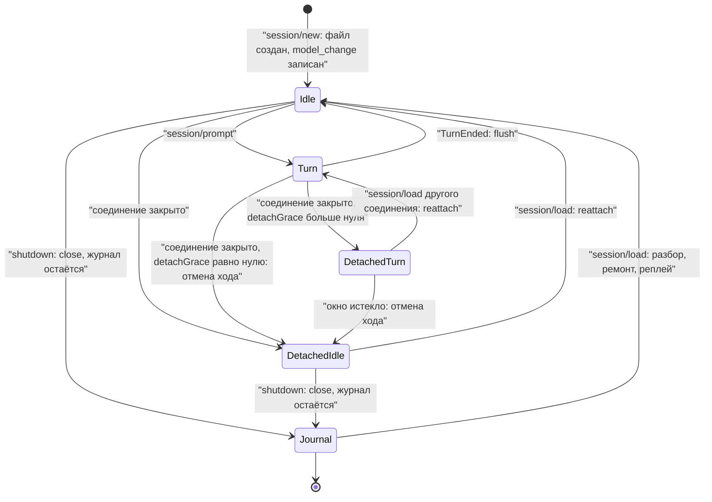
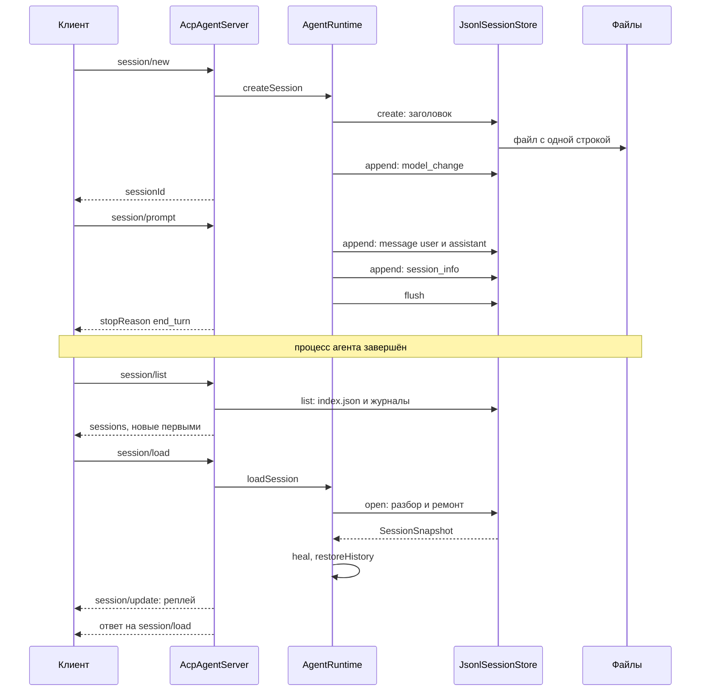
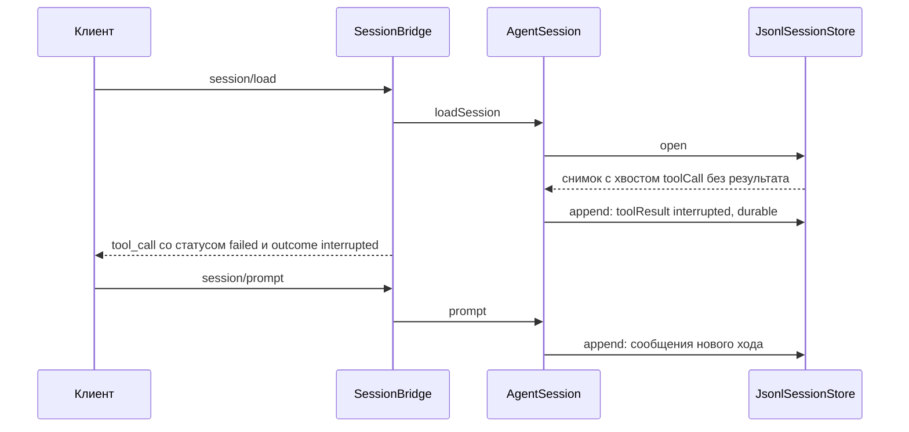
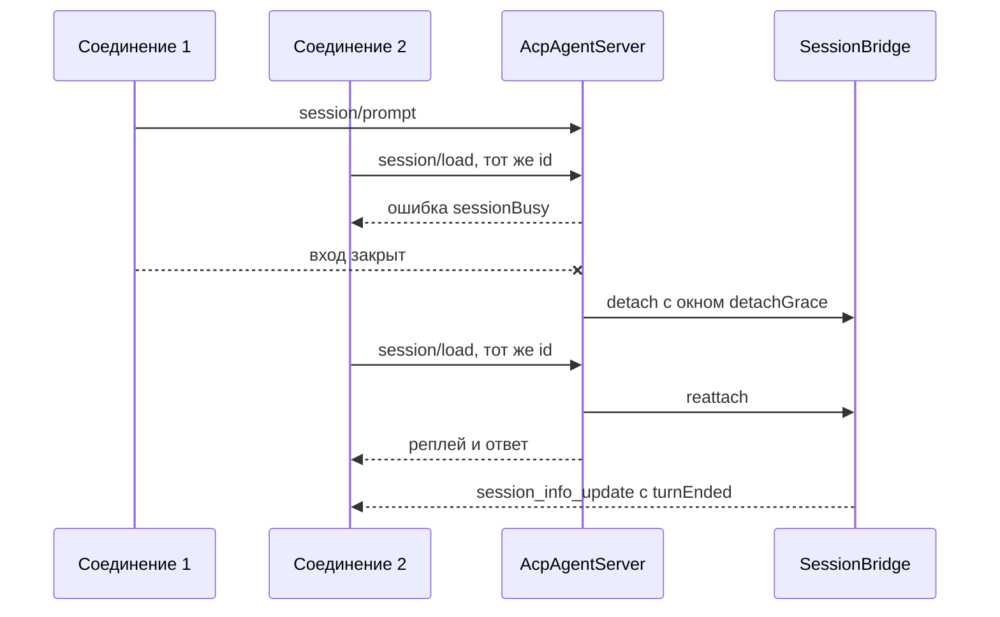

# Алгоритм сессий на стороне агента: от `session/new` до `session/load` после перезапуска

Сессия — один разговор с агентом в одной рабочей папке. Документ описывает её жизнь по шагам: как сессия получает id и журнал, как записи попадают на диск, как сессию находят в списке, как открывают после перезапуска или разрыва соединения и чем ею управляет пользователь. Здесь сторона агента. Сторона клиента — [управление сессиями в `codelab_client_core`](../../../codelab_client_core/doc/session-management.md).

Документ читается целиком. Справочники по частям вынесены отдельно, и здесь они не пересказываются:

- формат журнала, ремонт, проекции, сжатие — [глава 8](../08-sessions-and-compaction.md);
- мост ACP: ход, отмена, отсоединение, реплей — [глава 2 `codelab_agent_acp`](../../../codelab_agent_acp/doc/02-session-bridge.md);
- файлы на диске, `fsync`, карантин — [глава 6 `codelab_agent_io`](../../../codelab_agent_io/doc/06-sessions-and-state.md);
- ход и контекст — [turn.md](turn.md), [context.md](context.md);
- взгляд пользователя — [сессии и сжатие контекста](../../../../../apps/codelab_agent/doc/user/09-sessions.md), [каталог `CODELAB_HOME`](../../../../../docs/ops/codelab-home.md);
- нормы — [`agent-sessions`](../../../../../openspec/specs/agent-sessions/spec.md) (`SES-*`), [`agent-acp-server`](../../../../../openspec/specs/agent-acp-server/spec.md) (`ACP-*`), [`agent-binary`](../../../../../openspec/specs/agent-binary/spec.md);
- проект того, чего ещё нет (переименование, ветки, перемотка, блокировка записи), — [`17-6-session-management.md`](../../../../../docs/architecture/proposals/agent-core/17-6-session-management.md).

Пути в псевдокоде даны от `packages/dart/`: `core` — `codelab_agent_core/lib/src/`, `io` — `codelab_agent_io/lib/src/`, `acp` — `codelab_agent_acp/lib/src/`. Всё описанное реализовано; чего нет, собрано в разделе «Чего нет».

## Вход, выход, гарантии

**Вход.**

- ACP: `session/new`, `session/list`, `session/load`, `session/prompt`, `session/cancel`, `session/set_mode`, `session/set_config_option`. Других методов, которые создают, закрывают или удаляют сессию, в протоколе агента нет (`codelab_acp_protocol/lib/src/acp/acp_method_codec.dart`).
- Слэш-команды в тексте промпта: `/mode`, `/model`, `/compact`, `/status`, `/usage`.
- Конфигурация: `sessions.dir`, `sessions.fsync`; корень данных `CODELAB_HOME`.
- Часы и генератор случайных символов хоста (`Clock`, `IdGenerator`): id и время приходят от хоста, а не из `DateTime.now()`.

**Выход.**

- Файл журнала `<корень>/<слаг папки>/<время>_<id>.jsonl` и производные файлы рядом: `index.json`, `.corrupt`, `usage.json`.
- Ответы ACP: `sessionId`, страница `sessions`, реплей истории кадрами `session/update`.
- События лога `session.*`, `acp.session.*` ([глава 10](../10-observability-and-errors.md)).

**Что переживает перезапуск процесса.**

| Что | Почему переживает |
|---|---|
| сообщения, вызовы и результаты инструментов, сжатие, список задач, итоги субагентов | записаны в журнал, строка уже отдана ОС (`writeString` без буфера процесса) |
| модель, уровень рассуждения, режим, выбранный агент | записи `model_change`, `config_change`, `mode_change`; при загрузке берётся последняя на активной ветке |
| заголовок сессии | запись `session_info` |
| строка списка сессий | выводится из журнала; `index.json` только кэш |

**Что теряется.**

| Что | Почему |
|---|---|
| идущий ход: потоковые дельты, незавершённый ответ модели | в журнал не пишутся; вызов инструмента без результата после загрузки получает результат `interrupted` |
| режим, с которым сессия начиналась | при создании записывается только `model_change`; режим по умолчанию берётся из конфигурации при каждой загрузке, пока не было `mode_change` |
| решения «разрешать всегда» | в журнал не пишутся, агент спросит снова |
| вывод слэш-команд `/status`, `/usage`, `/help` | это ответ команды, а не сообщение транскрипта; в журнале и реплее его нет |
| подписки и очереди ACP, сессии в памяти процесса | у каждого процесса свои; после перезапуска сессия существует только как файл, пока клиент не пришлёт `session/load` |

**Гарантии.**

- Журнал — единственный источник истины. Контекст модели, реплей и строка списка строятся из него чистыми функциями; детерминизм `buildLlmContext` — SES-7, остальное — вывод из кода.
- Ход, который нельзя сохранить, не продолжается: сбой записи завершает его `failed` с классом `storage`.
- Ремонт при открытии меняет существующие строки только при карантине (SES-1); неизвестная версия формата не открывается и не меняется (SES-2).
- Одна сессия — один процесс-писатель. Это правило никем не проверяется, подробности — в «Граничных случаях».

## Модель

**Идентификаторы.** `SessionId` — ULID из 26 символов: 10 символов времени по часам хоста и 16 случайных из алфавита Crockford (`core/session/ids.dart`: `newSessionId`). Время в начале даёт сортировку файлов по созданию. Тот же id уходит клиенту как `sessionId`. Id записи — 8 символов `0-9a-z`, уникальный только внутри файла (`newRecordId`, SES-3).

**Журнал.** Первая строка — заголовок `SessionHeader` (`id`, `cwd`, `created`, `agent`, `metadata.profile`; у субагента ещё `parent`). Остальные строки — записи с полями `id`, `parentId`, `timestamp`. Типы записей и их поля — в [главе 8](../08-sessions-and-compaction.md#формат-журнала).

**Активная ветка.** Путь от листа к корню (`core/session/tree.dart`: `pathToLeaf`). Лист — id последней записи файла, а у записи `leaf` — её `targetId`. Пока записи `leaf` никто не пишет, ветка совпадает с файлом.

**Производные величины.** Всё, что агент знает о сессии при загрузке, берётся проекцией по активной ветке:

| Величина | Откуда | Где |
|---|---|---|
| модель | последняя `model_change` | `buildLlmContext`, `LlmContextProjection.model` |
| режим | последняя `mode_change` | `LlmContextProjection.modeId` |
| уровень рассуждения, агент | последние `config_change` по `optionId` (`effort`, `agent`) | `LlmContextProjection.config` |
| заголовок | последняя непустая `session_info`, иначе первые слова пользователя | `summarize` |
| время обновления | `timestamp` последней записи файла, иначе `created` заголовка | `summarize` |
| число сообщений | слова пользователя и ответы ассистента на ветке | `summarize` |
| список задач | операции `task` на ветке | `buildTaskList` |
| `cwd` | заголовок | `SessionHeader.cwd` |

**Хранилища.** Порт `SessionStore` (`core/session/session_store.dart`): `create`, `append`, `flush`, `open`, `list`, `close`, а для субагентов `createChild`, `openChild`, `openChildReadOnly`. Реализации:

| Реализация | Где | Когда |
|---|---|---|
| `JsonlSessionStore` | `io/session/jsonl_session_store.dart` | `codelab-agent serve`, встроенный агент приложения и `codelab`, сценарий с `--sessions-dir` |
| `MemorySessionStore` | `core/session/memory_session_store.dart` | тесты и хосты без постоянного носителя; тот же текст JSONL и тот же разбор, но в памяти |

`buildAgentCore` отвергает связку «capability `sessionPersistence` включена и хранилище `MemorySessionStore`» исключением `HostWiringException` (`core/host/build_agent_core.dart`).

### Раскладка на диске

```text
<sessions>/                                   sessions.dir или $CODELAB_HOME/sessions
  index.json                                  кэш списка, производный файл
  <слаг>/                                     cwdSlug(cwd): два последних сегмента пути + хеш FNV-1a
    <время>_<id>.jsonl                        журнал корневой сессии
    <время>_<id>.jsonl.corrupt                карантин битых строк, если был
    <время>_<id>/
      usage.json                              журнал расхода, создаётся при первом отчёте /usage
      subagents/<время>_<id потомка>.jsonl    журналы субагентов любой глубины, плоско
```

Время в имени — `created` заголовка, где `:` и `.` заменены на `-` (`io/session/jsonl_session_store.dart`: `create`). Слаг считает `core/session/slug.dart`: `cwdSlug`. Хеш считается от нормализованного полного пути, поэтому `/a/b-c` и `/a-b/c` дают разные каталоги. Слаг необратим, настоящий `cwd` лежит в заголовке. Поиск файла по id — по суффиксу `_<id>.jsonl` в каталогах слагов без рекурсии (`_find`), результат запоминается на жизнь хранилища.

### Жизненный цикл в процессе агента

На схеме — состояния сессии в одном процессе агента. Отдельного типа состояния у сессии нет: схема собрана из полей моста `SessionBridge` (`_turn`, `_detached`) и записи сессии в `AcpAgentServer._sessions`.



`Journal` — сессии нет в памяти, есть только файл. `Idle` и `Turn` — сессия открыта и принадлежит соединению-владельцу; `DetachedIdle` и `DetachedTurn` — владелец ушёл, сессия остаётся в памяти до следующего `session/load` или остановки сервера. Остановка сервера отменяет идущий ход, ждёт его не дольше `grace` и закрывает сессию из любого состояния; на схеме показаны переходы из состояний без хода.

## Псевдокод

Записан в порядке выполнения. Упрощена только запись: логирование и служебные вызовы, которые не меняют результат, опущены или сведены в строку.

### А. Создание: `session/new`

```text
sessionNew(params) -> NewSessionResponse
  // acp/agent_server.dart: _Connection._sessionNew
  1. checkCwd(params.cwd)                          // абсолютный путь; каталог существует, если хост может проверить; иначе -32602
  2. mapped = mapMcpServers(params.mcpServers)
     wiring = wire(cwd)                            // мост и порты создаются до сессии: порты нужны в SessionSpec
  3. session = runtime.createSession(SessionSpec(cwd, ports, mcpServers))
     // core/runtime/agent_runtime.dart: AgentRuntimeImpl.createSession
     3.1 start = applied                           // снимок конфигурации на момент вызова
     3.2 sessionId = newSessionId(clock, ids)      // core/session/ids.dart
         createdAt = clock.now()
     3.3 canonical = realpath(spec.cwd) или spec.cwd   // _canonicalCwd
     3.4 scope = sessionConfig(start, sessionId, spec.cwd, canonical)
         // _sessionConfig, _projectScope: конфигурация папки
         // отказ -> ProjectConfigException; журнала ещё нет
     3.5 header = SessionHeader(id: sessionId, cwd: spec.cwd, created: createdAt,
                                agent: coreAgentInfo, metadata: {profile: profile.name})
     3.6 await store.create(header)                // io/session/jsonl_session_store.dart: JsonlSessionStore.create
         // путь <root>/<cwdSlug(cwd)>/<время>_<id>.jsonl; один вызов write на строку заголовка, durable
     3.7 model = spec.model ?? selectModel(...)    // _selectModel: явная в конфиге -> последняя -> первый провайдер
     3.8 session = open(snapshot: SessionSnapshot.empty(header),
                        mode: spec.mode ?? settings.permissions.mode ?? profile.defaultMode, model, ...)
         // _open: SessionWriter над пустым снимком, _titled = false
     3.9 попытка: await writer.append(model_change(model))    // parentId = null
         при ошибке: abandon(session); rethrow
     3.10 если spec.model != null: rememberLastModel(...)
     3.11 session.handedOut = true
  4. bridge.attach(session); server.sessions[session.id] = bridge
  5. reply NewSessionResponse(sessionId, modes, configOptions)
     после ответа: session/update available_commands_update     // ACP-8: до ответа уведомлений нет
```

### Б. Запись

Какие записи пишет `SessionWriter` по каким событиям — в [главе 8](../08-sessions-and-compaction.md#запись-sessionwriter). Здесь путь одной записи от события до байтов.

```text
record(event)
  // core/session/session_writer.dart: SessionWriter.handle
  1. если event это TurnStarted: failed = false
     если failed: return                           // после сбоя до нового хода писатель молчит
  2. выбрать запись по типу события                // message, mode_change, task, subagent, session_info; TurnEnded -> шаг 6
  3. append(build, durable)
     // _enqueue: записи встают в одну цепочку (SES-16)
     3.1 id = newRecordId(ids, snapshot.byId.containsKey)
         parentId = snapshot.leafId; at = clock.now()   // вычисляются, когда дошла очередь
         record = build(id, parentId, at)
  4. commit(record, durable)
     // _commit
     4.1 await store.append(sessionId, record, durable)
         // io/session/jsonl_session_store.dart: JsonlSessionStore.append
         а) line = jsonEncode(record.toJson())      // один раз, до очереди; перевод строки внутри — StateError
         б) path = childPaths[id] ?? pathOf(id)
         в) writeQueue.run(path, () => writeLine(path, line, durable))
              // io/session/write_queue.dart: одна цепочка Future на путь
              handle = handles[path] ??= open(path, FileMode.append)
              handle.writeString(line + "\n")       // один вызов write на строку (вывод из кода)
              sync = switch fsync { always: true, checkpoints: durable, never: false }
              если sync: handle.flush()              // fsync
              при ошибке: закрыть дескриптор, rethrow
     4.2 snapshot = snapshot.withRecord(record, leafAfter(record))   // после файла, не до
  5. при ошибке шага 4: failed = true; лог session.append.failed; onFailure(error)
     // сессия: abort(StorageFailure) -> TurnEnded(failed), AgentError(cls: storage)
  6. TurnEnded: await store.flush(sessionId)       // fsync последней записи хода, если fsync != never
```

После `TurnEnded` сессия решает, нужен ли заголовок:

```text
afterTurn()
  // core/runtime/agent_runtime.dart: _Session._afterTurn
  1. если titled: return
  2. title = summarize(snapshot).title
     если title == null: return
  3. titled = true
  4. emit SessionTitleChanged(title)               // писатель запишет session_info{title, source: auto}
```

### В. Список: `session/list`

```text
sessionList(params) -> ListSessionsResponse
  // acp/agent_server.dart: _Connection._sessionList
  1. если params.cwd задан и не абсолютный: -32602 'cwd must be an absolute path'
  2. page = runtime.listSessions(cwd: params.cwd, cursor: params.cursor)    // pageSize не передаётся: 50
     // core/runtime/agent_runtime.dart: listSessions -> store.list
     // io/session/jsonl_session_store.dart: JsonlSessionStore.list
     2.1 index = readIndex()                       // index.json; нечитаемый игнорируется, лог session.index.ignored
     2.2 files = *.jsonl в каталоге слага cwd, либо во всех каталогах слагов   // без рекурсии
     2.3 для каждого файла: writeQueue.run(path, () => entryOf(file, index[ключ]))
         // entryOf: stat -> если (size, mtime) совпали с кэшем, взять кэш
         // иначе parseSessionLines(без ремонта на диске) -> summarize
         // нет id в имени файла или неизвестная версия формата -> пропустить файл
     2.4 если cwd задан: оставить сводки, у которых summary.cwd == cwd   // слаг не доказывает совпадение
     2.5 если индекс изменился: записать index.json через .tmp и rename
     2.6 pageOf(summaries, cursor, pageSize)       // core/session/session_store.dart
         // сортировка: updatedAt по убыванию, при равенстве id по убыванию
         // страница: элементы строго после курсора; nextCursor, если остались
         // курсор не разобрался -> InvalidCursor
  3. при InvalidCursor: -32602 'invalid cursor'
  4. reply sessions: [{sessionId, cwd, title, updatedAt}], nextCursor
     // updatedAt = formatJournalTime(summary.updatedAt)
```

### Г. Открытие: `session/load`

```text
sessionLoad(params) -> LoadSessionResponse
  // acp/agent_server.dart: _Connection._sessionLoad
  1. checkCwd(params.cwd); mapped = mapMcpServers(...)
  2. bridge = server.sessions[id]
     2.1 если bridge есть:                         // сессия открыта в этом процессе
         если bridge.turnActive и не bridge.detached: -32602 data.codelab.reason = sessionBusy
         reconnect = bridge.reattach(owner: this, sink, usageSink, capabilities)   // без await между проверкой и reattach
         bridge.session.setMcpServers(mcpServers)
     2.2 иначе:                                    // сессии в памяти нет: открыть из файла
         wiring = wire(cwd)
         session = runtime.loadSession(SessionId(id), ports, cwd: cwd, mcpServers)   // раздел Г.1
         нет файла -> SessionNotFound -> -32002 'Session not found: <id>'
         bridge = wiring.bridge; bridge.attach(session)
         await bridge.seedUsage()                  // сумма usage сессии из журнала, до реплея
         server.sessions[id] = bridge
  3. await bridge.replayInto(emit)                 // раздел Г.2
  4. reply LoadSessionResponse(modes, configOptions)          // ACP-3: после последнего кадра реплея
     после ответа: sendLoadSnapshot(); если reconnect: bridge.resume()
```

Г.1. Открытие в ядре:

```text
loadSession(id, ports, cwd?, model?, mcpServers) -> AgentSession
  // core/runtime/agent_runtime.dart: AgentRuntimeImpl.loadSession
  1. start = applied
  2. snapshot = await store.open(id)
     // JsonlSessionStore.open: writeQueue.run(path):
     //   а) drop(path): закрыть дескриптор (rename при ремонте подменяет inode)
     //   б) файла нет -> SessionNotFound
     //   в) text = utf8.decode(readAsBytes, allowMalformed) в Isolate.run
     //   г) parseSessionLines(text)                // core/session/parse.dart
     //        - первая строка: заголовок; version != sessionFormatVersion -> SessionOpenException, файл не меняется (SES-2)
     //        - строка не разбирается -> карантин, reason invalid, а у последней строки без \n - truncated (SES-5)
     //        - повтор id -> карантин, reason duplicate id
     //        - лист = id последней записи; указывает в пустоту -> последняя запись не leaf, healedLeafFrom (SES-6)
     //   д) repair(file, parsed)                   // раздел «Ремонт»
  3. restored = buildLlmContext(snapshot)          // модель, режим, config{effort, agent}
  4. canonical = realpath(cwd ?? header.cwd)
     scope = sessionConfig(start, id, cwd ?? header.cwd, canonical)   // конфигурация папки
  5. effort = restored.config['effort'] ?? settings.effort
     chosen = model ?? journalModel(в каталоге) ?? settings.defaultModel
  6. session = open(snapshot, mode: restored.modeId ?? settings.permissions.mode ?? profile.defaultMode,
                    model: chosen, effort, ...)
  7. попытка:
       7.1 await session.heal()                    // _heal: прерванный ход, раздел Д
       7.2 если журнальная модель != chosen: лог session.model.not_restored; append(model_change(chosen))
       7.3 если model != null: rememberLastModel(...)
       7.4 history = session.restoreHistory()      // проекция + список задач без публикации
       7.5 session.restoreAgent(restored.config['agent'], baseMode, baseModel)
             // пропавшее определение агента -> лог agent.definition.missing и config_change{agent: default}
       7.6 session.adoptProjection(history, ...)   // транскрипт агента и якорь сжатия
       7.7 если cwd != null и cwd != header.cwd: append(custom 'codelab.cwd_changed' {from, to})
     при ошибке: abandon(session); rethrow
  8. session.handedOut = true
```

Г.2. Реплей:

```text
replayInto(emit)
  // acp/session_bridge.dart: SessionBridge.replayInto
  1. если клиент согласился на subagentToolCalls: придержать кадры живого хода; events = await session.replayTree()
     иначе: events = session.replay()              // core/session/projections.dart: buildReplay; журналы потомков не читаются
  2. frames = replayUpdates(events)                // acp/replay.dart: по кадру на блок и на вызов, сразу с итоговым статусом
  3. хвост: последний plan; current_mode_update; config_option_update; available_commands_update;
     session_info_update с последним заголовком, если он был
  4. emit(frame) для каждого кадра по порядку
  5. finally: отпустить придержанные кадры живого хода
```

### Д. Ремонт и прерванный ход

Выполняется внутри Г.1, шаги 2д и 7.1.

```text
repair(file, parsed)
  // io/session/jsonl_session_store.dart: _repair
  1. если карантин пуст:
       если последняя строка целая, но без \n: дописать "\n"       // иначе две записи склеятся
       return
  2. дописать в <файл>.corrupt строки {line, text, reason, at}
  3. если в карантине только оборванная последняя строка:
       усечь файл до конца последней целой строки; flush
     иначе:
       записать keptLines в <файл>.tmp; flush; rename(tmp, файл)    // единственное переписывание (SES-1)
  4. лог session.quarantined {session_id, lines, truncated}

heal()
  // core/runtime/agent_runtime.dart: _Session._heal
  1. calls = findInterruptedCalls(snapshot)        // вызовы последнего ответа ветки без toolResult
  2. для каждого: appendBuilt(toolResult{outcome: interrupted, isError: true, текст interruptedResultText}, durable)   // SES-10
  3. для детей в статусе running: append(subagent{status: failed, failure: interrupted}, durable);
     журнал ребёнка лечится тем же способом рекурсивно, не глубже 3
  4. ничего не перезапускается; сессия после загрузки idle
```

### Е. Управление: режим, модель, уровень рассуждения, агент

```text
setMode(mode) / setModel(id) / setEffort(effort) / setAgent(name)
  // core/runtime/agent_runtime.dart: _Session.setMode, setModel, setEffort, setAgent
  1. serial(...)                                   // очередь смен: по одной
  2. setMode:   policy.mode = mode; systemPrompt пересобран; emit ModeChanged   // писатель: mode_change
     setModel:  model = catalog.resolve(id) или ArgumentError; apply(model); append(model_change); rememberLastModel
     setEffort: effort = e; apply(model с уровнем); append(config_change{optionId: effort, value})
     setAgent:  состояние агента и инструменты — до первого await; append(config_change{optionId: agent, value: name});
                затем model_change, если у агента своя модель; затем смена режима, если у агента свой режим
  3. setMode применяет политику сразу (applyMode, deferPolicy: false); setModel — на ближайшей границе шага идущего хода;
     на границу шага откладывается только режим, который повлёк setAgent (deferPolicy: true); запись в журнал — сразу
```

### Ж. Жизнь в мосте: разрыв, повтор, остановка

Полное описание — [глава 2 `codelab_agent_acp`](../../../codelab_agent_acp/doc/02-session-bridge.md#отсоединение-и-переподключение). Здесь порядок шагов.

```text
connectionClosed(connection)
  // acp/agent_server.dart: _Connection.run -> AcpAgentServer._detach
  1. для каждого моста, у которого owner == connection: bridge.detach(config.detachGrace)
     // acp/session_bridge.dart: detach
     1.1 detached = true; sink и usageSink заменены пустыми функциями   // кадры некуда слать, журнал остаётся
     1.2 если хода нет: return                      // сессия ждёт session/load
     1.3 лог acp.session.detached
     1.4 если detachGrace == 0: expire() сразу, иначе таймер на detachGrace
  2. expire(): лог acp.session.grace_expired; cancel()

sessionCancel(sessionId)
  // acp/agent_server.dart: _Connection._cancel -> SessionBridge.cancel
  1. хода нет: лог acp.cancel.no_turn, ничего не уходит
  2. иначе: cancelRequested = true (ответ на session/prompt будет cancelled, ACP-5);
     токен хода отменён; Agent.abort; ожидающие fs/* прекращены

shutdown(grace)
  // acp/agent_server.dart: AcpAgentServer.shutdown
  1. для каждого моста: cancel(); ждать TurnEnded не дольше grace (по умолчанию 5 с)
  2. bridge.close(): session.close()                // ждёт простоя хода, usage.json, store.close(id)
  3. sessions.clear(); закрыть соединения
```

## Пошаговое пояснение

### Создание

**Id и время до конфигурации папки (шаги 3.2–3.4).** Id нужен логам конфигурации, а журнал создаётся только после неё. Если конфигурация папки отвергнута, на диске ничего не остаётся (`ProjectConfigException` превращается в `-32603` с `data.codelab.reason: "projectConfigInvalid"`).

**`cwd` в заголовке — как передал клиент (шаг 3.5).** Каноническая форма (`realpath`) нужна для сравнения с корнем проекта и конфигурации, а в журнал идёт строка клиента. По ней же работает фильтр списка: `session/list` с другим написанием той же папки (через ссылку) сессию не найдёт.

**Первая запись — `model_change` с `parentId: null` (шаг 3.9).** Режим при создании не записывается: он берётся из `spec.mode`, конфигурации или профиля хоста. Поэтому сессия без единой смены режима при каждой загрузке получает режим из текущей конфигурации, а не из того дня, когда её создали. Первая смена пишет `mode_change`, и с этого момента режим закреплён журналом.

**Модель новой сессии (шаг 3.7).** Явная `agent.default_model` конфига побеждает всегда; иначе модель, которую пользователь выбрал последней (порт `LastModelStore`); иначе первая модель первого провайдера. Источник пишется в лог `session.model.selected`.

**Уведомления после ответа (шаг 5).** ACP-8: до ответа на `session/new` по сессии ничего не уходит. Список команд идёт сразу после ответа в `after`.

**Сбой после создания файла (шаг 3.9).** Если не записалась `model_change`, закрываются серверы MCP, но файл с одним заголовком остаётся. Он виден в списке без заголовка и с нулём сообщений. То же случается при `CancelledException` в `_open` после `store.create`, если рантайм останавливают. `_abandon` не вызывает `store.close(id)`, и дескриптор журнала остаётся открытым.

### Запись

**Очередь на двух уровнях.** `SessionWriter` ставит записи одной цепочкой (SES-16): родитель берётся из листа снимка, а две одновременные записи получили бы одного родителя, и вторая ушла бы на боковую ветку, невидимую для контекста модели. Ниже `JsonlSessionStore` ставит операции над одним путём в общую очередь процесса `writeQueue`: байты двух строк не перемешиваются (SES-4 — только общая очередь на путь), а ремонт при `open` не вклинивается между записью и сбросом (SES-4).

**Снимок меняется после файла (шаг 4.2).** Если запись не удалась, снимок остаётся прежним, и следующая запись возьмёт верного родителя.

**Сбой — это конец хода (шаг 5).** Писатель не бросает исключение в цикл: он запоминает сбой, логирует и просит сессию отменить ход причиной `StorageFailure`. До следующего `TurnStarted` он молчит, иначе в журнале появилась бы запись после пропуска.

**`fsync` по политике (шаг 4.1в).** `checkpoints` сбрасывает на носитель только записи с `durable` (результат инструмента, сжатие, события субагента) и конец хода. Падение процесса не теряет ничего ни при одной политике: байты уже у ОС. `fsync` защищает только от отключения питания, и только содержимое файла: каталог не синхронизируется ни после `create`, ни после `rename` при ремонте. Новый файл журнала и переписанный журнал могут не пережить отключение питания (вывод из кода).

**Заголовок после хода.** Первый же завершённый ход со словами пользователя пишет `session_info` с `source: auto`. Заголовок строит `summarize`: последний непустой `session_info`, иначе первое сообщение пользователя без пробелов-дублей, не длиннее 80 символов, с обрезкой по слову и `…` (`sessionTitleFrom`). Служебные сообщения цикла (подсказки, уведомления) слов пользователя не составляют (SES-14).

### Список

**Откуда берутся поля.** `sessionId` — id из имени файла, `cwd` — заголовок, `title` — последний `session_info` или первые слова пользователя, `updatedAt` — время последней записи файла (а не `mtime` файла и не время последнего хода). Сессия без записей показывает `created` заголовка.

**Кэш и свежесть.** Индекс хранит сводку и пару `(size, mtime)`. Если пара совпала, файл не читается. Иначе он разбирается (в памяти, без ремонта на диске), и строка индекса обновляется. Индекс пишется через `.tmp` и `rename`, без `fsync`. Потеря индекса стоит одного прохода по журналам.

**Фильтр по `cwd`.** Читается один каталог слага, затем сводки сравниваются с `cwd` из заголовка: слаг не доказывает совпадение пути (хеш 32 бита).

**Порядок и страницы.** Сначала самые свежие; при равном времени — больший `id`. Курсор — base64url от `{"v":1,"after":"<updatedAt>|<id>"}`, страница — элементы строго после него. Размер страницы — 50: ACP-слой `pageSize` не передаёт. Capability `sessionCapabilities.list` и `loadSession` объявляются, только когда включена `sessionPersistence` (`acp/agent_server.dart`: `_initialize`); без неё `session/list` и `session/load` в `initialize` не объявлены, но обработчики в сервере остаются и запросы обслуживаются (проверки capability нет).

### Открытие

**Два пути: файл и память (шаг 2).** Если сессия уже открыта в процессе, `session/load` не читает файл: мост переходит к новому владельцу (`reattach`) и отдаёт реплей из снимка в памяти. Файл читается, только когда сессии в памяти нет — например, после перезапуска.

**Разбор в `Isolate.run` (шаг 2в).** Встроенный агент живёт в одном isolate с интерфейсом клиента, а файл в тысячи записей читается и разбирается построчно. Результат тот же, что при разборе на месте.

**Ремонт делится (шаг 2г–д).** Разбор в ядре чинит «в памяти»: синтезирует отсутствующий заголовок, исправляет лист, считает битые ссылки. Хранилище чинит носитель по отчёту `ParsedJournal`: усечение, переписывание, перевод строки. Переписывание — единственное, что меняет существующие строки (SES-1). Оборванная последняя строка — обычный итог падения, а не повод отказать в открытии (SES-5).

**Модель, режим, уровень рассуждения (шаги 3–6).** Модель журнала побеждает, если её знает каталог; иначе берётся модель конфигурации, пишется `session.model.not_restored` и новая `model_change`, чтобы следующая загрузка не повторяла замену. Режим без `mode_change` в журнале — из конфигурации (см. «Создание»). Явный `model` в вызове побеждает журнал и запоминается как последняя выбранная.

**Прерванный ход (шаг 7.1).** Вызов без результата не перезапускается: `exec` или `write` мог выполниться наполовину. Он получает результат `interrupted` с текстом «проверьте состояние перед повтором» (SES-10). Результаты пишутся до реплея и до первого нового шага, поэтому первый же `prompt` видит согласованную историю.

**`cwd` при открытии (шаг 7.7).** Клиент может открыть сессию в другой папке. Агент не отказывает: конфигурация берётся для новой папки, а в журнал пишется `custom` `codelab.cwd_changed {from, to}`. Заголовок не переписывается. Это относится только к открытию из файла: если сессия уже открыта в памяти, `cwd` запроса `session/load` игнорируется, `cwd_changed` не пишется и новая конфигурация папки не берётся.

**Реплей (раздел Г.2).** Клиент получает ту же последовательность, что видел вживую: `user_message_chunk`, `agent_message_chunk`, вызовы инструментов целыми кадрами. Служебные сообщения цикла клиенту не показываются. Ответ на `session/load` идёт после последнего кадра реплея (ACP-3). Вывод слэш-команд в реплее отсутствует: в журнале его нет.

### Управление

**Что пишется.** Смена режима — `mode_change`, модели — `model_change`, уровня рассуждения и агента — `config_change` с `optionId` и `value`. Запись агента идёт раньше записей модели и режима, которые он повлёк: по ней загрузка находит «базу» — режим и модель до перехода на агента (`_agentBaseOf`).

**Откуда приходит смена.** Три пути, один результат: `session/set_mode`, `session/set_config_option` (`mode`, `model`, `effort`, `agent`) и слэш-команды `/mode`, `/model` в тексте промпта. Ответ `session/set_config_option` несёт полный список опций, поэтому эхо своего запроса подавляется (ACP-11). У `session/set_mode` ответ `{}`: `current_mode_update` отправляется, а `config_option_update` — нет (пример 2).

**Агент, которого больше нет.** Если определение агента из журнала пропало, загрузка пишет `config_change{agent: default}`, чтобы следующая загрузка не считала базу от устаревшего перехода.

**Встроенные команды.** `/status` печатает модель, режим, рабочую папку и серверы MCP; `/usage` строит отчёт расхода по журналу и создаёт `usage.json`; `/compact` пишет запись `compaction`; `/mode`, `/model` — смены выше; `/help`, `/config`, `/mcp` к сессии не относятся. Команд, которые начинают новую сессию, очищают историю, переименовывают, удаляют или ветвят её, нет (`core/commands/builtin_commands.dart`: `BuiltinName`). Новый разговор — это новый `session/new`.

### Мост

**Одна сессия в двух соединениях.** Идущий ход занимает сессию: второй `session/load` получает `sessionBusy`. Если хода нет или владелец ушёл, второе соединение становится владельцем (`reattach`): кадры идут ему, а у первого сессия перестаёт получать события.

**Отсоединение.** `detach` не трогает журнал и ход: он заменяет приёмники кадров пустыми. Хосты `codelab-agent` и встроенного агента задают `detachGrace: Duration.zero` (`apps/codelab_agent/lib/src/host/agent_host.dart`, `codelab_embedded/lib/src/assemble.dart`), поэтому разрыв во время хода отменяет его сразу. По умолчанию окно 30 секунд (`AcpServerConfig.detachGrace`).

**Отмена.** `session/cancel` отменяет токен хода; ход завершается `cancelled`, записи, уже сделанные ходом, остаются в журнале. Результат вызова при отмене — `cancelled`, а не `interrupted`: `interrupted` рождается только из обрыва процесса.

**Закрытие.** `close` сессии дожидается простоя хода, начатой записи `usage.json` и очереди записи, затем закрывает дескриптор. Журнал остаётся на диске.

## Схемы ключевых сценариев

### Создание, ход, перезапуск, открытие

На схеме — две жизни одного процесса агента. Между ними процесс завершён, остался только файл.



### Ход после открытия и прерванный вызов



### Второе соединение



При `detachGrace`, равном нулю (оба хоста), ход отменяется в момент `detach`: переподключение к идущему ходу рассчитано на хосты с ненулевым окном.

## Разобранный пример

Прогон на скомпилированном `codelab-agent serve --stdio` со сценарной моделью: `--llm-script` (четыре шага, ответы заготовлены) и `--sessions-dir` во временном каталоге, `CODELAB_HOME` там же, ключи провайдеров не передавались, сеть не использовалась. Клиент — короткая программа, которая шлёт кадры ACP в stdin и читает stdout. Процесс запускался несколько раз подряд над одним каталогом: так получен перезапуск. Ответы модели из-за сценария одинаковые («Сессия — это журнал разговора.»), и после перезапуска сценарий стартует с первого шага. Пути заменены на `~` (в кадрах `~/projects/demo` — только маскировка: реальные запросы шли с абсолютными путями), идентификаторы сессий — на `<session-id>` и `<session-id-2>`; идентификаторы записей и время записаны как есть. Хеш в имени каталога посчитан от настоящего пути прогона, поэтому не совпадёт с хешем от `~/projects/demo`.

### 1. Раскладка на диске

После двух сессий в разных папках, вызова `session/list` и `/usage` (`find sessions`):

```text
sessions/
sessions/index.json
sessions/projects-demo-ce2e8dd4/
sessions/projects-demo-ce2e8dd4/2026-11-25T07-04-02-514Z_<session-id>.jsonl
sessions/projects-demo-ce2e8dd4/2026-11-25T07-04-02-514Z_<session-id>.jsonl.corrupt
sessions/projects-demo-ce2e8dd4/2026-11-25T07-04-02-514Z_<session-id>/usage.json
sessions/projects-other-49f9c13b/2026-11-25T07-04-02-521Z_<session-id-2>.jsonl
```

`index.json` появился после первого `session/list`, а `usage.json` — после `/usage`. Файл `.corrupt` — следы шага 4 ниже.

### 2. Журнал после создания и трёх ходов

Сессия в `~/projects/demo`: `session/new`, ход «Расскажи, что такое сессия», `session/set_mode plan`, `/status`, ход «Что дальше?» и, после перезапуска, ход «Помнишь, о чём мы говорили?». Поле `usage` у ответов ассистента заменено на `…`:

```jsonl
{"type":"session","version":1,"id":"<session-id>","cwd":"~/projects/demo","created":"2026-11-25T07:04:02.514Z","agent":{"name":"codelab-agent","version":"0.1.0"},"metadata":{"profile":"agent-serve"}}
{"type":"model_change","id":"9o8ieq7m","parentId":null,"timestamp":"2026-11-25T07:04:02.516Z","provider":"scripted","modelId":"scripted-1","baseUrl":"http://scripted.invalid/v1"}
{"type":"message","id":"jjk9xme4","parentId":"9o8ieq7m","timestamp":"2026-11-25T07:04:02.517Z","message":{"role":"user","content":[{"type":"text","text":"Расскажи, что такое сессия"}],"timestamp":"2026-11-25T07:04:02.517549Z"}}
{"type":"message","id":"b7y48mda","parentId":"jjk9xme4","timestamp":"2026-11-25T07:04:02.517Z","message":{"role":"assistant","content":[{"type":"text","text":"Сессия — это журнал разговора."}],"model":{"provider":"scripted","id":"scripted-1"},"usage":"…","stopReason":"stop","timestamp":"2026-11-25T07:04:02.517838Z"}}
{"type":"session_info","id":"woga8xhf","parentId":"b7y48mda","timestamp":"2026-11-25T07:04:02.518Z","title":"Расскажи, что такое сессия","source":"auto"}
{"type":"mode_change","id":"zut402ds","parentId":"woga8xhf","timestamp":"2026-11-25T07:04:02.518Z","modeId":"plan"}
{"type":"message","id":"jbqznfrr","parentId":"zut402ds","timestamp":"2026-11-25T07:04:02.520Z","message":{"role":"user","content":[{"type":"text","text":"Что дальше?"}],"timestamp":"2026-11-25T07:04:02.520017Z"}}
{"type":"message","id":"7nxoe5s8","parentId":"jbqznfrr","timestamp":"2026-11-25T07:04:02.520Z","message":{"role":"assistant","content":[{"type":"text","text":"Режим plan включён."}],"model":{"provider":"scripted","id":"scripted-1"},"usage":"…","stopReason":"stop","timestamp":"2026-11-25T07:04:02.520220Z"}}
{"type":"message","id":"wcinpd4m","parentId":"7nxoe5s8","timestamp":"2026-11-25T07:04:03.699Z","message":{"role":"user","content":[{"type":"text","text":"Помнишь, о чём мы говорили?"}],"timestamp":"2026-11-25T07:04:03.699502Z"}}
{"type":"message","id":"5elsxaqd","parentId":"wcinpd4m","timestamp":"2026-11-25T07:04:03.701Z","message":{"role":"assistant","content":[{"type":"text","text":"Сессия — это журнал разговора."}],"model":{"provider":"scripted","id":"scripted-1"},"usage":"…","stopReason":"stop","timestamp":"2026-11-25T07:04:03.701738Z"}}
```

Что видно:

- Первая запись `model_change` с `parentId: null`, дальше цепочка: каждая запись ссылается на предыдущую.
- Режим при создании не записан. `mode_change` появился после `session/set_mode`.
- Запроса `/status` в журнале нет: ни сообщения пользователя, ни ответа. Поэтому его нет и в реплее.
- `session_info` написан один раз, после первого хода. Третий ход (`wcinpd4m`) идёт уже после перезапуска и продолжает цепочку от последней записи.

Кадры `session/new`, первого хода и `session/set_mode` (оба ответа `result` и уведомления, как записаны клиентом; длинные списки режимов и команд сокращены `…`):

```text
c2a {"jsonrpc":"2.0","id":2,"method":"session/new","params":{"cwd":"~/projects/demo","mcpServers":[]}}
a2c {"jsonrpc":"2.0","id":2,"result":{"sessionId":"<session-id>","modes":{"availableModes":[…]},"configOptions":[…]}}
c2a {"jsonrpc":"2.0","id":3,"method":"session/prompt","params":{"sessionId":"<session-id>","prompt":[{"type":"text","text":"Расскажи, что такое сессия"}]}}
a2c {"jsonrpc":"2.0","method":"session/update","params":{"sessionId":"<session-id>","update":{"sessionUpdate":"available_commands_update","availableCommands":[…]}}}
a2c {"jsonrpc":"2.0","method":"session/update","params":{"sessionId":"<session-id>","update":{"sessionUpdate":"agent_message_chunk","content":{"type":"text","text":"Сессия — это жур"}}}}
a2c {"jsonrpc":"2.0","method":"session/update","params":{"sessionId":"<session-id>","update":{"sessionUpdate":"agent_message_chunk","content":{"type":"text","text":"нал разговора."}}}}
a2c {"jsonrpc":"2.0","method":"session/update","params":{"sessionId":"<session-id>","update":{"sessionUpdate":"session_info_update","title":"Расскажи, что такое сессия","updatedAt":"2026-11-25T07:04:02.518Z"}}}
a2c {"jsonrpc":"2.0","id":3,"result":{"stopReason":"end_turn"}}
c2a {"jsonrpc":"2.0","id":4,"method":"session/set_mode","params":{"sessionId":"<session-id>","modeId":"plan"}}
a2c {"jsonrpc":"2.0","method":"session/update","params":{"sessionId":"<session-id>","update":{"sessionUpdate":"current_mode_update","currentModeId":"plan"}}}
a2c {"jsonrpc":"2.0","id":4,"result":{}}
```

### 3. Список после перезапуска

Новый процесс, тот же каталог. `index.json` на момент `initialize` ещё не существовал. Ответы `session/list` без фильтра и с `cwd` (кадры клиента):

```text
c2a {"jsonrpc":"2.0","id":2,"method":"session/list","params":{}}
a2c {"jsonrpc":"2.0","id":2,"result":{"sessions":[{"sessionId":"<session-id-2>","cwd":"~/projects/other","title":"Привет из другой папки","updatedAt":"2026-11-25T07:04:02.523Z"},{"sessionId":"<session-id>","cwd":"~/projects/demo","title":"Расскажи, что такое сессия","updatedAt":"2026-11-25T07:04:02.520Z"}]}}
c2a {"jsonrpc":"2.0","id":3,"method":"session/list","params":{"cwd":"~/projects/demo"}}
a2c {"jsonrpc":"2.0","id":3,"result":{"sessions":[{"sessionId":"<session-id>","cwd":"~/projects/demo","title":"Расскажи, что такое сессия","updatedAt":"2026-11-25T07:04:02.520Z"}]}}
```

Первой идёт сессия с более поздней последней записью. `updatedAt` сессии `demo` — `07:04:02.520`, время записи `7nxoe5s8`, а не время `session/set_mode` (оно раньше) и не `mtime` файла. Индекс снят позже, после третьего хода и ремонта, поэтому его `updatedAt` (`03.701Z`, `05.663Z`) новее, чем в ответе выше. Содержимое `index.json` в конце прогона (`messageCount: 6` — три слова пользователя и три ответа ассистента; `size` и `mtime` — ключ свежести):

```json
{"v":1,"sessions":{"projects-demo-ce2e8dd4/2026-11-25T07-04-02-514Z_<session-id>.jsonl":{"size":2948,"mtime":1795590244471,"id":"<session-id>","cwd":"~/projects/demo","title":"Расскажи, что такое сессия","updatedAt":"2026-11-25T07:04:03.701Z","messageCount":6,"lastTurnFailed":false},"projects-other-49f9c13b/2026-11-25T07-04-02-521Z_<session-id-2>.jsonl":{"size":2847,"mtime":1795590245663,"id":"<session-id-2>","cwd":"~/projects/other","title":"Привет из другой папки","updatedAt":"2026-11-25T07:04:05.663Z","messageCount":4,"lastTurnFailed":false}}}
```

### 4. Открытие и реплей

`session/load` той же сессии в новом процессе. Кадры реплея в порядке отправки (длинные `config_option_update` и `available_commands_update` сокращены):

```text
c2a {"jsonrpc":"2.0","id":4,"method":"session/load","params":{"sessionId":"<session-id>","cwd":"~/projects/demo","mcpServers":[]}}
a2c … "sessionUpdate":"user_message_chunk"   "text":"Расскажи, что такое сессия"
a2c … "sessionUpdate":"agent_message_chunk"  "text":"Сессия — это журнал разговора."
a2c … "sessionUpdate":"user_message_chunk"   "text":"Что дальше?"
a2c … "sessionUpdate":"agent_message_chunk"  "text":"Режим plan включён."
a2c … "sessionUpdate":"current_mode_update"  "currentModeId":"plan"
a2c … "sessionUpdate":"config_option_update" …
a2c … "sessionUpdate":"available_commands_update" …
a2c … "sessionUpdate":"session_info_update"  "title":"Расскажи, что такое сессия","updatedAt":"2026-11-25T07:04:02.518Z"
a2c {"jsonrpc":"2.0","id":4,"result":{"modes":{…,"currentModeId":"plan"},"configOptions":[…]}}
```

Режим `plan` восстановлен из `mode_change`. Две пары сообщений ушли двумя кадрами каждая, `/status` в реплее нет. Хвост (`current_mode_update`, `config_option_update`, `available_commands_update`, `session_info_update`) отправляет мост после истории; `updatedAt` в нём — время записи `session_info`.

### 5. Оборванная запись

Падение процесса посреди записи имитировано вручную: в конец журнала дописана неполная строка без `\n`. Размер файла до дописывания и после загрузки одинаков, `.corrupt` содержит одну строку:

```text
до дописывания: 2948 байт; после session/load: 2948 байт
```

Содержимое `<журнал>.jsonl.corrupt`:

```jsonl
{"line":11,"text":"{\"type\":\"message\",\"id\":\"zz9\",\"parentId\":\"k6qrb","reason":"truncated","at":"2026-11-25T07:04:04.470Z"}
```

Номер строки — 11: заголовок, девять записей, затем обрывок. Обрывок занимает 46 байт (`printf … | wc -c`), поэтому после дописывания файл был на 46 байт длиннее. После ремонта сессия открылась, а `/usage` на ней посчитал ровно девять записей:

```text
Session usage: 3 turns, 3 steps
Total: input ~0, output 0, cache read 0, cache write 0, cost $0.0000
By model:
  scripted/scripted-1: 3 steps, input ~0, output 0, cache read 0, cache write 0, cost $0.0000
Ledger: rebuilt from journal (9 records)
```

`session/list` с `cwd` в этом же прогоне вернул `updatedAt` последней целой записи (`07:04:03.701Z`): обрывок в сводку не попал.

### 6. Прерванный вызов

Сессия `<session-id-2>` в `~/projects/other`. В конец её журнала вручную дописаны две записи, которых агент не писал: сообщение пользователя «Прочитай a.txt» (`aa000001`) и ответ ассистента с вызовом `read` без результата (`aa000002`). Так выглядит журнал процесса, убитого между вызовом и результатом. `session/load` отдал вызов как завершившийся с ошибкой, а в журнал агент дописал синтетический результат:

```text
a2c … "sessionUpdate":"tool_call","toolCallId":"c1","title":"Read a.txt","kind":"read","status":"failed",
      "content":[{"type":"content","content":{"type":"text","text":"Tool call was interrupted: the agent process stopped before the result was recorded. The tool may have partially run. Check the current state (for example, re-read the file) before retrying."}}],
      "locations":[{"path":"~/projects/other/a.txt"}],"rawInput":{"path":"a.txt"},"_meta":{"codelab":{"outcome":"interrupted"}}
```

```jsonl
{"type":"message","id":"5oqlwucg","parentId":"aa000002","timestamp":"2026-11-25T07:04:05.663Z","outcome":"interrupted","toolMeta":{"title":"Read a.txt","kind":"read","locations":[{"path":"~/projects/other/a.txt"}]},"message":{"role":"toolResult","toolCallId":"c1","toolName":"read","content":[{"type":"text","text":"Tool call was interrupted: the agent process stopped before the result was recorded. The tool may have partially run. Check the current state (for example, re-read the file) before retrying."}],"isError":true,"timestamp":"2026-11-25T07:04:05.663255Z"}}
```

Запись `5oqlwucg` — результат, который агент написал при загрузке. `parentId` указывает на `aa000002`: ветка осталась цепочкой. Режим сессии `other` — `standard`: `mode_change` в ней не было, режим пришёл из профиля хоста.

### 7. Отказы

Ответы на запросы с ошибкой (кадры клиента):

```text
c2a {"jsonrpc":"2.0","id":2,"method":"session/load","params":{"sessionId":"01M88R5NJ9GE6CYGGEZYSAKX5Z","cwd":"~/projects/other","mcpServers":[]}}
a2c {"jsonrpc":"2.0","id":2,"error":{"code":-32002,"message":"Session not found: 01M88R5NJ9GE6CYGGEZYSAKX5Z"}}
c2a {"jsonrpc":"2.0","id":3,"method":"session/list","params":{"cursor":"bad"}}
a2c {"jsonrpc":"2.0","id":3,"error":{"code":-32602,"message":"invalid cursor"}}
c2a {"jsonrpc":"2.0","id":4,"method":"session/list","params":{"cwd":"relative/dir"}}
a2c {"jsonrpc":"2.0","id":4,"error":{"code":-32602,"message":"cwd must be an absolute path"}}
c2a {"jsonrpc":"2.0","id":5,"method":"session/load","params":{"sessionId":"<session-id-2>","cwd":"~/projects/missing","mcpServers":[]}}
a2c {"jsonrpc":"2.0","id":5,"error":{"code":-32602,"message":"cwd does not exist: ~/projects/missing"}}
```

Идентификатор из первого запроса — придуманный: он отличается от настоящего одной буквой.

### 8. Без `--sessions-dir`

Тот же агент без флага `--sessions-dir` (сессии в памяти, `sessionPersistence` сужена). Ответ `initialize`, сокращённый:

```text
{"jsonrpc":"2.0","id":1,"result":{"protocolVersion":1,"agentCapabilities":{"loadSession":false,…,"sessionCapabilities":{}},…}}
```

С флагом тот же ответ содержит `"loadSession":true` и `"sessionCapabilities":{"list":{}}`.

## Граничные случаи и отказы

| Ситуация | Что происходит | Где в коде |
|---|---|---|
| `session/new`: конфигурация папки отвергнута | `-32603`, `data.codelab.reason: "projectConfigInvalid"`; журнал не создан | `agent_server.dart`: `_projectConfigInvalid`; `agent_runtime.dart`: `_projectScope` |
| `session/new`: не записалась `model_change` | серверы MCP закрыты, ошибка уходит клиенту; файл с одним заголовком остаётся, дескриптор не закрыт (`store.close` не вызывается); так же при отмене из-за остановки рантайма | `agent_runtime.dart`: `createSession`, `_abandon` |
| `cwd` не абсолютный или каталога нет | `-32602`, сессия не создаётся и не открывается | `agent_server.dart`: `_checkCwd` |
| `session/prompt` и `session/cancel` для id, которого нет в памяти процесса (например, после перезапуска без `session/load`) | `prompt` — `-32002 Session not found`; `cancel` — лог `acp.cancel.no_turn`, ничего не уходит | `agent_server.dart`: `_bridge`, `_cancel` |
| `session/load`: файла нет | `-32002 Session not found: <id>` | `agent_server.dart`: `_sessionLoad`; `SessionNotFound` |
| неизвестная версия формата журнала | `SessionOpenException(unsupportedVersion)`, файл не меняется; `session/list` такой файл пропускает | `parse.dart`; `jsonl_session_store.dart`: `_entryOf` |
| оборван конец файла | усечение до последней целой строки, обрывок в `.corrupt`, сессия открывается (SES-5) | `jsonl_session_store.dart`: `_repair` |
| битая строка в середине | файл переписывается без неё через `.tmp` и `rename`, строка в `.corrupt` (SES-1) | `jsonl_session_store.dart`: `_repair` |
| последняя целая строка без `\n` | `\n` дописывает ремонт при открытии, до следующей записи | `jsonl_session_store.dart`: `_repair` |
| лист указывает на отсутствующий id | лист — последняя уцелевшая запись не `leaf`; в файл ничего не пишется; лог `session.leaf.healed` (SES-6) | `parse.dart` |
| заголовка нет | синтезируется в памяти: `cwd` из кэша списка, `created` по `mtime`; в файл не дописывается | `parse.dart`; `jsonl_session_store.dart`: `_parse` |
| цикл или обрыв в `parentId` | обход ветки останавливается, логи `session.cycle`, `session.broken_link` | `tree.dart`: `pathToLeaf` |
| файл журнала — ссылка за пределы `sessions/` | не читается и не переписывается: потомки — `SessionNotFound`, `usage.json` — не используется | `jsonl_session_store.dart`: `_insideRoot`, `isInsideRoot` |
| вызов инструмента без результата | синтетический результат `interrupted` с `durable`; вызов не повторяется (SES-10) | `agent_runtime.dart`: `_heal`; `projections.dart`: `healInterruptedTurn` |
| субагент `running` после падения | итоговая запись `subagent` со статусом `failed`, причина `interrupted`; журнал потомка лечится рекурсивно до глубины 3 | `agent_runtime.dart`: `_heal`, `_healChild` |
| журнал потомка не открывается при реплее | лог `subagent.replay_failed`; `session/load` не падает | `replay_tree.dart` |
| модель журнала не в каталоге | модель из конфигурации, лог `session.model.not_restored`, новая `model_change` | `agent_runtime.dart`: `loadSession` |
| определение агента из журнала пропало | лог `agent.definition.missing`, запись `config_change{agent: default}` | `agent_runtime.dart`: `_restoreAgent` |
| сессию открыли в другой папке | запись `custom codelab.cwd_changed {from, to}`; заголовок не меняется | `agent_runtime.dart`: `loadSession` |
| сбой записи в журнал | ход завершается `failed`, `AgentError(cls: storage)`; до следующего хода писатель молчит; лог `session.append.failed` | `session_writer.dart`: `_guard` |
| сбой файловой операции | дескриптор закрывается, следующая операция открывает файл заново | `jsonl_session_store.dart`: `_guard` |
| `index.json` нечитаем | игнорируется, лог `session.index.ignored`, пересчёт из журналов | `jsonl_session_store.dart`: `_readIndex` |
| курсор списка не разбирается | `-32602 invalid cursor` | `session_store.dart`: `_decodeCursor`; `agent_server.dart`: `_sessionList` |
| `cwd` фильтра списка записан иначе, чем в заголовке (ссылка, регистр) | сессия в ответ не попадёт: сравнение строк | `jsonl_session_store.dart`: `list` |
| второй `session/load`, пока идёт ход и владелец жив | `-32602`, `data.codelab.reason: "sessionBusy"` | `agent_server.dart`: `_sessionLoad` |
| `session/load` для открытой сессии без хода | `reattach`: владелец — новое соединение, реплей из памяти, файл не читается | `agent_server.dart`; `session_bridge.dart`: `reattach` |
| соединение закрыто посреди хода, `detachGrace` равен нулю | ход отменяется сразу; в журнале остаются записи до отмены | `session_bridge.dart`: `detach`, `_expire` |
| два процесса пишут одну сессию | блокировки нет; см. ниже | — |
| два одновременных `session/load` одной сессии, которой нет в памяти | открываются два `_Session` над одним журналом, у каждого свой лист, записи уходят в боковые ветки; первая сессия теряется в `_server._sessions`, её MCP и дескриптор утекают | `agent_server.dart`: `_sessionLoad` |
| чужое соединение шлёт `session/prompt`, `session/set_mode`, `session/cancel` в сессию | `_bridge(id)` владельца не проверяет: запрос принимается, запросы разрешений уходят владельцу | `agent_server.dart`: `_bridge` |
| смена режима после сбоя записи, между ходами | `_failed` держится до `TurnStarted`: `set_mode` отвечает успехом, а `mode_change` не пишется | `session_writer.dart`: `handle` |
| остановка хоста во время хода | ход отменяется, ждётся `TurnEnded` не дольше `grace`, затем `close` | `agent_server.dart`: `shutdown` |
| `sessionPersistence` включена, а хранилище — память | `HostWiringException` при сборке ядра | `build_agent_core.dart` |
| хост без `--sessions-dir` (сценарий) | `loadSession: false`, `sessionCapabilities: {}`, сессии в памяти | `agent_server.dart`: `_initialize`; `agent_host.dart` |

**Два процесса над одной сессией.** Ничто в коде этого не запрещает: межпроцессной блокировки нет, очередь записи `writeQueue` — переменная процесса, а ключи `sessions.lease` и `sessions.read_only` в схеме объявлены, но не применяются (см. «Параметры»). Последствия выведены из кода и прогоном не проверены. Каждый процесс берёт родителя новой записи из листа своего снимка, поэтому записи двух процессов могут получить одного родителя; активной ветке принадлежат записи, которые ведут от последней строки файла, остальные остаются на боковой ветке. Загрузка в одном из процессов может переписать файл через `rename` (карантин), и дескриптор другого процесса продолжит писать в замещённый файл. Практический вывод: одну сессию открывает один процесс. Разные сессии одного `CODELAB_HOME` — например, приложение и `codelab` одновременно — не мешают друг другу, но `index.json` они пишут оба, и побеждает последний `rename`; это кэш, он восстанавливается.

## Чего нет

Реализовано только описанное выше. Имена, которых в рантайме нет:

| Возможность | Состояние |
|---|---|
| удаление сессии | нет: ни метода ACP, ни команды; файл удаляют руками |
| переименование | нет: заголовок пишется только автоматически (`source: auto`); имя `/rename` зарезервировано |
| ветвление, перемотка, метки (`/branch`, `/branches`, `/rewind`, `/fork`, `/label`) | нет: записи `leaf` и `label` формат читает, рантайм их не пишет; имена зарезервированы в `reservedCommandNames` (`core/commands/command_template.dart`), чтобы шаблон не занял их раньше времени |
| `/new`, `/clear` | нет: новый разговор — новый `session/new` |
| блокировка записи между процессами (lease), режим только для чтения | нет: ключи `sessions.lease`, `sessions.read_only` объявлены, но не применяются |
| окно, сегменты и поиск по журналам (`sessions.window`, `sessions.segments`, `sessions.search`, `sessions.branch_summary`) | нет: ключи объявлены, но не применяются |
| метод ACP `session/resume`, `session/close`, `session/fork` | нет: в `codelab_acp_protocol` и в используемой спецификации их нет; агент объявляет `loadSession` и `sessionCapabilities.list` |
| автоматическое удаление или архивация старых журналов | нет |
| восстановление решений «разрешать всегда» | нет: не пишутся в журнал |

Планы по ним — в [`17-6-session-management.md`](../../../../../docs/architecture/proposals/agent-core/17-6-session-management.md); это проект, а не описание кода.

## Параметры

| Параметр | Значение, умолчание | Где |
|---|---|---|
| `sessions.dir` | путь; по умолчанию `$CODELAB_HOME/sessions`; читается из пользовательского слоя и из `config.local.yaml` доверенного проекта; из `.codelab/config.yaml` проекта не читается; нужен перезапуск | `config/schema.dart`, `config/trust.dart`, `config/settings_registry.dart`; `io/session/host_sessions.dart` |
| `sessions.fsync` | `checkpoints` (умолчание) \| `always` \| `never`; нужен перезапуск | `config/schema.dart`; `io/session/jsonl_session_store.dart`: `FsyncPolicy` |
| `sessions.lease`, `sessions.branch_summary`, `sessions.read_only`, `sessions.window`, `sessions.segments`, `sessions.search` | принимаются схемой как непрозрачные узлы `applied: false`: значение сохраняется, ничего не делает; явно заданный ключ даёт предупреждение `config.key.not_applied` | `config/schema.dart` |
| `CODELAB_HOME` | корень данных; сессии — в `sessions/` | [`docs/ops/codelab-home.md`](../../../../../docs/ops/codelab-home.md) |
| `sessionFormatVersion` | `1` | `core/session/records.dart` |
| размер страницы `session/list` | 50; `pageSize` порта есть, ACP-слой его не передаёт | `session_store.dart`, `agent_server.dart`: `_sessionList` |
| длина заголовка | до 80 символов, обрезка по границе слова | `core/session/summary.dart`: `sessionTitleFrom` |
| `AcpServerConfig.detachGrace` | 30 с по умолчанию; хосты `codelab-agent` и встроенного агента задают `Duration.zero` | `acp/agent_server.dart`; `apps/codelab_agent/lib/src/host/agent_host.dart`; `codelab_embedded/lib/src/assemble.dart` |
| `AcpAgentServer.shutdown(grace)` | 5 с по умолчанию | `acp/agent_server.dart` |
| `replayTreeMaxDepth` | 3 | `core/session/replay_tree.dart` |
| `_maxHealDepth` | 3 | `core/runtime/agent_runtime.dart` |
| id записи | 8 символов; до 16 повторов, затем 12 | `core/session/ids.dart`: `newRecordId` |
| предел `usage.json` при чтении | 32 МиБ | `io/session/jsonl_usage_ledger_store.dart` |

Где какой хост держит сессии:

| Хост | Хранилище | Корень |
|---|---|---|
| `codelab-agent serve --stdio` и `--ws` | `JsonlSessionStore` через `openHostSessions` | `sessions.dir` или `$CODELAB_HOME/sessions` (`apps/codelab_agent/lib/src/host/agent_host.dart`) |
| встроенный агент приложения и `codelab` | то же, `openHostSessions` в `codelab_embedded/io.dart` | то же (`codelab_embedded/lib/src/io/local_opener.dart`) |
| `codelab-agent` с `--llm-script` | с `--sessions-dir` — `JsonlSessionStore` над этим каталогом; без него `MemorySessionStore` и `sessionPersistence` сужена | `agent_host.dart` |
| сценарный открыватель `codelab_embedded/testing.dart` (`test-scenario`) | без каталога — память, `sessionPersistence` сужена | `codelab_embedded/lib/src/testing/scripted_opener.dart` |

## Как расширить

### Новый тип записи журнала

1. Класс-наследник `SessionRecord` в `core/session/records.dart` с `type` и `_fields`; ветка в `SessionRecord.fromJson`.
2. Источник записи: событие и ветка в `SessionWriter.handle` либо прямой `append` из сессии. Решить, нужна ли `durable`.
3. Правило в проекциях (`projections.dart`): входит ли запись в контекст модели, в реплей, в сводку. Правило среза при сжатии (`compaction/cut_point.dart`) — отнести ли запись к служебным.
4. Старые ядра не должны терять новую запись: неизвестный `type` читается как `CustomRecord("unknown:<type>")`. Если запись ломает чтение старыми ядрами, поднять `sessionFormatVersion` — это решение нужно принять отдельным change.
5. Тесты: `records_test.dart`, `parse_test.dart`, `projections_test.dart`, `session_writer_test.dart`, `deterministic_journal_test.dart`; фикстура `test/fixtures/sessions/all_records.jsonl`; контрактный набор `session_store_contract.dart` (память и файл); `jsonl_session_store_test.dart`, `jsonl_repair_test.dart` в `codelab_agent_io`.

### Новое поле сессии (в заголовке или в сводке)

- Заголовок: поле в `SessionHeader` с `toJson` и `fromJson`; неизвестные поля уже сохраняются в `extra`. Тесты — `records_test.dart`, `parse_test.dart`.
- Сводка списка: поле в `SessionSummary` (`session_store.dart`), расчёт в `summarize`, колонка в строке `index.json` (`_IndexEntry`), поле в ответе (`agent_server.dart`: `_sessionList`) — только если оно есть в `SessionInfo` протокола. Поднять версию `index.json` (`'v'`) или считать старую строку нечитаемой: старый индекс без поля падает на `json['…']!`. Тесты — `session_list_test.dart` (ядро и ACP), `jsonl_session_store_test.dart`.
- Состояние, которое надо восстанавливать: запись типа выше и поле в `LlmContextProjection`, использование в `loadSession`. Тест — `load_session_test.dart`.

### Новая операция управления

1. Метод сессии в `AgentSession` и реализация в `_Session` с очередью `_serial`.
2. Запись в журнал: смена выбора пишется записью `config_change` с новым `optionId`; `loadSession` читает её из `LlmContextProjection.config`.
3. Событие и проекция в ACP (`acp/event_projection.dart`) и ветка в `_setConfigOption`; если опция видна клиенту, она входит в `configOptions` (`acp/config_options.dart`).
4. Слэш-команда — `BuiltinName`, `BuiltinCommands.declare`, `match`; имя не должно пересекаться с `reservedCommandNames`.
5. Тесты: `session_options_test.dart`, `load_session_test.dart`, `builtin_commands_test.dart`; в ACP — `session_bridge_echo_test.dart`; golden-фикстуры `codelab_acp_testing/fixtures/acp/` и `melos run conformance:agent`.

Любое изменение журнала, ACP-контракта или списка сессий идёт через OpenSpec change (`AGENTS.md` §17) и сопровождается правкой этого документа, [главы 8](../08-sessions-and-compaction.md) и [главы 2 `codelab_agent_acp`](../../../codelab_agent_acp/doc/02-session-bridge.md).

## Смотрите также

- [Управление сессиями на стороне клиента](../../../codelab_client_core/doc/session-management.md) — как клиент ведёт список, открывает сессию и держит состояние; [сессии](../../../codelab_client_core/doc/04-sessions.md) и [восстановление](../../../codelab_client_core/doc/05-restore.md) в `codelab_client_core`.
- [04. Цикл хода](../04-turn-loop.md), [turn.md](turn.md) — события, которые пишет `SessionWriter`.
- [context.md](context.md) — сжатие и проекция контекста; [subagents.md](subagents.md) — журналы потомков; [plan.md](plan.md) — запись `task`.
- [usage.md](usage.md) — учёт usage: поле `usage` в записях журнала, `usage.json`, засев суммы при `session/load`.
- [10. Наблюдаемость и ошибки](../10-observability-and-errors.md) — события лога `session.*`.
- [`docs/architecture/session-lifecycle.md`](../../../../../docs/architecture/session-lifecycle.md) — жизненный цикл сессии на стороне клиента.
- Проекты: [`08-sessions.md`](../../../../../docs/architecture/proposals/agent-core/08-sessions.md), [`17-6-session-management.md`](../../../../../docs/architecture/proposals/agent-core/17-6-session-management.md).
