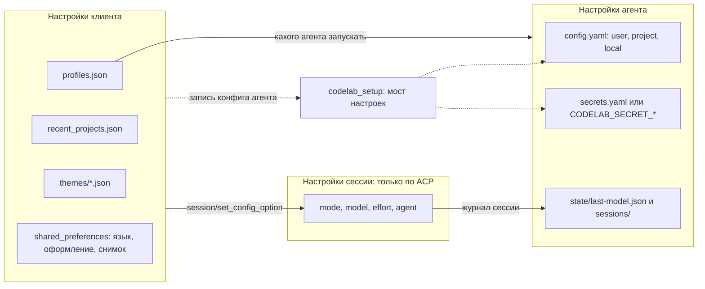
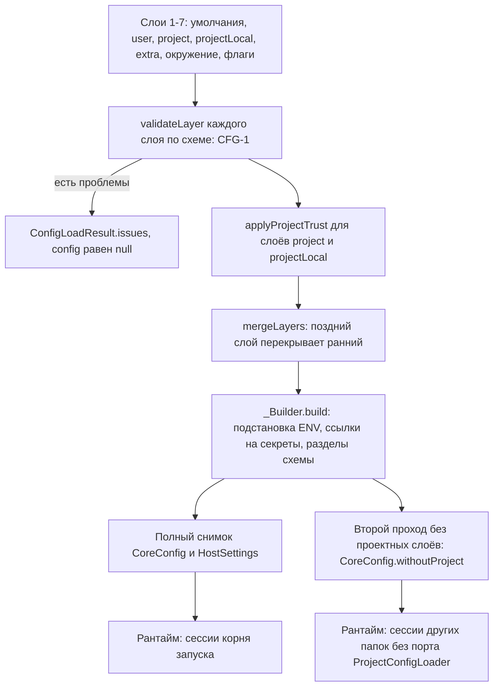
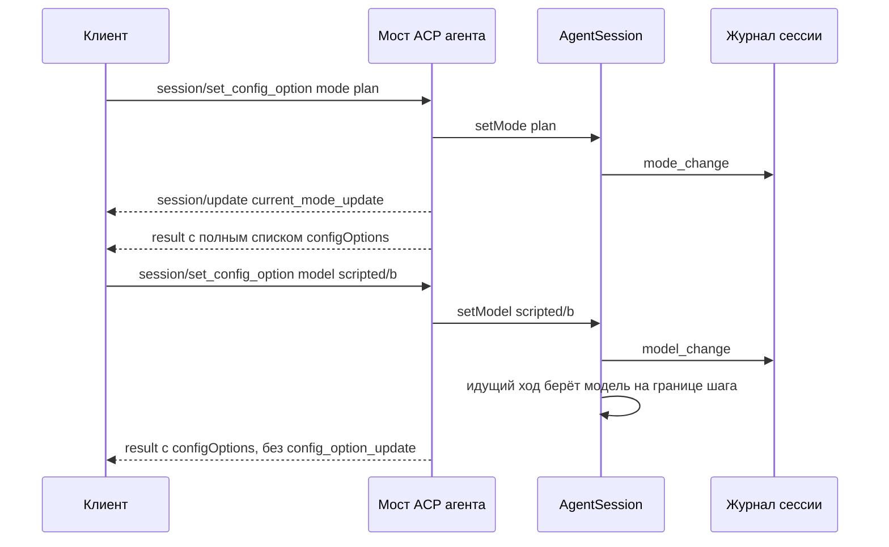
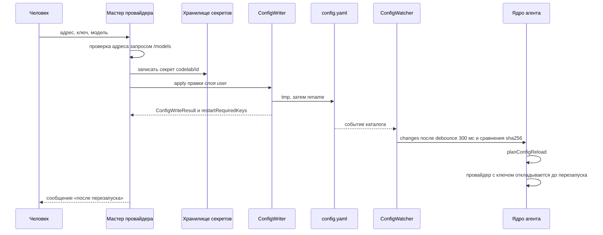

# Алгоритм настроек: чьи они, откуда берутся и как меняются

В CodeLab настройки лежат в разных местах и принадлежат разным сторонам. Конфигурацию агента читает агент, профили подключения и тему хранит клиент, а режим и модель сессии меняются по ACP и живут в журнале сессии. Документ отвечает на пять вопросов. Какая настройка чья. Каким путём файлы и флаги агента становятся `CoreConfig`. Как настройку меняют во время работы. Что от этого переживает перезапуск. Как всё это зависит от способа подключения: встроенный агент, `codelab-agent serve --stdio`, `serve --ws` или внешний агент.

Документ читается целиком. Справочники по частям существуют, здесь они не пересказываются:

- устройство модуля `lib/src/config/` ядра — [глава 09](../09-config-prompts-commands.md); загрузка файлов, запись, наблюдатель и подкоманды — [`codelab_agent_io`: загрузка](../../../codelab_agent_io/doc/03-config-loading.md), [запись и перезагрузка](../../../codelab_agent_io/doc/04-config-writing-and-reload.md), [подкоманды](../../../codelab_agent_io/doc/09-subcommands.md);
- мост настроек для клиентов: [`codelab_setup`](../../../codelab_setup/doc/README.md) — [хранилище конфигурации](../../../codelab_setup/doc/02-config-store.md), [мастер провайдера](../../../codelab_setup/doc/03-provider-wizard.md), [MCP-серверы](../../../codelab_setup/doc/04-mcp-servers.md), [расширения](../../../codelab_setup/doc/05-agent-extensions.md), [представления](../../../codelab_setup/doc/06-views.md);
- сторона клиента — [settings-on-client.md](../../../codelab_client_core/doc/settings-on-client.md): профили, темы, настройки app и CLI, хранилища; оба документа ссылаются друг на друга;
- для пользователя — [настройка агента](../../../../../docs/user/configuration.md), [каталог `CODELAB_HOME`](../../../../../docs/ops/codelab-home.md), [переменные окружения](../../../../../docs/ops/environment.md);
- смежные алгоритмы — [secrets.md](secrets.md) (ссылки `${secret:…}`, хранилище), [sessions.md](sessions.md) (журнал, смена режима и модели), [execution-sides.md](execution-sides.md) (кто исполняет при данном подключении);
- нормы: [`agent-configuration`](../../../../../openspec/specs/agent-configuration/spec.md) (CFG-*), [`agent-acp-server`](../../../../../openspec/specs/agent-acp-server/spec.md) («Режимы и опции сессии», «Уведомления после перезагрузки конфигурации», «Ошибка проектного конфига сессии»), [`client-agent-setup`](../../../../../openspec/specs/client-agent-setup/spec.md) (SETUP-*), [`app-settings`](../../../../../openspec/specs/app-settings/spec.md), [`client-themes`](../../../../../openspec/specs/client-themes/spec.md); методы ACP — `docs/protocols/acp/protocol/12-Session Model.md` (режимы), `13-Session Config Options.md` (опции), `14-Slash Commands.md`.

Пути в псевдокоде даны от `packages/dart/`: `core` — `codelab_agent_core/lib/src/`, `agent-io` — `codelab_agent_io/lib/src/`, `acp` — `codelab_agent_acp/lib/src/`, `setup` — `codelab_setup/lib/src/`, `embedded` — `codelab_embedded/lib/src/`; `host` — `apps/codelab_agent/lib/src/host/`.

## Короткий ответ

1. **Файлы `config.yaml` — настройки агента.** Их читает тот, кто запускает ядро: процесс `codelab-agent` или, во встроенном режиме, сам клиент. Клиент не хранит копию: его мастер провайдера и страницы настроек пишут в тот же файл через мост `codelab_setup`.
2. **Своё у клиента отдельное.** Профили подключения (`profiles.json`), недавние проекты, пользовательские темы, снимок восстановления, язык и оформление app. Агент их не читает, а клиент не пишет их в `config.yaml`.
3. **Слоёв семь**, приоритет растёт от умолчаний схемы к флагам запуска. Проект из репозитория доверенным по умолчанию не считается: из его слоёв вырезается всё, что могло бы расширить права или увести ключ на чужой адрес (CFG-3).
4. **Ядро получает только проверенное.** Любая проблема файла или значения останавливает загрузку: `serve` выходит с кодом `64`, живая перезагрузка оставляет прежний снимок целиком (CFG-1, CFG-15).
5. **На лету применяется не всё.** Правка файла вступает в силу сразу, если ключ не помечен `restartRequired`, а провайдер с ключом, stdio-сервер MCP и любые `permissions.*` ждут перезапуска (CFG-16).
6. **Режим, модель и уровень рассуждения сессии — не конфигурация.** Их меняют `session/set_config_option` и `session/set_mode` (расширений `_codelab/*` для этого нет). Выбор пишется в журнал сессии и возвращается при `session/load` этой сессии, а в `config.yaml` не попадает. Новые сессии узнают только последнюю выбранную модель (`state/last-model.json`), и то лишь при пустом `agent.default_model`.
7. **Запись в файлы идёт только через `ConfigWriter`:** блокировка, отпечаток, проверка итога, временный файл и `rename`. Две записи не портят файл, но проигравшая получает конфликт.
8. **Способ подключения решает, кто что может.** Встроенный агент и `codelab-agent` по stdio редактируются клиентом; по WebSocket и внешний агент — только чтение; `/config` по WebSocket выключена.

## Вход и выход

| | Что |
|---|---|
| Вход | файлы слоёв 2–5 (`config.yaml` пользователя, `.codelab/config.yaml` и `config.local.yaml` проекта, файл `--config` или `CODELAB_CONFIG`), переменные `CODELAB_*`, флаги `serve`, словарь окружения процесса, корень запуска `cwd`; во время работы — ACP-запросы `session/set_config_option` и `session/set_mode`, слэш-команды, сигнал наблюдателя «файл изменился», правки писателя |
| Выход | `ConfigLoadResult`: `CoreConfig` и `HostSettings` либо список `ConfigIssue`; предупреждения; плоская карта `values`; применённый снимок рантайма; кадры `current_mode_update` и `config_option_update`; записи журнала сессии `mode_change`, `model_change`, `config_change`; файл `config.yaml` после записи |
| Побочные эффекты | запись `config.yaml` (только `ConfigWriter`), файл `<файл>.lock` на время записи, `state/last-model.json`, события лога `config.*` |
| Гарантии | невалидный конфиг не применяется ни частично (CFG-15); проект без доверия не расширяет права (CFG-3); значение секрета не попадает в сообщения, лог и файл (CFG-2, CFG-10); файл записан целиком или не изменён (CFG-13); перезагрузка не расширяет доверие до перезапуска; `autopilot` включается только флагом (CFG-4) |
| Чего не гарантирует | что клиент увидит правку мгновенно (между записью и применением debounce 300 мс); что изменение сессии переживёт перезапуск агента с сессиями в памяти; что две программы, пишущие клиентские JSON-файлы без блокировки, не потеряют запись друг друга (файл остаётся целым); что правка в редакторе, попавшая в окно между повторной сверкой отпечатка и `rename`, не будет потеряна: lock защищает только от писателей, которые сами его берут |

Что при ошибках и сбоях:

- **Ошибка валидации при старте** — `config == null`, `serve` печатает проблемы в stderr и выходит с кодом `64`; встроенный агент не открывается (`EmbeddedAgentConfigException`).
- **Ошибка валидации при перезагрузке** — прежний снимок цел, клиентам ничего не уходит, в лог идёт `config.reload.failed`, `/config reload` отвечает `Config reload failed (N issue). Current settings kept. Run /config check.` (пример 6).
- **Повреждённый файл** — проблема вида `syntax` с файлом, строкой и столбцом; значение ключа в текст не попадает. Ядро при проблеме файла не вызывается вовсе.
- **Запись при ошибке** — файл не меняется, временный файл и блокировка удаляются, созданные каталоги убираются.
- **Гонка двух писателей** — выигрывает тот, кто успел взять блокировку и чей отпечаток совпал; остальные получают `ConfigConflictException`, команда повторяет один раз и затем выходит с кодом `1` (пример 7).

## Чьи настройки

Таблица отвечает на вопрос «настройка → владелец → где хранится → кто читает → кто меняет». Строки про агента относятся к конфигурации и состоянию, которые описаны ниже; строки про клиента подробно разобраны в [settings-on-client.md](../../../codelab_client_core/doc/settings-on-client.md).

| Настройка | Владелец | Где хранится | Кто читает | Кто меняет |
|---|---|---|---|---|
| Провайдеры, модели, `agent.default_model`, `agent.effort` | агент | `$CODELAB_HOME/config.yaml` (слой 2); у доверенного проекта ещё `.codelab/config.yaml` и `config.local.yaml` | `ConfigLoader` (процесс агента или клиента, если агент встроенный) | вы руками; `codelab config`, `provider`; мастер провайдера и страницы «Providers» и «General» в app и CLI (слои `user` и `projectLocal`) |
| Режим разрешений по умолчанию `permissions.mode`, правила `permissions.tools`, `permissions.deny` | агент | те же слои; недоверенный проект только ужесточает; доверенный `config.local.yaml` не ограничен, доверенный `config.yaml` не смягчает только режим | загрузчик; политика разрешений при создании сессии | то же; `autopilot` — только флаг `serve` |
| Бюджет, сжатие, навыки, субагенты, `tools.project_context.max_bytes` | агент | те же слои | рантайм на границе хода или сессии | то же |
| MCP-серверы `mcp.servers` | агент | `config.yaml`; проектные — только у доверенного проекта | загрузчик и MCP-супервизор | то же; страница «MCP servers», `codelab mcp` |
| Сессии, журнал, наблюдение: `sessions.*`, `logging.*`, `config.*`, `secrets.backend` | агент (хост) | слой 2, `config.local.yaml` доверенного проекта; `secrets.backend` и `trusted_projects` — только слой 2 | хост при сборке (`HostSettings`) | то же; применяется после перезапуска |
| `trusted_projects` | агент | только слой 2 (глобальный) | загрузчик; доверие закрепляется на старте | вы руками, `config set` |
| Секреты | агент | `$CODELAB_HOME/secrets.yaml` (бэкенд `file`) или `CODELAB_SECRET_*` ([secrets.md](secrets.md)) | `SecretResolver` | `codelab secret`, мастер, диалог профиля app |
| Последняя выбранная модель | агент | `$CODELAB_HOME/state/last-model.json` | выбор модели новой сессии, если `agent.default_model` не задан | пишет агент при `setModel` |
| Режим, модель, уровень рассуждения, агент **этой сессии** | агент (сессия) | журнал сессии (`mode_change`, `model_change`, `config_change`), память сессии | рантайм при загрузке сессии | клиент по ACP; слэш-команды `/mode`, `/model` |
| Профили подключения | клиент | `$CODELAB_HOME/profiles.json` | `JsonFileProfileStore` в app и CLI | `codelab profiles`, страница «Connection» |
| Профиль по умолчанию, язык, оформление, макет дока, пройденное приветствие, «открывать последний проект» | клиент (app) | `shared_preferences`, ключи `codelab.*` | app при старте | страницы «Connection», «General», «Appearance» |
| Пользовательские темы | клиент | `$CODELAB_HOME/themes/<имя>.json` | `IoThemeLibrary` (читает app; `codelab` пока не читает) | вы, «Import JSON…» в app |
| Недавние проекты | клиент | `$CODELAB_HOME/recent_projects.json` | app и CLI | app и CLI при открытии проекта |
| Снимок восстановления | клиент (app) | `shared_preferences`, ключ `codelab.workspace.snapshot` | `WorkspaceRestorer` | `WorkspaceRestorer` |
| Токен профиля WebSocket | клиент пишет ссылку, агентская сторона хранит значение | ссылка `env:` или `secret:` в `profiles.json`; значение в хранилище секретов | `ProfileSecretSource` | диалог профиля, `codelab profiles add` |

Где настройки пересекаются:

- **Встроенный агент читает конфиг агента в процессе клиента.** `localEmbeddedAgentOpener` вызывает `ConfigLoader().load` с окружением процесса клиента (`embedded/io/local_opener.dart`). Флагов запуска у него нет, но `CODELAB_CONFIG` действует.
- **Мастер провайдера пишет конфиг агента из клиента.** Клиент не импортирует `package:codelab_agent_*` и пользуется мостом `codelab_setup`: `FileAgentConfigStore` вызывает тот же `ConfigWriter`, что и `codelab config set` (CFG-14, SETUP-3).
- **Опции сессии идут по ACP** и не знают, где лежит конфигурация: клиент меняет их одинаково у любого агента, который их объявил.
- **Один `$CODELAB_HOME`.** Конфигурация, секреты и состояние агента и файлы клиента лежат в одном каталоге, поэтому app и `codelab` видят общие провайдеры, профили и темы.

На схеме показано, кто чем владеет; пунктир — запись клиента в файлы агента через мост.



## Слои конфигурации агента

На схеме — путь от слоёв до двух снимков `CoreConfig`. Слои 2–7 идут по возрастанию приоритета; решение о доверии принимается до слияния, потому что после слияния отбросить ключи уже нельзя.



Слои:

| № | Слой | Источник |
|---|---|---|
| 1 | умолчания | `ConfigTree.defaults()` и значения конструкторов `CoreConfig` |
| 2 | `user` | `$CODELAB_HOME/config.yaml` |
| 3 | `project` | `<cwd>/.codelab/config.yaml` |
| 4 | `projectLocal` | `<cwd>/.codelab/config.local.yaml` |
| 5 | `extra` | `--config <файл>` или `CODELAB_CONFIG` (абсолютный путь) |
| 6 | `environment` | предконфигурация `CODELAB_PROVIDER_*`, затем `CODELAB_MODEL`, `CODELAB_MAX_STEPS`, `CODELAB_PERMISSION_MODE`, `CODELAB_LOG_LEVEL`, `CODELAB_LOG_FILE` |
| 7 | `flags` | флаги `serve`: `--permission-mode`, `--max-steps`, `--model`, `--provider*`, `--log-level`, `--log-file` |

## Псевдокод

Блоки идут в порядке выполнения: загрузка слоёв, решение ядра, подстановка и слияние внутри него, перезагрузка на лету, запись, смена настройки сессии. Порядок шагов совпадает с кодом; пропущены только логи и защитные проверки.

### А. Загрузка слоёв: `ConfigLoader`

```text
load(cwd, environment, flags, preconfigFlags, extraConfig, scripted, knownVariables,
     pinnedTrustedProjects) -> ConfigLoadResult
  // agent-io/config/config_loader.dart: ConfigLoader.load → loadWithLayers
  1. extraPath = extraConfig ?? environment[CODELAB_CONFIG]        // флаг сильнее переменной
        .toml → ConfigUsageException; относительный CODELAB_CONFIG → ConfigUsageException
  2. root = канонический cwd (ссылки раскрыты)
     home = scripted ? '' : codelabHomeOf(environment)             // ~ раскрывается; ~user → код 64
  3. layers = [defaults]
  4. если !scripted:                                               // сценарий --llm-script файлов 2-4 не читает
        readFile($home/config.yaml, user)                          // нет файла: слой молча пропущен
        readFile($root/.codelab/config.yaml, project)              // checkProjectLayer: realpath внутри .codelab
        readFile($root/.codelab/config.local.yaml, projectLocal)
        warnings += config.yml, config.local.yml, .codelab/config.yml → config.file.ignored
  5. если extraPath != null: readFile(extraPath, extra)            // нет файла: проблема, а не пропуск
        readFile: размер ≤ 1 MiB → строгий UTF-8 → readYamlTree (якоря, теги, повторы ключей — проблема)
                  слой user: trusted_projects канонизируются
                  проблема файла → issues, слой не строится
  6. нет ни одного YAML-слоя и нет extraPath: legacyConfigNotice (codelab.toml)   // один раз на корень
  7. warnings += unknownEnvironmentWarnings(CODELAB_*)             // config.env.unknown
  8. preconfig = preconfigLayer(CODELAB_PROVIDER_* или --provider-type/--provider-config)
     слои 6 и 7 по порядку: [preconfig из окружения], buildEnvironmentLayer, [preconfig из флагов], flags
  9. issues не пусты → return ConfigLoadResult(issues)              // ядро не вызывается
 10. result = CoreConfig.fromLayers(layers, environment, projectRoot: root, pinnedTrustedProjects)
 11. secrets.backend: file на Windows → проблема значения
 12. return result; warnings загрузчика стоят перед предупреждениями ядра
```

### Б. Решение ядра: `resolveConfig`

```text
resolveConfig(layers, environment, projectRoot, collectAll, pinnedTrustedProjects) -> ConfigLoadResult
  // core/config/resolve.dart: resolveConfig → _resolve
  1. issues = validateLayer(каждый слой)                           // validate.dart: неизвестный ключ, тип, значение
             + _trustedProjectsPlacement + _trustedProjectsPaths   // trusted_projects: только user, только абсолютные
     issues не пусты:
        collectAll == false → return ConfigLoadResult(issues)      // serve, живая перезагрузка
        collectAll == true  → вырезать ключи с ошибками и пройти ступени снова (до 8 кругов),
                              чтобы config check показал все проблемы; неполно → validationIncompleteEvent
  2. applied = _applyTrust(layers)                                 // trust.dart: applyProjectTrust
        trusted = projectRoot ∈ (pinnedTrustedProjects ?? trusted_projects слоя user)
        для project и projectLocal: lower = merge(defaults, user, project)
        вырезанные ключи → warning config.project.untrusted_key
  3. builder = _Builder(applied.effective).build()
        3.1 для каждого слоя: collectNotApplied → warning config.key.not_applied     // схема applied: false
        3.2 _warnSecretsInFiles                                    // config.secret.in_file
        3.3 merged = mergeLayers(effective)                        // merge.dart
        3.4 _providers, _effort, _defaultModel, _permissions, _budget, _compaction,
            _mcpServers, _redact, _profiles, _projectContextMaxBytes, _skills, _subagents,
            _secretsBackend, config.watch, _configPollInterval
            подстановка: expandEnvironment только в разрешённых ключах; ${secret:имя} → SecretTemplate
        3.5 есть issues или нет модели → CoreConfig не строится
        3.6 CoreConfig(...); values = flattenConfigValues(merged); HostSettings(sessions.*, logging.*, secrets.backend, profile.*, config.watch, ...)
  4. есть проектные слои и projectRoot задан:
        второй _resolve без project и projectLocal → CoreConfig.withoutProject, withoutProjectValues
  5. return ConfigLoadResult(config, host, warnings, sources, values)
```

### В. Живая перезагрузка: `reloadConfig`

```text
reloadConfig() -> ConfigApplyReport
  // core/runtime/agent_runtime.dart: reloadConfig, _startReload, _reloadOnce, _applyLoaded
  // вызов: сигнал ConfigWatcher.changes после debounce 300 мс, или /config reload
  1. идёт другая перезагрузка → вызов встаёт в один общий повтор (коалесценция)
  2. result = await source.load()                                  // FileConfigSource: те же слои, окружение и флаги;
                                                                   //   доверие закреплено на старте; rebase базы наблюдателя
        исключение чтения → failed, config.reload.failed(error_class)
  3. после dispose результат отбрасывается; дальше до замены снимка нет ни одного await
  4. result.config == null или есть issues → failed: прежний снимок цел, клиентам ничего (CFG-15)
  5. plan = planConfigReload(previousValues, previous, nextValues, next)   // core/config/config_reload_plan.dart
        правила по порядку:
          1) провайдер с ключом, новый или с изменённой группой «адрес и аутентификация» → отложен
          2) ссылки на модели нового отложенного провайдера → отложены вместе с ним
          3) сервер mcp.servers: stdio, а также http с подстановкой ${…} → отложен
          4) реестр: restartRequired у дескриптора, а ключ вне реестра → отложен (fail closed)
  6. merged = CoreConfig.withDeferred(previous, loaded, plan.deferred); recheck = merged.validateSnapshot()
        проблемы → failed
  7. models = modelsFor(merged); services.secrets.invalidate()     // кэш секретов сброшен даже без изменённых ключей
  8. _applied = _Applied(config: merged, stream, catalog, values: plan.appliedValues,
                         host: previous.host)                      // одна атомарная замена; HostSettings прежние
  9. _notifySessions(previous, next)                               // список моделей изменился → ModelOptionsChanged
 10. session._applyConfigMcp() для живых сессий                    // серверы MCP из конфига
 11. лог: config.reload.restart_required(keys), config.reload.applied(keys, restart_required) или config.reload.noop
     return ConfigApplyReport(outcome, changedKeys, restartRequiredKeys)
```

### Г. Запись: `ConfigWriter.apply`

```text
apply(base: ConfigSnapshot, edits) -> ConfigWriteResult
  // agent-io/config/config_writer.dart: ConfigWriter.apply
  1. path = _targetPath(target)                                    // проектный слой: цель обязана быть внутри .codelab
  2. _checkEdits(edits, target)                                    // секрет значением → отказ раньше «неизвестного ключа»;
                                                                   //   слой, не разрешённый реестром, → отказ
  3. _createParents(path)                                          // $CODELAB_HOME создаётся с правами 0700
  4. lock = _locks.acquire(path)                                   // <файл>.lock, создаётся эксклюзивно; занят свежий → ConfigConflictException
     _locks.sweepAbandonedTmp(path)                                // только под своим lock
  5. fingerprint(файла) != base.fingerprint → ConfigConflictException
  6. text = ConfigDocumentEditor.apply(original, edits)            // yaml_edit: комментарии и порядок остаются
  7. result = _validate(text)                                      // литеральные секреты в изменённых листьях;
                                                                   //   validateCandidate теми же слоями; отброшенный доверием ключ → отказ;
                                                                   //   блокируют только НОВЫЕ ошибки
  8. text == original → вернуть результат, файл не трогать
  9. tmp = <файл>.tmp-<pid>-<случайное> (эксклюзивно, права прежнего файла), write, flush
 10. lock всё ещё свой? отпечаток файла прежний? иначе ConfigConflictException
 11. tmp.renameSync(path); лог config.write(path, keys) — значений нет
 12. finally: удалить tmp, снять lock, при отказе убрать созданные каталоги
     return ConfigWriteResult(warnings, restartRequiredKeys)       // restartRequiredKeys — по дескрипторам реестра
```

### Д. Смена настройки сессии по ACP

```text
session/set_config_option(sessionId, configId, value) -> configOptions        // ACP: 13-Session Config Options.md
  // acp/agent_server.dart: _setConfigOption; acp/session_bridge.dart: setMode, setModel, setEffort, setAgent
  1. bridge = _bridge(sessionId)                                   // неизвестная сессия → ошибка
  2. по configId:
        mode   → bridge.setMode(ModeId.tryParse(value))            // синонимы те же, что у /mode
        model  → value ∈ каталог моделей сессии → bridge.setModel(value)
        effort → модель с supportsReasoning → bridge.setEffort(parseEffort(value))
        agent  → value ∈ определения агентов или default → bridge.setAgent(value)
        mode с неизвестным id → -32602 «unknown mode: …»
        model, agent с неизвестным значением → -32602 «unknown value: …»
        иначе (в том числе effort у модели без рассуждения) → -32602 «unknown config option: …»
  3. смена идёт через AgentSession под очередью смен (_serial):    // core/runtime/agent_runtime.dart: _Session.setMode, setModel, ...
        setMode:   policy.mode = mode сразу; системный промпт пересобран; emit ModeChanged → запись mode_change
        setModel:  catalog.resolve(id) или ArgumentError; _apply(model): идёт ход → _pendingModel, на границе шага;
                   append(model_change); rememberLastModel → state/last-model.json
        setEffort: пересобрать модель с уровнем; append(config_change{effort})
        setAgent:  append(config_change{agent}); затем model_change и смена режима, если у определения они свои
  4. ответ — полный список configOptions; отдельный config_option_update его не дублирует (ACP-11);
     смена режима до ответа шлёт current_mode_update

session/set_mode(sessionId, modeId) -> {}                                      // ACP: 12-Session Model.md
  // acp/agent_server.dart: _setMode
  1. то же, что configId «mode»: bridge.setMode; current_mode_update до ответа; ответ {}
```

## Пошаговое пояснение

**А1–А2. Один способ найти файлы.** Загрузка не угадывает путь: `--config` сильнее `CODELAB_CONFIG`, а переменная обязана быть абсолютной, потому что относительная читала бы разные файлы при разных `cwd` клиента. Корень запуска канонический, иначе `trusted_projects` и выбор снимка сравнивали бы разные строки одного каталога.

**А4. `scripted`.** Режим `--llm-script` не читает слои 2–4 и `$CODELAB_HOME`: тест не должен зависеть от настроек разработчика. Поэтому `/config` и перезагрузки при сценарии нет.

**А5–А9. Файл — работа загрузчика, значение — работа ядра.** Загрузчик отвечает за размер, кодировку, YAML и ссылки; всё это проблемы вида `syntax`, и при них ядро не вызывается: проверка по неполному набору слоёв дала бы ложный ответ. Порядок шагов 8 держит правило «более частное побеждает»: `CODELAB_MODEL` и `--model` перекрывают предконфигурацию провайдера.

**Б1. Проверка до слияния.** Проблема называет файл, где она записана, а не итог слияния (CFG-1). Режим `collectAll` нужен `config check`: одна ошибка не прячет остальные. Неполный набор не выдаётся за полный.

**Б2. Доверие до слияния.** `applyProjectTrust` сравнивает проектный слой с итогом слоёв ниже. Ключ, который мог бы расширить права, вырезается с предупреждением `config.project.untrusted_key`, а не ошибкой: клонированный репозиторий не должен ломать запуск (CFG-3). `trusted_projects` и `secrets` из проекта не читаются никогда; `sessions`, `logging`, `exec`, `config` — из `config.yaml` проекта никогда, из `config.local.yaml` только у доверенного. Правила по разделам — в [главе 09](../09-config-prompts-commands.md). Доверенным считается корень из `trusted_projects` слоя `user`, закреплённого на старте: правка списка при работе доверие не расширяет.

**Б3. Сборка.** Ключи `applied: false` принимаются схемой, но потребителя пока нет, поэтому каждый даёт `config.key.not_applied` (полный список — в разделе «Параметры»). Подстановка `${NAME}` работает только в `providers.*.base_url`, `providers.*.api_key`, `providers.*.headers.*`, `mcp.servers[*].args`, `env`, `url`, `headers`; незаданная переменная — проблема, а не пустая строка, иначе отказы авторизации были бы тихими. Ссылка `${secret:имя}` допустима только в `env` и `headers` (и целиком в `providers.*.api_key`); в `mcp.servers[*].args`, `url` и `providers.*.base_url` она даёт проблему конфигурации. Ссылка в строку не раскрывается: результат — шаблон, значение читается лениво и не попадает ни в лог, ни в `values` ([secrets.md](secrets.md)).

**Б3.6. `CoreConfig` и `HostSettings`.** Ядро получает разделы, которые читает само (провайдеры, права, бюджет, MCP, навыки), а хост — ключи, которые читает он (`sessions.*`, `logging.*`, `secrets.backend`, `profile.*` — сужение профиля, `config.watch`, `config.poll_interval`). Хостовые ключи при живой перезагрузке не меняются: `HostSettings` остаётся прежним до перезапуска.

**Б4. Два снимка.** Сессия, открытая в папке вне корня запуска, не должна получить проектные ключи чужой папки. Поэтому второй проход идёт без проектных слоёв. Хост с портом `ProjectConfigLoader` (`serve --stdio`, встроенный агент) вместо этого читает слои самой папки при каждом открытии сессии и подставляет отложенное до перезапуска (`deferForFolderSession`); `serve --ws` порта не получает. Если глобальные `permissions` отложены до перезапуска, а у папки есть проектные слои, сессия в ней не открывается (`agent-runtime`); сессии папок (`_isolated`) живую перезагрузку не получают: их снимок строится при открытии.

**В4. Невалидное — не применяется.** Ошибка YAML посреди работы не должна оставить агента без конфигурации, поэтому снимок меняется целиком или не меняется вовсе (CFG-15).

**В5. Граница безопасности.** Правила `planConfigReload` — не оптимизация, а защита. Новый провайдер с ключом или изменение его адреса и заголовков откладываются, чтобы ключ процесса не ушёл на чужой адрес без перезапуска. Новый stdio-сервер MCP откладывается, чтобы файл, который кто-то изменил на диске, не запустил процесс в живом агенте. Любая правка `permissions.*` откладывается (в реестре `restartRequired`), а не только ослабление. Ключ без дескриптора реестра откладывается по умолчанию.

**В7–В8. Одна замена.** Между чтением и заменой снимка нет `await`, поэтому «двойного снимка» не бывает. Функция модели и каталог пересобираются при каждой успешной загрузке, даже если ключи не изменились: могло смениться значение в хранилище секретов.

**В9. Что видит клиент.** Если список моделей изменился, ядро шлёт `ModelOptionsChanged`, а мост ACP превращает его в один `config_option_update` с полным снимком опций (ACP-11). Бюджет и параметры сжатия сессия читает на границе каждого хода, поэтому они действуют «со следующего хода» (CFG-16).

**Г. Один путь записи.** Порядок «каталоги → lock → отпечаток → правка → проверка → tmp → повторная сверка → `rename`» нельзя упрощать: каждый шаг закрывает конкретную гонку (подробности — [глава 04 io](../../../codelab_agent_io/doc/04-config-writing-and-reload.md)). Проверка записи блокирует только новые ошибки: прежние идут предупреждениями, иначе первая запись в пустой слой упиралась бы в `agent.default_model: no model is configured`.

**Д2. Режим и модель — состояние сессии.** `permissions.mode` в конфигурации — режим *новой* сессии. После `session/set_mode` режим принадлежит сессии и пишется в журнал (`mode_change`). Поэтому правка `permissions.mode` в файле не меняет открытую сессию, а смена режима по ACP не меняет файл. `autopilot` режимом сессии не является: он приходит флагом как `modeOverride`, и клиент по ACP его не видит.

**Д3. Смена модели посреди хода.** Запись в журнал идёт сразу, а новая модель вступает в силу на границе ближайшего шага идущего хода (`_pendingModel`); предыдущий шаг заканчивается на прежней. Режим политики применяется сразу, со следующего вызова инструмента. Все смены идут по очереди `_serial`, поэтому два параллельных запроса клиента не перемешивают состояние.

## Схемы

### Смена модели или режима из клиента

На схеме — запрос клиента, который меняет опцию сессии. Файл `config.yaml` не затрагивается.



Ответ на `session/set_config_option` сам несёт полный снимок, поэтому отдельный `config_option_update` не нужен (ACP-11). Смена режима ещё и шлёт `current_mode_update` до ответа.

### Запись провайдера мастером с перезагрузкой

На схеме — мастер провайдера, который пишет провайдера с ключом, и живая перезагрузка агента. Для провайдера без ключа (локальный сервер) перезагрузка применяет его сразу.



Порядок «секрет, затем конфиг» держит `ProviderSetupCommitter`: в обратном порядке конфиг ссылался бы на несуществующий секрет. Если запись конфига не удалась, созданный секрет откатывается.

## Что зависит от способа подключения

Строки матрицы — вопросы о настройках, столбцы — способы подключения. Сторона исполнения инструментов в этой матрице не рассматривается: она в [execution-sides.md](execution-sides.md).

| Вопрос | Встроенный агент | `serve --stdio` | `serve --ws` | Внешний агент (не `codelab-agent`) |
|---|---|---|---|---|
| Кто читает конфиг агента | процесс клиента: `localEmbeddedAgentOpener`, окружение клиента | процесс `codelab-agent`: `loadServeConfig`, окружение и флаги из профиля | процесс `codelab-agent`, возможно на другой машине | неизвестно: не CodeLab |
| Флаги запуска (`--config`, `--permission-mode`, `--provider…`) | нет; есть переменные `CODELAB_*` процесса клиента | да, аргументы профиля | да, при запуске сервера | — |
| Может ли клиент редактировать конфиг | да: `EditableSettings`, слои `user` и `projectLocal` | да, если команда профиля `codelab-agent`; файл `--config` — только чтение | нет: `RemoteReadOnly` | нет: `NotManaged` |
| Живая перезагрузка файлов | да, `FileConfigSource` в процессе клиента | да | да | — |
| `/config reload`, `/config check` | да | да | нет: `configCommand: false`; ответ раскрыл бы пути машины агента | — |
| Конфигурация папки сессии вне корня запуска | читается при открытии сессии (`projectConfig`) | то же | нет: снимок `withoutProject` | — |
| MCP-серверы конфигурации | да | да | выключены (`mcp` off) | — |
| Режим, модель, `effort`, `agent` сессии | ACP-опции | ACP-опции | ACP-опции | только те, что агент объявил в `configOptions` |
| Секреты читает | процесс клиента | процесс агента | процесс агента | — |

Что из этого следует:

- **Единственное, что клиент меняет у любого агента, — опции сессии.** Всё остальное зависит от того, видит ли клиент файлы агента.
- **По WebSocket клиент настройки агента не пишет и не видит.** Страницы агента в app показывают InfoBar «только чтение», а в REPL `codelab` команды `/provider add|remove` и `/settings` отвечают строкой «read-only» (подкоманды `codelab provider`, `config`, `mcp` от профиля не зависят и правят локальный конфиг).
- **Внешний агент без `configOptions`** остаётся без выбора модели и режима: CLI отвечает `The agent has no "model" option.`, а флаги `-m`/`--mode` дают ошибку до первого хода.
- **В REPL `codelab` клиентская команда сильнее агентской.** `/config`, `/mode` и `/model` в REPL — команды клиента: они показывают и меняют ACP-опции. Слэш-команду агента с тем же именем вызывают с префиксом: `/agent:config reload` (`apps/codelab_cli/lib/src/repl/command_router.dart`: `route`).

## Разобранные примеры

Данные получены запусками текущей ветки. Бинари `codelab-agent` и `codelab` собраны командой `fvm dart compile exe`; каждый запуск шёл в чистом окружении (`env -i`) с временными `HOME` и `CODELAB_HOME`, поэтому ключей провайдеров и настоящего `~/.codelab` в прогонах не было. Сети не было: адрес провайдера `http://127.0.0.1:9`, модель — сценарий `--llm-script` или ход вообще не доходит до модели. Пути заменены на `~/demo/…`, идентификаторы сессий сокращены. Временные каталоги удалены.

Исходные файлы примеров 1–3, 6 и 10:

```yaml
# ~/demo/home/config.yaml (слой user)
agent:
  default_model: gw/m1
providers:
  gw:
    kind: openai-compatible
    base_url: http://127.0.0.1:9/v1
    api_key_secret: codelab/gw
    models:
      m1:
        context_window: 32768
permissions:
  mode: ask
budget:
  max_steps: 20
```

```yaml
# ~/demo/proj/.codelab/config.yaml (слой project)
budget:
  max_steps: 10
permissions:
  mode: bypass
providers:
  mine:
    kind: openai-compatible
    base_url: http://127.0.0.1:9/v1
sessions:
  dir: /tmp/elsewhere
```

### Пример 1. Слои и проект без доверия

Источник: `codelab-agent config check` в `~/demo/proj`.

```bash
codelab-agent config check
```

```text
Sources: defaults, ~/demo/home/config.yaml, ~/demo/proj/.codelab/config.yaml
warning: ~/demo/proj/.codelab/config.yaml:9:1: sessions: ignored: sessions is not read from a project config
warning: ~/demo/proj/.codelab/config.yaml:5:1: providers: ignored: the project is not trusted; add it to trusted_projects in the global config
warning: ~/demo/proj/.codelab/config.yaml:4:3: permissions.mode: ignored: a project config can only make the permission mode stricter
note: secrets backend: env (OS keychain backends are not available in this version; set secrets.backend: file or CODELAB_SECRET_* variables)
warning: ~/demo/home/config.yaml:7:5: providers.gw.api_key_secret: secret codelab/gw is not set; set CODELAB_SECRET_CODELAB_GW or add 'secrets.backend: file' and run: codelab secret set codelab/gw
Default model: gw/m1 (config)
Config: valid
```

Из проекта приняты `budget.max_steps: 10` (ниже глобального 20, то есть ужесточение) и ничего больше. `permissions.mode: bypass` мягче `ask`, поэтому отброшен; `providers` отброшены без доверия; `sessions` проект не читает никогда (Б2). Предупреждение о секрете — не ошибка: проверка ссылки только сообщает, что значения нет.

Если добавить в слой `user` `trusted_projects: [~/demo/proj]`, пропадёт только строка про `providers`: провайдеры проекта читаются, а `sessions` и мягкий режим всё равно отброшены, потому что это слой 3 (`isProject`).

### Пример 2. Что видит `config get`

Источник: те же файлы.

```bash
codelab-agent config get budget.max_steps --layer user
codelab-agent config get budget.max_steps --layer merged
codelab-agent config get permissions.mode --layer merged
CODELAB_MAX_STEPS=5 codelab-agent config get budget.max_steps
```

```text
20
layer: user
10
layer: project
bypass
layer: project
<from env:CODELAB_MAX_STEPS>
layer: env
```

`get` показывает сырое значение слоя-победителя (спецификация: «победитель — старший слой, где ключ задан»). Правила доверия он не применяет: `permissions.mode: bypass` из проекта в `get` победил, хотя `config check` его отбросил. Итоговый режим сессии `config check` не печатает; его даёт `currentModeId` ответа `session/new`, а `config check` показывает, какие ключи проекта отброшены.

То же верно для выключения сервера. Пользовательский сервер `tools` (stdio, `/bin/cat`) включён в слое `user`, а недоверенный проект пишет `mcp.servers: [{name: tools, enabled: false}]`:

```text
$ codelab-agent config get mcp.servers --layer merged
[
  {
    "name": "tools",
    "enabled": false
  }
]
layer: project
$ codelab-agent config check
warning: ~/demo/proj/.codelab/config.yaml:2:3: mcp.servers: ignored: the project is not trusted; add it to trusted_projects in the global config
Config: valid
$ /mcp list        (serve --stdio, session/new, затем prompt)
ID     SOURCE  TRANSPORT  STATE       TOOLS  LAST ERROR
tools  config  stdio      connecting  0      initialize failed (code -32601)
```

`get` показывает сервер выключенным, а агент его запустил: проектный элемент по имени заменил пользовательский целиком, но доверие вырезало весь `mcp.servers` проекта. Поэтому `get --layer merged` нельзя считать описанием действующей конфигурации: он может показать и мягче, и строже того, что работает. Действующее — `config check` (предупреждения доверия) и `/mcp list`.

### Пример 3. Слои режима: файл, переменная, флаг

Источник: `codelab-agent serve --stdio`, запрос `session/new`, поле `modes.currentModeId` ответа. Файл — `permissions.mode: ask` в слое `user`.

```text
файл                                                  → currentModeId: ask
CODELAB_PERMISSION_MODE=plan                          → currentModeId: plan
CODELAB_PERMISSION_MODE=plan и --permission-mode accept-edits → currentModeId: accept-edits
CODELAB_PERMISSION_MODE=autopilot                     → выход с кодом 64: unknown permission mode: autopilot
--permission-mode autopilot                           → currentModeId: standard
```

Переменная сильнее файла, флаг сильнее переменной. `autopilot` из окружения и из файла отвергается (CFG-4); флагом принимается, но это `modeOverride` политики, а не режим сессии, поэтому клиенту по ACP остаётся режим профиля `standard`.

### Пример 4. Отказ валидации и незаданная переменная

Источник: `codelab-agent config check` на файле `~/demo/bad/home/config.yaml` с четырьмя ошибками. Проверка идёт в режиме `collectAll`, но ступенями: сначала ошибки схемы, потом значений.

```bash
codelab-agent config check
```

```text
Sources: defaults, ~/demo/bad/home/config.yaml
~/demo/bad/home/config.yaml:3:3: agent.fallbak: unknown key (did you mean fallback?)
~/demo/bad/home/config.yaml:11:9: providers.gw.models.m1.context_window: expected int
~/demo/bad/home/config.yaml:17:3: logging.level: unknown log level (known: trace, debug, info, warning, error)
Config: invalid (issues: 3)
```

Код выхода `1`. После исправления этих трёх проблем всплывают следующие: `base_url: ${GW_URL}` при незаданной переменной и каскад «модель не в каталоге», потому что провайдер без адреса не построен.

```text
~/demo/bad/home/config.yaml:6:5: providers.gw.base_url: variable GW_URL is not set
~/demo/bad/home/config.yaml:2:3: agent.default_model: gw/m1 is not in the model catalog; declare it in providers.gw.models
warning: ~/demo/bad/home/config.yaml:14:3: exec.shell: this key is read but not applied by this version of the agent
Config: invalid (issues: 2)
```

`codelab-agent serve --stdio` на этом же файле выходит с кодом `64` и печатает обе проблемы в stderr без текста файла. Ключ `exec.shell` — пример `applied: false`: он принят схемой, а применять его пока некому. С заданной `GW_URL` файл валиден, и предупреждение остаётся. Значение переменной в сообщения не попадает: проблема называет только имя.

### Пример 5. Ключи `applied: false` и опечатка в переменной

Источник: `config check` на файле, где заданы `agent.summary_model`, `hooks.pre_tool` и `logging.trace`, при `CODELAB_FOO=1`.

```text
Sources: defaults, ~/demo/napp/home/config.yaml
warning: env: unknown environment variable CODELAB_FOO
warning: ~/demo/napp/home/config.yaml:3:3: agent.summary_model: this key is read but not applied by this version of the agent
warning: ~/demo/napp/home/config.yaml:12:3: hooks.pre_tool: this key is read but not applied by this version of the agent
warning: ~/demo/napp/home/config.yaml:14:3: logging.trace: this key is read but not applied by this version of the agent
Default model: gw/m1 (config)
Config: valid
```

Для непрозрачного раздела (`hooks`) предупреждение называет записанный листовой ключ, а не раздел. Опечатка в `CODELAB_*` не молчит (`config.env.unknown`).

### Пример 6. Правка файла во время работы

Источник: `codelab-agent serve --stdio` в `~/demo/proj`; клиент посылает `/config check`, а между запросами процесс правит файл; ответы слэш-команд приходят как `agent_message_chunk`.

```text
$ /config check
Config: valid
Sources: defaults, ~/demo/home/config.yaml, ~/demo/proj/.codelab/config.yaml
$ codelab-agent config set budget.max_steps 7
Updated budget.max_steps in ~/demo/home/config.yaml
warning: budget.max_steps: ignored: a project config can only lower the budget; the limit of the global config is kept
$ codelab-agent config set permissions.mode standard
Updated permissions.mode in ~/demo/home/config.yaml
warning: permissions.mode: ignored: a project config can only make the permission mode stricter
note: restart the agent to apply: permissions.mode
$ /config reload
Config reloaded: no keys applied now.
Restart required: permissions.mode
```

Лог агента за те же секунды (поля сокращены):

```text
info config.reload.applied {keys: [budget.max_steps], restart_required: []}
warning config.reload.restart_required {keys: [permissions.mode]}
info config.reload.applied {keys: [], restart_required: [permissions.mode]}
```

Бюджет применился сам, без `/config reload`: наблюдатель заметил запись через debounce. `permissions.mode` ждёт перезапуска (В5). Тот же прогон с файлом, испорченным вручную (`extra: [oops` в конце):

```text
$ /config reload
Config reload failed (1 issue). Current settings kept. Run /config check.
$ /config check
Config: invalid (issues: 1)
- ~/demo/home/config.yaml:16:1: While parsing a flow sequence, expected ',' or ']'.
Sources: defaults, ~/demo/proj/.codelab/config.yaml
```

```text
error config.reload.failed {sources: [...], issues: [{source: ~/demo/home/config.yaml, line: 16, column: 1, key: , kind: syntax}]}
```

После исправления файла наблюдатель применил правку сам (`config.reload.applied {keys: [budget.max_steps]}`), и следующий `/config reload` ответил `Config unchanged.`

Провайдер без ключа применяется сразу, провайдер с ключом ждёт перезапуска (правило 1 шага В5). Источник: тот же агент, `codelab-agent provider add` в соседнем процессе.

```text
$ codelab-agent provider add local --kind openai-compatible --base-url http://127.0.0.1:9/v1 --model m2 --context-window 8192
Updated providers.local in ~/demo/home/config.yaml
$ codelab-agent provider add keyed --kind openai-compatible --base-url http://127.0.0.1:9/v1 --model m3 --context-window 8192 --api-key-env KEYED_API
Updated providers.keyed in ~/demo/home/config.yaml
warning: providers.keyed.api_key_env: the environment variable with the API key is not set
$ /config reload
Config reloaded: no keys applied now.
Restart required: providers.keyed
```

```text
info config.reload.applied {keys: [providers.local.base_url, providers.local.kind, providers.local.models.m2.context_window], restart_required: []}
warning config.reload.restart_required {keys: [providers.keyed]}
```

### Пример 7. Две записи одновременно

Источник: шесть одновременных `codelab-agent config set budget.max_steps <N>` в пустом `CODELAB_HOME`.

```text
# 1, 2
Updated budget.max_steps in ~/demo/race/home/config.yaml
warning: agent.default_model: no model is configured; add a provider with at least one model
exit=0
# 3, 4, 5, 6
config file changed during the edit; run the command again
exit=1
```

Файл остался целым: `budget.max_steps: 11`. Две записи прошли по очереди, итог — значение последней. Четыре писателя получили `ConfigConflictException` и после повторной попытки вышли с кодом `1`: проигравший узнаёт о конфликте, а не теряет запись молча.

### Пример 8. `session/set_config_option` по stdio, сценарная модель

Источник: `codelab-agent serve --stdio --llm-script llm.json --model a --model b --permission-mode ask`; драйвер на Python шлёт JSON-RPC построчно. Сценарий даёт две модели `scripted/a` и `scripted/b`. Ответы сокращены: опции `options` заменены на `[...]`.

```text
C->A {"id":3,"method":"session/set_config_option","params":{"sessionId":"<session-id>","configId":"mode","value":"plan"}}
A->C {"method":"session/update","params":{"sessionId":"<session-id>","update":{"sessionUpdate":"current_mode_update","currentModeId":"plan"}}}
A->C {"id":3,"result":{"configOptions":[{"type":"select","id":"mode","name":"Mode","currentValue":"plan","options":[...],"category":"mode"},{"type":"select","id":"model","name":"Model","currentValue":"scripted/a","options":[...],"category":"model"}]}}
C->A {"id":4,"method":"session/set_config_option","params":{"sessionId":"<session-id>","configId":"model","value":"scripted/b"}}
A->C {"id":4,"result":{"configOptions":[{"type":"select","id":"mode",...,"currentValue":"plan"},{"type":"select","id":"model",...,"currentValue":"scripted/b"}]}}
C->A {"id":5,"method":"session/set_config_option","params":{"sessionId":"<session-id>","configId":"model","value":"scripted/zzz"}}
A->C {"id":5,"error":{"code":-32602,"message":"unknown value: scripted/zzz"}}
C->A {"id":6,"method":"session/set_config_option","params":{"sessionId":"<session-id>","configId":"theme","value":"dark"}}
A->C {"id":6,"error":{"code":-32602,"message":"unknown config option: theme"}}
C->A {"id":7,"method":"session/set_mode","params":{"sessionId":"<session-id>","modeId":"accept-edits"}}
A->C {"method":"session/update","params":{"sessionId":"<session-id>","update":{"sessionUpdate":"current_mode_update","currentModeId":"accept-edits"}}}
A->C {"id":7,"result":{}}
```

Что видно: `current_mode_update` стоит перед ответом; смена модели ответом с полным снимком и без `config_option_update`; неизвестное значение и неизвестная опция — `-32602`; `session/set_mode` отвечает `{}`.

### Пример 9. Смена модели посреди хода

Источник: тот же агент, сценарий из двух шагов (вызов `write`, затем текст). Клиент объявил согласие на `usage` и не объявил `fs`, поэтому сама запись завершилась `failed`: для примера важна модель шагов. Пока агент ждёт `session/request_permission`, клиент шлёт `session/set_config_option` с `model = scripted/b`, затем отвечает на вопрос.

```text
C->A {"id":3,"method":"session/prompt",...}
A->C {"id":"perm-1","method":"session/request_permission",...}
C->A {"id":4,"method":"session/set_config_option","params":{"configId":"model","value":"scripted/b",...}}
A->C {"id":4,"result":{"configOptions":[...,{"id":"model","currentValue":"scripted/b",...}]}}
C->A {"id":"perm-1","result":{"outcome":{"outcome":"selected","optionId":"allow_once"}}}
A->C {"method":"_codelab/session/usage","params":{"seq":1,"trigger":"step","step":{"index":0,"model":"scripted/a",...}}}
A->C {"method":"_codelab/session/usage","params":{"seq":2,"trigger":"step","step":{"index":1,"model":"scripted/b",...}}}
A->C {"id":3,"result":{"stopReason":"end_turn"}}
```

Кадры сокращены до полей, важных для примера. Шаг 0 закончился на `scripted/a`, шаг 1 прошёл на `scripted/b`. Ответ на смену пришёл сразу, а модель сменилась на границе шага (Д3). Кадр `_codelab/session/usage` — расширение CodeLab, а не ACP ([usage.md](usage.md)).

### Пример 10. Ссылка на несуществующий секрет доходит до первого хода

Источник: тот же агент с провайдером `gw` и `api_key_secret: codelab/gw`; клиент шлёт `session/prompt` с текстом `hi`.

```text
A->C {"id":3,"error":{"code":-32603,"message":"Turn failed: API key secret codelab/gw is not set. Run: codelab secret set codelab/gw","data":{"codelab":{"errorClass":"auth","message":"API key secret codelab/gw is not set. Run: codelab secret set codelab/gw","retryable":false}}}}
```

Загрузка конфига на отсутствие секрета не отказывает (пример 1: предупреждение); ошибка возникает при первом запросе провайдеру и называет имя секрета, но не значение.

### Пример 11. Файлы клиента

Содержимое `profiles.json`, `recent_projects.json`, тем и повреждённых файлов, а также одновременная запись двух копий клиента разобраны в [settings-on-client.md](../../../codelab_client_core/doc/settings-on-client.md) (примеры 1–5).

## Граничные случаи

| Ситуация | Что происходит | Где в коде |
|---|---|---|
| Проект без доверия | из слоёв 3 и 4 вырезаются: всегда `trusted_projects` и `secrets`; `providers`, `model_catalog`, `prompts`, `hooks`, `plugins`, `a2a`, `lsp`, `mcp.servers`; `sessions`, `logging`, `exec`, `config`; `skills.extra_roots`. Только ужесточаются: `permissions` (режим, `deny`, `tools`), `redact.*`, `budget`, `skills.*`, `subagents.*`, `tools.project_context.max_bytes`. Предупреждение `config.project.untrusted_key`, запуск не ломается (пример 1) | `core/config/trust.dart`: `applyProjectTrust`; CFG-3 |
| Доверенный проект | `trusted_projects` и `secrets` по-прежнему вырезаются. Остальное читается без ужесточения: `providers`, `mcp.servers` (запуск процессов stdio на машине агента), `permissions.tools: allow`, `permissions.deny` (список проекта заменяет список пользователя целиком), повышение бюджета, `redact.enabled: false`. `config.local.yaml` может задать и `permissions.mode: bypass`; `config.yaml` проекта не читает `sessions`, `logging`, `exec`, `config`, `skills.extra_roots` и не смягчает режим. Доверие `trusted_projects` — решение пользователя, и риск на нём | `core/config/trust.dart`: `isProject`, `_narrowMode` |
| Правка `trusted_projects` при работе | попадает только в `values`; доверие закреплено на старте, расширяется после перезапуска | `agent-io/config/file_config_source.dart`: `load`; `core/config/resolve.dart`: `_applyTrust` |
| Неизвестный ключ | проблема с файлом, строкой и подсказкой `did you mean`; `serve` выходит с кодом `64`, перезагрузка оставляет прежний снимок (пример 4) | `core/config/validate.dart`: `validateLayer` (CFG-1) |
| Неверный тип или значение вне допустимого | проблема `expected int`, `unknown log level (known: …)`; значение в текст не попадает | `core/config/validate.dart`; `core/config/resolve.dart` |
| Незаданная `${VAR}` | проблема `variable <имя> is not set`; писатель при проверке кандидата понижает её до предупреждения: окружение агента может отличаться | `core/config/resolve.dart`: `_interpolate`; `agent-io/config/config_loader.dart`: `validateCandidate` |
| Ссылка на несуществующий секрет | загрузка валидна, `config check` предупреждает; ход заканчивается ошибкой `auth` с именем секрета (пример 10) | `agent-io/cli/config_commands.dart`: `check`; рантайм провайдера |
| Литеральный ключ, вписанный в файл руками | работает, но `config.secret.in_file`; писатель литерал не запишет, подсказывает `codelab secret set` | `core/config/inline_secrets.dart`; `agent-io/config/config_writer.dart`: `_validate` (CFG-2) |
| `autopilot` в файле или в `CODELAB_PERMISSION_MODE` | проблема или выход `64`; принимается только флагом (пример 3) | `core/config/validate.dart`; `apps/codelab_agent/lib/src/cli/serve_args.dart` (CFG-4) |
| Конфиг другой папки сессии не читается | `session/new` и `session/load` отвечают `-32603` с `data.codelab.reason: "projectConfigInvalid"` и однострочным сообщением «файл:строка:столбец: ключ: текст»; журнал сессии не создаётся, другие сессии работают | `core/config/project_config.dart`: `ProjectConfigException`; `acp/agent_server.dart` |
| Правка файла во время работы | наблюдатель даёт один сигнал через 300 мс после изменения содержимого (sha256, не время); применяется то, что не `restartRequired` (пример 6) | `agent-io/config/config_watcher.dart`; `core/runtime/agent_runtime.dart`: `reloadConfig` |
| Файл испорчен во время работы | `config.reload.failed`, прежний снимок цел, клиентам ничего; `/config check` показывает проблему (пример 6) | `core/runtime/agent_runtime.dart`: `_applyLoaded` (CFG-15) |
| Файл не читается как YAML (якорь, тег, дубль ключа, больше 1 MiB, не UTF-8) | проблема файла, ядро не вызывается | `agent-io/config/yaml_reader.dart`, `config_loader.dart`: `_readText` (CFG-21) |
| `.codelab/config.yaml` — ссылка за пределы `.codelab` | отказ с путём слоя, цель ссылки не называется | `agent-io/config/config_link_containment.dart`: `checkProjectLayer` |
| Файл `config.yml` вместо `config.yaml` | не читается; предупреждение `config.file.ignored` с подсказкой переименовать | `agent-io/config/config_loader.dart`: `_ignoredYml` |
| Две копии app или CLI пишут один `config.yaml` | lock и отпечаток: успешная запись одна за другой, остальные — `config file changed during the edit`, код `1` (пример 7) | `agent-io/config/config_writer.dart`: `apply`; `config_write_lock.dart` |
| Запись в `config.yaml`, пока агент работает | запись идёт через тот же `ConfigWriter`; агент подхватывает её наблюдателем; провайдер с ключом и stdio-MCP ждут перезапуска, страницы app показывают «после перезапуска» | `core/config/config_reload_plan.dart`; `setup/mcp/mcp_restart.dart`: `restartRequiredProviders` |
| Смена модели посреди хода | запись в журнал сразу, модель вступает на границе шага (пример 9) | `core/runtime/agent_runtime.dart`: `_apply`, `_pendingModel` |
| Модель сессии исчезла из каталога при перезагрузке | сессия остаётся на прежней функции модели, событие `config.reload.model_orphaned` один раз | `core/runtime/agent_runtime.dart`: `_afterCatalogReplaced` |
| Опция, которую клиент не знает | агент: `-32602 unknown config option` (пример 8). Клиент: опция неизвестного `type` отбрасывается при разборе, незнакомая `category` приходит как есть; app и CLI показывают любую `select` по её `id` | `acp/agent_server.dart`: `_setConfigOption`; `codelab_acp_protocol/lib/src/acp/session.dart`: `parseSessionConfigOptionList` |
| Внешний агент без `configOptions` | клиент не может выбрать модель и режим; CLI: `The agent has no "model" option.` | `apps/codelab_cli/lib/src/repl/commands/config_option_support.dart`; `session_setup.dart`: `applyConfigFlag` |
| `serve --ws`: `/config` | команда не объявляется, ответ как на неизвестную команду; перезагрузка файлов при этом работает | `host/agent_host.dart`: `configCommand: stdio` |
| `serve --ws`: сессия в другой папке | снимок `withoutProject`; проектный слой папки не читается | `host/agent_host.dart`: `projectConfig: stdio ? source : null` |
| Сценарий `--llm-script` | слои 2–4 не читаются, источника перезагрузки нет, `/config` нет, `sessions.dir` и `sessions.fsync` дают `config.key.not_applied` | `apps/codelab_agent/lib/src/host/agent_host.dart`; `agent-io/config/config_loader.dart`: `scripted` |
| Режим сессии и перезапуск | `session/set_mode` пишется в журнал и возвращается при `session/load`; сессия в памяти (`--llm-script` без `--sessions-dir`) умирает с процессом | `core/runtime/agent_runtime.dart`: `_applyMode`; [sessions.md](sessions.md) |
| Последняя выбранная модель | `state/last-model.json` влияет на выбор модели новой сессии только если `agent.default_model` не задан; явный ключ сильнее | `core/runtime/agent_runtime.dart`: `rememberLastModel`, `selectSessionModel` |
| Агент правит собственный конфиг | вызовы `write` и `edit` по файлам конфигурации — критические действия: вопрос без «разрешить всегда», в `autopilot` отказ (PERM-11) | `agent-io/config/agent_config_paths.dart`; [глава 07 ядра](../07-permissions.md) |

## Параметры

### Файлы и каталоги

| Путь | Что | Кто пишет |
|---|---|---|
| `$CODELAB_HOME/config.yaml` | слой 2 | вы, `config set`, `provider`, `mcp`, мастер, страницы app |
| `<проект>/.codelab/config.yaml` | слой 3 | вы; клиенты его не пишут (SETUP-3) |
| `<проект>/.codelab/config.local.yaml` | слой 4 | вы, `config set --local`, клиенты (`projectLocal`) |
| `--config <файл>` или `CODELAB_CONFIG` | слой 5, читается, клиентами не пишется | вы |
| `$CODELAB_HOME/secrets.yaml` | значения секретов, права `0600`, бэкенд `file` | `codelab secret`, мастер |
| `$CODELAB_HOME/state/last-model.json` | последняя выбранная модель | агент |
| `<файл>.lock`, `<файл>.tmp-<pid>-…` | служебные файлы писателя | `ConfigWriter` |

`$CODELAB_HOME` по умолчанию — `<HOME>/.codelab`, `~` в значении раскрывается, `~user` — ошибка с кодом `64`.

### Переменные окружения, которые становятся слоем 6

| Переменная | Ключ |
|---|---|
| `CODELAB_MODEL` | `agent.default_model` |
| `CODELAB_MAX_STEPS` | `budget.max_steps` |
| `CODELAB_PERMISSION_MODE` | `permissions.mode` (`autopilot` недопустим) |
| `CODELAB_LOG_LEVEL` | `logging.level` |
| `CODELAB_LOG_FILE` | `logging.file` |
| `CODELAB_PROVIDER_TYPE`, `CODELAB_PROVIDER_CONFIG`, `CODELAB_PROVIDER_CONFIG_BASE64` | один провайдер без файла (`providers.<id>`) |

Остальные: `CODELAB_HOME` (корень состояния), `CODELAB_CONFIG` (слой 5), `CODELAB_SECRET_*` (секреты), `CODELAB_DEBUG_SECRETS`, `CODELAB_AGENT_TOKEN` (токен `serve --ws`). Любая другая `CODELAB_*` даёт предупреждение `config.env.unknown`. Полный перечень — [переменные окружения](../../../../../docs/ops/environment.md).

### Флаги `serve`, которые дают слой 7

`--permission-mode`, `--max-steps`, `--model`, `--provider`, `--base-url`, `--provider-type`, `--provider-config`, `--log-level`, `--log-file`, `--config` (слой 5). Прочие флаги (`--stdio`, `--ws`, `--host`, `--port`, `--token-env`, `--debug-secrets`) настройками агента не являются. Полный список — `codelab-agent serve` без аргументов.

### Умолчания и пределы

| Что | Значение | Где |
|---|---|---|
| `permissions.mode` | `standard` (режим профиля) | профиль хоста |
| `secrets.backend` | `auto` (`env`, `file`; `keychain` пока ошибка) | `HostSettings.secretsBackend` |
| `config.watch` | `true` | `HostSettings.configWatch` |
| `config.poll_interval` | `2s`, допустимо `1s..60s` | `HostSettings.configPollInterval` |
| debounce наблюдателя | 300 мс | `configWatchDebounce` |
| размер файла слоя | не больше 1 МиБ | `maxConfigBytes` |
| устаревший lock | 10 с | `ConfigWriteLocks` |
| глубина вложенности YAML | 64 уровня | `readYamlTree` |
| повтор правки при конфликте | один | `ConfigEditRunner` |

### Ключи с `restartRequired`

Правка этих ключей не применяется живой перезагрузкой (`SettingsRegistry`, `restartRequired: true`): `trusted_projects`, `permissions.mode`, `permissions.timeout`, `permissions.deny`, `permissions.tools`, `sessions` (все ключи раздела), `logging.level`, `logging.file`, `logging.trace`, `logging.trace_payload`, `logging.llm_snapshot`, `profile` (сужения профиля), `secrets.backend`, `config.watch`, `config.poll_interval`. Сверх реестра откладываются провайдер с ключом (по группе «адрес и аутентификация»), stdio-сервер MCP и http-сервер с `${…}` в адресе, заголовках или `env`.

### Ключи с `applied: false`

Схема принимает их, значение читается, но потребителя нет; каждый даёт `config.key.not_applied`. Список снят со схемы `rootSchema` запуском (скрипт обхода схемы), 89 ключей: 37 скалярных, списков и таблиц и 52 непрозрачных узла.

- **Скаляры и списки (37):** `providers.<id>.list_models`, `providers.<id>.list_models_include`; `agent.fallback`, `agent.summary_model`; `model_catalog.ttl`, `model_catalog.fetch_timeout`, `model_catalog.metadata_url`; `permissions.timeout`; `tools.output.max_lines`, `tools.output.max_bytes`, `tools.untrusted_paths`, `tools.disabled`; `loop.empty_response_retries`, `loop.misuse.enabled`, `loop.misuse.warn_after`, `loop.misuse.block_after`; `exec.shell`, `exec.default_timeout`, `exec.max_timeout`, `exec.secrets`, `exec.local_fallback`, `exec.env`; `prompts.system`, `prompts.system_text`, `prompts.append_system`, `prompts.append_system_text`, `prompts.context_files`, `prompts.modes.plan`, `prompts.compaction.summary`, `prompts.compaction.summary_update`; `logging.trace`, `logging.trace_payload`; `redact.enabled`, `redact.layers`, `redact.allowlist.builtin`, `redact.allowlist.patterns`, `redact.exempt_tools`.
- **Непрозрачные узлы (52):** `providers.<id>.models.<id>.tools`, `providers.<id>.` `preset`, `auth`, `key_rotation`, `key_cooldown`, `think_tags`, `usage_in_choice`, `image_reject_retry`, `schema_simplify_retry`, `overflow_phrases`, `retry_base_delay`, `retry_max_delay`, `max_retry_after`, `stall_retries`, `stall_key_rotations`, `stall_base_delay`, `stall_max_delay`; `compaction.engine`, `compaction.structured`; `tools.load`, `tools.mounted`, `tools.heartbeat`, `tools.web`, `tools.read`, `tools.edit`, `tools.inspect_image`, `tools.checkpoint`, `tools.ask`, `tools.history`, `tools.spill`; `skills.operative`; `loop.final_response`; `prompts.templates`, `prompts.templates_dirs`; `sessions.lease`, `sessions.branch_summary`, `sessions.read_only`, `sessions.window`, `sessions.segments`, `sessions.search`; `logging.llm_snapshot`; `redact.block`, `redact.command_rewrite`; разделы после MVP целиком: `llm`, `images`, `jobs`, `hooks`, `plugins`, `a2a`, `memory`, `steering`, `lsp`.

Предупреждение появляется, только если ключ задан явно; умолчание без потребителя молчит. Ключ из этого списка нельзя считать «выключенным»: он просто не действует (`permissions.timeout`, `exec.*` — примеры в [execution-sides.md](execution-sides.md)). Другие ключи реестра `fileOnly` клиент не редактирует в интерфейсе, но они применяются.

Не реализовано: файл `cli.yaml` настроек терминального клиента. Код его не читает; он только упомянут в [`app-settings`](../../../../../openspec/specs/app-settings/spec.md) и входит в список защищаемых путей (PERM-11). Настройки CLI сейчас — флаги.

## Как расширить

**Новый ключ конфигурации агента.** Порядок такой.

1. Спецификация: решение, в каком слое ключ допустим, нужен ли он `restartRequired`, как доверяем проектному слою (OpenSpec change; ключ — наблюдаемое поведение, [`agent-configuration`](../../../../../openspec/specs/agent-configuration/spec.md)).
2. Схема: узел в `core/config/schema.dart` (`rootSchema`). Ключ без потребителя помечается `applied: false` (`_strU`, `_intU` …), с потребителем — обычный узел. Неверный тип или значение ловит `validateLayer`; специальную проверку допустимых значений добавляет `_Builder` в `resolve.dart` (по методу на раздел).
3. Сборка: чтение значения в `_Builder` (`_str`, `_int`, `_bool`, `_dur`, подстановка через `_interpolate`, если ключ может нести `${…}`), поле в `CoreConfig` или `HostSettings`. Подстановка `${ENV}` разрешена только в перечисленных ключах; новый ключ в этот список добавляется нормой, а не молча.
4. Доверие: правило `applyProjectTrust` — вырезать, ужесточать или читать (CFG-3). Без правила проектный слой передаст ключ как есть.
5. Реестр: дескриптор в `core/config/settings_registry.dart` с `section`, `layers`, `restartRequired`, `secret`, `fileOnly` и причиной. Тест полноты (CFG-19) падает, если у ключа схемы нет дескриптора. Для перезагрузки `restartRequired` определяет, ждёт ли ключ перезапуска; ключ вне реестра откладывается автоматически.
6. Потребитель на границе: рантайм читает значение из применённого снимка там, где оно должно меняться на лету (граница хода или шага); хостовые ключи читает хост и не пересобирает.
7. Документация: таблицы в [главе 09](../09-config-prompts-commands.md), [настройка агента](../../../../../docs/user/configuration.md), раздел «Параметры» этого документа; списки `applied: false` и `restartRequired` обновляются.
8. Тесты: `config_schema_test.dart`, `config_validator_positions_test.dart`, тест доверия, тест реестра и тест полноты в `packages/dart/codelab_agent_core/test/config/`; `config_loader_test.dart` в `codelab_agent_io` для источника; если ключ даёт `restartRequired`, тест плана перезагрузки; golden-фикстуры `codelab_acp_testing` — только если ключ меняет кадры ACP.

**Новая ACP-опция сессии.** Опция входит в `sessionConfigOptions` (`acp/config_options.dart`) в порядке важности. Категории `mode`, `model`, `thought_level` использовать можно; придумывать другие имена без `_` нельзя — их резервирует ACP (`13-Session Config Options.md`, «Option Categories»); своя категория только с `_` через OpenSpec change. Обработка значения — ветка в `AcpAgentServer._setConfigOption` и метод на `AgentSession`, исполняемый под очередью смен `_serial` (иначе параллельные запросы перемешают состояние). Смена обязана попасть в журнал сессии (`config_change` с новым `optionId`), чтобы пережить `session/load`; клиентам с `current_mode_update` или `config_option_update` — через проекцию `event_projection.dart` и ACP-11. Придумывать поля протокола нельзя (`AGENTS.md` §3.4): новая опция — это вариант `select`.

**Новая настройка клиента.** Порт объявляется в `codelab_client_core` без `dart:io`, правила (лимиты, слияние, зарезервированные значения) — чистыми функциями слоя, реализация на `dart:io` — в `codelab_client_io`, реализация на плагине — в app. Подробно — [рецепт в settings-on-client.md](../../../codelab_client_core/doc/settings-on-client.md).

**Тесты и фикстуры.**

| Что изменилось | Что обновить |
|---|---|
| схема, слияние, доверие, реестр | `packages/dart/codelab_agent_core/test/config/` |
| загрузка и запись файлов, наблюдатель | `packages/dart/codelab_agent_io/test/config/` (`config_writer_test.dart`, `config_watcher_test.dart`, `file_config_source_test.dart`) |
| опции и режимы ACP | `packages/dart/codelab_agent_acp/test/`; фикстуры `set-config-option-model`, `set-config-option-agent`, `set-mode-*`, `session-new-modes-config`, `config-effort-option` корпуса `packages/dart/codelab_acp_testing/fixtures/acp/`; `melos run conformance:agent` |
| клиентский разбор опций | тесты `codelab_client_core` и `codelab_client_acp`; `melos run conformance:client` |
| встроенный агент и перезагрузка | `codelab_embedded/test/`; `melos run conformance:embedded`, `melos run test:e2e:cli:embedded` |
| мост настроек | `packages/dart/codelab_setup/test/` |
| подкоманды | `melos run test:e2e:cli:dart-agent`; тесты `apps/codelab_agent` и `apps/codelab_cli` |

## Справочные главы

- [Глава 09 «Конфигурация, промпты, команды»](../09-config-prompts-commands.md), [глава 07 «Разрешения»](../07-permissions.md), [глава 02 «Сборка и хосты»](../02-assembly-and-hosts.md).
- [`codelab_agent_io`: загрузка](../../../codelab_agent_io/doc/03-config-loading.md), [запись и перезагрузка](../../../codelab_agent_io/doc/04-config-writing-and-reload.md), [подкоманды](../../../codelab_agent_io/doc/09-subcommands.md).
- [`codelab_setup`: хранилище конфигурации](../../../codelab_setup/doc/02-config-store.md), [мастер провайдера](../../../codelab_setup/doc/03-provider-wizard.md).
- [`codelab_embedded`: устройство моста](../../../codelab_embedded/doc/00-architecture-and-debugging.md), [`codelab_agent_acp`: проекция](../../../codelab_agent_acp/doc/03-projection-and-client-requests.md).
- Клиентская сторона: [settings-on-client.md](../../../codelab_client_core/doc/settings-on-client.md), [`codelab config` и мастер в CLI](../../../../../apps/codelab_cli/doc/07-config-and-setup.md), [профили и домашний каталог CLI](../../../../../apps/codelab_cli/doc/08-profiles-and-home.md), [навигация и настройки app](../../../../../apps/codelab_desktop/doc/04-navigation-and-settings.md).
- Для пользователя: [настройка агента](../../../../../docs/user/configuration.md), [каталог `CODELAB_HOME`](../../../../../docs/ops/codelab-home.md).
