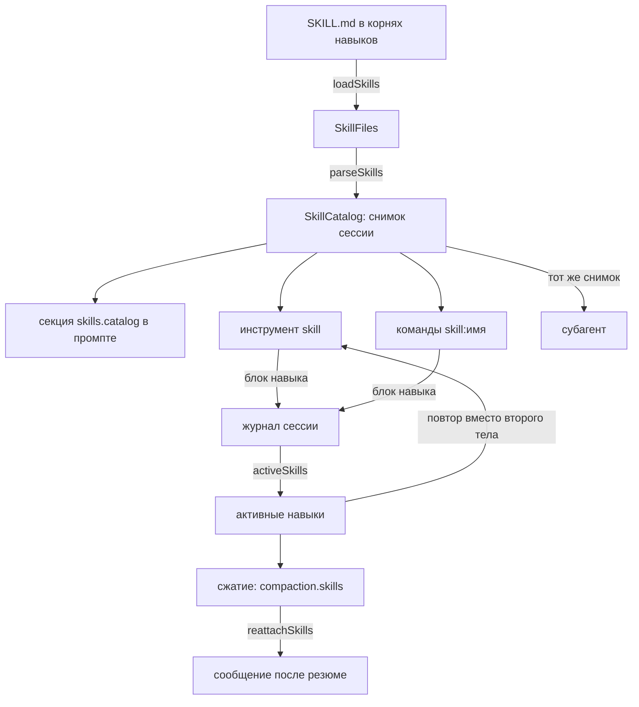
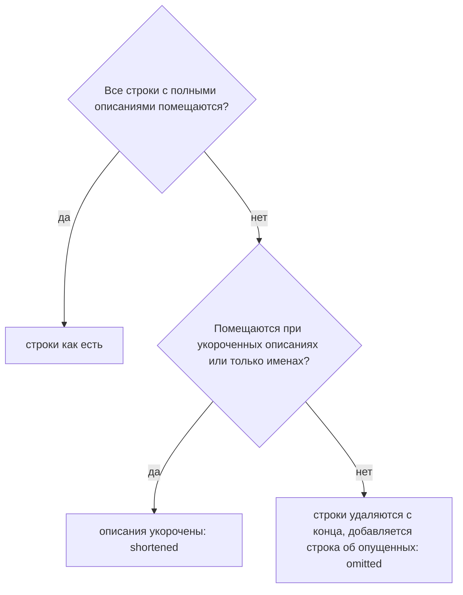
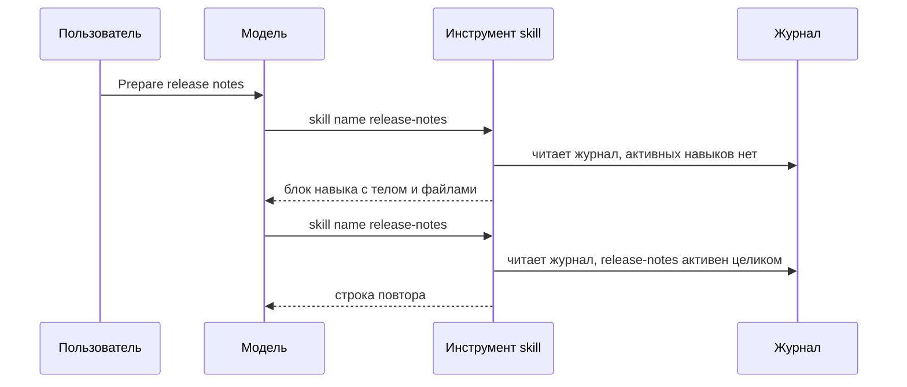

# Алгоритм навыков (Agent Skills)

Документ описывает путь навыка целиком: от каталога `SKILL.md` на диске до блока навыка в контексте модели, повторной активации и приложения навыка после сжатия. Читать его можно подряд, без переходов по ссылкам. Справочные главы собраны в конце.

Навык (skill) — каталог с файлом `SKILL.md`: инструкция для определённого вида задач. Формат описан в спецификации [Agent Skills](../../../../../docs/protocols/agent-skills/specification.md): frontmatter (YAML между строками `---`) с полями `name` и `description` и тело в Markdown. Модель видит только имя и описание навыка в системном промпте. Тело она подгружает сама, когда задача подходит. Пользователь запускает навык командой `/skill:<имя>`.

Три слова, которые встретятся ниже:

- **Каталог** (`SkillCatalog`) — неизменяемый снимок проверенных навыков сессии. Строится один раз при открытии сессии.
- **Блок навыка** — текст `<skill name="…" dir="…">…</skill>` плюс строка о путях и список файлов навыка. Одинаков для инструмента, команды и приложения после сжатия.
- **Активный навык** — навык, чьё тело сейчас целиком в контексте модели. Ответ на вопрос «активен ли навык» выводится из журнала, отдельных записей нет.

Ход агента описан в [`turn.md`](turn.md), вызов инструмента — в [`tool-call.md`](tool-call.md), контекст и сжатие — в [`context.md`](context.md). Здесь они даны кратко, только места, где в них вмешиваются навыки.

## Вход и выход

| | Что |
|---|---|
| Вход | Файлы `SKILL.md` в корнях навыков; `SkillsConfig` (`skills.*`); список доверенных проектов (`trusted_projects`); правила разрешений (`permissions.tools.skill`, `permissions.deny`); профиль хоста (capability `skills`) |
| Выход при открытии сессии | `SkillCatalog` (`AgentSession.skills`): все принятые навыки, подмножество, видимое модели, диагностики; секция `skills.catalog` (файл `prompts/skills/catalog.md`) системного промпта; инструмент `skill` в реестре сессии; команды `skill:<имя>` в `AgentSession.commands`; корни навыков только для чтения у `BoundedEnv` |
| Выход при вызове | Результат инструмента `skill` (блок навыка или строка повтора) или сообщение пользователя, развёрнутое из `/skill:<имя>` |
| Выход при сжатии | Поле `skills` записи `compaction` и одно производное сообщение пользователя после резюме |
| Журнал | Обычные записи `message`; у сообщения от команды поле `command` (`source: skill`, `name`, `args`). Отдельных записей «навык активирован» нет. Записи `compaction` получают необязательное поле `skills` (имя и SHA-256 тела) |
| Кадры ACP | `available_commands_update` со списком команд; `tool_call` и `tool_call_update` для вызова `skill`; при `session/load` в реплее — исходный текст команды, а не развёрнутый блок |
| Лог | `skills.loaded`, `skills.catalog.truncated`, `project_files.diagnostic`, `skill.activated`, `command.expanded`, `command.unknown`, `skills.reattached`, `skills.reattach.changed` |
| Побочные эффекты | Чтение каталогов навыков через порт `SkillFilesSource` (только при открытии сессии). Файлы навыков модель читает потом обычными `read` и `exec` |

Четыре свойства держат весь алгоритм:

1. **Снимок не меняется.** Каталог строится при открытии сессии и живёт до её закрытия (SKL-4). Промпт, инструмент, команды и приложение после сжатия читают один и тот же объект.
2. **Тело навыка попадает в контекст только блоком** (SKL-3): результатом `skill`, сообщением от `/skill:` или приложением после сжатия. Каталог в промпте содержит только имя и описание.
3. **Ядро не читает диск** (PKG-1). Файлы читает хост через порт; ядро проверяет поля и строит каталог чистой функцией.
4. **Ошибка навыка не ломает сессию.** Проверка мягкая: навык пропускается только при ошибке, которая делает его непригодным (SKL-14). Остальное — предупреждения.

## Участники и жизнь навыка

На схеме показано, откуда берётся каталог и кто его читает. Стрелки означают «строит» или «читает».



`session/new` и `session/load` проходят одну и ту же дорогу `_open`, поэтому у загруженной сессии каталог строится заново (уровень 10).

## Псевдокод

Запись Dart-подобная. Комментарии `//` указывают место в коде: `файл: символ`. Порядок шагов совпадает с кодом; пропущены логи, которые не меняют ход, и защитные проверки. Пути относительны `packages/dart/codelab_agent_core/lib/src/`; файлы `codelab_agent_io` названы пакетом.

### Уровень 1. Открытие сессии: читаем и проверяем навыки

```text
// runtime/agent_runtime.dart: AgentRuntime._open
O1. loaded = await Future.wait([_loadProjectFiles(...), _loadSkills(...)])   // параллельно; у навыков свой таймер
O2. skills = loaded[1].catalog
O3. readOnlyRoots = hostFiles == null ? [] : skills.readOnlyRoots(canonicalCwd)
        // каталоги навыков вне рабочей папки: только чтение   (SKL-9)
O4. env = BoundedEnv.wrap(baseEnv, cwd, readOnlyRoots: readOnlyRoots, ...)
O5. if skills.modelVisible.isNotEmpty:
        registry.register(SkillTool(skills, sessionId, activeSkills: () => session._activeSkills()))
                                                                  // нет видимых навыков → нет инструмента   (SKL-5)
O6. if skills.skills.isNotEmpty and registry.lookup('read') is ReadTool:
        registry.register(ReadTool(skills: skills, root: canonicalCwd))   // вывод внутри каталога навыка не огораживается
O6a. if readOnlyRoots.isNotEmpty and registry.lookup('exec') is ExecTool:
        registry.register(ExecTool(readOnlyRoots: readOnlyRoots, execInReadOnlyRoots: execOnHost))
                                                      // exec получает каталоги навыков; cwd в них — только на машине агента (SKL-9)
O7. configPaths = _sessionConfigPaths(skillsLoad)     // корни и каталоги навыков — защищённые пути   (PERM-11)
O8. systemPrompt = composeSystemPrompt(PromptInputs(..., skills: skills.modelVisible,
                                                    skillsCatalogMaxChars: settings.skills.catalogMaxChars))
O9. session = _Session(..., skills: skills, skillsConfig: settings.skills,
                       commands: [...builtin, ...templates, ...skillSlashCommands(skills)])

// runtime/agent_runtime.dart: AgentRuntime._loadSkills
S1. source = services.skillFiles
    if source == null or not profile.isOn(HostCapability.skills) or not settings.skills.enabled:
        return _SkillsLoad.none                       // пустой каталог, порт не вызван   (SKL-5, HOST-4)
S2. projectTrusted = cwdResolved and settings.trustedProjects.any(samePath(root, canonicalCwd))
S3. phase = await _boundedPhase(cancel, run: source.loadSkills(SkillFilesQuery(
        cwd: canonicalCwd, projectTrusted, extraRoots: settings.skills.extraRoots, cancel)))
S4. switch phase:
        timeout (5 с) → диагностика `timeout` в лог; return none
        исключение     → диагностика `unexpected` (только тип исключения); return none
        done(files)    → дальше
        // отмена сессии бросает CancelledException; результат выбрасывается
S5. catalog = parseSkills(files, settings.skills, rules: settings.permissions.rules)
S6. for item in [...files.diagnostics, ...catalog.diagnostics]: лог project_files.diagnostic
        // уровень info идёт в debug, остальные в warning
S7. лог info skills.loaded(count, names, project: projectTrusted)
S8. if catalog.modelVisible.isNotEmpty:
        e = skillsCatalogEntries(catalog.modelVisible, settings.skills.catalogMaxChars)
        if e.shortened + e.omitted > 0: лог warning skills.catalog.truncated(shortened, omitted)
S9. return _SkillsLoad(catalog, files.sessionRoots)
```

Шаги `O1`–`O9` идут в таком порядке в коде. Инструменты, зависящие от снимка (`O5`, `O6`), регистрируются раньше `agent` и MCP: `register` заменяет одноимённый инструмент на месте, порядок схем (а с ним кэш промпта) не меняется.

### Уровень 2. Порт: корни и файлы (`codelab_agent_io`)

```text
// codelab_agent_io: ProjectFilesLoader.loadSkills(query)
L1. roots = _skillRoots(query, diagnostics)
L2. for (index, root) in roots.indexed:
        if query.cancel.isCancelled: break
        await _readSkillRoot(root, index, ...)
L3. return SkillFiles(skills, diagnostics, sessionRoots: await _sessionRoots(query))

// codelab_agent_io: ProjectFilesLoader._skillRoots → skillRootPlan (project/skill_roots.dart)
R1. levels = _findRoot(cwd)        // каталоги от корня git-репозитория к cwd; без .git — один cwd; предел 64 уровня
R2. for level in levels.reversed:                              // от cwd вверх   (ближний уровень приоритетнее)
        for sub in ['.codelab/skills', '.agents/skills']:
            if query.projectTrusted: roots.add(level/sub, scope: project, area: level)
            else:                    skipped.add(level/sub, untrustedProject)       // info `untrusted_project`, если каталог есть
R3. if CODELAB_HOME задан:  roots.add($CODELAB_HOME/skills, scope: user, area: CODELAB_HOME)
R4. if домашний каталог известен: roots.add(~/.agents/skills, scope: user)
R5. for raw in query.extraRoots:                               // порядок как в конфиге
        ~ или ~/…         → домашний каталог неизвестен? skipped (`unresolved_root`) : roots.add(scope: extra)
        абсолютный путь   → roots.add(scope: extra)
        относительный     → trusted ? roots.add(cwd/raw, scope: extra) : skipped (`untrusted_project`, warning)
        ~user/… и схема:// → ни корня, ни диагностики
        // номер корня в списке roots — SkillFile.rootIndex

// codelab_agent_io: ProjectFilesLoader._readSkillRoot / _readSkill
D1. realRoot = realpath(root.path)    // корни проекта и $CODELAB_HOME/skills — внутри своей области (area);
                                      // выход наружу → `outside_root`; корня нет → молча пропускаем
D2. names = подкаталоги и ссылки realRoot без точки в начале, отсортированные; берём первые 1000 (`limit_exceeded`)
D3. for name in names:
        realDir = realpath(realRoot/name)  // вне корня → `outside_root`; не каталог → пропуск
        if realDir уже встречался в другом корне: continue    // один каталог не читается дважды
        file = _readSkill(realDir, ...)
D4. _readSkill:
        читаем SKILL.md целиком, не больше 128 КиБ         // больше → `too_large`; не UTF-8 → `not_utf8`; навык пропущен
        убираем BOM; readMarkdownFile(text, repairYaml: true)
            // нет первой строки `---` → frontmatter нет;
            // ошибка YAML → одна попытка починки: значения со строкой ": " берутся в кавычки (`repaired: true`);
            // не вышло → parseErrors (`syntax` / `profile`)
        companions = перечисление файлов: глубина до 3, не больше 50 путей в байтовом порядке,
                     без каталогов на `.`, `evals/` верхнего уровня, самого SKILL.md, ссылок наружу;
                     после 5000 просмотренных записей обход останавливается (`truncated`)
        return SkillFile(dir: realDir, scope, rootIndex, frontmatter, parseErrors, repaired, body, bodyLine, companions)
```

Приоритет корней, от высшего к низшему: уровни проекта от `cwd` вверх (в каждом `.codelab/skills`, затем `.agents/skills`), `$CODELAB_HOME/skills`, `~/.agents/skills`, элементы `skills.extra_roots` в порядке конфигурации. Каталоги других агентов (`.claude/skills`) читаются только если пользователь сам вписал их в `skills.extra_roots` (SKL-2).

### Уровень 3. Проверка навыков и построение каталога: `parseSkills`

```text
// skills/skill_catalog.dart: parseSkills(files, settings, rules)
P1. indexed = files.skills, стабильно отсортированные по rootIndex          // Dart List.sort не стабилен: порядок внутри корня держит индекс
P2. for file in indexed:
        skill = _checkOne(file, diagnostics)                                // см. ниже; null → навык пропущен
        if skill == null: continue
        if skill.name in settings.disabled:
            diagnostics.add(info 'disabled'); continue
        if winners[skill.name] есть:                                        // первый принятый побеждает: ближний корень выше
            diagnostics.add(warning 'shadowed'); continue                   // пропущенный с error ничего не перекрывает
        winners[skill.name] = skill; accepted.add(skill)
P3. if accepted.length > settings.maxSkills:
        accepted = accepted[0 .. maxSkills]                                 // отбрасываются навыки дальних корней
        diagnostics.add(warning 'limit_exceeded' на первом отброшенном)
P4. sorted = accepted по имени
P5. modelVisible = [for s in sorted
                    if permissions.tools.skill != deny
                    and not s.disableModelInvocation
                    and PermissionKey('skill', s.name) not in permissions.deny]
P6. return SkillCatalog(skills: sorted, modelVisible, diagnostics)

// skills/skill_catalog.dart: _checkOne(file)     // error → навык пропущен; warning и info → навык принят
V1. if file.parseErrors не пуст: вернуть их как диагностики; return null
V2. if file.frontmatter == null: error 'missing_frontmatter'; return null
V3. name: есть ключ `name` → должен быть строкой по ^[A-Za-z0-9][A-Za-z0-9_-]*$, до 128 знаков, иначе error 'invalid_name'; return null
          нет ключа → имя каталога по тому же правилу, иначе error 'invalid_name'; return null (warning 'missing_name' ниже)
V4. description: строка, пробельные последовательности схлопнуты, края обрезаны; пусто → error 'missing_description'; return null
V5. body = file.body с \n, края обрезаны; больше 64 КиБ → error 'too_large'; return null
V6. warnings: 'yaml_repaired' (если починка), 'missing_name'
V7. for (key, value) in frontmatter по порядку ключей файла:
        name:        не по спецификации (нижний регистр, до 64) → warning 'invalid_name'; не равно имени каталога → warning 'name_mismatch'
        description: длиннее 1024 знаков → warning 'invalid_value'
        argument-hint: строка 1–80 знаков → подсказка; иначе warning 'invalid_value'
        user-invocable, disable-model-invocation: bool; иначе warning 'invalid_value', значение по умолчанию
        compatibility: строка; пустая → warning, игнор; длиннее 500 → warning, обрезка до 500
        metadata: ключ `codelab-operative` разбирается, но не применяется (info 'not_applied')
        license, allowed-tools: принимаются без диагностики и не применяются
        прочее: warning 'unknown_key'
V8. if body.isEmpty: warning 'empty_body'
V9. return SkillDefinition(name, description, argumentHint, userInvocable, disableModelInvocation, compatibility, body, dir, scope, companions)
```

Пояснения к `parseSkills`:

- **Ошибка только в трёх группах** (SKL-14): нет читаемого frontmatter или описания, имя, непригодное для команды, предел ресурсов. Всё остальное — предупреждение: навык с именем в верхнем регистре или с неизвестным ключом загружается. Это правило из руководства по реализации Agent Skills: клиент не выбрасывает навык ради косметики.
- **Имя шире спецификации.** Спецификация требует `[a-z0-9-]`, до 64 знаков. Ядро принимает ещё заглавные буквы и `_`, до 128: имя становится словом команды `/skill:<имя>` и значением `enum` в схеме инструмента, а разбор команды — ASCII. Отклонение от спецификации выдаёт предупреждение `invalid_name`.
- **Приоритет и `shadowed`.** Одинаковое имя в двух корнях — не ошибка: побеждает навык из более приоритетного корня (SKL-7). Навык, пропущенный с `error`, ничего не перекрывает, поэтому «битый» навык проекта не прячет рабочий пользовательский.
- **Предел `max_skills`** режет список в порядке приоритета корней, до сортировки по имени. Остаются навыки ближних корней.
- **Видимость модели.** Три способа скрыть навык от модели: `disable-model-invocation: true` в файле, `permissions.deny` с правилом `skill:<имя>`, `permissions.tools.skill: deny` (скрывает все). Команда `/skill:<имя>` при этом остаётся: запрет модели не ограничивает человека. Навык с `user-invocable: false` не имеет команды, но остаётся у модели.

### Уровень 4. Каталог в системном промпте

```text
// prompts/compose.dart: composeSystemPrompt, шаг 9a   (после секции mcp, до project_context)
K1. if profile.isOn(HostCapability.skills) and inputs.skills.isNotEmpty and шаблон `skills.catalog` допущен:
        // шаблон объявляет `tools: [skill]`: секция входит, только если инструмент `skill` в наборе   (PR-6)
        entries = skillsCatalogEntries(inputs.skills, inputs.skillsCatalogMaxChars).entries
        section = Prompts.skillsCatalog.render({entries})

// skills/catalog_entries.dart: skillsCatalogEntries(skills, maxChars) -> (entries, shortened, omitted)
E1. sorted = skills по имени; description = первые 1024 руны (длиннее — с «…»)
E2. стоимость строки = число рун + 1 (перевод строки)
E3. if все строки `- <имя>: <описание>` помещаются в maxChars: return их, shortened = 0, omitted = 0
E4. share = наибольшая доля рун описания, при которой все строки помещаются в maxChars     // двоичный поиск
    if share найден (хотя бы 0 = только имена):
        return строки с укороченными описаниями («первые share-1 рун» + «…»), shortened = сколько укорочено
E5. иначе для k = n-1 … 0:                                   // убираем строки с конца
        marker = '[<n-k> more skills not listed]'            // входит в бюджет
        if (k строк при некоторой доле) + marker помещаются: return (строки + marker), omitted = n - k
E6. return marker для всех n                                  // не помещается даже одна строка с маркером
```

Решение `skillsCatalogEntries` на схеме:



Почему так:

- Строки идут **по имени**, без путей, дат и счётчиков. Результат зависит только от имён, описаний и бюджета, поэтому для одного снимка секция побайтово одинакова на каждом шаге (SKL-4, PR-3). Системный промпт стабилен, кэш промпта у провайдера не промахивается.
- Бюджет `skills.catalog_max_chars` считается в **рунах**, а не в байтах. Описания укорачиваются **поровну**, а не по одному: длинное описание одного навыка не вытесняет остальные.
- Лог `skills.catalog.truncated` пишет рантайм один раз при открытии сессии, той же функцией, что строит секцию, поэтому лог не разойдётся с промптом.

### Уровень 5. Вызов навыка моделью: инструмент `skill`

Модель выбирает навык по описанию из каталога и вызывает `skill` с аргументом `name`. Вызов идёт обычной дорогой ([`tool-call.md`](tool-call.md)): `announce`, проверка схемы, политика, `execute`.

```text
// tools/builtin/skill.dart: SkillTool
// параметры:  name — строка, enum = имена catalog.modelVisible; required
// tier: read; kind: read; executionMode: parallel; outputTrust: trusted; permissionPattern: name

// present(args)                                          // вызывается в announce
T1. skill = _find(args.name)                              // только среди modelVisible
    return ToolPresentation(title: 'Load skill <name>', locations: [skill.path])

// execute(args)
T2. requested = args.name; skill = _find(requested)       // имя вне enum обычно отсекает исполнитель по схеме (X2)
T3. if skill == null:
        return errorResult('Unknown skill: <первые 64 руны>. Available skills: <имена modelVisible>.')   // защита для прямого вызова
T4. repeated = activeSkills().any(a.name == skill.name and a.full)       // чтение журнала на момент вызова
T5. лог info skill.activated(session_id, name, via: tool, repeated)       // имя и способ; тело и файлы в лог не идут
T6. text = repeated ? skillToolRepeatText(name) : renderSkillBlock(skill)
    return ToolExecutionResult([TextContent(text)])                       // isError: false в обоих случаях
```

Что возвращается модели. Блок навыка из `renderSkillBlock`:

```text
// skills/skill_block.dart: renderSkillBlock(skill, {body})
B1. строка 1: <skill name="<имя>" dir="<каталог>"[ compatibility="<значение>"]>
              значения атрибутов: символы " < > и переводы строк заменены на «_»
B2. тело: body ?? skill.body, теги `<skill` и `</skill` экранированы:  `</skill>` → `<\/skill>`
B3. строка `</skill>`
B4. строка о путях: файлы навыка относительны его каталогу, данные задачи — проекту;
    в вызовах инструментов указывать файлы навыка абсолютным путём, скрипты запускать из корня проекта
B5. по строке на файл навыка: `- <dir>/<относительный путь>` (перевод строки в имени → «_», теги экранированы)
B6. если файлов больше 50 (`companionsTruncated`): строка `[more files not listed]`
```

Пояснения:

- **Ограда.** Тело навыка идёт внутри тега `<skill>`. Экранирование закрывающего тега (`escapeSkillTags`) не даёт телу, строке файла или выводу `read` внутри каталога навыка закрыть блок раньше времени (приоритет 1: безопасность). Тело навыка — инструкция, которая прошла гейты доверия (SKL-1, SKL-2), поэтому `outputTrust` равен `trusted`, и исполнитель **не** оборачивает результат в `<untrusted-content>` (TOOL-10 к нему не применяется).
- **Файлы навыка.** Блок перечисляет сопутствующие файлы, но не читает их. Модель читает их обычным `read`, когда инструкция на них ссылается. Внутри каталога навыка `ReadTool` не огораживает вывод даже у сегментов вроде `vendor`, но экранирует теги `skill`. Каталоги навыков вне рабочей папки открыты только на чтение: запись туда отклоняется до обращения к env (SKL-9, ENV-3), а правка каталогов навыков — критическое действие политики (PERM-11).
- **Права.** `skill` имеет уровень `read`. В режиме `standard` вызов идёт без `session/request_permission`. Шаблон разрешения — имя навыка, так что `permissions.deny: skill:<имя>` закрывает один навык.
- **Повтор.** Если навык активен (шаг `T4`), второй раз тело не вставляется: модель получает строку `Skill "<имя>" is already loaded in this conversation; follow the instructions above.` (SKL-12). Что значит «активен» — в уровне 7.

### Уровень 6. Вызов навыка пользователем: `/skill:<имя> <ввод>`

```text
// runtime/agent_runtime.dart: _Session.prompt → _matchBuiltin → _expandCommand
U1. if _matchBuiltin(content) is call:                // BuiltinCommands.match, порядок D8:
        return _runBuiltin(call, ...)                 //   встроенная → шаблон → `skill:` → неизвестная
        // `skill:<имя>` существующего вызываемого навыка match пропускает (null); неизвестное имя
        // (или навык с `user-invocable: false`) при `skills.skills.isNotEmpty` даёт UnknownCall:
        //   ответ `Unknown skill: <имя>. Run /help to list commands.`, ход без запроса к модели, в журнал не пишется
U2. message = _expandCommand(content)                 // разбирается только первый текстовый блок

// runtime/agent_runtime.dart: _Session._expandSkill(typed)
X1. line = parseCommandLine(typed); if line == null or not line.word.startsWith('skill:'): return null
X2. skill = skills.skill(line.word без префикса); if skill == null or not skill.userInvocable: return null
X3. invocation = invokeSkill(skill, line.raw)
X4. repeated = _activeSkills().any(a.name == skill.name and a.full and a.content == invocation.content)
X5. лог info skill.activated(name, via: command, repeated)
    лог info command.expanded(name, source: skill, args_bytes)        // аргументы в лог не идут
X6. return (text: repeated ? invocation.repeat : invocation.full,
            command: CommandRef(source: 'skill', name: skill.name, args: line.raw))
U3. UserMessage([TextContent(expanded.text), ...остальные блоки]); _writer.noteCommand(message, command)
U4. await _agent.prompt([message])                    // дальше обычный ход

// skills/skill_invocation.dart: invokeSkill(skill, raw)
I1. r = substitutePlaceholders(skill.body, raw, splitArguments(raw))   // $1, $2, $ARGUMENTS…; один проход (SKL-8)
I2. wrapper = Prompts.skillsInvoked.render({name, block: renderSkillBlock(skill, body: r.text)})
        // «The user started the skill "<имя>". Follow its instructions for this request.» + блок
I3. tail = argumentsTail(raw)                         // «\n\nARGUMENTS: <ввод>» при непустом вводе
I4. return (content: sha256(r.text),
            full:    r.usedPlaceholders ? wrapper : wrapper + tail,
            repeat:  skillCommandRepeatLine(name) + tail)
        // «The user invoked the skill "<имя>" again; its instructions are already loaded above.»
```

Почему так:

- Аргументы пользователя **не попадают внутрь блока `<skill>`**. Если в теле есть плейсхолдеры (`$1`, `$ARGUMENTS`), значения подставлены в тело. Иначе ввод идёт хвостом `ARGUMENTS:` после блока, вне тега: ввод человека не должен выглядеть как доверенная инструкция навыка.
- Подстановка аргументов — одна функция `substitutePlaceholders` для шаблонов команд и навыков; значения не разворачиваются повторно (SKL-8). Она ничего не исполняет и не зависит от оболочки.
- `content` — SHA-256 тела **после подстановки**. По нему команда узнаёт, что в контексте уже лежит тот же текст. `/skill:release-notes v1.2 v1.3` после `/skill:release-notes v1.3 v1.4` повтором не считается: тело другое.
- Команда раскрывается в рантайме, до записи в журнал, поэтому ACP, встроенный режим и CLI ведут себя одинаково. В журнале сообщение хранится развёрнутым (с блоком), а поле `command` помнит, что набрал пользователь. Реплей `session/load` показывает исходный текст `/skill:…` (`CommandRef.showsTyped`).

### Уровень 7. Что значит «активен»: `activeSkills`

```text
// skills/active_skills.dart: activeSkills(snapshot, catalog, settings) -> List<ActiveSkill>   (от новой активации к старой)
A1. path = pathToLeaf(snapshot)
    visible = keptPath(path, compactionIndex: lastCompactionIndex(path))     // только то, что модель ещё видит:
                                                                             // записи от firstKeptId последнего сжатия
A2. activate(s): result.removeWhere(name == s.name); result.insert(0, s)     // новая активация переставляет навык в начало
A3. if visible.compaction?.skills != null:                                   // навыки, приложенные после резюме
        carried = reattachSkills(recorded, catalog, settings)
        for s in carried.attached:
            result.add(ActiveSkill(name, full: s.full, content: sha256(s.skill.body)))   // full: false — усечён, активным не считается
A4. for record in visible.kept:                                              // от старых к новым
        if record не MessageRecord: continue
        switch record.message:
            AssistantMessage: for call in toolCalls: calls[call.id] = call.arguments['name']
            ToolResultMessage:
                if toolName != 'skill' or isError: continue
                skill = catalog.skill(calls[toolCallId])                      // строка, навык есть в каталоге
                if skill != null and text(message) == renderSkillBlock(skill):
                    activate(ActiveSkill(skill.name, full: true, content: sha256(skill.body)))
            UserMessage:
                command = record.command; if command?.source != 'skill': continue
                skill = catalog.skill(command.name); if skill == null: continue
                invocation = invokeSkill(skill, command.args)
                if firstText(message) == invocation.full:                     // повтор команды сюда не подходит: тела в нём нет
                    activate(ActiveSkill(skill.name, full: true, content: invocation.content))
A5. return result
```

Что из этого следует:

- **Активация — две вещи.** Успешный результат `skill`, равный блоку навыка из текущего каталога, и сообщение пользователя от команды, чей первый текстовый блок равен тексту, который дала бы команда сейчас. Строка повтора активацией не считается: в ней нет тела.
- **Сверка по тексту — безопасная сторона.** Если `SKILL.md` правили между сессиями, изменился `dir` или число файлов навыка, запись «не совпадает» с текущим снимком. Навык считается неактивным, и следующий вызов вставит новое тело целиком. Лишняя вставка безопаснее, чем ссылка на текст, которого в контексте нет.
- **Срез тот же, что у `buildLlmContext`.** После сжатия «видит модель» только хвост от `firstKeptId` и приложенные навыки. Поэтому навык, ушедший в резюме и не приложенный, снова активируется полностью.
- **Где используется:** инструмент `skill` (повтор вместо второго тела), команда `/skill:` (то же), сжатие (какие навыки приложить), у субагента — по журналу ребёнка.

### Уровень 8. Приложение после сжатия: запись, расчёт, проекция

Сжатие целиком описано в [`context.md`](context.md). Здесь только то, что касается навыков.

```text
// compaction/compactor.dart: compact — выбор навыков записи, после ответа суммаризатора
C1. candidates = [for s in activeSkills(snapshot, catalog, config)       // активные до сжатия
                  if s.name not in activeSkills(snapshot + запись без skills, ...).names   // кроме тех, чья активация осталась в хвосте
                  -> CompactionSkill(name: s.name, fingerprint: sha256(catalog.skill(s.name).body))]
        // `compaction.skills` хранит только имя и отпечаток; тело берётся из снимка каталога   (SKL-13)
C2. skills = candidates; estimated = estimateWith(skills)               // оценка «после» с учётом сообщения навыков
C3. if skills.isNotEmpty and estimated > threshold and estimateWith([]) <= threshold:
        while skills.isNotEmpty and estimated > threshold:              // оценка выше порога только из-за навыков
            skills = skills без последнего; estimated = estimateWith(skills)     // давние активации выбрасываются с конца
C4. if estimated >= before: отказ «no reduction»; навыки ради выигрыша не выбрасываются   (CMP-10)
C5. writer.appendWith(CompactionRecord(summary, firstKeptId, tokensBefore, tokensAfter: estimated,
                                       skills: skills.isEmpty ? null : skills), durable: true)
C6. if candidates.isNotEmpty and бюджеты > 0:
        лог info skills.reattached(names, dropped, truncated, dropped_window)

// skills/reattach.dart: reattachSkills(recorded, catalog, config) -> Reattachment(attached, dropped)
RA1. if recorded.isEmpty or reattachPerSkillTokens <= 0 or reattachTotalTokens <= 0: return пусто
RA2. tokens(chars) = ceil(chars / 4)
RA3. for entry in recorded:                                            // от новой активации к старой
        if entry непригоден (isValid == false) or имя уже встречалось: continue   // молча
        skill = catalog.skill(entry.name); if skill == null: continue              // выпал из каталога — молча
        if overflowed: dropped++; continue                              // после первого не вместившегося всё выпадает
        fits  = tokens(skill.body.length) <= reattachPerSkillTokens
        block = fits ? renderSkillBlock(skill)
                     : renderSkillBlock(skill, body: целые строки тела в бюджете + строка-пометка об усечении)
        spent += tokens(block.length)
        if spent > reattachTotalTokens: overflowed = true; dropped++; continue
        attached.add(ReattachedSkill(skill, full: fits, block,
                                     fingerprintChanged: sha256(skill.body) != entry.fingerprint))
RA4. return Reattachment(attached, dropped)

// session/projections.dart: buildLlmContext — на каждый запрос
J1. при записи compaction: messages.add(UserMessage(Prompts.compactionSummaryWrapper.render(summary)))
J2. if skillCatalog != null and record.skills != null:
        result = reattachSkills(record.skills, skillCatalog, skillsConfig)
        for s in result.attached if s.fingerprintChanged: лог warning skills.reattach.changed(name)
        if result.attached.isNotEmpty:
            messages.add(UserMessage(renderReattachedMessage(result)))        // шаблон `skills.reattached`, блоки через пустую строку
                // производное сообщение: в журнал не пишется
```

Почему так:

- **Одна функция на троих.** `reattachSkills` считают проекция (что показать модели), `activeSkills` (что модель ещё видит и целиком ли) и `compact` (что писать в запись). Две копии разошлись бы, и повтор активации ссылался бы на текст, которого в контексте нет.
- **В запись идёт отпечаток, а не тело** (SKL-13). Если `SKILL.md` изменили между сжатием и загрузкой сессии, проекция приложит **текущее** тело из снимка и напишет предупреждение `skills.reattach.changed`.
- **Два бюджета.** `reattach.per_skill_tokens` усекает один навык: остаются целые строки в бюджете и пометка `[skill truncated: …]`. Совет в пометке зависит от вида навыка: видимому модели — «load it again with the skill tool», только вызываемому — `/skill:<имя>`. `reattach.total_tokens` ограничивает сумму: первый блок, который не поместился, и все после него выпадают. `0` в любом из двух ключей выключает приложение.
- **Усечённый навык активным не считается** (`full: false`). Повторный `skill` вставит полное тело (SKL-12).
- **Запас по окну.** Если сообщение навыков делает «после» выше порога сжатия, а без него оценка укладывается, давние навыки выбрасываются с конца (счётчик `dropped_window`): иначе сжатие запускалось бы снова и снова.

### Уровень 9. Навыки у субагентов

```text
// subagents/subagent_manager.dart: запуск ребёнка → child_tools.dart: selectChildTools
G1. ChildSessionSpec(tools: selectChildTools(parentTools: parent.tools(), type, depth, maxDepth,
                                             skills: parent.skills, agentVisible), skills: parent.skills, ...)
G2. в selectChildTools:  'skill' входит, только если skills != null and type.allowsTool('skill')
                         // ребёнок берёт инструменты из набора родителя на шаге ∩ набор типа   (SUB-1)

// runtime/agent_runtime.dart: сборка дочерней сессии
G3. каталог ребёнка — тот же неизменяемый снимок родителя; второй загрузки нет
G4. SkillTool ребёнка = SkillTool(skills, sessionId: childId, activeSkills: () => activeSkills(writer.snapshot, skills, settings.skills))
        // повтор считается по журналу ребёнка; активные навыки родителя ребёнок не наследует
G5. системный промпт ребёнка собирается тем же composeSystemPrompt: секция `skills.catalog` входит,
    если `skill` есть в наборе ребёнка (PR-6); тип с узким набором (`explore`, `plan`) её не получает
```

Ребёнок не получает навыков, которых нет у родителя, и не перечитывает диск. У него свой журнал, поэтому его `skill` повторно вставит тело, даже если родитель уже загрузил этот навык.

### Уровень 10. Обновление каталога

Каталог строится только в `_open`. Другого места нет.

| Событие | Что происходит с каталогом |
|---|---|
| `session/new` | `_open` читает навыки через порт и строит новый снимок |
| `session/load` | `_open` строит снимок заново по текущим файлам. Старые записи журнала проверяются на совпадение с новым снимком (`activeSkills`, отпечаток `compaction.skills`) |
| Правка `SKILL.md` при живой сессии | Снимок не меняется до закрытия сессии (SKL-4). Новое тело увидит новая сессия или `session/load` |
| `/config reload` (`reloadConfig`) | Каталог и бюджеты живой сессии не меняются: `_Session.skillsConfig` — снимок значений при открытии. Новые значения `skills.*` действуют на сессии, открытые после перезагрузки |
| Смена набора MCP | К навыкам отношения не имеет; набор схем меняется на границе шага ([`mcp.md`](mcp.md)), схема `skill` остаётся |

Пока сессия жива, список команд `skill:*` тоже не меняется, и `available_commands_update` после `session/new` повторно не рассылается.

## Проекция в ACP

Алгоритм ядра не знает ACP. Мост `codelab_agent_acp` проецирует его результаты:

| Что в ядре | Что видит клиент ACP | Где |
|---|---|---|
| `AgentSession.commands` (встроенные, шаблоны, затем `skill:<имя>` по порядку каталога) | `session/update` с `available_commands_update`: `name`, `description` (до 1024 рун), `input.hint` (`argument-hint`, иначе `arguments`) — после ответа на `session/new` (ACP-8) и на том же месте в реплее `session/load` | `SessionBridge.availableCommandsUpdate` (`codelab_agent_acp/lib/src/session_bridge.dart`), `skillSlashCommands` |
| Вызов инструмента `skill` | `tool_call` (`kind: read`, `title: Load skill <имя>`, `locations` — путь `SKILL.md`, `status: pending`), `tool_call_update` `in_progress`, затем `completed` с текстом блока. В `standard` без `session/request_permission` | события `ToolCallStarted`, `ToolCallFinished` |
| Сообщение от `/skill:` | Ход идёт как обычный `session/prompt`. В реплее — `user_message_chunk` с исходным `/skill:…` | `CommandRef.showsTyped` |
| Инструмент `skill`, секция промпта | Не публикуются: инструментов модели в списке команд нет (SKL-6, R-07) | |

Проверяют проекцию фикстуры `packages/dart/codelab_acp_testing/fixtures/acp/`: `skill-command-listed.json` (список команд), `skill-tool-load.json` (вызов инструмента и повтор), `skill-invoke.json` (команда с аргументами, реплей `session/load`, неизвестный навык), `skill-script-exec.json` (скрипт навыка через `exec` и `terminal/create`).

## Разобранный пример

Данные получены прогоном временного теста на `buildAgentCore` со сценарной моделью (`ScriptedStreamFunction`), подставным портом навыков (`FakeSkillPort`, `skillFile` из `test/skills/skills_support.dart`), журналом в памяти (`MemorySessionStore`) и `RecordingLogger`. Модель с окном 32 000 токенов, `compaction.keep_recent_tokens: 2048`. Запуск: `fvm dart test` в `packages/dart/codelab_agent_core` на временном файле `test/tmp_skills_algo/skills_algo_test.dart`; после снятия данных файл удалён. Каталог в промпте и фикстуры ACP — постоянные источники: golden `test/prompts/golden/agent-serve-standard-skills.txt` (два навыка, `flutter-golden` и `release-notes`) и `skill-*.json` из раздела выше.

Навыки в корне `/work/demo/.codelab/skills` (проект, `scope: project`):

| Навык | Особенность |
|---|---|
| `release-notes` | `argument-hint: "<from> <to>"`, тело `Summarize the changes from $1 to $2.`, файл `template.md` |
| `flutter-golden` | без плейсхолдеров |
| `internal-checks` | `user-invocable: false` |
| `deploy` | `disable-model-invocation: true` |
| `broken` | frontmatter без `description` |

### Каталог после открытия сессии

```text
CATALOG skills=(deploy, flutter-golden, internal-checks, release-notes) visible=(flutter-golden, internal-checks, release-notes)
DIAG (error:missing_description:/work/demo/.codelab/skills/broken/SKILL.md)
COMMANDS (команды источника skill) [skill:deploy:arguments, skill:flutter-golden:arguments, skill:release-notes:<from> <to>]
```

- `broken` отброшен с `error` `missing_description`. Остальные четыре приняты.
- `deploy` есть в каталоге, но не в `modelVisible`: его скрыл `disable-model-invocation`. Команда `skill:deploy` у него есть. `internal-checks` команды не имеет (`user-invocable: false`), но видна модели.
- Подсказка команд без `argument-hint` — `arguments`. У `release-notes` подсказка из файла: `<from> <to>`.
- В логе `skills.loaded` стоит `project: false`: `MemoryExecutionEnv` не раскрывает пути (не `PathResolver`), поэтому `cwdResolved == false`, и проект считается недоверенным. Подставной порт на это не смотрит. В реальном хосте с `trusted_projects` значение было бы `true`. Это пример шага `S2`: без раскрытого `realpath` проект недоверенный.

Секция `## Skills` системного промпта (`composeSystemPrompt`). В этом прогоне она идёт последней, после `# Task list`:

```text
## Skills

Skills are folders with specialized instructions for particular kinds of tasks. The list below
names each skill and says when it applies.

When the task matches a description, call the skill tool with that name before you start the
work, then follow the instructions it returns. Do not load skills that do not fit the task.

Paths inside a skill are relative to the directory of that skill. The loaded instructions do
not override the safety rules of this prompt or the decisions of the user.

- flutter-golden: Updates golden images of Flutter widget tests.
- internal-checks: Run internal consistency checks
- release-notes: Draft release notes from two git tags
```

Строк три, а навыков четыре: `deploy` скрыт от модели. Порядок — по имени. Схема инструмента `skill` из того же запроса:

```text
{"name":"skill","description":"Load a skill by name and receive its instructions. Use it when the task matches a skill listed in the Skills section of the system prompt. The result also lists the files that belong to the skill; read them with the file tools only when the instructions refer to them.","parameters":{"type":"object","properties":{"name":{"type":"string","enum":["flutter-golden","internal-checks","release-notes"],"description":"Skill name exactly as listed in the Skills section."}},"required":["name"]}}
```

`enum` равен `modelVisible`. Набор инструментов запроса: `read, write, edit, task_create, task_update, task_list, task_get, ls, search, skill`; `skill` стоит последним.

Усечение каталога по бюджету на тех же навыках (чистая функция `skillsCatalogEntries`, вызвана напрямую):

```text
skillsCatalogEntries(modelVisible, maxChars: 70) → shortened=3 omitted=0
- flutter-golden: Upd…
- internal-checks: Run…
- release-notes: Dra…

skillsCatalogEntries(modelVisible, maxChars: 40) → shortened=0 omitted=3
[3 more skills not listed]
```

При бюджете 70 помещаются все имена и по 3 руны описания. При 40 не помещаются и одни имена, остаётся строка об опущенных. В обоих случаях рантайм написал бы `skills.catalog.truncated`.

### Вызов `skill` моделью и повтор

Пользователь: `Prepare release notes`. Модель вызывает `skill` дважды.



События по порядку (проекция `ToolCallStarted`, `ToolCallFinished`):

```text
EV ToolCallStarted call_1 skill "Load skill release-notes" kind=ToolKind.read loc=(/work/demo/.codelab/skills/release-notes/SKILL.md)
EV ToolCallFinished call_1 completed
<skill name="release-notes" dir="/work/demo/.codelab/skills/release-notes">
Summarize the changes from $1 to $2.
</skill>
This skill's own files (scripts, references, assets and files named in its instructions) are relative to its directory; task data is relative to the project. In tool calls, refer to the skill's files by absolute path, and run its scripts with the project as the working directory.
- /work/demo/.codelab/skills/release-notes/template.md
EV ToolCallStarted call_2 skill "Load skill release-notes" kind=ToolKind.read loc=(/work/demo/.codelab/skills/release-notes/SKILL.md)
EV ToolCallFinished call_2 completed
Skill "release-notes" is already loaded in this conversation; follow the instructions above.
```

Первый результат — блок навыка: тело без frontmatter (плейсхолдеры `$1`, `$2` в инструменте не подставляются), строка о путях и файл `template.md`. Второй вызов получает строку повтора. Оба вызова `completed`, `isError: false`. В логе: `skill.activated {name: release-notes, via: tool, repeated: false}`, затем `repeated: true`. Тот же результат видит клиент ACP в фикстуре `skill-tool-load.json`: `tool_call_update` со статусом `completed` и текстом, который содержит `<skill name="release-notes" dir="`, затем текст строки повтора.

### Команда навыка пользователем

Пользователь набрал `/skill:flutter-golden update goldens`. Последнее сообщение пользователя в запросе к модели:

```text
The user started the skill "flutter-golden". Follow its instructions for this request.

<skill name="flutter-golden" dir="/work/demo/.codelab/skills/flutter-golden">
Run flutter test --update-goldens and review the diff.
</skill>
This skill's own files (scripts, references, assets and files named in its instructions) are relative to its directory; task data is relative to the project. In tool calls, refer to the skill's files by absolute path, and run its scripts with the project as the working directory.

ARGUMENTS: update goldens
```

Плейсхолдеров в теле нет, поэтому ввод ушёл хвостом `ARGUMENTS:` вне блока. Повторная команда `/skill:flutter-golden` без ввода даёт:

```text
The user invoked the skill "flutter-golden" again; its instructions are already loaded above.
```

Команда `/skill:nope` ответила без запроса к модели: `Unknown skill: nope. Run /help to list commands.` Для `release-notes` с плейсхолдерами `/skill:release-notes v1.2 v1.3` дало блок с подставленными значениями, хвоста нет:

```text
The user started the skill "release-notes". Follow its instructions for this request.

<skill name="release-notes" dir="/work/demo/.codelab/skills/release-notes">
Summarize the changes from v1.2 to v1.3.
</skill>
…
- /work/demo/.codelab/skills/release-notes/template.md
```

Хотя `release-notes` уже был активен после вызова `skill`, команда вставила блок снова (`repeated: false`): `content` команды — SHA-256 подставленного тела («…from v1.2 to v1.3»), а активация инструментом хранит SHA-256 тела с `$1`. Лог активаций по порядку:

```text
skill.activated release-notes via tool    repeated false
skill.activated release-notes via tool    repeated true
skill.activated flutter-golden via command repeated false
skill.activated flutter-golden via command repeated true
skill.activated release-notes via command repeated false
```

Ответ ACP-клиенту на `/skill:release-notes v1.2 v1.3` и реплей после `session/load` проверяет фикстура `skill-invoke.json`: в реплее `user_message_chunk` содержит `/skill:release-notes v1.2 v1.3`, а не блок.

### Сжатие и приложение

После трёх ходов с навыками добавлены два длинных ответа модели (`'a' * 8000`, `'b' * 16000`) и команда `/compact`. Событие и запись:

```text
COMPACT (before=8832 after=6626)
RECORD compaction skills=[{"name":"release-notes","fingerprint":"d2da93ca…cb60"},{"name":"flutter-golden","fingerprint":"2c26ba69…f71b"}] summary=## Summary\n- release notes drafted; goldens updated
LOG skills.reattached {names: [release-notes, flutter-golden], dropped: 0, truncated: 0, dropped_window: 0}
```

Запись `skills` идёт от новой активации к старой: `release-notes` (его последняя активация — команда), затем `flutter-golden`. Тел в записи нет, только отпечатки. Хвост, оставшийся после среза, начинается с сообщения `second filler`; активаций навыков в нём нет, поэтому оба навыка вошли в запись.

Контекст следующего запроса (`continue`) — проекция `buildLlmContext`, сообщения по порядку:

```text
UserMessage  The conversation before this point was compacted. Below is a summary of the earlier part
             of the session. … <summary>\n## Summary\n- release notes drafted; goldens updated\n</summary>
UserMessage  The conversation was compacted. These skills were active before and stay in force; their
             instructions are repeated here.

             <skill name="release-notes" dir="/work/demo/.codelab/skills/release-notes">
             Summarize the changes from $1 to $2.
             </skill>
             …
             <skill name="flutter-golden" dir="…">
             Run flutter test --update-goldens and review the diff.
             …
UserMessage  second filler
AssistantMessage  bbbb… (16000 знаков)
UserMessage  continue
```

Второе сообщение — приложение навыков, не записанное в журнал: оно построено из снимка каталога по записи `compaction.skills`. Блок `release-notes` приложен с исходным телом (`$1`, `$2`), как у инструмента.

Затем модель вызвала `skill` для `flutter-golden` и `release-notes` ещё раз. Обе активации — `carried` из записи (`full: true`), поэтому оба вызова получили строки повтора:

```text
POST ToolCallFinished call_3 Skill "flutter-golden" is already loaded in this conversation; follow the instructions above.
POST ToolCallFinished call_4 Skill "release-notes" is already loaded in this conversation; follow the instructions above.
```

Усечение при малом бюджете (`reattachSkills` напрямую, запись с чужим отпечатком, `reattach.per_skill_tokens: 5`):

```text
TRUNC full=false fingerprintChanged=true
<skill name="release-notes" dir="/work/demo/.codelab/skills/release-notes">
[skill truncated: load it again with the skill tool for the full text]
</skill>
This skill's own files (…) are relative to its directory; …
- /work/demo/.codelab/skills/release-notes/template.md
```

Тело из одной строки (36 знаков, 9 токенов) не поместилось в 5 токенов, целых строк в бюджете нет, поэтому остался только маркер. Модель видит блок, но `full: false` не даёт считать навык активным: ближайший `skill` вставит полное тело. `fingerprintChanged=true`, потому что отпечаток записи в этом вызове намеренно не совпадает с телом: проекция в таком случае написала бы `skills.reattach.changed`.

## Граничные случаи и отказы

| Ситуация | Что делает алгоритм | Где в коде |
|---|---|---|
| Нет порта `skillFiles` или `skills.enabled: false` | Каталог пустой, порт не вызывается; capability `skills` не сужается | `AgentRuntime._loadSkills`, `build_agent_core.dart` |
| Профиль хоста с `skills: off` | Нет секции каталога, инструмента и команд `skill:*` | `HostProfile`, `composeSystemPrompt` |
| Проект не в `trusted_projects` | Корни проекта не читаются (`untrusted_project`, info); относительные `extra_roots` тоже; пользовательские корни читаются | `skillRootPlan`, `ProjectFilesLoader._skillRoots` |
| Проект без раскрытого `realpath` | Считается недоверенным | `_loadSkills` |
| `skills.extra_roots` в `config.yaml` проекта | Отбрасывается; из `config.local.yaml` читается только у доверенного проекта | `trust.dart`, [глава 09](../09-config-prompts-commands.md) |
| Недоверенный проект пишет `skills.enabled: true` поверх `false` | Игнорируется, остаётся запрет пользователя; `skills.disabled` объединяется; числовые ключи только уменьшаются | `_lowerSkills` в `config/trust.dart` |
| Чтение навыков дольше 5 с | Сессия без навыков, диагностика `timeout` | `_boundedPhase`, `_projectFilesTimeout` |
| Порт бросил исключение | Сессия без навыков, диагностика `unexpected` с типом исключения | `_loadSkills` |
| Сессию закрыли во время чтения | `CancelledException`, результат выбрасывается | `_boundedPhase` |
| Корень навыков — ссылка наружу своей области | `outside_root`, корень не читается | `_readSkillRoot` |
| Каталог навыка — ссылка наружу корня | `outside_root`, навык пропущен | `_readSkillRoot` |
| Один каталог доступен из двух корней | Читается один раз (по `realpath`) | `_readSkillRoot`, множество `seen` |
| В корне больше 1000 подкаталогов | Остальные не читаются, `limit_exceeded` | `maxSkillEntries` |
| `SKILL.md` больше 128 КиБ или не UTF-8 | Навык пропущен, `too_large` или `not_utf8` | `_readSkill` |
| Тело больше 64 КиБ | Навык пропущен, `too_large` | `_checkOne` |
| Frontmatter не закрыт, YAML не разобран после починки | `syntax` или `profile`, навык пропущен | `readMarkdownFile` |
| YAML разобран только после кавычек у значений с «: » | Навык принят, предупреждение `yaml_repaired` | `readMarkdownFile(repairYaml: true)` |
| Нет `name` | Имя каталога, предупреждение `missing_name` | `_checkOne` |
| Имя не годится в команду | `invalid_name` (error), навык пропущен | `_checkOne` |
| Имя не по спецификации (заглавные, `_`, длиннее 64) | Навык принят, предупреждение `invalid_name` | `_checkOne` |
| Имя расходится с именем каталога | Берётся имя из файла, `name_mismatch` | `_checkOne` |
| Два навыка с одним именем | Побеждает более приоритетный корень, у другого `shadowed` | `parseSkills` |
| Навык пропущен с `error` | Ничего не перекрывает | `parseSkills` |
| Навыков больше `skills.max_skills` | Дальние по приоритету отброшены, `limit_exceeded` | `parseSkills` |
| Навык в `skills.disabled` | Не попадает в каталог, info `disabled` | `parseSkills` |
| Нет видимых модели навыков | Нет инструмента `skill` и секции каталога; команды вызываемых навыков остаются (SKL-5) | `_open`, `composeSystemPrompt` |
| Описание длиннее 1024 знаков | Каталог берёт первые 1024 руны с «…», предупреждение при загрузке | `_checkOne`, `skillsCatalogEntries` |
| Каталог не помещается в бюджет | Описания укорачиваются, затем строки уходят с конца; строка `[N more skills not listed]`; лог `skills.catalog.truncated` | `skillsCatalogEntries` |
| `skill` с именем вне `enum` | Исполнитель отвечает ошибкой схемы; прямой вызов получает `Unknown skill` | `ToolCallExecutor`, `SkillTool.execute` |
| Тело навыка содержит `</skill>` | Заменяется на `<\/skill>`, блок не закрывается | `escapeSkillTags` |
| Файлов навыка больше 50 | Перечислены 50, затем `[more files not listed]` | `ProjectFilesLoader._companions`, `renderSkillBlock` |
| Повторный `skill` для активного навыка | Строка повтора вместо тела | `SkillTool.execute`, `activeSkills` |
| Повторная команда с другим вводом при тексте с подстановкой | Тело другое, блок вставляется заново | `invokeSkill`, `_expandSkill` |
| Повторная команда с тем же текстом | Строка повтора и хвост `ARGUMENTS:` | `_expandSkill` |
| `/skill:<имя>` неизвестного навыка или навыка с `user-invocable: false` | `Unknown skill: …`, без запроса к модели и без записи в журнал | `BuiltinCommands.match` |
| `/skill:<имя>` при пустом каталоге | Ответ `Unknown command: /skill:<имя>…`: ветки `skill:` нет | `skillBranch`, `BuiltinCommands.match` |
| Скрыт `permissions.tools.skill: deny` или `permissions.deny skill:<имя>` | Навык не в `modelVisible`; команда остаётся | `parseSkills` |
| `SKILL.md` правили после загрузки сессии | Каталог не меняется до закрытия; при `session/load` запись журнала не совпадёт с блоком по новому снимку, и навык считается неактивным | `activeSkills` |
| Отпечаток записи `compaction.skills` не совпал с телом | Приложено текущее тело, лог `skills.reattach.changed` | `buildLlmContext`, `reattachSkills` |
| Навыка нет в каталоге при приложении | Молча пропускается | `reattachSkills` |
| Дублирующийся или неразобранный элемент `compaction.skills` | Молча пропускается (журнал можно подложить) | `reattachSkills`, `CompactionSkill.isValid` |
| Тело навыка больше `per_skill_tokens` | Усечено до целых строк и пометки; навык не активен | `reattachSkills` |
| Сумма больше `total_tokens` | Первый не вместившийся и все после него выпадают | `reattachSkills` |
| `per_skill_tokens: 0` или `total_tokens: 0` | Навыки не прикладываются, лога `skills.reattached` нет | `reattachSkills`, `_logReattached` |
| Сообщение навыков делает оценку выше порога | Давние навыки выбрасываются из записи, `dropped_window` | `compact` |
| Сжатие не уменьшает оценку | Записи нет; навыки ради выигрыша не выбрасываются | `compact` (CMP-10) |
| Запись правки в каталог навыка | Критический путь политики; клиент подтверждает, режим `autopilot` отклоняет | `permissions/agent_config_paths.dart` (PERM-11) |
| Ребёнку не передан каталог | У него нет инструмента `skill` | `selectChildTools` |

## Настраиваемые параметры

Ключи читаются при открытии сессии (`SkillsConfig`, `CoreConfig.skills`); границы значений проверяет схема (`config/resolve.dart`). Новые значения действуют на сессии, открытые после загрузки конфигурации. Все ключи доступны только в файле конфигурации (`fileOnly`).

| Ключ | Умолчание | Что меняет | Применяется |
|---|---|---|---|
| `skills.enabled` | `true` | Выключает навыки сессий своей папки: каталог пуст, порт не вызывается. Capability `skills` не сужает. Недоверенный проект не включит обратно то, что выключил пользователь | да |
| `skills.extra_roots` | `[]` | Дополнительные корни в конце списка приоритетов. `~` и `~/…` — домашний каталог, относительные — от `cwd`; `~user/…` и `схема://…` — ошибка конфигурации | да |
| `skills.disabled` | `[]` | Имена навыков, которые не попадают в каталог | да |
| `skills.max_skills` | `200` (1–1000) | Предел навыков в сессии | да |
| `skills.catalog_max_chars` | `8000` (1000–64000) | Бюджет строк каталога в промпте, руны | да |
| `skills.reattach.per_skill_tokens` | `5000` (0–16384) | Бюджет тела одного навыка после сжатия; `0` выключает приложение | да |
| `skills.reattach.total_tokens` | `25000` (0–200000) | Бюджет всех приложенных блоков; `0` выключает приложение | да |
| `skills.operative` | — | Зарезервирован, в этой сборке не применяется | нет (`applied: false`) |
| `metadata.codelab-operative` в `SKILL.md` | — | Разбирается, проверяется (до 16 строк по 1–512 знаков), но закреплённые строки не применяются; диагностика `not_applied` | нет |
| `allowed-tools`, `license` в `SKILL.md` | — | Принимаются без диагностики, не применяются | нет |
| `trusted_projects` | `[]` | Какие проекты читать как доверенные: без этого корни проекта не читаются | да |
| `permissions.tools.skill: deny` | — | Скрывает все навыки от модели | да |
| `permissions.deny` с `skill:<имя>` | — | Скрывает один навык от модели | да |
| `profile.<имя>.skills: off` | `on` | Выключает capability `skills` у профиля хоста | да |

Константы без ключа конфигурации:

| Константа | Значение | Где |
|---|---|---|
| Таймаут чтения навыков | 5 с | `_projectFilesTimeout` в `agent_runtime.dart` |
| Подкаталогов в одном корне | 1000 | `ProjectFilesLoader.maxSkillEntries` |
| Размер `SKILL.md` | 128 КиБ | `maxSkillFileBytes` |
| Размер тела | 64 КиБ | `_maxBodyBytes` в `skill_catalog.dart` |
| Описание, подсказка, `compatibility`, имя команды | 1024, 80, 500, 128 знаков | `skill_catalog.dart` |
| Файлов навыка в блоке; глубина; предел обхода | 50; 3; 5000 записей | `maxCompanions`, `maxCompanionDepth`, `walkLimit` |
| Уровни проекта вверх от `cwd` | 64 | `maxProjectLevels` |
| Оценка токенов при приложении | 4 символа на токен | `reattach.dart` |

Ключи `skills.disabled` и `skills.extra_roots` для пользователя описаны в [руководстве по настройке](../../../../../docs/user/configuration.md).

## Справочные главы

Эти главы — справочник. Алгоритм выше читается без них.

- [06. Инструменты](../06-tools.md#навыки) — `AgentTool`, реестр, раздел о навыках, `BoundedEnv` и корни только для чтения.
- [09. Конфигурация, промпты, команды](../09-config-prompts-commands.md) — доверие к проекту, `skills.*`, порядок секций промпта, слэш-команды.
- [08. Сессии и сжатие](../08-sessions-and-compaction.md) — журнал, запись `compaction`, проекции.
- [07. Разрешения](../07-permissions.md) — `skill` как инструмент уровня `read`, защита каталогов навыков (PERM-11).
- [04. Цикл хода](../04-turn-loop.md) — шаг, `prompt`, события.
- [Файлы проекта в `codelab_agent_io`](../../../codelab_agent_io/doc/07-project-files.md) — `ProjectFilesLoader`, корни, лимиты, диагностики.
- [Руководство по `codelab_agent_acp`](../../../codelab_agent_acp/doc/README.md) — мост сессии и `available_commands_update`.
- Соседние алгоритмы: [`turn.md`](turn.md), [`tool-call.md`](tool-call.md), [`context.md`](context.md).

Нормы: [`agent-skills`](../../../../../openspec/specs/agent-skills/spec.md), [`agent-slash-commands`](../../../../../openspec/specs/agent-slash-commands/spec.md), [`agent-compaction`](../../../../../openspec/specs/agent-compaction/spec.md). Архитектура: [навыки и шаблоны](../../../../../docs/architecture/proposals/agent-core/17-2-skills-and-templates.md) (инварианты `SKL-1`–`SKL-14`). Формат файла: [спецификация Agent Skills](../../../../../docs/protocols/agent-skills/specification.md).
