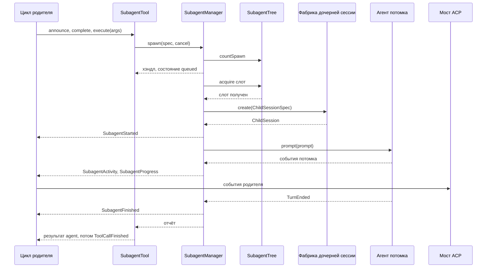
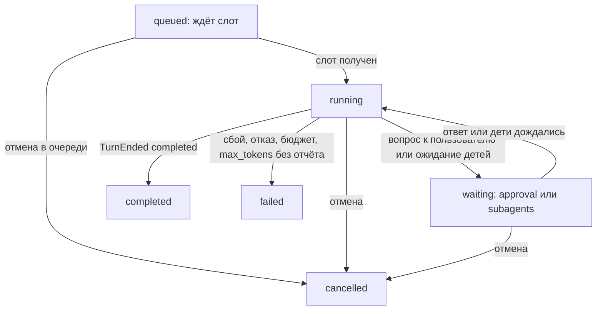

# Алгоритм управления субагентами

Документ описывает путь одного вызова инструмента `agent` целиком: от блока вызова в ответе модели родителя до отчёта потомка в транскрипте родителя, записей в журналах и кадров `session/update` у клиента. Читать его можно подряд, без переходов по ссылкам. Справочные главы собраны в конце.

Субагент (потомок) — дочерний агент со своим контекстом, журналом и набором инструментов. Он выполняет одно задание и возвращает один итоговый отчёт. Родитель — сессия, которая вызвала `agent`. Корень — сессия, которую открыл клиент; её глубина 0, у потомка корня глубина 1. Дерево — корень и все его потомки. Хэндл (`SubagentHandle`) — объект, через который родитель следит за потомком. Слот — право работать одновременно с другими потомками дерева.

Ход родителя и вызов инструмента описаны в [`turn.md`](turn.md) и [`tool-call.md`](tool-call.md). Здесь они даны одной строкой: `agent` — обычный инструмент, его вызов проходит ту же дорогу `announce` → `complete`. Потомок идёт тем же циклом хода, что и родитель. Всё особенное сосредоточено в четырёх объектах: `SubagentTool`, `SubagentManager`, `SubagentTree` и шлюзе `SubagentPermissionGate`.

## Вход и выход

| | Что |
|---|---|
| Вход | Вызов `agent` в ответе модели: `description` (3–60 символов), `prompt` (1–32 768 символов), `type` (по умолчанию `general`), у корня ещё `task` (id пункта списка задач) |
| Выход в транскрипт родителя | Один `ToolResultMessage` на вызов `agent`: блок `<subagent-report …>` внутри ограды `untrusted-content source="agent"`. `isError` истинно, если потомок не `completed`. Сообщений потомка в транскрипте родителя нет (`SUB-7`) |
| События родителя | `ToolCallStarted(agent)`, `SubagentStarted`, `SubagentProgress`, `ToolCallProgress(agent)` (строка прогресса), `SubagentActivity` на каждое событие потомка, `SubagentFinished`, `ToolCallFinished(agent)` |
| Журнал родителя | Две записи `subagent`: `running` при старте и итоговая (`durable`, до `ToolCallFinished`, `SUB-10`), затем запись `message` с результатом вызова |
| Журнал потомка | Отдельный файл от `SessionStore.createChild`; в заголовке поле `parent`; первым подписчиком агента потомка стоит `SessionWriter` |
| Кадры ACP | Один вызов `agent` у клиента: `tool_call`, `tool_call_update` со строками прогресса, итоговый `tool_call_update` с телом отчёта. Вызовы потомков — только клиенту с согласием `subagentToolCalls` |
| Лог | `subagent.spawn`, `subagent.start`, `subagent.end`, `subagent.failed`, `subagent.turn_failed`, `subagent.slot.release`, `subagent.slot.resume`, `subagent.unavailable`, `subagent.available`, `subagent.cancel_grace_exceeded`, `subagent.close_failed`, `subagent.permission.queued`, `subagent.type_overridden`, `task.assign.skipped`; на стороне ACP — `acp.subagent.unknown_parent` |
| Побочные эффекты | Дочерняя сессия, её журнал, действия её инструментов над общим `ExecutionEnv`, назначение пункта списка задач, usage потомка в usage хода родителя |

Три свойства держат весь алгоритм. Первое: ни цикл, ни политика, ни исполнитель не знают о потомках; `agent` — обычный инструмент уровня `read` (`SUB-7`: родитель видит только результат вызова). Второе: потомок «не шире предка» — по инструментам (`SUB-1`) и по режиму (`SUB-2`). Третье: терминальное состояние потомка наступает ровно один раз, и вызов `agent` заканчивается только после него или после `cancel_grace` (`SUB-4`).

## Участники

Схема показывает один вызов `agent` типа `explore` без вопросов пользователю. Подробный порядок шагов — в псевдокоде ниже.



События потомка идут в поток родителя через `emit` менеджера, а не напрямую: у потомка свой `Agent`, и его события не попадают в журнал родителя. Мост ACP подписан на события корня и сам решает, что отправить клиенту.

## Псевдокод

Запись Dart-подобная. Комментарии `//` указывают место в коде: `файл: символ`. Порядок шагов совпадает с кодом; пропущены логи, не меняющие ход, и защитные проверки. Пути относительны `packages/dart/codelab_agent_core/lib/src/`, кроме файлов `codelab_agent_acp`, которые так и названы.

### Уровень 0. Типы и инструмент в сессии (один раз при открытии)

```text
// subagents/subagent_types.dart: buildSubagentTypes
T1. byName = {general, explore, review, plan}          // builtinSubagentTypes(); source: builtin:<имя>
T2. for def in project.subagentAgents:                 // scope subagent или both; session отсеян раньше
        if def.name в byName и это встроенный тип: log info subagent.type_overridden
        byName[def.name] = def                          // определение заменяет встроенный тип
T3. types = byName отсортирован по имени                // снимок: схема и enum `type` не меняются в сессии

// agents/agent_definition.dart: parseAgentDefinitions
T4. определение проекта заменяет пользовательское с тем же именем;
    два файла с одним именем в одном каталоге отбрасываются оба

// runtime/agent_runtime.dart: _open (сборка сессии)
T5. if settings.subagents.enabled:
        manager = SubagentManager(tree: SubagentTree(limits: () => settings.subagents), …)
        registry.register(SubagentTool(manager, types, maxDepth: снимок max_depth,
                                       maxConcurrent: settings.subagents.maxConcurrent))
T6. // runtime/agent_runtime.dart: _visibleTools, _recheckSubagents
    на каждом шаге: схема `agent` уходит модели, только если
    effectiveContextWindow(model, cap) >= CompactionSettings.minSubagentContextWindow (32768)
    // subagents/child_tools.dart: subagentWindowOk
```

Схема `agent` строится из `types`: `enum` параметра `type` — имена типов, описание — список `- <имя>: <описание>`. Параметр `task` есть только у корня (`depth == 0`).

### Уровень 1. Вызов `agent`: `present` и `execute`

```text
// subagents/subagent_tool.dart: SubagentTool.present  (зовёт executor.announce)
P1. id = 'sub_' + 8 символов [0-9a-z]                 // резерв до ToolCallStarted (D28)
    return ToolPresentation(title: 'Subagent <type>: <description>',
                            subagent: SubagentCallRef(id, type))
    // первый кадр у клиента уже опознаёт вызов; без description заголовок — 'Subagent <type>'

// subagents/subagent_tool.dart: SubagentTool.execute  (зовёт executor.complete)
E1. description = args.description.trim()
    if длина < 3 or > 60:        throw SubagentCallError('Invalid agent call: description must be 3-60 characters.')
E2. prompt = args.prompt ?? ''
    if пусто or длина > 32768:   throw SubagentCallError('Invalid agent call: prompt must be 1-32768 characters.')
E3. type = types.firstWhere(name == args.type ?? 'general') ?? throw SubagentCallError('Unknown agent type …')
E4. taskId = depth == 0 ? args.task : null
    if taskId != null and нет пункта в ctx.services.tasks.items:
        throw SubagentCallError('Unknown task #… .')
E5. id = ctx.presentation.subagent.id ?? новый sub_…
E6. try handle = manager.spawn(SubagentSpec(id, depth: depth + 1, type, description, prompt, taskId,
                                            parentToolCallId: ctx.toolCallId, …), ctx.cancel)
    catch SubagentLimitException(limit):
        throw SubagentCallError('Subagent limit reached: at most <limit> subagents per turn. …')
E7. report = await _await(handle, ctx)                // строки прогресса, сердцебиение, cancel_grace
E8. resumed = await manager.settled(handle)           // у вложенного: родитель вернул слот
    if not resumed or report.status == cancelled:
        throw CancelledException(ctx.cancel.reason)
E9. return ToolExecutionResult([TextContent(wrapSubagentReport(report))],
                               isError: report.status != completed)
    // дальше executor: _fence(result, 'agent') → <untrusted-content source="agent"> (outputTrust: untrusted)
```

`SubagentCallError` исполнитель превращает в результат `failed` без ограды `untrusted-content`: текст составил сам инструмент (`TOOL-10`). Потомок при этом не создаётся. `CancelledException` исполнитель превращает в исход `cancelled`.

### Уровень 2. `spawn`: поставить потомка в очередь

```text
// subagents/subagent_manager.dart: SubagentManager.spawn
S1. tree.countSpawn()                                  // _spawned >= max_per_turn → SubagentLimitException (SUB-5)
S2. handle = _Handle(spec, source: CancelTokenSource(parent: ctx.cancel))
        // токен потомка — дочерний токену хода родителя (SUB-6); state = queued
S3. _all.add(handle); tree.register(spec.id); _turnHandles.add(handle)
    log info subagent.spawn
S4. _link?.callBegan()                                 // только у менеджера потомка: вернуть слот (уровень 6)
S5. unawaited(_run(handle)); return handle             // хэндл отдан сразу, работа идёт в фоне

// subagents/subagent_manager.dart: SubagentManager._run
try:                                                   // внешний try охватывает весь _run, включая acquire
    R1. leased = await tree.acquire(resume: false, cancel: handle.source.token)
            // SubagentTree.acquire: очередь FIFO; возвращающиеся родители раньше новых детей (SUB-23)
    R2. if not leased:                                 // отменён в очереди (SUB-6)
            await _finish(handle, cancelled); return   // слот не занимал, журнал не создавал, к модели не ходил
    R3. handle.holdsSlot = true
        try:     await _runLeased(handle)
        finally: _releaseSlot(handle)                  // tree.release(); log debug subagent.slot.release
catch Object:                                          // R4. сбой запуска; выполняется после внутреннего finally
    log error subagent.failed
    await _finish(handle, failed(failure: error, 'the subagent could not run: <тип ошибки>'))
```

### Уровень 3. `_runLeased`: собрать и запустить потомка

```text
// subagents/subagent_manager.dart: SubagentManager._runLeased
L1. handle.startedAt = now; handle.setState(running)
L2. limits = _limits(); parent = _parent()             // живые значения: «текущее состояние родителя»
    model    = spec.type.model ?? parent.model()       // модель типа, иначе текущая модель родителя
    windowOk = subagentWindowOk(model, parent.contextWindowCap())
    if not windowOk and spec.depth < maxChildDepth and type.allowsTool('agent'):
        log info subagent.unavailable (reason: context_window)
L3. if spec.taskId != null:                            // до создания сессии: TaskListChanged раньше SubagentStarted
        result = await parent.tasks.apply(AssignTask(taskId, TaskOwner(spec.id)), MainActor())
        assigned = result.item  (или log warning task.assign.skipped, если пункт удалён)
L4. child = await _create(ChildSessionSpec(
        tools:  selectChildTools(parent.tools(), type, depth, maxDepth, skills, agentVisible: windowOk),
        model:  model,
        budget: TurnBudget(maxSteps, maxTokens, maxCost, maxDuration  из subagents.*),
        mode:   () => narrow(parent.mode(), spec.type.mode),            // на каждое решение (SUB-2)
        gate:   parent.gate == null ? null
                : SubagentPermissionGate(queue: tree.wrapGate(parent.gate), spec, …),
        decisions, rules, extraDeniedTiers, agentConfigPaths: общие с корнем,
        env: parent.env, locks: parent.locks,                           // общие: TOOL-7
        tasks: SubagentTaskList(root: parent.tasks, subagentId, parentToolCallId: spec.sessionChain),
        onOwnUsage:     own => handle.ownUsage = own,
        ancestorBudget: limitForDescendants, task: assigned, …))
L5. handle.child = child; handle.childId = child.id; handle.journalPath = child.journalPath
    if handle.source.isCancelled:                      // отмена, пока создавалась сессия
        await _finish(handle, cancelled); return       // к модели потомок не пойдёт
L6. log info subagent.start
    await _emit(SubagentStarted(agent: type.name, description, childSessionId, journalPath))
    await _progress(handle, force: true)               // SubagentProgress(state: running)
L7. handle.unsubscribe = child.agent.subscribe(event => _onChildEvent(handle, event))
    unawaited(token.onCancel.then((_) => child.agent.abort(token.reason)))
        // колбэк идёт микрозадачей, уже после того, как prompt (L8) выставил ход
    if handle.source.isCancelled: child.agent.abort(token.reason)       // без хода — no-op: Agent.abort ничего не отменяет
L8. try:   await child.agent.prompt([UserMessage([TextContent(spec.prompt)])])   // тот же цикл хода
    catch Object: log error subagent.turn_failed; handle.lastError ??= 'the subagent turn failed: <тип>'
L9. await _finish(handle, _buildReport(handle))        // уровень 5
```

`prompt` потомка — единственное сообщение, которое он получает от родителя. Историю родителя он не видит: поэтому в описании инструмента сказано «положи в `prompt` всё, что нужно».

#### Набор инструментов потомка

```text
// subagents/child_tools.dart: selectChildTools
K1. for tool in parentTools:                           // схемы текущего шага родителя, в его порядке
        keep = switch tool.name:
            'task_create'                   → false    // список создаёт только корень
            'agent'                         → agentVisible and depth < maxDepth and type.allowsTool('agent')
            'skill'                         → skills != null and type.allowsTool('skill')
            'task_update' | 'task_list' | 'task_get' → true            // детский вариант, независимо от type.tools
            иначе                           → type.allowsTool(tool.name)   // type.tools == null → все
K2. return отобранные инструменты в порядке родителя
```

Результат — пересечение набора родителя с набором типа. Инструмента, которого нет у родителя, потомок не получит (`SUB-1`). Встроенные типы: `general` — без ограничения `tools`; `explore` и `plan` — `read`, `ls`, `search`, режим `plan`; `review` — `read`, `ls`, `search`, `exec`, режим `standard`.

#### Дочерняя сессия

```text
// runtime/agent_runtime.dart: _createChildSession
F1. childId = newSessionId(); header = SessionHeader(id, cwd, parent: SessionParent(
        sessionId: родитель, rootSessionId: корень, toolCallId, subagentId, agent: type.name, depth))
    journalPath = await store.createChild(header)       // журнал без ссылки на родителя не создаётся
F2. promptMode = type.mode строже parentMode (по softness) ? type.mode : parentMode
        // режим в системном промпте стабилен ради кэша; живое решение — через spec.mode (L4)
F3. if в spec.tools есть SubagentTool and дан parent и tree:
        nested = SubagentManager(на том же SubagentTree, link: spec.link, …)   // вложенность
F4. registry = ToolRegistry()
    for tool in spec.tools:
        SubagentTool → tool.nested(manager: nested, depth, path, chainPrefix)
        TaskUpdateTool → TaskUpdateTool(forSubagent: true)       // детское описание
        SkillTool → свой SkillTool над журналом потомка и снимком каталога родителя
        иначе → тот же объект
F5. childPolicy = PermissionPolicy(mode: promptMode, gate: spec.gate, rules, decisions, modeOf: spec.mode, …)
F6. agent = Agent(
        config: AgentLoopConfig(
            sessionId: childId, model: spec.model,
            executor: ToolCallExecutor(registry, env: spec.env, locks: spec.locks),
            budget: spec.budget,
            beforeToolCall: [childPolicy.asHook(registry.lookup),
                             для каждого хука хоста корня: _chainedHook(hook, sub.sessionChain)],
            onOwnUsage:     own => { spec.onOwnUsage(own); nested?.ownUsage = own },
            ancestorBudget: spec.ancestorBudget,
            subagentUsage:  nested == null ? null : () => nested.childrenUsage),
        systemPrompt: _systemPrompt(cwd, promptMode, registry, …,
                                    subagent: (name: type.name, body: type.prompt, task: spec.task)),
        tools: registry.tools)
F7. writer = SessionWriter(store, snapshot: SessionSnapshot.empty(header), …)
    agent.subscribe(writer.handle)                      // первый подписчик: журнал потомка пишется до остальных (SES-8)
F8. writer.append(model_change); writer.append(mode_change)
F9. return ChildSession(id, journalPath, agent, subagents: nested,
        close: () => { nested?.closeAll(ShutdownCancel); agent.waitForIdle(); store.close(childId) })
```

#### Системный промпт потомка

```text
// prompts/compose.dart: _sections (шаги 12–14 раздела 11.5)
C1. секции базового промпта сессии: system.base, system.untrusted, modes.plan (в режиме plan),
    секции инструментов из набора потомка (tools.read, tools.listing, …)
C2. subagent.system   — «You are a subagent. Another agent started you … will read only your final message. …»
C3. subagent.profile  — «## Agent profile: <имя типа>» и тело определения типа (prompt/subagent/types/<имя>.md
                         или тело файла определения агента); края тела обрезаются
C4. if назначен пункт: subagent.task — «Your task: #<id> <subject>»
```

### Уровень 4. События потомка и прогресс

```text
// subagents/subagent_manager.dart: SubagentManager._onChildEvent(handle, event)
V1. if handle.done: return                             // ребёнок пережил cancel_grace: до клиента не доходит
V2. switch event:
        StepEnded                          → handle.steps++
        ToolCallStarted(title)             → handle.toolCalls++; handle.lastActivity = title
        SubagentActivity(ToolCallStarted)  → handle.toolCalls++; handle.lastActivity = title   // внуки транзитивно
        TurnEnded                          → handle.ended = event
        AgentError(message)                → handle.lastError = message
V3. await _emit(event is SubagentActivity
        ? SubagentActivity(sessionId родителя, адрес внука без изменений)      // обёртка плоская (SUB-24)
        : SubagentActivity(sessionId родителя, subagentId, parentToolCallId, path, depth, event))
V4. if event is StepEnded or ToolCallStarted(или внука):  await _progress(handle)
    else if event is SubagentStarted or SubagentFinished: await _progress(handle, force: true)

// subagents/subagent_manager.dart: SubagentManager._progress(handle, force)
G1. if handle.done: return
G2. if not force and прошло < progress_interval с прошлого прогресса:
        handle.trailing ??= timer(остаток интервала, () => _progress(handle, force: true)); return
G3. trailing?.cancel(); lastProgressAt = now
    snapshot = handle.snapshot                          // состояние, шаги, вызовы, usage с внуками, lastActivity
    await _emit(SubagentProgress(snapshot)); handle.progressController.add(snapshot)

// subagents/subagent_tool.dart: SubagentTool._await — подписка на handle.progress
W1. каждый снимок → ctx.onUpdate(progressLine(snapshot))   // → ToolCallProgress(agent)
        // '<тип> · <состояние> · N steps · N tool calls · <токены> tokens[ · N subagents][ · <активность до 60 символов>]'
    и перезапуск таймера heartbeat_interval: тишина дольше интервала — та же строка со свежим снимком
```

Смена состояния (`running` ↔ `waiting`) и старт всегда уходят сразу, шаги и вызовы — не чаще `progress_interval`. Подавленное обновление не теряется: его отправит таймер. Исключение — конец потомка: `_finish` отменяет таймер, потому что итог заменяет любое промежуточное обновление.

#### Вопросы потомка к пользователю

```text
// subagents/subagent_permission_gate.dart: SubagentPermissionGate.request(req, cancel)
Q1. wrapped = PermissionRequest(
        toolCallId: chainPrefix + '/' + req.toolCallId,                // 'call_3/call_1'
        title: '[<тип>: <описание>] ' + req.title,
        subagent: SubagentRequestRef(id, type, description, depth, path, parentToolCallId: spec.rootCall),
        остальные поля (rawInput, locations, diffs, pattern, allowAlwaysOffered, …) — как у потомка)
Q2. log debug subagent.permission.queued (queue_length)
Q3. onWaiting()                                        // openQuestions++ → state waiting, waitingFor approval
Q4. try:     return await queue.request(wrapped, cancel)
    finally: onResumed()                               // openQuestions--; running, если вопросов не осталось

// subagents/subagent_permission_gate.dart: SubagentQuestionQueue.request   (один экземпляр на дерево)
Q5. if cancel.isCancelled: return cancelled
Q6. if _busy: встать в _waiters; отмена в очереди снимает запрос без кадра клиенту (PERM-7)
              получив право — повторно проверить cancel
    else _busy = true
Q7. try:     return await raceCancel(root.request(wrapped, cancel), cancel)   // gate корневой сессии
    catch CancelledException: return cancelled
    finally: _handOver()                               // право следующему в очереди или _busy = false
```

Если у корня нет gate, потомок получает `gate: null`, и любой вопрос — отказ `no approval interface is available` (`PERM-5`).

### Уровень 5. Конец потомка: отчёт и возврат результата

```text
// subagents/subagent_manager.dart: SubagentManager._buildReport
B1. ended = handle.ended; if ended != null: handle.finalUsage = ended.usage    // уже с внуками
    text = последний AssistantMessage потомка: текстовые блоки через пустую строку (thinking и вызовы — нет)
B2. if ended == null:                                  // TurnEnded не пришёл
        status = source.isCancelled ? cancelled : failed(error)
        message = lastError ?? 'the subagent ended without a result'
    else switch ended.reason:
        cancelled           → cancelled
        failed              → failed(error),   message = lastError ?? text
        refused             → failed(refused), message = lastError ?? text
        completed | maxTokens:
            if ended.budgetExceeded: failed(budgetExceeded, limit)
            else if maxTokens and text.trim() пуст: failed(maxTokens), тело = subagentNoReportAtOutputLimit
            else: completed; cutByLimit = (reason == maxTokens)
B3. cut = truncateReport(text, subagents.report_max_bytes)    // по границе строки, байты UTF-8
    text = noReportBody ?? (cutByLimit ? cut.text + '\n[report truncated: the subagent hit the output token limit]' : cut.text)
    truncated = cut.truncated or cutByLimit
B4. return SubagentReport(status, failure, budgetExceeded, text, truncated, steps, toolCalls, usage, duration)

// subagents/subagent_manager.dart: SubagentManager._finish(handle, report)
Z1. if handle.done: return                             // терминальное состояние ровно один раз (SUB-4)
Z2. handle.done = true
    handle.resume = _link?.callEnded()                 // вложенный: родитель встаёт в очередь возвращающихся (SUB-23)
    unsubscribe(); trailing?.cancel(); setState(report.status); endedAt = now; finalUsage = report.usage
Z3. log info subagent.end (status, failure, steps, tool_calls, tokens_in, tokens_out, duration_ms)
Z4. try:     await _emit(SubagentFinished(status, failure, usage, toolCalls, duration,
                                          report: report.text, reportPreview: первые 200 символов,
                                          budgetExceeded, truncated, childSessionId, journalPath))
    finally: reportCompleter.complete(report)          // _await в SubagentTool просыпается
             unawaited(_closeChild(handle))            // source.dispose(); child.close(); сбой → log warning subagent.close_failed

// subagents/subagent_report.dart: wrapSubagentReport(report)
Y1. body = switch (status, failure):
        completed                  → report.text
        failed, budgetExceeded     → report.text, если пуст — 'Subagent stopped: its budget was exhausted before it finished.'
        failed, maxTokens          → subagentNoReportAtOutputLimit
        failed                     → 'Subagent failed: ' + (failureMessage ?? text)
        иначе                      → 'Tool call was cancelled'
Y2. атрибуты: id, agent, status, steps, tool_calls, [truncated="true"], [reason="…"]
Y3. в body вхождения '</subagent-report' (без учёта регистра) → '&lt;/subagent-report'   (SUB-7)
Y4. return '<subagent-report …>\n' + body + '\n</subagent-report>'
```

После `_finish` слот возвращается в `_run` (R3): `tree.release()` передаёт его следующему в очереди. Поэтому при обычном завершении в логе `subagent.end` идёт раньше `subagent.slot.release`; на пути сбоя (R4) — наоборот.

### Уровень 6. Вложенные потомки и слоты

```text
// subagents/subagent_manager.dart: SubagentTree
D1. _pump(): while held < max_concurrent:
        next = _resumeQueue.removeFirst() ?? _newQueue.removeFirst() ?? return
        held++; next.complete(true)
D2. acquire(resume, cancel): отмена до слота → false, из очереди запрос убирается

// subagents/subagent_manager.dart: слот ждущего родителя (вложенность)
N1. _waitBegan(handle):  waitingCalls++; при 0 → 1: слот возвращается дереву, state = waiting, waitingFor = subagents
N2. _waitEnded(handle):  waitingCalls--; при 1 → 0: родитель встаёт в _resumeQueue (acquire(resume: true))
                         ссылка handle.resume ждёт SubagentTool через manager.settled(handle) (E8)
N3. _resume(handle):     слот получен → holdsSlot = true, log debug subagent.slot.resume; не получен (отмена) → false
```

Потомок, который ждёт своих детей, слот не держит: иначе цепочка из трёх уровней при `max_concurrent: 1` повисла бы. Возвращающийся родитель обгоняет новых детей в очереди (`SUB-23`).

## Схема состояний потомка



Терминальные состояния — `completed`, `failed`, `cancelled`. Первое записанное побеждает: если отмена и завершение случились одновременно, выигрывает то, что дошло до `_finish` раньше.

## Пошаговое пояснение

**T1–T3. Снимок типов.** Схема `agent` и её `enum` не должны меняться посреди сессии: это сломало бы кэш промпта. Поэтому типы собираются один раз при открытии сессии. Определение с именем встроенного типа заменяет его, и в лог пишется `subagent.type_overridden`. Определения со `scope: session` в типы не входят.

**T6. Скрытие `agent` при малом окне.** Схема `agent` и отчёты потомков съели бы малое окно. Инструмент регистрируется всегда, а видимость пересчитывается на границе шага: смена модели или `compaction.context_window_cap` меняет набор схем со следующего запроса. Работающие потомки не прерываются.

**P1. Резерв id до `ToolCallStarted`.** Клиент должен опознать вызов `agent` с первого кадра (`_meta.codelab.subagent {id, type}`), а `ToolCallStarted` отправляется до `execute`. Поэтому id резервирует `present`. Отклонённый проверкой вызов потомка не создаёт, и id остаётся только в этом кадре.

**E1–E4. Проверки до запуска.** Они стоят до `spawn`, чтобы неверный вызов не тратил слот и счётчик `max_per_turn`. Ошибка проверки — результат `failed`, который модель читает и исправляет. Ограда `untrusted-content` на нём не нужна: текст составил инструмент.

**E6, S1. Лимит запусков.** `max_per_turn` считает запуски всего дерева за ход корня, включая внуков. Счётчик сбрасывает только `beginTurn` корневого менеджера, вызванный из `_Session.prompt`. Менеджер потомка его не сбрасывает.

**S2. Токен потомка.** `CancelTokenSource(parent: ctx.cancel)` делает отмену хода родителя каскадной: она доходит до потомка и его детей (`SUB-6`). Обратного влияния нет: отмена потомка не отменяет родителя и соседей.

**S5, R1. Хэндл сразу, работа в фоне.** `spawn` не ждёт слота. Несколько `agent` из одного ответа идут параллельно, потому что у `agent` нет `executionMode`, то есть он не барьер (`tool-call.md`, уровень 2). Одновременно работают не больше `max_concurrent` потомков дерева; остальные стоят `queued`.

**R2. Отмена в очереди.** Потомок, отменённый до получения слота, не создаёт журнал и не делает запросов (`SUB-5`). Его отчёт — `cancelled` с нулевым usage.

**L2. Модель.** У типа есть своя `model` — берётся она; иначе модель родителя на момент запуска. Правило окна применяется и к потомку: если окно его модели меньше порога, `agent` в его набор не входит (`selectChildTools(agentVisible: false)`), в лог — `subagent.unavailable`.

**L3. Назначение пункта.** `AssignTask` выполняется до создания сессии. Поэтому `TaskListChanged` приходит раньше `SubagentStarted`, а `subject` строки `Your task:` берётся на момент назначения. Пункт могли удалить, пока потомок стоял в очереди: тогда потомок работает без пункта, в лог пишется `task.assign.skipped`.

**L4, K1. Набор и режим «не шире родителя».** Набор — пересечение наборов родителя и типа (`SUB-1`). Режим считается функцией, а не значением: `narrow(parent.mode(), type.mode)` вызывается при каждом решении политики. Берётся режим с меньшим номером из ряда `alwaysAsk < write < acceptEdits < yolo < autopilot`, запреты уровней объединяются. Если родитель посреди работы потомка переключится в `plan`, следующий `write` потомка будет отклонён (`SUB-2`). У внука `parent.mode()` — режим его родителя-потомка, поэтому сужение идёт по всей цепочке.

**L4. Что общее с корнем.** Хранилище решений «разрешить всегда» и «отклонить всегда», правила, запреты уровней, защищаемые пути конфигурации, `env`, список задач и очередь блокировок путей. Общее хранилище значит, что `reject_always` родителя действует и для потомка. Общая очередь `PathLock` значит, что правки одного файла родителем и потомками упорядочены (`TOOL-7`). Хуки хоста `beforeToolCall` ставятся последними, вызов уходит к ним с цепочкой id.

**Q1–Q7. Вопросы через gate корня.** Клиент знает только корневую сессию, а `toolCallId` потомка уникален лишь внутри его сессии (`PERM-4`). Поэтому id вопроса — цепочка от вызова `agent` корня, а заголовок получает префикс с типом и описанием. Очередь `SubagentQuestionQueue` одна на дерево: три потомка с вопросами не открывают три диалога (`SUB-3`). Пока вопрос ждёт, хэндл в `waiting` / `approval`; счётчик открытых вопросов нужен, потому что два параллельных `write` дают два вопроса. Отмена в очереди снимает вопрос без кадра клиенту (`PERM-7`). Без gate корня вопрос потомка — отказ (`PERM-5`).

**F1. Журнал с ссылкой на родителя.** `createChild` без `header.parent` бросает ошибку: потомок без ссылки не создаётся. Журналы потомков любой глубины лежат плоско в каталоге корневой сессии (`SUB-9`), а в `session/list` не входят.

**F2. Два режима.** Режим в системном промпте — более строгий из режима родителя и типа на момент запуска: промпт стабилен ради кэша. Живое решение о разрешении считает `spec.mode` (L4). Разные механизмы, одна цель: потомок не мягче предка.

**F7. Писатель журнала первым.** Потомок — обычная сессия: журнал пишет первый подписчик агента (`SES-8`). Поэтому записи потомка в файле идут в том же порядке, что события.

**L7–L8. Отмена и ход.** Потомок идёт тем же циклом (`runAgentLoop`), с тем же бюджетом и событиями; особых случаев для детей в цикле нет. `Agent.abort` без идущего хода ничего не делает (`_turn?.cancel`), поэтому синхронная проверка `isCancelled` перед `prompt` сама по себе отмену не доставит. Доставляет её колбэк `onCancel.then(abort)`: он выполняется микрозадачей уже после того, как `prompt` выставил ход.

**V3. Плоская обёртка.** Любое событие потомка доходит до потока корня ровно одной обёрткой `SubagentActivity` (`SUB-24`). У внука `SubagentActivity` уже есть: менеджер потомка переизлучил его, и менеджер корня меняет только `sessionId`. Вторая обёртка не вкладывается, поэтому адрес `subagentId`, `path`, `depth` остаётся адресом автора.

**G2. Троттлинг.** События потомка идут часто, а клиенту нужна строка, а не поток. Смена состояния уходит сразу, остальное — не чаще `progress_interval`; последнее подавленное обновление не теряется.

**B2–B3. Отчёт.** Отчёт — последний ответ потомка; рассуждения и вызовы инструментов в него не входят. Усечение по `report_max_bytes` идёт по границе строки; полный текст остаётся в журнале потомка. Пометка лимита выходных токенов дописывается после усечения, чтобы усечение её не отрезало.

**Y3. Экранирование.** Отчёт — пересказ того, что потомок прочёл в файлах и выводе команд. Он остаётся недоверенным: обёртку закрывать нельзя, поэтому `</subagent-report` в тексте заменяется на `&lt;/subagent-report`. Поверх этого исполнитель ставит ограду `untrusted-content source="agent"` (`SUB-7`).

**Z1–Z4. Один терминальный переход и порядок записи.** `SubagentFinished` эмитится до `ToolCallFinished(agent)` и пишется в журнал `durable`. Это точка восстановления: если процесс упадёт между итоговой записью и записью результата, отчёт не потеряется, и вызов `agent` не повторится (`SUB-10`). `reportCompleter` завершается в `finally`: `SubagentTool` проснётся, даже если подписчик события бросил исключение.

**E8. `settled` и отмена.** После отчёта вызов ждёт возврата слота родителем (у вложенных). Если потомок `cancelled`, вызов бросает `CancelledException`: исполнитель закрывает вызов исходом `cancelled`, а не результатом с текстом отчёта.

## События и их порядок

Для одного вызова `agent` корневой сессии порядок такой (подтверждён прогоном ниже и тестом `test/subagents/subagent_activity_test.dart`):

1. `ToolCallStarted(agent)` — с `subagent: {id, type}`.
2. `SubagentStarted` — слот получен, журнал создан, запроса к модели ещё не было.
3. `SubagentProgress` с состоянием `running` и `ToolCallProgress(agent)` с первой строкой.
4. Любое число `SubagentActivity`, между ними `SubagentProgress`.
5. `SubagentFinished` — отчёт готов, итоговая запись `subagent` в журнале.
6. `ToolCallFinished(agent)`.

Кто что видит:

| Событие | Журнал родителя | Клиент без `subagentToolCalls` | Клиент с `subagentToolCalls` |
|---|---|---|---|
| `ToolCallStarted(agent)` | результат вызова пишется позже, вместе с `ToolCallFinished` | `tool_call`, `kind: think`, `_meta.codelab.subagent {id, type}` | то же |
| `SubagentStarted` | запись `subagent`, `status: running`, `durable` | не отправляется (в логе `subagent.start`) | не отправляется |
| `SubagentProgress` | не пишется | не отправляется | не отправляется |
| `ToolCallProgress(agent)` | не пишется | `tool_call_update`, `in_progress`, текст строки прогресса | то же |
| `SubagentActivity(ToolCallStarted/Progress/Finished)` | не пишется | не отправляется (`SUB-12`) | `tool_call` / `tool_call_update` с `toolCallId` вида `call_1/child_1` и `_meta.codelab.parentToolCallId` |
| `SubagentActivity` (тексты, мысли, шаги, `TurnEnded`) | не пишется | не отправляется | не отправляется |
| Вопрос потомка | — | `session/request_permission` корня с цепочкой id и `_meta.codelab.subagent` | то же |
| `SubagentFinished` | итоговая запись `subagent`, `durable`, до результата | не отправляется; мост запоминает итог по вызову | то же |
| `ToolCallFinished(agent)` | `message` с результатом (`toolResult`), `toolMeta` | `tool_call_update`, `completed`/`failed`, тело отчёта без обёртки, `_meta.codelab.subagent.summary {toolCalls, tokens, durationMs}` | то же; перед ним мост закрывает висящие вызовы поддерева кадрами `failed` с `outcome: cancelled` |

Мост хранит итог потомка по `parentToolCallId` и подставляет его в финальный кадр (`SessionBridge._onEvent`). Поэтому клиент получает тело отчёта без обёртки `<subagent-report>` и без ограды: они нужны только модели.

## Разобранный пример

Данные получены прогоном временного теста на харнессе `SubagentRig` (`test/subagents/subagent_rig.dart`): `buildAgentCore` с профилем `agent-serve`, `ScriptedStreamFunction` по сценарию на каждого участника дерева, `MemoryExecutionEnv(cwd: '/proj')` с файлом `/proj/a.txt` (`alpha`), `MemorySessionStore`, `FakeClock`, модель с окном 32768. Команда:

```bash
cd packages/dart/codelab_agent_core && fvm dart test test/subagents/tmp_algo_doc_test.dart
```

Сценарий. Родитель получает промпт `go`. Его первый шаг — вызов `agent {type: explore, description: "Read a.txt", prompt: "read a.txt"}` (usage `100/20`), второй — текст `thanks` (usage `300/10`). Потомок получает `read a.txt` как первое сообщение. Его первый шаг — `read {path: a.txt}` (usage `50/10`), второй — текст `a.txt line 1: alpha` (usage `80/12`). Тест удалён после прогона. Кадры клиента взяты не из этого прогона, а из golden-файла `packages/dart/codelab_acp_testing/fixtures/acp/prompt-subagent-tool-call.json`: он проверяется на сценарии той же формы (`explore`, отчёт, `summary`).

### Что получил потомок

Набор инструментов запроса потомка: `read`, `task_update`, `task_list`, `task_get`, `ls`, `search`. Это пересечение набора родителя (`read`, `write`, `edit`, `task_create`, `task_update`, `task_list`, `task_get`, `ls`, `search`, `agent`) с типом `explore` (`read`, `ls`, `search`) и детскими `task_*` без `task_create`. `agent`, `write`, `edit` в набор не вошли.

Системный промпт потомка собран из тех же секций, что у корня, плюс секции потомка `subagent.system` и `subagent.profile` (`subagent.task` — только при назначенном пункте). В нём `Mode: plan` и раздел «Plan mode»; секции `tools.read` и `tools.listing` есть, секций про `write`, `exec` и `agent` нет. Последние строки промпта:

```text
You are a subagent. Another agent started you to complete one assignment and will read only your final message.
- Work autonomously. You cannot ask the user or the other agent questions. If something is ambiguous, choose the most reasonable interpretation and state it in your report.
- Stay within the assignment. Do not start unrelated work.
- Your final message is the report. Make it self-contained: findings, file paths with line numbers, what you changed (if anything) and what remains uncertain. Do not narrate your intermediate steps.

## Agent profile: explore

You only search and read. Answer the question with what the files say: name each finding with its file path and line numbers, and say plainly when something was not found.
```

Первое и единственное сообщение потомка: `read a.txt`. В нём нет ни слова из разговора родителя.

### События родителя по порядку

Номера — порядок в потоке событий корня. Хвост хода (E34–E44: сообщение с результатом, шаг `thanks`, `TurnEnded`, `SessionTitleChanged`) опущен; события E1–E7 — начало хода родителя.

```text
E8   ToolCallStarted(c1 agent) title="Subagent explore: Read a.txt" subagent=sub_00000005/explore
E9   SubagentStarted(id=sub_00000005 call=c1 agent=explore desc="Read a.txt"
        child=01KDVDNA000000000000000006
        journal=subagents/01KDVDNA000000000000000001/01KDVDNA000000000000000006.jsonl)
E10  SubagentProgress(state=running steps=0 calls=0 tok=0/0 last=null)
E11  ToolCallProgress(c1 "explore · running · 0 steps · 0 tool calls · 0 tokens")
E12–E18  SubagentActivity(sub=sub_00000005 depth=1 parent=c1):
         TurnStarted, MessageStarted, MessageEnded, StepStarted, ModelRequested, MessageStarted, MessageEnded
E19  SubagentActivity(… inner=ToolCallStarted(child_read_1 read))
E20  SubagentActivity(… inner=ToolCallFinished(child_read_1 completed))
E21–E23  SubagentActivity: MessageStarted, MessageEnded, StepEnded
E24–E30  SubagentActivity: StepStarted, ModelRequested, MessageStarted, MessageDelta ×2, MessageEnded, StepEnded
E31  SubagentActivity(… inner=TurnEnded)
E32  SubagentFinished(status=completed calls=1 usage=130/22 trunc=false report="a.txt line 1: alpha")
E33  ToolCallFinished(c1 completed)
```

Что видно в этом прогоне:

- После `SubagentProgress` в E10 других `SubagentProgress` нет, хотя потомок сделал вызов и два шага. `FakeClock` не двигался, и обновления шли под `progress_interval` (2 с): они подавлены (`G2`). Таймер отправил бы последнее, но потомок закончился раньше, и `_finish` его отменил (`Z2`).
- `ToolCallProgress(agent)` один: строку порождает `SubagentProgress`, а подавленные снимки строк не дают.
- Внутри `SubagentActivity` лежат исходные события потомка: `sessionId` внутреннего события — потомка (`01KDVDNA…06`), `sessionId` обёртки — родителя. `depth=1`, `path` пуст.
- `SubagentActivity` в журнал родителя не попал: в нём нет `child_read_1`.

### Итог вызова

`TurnEnded` потомка: `usage 130/22` (50+80 входных, 10+12 выходных). `TurnEnded` родителя: `usage 530/52`. Это 100+300 собственных входных токенов родителя плюс 130 потомка и 20+10 плюс 22 выходных: usage потомка входит в usage хода родителя (`SUB-11`).

Результат вызова `c1`, каким его увидела модель родителя на втором шаге (`isError=false`):

```text
<untrusted-content source="agent">
<subagent-report id="sub_00000005" agent="explore" status="completed" steps="2" tool_calls="1">
a.txt line 1: alpha
</subagent-report>
</untrusted-content>
```

### Журнал родителя

```text
{"type":"message", … "message":{"role":"assistant","content":[{"type":"toolCall","id":"c1","name":"agent","arguments":{"description":"Read a.txt","prompt":"read a.txt","type":"explore"}}], … "stopReason":"toolUse"}}
{"type":"subagent","id":"00000009","parentId":"00000004", … "subagentId":"sub_00000005","toolCallId":"c1","agent":"explore","description":"Read a.txt","childSessionId":"01KDVDNA000000000000000006","journal":"subagents/01KDVDNA000000000000000001/01KDVDNA000000000000000006.jsonl","status":"running"}
{"type":"subagent","id":"0000000e","parentId":"00000009", … "status":"completed","report":"a.txt line 1: alpha","usage":{"input":130,"output":22, …},"toolCalls":1,"durationMs":0}
{"type":"message","id":"0000000f","parentId":"0000000e", … "outcome":"completed","toolMeta":{"title":"Subagent explore: Read a.txt","kind":"think","locations":[]},"message":{"role":"toolResult","toolCallId":"c1","toolName":"agent", … "isError":false}}
```

Две записи `subagent` стоят между сообщением модели и результатом вызова, итоговая — раньше результата (`SUB-10`). Записей `user` и `assistant` потомка в журнале родителя нет (`SUB-7`). Остальные поля записей опущены (`…`).

### Журнал потомка

```text
{"type":"session","version":1,"id":"01KDVDNA000000000000000006","cwd":"/proj", … "parent":{"sessionId":"01KDVDNA000000000000000001","rootSessionId":"01KDVDNA000000000000000001","toolCallId":"c1","subagentId":"sub_00000005","agent":"explore","depth":1}}
{"type":"model_change","id":"00000007", …}
{"type":"mode_change","id":"00000008","parentId":"00000007", … "modeId":"plan"}
{"type":"message","id":"0000000a", … "message":{"role":"user","content":[{"type":"text","text":"read a.txt"}], …}}
{"type":"message","id":"0000000b", … "message":{"role":"assistant","content":[{"type":"toolCall","id":"child_read_1","name":"read", …}], … "stopReason":"toolUse"}}
{"type":"message","id":"0000000c", … "outcome":"completed","toolMeta":{"title":"Read a.txt","kind":"read","locations":[{"path":"/proj/a.txt"}]},"message":{"role":"toolResult","toolCallId":"child_read_1", … "content":[{"type":"text","text":"1| alpha"}]}}
{"type":"message","id":"0000000d", … "message":{"role":"assistant","content":[{"type":"text","text":"a.txt line 1: alpha"}], … "stopReason":"stop"}}
```

Заголовок несёт `parent`. Записи `model_change` и `mode_change` написала фабрика (F8). Режим `plan` — из типа `explore`, а режим родителя мягче.

### Лог прогона

```text
info  subagent.spawn         tool_call_id=c1 subagent_id=sub_00000005 subagent_type=explore depth=1
info  subagent.start         child_session_id=01KDVDNA000000000000000006 wait_ms=0
info  subagent.end           status=completed failure=null steps=2 tool_calls=1 tokens_in=130 tokens_out=22 duration_ms=0
debug subagent.slot.release  free_slots=3
```

`subagent.end` идёт раньше `subagent.slot.release` при обычном завершении: слот возвращается в `finally` внутри `_run` уже после `_finish`. При сбое `_runLeased` порядок обратный: внутренний `finally` освобождает слот, и только потом внешний `catch` вызывает `_finish`.

### Что увидел клиент

Из golden-файла `acp/prompt-subagent-tool-call.json` (потомок там делает три `ls`; тип `explore`). Клиент без `subagentToolCalls` получает ровно одну цепочку кадров вызова `call_1`:

```text
tool_call         call_1 status=pending kind=think title="Subagent explore: Find auth code"
                  _meta.codelab.subagent {id, type: explore}
tool_call_update  call_1 status=in_progress                      // без content: хук markInProgress
tool_call_update  call_1 status=in_progress content=[text "explore · … "]   // строка прогресса, одна или больше
tool_call_update  call_1 status=completed content=[text "<тело отчёта без обёртки>"]
                  _meta.codelab.subagent {id, summary: {toolCalls: 3, tokens: {input: 6000, output: 400}, durationMs}}
```

Вызовов потомка (`call_1`…`call_3` в его сессии) клиент не видит. Клиент с `subagentToolCalls` получает дополнительно их `tool_call` с цепочкой id: фикстура `acp/prompt-subagent-tool-tree.json` показывает `call_1/call_1` для вызова потомка и `call_1/call_2/call_1` для вызова внука.

## Граничные случаи и отказы

| Ситуация | Что делает алгоритм | Где в коде |
|---|---|---|
| `description` короче 3 или длиннее 60 символов, `prompt` пуст или длиннее 32 768 | `SubagentCallError`, результат `failed` без ограды; потомок не создаётся | `SubagentTool.execute` (E1, E2) |
| Тип не из `enum` (провайдер не соблюл схему) | `SubagentCallError` со списком доступных типов | `SubagentTool.execute` (E3) |
| `task` неизвестного пункта | `SubagentCallError`: `Unknown task #… The task list is empty.` или со списком известных | `SubagentTool.execute` (E4) |
| `task` у потомка (глубина больше 0) | параметра нет в схеме; значение игнорируется | `SubagentTool.parameters`, `execute` |
| Исчерпан `max_per_turn` | `SubagentCallError`: `Subagent limit reached: at most N subagents per turn…`; потомок не создаётся | `SubagentTree.countSpawn`, `SubagentTool.execute` (E6) |
| Все слоты заняты | потомок в `queued`, запросов к модели нет; слот достаётся по очереди, возвращающиеся родители первыми | `SubagentTree._pump`, `acquire` |
| Отмена в очереди | отчёт `cancelled`, нулевой usage, журнал не создан | `_run` (R2) |
| Отмена во время создания сессии | потомок закрывается, к модели не идёт | `_runLeased` (L5) |
| Отмена между `SubagentStarted` и `prompt` | синхронный `abort` без хода — no-op; отмену доставляет колбэк `onCancel.then(abort)` микрозадачей после старта хода, ход заканчивается `cancelled` | `_runLeased` (L7–L8) |
| Отмена хода родителя при работе потомка | токен потомка отменён каскадом, `child.agent.abort`; вызов `agent` ждёт остановки не дольше `cancel_grace`; потом `forceCancelled`: хэндл `cancelled`, сессия закрывается в фоне, лог `subagent.cancel_grace_exceeded`; события потомка после этого не доходят | `SubagentTool._await`, `SubagentManager.forceCancelled`, `_onChildEvent` (V1) |
| Потомок отменён, вызов `agent` возвращается | `CancelledException`, исход вызова `cancelled`, частичный текст потомка клиенту не уходит | `SubagentTool.execute` (E8) |
| Отмена одного потомка (`manager.cancel`) | отменяется он и его дети; родитель и соседи не затронуты | `SubagentManager.cancel` |
| Закрытие родительской сессии | все потомки отменяются; внуки — раньше сессии потомка | `closeAll`, `ChildSession.close` |
| Сбой создания дочерней сессии или слота | лог `subagent.failed`, отчёт `failed`: `the subagent could not run: <тип ошибки>` | `_run` (R4) |
| Исключение из `child.agent.prompt` | лог `subagent.turn_failed`, `lastError`, отчёт `failed` | `_runLeased` (L8) |
| Потомок кончился без `TurnEnded` | `failed` с сообщением `the subagent ended without a result`, либо `cancelled`, если токен отменён | `_buildReport` (B2) |
| Отказ провайдера, ошибка хода | `failed` (`error` или `refused`), сообщение — последняя ошибка или текст потомка; тело вызова `Subagent failed: …` | `_buildReport`, `wrapSubagentReport` |
| Бюджет потомка или предка исчерпан | `failed` с `budget_exceeded:<лимит>`; частичный текст сохраняется, иначе `Subagent stopped: its budget was exhausted before it finished.` | `_buildReport`, `limitForDescendants` |
| Лимит выходных токенов, текст есть | `completed`, к отчёту дописана строка `[report truncated: the subagent hit the output token limit]`, `truncated` | `_buildReport` (B2, B3) |
| Лимит выходных токенов ушёл в рассуждения | `failed` с `max_tokens`, тело `Subagent stopped: it hit the output token limit before writing a report.` | `_buildReport`, `subagentNoReportAtOutputLimit` |
| Отчёт длиннее `report_max_bytes` | усечение по границе строки, пометка с числом показанных байт; полный текст — в журнале потомка | `truncateReport` |
| В тексте отчёта есть `</subagent-report` | заменяется на `&lt;/subagent-report` | `wrapSubagentReport` (Y3) |
| Потомок просит разрешение, у корня нет gate | отказ `no approval interface is available` (`PERM-5`) | `_runLeased` (L4) |
| Несколько вопросов потомков одновременно | очередь по одному, остальные ждут; отмена ждущего снимает вопрос без кадра | `SubagentQuestionQueue` |
| Окно модели потомка меньше 32 768 | `agent` не входит в его набор, лог `subagent.unavailable` | `subagentWindowOk`, `selectChildTools` |
| Окно модели родителя меньше 32 768 | схема `agent` скрыта на шаге, лог `subagent.unavailable`; вернётся при смене модели (`subagent.available`) | `_recheckSubagents`, `_visibleTools` |
| Глубина достигла `max_depth` | у потомка этой глубины нет `agent`; запуск глубже невозможен по построению | `selectChildTools` |
| Ждущий детей родитель и `max_concurrent: 1` | слот возвращается дереву, потом родитель встаёт в очередь возвращающихся: взаимоблокировки нет (`SUB-23`) | `_waitBegan`, `_waitEnded`, `_resume` |
| Потомок пытается изменить чужой пункт списка задач | отказ `Subagents may change only the status of their own tasks.` (`TSK-4`) | `SubagentTaskList.apply` |
| Пункт удалён, пока потомок стоял в очереди | потомок работает без пункта, лог `task.assign.skipped` | `_runLeased` (L3) |
| Тип с тем же именем, что у встроенного | заменяет встроенный, лог `subagent.type_overridden` | `buildSubagentTypes` |
| Процесс упал во время работы потомка | при загрузке: запись `subagent` в статусе `running` получает итог `failed` / `interrupted`; если итоговая запись уже есть, отчёт становится результатом вызова | `interruptedSubagentRecords`, `healInterruptedTurn` |
| Событие потомка пришло после конца хода | мост отбрасывает его: ядро его уже не ждёт | `SessionBridge._onActivity` |
| Неизвестный предок у события внука | кадр не отправляется, лог `acp.subagent.unknown_parent` | `SessionBridge._onActivity` |

## Список задач потомка

Список один на дерево и принадлежит корню. Потомок не получает отдельный список: фабрика кладёт ему в `ToolServices.tasks` обёртку `SubagentTaskList` над списком корня.

```text
// subagents/subagent_task_list.dart: SubagentTaskList.apply(op, actor, toolCallId, precheck)
M1. if op is not UpdateTask: return TaskRejected('Subagents may change only the status of their own tasks.')
M2. onlyStatus = op.status != null and остальные поля операции пусты
M3. return root.apply(op, SubagentActor(subagentId),
        toolCallId: toolCallId == null ? parentToolCallId : parentToolCallId + '/' + toolCallId,
        precheck: items =>                                    // под замком списка, в том состоянии, где операция применится
            item = items.firstWhere(id == op.id)
            if item == null: return onlyStatus ? null : denied
            return (not onlyStatus or item.owner != subagentId) ? denied : null)
```

Корень назначает пункт через параметр `task` и `AssignTask` (L3). Потомок меняет только статус своих пунктов. Ему доступны `task_update`, `task_list`, `task_get`; `task_create` у него нет (K1). Цепочка в `toolCallId`: сырой `call_1` потомка совпал бы с `call_1` корня, и клиент приписал бы операцию чужому вызову (`TSK-4`).

## Настраиваемые параметры

Раздел `subagents` конфигурации. Все ключи применяются: их читает `SubagentsConfig`. Слои проекта могут только ужесточать значения (меньше число) относительно слоёв ниже. `enabled` и `max_depth` действуют на новые сессии; остальные значения читаются при каждом запуске потомка, поэтому перезагрузка конфигурации действует со следующего запуска.

| Ключ | Умолчание | Диапазон | Действие |
|---|---|---|---|
| `subagents.enabled` | `true` | — | `false` — схемы `agent` и секции промпта нет в новых сессиях |
| `subagents.max_depth` | 3 | 1–3 | глубина вложенности; у потомка этой глубины нет `agent`; снимок корня на всё дерево |
| `subagents.max_concurrent` | 3 | 1–8 | слоты одновременно работающих потомков дерева; число в описании `agent` — снимок сессии |
| `subagents.max_per_turn` | 10 | 1–50 | запусков на всё дерево за ход корня |
| `subagents.max_steps` | 30 | 1–500 | запросов к модели одного потомка |
| `subagents.max_tokens` | нет | от 1 | токенов `input + output` одного потомка |
| `subagents.max_cost` | нет | больше 0 | стоимость одного потомка в долларах; не проверяется без цен модели |
| `subagents.max_duration` | `600s` | больше 0 | время одного потомка без ожидания одобрений |
| `subagents.report_max_bytes` | 16 384 | 1 024–1 048 576 | предел отчёта в байтах UTF-8 |
| `subagents.progress_interval` | `2s` | — | самая частая строка прогресса вызова `agent` |
| `subagents.heartbeat_interval` | `15s` | — | пауза, после которой молчащий вызов повторяет строку |
| `subagents.cancel_grace` | `10s` | — | сколько вызов `agent` ждёт остановки потомков после отмены |

Константы кода, из конфигурации не задаются:

| Константа | Значение | Где |
|---|---|---|
| `CompactionSettings.minSubagentContextWindow` | 32 768 токенов | `compaction/settings.dart`; ключа нет, эффективное окно считается с `compaction.context_window_cap` |
| длина `description` | 3–60 символов | `SubagentTool.execute` |
| длина `prompt` | 1–32 768 символов | `SubagentTool.execute` |
| id потомка | `sub_` и 8 символов `[0-9a-z]` | `SubagentTool.present` |
| строка активности в прогрессе | не длиннее 60 символов | `SubagentTool.progressLine` |
| предпросмотр отчёта в `SubagentFinished` | 200 символов | `SubagentManager._finish` |
| глубина лечения журналов потомков | не больше 3 уровней (`_maxHealDepth`) | `agent_runtime.dart` |

Ключи следующих этапов (`background`, `follow_ups`) в схему конфигурации не входят.

## Справочные главы

- [06. Инструменты](../06-tools.md) — раздел о субагентах: регистрация, типы, набор, менеджер, отчёт, список задач; `ToolCallExecutor`, ограда недоверенного вывода.
- [07. Разрешения](../07-permissions.md) — политика, режимы, `narrow`, разрешения субагентов, `PermissionRequest.subagent`.
- [04. Цикл хода](../04-turn-loop.md) — события, бюджет, `subagentUsage` и `ancestorBudget`, потомок как обычная сессия.
- [08. Сессии и сжатие](../08-sessions-and-compaction.md) — журнал, запись `subagent`, лечение после сбоя, реплей дерева, раскладка каталога `subagents/`.
- [09. Конфигурация, промпты, команды](../09-config-prompts-commands.md) — определения агентов `agents/*.md`, слои конфигурации, секции промпта.
- [10. Наблюдаемость и ошибки](../10-observability-and-errors.md) — события и лог.
- [`turn.md`](turn.md), [`tool-call.md`](tool-call.md), [`context.md`](context.md) — соседние алгоритмы.
- [`usage.md`](usage.md) — как usage потомков входит в итог хода и сессии и что теряется при сбое.
- Нормы: [`agent-subagents`](../../../../../openspec/specs/agent-subagents/spec.md), [`agent-cancellation`](../../../../../openspec/specs/agent-cancellation/spec.md), [`agent-permissions`](../../../../../openspec/specs/agent-permissions/spec.md), [`agent-definitions`](../../../../../openspec/specs/agent-definitions/spec.md), [`agent-acp-server`](../../../../../openspec/specs/agent-acp-server/spec.md).
- Архитектура: [`17-3-subagents.md`](../../../../../docs/architecture/proposals/agent-core/17-3-subagents.md) — полный перечень инвариантов `SUB-1…SUB-24`.
- Исходный код: [`subagent_tool.dart`](../../lib/src/subagents/subagent_tool.dart), [`subagent_manager.dart`](../../lib/src/subagents/subagent_manager.dart), [`child_tools.dart`](../../lib/src/subagents/child_tools.dart), [`subagent_permission_gate.dart`](../../lib/src/subagents/subagent_permission_gate.dart), [`subagent_report.dart`](../../lib/src/subagents/subagent_report.dart), [`subagent_task_list.dart`](../../lib/src/subagents/subagent_task_list.dart), [`subagent_types.dart`](../../lib/src/subagents/subagent_types.dart); сторона ACP — [`codelab_agent_acp`](../../../codelab_agent_acp/README.md).
