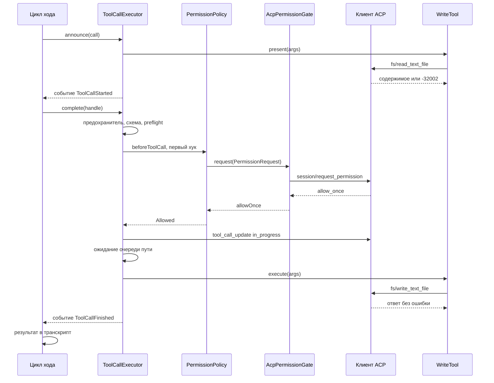
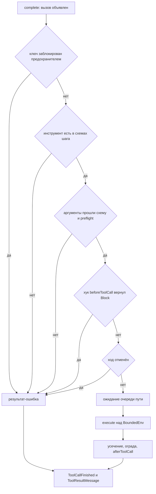
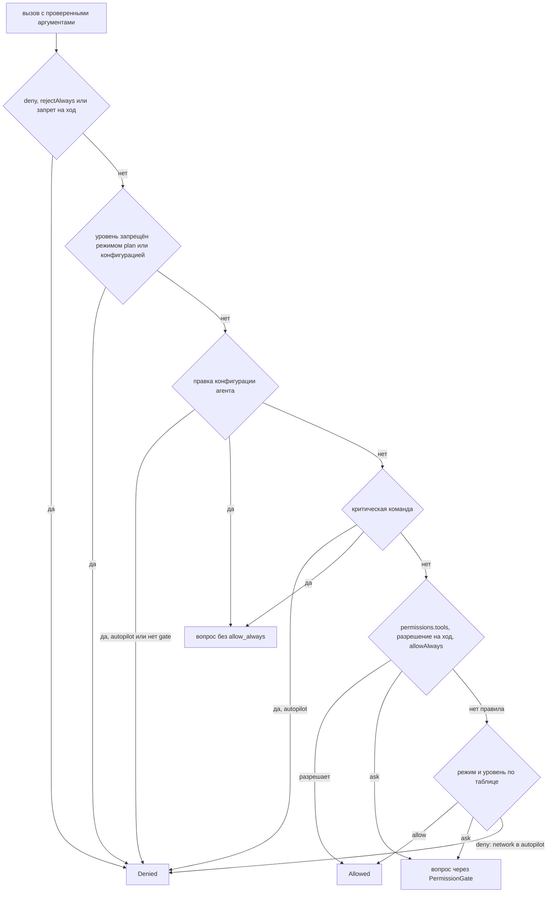

# Алгоритм вызова и исполнения инструмента

Документ описывает путь одного вызова инструмента целиком: от блока `toolCall` в ответе модели до результата в транскрипте и кадров `session/update` у клиента. Читать его можно подряд, без переходов по ссылкам. Справочные главы собраны в конце.

Инструмент — объект `AgentTool`: он описывает себя для модели и выполняет действие над `ExecutionEnv`. Вызов — блок `ToolCall` в ответе модели: `id`, `name` и `arguments`. Пакет — все вызовы из одного ответа. Группа — часть пакета, которую цикл исполняет целиком. Транскрипт — список сообщений, который видит модель.

Ход агента, в который встроен этот алгоритм, описан в [`turn.md`](turn.md). Здесь он дан одной строкой: цикл получает ответ модели и зовёт `_runBatch`. Что происходит внутри `_runBatch` — тема этого документа.

## Вход и выход

| | Что |
|---|---|
| Вход | Ответ модели `AssistantMessage` с блоками `ToolCall` (`id`, `name`, `arguments` — уже разобранный JSON-объект) и набор схем шага, который ушёл модели в том же запросе |
| Выход в транскрипт | По одному `ToolResultMessage` на каждый вызов, в порядке вызовов ответа. Поля: `toolCallId`, `toolName`, `content`, `isError`, `timestamp` |
| События | На каждый вызов: `ToolCallStarted`, ноль и больше `ToolCallProgress`, `ToolCallFinished` с исходом `ToolOutcome` (`completed`, `failed`, `cancelled`, `rejected`). Затем `MessageStarted` и `MessageEnded` для результата |
| Журнал | Запись `message` с результатом. Поля записи: `outcome`, `diff` (если правился один файл), `toolMeta` (заголовок, вид, места). Пишется как `durable` |
| Кадры ACP | `tool_call`, `tool_call_update` (`in_progress`, `completed`, `failed`), запрос `session/request_permission`, запросы агента к клиенту `fs/*` и `terminal/*` |
| Лог | `tool.present.error`, `tool.validate.error`, `tool.misuse.warned`, `tool.misuse.blocked`, `tool.lock.wait`, `tool.lock.cancelled`, `tool.abandon.error`, `permission.asked`, `permission.decided`, `permission.denied`; на стороне ACP — `acp.permission.failed`, `acp.permission.unknown_option` |
| Побочные эффекты | Действие инструмента над `ExecutionEnv` (файл, команда), решения «разрешить всегда» и «отклонить всегда» в памяти сессии, счётчик неверных вызовов хода |

Два свойства держат весь алгоритм. Первое: `AgentTool.execute` вызывает только `ToolCallExecutor`, а значит, любой инструмент — встроенный, MCP или навыка — проходит одну дорогу (`TOOL-1`). Второе: у каждого вызова ответа есть результат, даже если вызов отклонён, отменён или не начинался (`TOOL-6`). Модель никогда не получает запрос с «висящим» вызовом.

## Участники

Схема показывает один вызов `write`, который требует разрешения, со стороны ядра и ACP. Подробный порядок шагов — в псевдокоде ниже.



Вызовы `fs/*` на схеме идут от `write` через env сессии: `BoundedEnv` проверяет путь, а `AcpClientExecutionEnv` отправляет запрос клиенту.

Кадры клиенту уходят не из исполнителя, а из моста ACP (`SessionBridge`): он подписан на события ядра и проецирует их в `session/update`. Исключение — `in_progress`: его отправляет хук `markInProgress`, который мост ставит последним звеном цепочки `beforeToolCall`.

## Псевдокод

Запись Dart-подобная. Комментарии `//` указывают место в коде: `файл: символ`. Порядок шагов совпадает с кодом; пропущены только логи, которые не меняют ход, и защитные проверки. Пути относительны `packages/dart/codelab_agent_core/lib/src/`, кроме файлов `codelab_agent_acp`, которые так и названы.

### Уровень 0. Схема инструмента попадает к модели

```text
// loop/agent_loop.dart: _Turn._request
S1. tools = _context.tools
        // набор шага: реестр сессии без `agent` (если окно модели мало)
        // и без инструментов вне набора выбранного агента
        // runtime/agent_runtime.dart: _visibleTools
S2. context = LlmContext(
        systemPrompt: _context.systemPrompt,
        messages: payload.messages,
        tools: [for tool in tools: tool.toSchema()],   // name, description, parameters
        cacheKey: sessionId)
S3. response = await _config.stream(model, context, cancel)
        // llm/providers/anthropic.dart:       tools[{name, description, input_schema}], tool_choice: auto
        // llm/providers/openai_compatible.dart: tools[{type: function, function: {name, description, parameters}}],
        //                                       tool_choice: auto

// loop/agent_loop.dart: _Turn.run, после StepEnded
S4. if prepareNextStep вернул StepUpdate(tools: …):    // MCP обновил набор, сменился агент
        _context.tools = update.tools                  // со следующего запроса, не внутри шага
```

Набор схем меняется только на границе шага (`S4`). Поэтому множество инструментов, которое модель видела в запросе, равно множеству, по которому исполнитель проверяет имя вызова из её ответа (`stepTools`).

### Уровень 1. Разбор ответа и решение, исполнять ли пакет

```text
// loop/agent_loop.dart: _Turn._consume и _Turn._unique
R1. for event in stream:
        BlockStartEvent  → при первом блоке: partial = _unique(event.partial);
                           transcript.add(partial); await emit(MessageStarted)
        BlockDeltaEvent  → для text и thinking: await emit(MessageDelta | ThoughtDelta)
        DoneEvent        → result = _unique(message)
        ErrorEvent       → result = _unique(error)
R2. _unique(message): для каждого ToolCall с непустым id:
        id = renames[i] ??= _freeId(id)        // id, затем id_2, id_3… пока id в _usedIds
        // _usedIds заполнен id всех вызовов транскрипта в конструкторе _Turn   (LOOP-11)

// loop/agent_loop.dart: _Turn.run, шаг после _request
R3. if response.stopReason in {error, aborted}:
        эмитировать AgentError (для error) и StepEnded; завершить ход       // вызовы не исполняются
R4. calls = response.toolCalls
R5. results = response.stopReason == length
        ? [for call in calls: ToolResultMessage(isError: true, truncatedArgumentsText)]
              // JSON аргументов мог оборваться: вызовы не исполняются, ToolCallStarted нет   (LOOP-5)
        : await _runBatch(calls)
R6. for result in results: await _append(result)   // MessageStarted, MessageEnded; SessionWriter пишет запись
R7. emit StepEnded; pending = calls.isNotEmpty     // непустой пакет → ещё один шаг
```

### Уровень 2. Пакет делится на группы

```text
// loop/agent_loop.dart: _Turn._runBatch(calls)
B0. if calls.isEmpty: return []
B1. invocation = ToolInvocation(
        sessionId, cancel: _cancel, emit: _emit,
        stepTools: [имена из _context.tools],
        beforeToolCall: _config.beforeToolCall, afterToolCall: _config.afterToolCall,
        misuse: _misuse,                        // один MisuseBreaker на ход   (LOOP-16)
        supportsImages: _config.model.supportsImages)
B2. groups = []; lastIsBarrier = false
    for call in calls:
        tool    = _context.tools.firstWhere(t.name == call.name) ?? null
        barrier = tool?.executionModeOf(call.arguments) == sequential    // сырые аргументы модели
        if barrier or groups.isEmpty or lastIsBarrier: groups.add([call])
        else:                                          groups.last.add(call)
        lastIsBarrier = barrier
B3. for group in groups:                                 // строго по порядку   (LOOP-4)
        handles = []
        try:
            for call in group:
                handles.add(await executor.announce(call, invocation))   // по порядку ответа
        catch:
            await _abandonAll(executor, handles)         // откат уже объявленных; ошибка отката только в лог
            rethrow                                      // _Turn.run: AgentError(hook), TurnEnded(failed)   (LOOP-1)
        outcomes = _cancel.isCancelled
            ? await _abandonCancelled(executor, handles)             // abandon всех; первая ошибка отката → throw
            : await Future.wait(handles.map(executor.complete))      // одновременно
        for o in outcomes: results[o.message.toolCallId] = o.message
B4. return [for call in calls: results[call.id]!]        // в порядке ответа, независимо от групп   (LOOP-3)
```

Барьер — вызов, у которого `executionModeOf` вернул `sequential`. Среди встроенных такие только `task_create`, `task_update`, `task_list`, `task_get` (`tools/tasks/task_tools.dart`). Остальные возвращают `null` или `parallel` (так объявлен `skill`), то есть параллельны. Для пакета `[read, task_update, agent, agent]` получаются три группы: `[read]`, `[task_update]`, `[agent, agent]`. Один барьер не делает последовательным весь пакет.

### Уровень 3. `announce`: объявить вызов

```text
// tools/executor.dart: ToolCallExecutor.announce(call, invocation)
A1. available = call.name in invocation.stepTools
    tool      = available ? registry.lookup(call.name) : null       // null → «инструмента нет»
A2. context = ToolContext(env, cancel: invocation.cancel, toolCallId: call.id, services,
                          stepTools, misuse, supportsImages,
                          onUpdate:   partial → emit(ToolCallProgress(content: блоки)),
                          onTerminal: id      → emit(ToolCallProgress(content: [ToolCallTerminal(id)])))
        // доставки progress копятся в handle._progress и ждутся до финиша
A3. lock = null
    if tool?.lockPath(call.arguments) is String raw:                // write и edit; сырые аргументы
        abs = normalizePath(env.cwd, raw)
        if abs != null: lock = _locks.reserve(abs)                  // место в очереди пути, в порядке ответа   (TOOL-7)
A4. try:
        presentation = ToolPresentation(title: call.name)
        if tool != null:
            try:
                presentation = await tool.present(call.arguments, context)   // заголовок, места, diff; может читать env
                context.presentation = presentation                          // политика возьмёт его, не звал present второй раз
            catch: log debug tool.present.error                              // заголовком остаётся имя инструмента
        await invocation.emit(ToolCallStarted(
            toolCallId: call.id, tool: call.name,
            kind: tool?.kindOf(call.arguments) ?? other,
            title: presentation.title, input: call.arguments,
            locations: presentation.locations, subagent: presentation.subagent))
    catch:
        lock?.release()                       // без handle тикет некому отпустить
        rethrow
A5. return ToolCallHandle(call, invocation, tool, context, progress, lock)
```

`present` строит diff правки заранее. Поэтому для `write` через ACP-клиента первым кадром уходит `fs/read_text_file`, а уже потом `tool_call`: `announce` ждёт `present`, а `present` читает старое содержимое через клиента.

### Уровень 4. `complete`: проверки, решение, исполнение

```text
// tools/executor.dart: ToolCallExecutor.complete(handle)
try:    (result, outcome) = await _run(handle)
finally: handle._lock?.release()                  // на любом пути завершения
return await _finish(handle, result, outcome)

// tools/executor.dart: ToolCallExecutor._run
C1. key = MisuseBreaker.keyOf(call.name, call.arguments)      // имя + canonicalJson(сырые аргументы)
    if misuse != null and misuse.isBlocked(key):
        return failed('Blocked: this exact call to <tool> has already failed <n> times …')   // дальше не идём, счёт не растёт   (TOOL-11)
C2. (result, outcome, invalid) = await _checkAndExecute(handle)
C3. if invalid and misuse != null:
        warning = misuse.recordInvalid(key)             // n-й неверный вызов с этим ключом
        if warning != null: log tool.misuse.warned | tool.misuse.blocked; result = result + "\n" + warning
    return (result, outcome)

// tools/executor.dart: ToolCallExecutor._checkAndExecute        (invalid = true только в шагах 2, 3, 4)
X1. if tool == null:
        return invalid(unavailableText?.call(name)
                       ?? 'Tool "<name>" is not available. Available tools: <stepTools>.')
X2. try:
        args = validateArguments(tool.parameters, call.arguments)    // тип, required, enum, default, items; приведение "42" → 42
        Err(violations) → return invalid(formatInvalidArguments(name, violations, call.arguments))
    catch (схема сломана или недоверенная):
        log debug tool.validate.error
        return failed(errorText(error))                              // НЕ invalid: это сбой инструмента   (TOOL-3)
X3. try:
        text = tool.preflight(args)                                  // без побочных эффектов   (PERM-1)
        if text != null: return invalid(text)
    catch (error): return invalid(errorText(error))
X4. try:
        for hook in invocation.beforeToolCall:                       // 1-й: PermissionPolicy.asHook; последний у ACP: markInProgress
            block = await hook(call, args, context)
            if block != null: return failed-or-other(block.reason, block.outcome)   // rejected по умолчанию
    catch (error): return failed(errorText(error))
X5. if invocation.cancel.isCancelled:
        return cancelled('Tool call was cancelled')
X6. if handle._lock != null:
        log debug tool.lock.wait
        await Future.any([lock.acquired, invocation.cancel.onCancel])
        if invocation.cancel.isCancelled:
            log debug tool.lock.cancelled {reason: user | shutdown | storage_failure | watchdog | other}
            return cancelled('Tool call was cancelled')
X7. return await _execute(handle, tool, args)

// tools/executor.dart: ToolCallExecutor._execute
E1. try:    result = await tool.execute(args, context)               // здесь env — BoundedEnv   (ENV-2)
    catch ToolCancelled(content):  return (ToolExecutionResult(content, isError: true), cancelled)
    catch CancelledException:      return cancelled('Tool call was cancelled')
    catch (error):                 return failed(errorText(error))   // без префиксов "Exception: ", "Bad state: ", "Invalid argument(s): "
E2. if not tool.truncatesOutput:
        result = _limit(result)                          // truncateHead: 2000 строк и 50 КиБ, уведомление   (TOOL-9)
E3. if tool.outputTrust(args) == untrusted or isMcpToolName(tool.name):
        result = _fence(result, tool.name)               // каждый TextContent в <untrusted-content source="…">   (TOOL-10)
E4. for hook in invocation.afterToolCall:
        try:
            override = await hook(call, result, result.isError)
            if override != null:
                result = ToolExecutionResult(override.content ?? result.content,
                                             diffs: result.diffs, isError: override.isError ?? result.isError)
        catch (error): result = ToolExecutionResult([TextContent(errorText(error))], isError: true)
E5. return (result, result.isError ? failed : completed)

// tools/executor.dart: ToolCallExecutor._finish
F1. await Future.wait(handle._progress)                  // все ToolCallProgress доставлены до финиша
F2. await invocation.emit(ToolCallFinished(toolCallId, outcome, content: result.content, diffs: result.diffs))
F3. return ToolExecutionOutcome(
        message: ToolResultMessage(toolCallId, toolName, content: result.content,
                                   isError: result.isError or outcome != completed,
                                   timestamp: clock.now()),
        outcome, diffs)
```

`ToolCallFinished` эмитится из `_finish`, до того как цикл положит `ToolResultMessage` в транскрипт (`R6`). Поэтому событие вызова идёт раньше сообщения-результата, а результаты параллельной группы ложатся в транскрипт позже всех `ToolCallFinished`.

### Уровень 5. Решение о разрешении: `PermissionPolicy._decide`

Политика — первое звено `beforeToolCall` (`PERM-1`). К ней приходят уже проверенные и приведённые аргументы: шаги `X2` и `X3` позади.

```text
// permissions/policy.dart: PermissionPolicy.asHook(lookup)
H1. tool = lookup(call.name); if tool == null: return null
H2. outcome = await decide(tool, args, ctx)             // decide пишет info permission.denied при отказе
H3. Allowed → return null                               // цепочка идёт дальше
    Denied(reason) → return Block(
        'Permission denied for <tool>: <reason>. Do not retry the same call; choose another approach or ask the user.',
        outcome: ctx.cancel.isCancelled ? cancelled : rejected)       // PERM-7: ход продолжается

// permissions/policy.dart: PermissionPolicy._decide(tool, args, ctx)
D0. key    = PermissionKey(tool.name, tool.permissionPattern(args, ctx.env.cwd))
    policy = rules.toolPolicies[tool.name]              // allow | ask | deny | null  (permissions.tools)
    tier   = tool.tierOf(args)                          // read | write | network | exec
D1. if policy == deny or key in rules.denyPatterns:    // permissions.tools, permissions.deny
        return Denied('denied by configuration')
D2. if key in decisions.rejectAlways:
        return Denied('previously rejected by the user')
D3. if tool.name in _turnDeny:                          // запрет на текущий ход
        return Denied('not allowed in this turn')
D4. denied = modeOf?.call().deniedTiers ?? mode.deniedTiers      // режим plan: {write, exec}
    if modeOverride == null and (tier in denied or tier in extraDeniedTiers):
        return Denied('plan mode: changes are not allowed')
D5. effective = modeOf?.call().mode ?? modeOverride ?? mode.permissionMode
    scope     = await _scopeFor(tool, args)             // пути конфигурации хоста; только для вызова с lockPath или уровнем exec
D6. target = await _agentConfigTarget(tool, args, cwd, scope)    // только инструменты с lockPath: write, edit
    if target != null:                                           // правка конфигурации агента (PERM-11)
        if effective == autopilot or gate == null:
            return Denied('Editing agent configuration requires a human: <target>')
        return _ask(reason: 'agent configuration: <target>', allowAlways: false)
D7. label = await _criticalLabel(tool, args, cwd, scope)         // только exec: findCritical(command)
    if label != null:                                            // критическая команда (PERM-9)
        if effective == autopilot:
            return Denied('critical command blocked in autopilot: <label>')
        return _ask(reason: 'critical command: <label>', criticalLabel: label, allowAlways: false)
D8. switch policy:
        allow       → return Allowed('tool policy')
        ask         → return _ask()
        deny | null → дальше                                     // deny сюда не дойдёт: ушёл на D1
D9. if tool.name in _turnAllow: return Allowed('turn grant')
D10. if key in decisions.allowAlways: return Allowed('always allowed')
D11. switch tierDecision(effective, tier):                       // таблица «режим × уровень»
         allow → return Allowed('mode')
         ask   → return _ask()
         deny  → return Denied('network access needs approval and autopilot has no approver')
```

Порядок правил идёт от самого сильного запрета к самому слабому разрешению. Что из него следует:

- Явный `deny` из конфигурации и `rejectAlways` сильнее всего, включая `allow` для инструмента (`D1`, `D2`).
- Запрет уровней режима `plan` стоит раньше `permissions.tools: {write: allow}`: `allow` не снимает запрет `plan` (`D4`, `D8`).
- Критические проверки (`D6`, `D7`) стоят раньше `allow`, разрешения на ход и «разрешить всегда». Поэтому «разрешить всегда» на критическую команду невозможно: вопрос задаётся без этого варианта (`allowAlways: false`) (`PERM-2`).
- Разрешение на ход (`D9`, `grantForTurn`) в рабочем коде никто не выдаёт: метод вызывают только тесты. Правило есть, но сейчас не срабатывает.

```text
// permissions/policy.dart: PermissionPolicy._ask(tool, args, ctx, key, {reason, criticalLabel, allowAlways = true})
Q1. if gate == null: return Denied('no approval interface is available')          // PERM-5
Q2. offered = allowAlways and tool.offersAllowAlways(args)
Q3. presentation = ctx.presentation ?? await tool.present(args, ctx)               // обычно уже готова из announce
        // при ошибке present: title = tool.name
Q4. log debug permission.asked {tool_call_id, tool, tier, critical: reason != null}
Q5. approvalWait.begin(now)                                                        // время ожидания не входит во время хода
    try:     decision = await raceCancel(gate.request(PermissionRequest(
                 toolCallId, tool, kind, tier, title, rawInput: args, locations, diffs,
                 pattern: key.pattern, reason, criticalLabel, allowAlwaysOffered: offered),
                 ctx.cancel), ctx.cancel)
    catch CancelledException: decision = cancelled
    finally: approvalWait.end(now)                                                 // и при отмене
Q6. log debug permission.decided {tool_call_id, decision}
Q7. switch decision:
        allowOnce    → return Allowed('user')
        allowAlways  → if offered: decisions.allowAlways.add(key)
                       return Allowed('user')
        rejectOnce   → return Denied('rejected by the user')
        rejectAlways → decisions.rejectAlways.add(key); return Denied('rejected by the user')
        cancelled    → return Denied('permission request was cancelled')
```

Решение «разрешить всегда» хранится по ключу `PermissionKey(tool, pattern)`, а не по виду инструмента (`PERM-3`). Для `write` шаблон — путь относительно рабочей папки (`NOTES.md`), поэтому «разрешить всегда» на один файл не открывает другие.

### Уровень 6. Вопрос через ACP: `AcpPermissionGate.request`

```text
// codelab_agent_acp: acp_permission_gate.dart: AcpPermissionGate.request(req, cancel)
G1. if announced != null:
        try:   await raceCancel(announced(waitFor), cancel)     // tool_call вызова уже в очереди соединения
        catch CancelledException: return cancelled              // запрос на провод не уходит
        // waitFor = req.toolCallId; у потомка без согласия клиента на `subagentToolCalls` — id вызова agent
G2. loop:
        try:   raw = await link.requests.request(session/request_permission, params, cancel: cancel); break
        catch ClientCallCancelled:   return cancelled
        catch ClientDisconnected:    if await waitForReconnect(cancel): continue      // тот же toolCallId, новый id запроса
                                     if cancel.isCancelled: return cancelled
                                     return _failed(...)                              // rejectOnce, лог acp.permission.failed
        catch ClientCallFailure:     return _failed(...)
G3. response = decodeResult(raw)                                // не разобрался → _failed(...)
G4. switch response.outcome:
        cancelled           → return cancelled
        selected(optionId)  → allow_once → allowOnce
                              allow_always (только если предложен) → allowAlways
                              reject_once → rejectOnce;  reject_always → rejectAlways
                              иной optionId → rejectOnce, лог acp.permission.unknown_option   // не предлагали — не разрешение
```

Параметры запроса: `toolCall` — `ToolCallUpdate` со статусом `pending`, `rawInput` (приведённые аргументы, то, что будет исполнено — `PERM-6`), `locations`, `content` (причина текстом и `diff` на каждый файл). Варианты: `allow_once`, `allow_always` (если предложен), `reject_once`, `reject_always`; `optionId` совпадает с `kind`. У критической команды в `_meta.codelab` лежат `critical: true` и `label`. Любой сбой превращается в отказ, а не в разрешение.

### Уровень 7. Отмена и откат

```text
// tools/executor.dart: ToolCallExecutor.abandon(handle)          // вызвать вместо complete
K1. handle._lock?.release()                                       // до эмита: сбой эмита путь уже не держит
K2. return _finish(handle,
        ToolExecutionResult([TextContent('Tool call was cancelled before it started')], isError: true),
        cancelled)                                                // ToolCallFinished(cancelled) и результат для модели

// loop/agent_loop.dart: _Turn._abandonAll(executor, handles, [outcomes])
K3. pending = [for h in handles: (h, _settle(() => executor.abandon(h)))]    // все abandon стартуют сразу
K4. for (h, settled) in pending:
        (outcome, failure) = await settled
        if outcome != null: outcomes?.add(outcome); continue
        first ??= failure
        log warning tool.abandon.error {session_id, tool, tool_call_id, error_class}   // сбой логгера глотается
K5. return first                                                  // вызывающий решает, пробрасывать ли
```

Отмена может прийти в пяти местах, и в каждом исход один — `cancelled` (текст `Tool call was cancelled` или `…before it started`):

1. Между объявлением группы и её исполнением: `B3` отправляет все вызовы группы в `abandon`.
2. Во время вопроса пользователю: `raceCancel` в `_ask` даёт `cancelled`, политика возвращает `Denied`, а `asHook` видит `ctx.cancel.isCancelled` и ставит исход `cancelled`, а не `rejected`.
3. После хуков, до очереди пути: проверка `X5`.
4. В очереди пути: `Future.any` в `X6` прерывает ожидание; тикет остаётся в очереди до своего часа и освобождается в `finally` метода `complete`.
5. Во время `execute`: инструмент видит `ctx.cancel`. `exec` бросает `ToolCancelled` со своим текстом, остальные — `CancelledException`.

После отмены ход не обрывается на полпути: цикл дожидается результатов, кладёт их в транскрипт, эмитит `StepEnded`, и только потом видит `_cancel.isCancelled` и завершает ход как `cancelled`. Токен с причиной `StorageFailure` (сбой журнала) завершает ход как `failed`.

### Уровень 8. Ремонт парности при следующем запросе

```text
// loop/payload_builder.dart: buildPayload  →  tools/pairing.dart: repairToolPairing(messages)
P1. renamed = _renameDuplicates(messages)             // повтор id получает _dup<N>, результаты за ним — тоже
P2. for (i, message) in renamed:
        AssistantMessage с вызовами:
            добавить сообщение; найти его результаты среди следующих сообщений до следующего ответа с вызовами
            for call in message.toolCalls:
                найден результат → поставить сразу за ответом (если был дальше: action 'moved <id>')
                нет результата   → вставить ToolResultMessage(isError: true,
                                       'Tool call was interrupted before it produced a result.')   // action 'synthesized <id>'
        ToolResultMessage, который никто не забрал:
            заменить на UserMessage('[Note: a tool result without a matching call was removed: <toolName> <id>]')
                                                              // action 'dropped orphan <id>'
P3. непустой отчёт → emit ToolPairingRepaired(report)
```

Ремонт работает только над payload, а не над транскриптом и журналом (`LOOP-7`, `TOOL-6`). Если провайдер всё равно ответил `400` с текстом про `tool_use`, `tool_call` или `tool_result` (`isPairingError`), `_request` пересобирает payload и повторяет запрос один раз.

Есть и второй, независимый ремонт — в журнале. При загрузке сессии `healInterruptedTurn` (`session/projections.dart`) дописывает в журнал записи с исходом `interrupted` для вызовов последнего ответа, у которых нет результата: процесс остановился между вызовом и записью результата. Текст этих записей другой: `Tool call was interrupted: the agent process stopped before the result was recorded…`.

## Схемы решений

Первая схема — `complete`: куда вызов может свернуть до исполнения.



Результат-ошибка — всегда `ToolResultMessage` с `isError: true`. Исход разный: `failed` для предохранителя, отсутствующего инструмента и неверных аргументов; исход `Block` для хука (у политики `rejected` или `cancelled`); `cancelled` для отмены. Счётчик предохранителя растёт только на отсутствующем инструменте, неверных аргументах и неудачном `preflight`.

Вторая схема — `_decide`: порядок проверок политики.



Узел «разрешает» объединяет `allow` из `permissions.tools`, разрешение на ход и «разрешить всегда». Таблица `tierDecision` (`permissions/modes.dart`):

| Режим | `read` | `write` | `network` | `exec` |
|---|---|---|---|---|
| `alwaysAsk` | вопрос | вопрос | вопрос | вопрос |
| `write` | разрешено | вопрос | вопрос | вопрос |
| `acceptEdits` | разрешено | разрешено | вопрос | вопрос |
| `yolo` | разрешено | разрешено | вопрос | разрешено |
| `autopilot` | разрешено | разрешено | запрет | разрешено |

Режим клиента `standard` — это `PermissionMode.write`; `plan` — тоже `write`, но с запретом уровней `write` и `exec` (`D4`).

## Пошаговое пояснение

Ниже — почему шаги именно такие и какой инвариант каждый держит. Номера шагов совпадают с псевдокодом.

**S1–S4. Схема и набор шага.** Модель вызывает только то, что видела. Набор меняется только между шагами (`S4`), поэтому исполнитель проверяет имя вызова по тому же `stepTools`, что ушёл в запрос. Схему инструмента задаёт он сам, а схему MCP-инструмента — недоверенный сервер. Поэтому всё дальше (`X2`) читает схему терпимо и не бросает.

**R2. Уникальный id (`LOOP-11`).** Результаты, события и кадры ACP связываются с вызовом по `toolCallId`. Дубликат от провайдера получает `_2` в первом же снимке сообщения, до первого события наружу, иначе клиент увидел бы два вызова с одним id. `_runBatch` в конце собирает результаты по `results[call.id]!`, и без уникальности один результат затёр бы другой.

**R3, R5. Когда вызовы не исполняются.** Ответ с `error` или `aborted` не содержит надёжных вызовов. Ответ с `stopReason: length` оборван по лимиту вывода, и JSON аргументов мог оборваться посередине. Исполнить обрезанную запись `write` значило бы записать неполный файл. Вызов получает результат `truncatedArgumentsText` с просьбой повторить с меньшими аргументами.

**B2. Группы и барьеры (`LOOP-4`).** Параллельное исполнение быстрее, но инструменты списка задач зависят от порядка: `task_create` выдаёт id по порядку. Барьер делит пакет так, что порядок между барьером и соседями сохраняется, а остальные вызовы идут одновременно. Барьер определяется по сырым аргументам: `executionModeOf` может зависеть от значения аргумента.

**B3. Объявление всех вызовов группы до исполнения.** Параллельная группа сначала объявляет все вызовы по порядку ответа и только потом исполняет. Иначе асинхронный `present` одного вызова мог бы обогнать другой, и `ToolCallStarted` пришли бы не по порядку (`LOOP-3`). `ToolCallFinished` приходят в порядке завершения, а результаты в транскрипт ложатся в порядке вызовов (`B4`).

**A3. Место в очереди пути занимается при объявлении (`TOOL-7`).** Хуки разрешений разных вызовов отвечают в любом порядке: один пользователь нажмёт «разрешить» на втором вызове раньше, чем на первом. Если бы место брали после хуков, порядок правок одного файла зависел бы от скорости ответов. Теперь итог равен последовательному применению вызовов ответа. `PathLock` общий для дерева сессий: потомки используют очередь корня.

**A4. `present` до `ToolCallStarted`.** Заголовок, места и diff нужны и клиенту, и запросу разрешения. Результат кладётся в `context.presentation`, и политика не вызывает `present` второй раз: через ACP-клиента каждый вызов `present` — лишний `fs/read_text_file`. Сбой `present` не ошибка вызова: аргументы ещё сырые, модель могла прислать что угодно.

**C1, C3. Предохранитель (`TOOL-11`, `LOOP-16`).** Модель, получившая ошибку валидации, иногда повторяет тот же вызов. Ключ — имя и канонический JSON сырых аргументов, поэтому порядок ключей не важен. С третьего неверного вызова к тексту ошибки дописывается предупреждение, на шестом ключ блокируется до конца хода: следующий такой вызов отвечает `Blocked: …` без валидации, разрешений и исполнения. Отказ политики, отмена и ошибки исполнения счёт не меняют: повторить упавший `exec dart test` после правки — нормальная работа.

**X1. Нет инструмента.** Проверка идёт до политики, поэтому пользователя не спрашивают о вызове, который всё равно не исполнится. Если инструмент есть в реестре, но вне набора выбранного агента, текст ошибки строит сессия (`unavailableText`): `Tool not available for agent <name>: <tool>`.

**X2. Схема и приведение (`TOOL-2`).** `execute` получает только проверенные и приведённые аргументы. Поддерживается подмножество JSON Schema: `type`, `properties`, `required`, `items`, `enum`, `default`; лишние ключи аргументов проходят. Несовпавший тип приводится, если смысл однозначен: `"42"` в `42`, `"true"` в `true`. Исключение в валидаторе — сбой инструмента, а не ошибка модели, и в счёт предохранителя не идёт.

**X3. `preflight`.** Дешёвая проверка до разрешений, например относительный путь вне рабочей папки. Она не может иметь побочных эффектов: пользователя не должно спрашивать про вызов, который заведомо неверен (`PERM-1`).

**X4. Хуки `beforeToolCall`.** Первым стоит `PermissionPolicy.asHook`: до его решения не исполняется ни `execute`, ни другие хуки (`PERM-1`). Хуки хоста идут после политики. У ACP-агента последний — `markInProgress`: если вызов дошёл до него, клиенту уходит `in_progress`. Первый `Block` останавливает цепочку; его `outcome` по умолчанию `rejected`. Отказ — данные для модели, ход продолжается (`PERM-7`).

**D1–D11. Решение о разрешении.** Порядок правил разобран выше. Вопрос человеку (`_ask`) открывает ожидание в `ApprovalWaitMeter` и закрывает его в `finally`: время, пока человек думает, не входит в бюджет времени хода. Без `PermissionGate` любой вопрос становится отказом `no approval interface is available` (`PERM-5`). Решение относится к одному `toolCallId` (`PERM-4`).

**X5, X6. Отмена и очередь пути.** Токен хода живёт не дольше хода: цикл создаёт его заново, потому что `Future.any` в `X6` не снимает слушателя `onCancel`. Ожидание очереди прерывается отменой, иначе вызов за держателем, который не реагирует на отмену, получил бы `cancelled` лишь после того, как держатель отпустит путь. Тикет при этом не отпускается досрочно: место освобождается только после предыдущего держателя, иначе следующий вызов того же пути прошёл бы раньше времени.

**E1. `execute` над `BoundedEnv`.** Инструмент получает не базовый env, а обёртку над ним (`ENV-2`). Путь вне рабочей папки даёт `Err(FileError(outsideWorkspace))` до обращения к внутреннему env (`ENV-3`). Ожидаемые сбои — значения `Err`, а не исключения (`ENV-1`). Исключение из `execute` исполнитель превращает в результат-ошибку с исходом `failed` (`TOOL-3`).

**E2, E3. Усечение и ограда.** Результат не больше 2000 строк и 50 КиБ и всегда говорит об усечении (`TOOL-9`). Инструменты, которые усекают сами (`read`, `exec`, `ls`, `search`), делают это со своим уведомлением. Текст из файлов, команд и серверов — данные, которым модель не обязана подчиняться. Он попадает в транскрипт только внутри `<untrusted-content source="…">`, а маркеры внутри текста экранируются (`TOOL-10`). Результат любого инструмента с именем `mcp__…` огораживается всегда, независимо от `outputTrust`: MCP-сервер не может объявить себя доверенным.

**E4. `afterToolCall`.** Хуки видят результат после усечения и ограды и могут заменить `content` и `isError`. Выполняются только для вызовов, из которых `execute` вернул результат (в том числе с `isError: true`): исключение инструмента, отмена, отказ и ошибка проверки их пропускают.

**F1–F3. Финиш.** `ToolCallFinished` не уходит, пока не доставлены все `ToolCallProgress`: клиент не должен получить прогресс после финиша. `ToolResultMessage.isError` истинно и тогда, когда сам результат без ошибки, но исход не `completed`.

## Исполнение у клиента через ACP

Этот раздел описывает только ветку «через клиента». Какая сторона исполняет и решает при встроенном агенте, `serve --stdio`, `serve --ws` и внешнем агенте — в [execution-sides.md](execution-sides.md).

Когда агент работает как процесс по `stdio` или `WebSocket`, он не видит файлов и терминалов клиента. Поэтому env сессии — `AcpClientExecutionEnv` из `codelab_agent_acp`: он переводит операции `ExecutionEnv` в запросы агента к клиенту. Встроенные инструменты от этого не меняются: они написаны один раз над `ExecutionEnv`.

Сборка env сессии в `agent_server.dart`: `AcpClientExecutionEnv` (при `localListing` его оборачивает `ListingOverlayEnv`, который берёт локально только `listDir` и `stat`), затем `BoundedEnv.wrap(…, cwd)` в `agent_runtime.dart`. У встроенного агента (профили `embedded-*`) клиентского env нет: хост исполняет файлы и команды сам.

| Операция `ExecutionEnv` | Что уходит клиенту | Ошибки и особенности |
|---|---|---|
| `readText` | `fs/read_text_file {sessionId, path, line?, limit?}` | Клиент не объявил `fs.readTextFile` — `Err(unsupported)` без кадра. Ответ `-32002` — `notFound`, прочие ошибки — `io`. Таймаут 30 с |
| `writeText` | `fs/write_text_file {sessionId, path, content}` | То же по возможности `fs.writeTextFile`. Таймаут даёт `io` с пометкой `the write may have completed` |
| `stat` | `fs/read_text_file` с `limit: 1` | В ACP нет `stat`. Каталоги через клиента не видны. С `ListingOverlayEnv` `stat` локальный |
| `exec` | `terminal/create` (`/bin/sh -c <команда>`, `cwd`, `env`, `outputByteLimit`) → `terminal/wait_for_exit` → `terminal/output` → `terminal/release` | Клиент не объявил `terminal` — `ExecErrorCode.shellUnavailable` без кадра. `terminal/release` уходит всегда (`ENV-7`), `terminal/kill` — при таймауте и отмене |

Как проверяется граница. `BoundedEnv` нормализует путь от корня сессии и отклоняет всё вне корня до обращения к `AcpClientExecutionEnv`; сравнение идёт по сегментам (`/proj_evil` не лежит в `/proj`). `AcpClientExecutionEnv` не раскрывает символические ссылки: файлов агент не видит, а containment для ссылок остаётся задачей клиента. Для `fs/*` и `terminal/*` у агента нет своего approval-гейта: по `AGENTS.md` §10 разрешение остаётся на агенте (политика, `D1–D11`), а компенсирующий контроль — containment рабочей папки.

Терминал встраивается в вызов так: `exec` передаёт `ctx.onTerminal` в `ExecOptions`, `AcpClientExecutionEnv` получает от клиента `terminalId`, вызывает `onTerminal`, и исполнитель эмитит `ToolCallProgress` с `ToolCallTerminal`. Мост превращает его в `tool_call_update` с блоком `{"type":"terminal","terminalId":…}`. Только после этого кадра `AcpClientExecutionEnv` идёт в `terminal/wait_for_exit` (`terminalShown`): клиент должен успеть показать терминал. Пример кадров — фикстура `acp/tool-exec-terminal-embed`.

Отмена с клиента: `session/cancel` вызывает `SessionBridge.cancel`. Он отменяет токен хода, ожидающие вопросы разрешения и зовёт `abortPending`: запросы `fs/*` завершаются ошибкой `io` «aborted» (запрос клиенту не отзывается — в ACP нечем). Терминал останавливается через `terminal/kill`, затем `terminal/release`; `exec` отдаёт `ToolCancelled` с текстом `[Command was cancelled after <t> s]`.

## Проекция в ACP

Мост (`SessionBridge._onEvent`, `event_projection.dart: projectEvent`) переводит события ядра в кадры.

| Событие ядра | Кадр `session/update` |
|---|---|
| `ToolCallStarted` | `tool_call`: `toolCallId`, `title`, `kind`, `status: pending`, `rawInput` (сырые аргументы модели), `locations` (если не пусто). У вызова `agent` — ещё `_meta.codelab.subagent {id, type}` |
| хук `markInProgress` (после разрешений) | `tool_call_update` со `status: in_progress`. Если хук сработал раньше, чем мост спроецировал `tool_call`, кадр откладывается |
| `ToolCallProgress` | `tool_call_update` со `status: in_progress` и `content`: блок текста, `diff` или `terminal` |
| `ToolCallFinished` | `tool_call_update`: `status` `completed` (исход `completed`) или `failed` (все остальные); `content` — блоки результата и по одному `diff` на файл. Для исхода `cancelled` ключа `content` нет; исключение — `agent` с итогом потомка: у него `content: []`. `_meta.codelab.outcome` — `cancelled`, `rejected` (или `interrupted` у реплея) |

Что из этого следует:

- В ACP нет статусов `cancelled` и `rejected`, поэтому клиент видит `failed`, а точный исход — в `_meta.codelab.outcome`.
- `in_progress` приходит до ожидания очереди пути: вызов, который ждёт чужую правку того же файла, уже показан как выполняющийся.
- Вызов, который не прошёл проверку (предохранитель, схема, `preflight`), и вызов, который отклонила политика, `in_progress` не получают: хук `markInProgress` до них не доходит.
- `AcpPermissionGate` перед запросом ждёт, пока `tool_call` вызова будет в очереди соединения (`announced`): запрос разрешения не должен обогнать объявление вызова.
- Все кадры идут через одну исходящую очередь соединения в порядке постановки; ответ на `session/prompt` встаёт последним (`ACP-3`).

## Разобранные примеры

Данные получены прогоном, а не придуманы. Два временных теста (удалены после прогона) запускали сценарную модель `ScriptedStreamFunction` и писали то, что видят цикл и клиент:

- **События, решение политики, журнал лога.** Тест в `codelab_agent_core`: `LoopHarness` (память `/proj`, `BoundedEnv`), `WriteTool` или `ReadTool`, `PermissionPolicy(mode: ModeId.standard)` с `FakeGate`, хук `policy.asHook` в `beforeToolCall`. Команда: `fvm dart test test/tmp_algo/tool_call_algo_test.dart` в `packages/dart/codelab_agent_core`.
- **Кадры ACP.** Тест в `codelab_agent_acp`: драйвер `runAgentFixture` проиграл фикстуры корпуса `acp/tool-write-permission-diff` и `acp/tool-invalid-args-error` против `AcpAgentServer` из `conformance_test.dart`; транспорт агента обернут записывающим декоратором, который сохранил кадры в обе стороны. Команда: `fvm dart test test/tmp_algo/write_frames_test.dart` в `packages/dart/codelab_agent_acp`.

Те же фикстуры лежат в корпусе (`packages/dart/codelab_acp_testing/fixtures/acp/`) и проверяются командой `melos run conformance:agent`. Рабочая папка в кадрах заменена на `${cwd}` (в прогоне это временный каталог), идентификатор сессии — на `<session-id>`.

### Пример 1. `write` с разрешением

Модель просит создать файл. Режим сессии `standard`, файла `NOTES.md` нет. Сценарий модели (фикстура `acp/tool-write-permission-diff`): шаг 1 — вызов `write` с `{"path": "NOTES.md", "content": "# Notes\n"}` и `id: call_1`; шаг 2 — текст `Создал NOTES.md.`.

**Запрос к модели.** Модель видит схему `write`, и это точный объект `parameters`:

```text
write: {"type":"object","properties":{"path":{"type":"string","description":"File path to create or overwrite."},"content":{"type":"string","description":"Full new file content."}},"required":["path","content"]}
```

**События ядра по порядку** (вывод теста ядра; `FileDiff` сокращён до пути):

Тест ядра шёл со вторым шагом «Готово.», а в фикстуре ACP и в её кадрах второй шаг — «Создал NOTES.md.».

```text
TurnStarted
MessageStarted(user)
MessageEnded(user)
StepStarted(0)
ModelRequested
MessageStarted(assistant)
MessageEnded(assistant toolUse)
ToolCallStarted(id=call_1, tool=write, kind=edit, title="Write NOTES.md", input={"path":"NOTES.md","content":"# Notes\n"}, locations=[Location(/proj/NOTES.md)])
ToolCallFinished(id=call_1, outcome=completed, content=["Created NOTES.md (8 bytes)."], diffs=[FileDiff(/proj/NOTES.md)])
MessageStarted(toolResult call_1)
MessageEnded(toolResult call_1)
StepEnded(0)
StepStarted(1)
ModelRequested
MessageStarted(assistant)
MessageDelta(Готово.)
MessageEnded(assistant stop)
StepEnded(1)
TurnEnded(completed)
```

Видно порядок из псевдокода: `ToolCallStarted` и `ToolCallFinished` идут подряд, результат попадает в транскрипт только после них (`R6`), а `StepEnded` закрывает шаг с вызовом.

**Решение политики по шагам `D0–D11`.**

| Шаг | Значение |
|---|---|
| `D0` | `key = PermissionKey('write', 'NOTES.md')`: шаблон `write` — путь относительно рабочей папки; `policy = null`; `tier = write` |
| `D1`–`D3` | в конфигурации нет `deny`, `rejectAlways` пуст, запретов на ход нет |
| `D4` | `standard`: `deniedTiers` пуст, `extraDeniedTiers` пуст |
| `D5` | `effective = PermissionMode.write` |
| `D6` | `lockPath = NOTES.md`; `isAgentConfigPath('NOTES.md')` ложно, область хоста не задана |
| `D7` | инструмент не `exec`: критической метки нет |
| `D8`–`D10` | правила для `write` нет, разрешений на ход и «всегда» нет |
| `D11` | `tierDecision(write, write)` — `ask`, вызывается `_ask` |

Запрос, который получил `PermissionGate`:

```text
toolCallId=call_1 tool=write kind=edit tier=write title="Write NOTES.md" pattern=NOTES.md reason=null critical=null allowAlwaysOffered=true
  rawInput={"path":"NOTES.md","content":"# Notes\n"}
  locations=[Location(/proj/NOTES.md)]
  diffs=[(/proj/NOTES.md, oldText=null, newText="# Notes\n")]
```

Шаблон `NOTES.md` и diff без `oldText` — потому что файла нет. Ответ шлюза `allowOnce` даёт `Allowed('user')`, хук возвращает `null`, цепочка идёт дальше. В логе остались три записи:

```text
debug permission.asked {"tool_call_id":"call_1","tool":"write","tier":"write","critical":false}
debug permission.decided {"tool_call_id":"call_1","decision":"allowOnce"}
debug tool.lock.wait {"tool":"write","tool_call_id":"call_1"}
```

**Результат в транскрипте:**

```text
ToolResultMessage(toolCallId=call_1, toolName=write, isError=false, content=["Created NOTES.md (8 bytes)."])
```

**Кадры ACP.** Направление: `a2c` — от агента клиенту, `c2a` — от клиента агенту. `initialize`, `session/new` и `available_commands_update` опущены.

```text
c2a  {"jsonrpc":"2.0","id":"fixture-promptId","method":"session/prompt","params":{"sessionId":"<session-id>","prompt":[{"type":"text","text":"Создай NOTES.md"}]}}
a2c  {"jsonrpc":"2.0","id":"fs-1","method":"fs/read_text_file","params":{"sessionId":"<session-id>","path":"${cwd}/NOTES.md"}}
c2a  {"jsonrpc":"2.0","id":"fs-1","error":{"code":-32002,"message":"Resource not found","data":{"kind":"resourceNotFound","message":"No such file: ${cwd}/NOTES.md"}}}
a2c  {"jsonrpc":"2.0","method":"session/update","params":{"sessionId":"<session-id>","update":{"sessionUpdate":"tool_call","toolCallId":"call_1","title":"Write NOTES.md","kind":"edit","status":"pending","locations":[{"path":"${cwd}/NOTES.md"}],"rawInput":{"path":"NOTES.md","content":"# Notes\n"}}}}
a2c  {"jsonrpc":"2.0","id":"perm-2","method":"session/request_permission","params":{"sessionId":"<session-id>","toolCall":{"toolCallId":"call_1","title":"Write NOTES.md","kind":"edit","status":"pending","content":[{"type":"diff","path":"${cwd}/NOTES.md","newText":"# Notes\n"}],"locations":[{"path":"${cwd}/NOTES.md"}],"rawInput":{"path":"NOTES.md","content":"# Notes\n"}},"options":[{"optionId":"allow_once","name":"Allow once","kind":"allow_once"},{"optionId":"allow_always","name":"Always allow NOTES.md","kind":"allow_always"},{"optionId":"reject_once","name":"Reject","kind":"reject_once"},{"optionId":"reject_always","name":"Always reject NOTES.md","kind":"reject_always"}]}}
c2a  {"jsonrpc":"2.0","id":"perm-2","result":{"outcome":{"outcome":"selected","optionId":"allow_once"}}}
a2c  {"jsonrpc":"2.0","method":"session/update","params":{"sessionId":"<session-id>","update":{"sessionUpdate":"tool_call_update","toolCallId":"call_1","status":"in_progress"}}}
a2c  {"jsonrpc":"2.0","id":"fs-3","method":"fs/read_text_file","params":{"sessionId":"<session-id>","path":"${cwd}/NOTES.md"}}
c2a  {"jsonrpc":"2.0","id":"fs-3","error":{"code":-32002,"message":"Resource not found","data":{"kind":"resourceNotFound","message":"No such file: ${cwd}/NOTES.md"}}}
a2c  {"jsonrpc":"2.0","id":"fs-4","method":"fs/write_text_file","params":{"sessionId":"<session-id>","path":"${cwd}/NOTES.md","content":"# Notes\n"}}
c2a  {"jsonrpc":"2.0","id":"fs-4","result":null}
a2c  {"jsonrpc":"2.0","method":"session/update","params":{"sessionId":"<session-id>","update":{"sessionUpdate":"tool_call_update","toolCallId":"call_1","status":"completed","content":[{"type":"content","content":{"type":"text","text":"Created NOTES.md (8 bytes)."}},{"type":"diff","path":"${cwd}/NOTES.md","newText":"# Notes\n"}]}}}
a2c  {"jsonrpc":"2.0","method":"session/update","params":{"sessionId":"<session-id>","update":{"sessionUpdate":"agent_message_chunk","content":{"type":"text","text":"Создал NOTES.md."}}}}
a2c  {"jsonrpc":"2.0","method":"session/update","params":{"sessionId":"<session-id>","update":{"sessionUpdate":"session_info_update","title":"Создай NOTES.md","updatedAt":"2026-01-01T00:00:00.000Z"}}}
a2c  {"jsonrpc":"2.0","id":"fixture-promptId","result":{"stopReason":"end_turn"}}
```

Как кадры соотносятся с шагами алгоритма:

| Кадр | Шаг |
|---|---|
| `fs-1`, ответ `-32002` | `A4`: `present` читает старое содержимое; ошибка `notFound` значит «новый файл», `oldText` не будет |
| `tool_call` (`pending`) | `A4`: `ToolCallStarted` после `present`; `rawInput` — сырые аргументы, `locations` — из `present` без `line` |
| `session/request_permission` | `D11` → `Q5` → `G2`; `content` несёт diff без `oldText`, варианты названы шаблоном `NOTES.md` |
| `tool_call_update` `in_progress` | `X4`: после решения политики сработал последний хук `markInProgress` |
| `fs-3` | `E1`: `write.execute` заново читает старое содержимое, уже под блокировкой пути: файл мог измениться, пока человек думал |
| `fs-4` | `E1`: `ctx.env.writeText` |
| `tool_call_update` `completed` | `F2`: текст результата и diff из `ToolExecutionResult.diffs` |

Номера в `id` запросов (`fs-1`, `perm-2`, `fs-3`, `fs-4`) идут одним счётчиком соединения.

### Пример 2. Ошибка аргументов

Модель вызывает `read` без обязательного `path`. Фикстура `acp/tool-invalid-args-error`: шаг 1 — `{"toolCall": {"id": "call_1", "name": "read", "arguments": {}}}`, шаг 2 — текст `Нужен путь.`.

**События ядра:**

```text
ToolCallStarted(id=call_1, tool=read, kind=read, title="read", input={}, locations=[])
ToolCallFinished(id=call_1, outcome=failed, content=["Invalid arguments for tool \"read\":\n  - path: missing required property\nReceived arguments: {}"], diffs=[])
```

Путь по шагам: `A4` (`present` не нашёл пути, заголовок — имя инструмента), `C1` (ключ не заблокирован), `X1` (`read` есть в схемах), `X2` (`validateArguments` вернул `Err(['path: missing required property'])`). Дальше вызов не идёт: ни `X3`, ни политика, ни хуки, ни `execute`. `PermissionGate` не вызывался (0 запросов), в логе нет записей `permission.*`. Вызов засчитан предохранителем (`C3`), но с первого раза предупреждения нет.

Транскрипт получает `ToolResultMessage(toolCallId=call_1, isError=true, content=["Invalid arguments for tool \"read\":\n  - path: missing required property\nReceived arguments: {}"])`, цикл делает шаг 2, и модель отвечает текстом. Ход завершается `TurnEnded(completed)`: ошибка вызова не обрывает ход.

**Кадры ACP:**

```text
c2a  {"jsonrpc":"2.0","id":"fixture-promptId","method":"session/prompt","params":{"sessionId":"<session-id>","prompt":[{"type":"text","text":"Прочитай файл"}]}}
a2c  {"jsonrpc":"2.0","method":"session/update","params":{"sessionId":"<session-id>","update":{"sessionUpdate":"tool_call","toolCallId":"call_1","title":"read","kind":"read","status":"pending","rawInput":{}}}}
a2c  {"jsonrpc":"2.0","method":"session/update","params":{"sessionId":"<session-id>","update":{"sessionUpdate":"tool_call_update","toolCallId":"call_1","status":"failed","content":[{"type":"content","content":{"type":"text","text":"Invalid arguments for tool \"read\":\n  - path: missing required property\nReceived arguments: {}"}}]}}}
a2c  {"jsonrpc":"2.0","method":"session/update","params":{"sessionId":"<session-id>","update":{"sessionUpdate":"agent_message_chunk","content":{"type":"text","text":"Нужен путь."}}}}
a2c  {"jsonrpc":"2.0","method":"session/update","params":{"sessionId":"<session-id>","update":{"sessionUpdate":"session_info_update","title":"Прочитай файл","updatedAt":"2026-01-01T00:00:00.000Z"}}}
a2c  {"jsonrpc":"2.0","id":"fixture-promptId","result":{"stopReason":"end_turn"}}
```

Статус идёт `pending` → `failed`, минуя `in_progress`, и ни одного `fs/*` или `request_permission` не было.

**Повтор той же ошибки.** Предохранитель виден, когда модель упорствует. Тест ядра: семь шагов подряд модель зовёт `write {"path": "notes.md"}` (без `content`). Тексты результатов вызовов `bad_0 … bad_6`:

```text
bad_0, bad_1: Invalid arguments for tool "write":
                - content: missing required property
              Received arguments: {"path":"notes.md"}
bad_2:        … то же … + [Warning: this exact call has failed 3 times in this turn. Do not repeat it: change the arguments or use another approach.]
bad_3, bad_4: … то же … + [Warning: this exact call has failed 4|5 times in this turn. Do not repeat it: …]
bad_5:        … то же … + [Warning: this exact call has failed 6 times in this turn and is now blocked until the turn ends.]
bad_6:        Blocked: this exact call to write has already failed 6 times in this turn and will not be run again until the turn ends. Change the arguments or use another approach.
```

В логе остались `tool.misuse.warned` (на 3, 4 и 5-м вызовах) и `tool.misuse.blocked` (на 6-м). У `bad_6` валидация не запускалась, а `PermissionGate` за все семь вызовов не спросили ни разу.

### Пример 3. Отказ

Тот же вызов `write`, но решение другое. Данные получены тем же тестом ядра.

Пользователь отвечает `rejectOnce`. Политика получает `Denied('rejected by the user')`, хук возвращает `Block`:

```text
ToolCallFinished(id=call_1, outcome=rejected, content=["Permission denied for write: rejected by the user. Do not retry the same call; choose another approach or ask the user."], diffs=[])
info permission.denied {"tool_call_id":"call_1","tool":"write","reason":"rejected by the user"}
```

Файл не создан. Результат с `isError=true` уходит модели, ход продолжается. Клиент увидит `tool_call_update` со `status: failed` и `_meta.codelab.outcome: "rejected"`.

В режиме `plan` (`ModeId.plan`) вопроса нет вообще: шаг `D4` отказывает раньше. Шлюз получает ноль запросов:

```text
ToolCallFinished(id=call_1, outcome=rejected, content=["Permission denied for write: plan mode: changes are not allowed. Do not retry the same call; choose another approach or ask the user."], diffs=[])
info permission.denied {"tool_call_id":"call_1","tool":"write","reason":"plan mode: changes are not allowed"}
```

## Граничные случаи и отказы

| Ситуация | Что делает алгоритм | Где в коде |
|---|---|---|
| Имени нет в схемах шага | Результат-ошибка `Tool "<name>" is not available. Available tools: …`, исход `failed`. Считается неверным вызовом. Политика не спрашивает | `executor.dart: _checkAndExecute` (`X1`) |
| Инструмент есть в реестре, но вне набора агента | Тот же шаг, текст `Tool not available for agent <agent>: <tool>` | `agent_runtime.dart: _unavailableText` |
| Аргументы не соответствуют схеме | `failed`, список нарушений и полученные аргументы. Считается неверным | `validator.dart: validateArguments`, `formatInvalidArguments` |
| Валидатор бросил (кривая схема, например у MCP-сервера) | `failed`, текст исключения. Не считается неверным вызовом: это сбой инструмента | `executor.dart` (`X2`), `TOOL-3` |
| `preflight` вернул текст или бросил | `failed`. Считается неверным | `executor.dart` (`X3`) |
| Тот же неверный вызов 3-й раз и далее | К ошибке дописывается предупреждение; на 6-м ключ блокируется до конца хода | `misuse.dart: MisuseBreaker` |
| Политика отказала | `Block` с исходом `rejected`; ход продолжается | `policy.dart: asHook` |
| Ход отменён, пока шёл вопрос | Исход `cancelled`, а не `rejected` | `policy.dart: asHook` |
| Нет `PermissionGate` | Любой вопрос — отказ `no approval interface is available` | `policy.dart: _ask` (`Q1`) |
| Критическая команда в `autopilot` | Отказ без вопроса `critical command blocked in autopilot: <label>` | `policy.dart: _decide` (`D7`) |
| Правка файла конфигурации агента в `autopilot` или без `gate` | Отказ `Editing agent configuration requires a human: <path>` | `policy.dart: _decide` (`D6`) |
| Сеть в `autopilot` | Отказ без вопроса: спросить некого | `modes.dart: tierDecision`, `policy.dart` (`D11`) |
| Клиент ответил неизвестным `optionId` или ошибкой, соединение пропало | `rejectOnce` и запись в лог. При разрыве вопрос ждёт переподключения, если оно возможно | `acp_permission_gate.dart` (`G2`, `G4`) |
| Хук `beforeToolCall` бросил исключение | `failed` с текстом исключения. Не считается неверным | `executor.dart` (`X4`) |
| Отмена до очереди пути, в очереди, во время `execute` | `cancelled`; место в очереди освобождается в `finally` | `executor.dart` (`X5`, `X6`, `E1`) |
| Отмена до старта группы | `abandon` каждого вызова: `Tool call was cancelled before it started` | `agent_loop.dart: _abandonCancelled`, `executor.dart: abandon` |
| `announce` бросил (чаще всего `emit`) | Место в очереди освобождается, уже объявленные вызовы группы откатываются, ход `failed` | `executor.dart: announce`, `agent_loop.dart: _abandonAll` |
| Откат вызова бросил | Запись `tool.abandon.error`, остальные вызовы откатываются; при отмене первая ошибка завершает ход `failed` | `agent_loop.dart: _abandonAll` |
| `present` бросил | Запись `tool.present.error`, заголовок — имя инструмента, вызов продолжается | `executor.dart: announce` (`A4`) |
| `execute` бросил | `failed`; префиксы `Exception: `, `Bad state: `, `Invalid argument(s): ` срезаются | `executor.dart: _execute`, `errorText` |
| `execute` вернул `isError: true` | Исход `failed`, текст результата доходит до модели; `afterToolCall` выполняется | `executor.dart: _execute` (`E5`) |
| Инструмент бросил `ToolCancelled` | `cancelled` с текстом инструмента (`exec`: `[Command was cancelled after <t> s]`) | `executor.dart: _execute` (`E1`) |
| Вывод больше 2000 строк или 50 КиБ, инструмент сам не усекает | Голова вывода и уведомление `[Output truncated: showing the first N lines of M.]` | `executor.dart: _limit`, `truncate.dart` |
| Результат MCP-инструмента | Огораживается всегда, `source` — полное имя инструмента | `executor.dart: _execute` (`E3`) |
| `afterToolCall` бросил | Результат заменяется ошибкой с текстом исключения, исход `failed` | `executor.dart: _execute` (`E4`) |
| Две правки одного пути в одном пакете | Идут по очереди в порядке ответа; итог равен последовательному применению | `path_lock.dart: PathLock`, `TOOL-7` |
| Ответ оборван по лимиту вывода (`stopReason: length`) | Вызовы не исполняются, каждый получает `truncatedArgumentsText` | `agent_loop.dart: _truncatedArguments` |
| Провайдер прислал повторный `id` | Второй получает `<id>_2` | `agent_loop.dart: _unique` |
| В транскрипте вызов без результата или результат без вызова | Ремонт в payload (`synthesized`, `moved`, `dropped orphan`, `renamed duplicate`), событие `ToolPairingRepaired` | `pairing.dart: repairToolPairing` |
| Путь вне рабочей папки | `Err(FileError(outsideWorkspace))` до обращения к клиенту; для `exec` — `ExecErrorCode.outsideWorkspace` | `bounded_env.dart` (`ENV-3`) |
| Клиент не объявил `fs` или `terminal` | `Err(unsupported)` или `shellUnavailable` без кадра | `acp_client_env.dart` |
| Запись `fs/write_text_file` не получила ответа в срок | `io` с пометкой `the write may have completed` | `acp_client_env.dart: writeText` |
| Терминал клиента: ошибка, таймаут, отмена | `terminal/release` уходит всегда; при таймауте и отмене до него — `terminal/kill` | `acp_client_env.dart: exec`, `_awaitTerminal` |

## Настраиваемые параметры

Ключи конфигурации и константы, которые меняют поведение алгоритма. Колонка «Применяется» отражает `applied` в схеме конфигурации (`config/schema.dart`): ключ с `applied: false` читается и проверяется, но поведения не меняет.

| Ключ или константа | Умолчание | Что меняет | Применяется |
|---|---|---|---|
| `permissions.mode` | режим профиля хоста, для новых сессий `standard` | режим сессии: `plan`, `ask`, `standard`, `accept-edits`, `bypass`; шаги `D4`, `D5`, `D11` | да, после перезапуска |
| флаг запуска `--permission-mode autopilot` | выключен | `modeOverride`: нет вопросов, нет `network`, снимает запрет уровней `plan` | да |
| `permissions.tools.<инструмент>` | нет | `allow`, `ask` или `deny` для инструмента; шаги `D1`, `D8` | да, после перезапуска |
| `permissions.deny` | `[]` | запреты вида `<инструмент>:<шаблон>`, например `write:NOTES.md`; сравниваются с `PermissionKey` целиком; шаг `D1` | да, после перезапуска |
| `permissions.timeout` | нет | таймаут ответа на вопрос | нет (`applied: false`): вопрос ждёт без срока |
| `loop.misuse.enabled`, `loop.misuse.warn_after`, `loop.misuse.block_after` | в коде `true`, 3, 6 (`MisuseLimits`) | пределы предохранителя; допустимо `1 ≤ warn_after ≤ block_after ≤ 50` | нет (`applied: false`): цикл берёт значения по умолчанию, из конфигурации они не читаются |
| `tools.output.max_lines`, `tools.output.max_bytes` | в коде 2000 строк и 50 КиБ (`defaultMaxLines`, `defaultMaxBytes`) | пределы усечения | нет (`applied: false`) |
| `tools.untrusted_paths` | в коде `node_modules`, `.dart_tool`, `vendor` (`defaultUntrustedPaths`) | каталоги, чей вывод `read` и `search` огораживается | нет (`applied: false`) |
| `AcpTimeouts` (`AcpServerConfig.timeouts`) | `fs` 30 с, `terminalCreate` 30 с, `terminalOutput` 30 с, `terminalKill` 10 с, `terminalRelease` 10 с | таймауты запросов агента к клиенту | да, задаёт хост кодом |
| `exec.timeout` (аргумент вызова) | 120 с, максимум 3600 с | таймаут команды | да, значение вне диапазона правится с пометкой `[Note: …]` |
| `subagentToolCalls` (возможность клиента) | выключена | показ вызовов потомков клиенту; без неё кадры потомков не уходят, а запрос разрешения потомка ждёт объявления вызова `agent` | да |

Тексты `cancelledText` (`Tool call was cancelled`) и `cancelledBeforeStartText` (`Tool call was cancelled before it started`) — константы `executor.dart`, не настройки.

## Справочные главы

Эти главы — справочник. Алгоритм выше читается без них.

- [04. Цикл хода](../04-turn-loop.md) — `runAgentLoop`, события, бюджет, пакет инструментов.
- [05. Вызов модели](../05-llm.md) — `StreamFunction`, события потока, `ToolSchema` в провайдерах, ошибки.
- [06. Инструменты](../06-tools.md) — `AgentTool`, реестр, `ToolCallExecutor`, `ExecutionEnv` и `BoundedEnv`, `PathLock`.
- [07. Разрешения](../07-permissions.md) — режимы, критические команды, защита конфигурации агента, разрешения субагентов.
- [08. Сессии и сжатие](../08-sessions-and-compaction.md) — запись результата в журнал, восстановление прерванных вызовов.
- [03. Путь запроса](../03-request-flow.md) — сквозной путь `session/prompt` с вызовом инструмента.
- [Руководство по `codelab_agent_acp`](../../../codelab_agent_acp/doc/README.md) — мост сессии, проекция событий, запросы к клиенту.
- [Руководство по `codelab_agent_mcp`](../../../codelab_agent_mcp/doc/README.md) — как MCP-инструмент становится `AgentTool`.
- Соседние алгоритмы: [`turn.md`](turn.md), [`mcp.md`](mcp.md).

Нормы: [`agent-tools`](../../../../../openspec/specs/agent-tools/spec.md), [`agent-loop`](../../../../../openspec/specs/agent-loop/spec.md), [`agent-permissions`](../../../../../openspec/specs/agent-permissions/spec.md), [`agent-execution-env`](../../../../../openspec/specs/agent-execution-env/spec.md), [`agent-acp-server`](../../../../../openspec/specs/agent-acp-server/spec.md).
