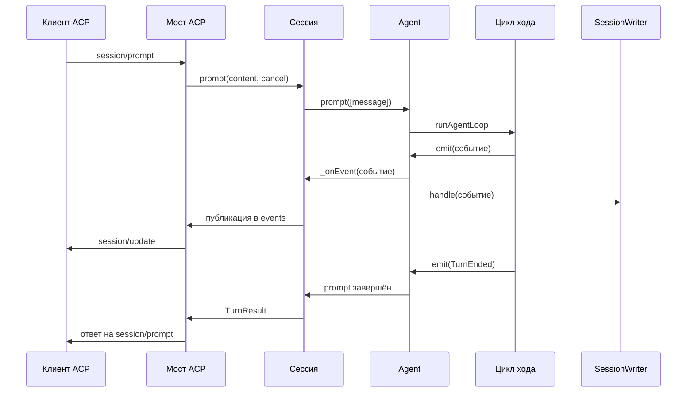
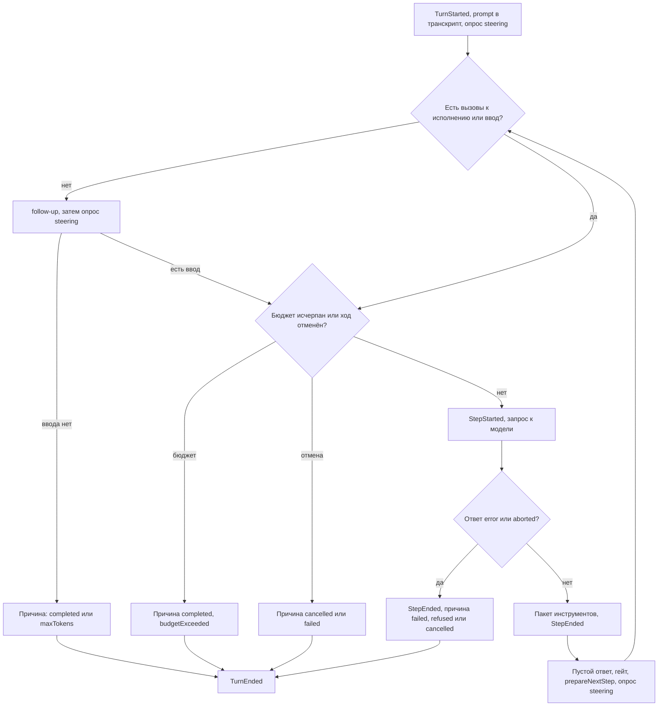

# Алгоритм хода агента

Документ описывает один ход агента целиком: от вызова `AgentSession.prompt` (или ACP-запроса `session/prompt`) до события `TurnEnded`, записи в журнал и ответа клиенту. Читать его можно подряд, без переходов по ссылкам. Справочные главы собраны в конце.

Ход (turn) — всё, что агент делает в ответ на одно сообщение пользователя. Шаг (step) — один запрос к модели вместе с исполнением вызовов инструментов из её ответа. Пакет — все вызовы инструментов из одного ответа модели. Транскрипт — список сообщений `Message`, который видит модель.

Два шага алгоритма описаны отдельно, и здесь они даны одной строкой:

- **Формирование контекста запроса и сжатие** — в [`context.md`](context.md). Здесь это шаг `_request` → `buildPayload` и вызовы `emergencyCompact`.
- **Исполнение инструмента** — в [`tool-call.md`](tool-call.md). Здесь это шаг `_runBatch` → `executor.announce` / `executor.complete`.

## Вход и выход

| | Что |
|---|---|
| Вход | `AgentSession.prompt(List<ContentBlock> content, {CancelToken? cancel})`. Через ACP — запрос `session/prompt` с блоками промпта; мост `codelab_agent_acp` превращает его в тот же вызов |
| Выход | `TurnResult`: `reason` (`TurnEndReason`), `usage`, `budgetExceeded`, `held`, `subagentUsage`. Через ACP — `PromptResponse` с `stopReason` или JSON-RPC ошибка `-32603` |
| События | `TurnStarted` … `TurnEnded` в порядке, который одинаков для всех подписчиков (таблица в разделе «События и их порядок») |
| Журнал | записи `message` (промпт, ответы модели, результаты инструментов), `session_info` (заголовок), а у встроенных команд — только записи, которые пишет сама команда |
| Лог | `command.builtin`, `command.unknown`, `command.builtin.cancelled`, `command.builtin.failed`, `command.expanded`, `loop.empty_response`, `loop.empty_response.stopped`, `tool.abandon.error`, `compaction.failed`, `session.append.failed` |
| Побочные эффекты | сжатие контекста после хода (в фоне), применение отложенной смены MCP-серверов, применение отложенной смены модели |

Ядро не ставит промпты в очередь. Пока ход идёт, второй `prompt` получает `StateError('a turn is already running')` (`LOOP-10`). ACP-сервер проверяет это раньше: `session/prompt` во время хода получает `-32602` с `data.codelab.reason: "turnActive"`. Очередь промптов, которую видит пользователь, живёт в клиенте (`codelab_client_core`), а не в агенте.

## Участники

Схема показывает, кто кого вызывает и кто видит события. Подписчик у `Agent.emit` один — `_Session._onEvent`: он пишет событие в журнал и публикует его в `AgentSession.events` через `_publish`; на `events` подписан мост ACP.



## Псевдокод

Алгоритм состоит из четырёх уровней: ACP-мост, `_Session.prompt`, `runAgentLoop` / `_Turn.run`, `_request` и `_runBatch`. Запись Dart-подобная; комментарии `//` указывают место в коде. Порядок шагов совпадает с кодом, лишние детали (логи, защитные проверки) опущены.

### Уровень 1: ACP-мост

```text
// codelab_agent_acp: agent_server.dart: _sessionPrompt
A1. request = decode(session/prompt); bridge = _bridge(request.sessionId)
A2. content = promptContent(request.prompt)
A3. if bridge.turnActive:                       // ход уже идёт
        log acp.prompt.rejected {reason: turnActive}
        throw AcpRequestError.invalidParams('a turn is already running')   // -32602
A4. response = await bridge.prompt(content)
A5. return encode(response)

// codelab_agent_acp: session_bridge.dart: prompt
B1. turn = Completer<TurnEnded>; сбросить _ended, _failure, _cancelRequested, _turnMoved
B2. if _effortNote != null: отправить agent_message_chunk с заметкой, обнулить её
B3. unawaited(
        session.prompt(content, cancel: (_turnCancel = CancelTokenSource()).token)
            .then(_finishTurn(turn),
                  onError: log acp.turn.failed; turn.completeError(error)))
B4. try:
        ended = await turn.future               // _ended заполнила проекция события TurnEnded
        return turnResponse(ended, failure: _failure, cancelRequested: _cancelRequested)
    finally: _turn = null; дождаться кадров смены конфигурации, придержанных клиентским запросом

// event_projection.dart: turnResponse
C1. if cancelRequested: return stopReason = cancelled          // ACP-5: даже если отмена вызвала ошибки
C2. switch ended.reason:
        completed  -> budgetExceeded == null ? end_turn
                                              : max_turn_requests (+ _meta.codelab.budgetExceeded)
        maxTokens  -> max_tokens
        refused    -> refusal
        cancelled  -> cancelled
        failed     -> throw AcpRequestError(-32603, data.codelab {errorClass, message, retryable})
```

### Уровень 2: `_Session.prompt`

```text
// agent_runtime.dart: _Session.prompt
P1.  if _background != null: await _background          // фоновое сжатие afterTurn прошлого хода
P2.  while _mcpWork != null: await _mcpWork              // смена MCP-серверов кончается до хода (D11)
P3.  if _agent.isRunning || _builtinRunning:             // слот хода занят
         throw StateError('a turn is already running')   // LOOP-10
P4.  if call = _matchBuiltin(content):                   // встроенная или неизвестная слэш-команда
         return _runBuiltin(call, content, cancel)      // без модели; см. «Встроенные команды»
P5.  _policy.clearTurnGrants()                           // разрешения «на ход» не переходят в новый ход
     _subagents?.beginTurn()
     _tools.approvalWait.reset()
P6.  _refreshSettings()                                  // budget.* и compaction.* со следующего хода (CFG-16)
P7.  _ended = null; _agentPending = false
     _flushPendingPolicyMode()
     _applyMcpUpdate()                                   // набор MCP-инструментов меняется только между ходами
P8.  cancel?.onCancel.then(_agent.abort(cancel.reason))  // токен вызывающего отменяет ход
P9.  message = _expandCommand(content)                   // навык /skill:, затем шаблон; иначе UserMessage(content)
P10. try:
         await _agent.prompt([message])                  // уровень 3
     finally:
         _startPendingMcp()                              // отложенная смена MCP-серверов, пришедшая во время хода
P11. ended = _ended!                                     // событие TurnEnded, сохранённое _publish
P12. if ended.reason in {completed, maxTokens}:
         _compactAfterTurn()                             // оценка выше порога -> сжатие в фоне
P13. return TurnResult(reason, usage, budgetExceeded, held, subagentUsage)   // поля TurnEnded

// agent.dart: Agent.prompt
G1. if isRunning: throw StateError('a turn is already running')   // LOOP-10
G2. source = CancelTokenSource(); _turn = source
G3. try:
        out = await runAgentLoop(prompts: messages,
                                 context: LoopContext(systemPrompt, _messages, tools),
                                 config: config.copyWith(steering: _steering, followUp: _followUp),
                                 emit: emit, cancel: source.token)
        if out.history != null: _messages = out.history   // после аварийного сжатия (LOOP-7)
        _messages += out.added
        await _tail                                       // все подписчики обработали все события
    finally: _turn = null; завершить waitForIdle

// agent_runtime.dart: _Session._onEvent — первый и главный подписчик Agent.emit
E1. await _writer.handle(event)                // запись в журнал раньше любой публикации (SES-8)
E2. _publish(event)                            // _turn.add, _live.add; для TurnEnded — _ended = event
E3. if event is TurnEnded: await _afterTurn()  // автоматический заголовок: SessionTitleChanged
```

### Уровень 3: `runAgentLoop` и `_Turn.run`

```text
// agent_loop.dart: runAgentLoop -> _Turn(...).run(prompts)
// конструктор _Turn: _transcript = копия context.messages; _misuse = MisuseBreaker (один на ход, LOOP-16);
//                    _startedAt = clock.now(); _waitAtStart = approvalWait.totalAt(now);
//                    _usedIds = id вызовов из транскрипта (LOOP-11)
L0.  reason = null; exceeded = null; held = null; last = null
     try:
L1.      turnId = ids.nextId(); onOwnUsage?.call(Usage.zero)
L2.      await emit(TurnStarted(turnId, input: prompts))
L3.      for prompt in prompts: await _append(prompt)          // MessageStarted + MessageEnded
L4.      pending = false; newInput = prompts.isNotEmpty
         emptyStreak = 0; revisions = 0; reviseNote = null
L5.      if await _pollSteering(): newInput = true             // ввод, пришедший до начала хода
L6.      while true:
L7.          if !pending && !newInput:                         // естественная остановка
                 if followUp.takeOne() -> m: await _append(m); newInput = true
                 else if await _pollSteering(): newInput = true
                 if !newInput: break                           // ход запечатан
L8.          pending = false; newInput = false
L9.          if limit = _budgetExceeded():                     // LOOP-12, только на границе шага
                 exceeded = limit; reason = completed; break
L10.         if cancel.isCancelled: reason = _cancelledReason; break
L11.         await emit(StepStarted(stepIndex: _step))
L12.         response = await _request(reviseNote)             // уровень 4
             reviseNote = null
L13.         _usage += response.usage; onOwnUsage?.call(_usage); last = response
L14.         if response.stopReason in {error, aborted}:       // сбой модели или отмена запроса
                 if stopReason == error:
                     await emit(AgentError(cls: provider, errorClass, message))
                 await emit(StepEnded(results: [], budget: _progress(_step + 1), context: _contextFill()))
                 _step++                                       // StepEnded уже ушёл: шаг завершён (C-13)
                 reason = _failureReason(response); break
L15.         empty = isEmptyCompletion(response)
             if !empty: emptyStreak = 0
L16.         calls = response.toolCalls
             results = stopReason == length
                 ? [for call in calls: _truncatedArguments(call)]   // обрезанный JSON не исполняется (LOOP-5)
                 : await _runBatch(calls)                           // уровень 4, см. tool-call.md
L17.         for result in results: await _append(result)      // в порядке вызовов ответа (LOOP-3)
L18.         await emit(StepEnded(result: StepResult, context: _contextFill(), budget: _progress(_step + 1)))
             _step++
L19.         pending = calls.isNotEmpty
L20.         if !pending && empty:                             // пустой ответ (LOOP-14, LOOP-15)
                 log loop.empty_response
                 if emptyStreak < config.emptyResponseRetries:
                     emptyStreak++; await _appendNudge(emptyStreak); pending = true
                 else:
                     await _appendEmptyNote(emptyStreak + 1); emptyStreak = 0
L21.         else if !pending:                                 // финальный гейт (LOOP-13)
                 verdict = beforeFinalResponse?.call(response, TurnInfo(...)) ?? Accept()
                 switch verdict:
                     Revise(note) when revisions < maxResponseRevisions:
                         revisions++; reviseNote = UserMessage(note); pending = true
                     Hold(reason): held = reason
                     Accept | Revise: пропустить
L22.         if update = await prepareNextStep?.call(stepResult): _apply(update)   // граница шага
L23.         if cancel.isCancelled: reason = _cancelledReason; break
L24.         if await _pollSteering(): newInput = true
L25.     reason ??= last?.stopReason == length ? maxTokens : completed
     catch (error):                                            // исключение хука, подписчика, отката группы
L26.     reason = failed; exceeded = null; held = null
         try: await emit(AgentError(cls: hook, message: errorText(error)))
         catch: игнорировать                                   // TurnEnded обязан выйти (LOOP-1)
L27. await emit(TurnEnded(reason, usage: _usage + _childUsage, budgetExceeded: exceeded,
                          held, subagentUsage: _childUsage == zero ? null : _childUsage,
                          budget: _progress(_step)))
L28. return TurnOutput(added: _added.sublist(_historyFrom), history: _history)

// agent_loop.dart: _pollSteering
S1. queue = config.steering
    if queue == null || queue.isEmpty || _steeringSteps >= maxSteeringSteps
       || cancel.isCancelled || _budgetExceeded() != null: return false
S2. _steeringSteps++
    for item in queue.takeAll(): await _append(item.message, origin: item.origin)
S3. return true

// agent_loop.dart: _budgetExceeded и _progress
Q1. _progress(steps) = BudgetProgress(limits: config.budget, steps,
                                      tokens: (_usage + _childUsage).input + .output,
                                      cost: model.cost == null ? null : total.cost.total,
                                      active: now - _startedAt - (approvalWait.totalAt(now) - _waitAtStart))
Q2. _budgetExceeded() = _progress(_step).exceeded ?? config.ancestorBudget?.call()
    // exceeded: steps >= maxSteps, затем tokens, cost, duration (первый исчерпанный)
```

### Уровень 4: `_request` и `_runBatch`

```text
// agent_loop.dart: _Turn._request(note)
R1.  retried = false
R2.  while true:
R3.      payload = await buildPayload(_transcript, cancel, transform: transformContext, note)
             // см. context.md: пустые ответы убираются, парность вызовов чинится, заметка Revise - последней
         if !payload.report.isEmpty: await emit(ToolPairingRepaired(report))
R4.      context = LlmContext(systemPrompt, payload.messages, tools: схемы инструментов шага,
                              cacheKey: session id)
R5.      estimated = estimateTokens?.call(context) ?? 0
         window = effectiveContextWindow(model, cap: contextWindowCap)
R6.      if estimateTokens != null && estimated > window:      // окно, а не порог сжатия
             if await _compactEmergency(preflight): continue   // один раз за ход (CMP-8)
             return await _exhausted()                         // синтетический ответ overflow, провайдер не вызван
R7.      await emit(ModelRequested(model, estimatedTokens: estimated, messageCount))
R8.      (response, started) = await _consume(config.stream(model, context, cancel))
R9.      if !started && !retried && response.errorClass == badRequest && isPairingError(message):
             retried = true; continue                          // один повтор с пересобранным payload
R10.     if !started && response.errorClass == overflow
            && await _compactEmergency(overflow): continue     // повтор того же шага
R11.     if started: _replaceLast(response)
         else: _transcript += response; _added += response; await emit(MessageStarted(response))
R12.     await emit(MessageEnded(response))
         return response

// agent_loop.dart: _Turn._consume
K1. for event in stream:
        BlockStartEvent (первый блок): снимок в транскрипт, emit(MessageStarted)
        BlockDeltaEvent текста:        _replaceLast(снимок), emit(MessageDelta)
        BlockDeltaEvent рассуждения:   _replaceLast(снимок), emit(ThoughtDelta)
        DoneEvent / ErrorEvent:        запомнить итоговое сообщение
        прочие: игнорировать
K2. id вызовов проходят _unique: повтор id получает суффикс _2, _3 (LOOP-11)
K3. return (итоговое сообщение ?? await stream.result, started)

// agent_loop.dart: _Turn._compactEmergency(cause)
M1. if emergencyCompact == null || _emergencyUsed: return false
M2. _emergencyUsed = true
    try: context = await emergencyCompact(cause, cancel) catch CancelledException: return false
    if context == null: return false
M3. _context = context; _transcript = context.messages
    _history = context.messages; _historyFrom = _added.length
    return true

// agent_loop.dart: _Turn._runBatch(calls)         // подробно - tool-call.md
T1. if calls.isEmpty: return []
T2. invocation = ToolInvocation(sessionId, cancel, stepTools, emit, hooks, misuse, supportsImages)
T3. groups = calls по порядку ответа: подряд идущие parallel-вызовы - одна группа,
             каждый sequential-вызов - отдельная группа-барьер (LOOP-4)
T4. for group in groups:                                       // группы строго одна за другой
        try: handles = [for call in group: await executor.announce(call, invocation)]   // ToolCallStarted
        catch: await _abandonAll(handles); rethrow             // ход закончится failed (LOOP-1)
        outcomes = cancel.isCancelled
            ? await _abandonCancelled(handles)                 // ToolCallFinished(cancelled) без исполнения
            : await Future.wait(handles.map(executor.complete))   // ToolCallFinished
        results[call.id] = outcome.message
T5. return [for call in calls: results[call.id]]               // порядок ответа, не порядок завершения
```

## Схема цикла

Схема показывает один проход `_Turn.run`: проверки перед шагом, запрос, пакет и решение о продолжении. Ромбы — проверки, прямоугольники — действия.



## Пошаговое пояснение

### Слот хода и встроенные команды (P1–P4)

**P1–P2. Ожидание фоновой работы.** Сжатие после прошлого хода (`_compactAfterTurn`, P12) и смена MCP-серверов идут в фоне. Новый ход ждёт их, иначе набор инструментов или транскрипт поменялись бы посреди хода. Ожидание не считается занятым слотом: ход в это время ещё не начался.

**P3. Слот.** Слот занят, если идёт ход модели (`_agent.isRunning`) или встроенная команда (`_builtinRunning`). Проверка и занятие слота не разделены `await`: в `_runBuiltin` флаг `_builtinRunning` ставится синхронно, в `Agent.prompt` — `_turn`. Поэтому два одновременных `prompt` не пройдут оба (`LOOP-10`).

**P4. Встроенные команды.** `_matchBuiltin` берёт первый текстовый блок и спрашивает `BuiltinCommands.match`. Порядок разбора:

1. текст не начинается с `/` или слово после `/` содержит недопустимые символы (`/usr/bin/foo`) — это не команда, промпт идёт модели;
2. слово совпало с объявленной в сессии встроенной командой (`compact`, `mode`, `model`, `status`, `usage`, `help`; `config` и `mcp` — только если объявлены хостом, `compact` — только при включённом сжатии) — команда;
3. слово совпало с именем шаблона или с существующим навыком `skill:<имя>` — не встроенная, дальше её раскроет P9;
4. иначе — неизвестная команда (`UnknownCall`): ответ «неизвестная команда», модель текст не видит.

`_runBuiltin` публикует `TurnStarted`, одно сообщение агента (`MessageStarted`, `MessageDelta`, `MessageEnded`) и `TurnEnded` мимо цикла и мимо писателя журнала: промпт и ответ команды в журнал не пишутся. Команды, которые меняют состояние (`compact`, `mode`, `model`), пишут свои записи (`compaction`, `mode_change`, `model_change`) сами и всегда доводятся до конца. Остальные при отмене сразу завершаются `cancelled`. Сбой команды — `AgentError(hook)` и `TurnEnded(failed)`. Исключение: `/compact` с исходом `CompactionFailed` даёт `BuiltinTurnFailed`, то есть `TurnEnded(failed)` без `AgentError(hook)`: `AgentError(compaction)` к этому моменту уже отправил компактор. В конце `_drainSubscribers` даёт подписчикам получить события до возврата `prompt`: иначе мост ACP ответил бы на `session/prompt` раньше, чем увидел `TurnEnded` (`ACP-3`).

### Подготовка хода (P5–P9)

**P5.** Разрешения «на ход» сбрасываются: решение пользователя для одного хода не действует в другом ([глава 7](../07-permissions.md)). Счётчик ожидания одобрений обнуляется, чтобы время ожидания не попало в `maxDuration`.

**P6.** `_refreshSettings` копирует в `AgentLoopConfig` бюджет (`budget.*`), окно (`compaction.context_window_cap`) и параметры сжатия из применённого снимка конфигурации. Перезагрузка конфигурации посреди хода поэтому действует «со следующего хода» (`CFG-16`).

**P7.** Набор MCP-инструментов и режим политики, отложенные во время прошлого хода, применяются до первого запроса: внутри хода набор меняется только на границе шага (`prepareNextStep`, L22).

**P8.** Токен вызывающего связывается с агентом: его отмена вызывает `Agent.abort(reason)` и отменяет токен хода.

**P9. Раскрытие команд.** `_expandCommand` разбирает только первый текстовый блок. Порядок такой:

1. `/skill:<имя> <аргументы>` — навык с `user-invocable`: подставляется полный текст навыка или короткая строка повтора, если такой навык уже активен;
2. `/<имя> <аргументы>` — шаблон из `_templates`: `expandCommand` подставляет `$1`, `$2`, `$ARGUMENTS` в тело шаблона; функция чистая и ничего не исполняет;
3. иначе — `UserMessage(content)` как есть.

Развёрнутый текст ставится первым, остальные блоки (например, картинки) идут за ним в исходном порядке. Исходную команду запоминает `SessionWriter.noteCommand`: запись `message` получит поле `command` с источником, именем и сырыми аргументами. Раскрытие идёт до записи в журнал, поэтому ACP, встроенный режим и CLI ведут себя одинаково. В лог идут имя, источник и размер аргументов в байтах, но не сами аргументы: там мог быть секрет (§16).

### `Agent.prompt` и подписчики (G, E)

`Agent` хранит транскрипт между ходами и ведёт единую очередь событий. Цикл получает копию транскрипта (`_Turn._transcript`), `Agent` забирает результат после возврата: `out.history` заменяет транскрипт (после аварийного сжатия), `out.added` дописывается. Транскрипт после хода — это история плюс добавленное, а не старая история плюс все сообщения хода (`LOOP-7`).

`Agent.emit` цепляет доставку к `_tail`: следующее событие не уходит, пока все подписчики не обработали предыдущее. Цикл ждёт каждый `emit` (`LOOP-2`). Первый подписчик — `_Session._onEvent`. Он сначала пишет событие в журнал, потом публикует (E1–E2), поэтому запись всегда опережает любого другого подписчика: мост ACP не покажет клиенту то, чего нет в журнале (`SES-8`).

### Начало хода и условие продолжения (L1–L8)

**L1–L3.** Цикл создаёт `TurnId`, обнуляет собственный usage, публикует `TurnStarted` со входными сообщениями и кладёт каждое в транскрипт (`_append`: `MessageStarted`, `MessageEnded`). Запись журнала для пользовательского сообщения делает обработчик `MessageEnded`.

**L5.** До первого запроса опрашивается steering. Ввод, пришедший до начала хода, считается обычным вводом и даёт шаг.

**L7. Условие продолжения.** Цикл идёт дальше, если есть что делать: предыдущий шаг вызвал инструменты (`pending`) или появился новый ввод (`newInput`). В остальных случаях наступает естественная остановка: цикл берёт одно сообщение из очереди follow-up, затем в последний раз опрашивает steering. Нет ни того, ни другого — ход запечатан (`break`) и причина вычисляется в L25.

**L9–L10. Бюджет и отмена до запроса.** Бюджет проверяется раньше отмены и только на границе шага (`LOOP-12`): лимит не прерывает идущий шаг. Исчерпание лимита — не ошибка, ход заканчивается `completed` с `budgetExceeded`. `_progress` — единственное место, где сравниваются лимиты, и тот же объект идёт в `StepEnded.budget` и `TurnEnded.budget`: клиент видит ровно те цифры, по которым принято решение. В бюджет входят usage потомков (`SUB-11`) и время хода без ожидания одобрений. У потомка `ancestorBudget` проверяет лимиты предков.

### Запрос к модели (L11–L14, R1–R12)

**L12.** `_request` возвращает `AssistantMessage` всегда, в том числе с ошибкой: исключение здесь означало бы сбой хода, а ошибка модели — это данные.

**R3.** Формирование payload — шаг, описанный в [`context.md`](context.md). Для хода важно одно: транскрипт модель получает исправленной копией, а сам транскрипт не меняется (`LOOP-7`). Заметка `Revise` уходит только в запрос.

**R6. Проверка окна.** При включённой capability `compaction` цикл оценивает запрос и сравнивает с окном модели, а не с порогом сжатия. Запрос больше окна провайдеру не отправляется: один вызов `emergencyCompact` с причиной `preflight` и пересборка. Если сжатие не помогло, цикл возвращает синтетический ответ с `errorClass: overflow` и текстом `context window exhausted` (`contextExhaustedText`). Дальше он идёт по обычному пути ошибки (L14).

**R8–R10. Повторы одного шага.** Их три. `preflight` срабатывает до отправки запроса. Повтор при ошибке парности и повтор при `overflow` возможны, только если ответ не начался (`started == false`):

- `400` из-за парности вызовов и результатов (`isPairingError`) — один повтор с пересобранным payload;
- `overflow` — аварийное сжатие с причиной `overflow` и повтор шага;
- `preflight` — выше.

Аварийное сжатие — не больше одного раза за ход (`CMP-8`, флаг `_emergencyUsed`). Ответ с ошибкой, после которого был повтор, в транскрипт не попадает. После сжатия `_history` и `_historyFrom` запоминают, откуда в `_added` идут сообщения новой истории.

**K. Чтение потока.** Первый блок ответа кладёт в транскрипт снимок и публикует `MessageStarted`. Дальше каждая дельта текста или рассуждения заменяет снимок и публикует `MessageDelta` или `ThoughtDelta`. Аргументы вызовов приходят целиком в `DoneEvent`. `MessageEnded` с итоговым сообщением — точка сохранения для журнала. Сетевые повторы и переключение на запасную модель идут внутри `StreamFunction` (декораторы, [глава 5](../05-llm.md)) и для цикла невидимы.

**L14. Ответ с ошибкой или прерыванием.** `StopReason.error` даёт `AgentError(cls: provider)` с `LlmErrorClass`; `stopReason: aborted` обходится без `AgentError`, только `StepEnded`; а ответ с `stopReason: error` и `errorClass: aborted` `AgentError(provider)` получает, хотя ход кончается `cancelled`. В обоих случаях цикл публикует `StepEnded` без результатов, увеличивает `_step` и выходит. Шаг считается завершённым, потому что `StepEnded` уже отправлен: тогда `TurnEnded.budget.steps` совпадает с числом `StepEnded`. Причина (`_failureReason`):

| Ответ | Причина |
|---|---|
| `aborted` или `errorClass: aborted` | `cancelled`; если отмена пришла с `StorageFailure` — `failed` |
| `errorClass: terminalFinish` (`content_filter`, `refusal`) | `refused` |
| любой другой `error` | `failed` |

### Пакет инструментов и конец шага (L15–L19)

**L16.** `stopReason: length` значит, что ответ оборвался по лимиту вывода и JSON аргументов может быть обрезан. Такие вызовы не исполняются: каждый получает результат-ошибку `truncatedArgumentsText` и модель увидит просьбу повторить с меньшими аргументами (`LOOP-5`). Иначе вызовы идут в `_runBatch`. Как исполняется каждый вызов — в [`tool-call.md`](tool-call.md). Здесь важны три свойства: группы идут строго одна за другой, результаты в транскрипт ложатся в порядке вызовов ответа (`LOOP-3`, `LOOP-4`), а отмена до старта группы закрывает её вызовы исходом `cancelled` без исполнения.

**L17. Результаты в транскрипт.** Каждый результат — `MessageStarted` и `MessageEnded`. Обработчик журнала на `MessageEnded` результата пишет запись `message` с `durable`: к ней приклеены `outcome` из `ToolCallFinished` и `toolMeta` (заголовок, вид, пути) из `ToolCallStarted`. Следующий запрос к модели не начнётся, пока запись не сохранена.

**L18.** `StepEnded` несёт `StepResult`, заполнение контекста (`ContextFill`: оценка, окно, порог автосжатия) и прогресс бюджета. Оценка считается по транскрипту без `transformContext` и не меняет ни состояние цикла, ни журнал.

### Решение о продолжении (L20–L24)

**L20. Пустой ответ.** `stop` без текста и без вызовов не принимается за ответ (`LOOP-14`, `LOOP-15`). Пока подряд идущих пустых ответов не больше `emptyResponseRetries` (по умолчанию 2), в транскрипт добавляется сообщение `user` с подсказкой `emptyResponseNudge` (помечено `LoopNudgeOrigin`) и идёт ещё один шаг. После исчерпания повторов цикл добавляет видимую заметку `assistant` (`emptyResponseNote`, помечена `LoopNoteOrigin`) и ход заканчивается. Заметка — не шаг: `StepStarted` нет, бюджет она не тратит. Финальный гейт пустой ответ не оценивает.

**L21. Финальный гейт.** Хук `beforeFinalResponse` вернул бы `Accept`, `Revise(note)` (ещё один шаг с заметкой, не больше `maxResponseRevisions` = 2 раз) или `Hold(reason)` (в `TurnEnded.held` попадёт причина). В рантайме хук не регистрируется, поэтому гейт всегда `Accept` (`LOOP-13`). Ветки `Revise` и `Hold` в рантайме недостижимы.

**L22. `prepareNextStep`.** Хук стоит на границе шага после `StepEnded`. Сессия подключает `_takeStepUpdate`: он возвращает `StepUpdate` с новой моделью (после `session/set_config_option` посреди хода), набором инструментов и системным промптом (после обновления MCP или смены агента) или `null`. `_apply` ставит их, и следующий запрос идёт с новыми значениями. Идущий запрос не прерывается. `StepEnded` публикуется до хука, поэтому смена модели видна в `ContextFill` только со следующего шага.

**L23–L24.** Отмену проверяют ещё раз на границе шага, затем опрашивают steering. Если опрос принёс ввод, цикл возвращается в L7 с `newInput = true` и делает ещё один шаг.

### Что рантайм подключает из очередей ввода

| Возможность цикла | Подключена в рантайме |
|---|---|
| `prepareNextStep` | да, `_takeStepUpdate` |
| `estimateTokens`, `emergencyCompact` | да, при включённой capability `compaction` |
| `contextEstimator` | да, всегда |
| `steering`, `followUp` | очереди `Agent` передаются в цикл, но `Agent.steer` и `Agent.followUp` из рантайма и ACP не вызываются: очереди всегда пусты |
| `beforeFinalResponse`, `transformContext` | нет, поля `null` |
| `maxSteeringSteps`, `maxResponseRevisions`, `emptyResponseRetries`, `misuse` | не передаются, действуют умолчания `AgentLoopConfig` |

Ветки steering и follow-up в алгоритме реализованы в цикле и проверены тестами цикла, но в настоящем ходе агента не срабатывают. Клиентского ACP-канала для них нет.

### Завершение хода (L25–L28)

**L25. Причина по умолчанию.** Если ни одна ветка не поставила причину, ход закончился естественно. Если последний ответ был оборван по лимиту вывода (`stopReason: length`), причина `maxTokens`. Иначе — `completed`.

**L26. Исключение.** Любое исключение внутри `run` — в хуке, у подписчика (в том числе сбой записи журнала), в откате группы — превращается в `AgentError(cls: hook)` и причину `failed`. Если этот `emit` тоже бросает, исключение игнорируется. `exceeded` и `held` сбрасываются: ход не завершён по бюджету или гейту.

**Сбой журнала.** Исключение писателя цикл принял бы за ошибку хука, поэтому писатель сообщает о сбое иначе: `_guard` ставит `_failed = true`, пишет в лог `session.append.failed` и вызывает `_onStorageFailure`. Тот отменяет токен хода причиной `StorageFailure` и ставит в очередь `AgentError(cls: storage)`. Цикл останавливается на ближайшей границе, а `_cancelledReason` выбирает `failed`, а не `cancelled`: ход нельзя сохранить, значит, продолжать его нельзя (`SES-8`). До конца хода писатель ничего не пишет; следующий `TurnStarted` снимает флаг.

**L27.** `TurnEnded` — последнее событие хода и единственное с причиной (`LOOP-1`). `usage` — сумма собственных шагов и потомков; `subagentUsage` — только часть потомков (она уже входит в сумму) или `null`. Бюджет — `_progress(_step)`, то есть число реально завершённых шагов.

**E1 на `TurnEnded`.** `SessionWriter.handle` вызывает `flush` хранилища: журнал сброшен на носитель до того, как мост ответит клиенту. Затем `_afterTurn` пишет заголовок (`SessionTitleChanged`, запись `session_info`) один раз за сессию — после первого хода со словами пользователя.

**P11–P13. Итог.** `_publish` сохранил `TurnEnded` в `_ended`. Если ход закончился `completed` (в том числе по бюджету) или `maxTokens`, `_compactAfterTurn` оценивает транскрипт и при превышении порога запускает сжатие в фоне; следующий `prompt` дождётся его в P1. Ходы `failed`, `refused` и `cancelled` сжатие не запускают. `TurnResult` собирается из полей `TurnEnded`. Мост ACP строит ответ по таблице `turnResponse` (C1–C2): отмена клиента (`session/cancel`) всегда отвечает `cancelled`, даже если отмена вызвала ошибки провайдера или инструментов (`ACP-5`); `failed` — всегда JSON-RPC `-32603`, а не `end_turn` (`ACP-7`).

## События и их порядок

Порядок одного шага с вызовом инструмента такой. Каждое событие ждёт обработки предыдущего всеми подписчиками.

| № | Событие | Кто эмитит | Журнал |
|---|---|---|---|
| 1 | `TurnStarted` | цикл (L2) | снимает флаг сбоя писателя |
| 2 | `MessageStarted`, `MessageEnded` для промпта | цикл (L3) | запись `message` на `MessageEnded` |
| 3 | `StepStarted` | цикл (L11) | нет |
| 4 | `ToolPairingRepaired` (только если ремонт что-то изменил) | цикл (R3) | нет |
| 5 | `ModelRequested` | цикл (R7) | нет |
| 6 | `MessageStarted`, `MessageDelta` / `ThoughtDelta`, `MessageEnded` для ответа | цикл (K, R12) | запись `message` на `MessageEnded` |
| 7 | `ToolCallStarted` | исполнитель (T4) | запоминает заголовок, вид, пути |
| 8 | `ToolCallProgress` (при выводе) | исполнитель | нет |
| 9 | `ToolCallFinished` | исполнитель | запоминает исход |
| 10 | `MessageStarted`, `MessageEnded` для результата | цикл (L17) | запись `message` с `durable`, `outcome`, `toolMeta` |
| 11 | `StepEnded` | цикл (L18) | нет |
| 12 | `TurnEnded` | цикл (L27) | `flush` хранилища |
| 13 | `SessionTitleChanged` (один раз) | сессия (E3) | запись `session_info` |

`AgentError` встаёт в поток там, где возникла ошибка: провайдерская — перед `StepEnded` шага, хук — перед `TurnEnded`. События `ContextCompacted` и `CompactionDiscarded` приходят от компактора, `TaskListChanged` — между `ToolCallStarted` и `ToolCallFinished` своего вызова.

## Разобранный пример

Данные получены прогоном временного теста на сценарной модели: `CoreHarness` (`test/host/core_harness.dart`), `ScriptedStreamFunction` с двумя шагами, `MemoryExecutionEnv(cwd: '/proj')` с файлом `/proj/notes.txt` (`alpha`, `beta`), `MemorySessionStore`, `FakeClock`. Команда:

```bash
cd packages/dart/codelab_agent_core && fvm dart test test/tmp_algo_turn_test.dart
```

Сценарий: первый шаг — вызов `read {path: notes.txt}` с usage `input 120, output 15`; второй — текстовый ответ `The file has two lines.` с usage `input 180, output 8`. Промпт — `read notes.txt`. Профиль `agent-serve`, окно модели 32768. Тест удалён после прогона.

### События хода

```text
TurnStarted turnId=id-1 input=[user[text:"read notes.txt"]]
MessageStarted user[text:"read notes.txt"] origin=null
MessageEnded user[text:"read notes.txt"]
StepStarted stepIndex=0
ModelRequested estimatedTokens=2450 messageCount=1
MessageStarted assistant[toolCall:c1/read] stop=stop origin=null
MessageEnded assistant[toolCall:c1/read] stop=toolUse
ToolCallStarted id=c1 tool=read title="Read notes.txt" kind=read input={path: notes.txt}
ToolCallFinished id=c1 outcome=completed interrupted=false
MessageStarted toolResult[text:"1| alpha\n2| beta"] origin=null
MessageEnded toolResult[text:"1| alpha\n2| beta"]
StepEnded stepIndex=0 results=1 usage=in120/out15 context=used=144 window=32768 compactAt=24576 budget=steps1/tokens135
StepStarted stepIndex=1
ModelRequested estimatedTokens=144 messageCount=3
MessageStarted assistant[text:""] stop=stop origin=null
MessageDelta delta="The file has two"
MessageDelta delta=" lines."
MessageEnded assistant[text:"The file has two lines."] stop=stop
StepEnded stepIndex=1 results=0 usage=in180/out8 context=used=188 window=32768 compactAt=24576 budget=steps2/tokens323
TurnEnded reason=completed usage=in300/out23 budgetExceeded=null budget=steps2/tokens323
SessionTitleChanged
```

Результат вызова `prompt`: `TurnResult(reason: completed, usage: input 300 / output 23 / cacheRead 0, budgetExceeded: null, held: null, subagentUsage: null)`.

Как читать эти данные:

- **L2–L3.** Промпт — четыре первых события; `turnId` выдал `SequentialIdGenerator` (`id-1`).
- **R7.** Первая оценка `2450` включает системный промпт и схемы десяти инструментов; `messageCount=1` — только промпт. Во втором запросе оценка `144` равна `120 + 15` (usage первого ответа, заданный сценарием) плюс хвост из результата инструмента: якорь на usage (`context.md`). Настоящий провайдер вернул бы usage побольше.
- **K, R11.** Первый ответ — один блок вызова без текста, поэтому `MessageStarted` несёт снимок с `stopReason: stop`, а итоговое сообщение в `MessageEnded` — `toolUse`. Во втором ответе текст приходит двумя дельтами по 16 символов — размер дельты задаёт сценарная модель.
- **L16–L17.** Между `ToolCallFinished` и `StepEnded` стоит пара `MessageStarted` / `MessageEnded` результата. Результат один, потому что вызов один.
- **L18.** `ContextFill`: `used=144`, `window=32768`, `compactAt=24576` (`32768 − 8192`: запас `reserveTokens = min(16384, max(1024, 32768/4)) = 8192`).
- **L27.** `usage` хода — `120+180` входных и `15+8` выходных. `budget=steps2/tokens323` — два шага и `300 + 23` токена.
- **P12.** Оценка после хода `188` меньше порога `24576`, сжатие в фоне не запускается.
- **E3.** `SessionTitleChanged` приходит после `TurnEnded`, но до возврата `prompt`.

### Журнал хода

Записи в том порядке, в каком их оставил ход (поля `timestamp` у `FakeClock` одинаковы, длинные строки сокращены):

```text
{"type":"session","version":1,"id":"<session-id>","cwd":"/proj", … ,"metadata":{"profile":"agent-serve"}}
{"type":"model_change","id":"00000002","parentId":null, … ,"provider":"test","modelId":"model-1", …}
{"type":"message","id":"00000003","parentId":"00000002", … ,"message":{"role":"user","content":[{"type":"text","text":"read notes.txt"}], …}}
{"type":"message","id":"00000004","parentId":"00000003", … ,"message":{"role":"assistant","content":[{"type":"toolCall","id":"c1","name":"read","arguments":{"path":"notes.txt"}}], … ,"usage":{"input":120,"output":15, …
{"type":"message","id":"00000005","parentId":"00000004", … ,"outcome":"completed","toolMeta":{"title":"Read notes.txt","kind":"read","locations":[{"path":"/proj/notes.txt"}]},"message":{"role":"toolResult","toolCallId":"c1","toolName":"read","content":[{"type":"text","text":"1| alpha\n2| beta"}…
{"type":"message","id":"00000006","parentId":"00000005", … ,"message":{"role":"assistant","content":[{"type":"text","text":"The file has two lines."}], … ,"usage":{"input":180,"output":8, …
{"type":"session_info","id":"00000007","parentId":"00000006", … ,"title":"read notes.txt","source":"auto"}
```

Записи образуют цепочку `parentId`; каждая `message` легла на лист после предыдущей. Промежуточные снимки ответа (`MessageStarted`, `MessageDelta`) в журнал не пишутся: в нём только итоговое сообщение с `MessageEnded`. У записи результата есть `outcome` и `toolMeta`, у остальных их нет.

### Пример отмены посреди хода

Тот же сценарий, но второй шаг — `waitForCancel` с текстом `Partial answer`: модель начала ответ и ждёт отмены. Тест дождался второго запроса к модели и вызвал `session.cancel()` (то же делает `session/cancel` через мост ACP). Источник и команда те же.

```text
TurnStarted turnId=id-1 input=[user[text:"read notes.txt"]]
MessageStarted user[text:"read notes.txt"] origin=null
MessageEnded user[text:"read notes.txt"]
StepStarted stepIndex=0
ModelRequested estimatedTokens=2450 messageCount=1
MessageStarted assistant[toolCall:c1/read] stop=stop origin=null
MessageEnded assistant[toolCall:c1/read] stop=toolUse
ToolCallStarted id=c1 tool=read title="Read notes.txt" kind=read input={path: notes.txt}
ToolCallFinished id=c1 outcome=completed interrupted=false
MessageStarted toolResult[text:"1| alpha\n2| beta"] origin=null
MessageEnded toolResult[text:"1| alpha\n2| beta"]
StepEnded stepIndex=0 results=1 usage=in120/out15 context=used=144 window=32768 compactAt=24576 budget=steps1/tokens135
StepStarted stepIndex=1
ModelRequested estimatedTokens=144 messageCount=3
MessageStarted assistant[text:""] stop=stop origin=null
MessageDelta delta="Partial answer"
MessageEnded assistant[text:"Partial answer"] stop=aborted
StepEnded stepIndex=1 results=0 usage=in0/out0 context=used=152 window=32768 compactAt=24576 budget=steps2/tokens135
TurnEnded reason=cancelled usage=in120/out15 budgetExceeded=null budget=steps2/tokens135
SessionTitleChanged
```

`TurnResult(reason: cancelled, usage: input 120 / output 15)`. Путь отмены:

1. `session.cancel()` вызывает `_agent.abort(UserCancel())`, токен хода отменяется (`Agent.abort`).
2. Сценарная модель ждала `cancel.onCancel`; получив отмену, она закрывает поток ответом `aborted`. Настоящая функция модели закрывает HTTP-запрос.
3. `_consume` возвращает сообщение с `stopReason: aborted`. Частичный текст `Partial answer` остаётся в транскрипте и журнале.
4. L14: для `aborted` `AgentError` не публикуется. `StepEnded` идёт без результатов, `_step` растёт до 2, причина — `_failureReason` → `_cancelledReason` → `cancelled` (отмена не от `StorageFailure`).
5. L27: `TurnEnded(cancelled)`; бюджет показывает `steps2` — тот же шаг, который закончился отменой, посчитан. Usage второго шага нулевой: ответ оборван до usage, поэтому в итоге только `120/15` первого шага.
6. Мост ACP: `cancelRequested` истинно, ответ — `stopReason: cancelled`. Ход не запускает сжатие (P12): причина не `completed` и не `maxTokens`.

Если бы отмена пришла до запроса (L9–L10 или L23), цикл вышел бы без `StepStarted` нового шага, а `TurnEnded.reason` был бы тем же `cancelled`.

## Граничные случаи и отказы

| Ситуация | Что делает алгоритм | Где в коде |
|---|---|---|
| Второй `prompt` во время хода | `StateError('a turn is already running')`; через ACP — `-32602` с `turnActive`, лог `acp.prompt.rejected` | `_Session.prompt` (P3), `Agent.prompt`, `_sessionPrompt` |
| Встроенная команда | исполняется под тем же слотом, без модели и без записи промпта; ход — `TurnStarted`, сообщение, `TurnEnded` | `_matchBuiltin`, `_runBuiltin` |
| Неизвестная слэш-команда | ответ «неизвестная команда», модель текст не видит; в лог — только число байт слова | `BuiltinCommands.match`, `_runBuiltin` |
| `session/cancel` во время встроенной команды | команда без состояния — сразу `TurnEnded(cancelled)` без текста; `compact`, `mode`, `model` ждут свою работу и отвечают по факту | `_runBuiltin`, `_cancelBuiltin` |
| Шаблон команды | раскрывается до записи в журнал; запись получает `command` | `_expandCommand`, `SessionWriter.noteCommand` |
| Бюджет исчерпан | перед следующим запросом; `completed` + `budgetExceeded`; ACP — `max_turn_requests` | `_budgetExceeded` (L9), `turnResponse` |
| Отмена до запроса | `TurnEnded(cancelled)` без нового `StepStarted` | L10, L23 |
| Отмена во время запроса | ответ `aborted`, `StepEnded` без результатов, `cancelled` | L14, `_failureReason` |
| Отмена во время пакета инструментов | вызовы, не начавшие исполняться, закрываются `cancelled` без исполнения; уже идущие получают отмену от токена | `_runBatch`, `_abandonCancelled` |
| Сбой отката группы при отмене или сбой `announce` | `tool.abandon.error` в лог, первая ошибка выходит из хода, `TurnEnded(failed)` | `_abandonAll`, L26 |
| Ошибка провайдера после повторов | `AgentError(provider)`, `StepEnded`, `failed` | L14 |
| Отказ провайдера (`content_filter`, `refusal`) | `refused`; ACP — `refusal` | `_failureReason` |
| Ответ оборван по `length`, вызовов нет | ход заканчивается `maxTokens`; ACP — `max_tokens` | L25 |
| Ответ оборван по `length`, вызовы есть | вызовы не исполняются, каждый получает ошибку `truncatedArgumentsText`, идёт следующий шаг | L16, `_truncatedArguments` |
| Запрос больше окна | аварийное сжатие `preflight` один раз; не помогло — синтетический `overflow` | R6, `_exhausted` |
| `overflow` от провайдера до первого блока | аварийное сжатие `overflow` и повтор шага; второго раза за ход нет | R10, `_compactEmergency` |
| `400` про парность вызовов | один повтор с пересобранным payload | R9, `isPairingError` |
| Повтор id вызова | суффикс `_2`, `_3` до первого события наружу | `_unique`, `_freeId` |
| Пустой ответ модели | подсказка и ещё шаг; после `emptyResponseRetries` повторов — видимая заметка и конец хода | L20, `_appendNudge`, `_appendEmptyNote` |
| Исключение в хуке или подписчике | `AgentError(hook)`, `failed`; `TurnEnded` выходит всегда | L26 |
| Сбой записи журнала | отмена токена `StorageFailure`, `AgentError(storage)`, ход `failed`, запись прекращается до следующего хода | `_guard`, `_onStorageFailure`, `_cancelledReason` |
| Смена модели во время хода | запоминается как `_pendingModel`, применяется после `StepEnded` | `_apply`, `_takeStepUpdate` (L22) |
| Смена MCP-серверов во время хода | откладывается до `TurnEnded`, затем `_startPendingMcp` | `setMcpServers`, P10 |
| Сжатие после хода идёт, пришёл новый `prompt` | `prompt` ждёт конца сжатия | P1 |
| Ход закончился `failed`, `refused` или `cancelled` | сжатие после хода не запускается | P12 |
| Сбой фонового сжатия после хода | лог `compaction.failed`, `AgentError(compaction)`; ход уже завершён | `_runBackground` |

## Настраиваемые параметры

| Ключ или константа | Умолчание | Действие |
|---|---|---|
| `budget.max_steps` | 50 (минимум 1) | число шагов за ход; в ACP `max_turn_requests` (применяется) |
| `budget.max_tokens` | нет | сумма `input + output` без кэша, с учётом потомков (применяется) |
| `budget.max_cost` | нет | стоимость хода; не проверяется, пока у модели нет цен (применяется) |
| `budget.max_duration` | нет | время хода без ожидания одобрений (применяется) |
| `compaction.enabled` | `true` | `false` выключает capability `compaction`: нет проверки окна, аварийного сжатия и сжатия после хода |
| `compaction.context_window_cap` | нет | верхняя граница окна для проверки запроса, `ContextFill.window` и порога |
| `compaction.reserve_tokens`, `compaction.keep_recent_tokens`, `compaction.keep_recent_user_turns` | считаются от окна; для окна 32768 запас 8192 | порог сжатия после хода равен окну минус запас; подробности — `context.md` |
| `loop.empty_response_retries` | 2 в коде | объявлен в схеме, `applied: false`: рантайм его не передаёт, действует умолчание |
| `loop.misuse.enabled`, `loop.misuse.warn_after`, `loop.misuse.block_after` | `true`, 3, 6 | объявлены, `applied: false`: действуют умолчания `MisuseLimits` |
| `loop.final_response` | нет | объявлен как непрозрачный, `applied: false`; финального гейта в рантайме нет |
| `AgentLoopConfig.maxSteeringSteps` | 20 | число шагов, которые может добавить steering; из конфигурации не задаётся |
| `AgentLoopConfig.maxResponseRevisions` | 2 | число `Revise` за ход; из конфигурации не задаётся |
| `emptyResponseNudge`, `emptyResponseNote`, `truncatedArgumentsText`, `contextExhaustedText` | константы в `agent_loop.dart` | тексты подсказки, заметки, ошибки обрезанных аргументов и синтетического `overflow` |

Бюджет и параметры сжатия читаются на границе хода (P6): перезагрузка конфигурации посреди хода действует со следующего хода.

## Справочные главы

- [04. Цикл хода](../04-turn-loop.md) — `Agent`, события, бюджет, пустой ответ, хуки: справочник по тем же типам.
- [03. Путь запроса](../03-request-flow.md) — ACP-запрос до `AgentRuntime` и обратно, встроенный режим.
- [05. Вызов модели](../05-llm.md) — `StreamFunction`, события потока, повторы и запасные модели.
- [06. Инструменты](../06-tools.md) — `ToolCallExecutor`, блокировки путей, `abandon`.
- [07. Разрешения](../07-permissions.md) — политика и шлюз в `beforeToolCall`.
- [08. Сессии и сжатие](../08-sessions-and-compaction.md) — журнал, записи, сжатие.
- [09. Конфигурация, промпты, команды](../09-config-prompts-commands.md) — встроенные слэш-команды и шаблоны.
- [`context.md`](context.md), [`tool-call.md`](tool-call.md) — соседние алгоритмы.
- [`usage.md`](usage.md) — как usage шагов и потомков складывается в `TurnEnded.usage` и уходит клиенту.
- Нормы: [`agent-loop`](../../../../../openspec/specs/agent-loop/spec.md), [`agent-cancellation`](../../../../../openspec/specs/agent-cancellation/spec.md), [`agent-sessions`](../../../../../openspec/specs/agent-sessions/spec.md), [`agent-slash-commands`](../../../../../openspec/specs/agent-slash-commands/spec.md).
- Исходный код: [`agent_loop.dart`](../../lib/src/loop/agent_loop.dart), [`agent.dart`](../../lib/src/loop/agent.dart), [`agent_runtime.dart`](../../lib/src/runtime/agent_runtime.dart), [`session_writer.dart`](../../lib/src/session/session_writer.dart); сторона ACP — [`codelab_agent_acp`](../../../codelab_agent_acp/README.md).
