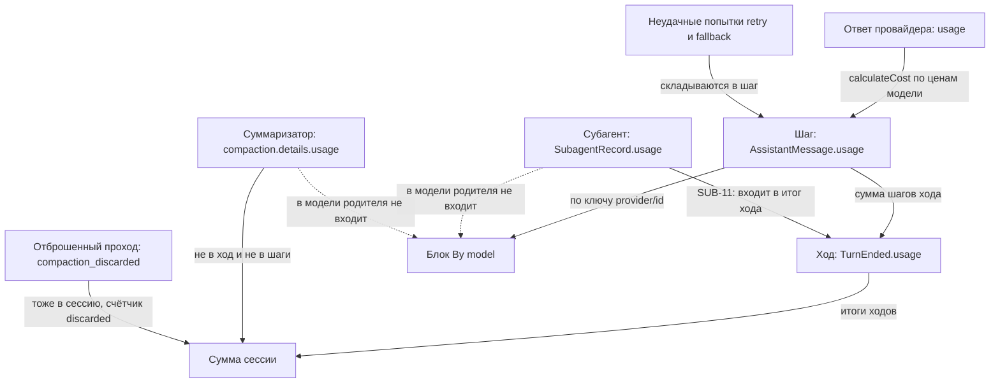
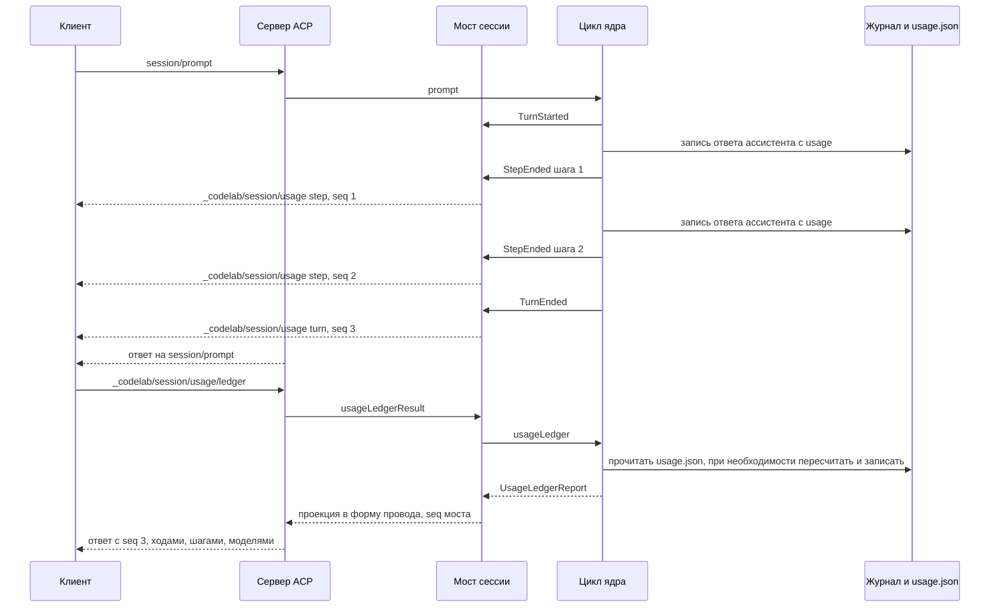
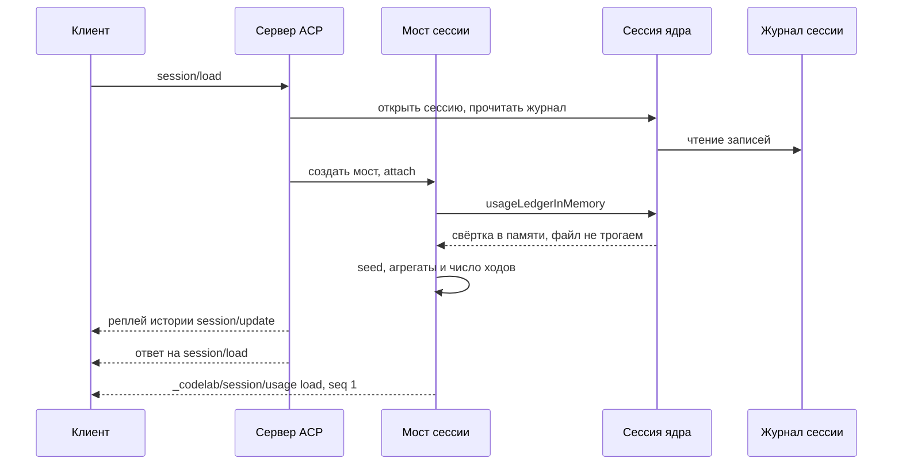

# Алгоритм учёта usage на стороне агента: от ответа провайдера до `_codelab/session/usage`

Usage — это токены и деньги, которые сессия потратила на запросы к модели. Документ описывает путь чисел по шагам: как токены попадают из ответа провайдера в `Usage`, как по ним считается стоимость, как шаги складываются в ход, сессию, субагентов и суммаризатор сжатия, где числа лежат на диске и как уходят клиенту. Здесь сторона агента. Сторона клиента — [учёт usage в `codelab_client_core`](../../../codelab_client_core/doc/usage-accounting.md).

Документ читается целиком. Справочники по частям вынесены отдельно, и здесь они не пересказываются:

- типы `Usage` и `ModelCost`, адаптеры провайдеров, повтор запроса — [глава 5](../05-llm.md);
- журнал сессии, сжатие и его usage — [глава 8](../08-sessions-and-compaction.md);
- логи `usage.*` и `acp.usage.*` — [глава 10](../10-observability-and-errors.md);
- мост ACP и запрос журнала — [глава 2 `codelab_agent_acp`](../../../codelab_agent_acp/doc/02-session-bridge.md), [глава 3 `codelab_agent_acp`](../../../codelab_agent_acp/doc/03-projection-and-client-requests.md);
- ход, контекст, субагенты, сессии — [turn.md](turn.md), [context.md](context.md), [subagents.md](subagents.md), [sessions.md](sessions.md);
- нормы — [`agent-llm`](../../../../../openspec/specs/agent-llm/spec.md) («Usage и стоимость»), [`agent-sessions`](../../../../../openspec/specs/agent-sessions/spec.md) («Журнал usage сессии», «Файл usage.json и порт UsageLedgerStore»), [`agent-compaction`](../../../../../openspec/specs/agent-compaction/spec.md) («Usage суммаризатора», «Учёт вызова суммаризатора отброшенного прохода»), [`agent-acp-server`](../../../../../openspec/specs/agent-acp-server/spec.md) («Уведомление `_codelab/session/usage`», «Запрос `_codelab/session/usage/ledger`»), [`agent-slash-commands`](../../../../../openspec/specs/agent-slash-commands/spec.md) («Команда /usage»), [`agent-configuration`](../../../../../openspec/specs/agent-configuration/spec.md) («Цены моделей конфигурации»);
- решения — changes [`add-usage-extension`](../../../../../openspec/changes/archive/2026-11-18-add-usage-extension/design.md), [`add-usage-ledger`](../../../../../openspec/changes/archive/2026-11-18-add-usage-ledger/design.md), [`fix-discarded-compaction-usage`](../../../../../openspec/changes/archive/2026-11-18-fix-discarded-compaction-usage/design.md); обозначения `D1`, `D4`, `Q6` в комментариях кода — их решения.

Пути в псевдокоде даны от `packages/dart/`: `core` — `codelab_agent_core/lib/src/`, `io` — `codelab_agent_io/lib/src/`, `acp` — `codelab_agent_acp/lib/src/`. Чего нет, собрано в разделе «Чего нет».

## Вход, выход, гарантии

**Вход.**

- Поток ответа провайдера: поля `usage` в событиях Anthropic (`message_start`, `message_delta`) и в чанках OpenAI-совместимого API.
- Цены модели: `providers.<id>.models.<модель>.cost_*` в конфигурации, встроенная таблица `builtinModels`, блок `llm.model.cost` сценария `--llm-script`.
- События ядра: `StepEnded`, `TurnEnded`, `SubagentFinished`, `ContextCompacted`, `CompactionDiscarded`.
- Записи журнала сессии: ответы ассистента с `usage`, `subagent`, `compaction` с `details.usage`, `custom` типа `codelab.compaction_discarded`.
- ACP: `initialize` с `clientCapabilities._meta.codelab.usage`, запрос `_codelab/session/usage/ledger`, `session/load`; слэш-команда `/usage [rebuild]`. Расширения `_codelab/*` — не ACP: в схеме ACP нет полей и методов про токены и стоимость (в [`17-Schema.md`](../../../../../docs/protocols/acp/protocol/17-Schema.md) о токенах говорит только причина остановки `max_tokens`), а правила собственных методов задаёт [`15-Extensibility.md`](../../../../../docs/protocols/acp/protocol/15-Extensibility.md).

**Выход.**

- Поле `usage` у каждого ответа ассистента в журнале: четыре счётчика, `reasoning` (если есть) и стоимость в долларах по категориям.
- `TurnEnded.usage` и `TurnEnded.subagentUsage`: итог хода.
- Файл `usage.json` рядом с журналом: производная свёртка (кэш).
- Уведомления `_codelab/session/usage` с триггерами `step`, `turn`, `compaction`, `compactionDiscarded`, `load`.
- Ответ на `_codelab/session/usage/ledger`: история по ходам, шагам, моделям, субагентам и суммаризатору.
- Текст `/usage`.
- Записи лога `usage.ledger.rebuild`, `usage.ledger.write_failed`, `acp.usage.sent`, `acp.usage.ledger`, `acp.usage.seeded`.

**Что точно, а что оценка.**

| Величина | Точность |
|---|---|
| токены шага | точно то, что прислал провайдер; агент их не считает и токенайзера не имеет. Провайдер не прислал — нули и причина `noUsage` |
| токены частичного ответа (обрыв, отмена) | то, что провайдер успел прислать до обрыва; часто ноль |
| стоимость | оценка: токены × ставка из каталога моделей, по четырём категориям, линейно. Это не счёт провайдера: скидок, ступеней и округления на стороне провайдера агент не знает |
| стоимость без цены модели | неизвестна: в журнале нулевая, на проводе поля `cost` нет, причина `noPrice` |
| сумма хода, сессии | точная сумма записанных чисел; на проводе деньги — целые микродоллары, без накопления ошибки `double` |
| `context.used` в снимках | не usage, а оценка заполнения окна: якорь на usage последнего ответа плюс оценка хвоста ([context.md](context.md)) |
| `budget.tokens` | сумма `input + output` без кэш-токенов: так считает бюджет хода (LOOP-12), а не поле `Usage.total` |

**Что переживает перезапуск процесса.**

| Что | Почему переживает |
|---|---|
| usage каждого шага | поле `usage` ответа ассистента в журнале; запись уходит в файл на `MessageEnded`, до `StepEnded` |
| usage субагентов | запись `subagent` со статусом `completed`, `failed` или `cancelled` и полем `usage` |
| usage суммаризатора | `details.usage` записи `compaction` или запись `custom` `codelab.compaction_discarded` |
| итог сессии, ходы, модели | пересчитываются из журнала чистой функцией, поэтому `session/load` восстанавливает те же числа |
| `usage.json` | кэш: можно удалить, ядро пересчитает |

**Что теряется.**

| Когда | Что теряется |
|---|---|
| процесс упал, пока субагент работал | запись `subagent` осталась `running` без `usage`: в журнал родителя его токены не вошли (журнал ребёнка лежит отдельно и свёрткой не читается) |
| суммаризатор сжатия упал, дал пустое резюме или ход отменён после его ответа | записи `compaction` и записи учёта нет: токены оплачены, но нигде не записаны (R3 change `add-usage-ledger`) |
| сбой записи в журнал | писатель молчит до следующего `TurnStarted`: шаги после сбоя в журнал не попали, живые снимки их ещё учитывают, а после перезапуска суммы будут меньше |
| соединение владельца закрыто | кадры `_codelab/session/usage` некому доставить: номера `seq` пропускаются, агрегаты продолжают считаться, новый владелец получает снимок `load` |
| ответ, который цикл отбрасывает и повторяет шаг (`overflow` до первого блока с успешным аварийным сжатием; `badRequest` с ошибкой спаривания, один повтор) | ответ в транскрипт не входит, его usage не учитывается нигде. Это расходится с требованием «Usage шага SHALL быть суммой всех попыток» ([`agent-llm`](../../../../../openspec/specs/agent-llm/spec.md)): `continue` выполняется раньше `_usage += …`. Денежный случай — тихое переполнение `length` с `output == 0`: `input` уже оплачен, а ответ отброшен; у отказа провайдера usage обычно нулевой. Дефект записан в backlog как REV-43 ([backlog](../../../../../docs/backlog/review-2026-11-25-developer-guides.md)) |
| сбой записи `usage.json` | не теряется ничего: отчёт строится без файла, статус `notSaved` |

## Модель

Типы и их место:

| Тип | Что хранит | Где |
|---|---|---|
| `Usage` | `input` (без кэш-токенов), `output` (с рассуждением), `cacheRead`, `cacheWrite`, необязательный `reasoning`, `UsageCost` | `core/llm/usage.dart` |
| `UsageCost` | доллары `double` по тем же четырём категориям | `core/llm/usage.dart` |
| `ModelCost` | ставки в долларах за 10⁶ токенов; `null` у `ModelRef.cost` — цен нет | `core/llm/model_ref.dart` |
| `UsageLedger` | свёртка журнала: шаги, ходы, модели, субагенты, суммаризатор; сериализуется в `usage.json` версии 1 | `core/usage/usage_ledger.dart` |
| `UsageLedgerReport` | свёртка плюс состояние файла (`upToDate`, `rebuilt`, `inMemory`, `notSaved`) и модели без цены | `core/usage/usage_ledger_report.dart` |
| `UsageLedgerKeeper` | свежесть файла, пересчёт, запись, «одна операция на сессию» | `core/usage/usage_ledger_keeper.dart` |
| `UsageLedgerStore`, `JsonlUsageLedgerStore` | порт файла и его реализация на `dart:io` | `core/usage/usage_ledger_store.dart`, `io/session/jsonl_usage_ledger_store.dart` |
| `UsageAccounting`, `UsageLedgerProjection` | агрегаты сессии сервера, `seq` и перевод в форму провода | `acp/usage_accounting.dart` |

Агрегация идёт по двум путям. Первый — живой: события цикла складываются в агрегаты моста и сразу уходят снимками. Второй — свёртка журнала: та же сумма строится заново из записей. Они совпадают по построению: снимок `load` берёт `session` из той же проекции, что строит `total` ответа журнала.

Схема показывает, что во что входит. Стрелка — «входит в сумму».



Сплошная стрелка — «входит в сумму», пунктир — «не входит». Usage субагентов и суммаризатора есть в сумме сессии, но в строках моделей родителя его нет: модели детей и суммаризатора родителю не видны (R3 change `add-usage-extension`).

## Псевдокод

Шаги идут в порядке кода. Служебные вызовы и логирование опущены, где не меняют результат.

### А. Шаг: от потока провайдера до журнала

```text
A1. событие потока с usage приходит из адаптера провайдера
      Anthropic: message_start.usage  -> Usage(input = input_tokens, output = output_tokens,
                                              cacheRead = cache_read_input_tokens,
                                              cacheWrite = cache_creation_input_tokens)
                 message_delta.usage.output_tokens -> output заменяется, остальные счётчики
                                              остаются от message_start     // core/llm/providers/anthropic.dart: _handle
      OpenAI-совместимый: чанк с usage -> Usage(
                              input = max(0, prompt_tokens - cacheRead - cacheWrite),
                              output = completion_tokens,
                              cacheRead = prompt_tokens_details.cached_tokens
                                          иначе prompt_cache_hit_tokens,
                              cacheWrite = prompt_tokens_details.cache_write_tokens,
                              reasoning = completion_tokens_details.reasoning_tokens)
                                                                            // core/llm/providers/openai_compatible.dart: _handle, _usage
      запрос просит usage в потоке: stream_options.include_usage = true     // openai_compatible.dart: buildOpenAiBody; ProviderConfig.includeUsage
A2. state.setUsage(usage)                  // заменяет прежнее значение, после терминального события игнорируется
                                           // core/llm/stream_state.dart: ProviderStreamState.setUsage
A3. конец ответа:
      finish(reason): usage = calculateCost(usage, model.cost)
                      если input + cacheRead выше окна (stop) или length без вывода у границы окна:
                          fail(overflow) вместо DoneEvent                   // core/llm/overflow.dart: silentOverflow
      fail(class, message, aborted): usage = calculateCost(usage, model.cost)   // обрыв и ошибка тоже стоят денег
                                           // core/llm/stream_state.dart: finish, fail
      calculateCost: cost.<категория> = токены × ставка / 1e6; model.cost == null -> все цены 0
                                           // core/llm/usage.dart: calculateCost
A4. withTransientRetry, withFallback:
      неудачная попытка, за которой идёт повтор -> failedUsage += error.usage
      каждое событие следующей попытки несёт usage + failedUsage
      итоговая ошибка несёт error.usage + failedUsage                       // core/llm/decorators/retry.dart: withTransientRetry, addUsage, _withHistory; fallback.dart
A5. цикл получает ответ                    // core/loop/agent_loop.dart: _request
      overflow до первого блока и аварийное сжатие удалось -> ответ отброшен, повтор шага
      иначе ответ в транскрипт; emit MessageStarted, MessageEnded
A6. SessionWriter на MessageEnded пишет MessageRecord с message.usage       // core/session/session_writer.dart: handle
A7. _usage += response.usage; onOwnUsage?.call(_usage)                      // core/loop/agent_loop.dart: run
A8. stopReason == error:   emit AgentError(provider)
    stopReason == error | aborted: emit StepEnded(result.usage = response.usage, budget, context);
                                   _step++; конец хода                       // run
    иначе: выполнить вызовы инструментов, дописать результаты;
           emit StepEnded(result.usage = response.usage, context, budget)
```

### Б. Ход

```text
B1. emit TurnStarted; onOwnUsage?.call(Usage.zero)                          // core/loop/agent_loop.dart: run
B2. на каждом шаге: _usage += response.usage                                // шаг А7
B3. перед каждым шагом: _budgetExceeded() сверяет _progress(_step) с лимитами
      _progress: total = _usage + _childUsage
                 tokens = total.input + total.output
                 cost   = model.cost == null ? null : total.cost.total      // core/loop/agent_loop.dart: _progress
B4. _childUsage = subagentUsage?.call() ?? Usage.zero                       // живая сумма потомков, шаг В2
B5. emit TurnEnded(usage: _usage + _childUsage,
                   subagentUsage: _childUsage == zero ? null : _childUsage,
                   budget: _progress(_step))                                // всегда, в том числе после сбоя хода (LOOP-1)
B6. SessionWriter на TurnEnded: store.flush                                 // core/session/session_writer.dart: handle
```

### В. Субагент

```text
V1. spawn(spec): дочерняя сессия со своим циклом
      onOwnUsage:    own => handle.ownUsage = own; nested?.ownUsage = own
      subagentUsage: () => nested.childrenUsage                              // внуки; core/runtime/agent_runtime.dart: сборка ребёнка
V2. handle.usageNow = finalUsage ?? ownUsage + childManager.childrenUsage    // core/subagents/subagent_manager.dart: _Handle.usageNow
      childrenUsage родителя = сумма usageNow по хэндлам хода                // subagent_manager.dart: childrenUsage
V3. _buildReport: если у ребёнка есть TurnEnded -> handle.finalUsage = ended.usage   // свой + внуки; subagent_manager.dart: _buildReport
V4. _finish (один раз): handle.finalUsage = report.usage
      emit SubagentFinished(status, usage: report.usage)                     // subagent_manager.dart: _finish
      SessionWriter пишет SubagentRecord(status, usage), durable,
      до ToolCallFinished вызова agent                                       // core/session/session_writer.dart: SubagentFinished
      у ребёнка, не дошедшего до запуска: usage = Usage.zero                 // subagent_manager.dart: снимок хэндла
```

### Г. Суммаризатор сжатия

```text
G1. modelSummarizer: spent = (usage: Usage.zero, model: <модель сессии>)
      на каждый запрос прохода (резюме региона, резюме префикса хода):
          message = ответ модели
          spent.usage += message.usage; spent.model = <provider>/<id> ответа
          aborted или токен отмены -> CancelledException
          error -> CompactionFailure; пустой текст -> CompactionFailure('empty summary')
      вернуть SummaryResult(text, usage: spent.usage, model)                // core/compaction/summarizer.dart: modelSummarizer
G2. compact(): result = await summarize(...)                                // core/compaction/compactor.dart: compact
      CompactionFailure -> лог compaction.failed, emit AgentError(compaction); записи нет
      cancel.throwIfCancelled()                                              // отмена после ответа модели: записи нет
G3. details = {readFiles, modifiedFiles, splitTurn, summaryModel, usage: result.usage}
G4. after >= before (нет выигрыша, CMP-10):
      discard(reason: 'no reduction'):
          writer.append(CustomRecord(customType: 'codelab.compaction_discarded',
                                     data: {reason, trigger, pass, tokensBefore, tokensAfter,
                                            summaryModel, usage}))
          emit CompactionDiscarded(usage, model)
          лог compaction.skipped (usage_record_id, summary_model)             // compactor.dart: discard
      вернуть NothingToCompact
G5. запись CompactionRecord(details) в очереди писателя:
      между началом прохода и записью появилась запись, блокирующая сжатие (stale):
          discard(reason: 'stale')  // исход недостижим в текущем ядре, лог warning
      отмена, пришедшая в очереди записи: записи нет, учёта нет
      иначе: emit ContextCompacted(usage: result.usage, model: result.model)
```

### Д. Свёртка журнала и файл `usage.json`

```text
D1. buildUsageLedger(snapshot): чистая функция записей, без файлов и часов  // core/usage/usage_ledger.dart: buildUsageLedger
      lastOfSubagent[subagentId] = последняя запись subagent в файле
      counted(r) = r — последняя запись своего subagentId, status != 'running', usage != null
      по всем записям файла, в порядке записей:
          ответ ассистента, origin != loop_note ("шаг") -> steps++, total += usage, byModel['<provider>/<id>'] += usage
          subagent, counted                              -> runs += usage, total += usage
          compaction с details.usage                     -> calls += (usage, summaryModel), total += usage
          custom 'codelab.compaction_discarded' с data.usage
                                                          -> calls += ..., discarded++, total += usage
      по пути до активного листа (pathToLeaf):
          слова пользователя не от steer начинают ход: title = первые 64 руны, пробелы схлопнуты
          шаг -> turn.steps (noUsage = stopReason != error и все четыре счётчика == 0; toolCallIds)
          counted subagent -> turn.subagents
          turn.usage = сумма шагов + субагенты хода
D2. UsageLedgerKeeper.report({rebuild}):                                    // core/usage/usage_ledger_keeper.dart
      сессия закрыта -> inMemory()
      во время операции вызов ждёт её результат, rebuild — одну новую после неё
      ledger = buildUsageLedger(snapshot()); noPrice = modelsWithoutPrice(ledger, catalog())
      store == null -> state inMemory
      text = store.read(id)  (сбой чтения = как битый файл)
      rebuild -> reason explicit; файла нет -> missing;
      иначе по файлу: version != 1 или source не разобран -> invalid;
                      source.records и source.lastRecordId совпали со снимком -> upToDate, записи нет;
                      иначе -> stale
      лог usage.ledger.rebuild (session_id, reason, records, duration_ms)
      store.write(id, ledger.serialize())                                    // tmp-файл и rename, без fsync
          сбой -> лог usage.ledger.write_failed, state notSaved (reason, saveError)
          успех -> state rebuilt (reason)
D3. /usage [rebuild]: formatUsageReport(await session.usageLedger(rebuild: ...))   // core/usage/usage_report_text.dart; core/commands/builtin_commands.dart: _usage
```

### Е. Проекция в ACP

```text
E1. initialize: агент объявляет в agentCapabilities._meta.codelab
      usage {version:1} и usageLedger {version:1} — только если клиент прислал объект
      clientCapabilities._meta.codelab (пусть пустой)                        // acp/agent_server.dart: _codelabExtensions
E2. SessionBridge._onEvent(event): агрегаты ведутся всегда, снимок строится, только если кадр уйдёт
      TurnStarted        -> usage.turnStarted(turnId)
      StepEnded          -> если usage.stepEnded(event): _sendUsage('step')
      ContextCompacted   -> usage.summarizerEnded(usage, priced: у модели в каталоге есть цена)
                            _sendUsage('compaction')
      CompactionDiscarded-> usage.summarizerEnded(...); _sendUsage('compactionDiscarded')
      TurnEnded          -> если usage.turnEnded(event): _sendUsage('turn')   // до ответа на session/prompt
                                                                            // acp/session_bridge.dart: _onEvent
E3. _sendUsage(trigger, build):
      отсоединена сессия или клиент не объявил usage (читается в момент события) -> return
      params = build(sessionId)   // тратит очередной seq
      лог acp.usage.sent (session_id, seq, trigger, turn_id?)
      JSON-RPC уведомление _codelab/session/usage в очередь владельца; на время реплея кадр придерживается
                                                                            // session_bridge.dart: _sendUsage, _sendFrame
E4. UsageAccounting.stepEnded(event):                                       // acp/usage_accounting.dart
      нет открытого хода -> false (поздний шаг после TurnEnded не учитывается)
      priced = model.cost != null && микродоллары шага конечны, неотрицательны и <= 2^53 - 1
      step.partial: noUsage, если stopReason != error и все счётчики 0
                    noPrice, если !priced и токены > 0
      turn += usage; steps++; запомнить context и budget последнего шага
E5. UsageAccounting.turnEnded(event):
      ход без шагов (/status, отмена до первого запроса) -> false, в сессию не входит
      итог хода = TurnEnded.usage (а не сумма снимков шагов): в нём уже дети
      noPrice, если стоимость итога бессмысленна, либо у subagentUsage токены > 0 при нулевой стоимости
      _completed.merge(итог); _completedTurns++
E6. сумма сессии в снимке = итоги завершённых ходов + идущий ход + суммаризатор
      + причина beforeLoad только после неудачного засева
E7. session/load: bridge = создать, attach(session); await bridge.seedUsage();
      replayInto(...); ответ на session/load; затем after: sendLoadSnapshot()   // acp/agent_server.dart: _sessionLoad
      seedUsage: report = session.usageLedgerInMemory()  // файл не читается и не пишется
                 _usage.seed(UsageLedgerProjection.of(report))
                 сбой -> beforeLoad = true, лог acp.usage.seed_failed
      sendLoadSnapshot: есть хотя бы один шаг -> _sendUsage('load')
E8. запрос _codelab/session/usage/ledger {sessionId, rebuild?}              // acp/agent_server.dart: _usageLedger
      sessionId не строка или rebuild не булево -> -32602
      сессии нет среди открытых в сервере -> -32002 Session not found
      bridge.usageLedgerResult(rebuild):    // одновременные запросы с тем же rebuild склеиваются
          report = session.usageLedger(rebuild)
          result = UsageLedgerProjection.of(report).result(sessionId, seq: usage.seq,
                       running: ход идёт и шагов в журнале больше, чем в завершённых ходах)
      исключение свёртки -> -32603, data.codelab.reason = "usageLedgerFailed"
      сбой записи файла ошибкой не является (статус notSaved)
```

## Пошаговое пояснение

### Шаг модели

**А1–А2.** Агент не считает токены. Он берёт то, что прислал провайдер, и приводит к одной схеме: `input` без кэшированных токенов, `output` с рассуждениями. Для Anthropic `input_tokens` уже без кэша. Для OpenAI-совместимого API `prompt_tokens` включает кэш, поэтому адаптер вычитает `cached_tokens` и `cache_write_tokens` (с нижней границей 0). Без `stream_options.include_usage` провайдер usage в потоке не шлёт: флаг `includeUsage` включён по умолчанию, ключа конфигурации для него нет. `setUsage` заменяет, а не складывает: у Anthropic `message_delta` приходит с итоговым `output` и перезаписывает его, сохраняя вход и кэш из `message_start`.

**А3.** Цена считается при завершении ответа, в `finish` и в `fail`: оборванный ответ тоже стоит денег. `calculateCost` пересчитывает стоимость с нуля по токенам, поэтому повторный вызов не удваивает её. Рассуждение входит в `output` и отдельно не тарифицируется. Без цены (`ModelRef.cost == null`) все четыре категории стоимости нулевые. Это не «бесплатно», а «неизвестно»: различает их поздний шаг, которому нужна причина `noPrice`.

**А4.** Запрос к провайдеру может повторяться (`withTransientRetry`) или переходить на другую модель (`withFallback`). Usage неудачной попытки не теряется: он копится и добавляется к событиям следующей попытки и к итоговой ошибке. Поэтому usage шага — сумма всех попыток и моделей (спецификация `agent-llm`, «Usage и стоимость»), а его стоимость — сумма стоимостей попыток, посчитанных по ценам модели каждой попытки.

**А5–А8.** Ответ записывается в журнал на `MessageEnded`, до `StepEnded`. `StepEnded` уходит после выполнения инструментов шага, поэтому снимок `step` отстаёт от журнала на время инструментов; ответ журнала поэтому может содержать шаг, которого снимки ещё не показали (`running`, шаг Е8). Ответ с ошибкой и ответ, прерванный отменой, тоже входят в `_usage` и в `StepEnded`: токены провайдера оплачены, даже если ход закончился.

### Ход

**Б2–Б5.** Итог хода — `_usage + _childUsage`, а не отдельная сумма: потомки входят в итог (SUB-11). Бюджет считает по тем же числам (LOOP-12), но с другой арифметикой: токены бюджета — `input + output`, а цена `null`, пока у модели нет цен, так что `budget.max_cost` без цен не срабатывает. `TurnEnded` выпускается всегда (LOOP-1), поэтому у хода, закончившегося сбоем, usage уже есть.

### Субагент

**В1–В4.** У каждого потомка свой `TurnEnded`, и его итог уже включает внуков. Пока потомок работает, родителю виден его живой usage (`ownUsage` плюс внуки), а когда он закончил, живое значение заменяет окончательное. Запись `subagent` с итогом пишется до результата вызова `agent`. Запись `running` usage не несёт: свёртка берёт для каждого `subagentId` только последнюю запись и учитывает её, если она не `running` и usage есть.

### Суммаризатор

**Г1–Г5.** Один проход сжатия может сделать несколько запросов: резюме региона и резюме префикса разрезанного хода. Их usage складывается в `spent.usage`. Он попадает в журнал вместе с записью `compaction` (`details.usage`) или, если проход отброшен без выигрыша, отдельной записью `custom` — иначе оплаченные токены пропали бы (CMP-13). Если проход упал или отменён после ответа модели, ни записи, ни учёта нет: токены потеряны, и документ не пытается их оценить.

### Свёртка журнала

**Д1.** Свёртка делает два обхода. Итог, модели, субагенты и суммаризатор берутся по всем записям файла, ходы и шаги по ходам — по пути до листа. Пока ядро ветки не пишет, пути совпадают (OBS-10). Шаг — ответ ассистента, кроме заметки цикла (`loop_note`). `noUsage` выводится из записи: `stopReason` не `error` и четыре счётчика нулевые. Ход начинают слова пользователя, кроме `steer`; шаги и субагенты до первых слов в ход не входят, но входят в итог.

**Д2.** `usage.json` — кэш свёртки. Свежесть определяет `source.records` и `source.lastRecordId`: файл пересчитывается, если записей стало больше, он битый, его нет или пользователь попросил `rebuild`. Операция с записью на сессию одна: параллельные вызовы делят результат. Запись идёт через временный файл и `rename`, без `fsync`: потеря файла при сбое питания ничего не стоит, ядро пересчитает его. Файл создаётся лениво: при первом `/usage` или запросе журнала, а не после каждого шага; `session/load` его не читает и не пишет, а сумму берёт из свёртки в памяти.

### Проекция в ACP

**Е1–Е3.** Агрегаты ведутся независимо от того, объявил ли клиент `usage`: после `reattach` или переподключения они и `seq` продолжаются без сброса. Снимок строится, и тратит `seq`, только когда кадр действительно уйдёт. Поэтому клиент считает пропуски номеров нормой и применяет снимок, только если его `seq` больше последнего. Согласие читается из `ClientLink.capabilities` в момент события, а не при `initialize`: объявление клиента после переподключения могло смениться.

**Е4.** Шаг учитывается, только пока есть открытый ход: поздний `StepEnded` после `TurnEnded` и шаг до `TurnStarted` не дают ни учёта, ни кадра. Цена известна, если у модели шага она есть и стоимость конечна, неотрицательна и не больше 2^53 − 1 микродолларов; иначе это `noPrice` без исключения: ход идёт штатно. `noUsage` у шага ставится при любом `stopReason`, кроме `error`, и нулевых счётчиках — в том числе у шага, оборванного отменой. Шаг, где пришли только кэш-токены, — сообщённый расход, у него `noUsage` нет.

**Е5.** Итог хода берётся из `TurnEnded.usage`, а не суммируется из снимков шагов. Поэтому в снимках `step` дети ещё не видны, а в снимке `turn` уже есть (пример 1: `session.cost` растёт с `0.01224` до `0.02274` на снимке `turn`). Снимок `turn` уходит после последнего `session/update` хода и до ответа на `session/prompt`, при любой причине завершения, включая отмену и `-32603` (ACP-3).

**Е6.** Суммаризатор входит в сумму сессии, но не в ход, не в `turns` и не в `steps`. Цена вызова — по каталогу сессии на момент события.

**Е7.** При `session/load` сумма засевается из свёртки журнала в памяти, а не помечается причиной `beforeLoad`: ранние ходы входят в сумму, и `session` снимка `load` равна `total` ответа журнала. `beforeLoad` ставится только после неудачного засева. Снимок `load` уходит после ответа на `session/load` и после реплея, чтобы клиент, сбросивший usage в начале загрузки, получил итог последним.

**Е8.** Запрос журнала не зависит от согласия клиента на уведомления: он только читает, во время хода обслуживается, а `session/cancel` его не отменяет. Поле `seq` ответа — текущий `seq` моста, по нему клиент сравнивает журнал со снимками.

## Схемы ключевых сценариев

### Ход с уведомлениями usage и запрос журнала клиентом

На схеме один ход с одним вызовом инструмента и запрос журнала после него. Участники — клиент, сервер ACP, мост сессии, цикл ядра и хранилище (журнал и `usage.json`).



Снимок `turn` идёт до ответа на `session/prompt`. Ответ журнала несёт `seq` последнего снимка: клиент сравнивает его со своим `lastSeq`. Если журнал строится во время хода, у последнего хода стоит `running`.

### Открытие сессии после перезапуска

На схеме `session/load` в новом процессе: засев суммы из журнала и снимок `load`.



## Разобранный пример

Все прогоны — на скомпилированном `codelab-agent serve --stdio` со сценарной моделью `--llm-script` (шаги и usage заданы в сценарии) и `--sessions-dir` во временном каталоге. `CODELAB_HOME` там же, процессы запускались с пустым окружением (`env -i`), ключи провайдеров не передавались, сеть не использовалась. Клиент — короткая программа на Dart, которая шлёт кадры ACP в stdin и пишет кадры stdout; в `initialize` она объявляет `clientCapabilities._meta.codelab.usage` (в прогоне «без согласия» — нет). Цены сценария: `input 3`, `output 15`, `cacheRead 0.3`, `cacheWrite 3.75` долларов за 10⁶ токенов; в прогоне 2 цен нет. Пути заменены на `~`, идентификаторы сессий и ходов — на `<session-id>`, `<turn-1>`; идентификаторы записей и время записаны как есть.

### 1. Три хода, субагент и сжатие

Сценарий (`contextWindow 131072`, цены выше):

| Запрос к модели | Что делает | usage в сценарии |
|---|---|---|
| 1 (ход 1) | вызывает `agent` с типом `explore` | `input 800, output 60, cacheRead 4000` |
| 2, 3 (ребёнок) | вызов `ls`, затем текстовый отчёт | `1000/40` и `1300/200` |
| 4 (ход 1) | итоговый ответ | `input 1500, output 120, cacheRead 4800` |
| 5 (ход 2) | длинный ответ (≈87 000 знаков) | `input 2000, output 22000, cacheRead 6000` |
| 6 (ход 3) | то же | `input 3000, output 22000, cacheRead 30000` |
| 7 (`/compact`) | суммаризатор | `input 900, output 120` |

Клиент отправил три промпта, затем `/compact` и `/usage`. Ответ `initialize` содержит объявление агента:

```text
c2a {"jsonrpc":"2.0","id":1,"method":"initialize","params":{"protocolVersion":1,"clientCapabilities":{"fs":{"readTextFile":true,"writeTextFile":true},"terminal":true,"_meta":{"codelab":{"usage":{"version":1},"subagents":{"version":1}}}}}}
a2c … "agentCapabilities":{…,"_meta":{"codelab":{"subagents":{"version":1,"maxDepth":3},"subagentToolCalls":{"version":1},"tasks":{"version":1},"usage":{"version":1},"usageLedger":{"version":1}}}} …
```

Уведомления `_codelab/session/usage` (из восьми выбраны три; `a2c` — от агента к клиенту):

```text
a2c {"jsonrpc":"2.0","method":"_codelab/session/usage","params":{"sessionId":"<session-id>","seq":1,"trigger":"step","turnId":"<turn-1>","step":{"index":0,"model":"scripted/scripted-1","tokens":{"input":800,"output":60,"cacheRead":4000,"cacheWrite":0},"cost":"0.0045"},"turn":{"steps":1,"tokens":{"input":800,"output":60,"cacheRead":4000,"cacheWrite":0},"cost":"0.0045"},"session":{"turns":1,"steps":1,"tokens":{"input":800,"output":60,"cacheRead":4000,"cacheWrite":0},"cost":"0.0045"},"currency":"USD","context":{"used":4919,"size":131072,"compactAt":114688}}}
a2c {"jsonrpc":"2.0","method":"_codelab/session/usage","params":{"sessionId":"<session-id>","seq":3,"trigger":"turn","turnId":"<turn-1>","turn":{"steps":2,"tokens":{"input":4600,"output":420,"cacheRead":8800,"cacheWrite":0},"cost":"0.02274"},"session":{"turns":1,"steps":2,"tokens":{"input":4600,"output":420,"cacheRead":8800,"cacheWrite":0},"cost":"0.02274"},"currency":"USD","context":{"used":6420,"size":131072,"compactAt":114688}}}
a2c {"jsonrpc":"2.0","method":"_codelab/session/usage","params":{"sessionId":"<session-id>","seq":8,"trigger":"compaction","session":{"turns":3,"steps":4,"tokens":{"input":10500,"output":44540,"cacheRead":44800,"cacheWrite":0},"cost":"0.71304"},"currency":"USD","context":{"used":33088,"size":131072,"compactAt":114688}}}
```

Что видно:

- Стоимость шага 1: `800 × 3 + 60 × 15 + 4000 × 0.3 = 4500` микродолларов, на проводе `"0.0045"`.
- Снимок `turn` (seq 3) несёт `input 4600`: шаги родителя (800 + 1500 = 2300) плюс ребёнок (1000 + 1300 = 2300). Ребёнок добавил `0.0105` к `0.01224`. В снимке `step` seq 2 ребёнка ещё не было: `session.cost` был `0.01224`. Число `steps` в снимке `turn` — 2: шаги ребёнка не считаются.
- Снимок `compaction` (seq 8) без `turnId`, `step` и `turn`. Сумма сессии выросла на usage суммаризатора: `input 9600 → 10500`, `output 44420 → 44540`, `cost 0.70854 → 0.71304` (900 × 3 + 120 × 15 = 4500). `turns` и `steps` остались 3 и 4.
- `context.used` — оценка, а не usage: после сжатия `33088`.

Ответ `/usage` — текст агента, а не снимок (встроенная команда не делает шагов, `seq` не меняется):

```text
Session usage: 3 turns, 4 steps
Total: input 10500, output 44540, cache read 44800, cache write 0, cost $0.7130
By model:
  scripted/scripted-1: 4 steps, input 7300, output 44180, cache read 44800, cache write 0, cost $0.6980
Subagents: 1 runs, input 2300, output 240, cache read 0, cache write 0, cost $0.0105
Summaries: 1, input 900, output 120, cache read 0, cache write 0, cost $0.0045
Ledger: rebuilt from journal (13 records)
```

В строке модели 4 шага родителя: шаги ребёнка и суммаризатор в модели не входят. Деньги тут — четыре знака (`$0.7130`), а на проводе — до шести (`"0.71304"`).

Ответ на `_codelab/session/usage/ledger` (запрос `{"sessionId":"<session-id>"}`; из трёх ходов оставлен первый, остальные пропущены):

```text
a2c {"jsonrpc":"2.0","id":8,"result":{"sessionId":"<session-id>","seq":8,"ledger":{"status":"upToDate","records":13},"total":{"turns":3,"steps":4,"tokens":{"input":10500,"output":44540,"cacheRead":44800,"cacheWrite":0},"cost":"0.71304"},"turns":[{"index":1,"title":"Найди, где реализована авторизация","total":{"steps":2,"tokens":{"input":4600,"output":420,"cacheRead":8800,"cacheWrite":0},"cost":"0.02274"},"steps":[{"index":0,"model":"scripted/scripted-1","tokens":{"input":800,"output":60,"cacheRead":4000,"cacheWrite":0},"cost":"0.0045","toolCallIds":["call_1"]},{"index":1,"model":"scripted/scripted-1","tokens":{"input":1500,"output":120,"cacheRead":4800,"cacheWrite":0},"cost":"0.00774","toolCallIds":[]}],"subagents":{"runs":1,"tokens":{"input":2300,"output":240,"cacheRead":0,"cacheWrite":0},"cost":"0.0105"}}, …],"models":[{"model":"scripted/scripted-1","steps":4,"tokens":{"input":7300,"output":44180,"cacheRead":44800,"cacheWrite":0},"cost":"0.69804"}],"subagents":{"runs":1,"tokens":{"input":2300,"output":240,"cacheRead":0,"cacheWrite":0},"cost":"0.0105"},"summaries":{"count":1,"tokens":{"input":900,"output":120,"cacheRead":0,"cacheWrite":0},"cost":"0.0045"},"currency":"USD"}}
```

Статус файла `upToDate`: `/usage` перед запросом уже построил `usage.json`, а записей с тех пор не прибавилось. `total` совпадает с `session` последнего снимка (`0.71304`).

Журнал сессии: поле `usage` у ответа ассистента, запись субагента и запись сжатия (первые две записи сокращены, `parentId`, время и пути опущены или заменены `…`):

```jsonl
{"type":"session","version":1,"id":"<session-id>","cwd":"~/projects/demo","created":"…","agent":{…}}
{"type":"message","id":"q9x0axow","parentId":"o74hlwte","message":{"role":"assistant","content":[{"type":"toolCall","id":"call_1","name":"agent","arguments":{…}}],"model":{"provider":"scripted","id":"scripted-1"},"usage":{"input":800,"output":60,"cacheRead":4000,"cacheWrite":0,"cost":{"input":0.0024,"output":0.0009,"cacheRead":0.0012,"cacheWrite":0.0}},"stopReason":"toolUse","timestamp":"…"}}
{"type":"subagent","id":"a9mj1i8b","parentId":"q9x0axow","subagentId":"sub_jpopdmcy","toolCallId":"call_1","agent":"explore","childSessionId":"<child-session-id>","status":"running"}
{"type":"subagent","id":"zcwmzweb","parentId":"a9mj1i8b","subagentId":"sub_jpopdmcy","toolCallId":"call_1","agent":"explore","childSessionId":"<child-session-id>","status":"completed","report":"Authentication lives in lib/auth.dart.","usage":{"input":2300,"output":240,"cacheRead":0,"cacheWrite":0,"cost":{"input":0.0069,"output":0.0036,"cacheRead":0.0,"cacheWrite":0.0}},"toolCalls":1,"durationMs":2}
{"type":"compaction","id":"r16qvoz8","tokensBefore":55000,"tokensAfter":33088,"details":{"readFiles":[],"modifiedFiles":[],"splitTurn":false,"summaryModel":"scripted/scripted-1","usage":{"input":900,"output":120,"cacheRead":0,"cacheWrite":0,"cost":{"input":0.0027,"output":0.0018,"cacheRead":0.0,"cacheWrite":0.0}}}}
```

Запись `running` usage не несёт, итоговая — несёт, и свёртка берёт только последнюю. В журнале стоимость — доллары `double` по категориям, на проводе — микродоллары.

Файл `usage.json` (поле `turns` опущено, остальное как записано; ключи в порядке формата, одной строкой):

```json
{"version":1,"sessionId":"<session-id>","source":{"records":13,"lastRecordId":"r16qvoz8"},"steps":4,"total":{"input":10500,"output":44540,"cacheRead":44800,"cacheWrite":0,"cost":{"input":0.0315,"output":0.6681,"cacheRead":0.01344,"cacheWrite":0.0}},"byModel":[{"model":"scripted/scripted-1","steps":4,"usage":{"input":7300,"output":44180,"cacheRead":44800,"cacheWrite":0,"cost":{"input":0.0219,"output":0.6627,"cacheRead":0.01344,"cacheWrite":0.0}}}],"subagents":{"runs":1,"usage":{"input":2300,"output":240,"cacheRead":0,"cacheWrite":0,"cost":{"input":0.0069,"output":0.0036,"cacheRead":0.0,"cacheWrite":0.0}}},"summaries":{"count":1,"usage":{"input":900,"output":120,"cacheRead":0,"cacheWrite":0,"cost":{"input":0.0027,"output":0.0018,"cacheRead":0.0,"cacheWrite":0.0}},"models":["scripted/scripted-1"]}}
```

В `source` — число записей и id последней: по ним ядро решает, свеж ли файл. Размер файла этого прогона — 2583 байта.

### 2. Нет usage, нет цены, ошибка и отмена

Сценарий без цен модели, пять ходов (`contextWindow 131072`):

| Ход | Шаг в сценарии | Что на проводе в снимке `step` |
|---|---|---|
| 1 | `usage` `input 1000, output 50` | токены есть, `cost` нет, `partial: ["noPrice"]` |
| 2 | поле `usage` не задано | нули, `partial: ["noUsage"]` |
| 3 | `usage` `cacheRead 900` | токены есть, `noUsage` нет, `partial: ["noPrice"]` |
| 4 | ошибка `auth` после части ответа, `usage` `input 700, output 5` | токены есть, `partial: ["noPrice"]`; ответ на `session/prompt` — `-32603` |
| 5 | шаг ждёт отмены, клиент шлёт `session/cancel` | нули, `partial: ["noUsage"]`; ответ `stopReason: cancelled` |

Снимок хода 2 и снимок хода 4 (`partial` сессии накапливается; `cost` и `currency` нет ни в одном кадре, потому что цен нет нигде):

```text
a2c {"jsonrpc":"2.0","method":"_codelab/session/usage","params":{"sessionId":"<session-id>","seq":3,"trigger":"step","turnId":"<turn-2>","step":{"index":0,"model":"scripted/scripted-1","tokens":{"input":0,"output":0,"cacheRead":0,"cacheWrite":0},"partial":["noUsage"]},"turn":{"steps":1,"tokens":{"input":0,"output":0,"cacheRead":0,"cacheWrite":0},"partial":["noUsage"]},"session":{"turns":2,"steps":2,"tokens":{"input":1000,"output":50,"cacheRead":0,"cacheWrite":0},"partial":["noUsage","noPrice"]},"context":{"used":1063,"size":131072,"compactAt":114688}}}
a2c {"jsonrpc":"2.0","method":"_codelab/session/usage","params":{"sessionId":"<session-id>","seq":7,"trigger":"step","turnId":"<turn-4>","step":{"index":0,"model":"scripted/scripted-1","tokens":{"input":700,"output":5,"cacheRead":0,"cacheWrite":0},"partial":["noPrice"]},"turn":{"steps":1,"tokens":{"input":700,"output":5,"cacheRead":0,"cacheWrite":0},"partial":["noPrice"]},"session":{"turns":4,"steps":4,"tokens":{"input":1700,"output":55,"cacheRead":900,"cacheWrite":0},"partial":["noUsage","noPrice"]},"context":{"used":705,"size":131072,"compactAt":114688}}}
```

В журнале у ответа с ошибкой `stopReason: "error"`, `errorMessage: "key rejected"` и `usage 700/5`; у оборванного ответа — `stopReason: "aborted"` и нулевые счётчики. Все пять ходов дали снимки `step` и `turn` (десять кадров): снимок `turn` идёт и при ошибке, и при отмене.

Ответ `/usage` и запись журнала по сумме (из прогона):

```text
Session usage: 5 turns, 5 steps
Total: input ~1700, output 55, cache read 900, cache write 0, cost unknown
By model:
  scripted/scripted-1: 5 steps, input ~1700, output 55, cache read 900, cache write 0, cost unknown
Ledger: rebuilt from journal (12 records)
```

`~` перед `input` — признак «в сумме есть шаг без usage провайдера»; `cost unknown` — ни у одной части с токенами нет цены. Ответ журнала согласуется: `total.partial` — `["noUsage","noPrice"]`, у ходов 2 и 5 `noUsage`, у хода 3 только `noPrice`.

### 3. Отброшенное сжатие

Сценарий с ценами: ход 1 — длинный ответ (`input 2000, output 22000`), ход 2 — «Коротко.» (`input 24000, output 20`), затем `/compact`; суммаризатор отвечает резюме длиннее региона (`input 900, output 120`). Резюме не уменьшает оценку (`tokens_after 59343 >= tokens_before 24020`), проход отброшен. Лог агента: `compaction.skipped … reason: no reduction … usage_record_id: eue8j8to, summary_model: scripted/scripted-1`. Агент отвечает текстом `Nothing to compact.` Запись в журнале:

```jsonl
{"type":"custom","id":"eue8j8to","parentId":"mn5emjmc","timestamp":"…","customType":"codelab.compaction_discarded","data":{"reason":"no reduction","trigger":"manual","pass":1,"tokensBefore":24020,"tokensAfter":59343,"summaryModel":"scripted/scripted-1","usage":{"input":900,"output":120,"cacheRead":0,"cacheWrite":0,"cost":{"input":0.0027,"output":0.0018,"cacheRead":0.0,"cacheWrite":0.0}}}}
```

Последний снимок:

```text
a2c {"jsonrpc":"2.0","method":"_codelab/session/usage","params":{"sessionId":"<session-id>","seq":5,"trigger":"compactionDiscarded","session":{"turns":2,"steps":2,"tokens":{"input":26900,"output":22140,"cacheRead":0,"cacheWrite":0},"cost":"0.4128"},"currency":"USD","context":{"used":24020,"size":131072,"compactAt":114688}}}
```

`context.used` остался `24020`, как у снимка хода: сжатия нет, индикатор не прыгает. `turns` и `steps` — по-прежнему 2. Из ответа `/usage`:

```text
Summaries: 1 (1 discarded), input 900, output 120, cache read 0, cache write 0, cost $0.0045
```

В ответе журнала `summaries` несёт `"count":1,"discarded":1`.

### 4. Перезапуск и `session/load`

Сессия из примера 1, новый процесс над тем же `--sessions-dir`. Клиент объявляет `usage`, шлёт `session/load`, затем два запроса журнала: обычный и с `rebuild: true`.

```text
a2c {"jsonrpc":"2.0","method":"_codelab/session/usage","params":{"sessionId":"<session-id>","seq":1,"trigger":"load","session":{"turns":3,"steps":4,"tokens":{"input":10500,"output":44540,"cacheRead":44800,"cacheWrite":0},"cost":"0.71304"},"currency":"USD"}}
```

Снимок `load` несёт ту же сумму `0.71304`, что и прежний процесс: числа пересчитаны из журнала. У него `seq 1`: счётчик нового процесса начался заново (клиент при `session/load` сам сбросил свой). В снимке нет `context`: мосту после загрузки неизвестно заполнение окна. Два ответа журнала:

```text
"ledger":{"status":"upToDate","records":13}
"ledger":{"status":"rebuilt","reason":"explicit","records":13}
```

Обычный запрос нашёл свежий файл и ничего не писал, `rebuild` пересчитал и записал.

### 5. Клиент не объявил `usage`

Прогон со сценарием примера 2: клиент отправил `initialize` с `_meta.codelab.subagents`, но без `usage`. Один ход дал нуль кадров `_codelab/session/usage`, ответ агента на `initialize` всё равно объявляет `usage` и `usageLedger`. Запрос журнала отвечает:

```text
"seq":0,"ledger":{"status":"rebuilt","reason":"missing","records":4},"total":{"turns":1,"steps":1,"tokens":{"input":1000,"output":50,"cacheRead":0,"cacheWrite":0},"partial":["noPrice"]}
```

`seq: 0` — снимков не было ни одного. Файла `usage.json` до запроса не существовало (`reason: missing`).

### 6. Клиент `codelab`

Тот же агент, подключённый как внешний процесс (`codelab --agent "stdio:…"`) к двум ходам сценария с ценами: что показывает строка статуса и команда `/usage`, — в [учёте usage на стороне клиента](../../../codelab_client_core/doc/usage-accounting.md#cli-и-tui).

## Граничные случаи

| Ситуация | Что происходит | Где в коде |
|---|---|---|
| провайдер не прислал usage | счётчики нулевые; `noUsage` у шага (не `error`); в сумме `~` перед `input` у `/usage`; цена `0` с причиной `noUsage` (если модель с ценой, `cost` шага — `"0"`) | `usage_ledger.dart`: `_TurnBuilder.addStep`; `usage_accounting.dart`: `stepEnded` |
| у ответа только кэш-токены | usage прислан: `noUsage` нет | `usage_accounting.dart`: `stepEnded` (`stepTotal`) |
| нет цены модели | стоимость `0`, на проводе у шага и хода `cost` нет, причина `noPrice`; если цен нет нигде — нет и `currency`; `/usage` печатает `cost unknown` или `~$…` | `usage.dart`: `calculateCost`; `usage_accounting.dart`: `_Totals.toJson`; `usage_report_text.dart`: `_usage` |
| цена модели из конфигурации не конечна, отрицательна | конфигурация отвергает ключ (`cost_*` — конечное число не меньше 0, `cost_input` и `cost_output` вместе); достичь `Infinity` через конфиг нельзя | `config/resolve.dart`: `_modelInfo` |
| стоимость больше 2^53 − 1 микродолларов, не конечна или отрицательна (защита адаптера) | как «цены нет»: `cost` нет, `noPrice`, исключения нет | `usage_accounting.dart`: `_micros` |
| смена модели посреди сессии | каждый шаг несёт модель и стоимость по своим ценам; `By model` разбивает по `<provider>/<id>`; снимок `step` хранит модель шага | `usage_ledger.dart`: `_modelKey`, `byModel`; `usage_accounting.dart`: `stepEnded` |
| цены в конфигурации изменились между запусками | принятый риск: R6 и Q4 (а) [`add-usage-ledger`](../../../../../openspec/changes/archive/2026-11-18-add-usage-ledger/design.md). Доллары в журнале — те, что посчитаны в момент шага. Признак «цена известна» после перезапуска берётся из текущего каталога: модель, потерявшая цену, даёт `noPrice`, и её деньги не входят в сумму снимка `load` и ответа журнала, хотя в журнале они записаны | `usage_ledger.dart`: `modelsWithoutPrice`; `usage_accounting.dart`: `UsageLedgerProjection.of` |
| ход отменён | оборванный ответ записан со своим usage (часто нулевым → `noUsage`); снимки `step` и `turn` уходят, ответ `stopReason: cancelled` идёт после `turn`; отмена в очереди слотов субагента — usage `0` | `agent_loop.dart`: `run`; `session_bridge.dart`: `TurnEnded` |
| ошибка провайдера посреди потока | usage частичного ответа, если провайдер его прислал до обрыва, остаётся в шаге; `StepEnded` и `TurnEnded` выпускаются; ответ `session/prompt` — `-32603` после снимка `turn` | `stream_state.dart`: `fail`; `agent_loop.dart`: `run` |
| повтор запроса (retry), смена модели (fallback) | usage неудачных попыток входит в usage шага, стоимость — по ценам модели каждой попытки | `llm/decorators/retry.dart`, `fallback.dart` |
| silent overflow (`stop` с входом выше окна) | ответ превращается в ошибку `overflow`, usage в нём остаётся и входит в шаг, если блоки уже шли | `overflow.dart`: `silentOverflow`; `stream_state.dart`: `finish` |
| overflow до первого блока и аварийное сжатие; повтор после ошибки спаривания | ответ отброшен, usage потерян, шаг повторяется (расхождение с `agent-llm`, REV-43, [backlog](../../../../../docs/backlog/review-2026-11-25-developer-guides.md)); для тихого `length` без вывода `input` уже оплачен | `agent_loop.dart`: `_request` (ветки `continue` до `_usage += …`) |
| контекст не помещается ещё до запроса | синтетический ответ `overflow` без обращения к провайдеру: usage `0`, `noUsage` у него нет (это `error`) | `agent_loop.dart`: `_exhausted` |
| отброшенная компакция (нет выигрыша, `stale`) | запись `custom` `codelab.compaction_discarded` с usage, событие `CompactionDiscarded`, снимок `compactionDiscarded`; в `/usage` — `(N discarded)`; в ответе журнала — `summaries.discarded` | `compactor.dart`: `discard`; `usage_ledger.dart`: `buildUsageLedger` |
| суммаризатор упал, пустое резюме, отмена после ответа | записей нет, usage теряется | `compactor.dart`: `compact`; `summarizer.dart`: `ask` |
| у суммаризатора нет usage | вызов без токенов на цену не влияет; в `/usage` перед `input` ставится `~` | `usage_report_text.dart`: `summaryApprox` |
| субагент закончил с ошибкой или отменён | запись `subagent` со статусом `failed` или `cancelled` и usage, если он дошёл до запуска; в итог хода он входит | `subagent_manager.dart`: `_finish`; `usage_ledger.dart`: `counted` |
| субагент не успел записать итог (падение процесса) | запись осталась `running` без usage: его токены не входят в журнал родителя | `usage_ledger.dart`: `counted` |
| цена детей | цены моделей потомков родителю не видны: токены при нулевой стоимости у прогона — «цены нет» (`noPrice`) | `usage_accounting.dart`: `_judgeRuns`, `turnEnded` |
| клиент без `usage` в `_meta` | снимков нет, агрегаты ведутся; запрос журнала работает, `seq` 0 | `session_bridge.dart`: `_sendUsage`; `agent_server.dart`: `_usageLedger` |
| клиент не прислал `_meta.codelab` совсем | агент не объявляет расширения (`_codelabExtensions` даёт `null`) | `agent_server.dart`: `_codelabExtensions` |
| внешний агент (не CodeLab) | в ACP usage нет; клиент CodeLab получает только то, что агент пришлёт расширением `_codelab/*`; без него usage сессии «неизвестно» | [`17-Schema.md`](../../../../../docs/protocols/acp/protocol/17-Schema.md); клиентская сторона — [usage-accounting.md](../../../codelab_client_core/doc/usage-accounting.md) |
| перезапуск и `session/load` | сумма засевается из журнала в памяти; `beforeLoad` нет; снимок `load` — только если в сумме есть шаг | `session_bridge.dart`: `seedUsage`, `sendLoadSnapshot` |
| сбой засева | `beforeLoad` в `partial`, лог `acp.usage.seed_failed`; `session/load` не падает | `session_bridge.dart`: `seedUsage` |
| запрос журнала для сессии, которой нет в процессе (после перезапуска без `session/load`) | `-32002 Session not found` | `agent_server.dart`: `_bridge`, `_usageLedger` |
| сессия закрыта | отчёт строится в памяти, исключения нет | `usage_ledger_keeper.dart`: `report` |
| файл `usage.json` битый, неверной версии, устарел, больше 32 МиБ | считается битым или устаревшим: пересчёт и перезапись | `usage_ledger_keeper.dart`: `_freshness`; `jsonl_usage_ledger_store.dart`: `_maxLedgerBytes` |
| `usage.json` или `usage.json.tmp` — ссылка | ссылка не читается, `.tmp`-ссылка перед записью удаляется | `jsonl_usage_ledger_store.dart` |
| запись `usage.json` не удалась | статус `notSaved`, лог `usage.ledger.write_failed`, отчёт возвращается | `usage_ledger_keeper.dart`: `_run` |
| два запроса журнала одновременно | склеиваются по `rebuild`: одна проекция на обоих | `session_bridge.dart`: `usageLedgerResult` |
| событие после конца хода | поздний `StepEnded`, `TurnEnded` без хода не учитываются и кадров не дают | `usage_accounting.dart`: `stepEnded`, `turnEnded` |
| ход без шагов (`/status`, `/usage`, отмена до запроса) | в сессию не входит, снимка нет | `usage_accounting.dart`: `turnEnded` |
| большие числа | токены — целые Dart; деньги — до 2^53 − 1 микродолларов (≈ 9·10⁹ долларов); больше — «цены нет». На проводе деньги — строка `^(0|[1-9][0-9]*)(\.[0-9]{1,6})?$`; клиент `codelab_client_core` принимает до 9 цифр целой части, поэтому сумма от 10⁹ долларов (агент ещё отправляет её) у клиента будет без стоимости. Это принятое решение D22 п. 3 ([`add-usage-extension`](../../../../../openspec/changes/archive/2026-11-18-add-usage-extension/design.md), [`add-desktop-usage-pane`](../../../../../openspec/changes/archive/2026-11-18-add-desktop-usage-pane/design.md)) | `usage_accounting.dart`: `_micros`, `_costString` |
| округление | на проводе `round(cost.total × 10⁶)` (половина от нуля), печать целочисленная; в `usage.json` каждая категория округляется до 10⁻⁶; в `/usage` — четыре знака; сумма на проводе считается по ходам и группам, а не по категориям файла, поэтому суммы файла и кадров могут разойтись в шестом знаке | `usage_accounting.dart`: `_micros`; `usage_ledger.dart`: `_round6`; `usage_report_text.dart` |

## Чего нет

- Агент не оценивает токены usage сам: токенайзера нет, а при пропущенном usage шаг остаётся нулевым (оценка заполнения окна — отдельная эвристика, [context.md](context.md)).
- Цены не ступенчатые: одна ставка на категорию (у Anthropic — ставка записи кэша на пять минут), без скидок за длинный контекст.
- Каталог моделей работает без сети: `StaticModelCatalog.refresh` ничего не делает, а удалённого каталога цен нет.
- Рассуждение не тарифицируется отдельно: оно входит в `output`; `reasoning` — справочное поле только у OpenAI-совместимых провайдеров.
- Usage по инструментам и по вызовам MCP не ведётся.
- `usage.json` не читается при `session/load`; файла у сессии может не быть, пока никто не запросил журнал.
- В ACP нет собственных полей usage: всё, что описано выше, — расширения CodeLab `_codelab/*`.

## Параметры

| Параметр | Значение, умолчание | Где |
|---|---|---|
| `providers.<id>.models.<модель>.cost_input`, `cost_output` | доллары за 10⁶ токенов; задаются вместе; конечное число не меньше 0 | `core/config/schema.dart`, `core/config/resolve.dart`: `_modelInfo`, `core/config/settings_registry.dart` |
| `providers.<id>.models.<модель>.cost_cache_read`, `cost_cache_write` | доллары за 10⁶ токенов; умолчание `0`; без `cost_input` и `cost_output` отвергаются | то же |
| встроенная таблица цен | `builtinModels`; порядок источников поля: конфигурация, таблица, умолчание (`cost` — `null`) | `core/llm/builtin_models.dart`, `core/llm/model_catalog.dart`: `_resolveFields` |
| `llm.model.cost` сценария `--llm-script` | `input`, `output` обязательны, `cacheRead`, `cacheWrite` — умолчание `0`; не объект, отрицательное или не число — `LlmScriptException` | `io/scripted/llm_script.dart`: `_costOf` |
| `ProviderConfig.includeUsage` | `true`; ключа конфигурации нет | `core/llm/provider_config.dart`; `openai_compatible.dart`: `buildOpenAiBody` |
| `providers.<id>.usage_in_choice` | принимается схемой как непрозрачный узел `applied: false`: значение сохраняется, ничего не делает, явно заданный ключ даёт предупреждение `config.key.not_applied` | `core/config/schema.dart` |
| `budget.max_tokens`, `budget.max_cost`, `budget.max_steps` | лимиты хода; потребляют usage; `max_cost` работает только с известными ценами; `max_steps` — 50 | `core/config/settings_registry.dart`; `core/loop/agent_loop.dart`: `_progress` |
| `subagents.max_tokens`, `subagents.max_cost`, `subagents.max_steps` | те же лимиты потомка, usage потомков входит в бюджет предков (SUB-11) | `core/config/settings_registry.dart` |
| `compaction.enabled`, `compaction.keep_recent_tokens`, `compaction.reserve_tokens` | от них зависит, будет ли суммаризатор и каков его регион; влияют на число вызовов суммаризатора | `core/config/settings_registry.dart`; `core/compaction/settings.dart` |
| `sessions.dir` | где лежат журнал и `usage.json`; умолчание `$CODELAB_HOME/sessions` | [sessions.md](sessions.md#параметры) |
| версия `usage.json` | `1` | `core/usage/usage_ledger.dart`: `serialize`, `usage_ledger_keeper.dart`: `_freshness` |
| предел чтения `usage.json` | 32 МиБ | `io/session/jsonl_usage_ledger_store.dart`: `_maxLedgerBytes` |
| заголовок хода | первые 64 руны слов пользователя, пробелы схлопнуты | `usage_ledger.dart`: `_titleOf` |
| версия расширений `usage`, `usageLedger` | `{"version": 1}`; другое значение у клиента — согласия нет | `acp/usage_accounting.dart`: `codelabKeyAgreed` |
| имена методов | `_codelab/session/usage` (уведомление), `_codelab/session/usage/ledger` (запрос) | `acp/usage_accounting.dart`: `usageNotificationMethod`, `usageLedgerMethod` |
| `/usage [rebuild]` | команда агента; другой аргумент — строка `Usage: /usage [rebuild]` | `core/commands/builtin_commands.dart`: `_usage` |

Где какой хост держит `usage.json`:

| Хост | Порт `UsageLedgerStore` |
|---|---|
| `codelab-agent serve --stdio` и `--ws` | `JsonlUsageLedgerStore` над `JsonlSessionStore` (`apps/codelab_agent/lib/src/host/agent_host.dart`) |
| встроенный агент приложения и `codelab` | то же, `codelab_embedded/lib/src/io/local_opener.dart` |
| `codelab-agent --llm-script` с `--sessions-dir` | `JsonlUsageLedgerStore` над этим каталогом |
| `codelab-agent --llm-script` без каталога, сценарный открыватель без каталога | порта нет: отчёт `inMemory`, `Ledger: rebuilt in memory` |

## Чем отличается подключение

Один и тот же код агента (ядро, мост `AcpAgentServer`) работает во всех способах подключения. Различается то, кто его запускает и что видит клиент.

| Способ | Кто считает | Где хранится | Как уходит клиенту | Замечание |
|---|---|---|---|---|
| встроенный агент (app и `codelab` по умолчанию) | ядро в процессе клиента (`codelab_embedded`) | `$CODELAB_HOME/sessions` клиента | кадры идут через `InProcessAcpLink`, без процесса и сети; клиент объявляет `usage` | перезапуск клиента — это и перезапуск агента: `session/load` засевает сумму из журнала |
| `codelab-agent serve --stdio` | агент-процесс | `sessions.dir` или `$CODELAB_HOME/sessions` процесса агента | кадры в stdout, один клиент | закрытие stdin останавливает агента (запись `serve.stop`); после перезапуска процесса сессию открывает только `session/load` |
| `codelab-agent serve --ws` | агент-процесс, несколько соединений | то же | `usage` получают только соединения, объявившие его; `seq` общий для всех соединений сессии | отсоединённая сессия не доставляет кадры, новый владелец получает `load` |
| внешний агент (не CodeLab) | сам агент | как у него | только то, что он пришлёт по ACP; ACP usage не описывает | клиент CodeLab покажет «неизвестно»; `_codelab/*` чужой агент не знает |

Строки про `--ws` и внешний агент получены чтением кода (`agent_server.dart`, `session_bridge.dart`) и спецификаций; в этих режимах прогонов для документа не делалось.

## Как расширить

### Новый провайдер со своим форматом usage

1. Адаптер в `core/llm/providers/` разбирает usage своего потока и вызывает `state.setUsage(Usage(...))` с приведением к схеме `Usage`: `input` без кэша, `output` с рассуждением, `reasoning` — часть `output`. Другие значения (скидки, тарифные ступени) в `Usage` не кладутся.
2. Цену считать не надо: её добавит `finish` и `fail` через `calculateCost`.
3. Если провайдеру нужен свой флаг запроса usage, он идёт в `ProviderConfig` и в тело запроса; ключ конфигурации — отдельное решение, с правкой схемы и `settings_registry.dart`.
4. Тесты: `test/llm/<провайдер>_test.dart` (поток с usage, поток без usage, обрыв), `test/llm/cost_test.dart`, `stream_state_test.dart`; фикстуры потоков провайдера в тестах адаптера.

### Новое поле usage (например, отдельные reasoning-токены Anthropic)

1. Поле в `Usage` (`fromJson`, `toJson`, `+`, `==`, `hashCode`, `toString`) и, если у него своя цена, в `UsageCost` и `ModelCost` с ключами `cost_*` в `schema.dart` и `resolve.dart`.
2. Разбор в адаптере и учёт в `calculateCost`; не удвоить: рассуждение уже в `output`.
3. Журнал: поле читается старыми ядрами как неизвестное, поэтому формат записи сохраняется. `usage.json`: новое поле в `_usageJson` требует решения о версии (`version: 1` не менять молча) и изменения проверки свежести.
4. ACP: поле `tokens` на проводе (`_Totals.tokensJson`, `UsageLedgerProjection`), расширение `{"version": 1}` не менять без решения: добавление необязательного поля совместимо, а переименование — нет. Решение — OpenSpec change.
5. Тексты: `/usage` (`formatUsageReport`) и фикстура `acp/slash-usage`.
6. Тесты и фикстуры: `test/llm/cost_test.dart`, `usage_ledger_test.dart`, `usage_ledger_report_test.dart` (ядро), `usage_projection_test.dart`, `usage_bridge_test.dart` (ACP), фикстуры `prompt-usage-steps`, `usage-ledger-request`, `session-load-usage-full`; клиентская сторона — [usage-accounting.md](../../../codelab_client_core/doc/usage-accounting.md#как-расширить).

### Новая цена или единица

- Новая цена модели: запись в `builtinModels` с тестом `builtin_models_test.dart`, либо ключи `cost_*` в конфигурации пользователя. Единица — доллары за 10⁶ токенов; другую единицу (за 1000 токенов) вводить нельзя без пересчёта на входе.
- Другая валюта: на проводе `currency: "USD"` — константа, валюта клиентом читается как `^[A-Z]{3}$`. Новая валюта требует решения: проекция, ответ журнала и все клиенты.
- Другая точность денег: микродоллары — свойство `_micros`/`_costString` и схемы ответа; смена точности ломает совместимость с клиентами.
- Тесты: `test/llm/cost_test.dart`, `usage_projection_test.dart` и `usage_budget_projection_test.dart` в `codelab_agent_acp` (микродоллары, причины, бюджет), `static_model_catalog_test.dart`, конфигурация — `test/config/` (проверка `cost_*`).

### Показ в новом клиенте

- Не складывать числа самому: брать готовые снимки `_codelab/session/usage` и журнал `_codelab/session/usage/ledger`. Правила применения снимка (`seq`, поколение соединения, сброс на `session/load`) — в [главе 10 `codelab_client_core`](../../../codelab_client_core/doc/10-usage.md).
- Объявить `clientCapabilities._meta.codelab.usage = {"version": 1}` и прочитать `usage` и `usageLedger` из `agentCapabilities._meta.codelab`.
- Если клиент не использует `codelab_client_core`, придётся повторить свёртку `UsageFold` и разбор `UsageDecoder`; фикстуры `prompt-usage-steps`, `prompt-usage-unpriced`, `prompt-usage-cancelled`, `session-load-usage-full`, `usage-ledger-request`, `usage-ledger-rebuild` в `codelab_acp_testing/fixtures/acp/` — готовый набор кадров для проверки (`melos run conformance:agent`, `conformance:client`).

Любое изменение формы кадров, `usage.json` или ключей конфигурации идёт через OpenSpec change (`AGENTS.md` §17) и сопровождается правкой этого документа, [главы 5](../05-llm.md) и [главы 2 `codelab_agent_acp`](../../../codelab_agent_acp/doc/02-session-bridge.md).

## Смотрите также

- [Учёт usage на стороне клиента](../../../codelab_client_core/doc/usage-accounting.md) — как клиент принимает снимки, хранит состояние, запрашивает журнал и показывает расход; [глава 10 `codelab_client_core`](../../../codelab_client_core/doc/10-usage.md) — справочник по состоянию клиента.
- [turn.md](turn.md) — события `StepEnded`, `TurnEnded` и бюджет хода; [context.md](context.md) — сжатие и оценка контекста; [subagents.md](subagents.md) — usage дерева потомков; [sessions.md](sessions.md) — журнал и `session/load`.
- [05. Вызов модели](../05-llm.md), [08. Сессии и сжатие](../08-sessions-and-compaction.md), [10. Наблюдаемость и ошибки](../10-observability-and-errors.md).
- [`docs/architecture/proposals/agent-core/12-observability-and-errors.md`](../../../../../docs/architecture/proposals/agent-core/12-observability-and-errors.md) — раздел о журнале usage и OBS-10; [`13-acp-adapter.md`](../../../../../docs/architecture/proposals/agent-core/13-acp-adapter.md) — адаптер ACP.
- Для пользователя: [сессии и сжатие контекста](../../../../../apps/codelab_agent/doc/user/09-sessions.md).
