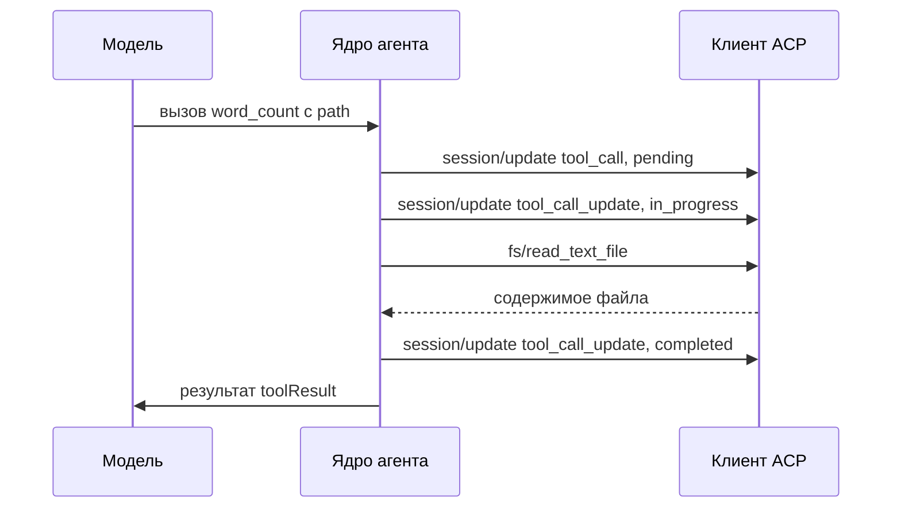

# Туториал: новый встроенный инструмент с нуля

Туториал проходит рецепт 1 из [11-extending.md](11-extending.md) от пустого места до зелёных проверок. Мы добавим инструмент `word_count`: он читает текстовый файл и возвращает число строк и слов.

`word_count` — учебный пример. В продукт он не входит, в репозиторий его не коммитят: код ниже был написан и прогнан на текущем коде ядра, а затем изменения откатили. Каждый листинг и каждый вывод в документе — из этого прогона.

Инструмент выбран так, чтобы показать весь путь и не отвлекать побочными эффектами: он только читает, как `read`, и устроен проще `ls`. Перед туториалом полезно прочитать [06-tools.md](06-tools.md) (инструменты, `ToolCallExecutor`, `ExecutionEnv`) и [07-permissions.md](07-permissions.md) (уровни разрешений).

Команды запускаются из каталога пакета `packages/dart/codelab_agent_core`, если не сказано иное. Все команды Dart идут через `fvm`.

## Что мы сделаем

| Шаг | Файл | Что |
|---|---|---|
| 1 | `prompts/tool_descriptions/word_count.md` | описание для модели |
| 2 | `lib/src/prompts/prompts.g.dart` | константа, которую создаёт генератор |
| 3 | `test/tools/builtin/word_count_test.dart` | тест инструмента на `ExecutorHarness` |
| 4 | `lib/src/tools/builtin/word_count.dart` | класс инструмента |
| 5 | `lib/src/host/build_agent_core.dart` | регистрация в `buildAgentCore` |
| 6 | `test/host/word_count_turn_test.dart` | тест хода со сценарной моделью |
| 7 | `test/tools/golden/word_count.txt` | golden-вывод для модели |
| 8 | тесты, которые перечисляют инструменты | список и бюджет контекста |
| 9 | проверки §21 | форматирование, анализ, тесты, сторож, конформанс |

Порядок следует правилу TDD пакета: сначала тест, потом код. Здесь тест инструмента (шаг 3) идёт раньше класса (шаг 4); запустите его между шагами 3 и 4, и он не соберётся — это и есть красный тест. Описание (шаг 1) нужно раньше всех: класс ссылается на сгенерированную константу, без неё он не компилируется.

## Шаг 1. Описание для модели

Текст, который видит модель, лежит в Markdown, а не в Dart (PR-2: многострочных литералов промпта в `lib/` нет). Создайте `prompts/tool_descriptions/word_count.md`:

```markdown
---
id: tool_descriptions.word_count
description: Description of the word_count tool schema
vars: []
---
Count the lines and words of a text file of the workspace. Use it to size a file before reading it.
```

`id` совпадает с путём файла (`tool_descriptions/word_count.md` → `tool_descriptions.word_count`). `vars` пуст: подстановок в тексте нет. Текст пишется на английском, потому что это текст для модели. Правила frontmatter и подстановок — в [09-config-prompts-commands.md](09-config-prompts-commands.md).

Секция правил в `prompts/tools/` инструменту не нужна: отдельных правил для модели у него нет. Если бы они были, файл секции и ветка в `_sections` файла `lib/src/prompts/compose.dart` добавлялись бы по шагу 3 рецепта 1.

## Шаг 2. Генерация

```bash
fvm dart run tool/gen_prompts.dart
echo "exit=$?"
```

```text
exit=0
```

Генератор при успехе молчит. Результат виден в `git diff lib/src/prompts/prompts.g.dart`: появилась константа и запись в таблицу по `id`.

```diff
+  static const toolDescriptionsWordCount = PromptTemplate(
+    id: 'tool_descriptions.word_count',
+    vars: {},
+    text:
+        'Count the lines and words of a text file of the workspace. Use it to size a file before reading it.',
+  );
…
+    'tool_descriptions.word_count': toolDescriptionsWordCount,
```

Файл `prompts.g.dart` не правится руками и коммитится вместе с Markdown. Сверка идёт командой с флагом `--check`: она падает, если файл расходится с Markdown (PR-1).

```bash
fvm dart run tool/gen_prompts.dart --check
echo "exit=$?"
```

```text
exit=0
```

## Шаг 3. Тест инструмента

Образец — `test/tools/builtin/ls_test.dart`. `ExecutorHarness.create` собирает `ToolCallExecutor` над `MemoryExecutionEnv`, обёрнутым в `BoundedEnv`, как это делает хост (ENV-2). Вызов `h.run(имя, аргументы)` идёт через единую точку исполнения (TOOL-1), поэтому в тесте работают проверка аргументов по схеме и разбор ошибок, а не только метод `execute`.

Создайте `test/tools/builtin/word_count_test.dart`:

```dart
import 'package:codelab_agent_core/codelab_agent_core.dart';
import 'package:codelab_agent_core/src/tools/builtin/word_count.dart';
import 'package:test/test.dart';

import '../executor_harness.dart';

void main() {
  late MemoryExecutionEnv memory;
  late ExecutorHarness h;

  setUp(() async {
    memory = MemoryExecutionEnv(cwd: '/proj');
    h = await ExecutorHarness.create([WordCountTool()], memory: memory);
  });

  test('schema, tier and kind', () {
    final tool = WordCountTool();

    expect(tool.tier, ToolTier.read);
    expect(tool.kind, ToolKind.read);
    expect(tool.parameters['required'], ['path']);
  });

  test('counts lines and words', () async {
    await memory.writeText('/proj/a.txt', 'one two\nthree\n\nfour five six\n');

    final outcome = await h.run('word_count', {'path': 'a.txt'});

    expect(outcome.outcome, ToolOutcome.completed);
    expect(textOf(outcome), 'a.txt: 4 lines, 6 words');
  });

  test('an empty file', () async {
    await memory.writeText('/proj/empty.txt', '');

    expect(
      textOf(await h.run('word_count', {'path': 'empty.txt'})),
      'empty.txt: 0 lines, 0 words',
    );
  });

  test('a missing file and a path outside the workspace are errors', () async {
    final missing = await h.run('word_count', {'path': 'nope.txt'});
    final outside = await h.run('word_count', {
      'path': '../etc/passwd',
    }, id: 'call_2');

    expect(textOf(missing), 'File not found: nope.txt');
    expect(textOf(outside), startsWith('Path is outside the workspace'));
  });

  test('the missing path argument is rejected before execute', () async {
    final outcome = await h.run('word_count', {});

    expect(outcome.outcome, ToolOutcome.failed);
  });
}
```

Последний тест проверяет не наш код, а контракт: схема объявила `path` обязательным, и исполнитель отклоняет вызов без него до `execute` (`outcome: failed`). Тест про выход за рабочую папку тоже проверяет контракт окружения: ограничение накладывает `BoundedEnv`, инструменту писать его не нужно.

## Шаг 4. Класс инструмента

Файл `lib/src/tools/builtin/word_count.dart`. Решения, которые принимает автор инструмента, перечислены в шаге 1 рецепта 1; здесь они такие:

- `tier: read` — инструмент ничего не меняет, поэтому в режиме `standard` вопроса пользователю не будет;
- `kind: ToolKind.read` — значение попадает в ACP по имени, и `read` у ACP есть;
- `outputTrust: trusted` — вывод инструмента состоит из пути и двух чисел, а не из содержимого файла, поэтому ограды недоверенного вывода не нужны. Если бы инструмент возвращал фрагменты файла, по умолчанию (`untrusted`) их пришлось бы огораживать (TOOL-10);
- `permissionPattern` — шаблон «разрешить всегда» по пути, как у `read`;
- `truncatesOutput` не переопределяется: ответ — одна короткая строка, усекать нечего;
- `executionMode` и `lockPath` не нужны: побочных эффектов нет, параллельный запуск безопасен.

```dart
import '../../llm/messages.dart';
import '../../prompts/prompts.g.dart';
import '../../util/result.dart';
import '../agent_tool.dart';
import 'common.dart';

/// `word_count` — число строк и слов текстового файла.
///
/// Почему: учебный инструмент туториала `doc/tutorial-new-tool.md`; в
/// продукт он не входит. Показывает минимальный инструмент уровня `read`.
///
/// Для чего: единственный путь через `ctx.env.readText` — файл читается
/// через порт окружения под `BoundedEnv`, а не напрямую.
///
/// Как использовать: модель передаёт `path`; ответ — одна строка
/// `<путь>: <N> lines, <M> words`. Ошибки файла — текст для модели с
/// `isError: true`.
final class WordCountTool extends AgentTool {
  @override
  String get name => 'word_count';

  @override
  String get description => Prompts.toolDescriptionsWordCount.render(const {});

  @override
  Map<String, Object?> get parameters => const {
    'type': 'object',
    'properties': {
      'path': {
        'type': 'string',
        'description': 'File path, relative to the workspace root or absolute.',
      },
    },
    'required': ['path'],
  };

  @override
  ToolTier get tier => ToolTier.read;

  @override
  ToolKind get kind => ToolKind.read;

  @override
  ContentTrust outputTrust(Map<String, Object?> args) => ContentTrust.trusted;

  @override
  String permissionPattern(Map<String, Object?> args, String cwd) =>
      pathPattern('${args['path'] ?? '.'}', cwd);

  @override
  Future<ToolPresentation> present(
    Map<String, Object?> args,
    ToolContext ctx,
  ) async {
    final path = args['path'];
    if (path is! String) {
      return ToolPresentation(title: name);
    }
    final abs = absolutePath(ctx, path);
    return ToolPresentation(
      title: 'Count words in ${displayPath(ctx, path)}',
      locations: [if (abs != null) Location(abs)],
    );
  }

  @override
  Future<ToolExecutionResult> execute(
    Map<String, Object?> args,
    ToolContext ctx,
  ) async {
    final path = args['path']! as String;
    final String text;
    switch (await ctx.env.readText(path)) {
      case Ok(:final value):
        text = value;
      case Err(:final error):
        return errorResult(fileErrorText(error, ctx, path));
    }
    final lines = splitLines(text).length;
    final words = text.split(RegExp(r'\s+')).where((w) => w.isNotEmpty).length;
    return ToolExecutionResult([
      TextContent('${displayPath(ctx, path)}: $lines lines, $words words'),
    ]);
  }
}
```

Что здесь важно:

- `execute` не бросает исключений на ожидаемых ошибках. Ошибку файла он превращает в `errorResult(...)` с текстом для модели (`fileErrorText` из `common.dart`), и `isError: true` модель читает как обычный результат. Исключение тоже не сломало бы ход (оно даст `ToolCallFinished(outcome: failed)`, TOOL-3), но текст ошибки был бы хуже.
- `args['path']! as String` безопасно: к моменту `execute` исполнитель уже проверил аргументы по `parameters` и отклонил вызов без `path`. В `present` аргументы сырые, вызов ещё не проверен, поэтому там стоит проверка типа.
- Файл читается только через `ctx.env`. Прямой доступ к `dart:io` в ядре запрещён (PKG-1), а `BoundedEnv` отсекает пути за пределами рабочей папки.

Теперь тест шага 3 проходит:

```bash
fvm dart test test/tools/builtin/word_count_test.dart
```

```text
00:00 +0: loading test/tools/builtin/word_count_test.dart
00:00 +0: schema, tier and kind
00:00 +1: counts lines and words
00:00 +2: an empty file
00:00 +3: a missing file and a path outside the workspace are errors
00:00 +4: the missing path argument is rejected before execute
00:00 +5: All tests passed!
```

## Шаг 5. Регистрация в `buildAgentCore`

Хост не может подложить инструмент снаружи: `ToolRegistry` не входит в публичный барель, а у `AgentCoreServices` нет поля для инструментов. Встроенные инструменты регистрирует только `buildAgentCore` (`lib/src/host/build_agent_core.dart`).

Добавьте импорт и вызов `register` в конец группы базовых инструментов, перед блоками по возможностям хоста. Порядок регистрации — порядок схем в запросе к модели, он стабилен ради кэша промпта провайдера; поэтому новый инструмент ставят в конец своей группы, а не в середину.

```dart
import '../tools/builtin/word_count.dart';
```

```dart
  register('task_get', () => registry.register(TaskGetTool()));
  register('word_count', () => registry.register(WordCountTool()));
  if (narrowed.isOn(HostCapability.shellExec)) {
```

`word_count` читает файлы через `ExecutionEnv`, как `read`, поэтому отдельная `HostCapability` не нужна: инструмент работает в любом профиле. Если бы ему требовалась возможность хоста (как `ls` — `fileListing`), регистрацию окружил бы `if (narrowed.isOn(...))`, а выключенная возможность не оставляла бы у модели ни схемы, ни секции (HOST-4). Дубликат имени `register` отклонит исключением `HostWiringException` (HOST-5).

## Шаг 6. Тест хода со сценарной моделью

Тест инструмента не проверяет, что модель его увидит и что результат вернётся ей. Это проверяет тест хода: `CoreHarness.build` собирает ядро через настоящий `buildAgentCore` (HOST-6), а модель играет сценарий `ScriptedStreamFunction`. Шаги описывают ответы модели: `callStep` — вызов инструмента, `textStep` — текст. Сеть не нужна.

Создайте `test/host/word_count_turn_test.dart`:

```dart
import 'package:codelab_agent_core/codelab_agent_core.dart';
import 'package:test/test.dart';

import '../permissions/fake_gate.dart';
import 'core_harness.dart';

void main() {
  test('the model calls word_count and gets the counts back', () async {
    final memory = MemoryExecutionEnv(cwd: '/proj');
    await memory.writeText('/proj/notes.txt', 'alpha beta\ngamma\n');
    final h = CoreHarness.build(
      baseEnv: memory,
      narrow: noExec,
      gate: FakeGate(),
      steps: [
        callStep('c1', 'word_count', {'path': 'notes.txt'}),
        textStep('The file has 2 lines.'),
      ],
    );
    final session = await h.core.runtime.createSession(
      SessionSpec(cwd: '/proj'),
    );
    final events = <AgentEvent>[];
    session.events.listen(events.add);

    await session.prompt([const TextContent('size notes.txt')]);
    await pumpEventQueue();

    h.model.verify();
    // Схема инструмента ушла в первый запрос.
    expect(
      h.requestedContexts.first.tools.map((t) => t.name),
      contains('word_count'),
    );
    // Результат инструмента вернулся модели вторым запросом.
    final result = h.requestedContexts.last.messages
        .whereType<ToolResultMessage>()
        .single;
    expect(result.toolName, 'word_count');
    expect(result.isError, isFalse);
    expect(
      (result.content.single as TextContent).text,
      'notes.txt: 2 lines, 3 words',
    );
    // Клиент видит пару событий вызова.
    final started = events.whereType<ToolCallStarted>().single;
    expect(started.tool, 'word_count');
    expect(started.kind, ToolKind.read);
    expect(started.title, 'Count words in notes.txt');
    final finished = events.whereType<ToolCallFinished>().single;
    expect(finished.toolCallId, started.toolCallId);
    expect(finished.outcome, ToolOutcome.completed);
  });
}
```

Что делает тест:

- `h.model.verify()` падает, если сценарий не доигран или модель получила не тот запрос;
- `h.requestedContexts` — запросы, которые ядро отправило модели: в первом есть схема инструмента, во втором — результат вызова;
- `FakeGate` записывает вопросы о разрешениях в `requests` и по умолчанию отвечает «разрешить один раз». Для уровня `read` в режиме `standard` вопроса не возникает, поэтому шлюз остаётся без работы.

```bash
fvm dart test test/tools/builtin/word_count_test.dart test/host/word_count_turn_test.dart
```

```text
00:00 +0: loading test/tools/builtin/word_count_test.dart
00:00 +0: test/tools/builtin/word_count_test.dart: schema, tier and kind
00:00 +1: test/host/word_count_turn_test.dart: the model calls word_count and gets the counts back
…
00:00 +6: All tests passed!
```

## Шаг 7. Golden-вывод

Тексты ответов инструмента — часть контракта с моделью, поэтому для каждого встроенного инструмента есть golden-файл. Добавьте в `test/tools/builtin_tools_golden_test.dart`:

- импорт `package:codelab_agent_core/src/tools/builtin/word_count.dart`;
- запись в таблицу `_cases` (ставьте её после `search`, перед `exec`) — вызовы, которые исполнятся по порядку на фиксированном дереве файлов `_tree`;
- `WordCountTool()` в список инструментов `ExecutorHarness.create`.

```dart
  'word_count': [
    {'path': 'lib/main.dart'},
    {'path': 'missing.txt'},
    {'path': 'lib'},
    {},
  ],
```

Создайте golden-файл командой обновления:

```bash
UPDATE_GOLDEN=1 fvm dart test test/tools/builtin_tools_golden_test.dart
```

```text
…
00:00 +6: word_count matches test/tools/golden/word_count.txt
00:00 +7: exec matches test/tools/golden/exec.txt
00:00 +8: All tests passed!
```

Прочитайте получившийся `test/tools/golden/word_count.txt` в ревью, прежде чем коммитить: так вы видите ровно то, что прочтёт модель.

```text
## word_count {"path":"lib/main.dart"}
outcome: completed
lib/main.dart: 5 lines, 7 words

## word_count {"path":"missing.txt"}
outcome: failed
File not found: missing.txt

## word_count {"path":"lib"}
outcome: failed
lib is a directory. Use ls to list it.

## word_count {}
outcome: failed
Invalid arguments for tool "word_count":
  - path: missing required property
Received arguments: {}
```

Тексты ошибок для модели вы не писали: их дают `fileErrorText` и проверка аргументов исполнителя. Подсказка `Use ls to list it.` появляется, потому что `ls` есть в наборе инструментов шага.

## Шаг 8. Тесты, которые перечисляют инструменты

Регистрация в базовой группе меняет то, что модель видит в каждой сессии, поэтому часть существующих тестов должна измениться. Это нормально: такие тесты и стоят на страже порядка и состава схем. Полный прогон пакета показывает, какие именно.

```bash
fvm dart test -r failures-only
```

Список упавших тестов после шага 5 (по файлам; названия отдельных тестов сокращены):

```text
test/agents/agent_select_test.dart
test/compaction/long_session_test.dart: 30 turns with large tool results in a window of 8 192
test/host/build_agent_core_test.dart: agent-serve over the memory env without shell
test/host/build_agent_core_test.dart: exec is registered when shellExec is on
test/host/build_agent_core_test.dart: without DirectoryListing ls and search are not registered
test/host/host_profile_test.dart: … the golden matrix matches test/host/profiles/ …
test/runtime/session_mcp_test.dart: …
test/runtime/set_mcp_servers_test.dart: …
test/runtime/subagents_runtime_test.dart: …
test/subagents/agent_tool_schema_test.dart: …
test/subagents/subagent_tools_intersection_test.dart: … тип general: все инструменты родителя …
```

Как исправлять каждую группу:

1. **Списки имён инструментов** (`build_agent_core_test.dart`, `session_mcp_test.dart`, `set_mcp_servers_test.dart`, `agent_select_test.dart`, `subagents_runtime_test.dart`, `agent_tool_schema_test.dart`). Добавьте `'word_count'` после `'task_get'` в ожидаемые списки — там, где порядок регистрации важен, место определяет шаг 5. Пример из `build_agent_core_test.dart`:

   ```diff
          'task_get',
   +      'word_count',
          'ls',
          'search',
   ```

2. **Наборы инструментов субагентов** (`subagent_tools_intersection_test.dart`). Тип `general` получает все инструменты родителя, поэтому в ожидаемые списки его полного набора `word_count` добавляют. Типы `explore` и `review` перечисляют инструменты явно в `subagent_types.dart` (`read`, `ls`, `search` и задачи), пересечение с набором родителя `word_count` не включает (SUB-1), и их тесты не падают. Если вставить `word_count` в их ожидания, эти тесты упадут: вставка лишняя.

3. **Golden профиля хоста** (`test/host/profiles/embedded-app-desktop.golden.json`). Файл описывает матрицу профиля целиком, включая схемы инструментов. Обновите его командой и прочитайте diff:

   ```bash
   UPDATE_GOLDEN=1 fvm dart test test/host/host_profile_test.dart
   ```

   В файле появились имя в `toolNames` и схема целиком. Эта часть — ровно то, что модель получает в запросе:

   ```json
   {
     "name": "word_count",
     "description": "Count the lines and words of a text file of the workspace. Use it to size a file before reading it.",
     "parameters": {
       "type": "object",
       "properties": {
         "path": {
           "type": "string",
           "description": "File path, relative to the workspace root or absolute."
         }
       },
       "required": [
         "path"
       ]
     }
   }
   ```

4. **Бюджет контекста** (`long_session_test.dart`). Тест держит заполнение окна в 8 192 токена и требует, чтобы после сжатия оценка была меньше порога 6 144. Схема нового инструмента добавила к запросу токены, и тест перестал укладываться:

   ```text
   Expected: a value less than <6144>
     Actual: <6185>
   ```

   Мы уменьшили файл, который читает сценарий теста (`'x' * 36` → `'x' * 30` в строках `big.txt`): смысл теста «много больших результатов инструментов в узком окне» остался. Урок общий: каждый новый встроенный инструмент платит токенами в каждом запросе, и такие тесты с жёстким бюджетом это замечают.

5. **Фикстура ACP.** Сценарий `session-new-with-mcp.json` в [`codelab_acp_testing/fixtures/acp/`](../../codelab_acp_testing/fixtures/acp) сверяет список инструментов в запросе к модели. Добавьте `"word_count"` после `"task_get"`. Правила правки фикстур — в [README `codelab_acp_testing`](../../codelab_acp_testing/README.md#как-добавить-фикстуру): ожидаемые кадры нельзя подгонять под реализацию, но здесь изменился не контракт ACP, а состав инструментов агента, который сценарий и должен фиксировать.

   Системный промпт при этом не изменился: golden-файлы `test/prompts/golden/*.txt` не потребовали правки, потому что у инструмента нет секции правил (`tools/*.md`), а описание живёт только в схеме.

После правок весь пакет проходит:

```bash
fvm dart test
```

```text
00:15 +3349: All tests passed!
```

## Шаг 9. Проверки §21

Состав проверки перед pull request — корневой `AGENTS.md` §21, раздел «Проверка перед pull request». Для этого изменения (ядро агента, ACP-фикстура) запускалось следующее.

Форматирование и анализ изменённых каталогов:

```bash
fvm dart format --set-exit-if-changed lib/src/tools/builtin/word_count.dart \
  lib/src/host/build_agent_core.dart test/tools test/host test/compaction \
  test/subagents test/runtime test/agents
fvm dart analyze lib test/tools test/host test/compaction test/subagents \
  test/runtime test/agents
```

```text
Formatted 121 files (0 changed) in 0.37 seconds.
Analyzing lib, tools, host, compaction, subagents, runtime, agents...
No issues found!
```

Скрипты Melos (из корня репозитория):

| Скрипт | Зачем здесь | Результат |
|---|---|---|
| `fvm dart run tool/gen_prompts.dart --check` в пакете (суть `prompts:check`) | изменён промпт | `exit=0` |
| `melos run guard` | сторож импортов и allowlist | `All tests passed!` (366 проверок, 3 пропущены) |
| `melos run conformance:agent` | изменена фикстура ACP и набор инструментов агента | `fvm dart test packages/dart/codelab_agent_acp/test/conformance_test.dart`: `All tests passed!` |
| `melos run web-compile` | обязателен: новый файл в `lib/` импортируется из `build_agent_core.dart`, скрипт компилирует `test/web_smoke/main.dart` | не запускался в этом прогоне |
| `melos run protocol-conformance` | обязателен при изменении фикстуры (§21) | не запускался в этом прогоне |
| `melos run conformance:client` | обязателен при изменении фикстуры (§21) | не запускался в этом прогоне |
| `melos run conformance:embedded` | встроенный агент строит ту же сессию | `test-scenario … --agent embedded`: `50 passed, 0 failed, 35 skipped` |

Не запускались также `test:e2e:cli:dart-agent`: он нужен, если затронуты бинари или CLI. Три скрипта с пометкой «не запускался в этом прогоне» перед настоящим pull request запускать обязательно. Полный `melos run check` перед pull request из `feature/*` запускают только по просьбе пользователя.

## Что увидит модель

Модель не видит класс и тесты. Она получает три вещи.

1. **Схему инструмента** в запросе — имя, описание из шага 1 и JSON-схему параметров. Это блок из golden профиля в шаге 8: `name: word_count`, `description`, `parameters` с обязательным `path`.
2. **Свой вызов**: сценарный шаг `callStep('c1', 'word_count', {'path': 'notes.txt'})` — это ответ модели с вызовом инструмента и аргументами `{"path": "notes.txt"}`.
3. **Результат** следующим сообщением роли `toolResult` с `toolName: word_count`, `isError: false` и текстом:

   ```text
   notes.txt: 2 lines, 3 words
   ```

   Тест из шага 6 проверяет именно это сообщение во втором запросе к модели. При ошибке модель получает текст из golden-файла (`File not found: missing.txt`) и `isError: true`.

Разрешения для модели прозрачны: `word_count` — уровень `read`, и режим `standard` его не спрашивает; спрашивает только режим `ask`, который просит подтверждение для любого вызова (`tierDecision` в `lib/src/permissions/modes.dart`). Таблица «режим × уровень» — в [07-permissions.md](07-permissions.md).

## Что увидит клиент

Клиент ACP модель и инструмент не видит. Он получает события хода как кадры `session/update`. Для `word_count` ядро выпускает `ToolCallStarted`, затем `ToolCallFinished`; ACP-проекция (`projectEvent` в `codelab_agent_acp`, [04-turn-loop.md](04-turn-loop.md)) превращает их в кадры:

| Событие ядра | Кадр ACP |
|---|---|
| `ToolCallStarted` | `session/update`, `sessionUpdate: tool_call`, `status: pending`; поля `title`, `kind`, `rawInput`, `locations` приходят из `present` и из `kind` инструмента |
| (начало исполнения) | `tool_call_update`, `status: in_progress` |
| `ToolCallFinished` | `tool_call_update`, `status: completed` или `failed`, текст результата в `content` |

Поля берутся из кода инструмента: `title` — из `ToolPresentation.title` (`Count words in lib/main.dart`), `kind` — из `ToolKind.read`, `locations` — из `ToolPresentation.locations` (путь превращается в абсолютный).

Живой пример из прогона. Для него временно собрали сценарий по образцу `tool-list-dir.json` и проиграли командой `codelab test-scenario … --agent embedded`; результат `PASS acp/tool-word-count`, поэтому кадры ниже именно те, что встроенный агент отправил клиенту (поля `sessionId` и абсолютный `cwd` — подстановки `${sessionId}` и `${cwd}` сценария). Клиент сценария умеет файловую систему ACP, поэтому чтение файла идёт запросом агента к клиенту `fs/read_text_file`, а не локально:

```json
{"jsonrpc":"2.0","method":"session/update","params":{"sessionId":"${sessionId}","update":{"sessionUpdate":"tool_call","toolCallId":"call_1","title":"Count words in lib/main.dart","kind":"read","status":"pending","rawInput":{"path":"lib/main.dart"},"locations":[{"path":"${cwd}/lib/main.dart"}]}}}
{"jsonrpc":"2.0","method":"session/update","params":{"sessionId":"${sessionId}","update":{"sessionUpdate":"tool_call_update","toolCallId":"call_1","status":"in_progress"}}}
{"jsonrpc":"2.0","id":"<read1>","method":"fs/read_text_file","params":{"sessionId":"${sessionId}","path":"${cwd}/lib/main.dart"}}
{"jsonrpc":"2.0","id":"<read1>","result":{"content":"void main() {}\n"}}
{"jsonrpc":"2.0","method":"session/update","params":{"sessionId":"${sessionId}","update":{"sessionUpdate":"tool_call_update","toolCallId":"call_1","status":"completed","content":[{"type":"content","content":{"type":"text","text":"lib/main.dart: 1 lines, 3 words"}}]}}}
```

Кадры 1, 2, 3 и 5 идут от агента к клиенту, кадр 4 — ответ клиента на запрос чтения. Тот же порядок виден в фикстуре `tool-read-range.json`.



Новая фикстура в корпус не нужна: инструмент использует уже существующие кадры (`tool_call`, `tool_call_update` с текстом), как `ls` и `search` (рецепт 1, «Фикстура ACP»). Мы проигрывали сценарий только затем, чтобы показать кадры, и не добавляли его в репозиторий.

## Откат

Туториал учебный, поэтому всё сделанное выше откатывается: удалите пять новых файлов (`word_count.md`, `word_count.dart`, оба новых теста и `word_count.txt`), верните правки в `build_agent_core.dart`, `prompts.g.dart`, тестах и фикстуре (`git checkout -- <файлы>`) и перегенерируйте промпты командой из шага 2, если откатывали Markdown отдельно. Проверьте `git status --short`: в рабочем дереве не должно остаться ничего, кроме правок документации.

## Что дальше

- Рецепт 1 в [11-extending.md](11-extending.md): тот же путь в сжатом виде с ссылками на правила (TOOL-5, TOOL-10, HOST-4) и на инструмент с побочными эффектами.
- [06-tools.md](06-tools.md): исполнитель, блокировки, усечение вывода — когда инструменту нужны `write`-подобные свойства.
- [12-testing.md](12-testing.md): уровни тестов пакета и как устроены `CoreHarness`, `ExecutorHarness` и сценарная модель.
- [11-extending.md](11-extending.md), чек-лист перед pull request: общий список проверок для любого рецепта.
