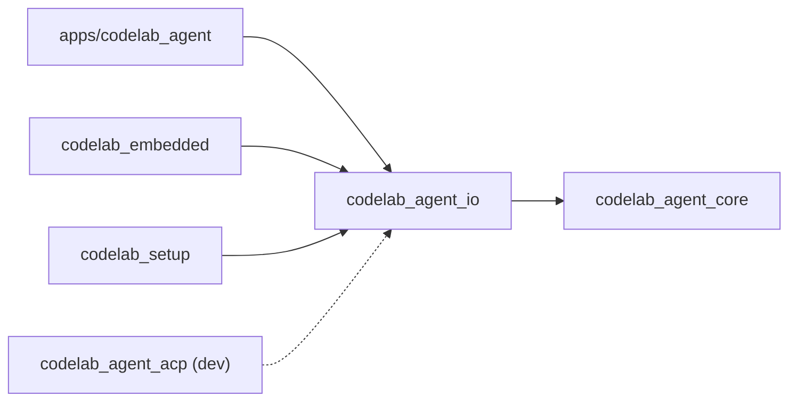

# codelab_agent_io

Реализации портов ядра агента на `dart:io`: файлы и процессы, журналы сессий, загрузка конфигурации и файлов проекта, хранилища секретов, общие подкоманды `config`, `provider`, `mcp`, `secret`. Ядро (`codelab_agent_core`) не знает про `dart:io` и описывает только интерфейсы. Этот пакет даёт им настольные реализации, чтобы один и тот же код работал в `codelab-agent` и во встроенном агенте клиентов.

## Место в архитектуре

Пакет называется по схеме `codelab_<сторона>_<слой>` (ADR-0002): сторона `agent`, слой `io`. Это чистый Dart с `dart:io`, Flutter не используется. Основной барель не web-безопасен: он импортирует `dart:io`.

Схема показывает, кто использует пакет и от чего он зависит (по `pubspec.yaml` пакетов).



- Клиенты (`apps/codelab_desktop`, `apps/codelab_cli`) пакет напрямую не импортируют. Они получают его через мосты `codelab_setup` и `codelab_embedded`.
- Ядро от пакета не зависит. Хост передаёт реализации в ядро при сборке.
- Пунктир: `codelab_agent_acp` использует пакет только в `dev_dependencies`, для тестов.

Правила слоёв — в [`docs/architecture/layers-and-dependencies.md`](../../../docs/architecture/layers-and-dependencies.md), архитектура агента — в [`agent-core-architecture.md`](../../../docs/architecture/proposals/agent-core-architecture.md).

## Что внутри

Публичное API экспортирует `lib/codelab_agent_io.dart`. Дополнительный барель `lib/testing.dart` отдаёт сценарий модели для тестов.

### Порты ядра

| Реализация | Порт ядра | Для чего |
|---|---|---|
| `LocalExecutionEnv` | `ExecutionEnv` (а также `DirectoryListing`, `BinaryFiles`, `PathResolver`) | файлы и процессы локальной машины; пути ядра — POSIX, на Windows их переводят `toCorePath`/`toHostPath` |
| `JsonlSessionStore` | `SessionStore` | журнал сессий в JSONL; `openHostSessions` открывает его по настройкам конфигурации |
| `JsonlUsageLedgerStore` | `UsageLedgerStore` | журнал расхода токенов |
| `FileConfigSource` | `ConfigSource` | загрузка конфигурации и наблюдение за файлами для перезагрузки |
| `ProjectFilesLoader` | `ProjectFilesSource`, `SkillFilesSource` | `AGENTS.md`/`CLAUDE.md`, шаблоны команд, определения агентов, навыки |
| `EnvSecretStore`, `FileSecretStore` | `DescribedSecretStore` | хранилища секретов `env` и `file`; `openSecretStore` выбирает по `secrets.backend` |
| `FileLastModelStore` | `LastModelStore` | память последней выбранной модели |
| `StdioMcpTransportFactory` | `McpTransportFactory` | запуск stdio-серверов MCP как процессов |

### Конфигурация

| Часть | Для чего |
|---|---|
| `ConfigLoader` | читает слои (`config.yaml` в `CODELAB_HOME`, проектные `config.yaml` и `config.local.yaml`, `--config`/`CODELAB_CONFIG`, переменные `CODELAB_*`) и передаёт их в `CoreConfig.fromLayers` ядра. Схема, доверие и слияние — в ядре |
| `ConfigWriter` | правит `config.yaml` с сохранением комментариев и порядка ключей, под блокировкой и с проверкой отпечатка |
| `ConfigWatcher` | следит за файлами слоёв: события каталогов, debounce, опрос как запасной путь |
| `codelabHomeOf`, `userHomeOf` | вычисляют `CODELAB_HOME` и домашний каталог пользователя |
| `agentConfigPathsFor`, `watchedConfigFiles` | пути файлов, которые наблюдает хост и защищает политика разрешений |
| `ProviderPreconfigFlags` | предконфигурация провайдера из флагов `serve` |

### Файлы проекта и секреты

| Часть | Для чего |
|---|---|
| `loadProjectExtensions`, `ProjectExtensionsLoader` | чтение файлов проекта и навыков одним отчётом |
| `loadAgentDefinitions` | чтение определений агентов для моста `codelab_setup` |
| `projectTrustAt` | единое правило доверия папки проекта |
| `openHostSecrets`, `SecretAdmin`, `SecretMigrator` | резолвер секретов хоста, программные `store`/`delete`/`list`, перенос литеральных секретов в хранилище |
| `ClientSecretAccess` | единственный путь клиентов к хранилищу секретов |

### Подкоманды для приложений

`ConfigCommands` (`check`, `path`, `get`, `set`, `unset`), `ProviderCommands`, `McpServerCommands`, `SecretCommands` (`set`, `delete`, `list`, `migrate`) возвращают текст и код выхода (`ConfigCommandResult`, `SecretCommandResult`, коды — `exit_codes.dart`). Аргументы разбирает каждое приложение своим `package:args`. Так тексты и коды выхода `codelab` и `codelab-agent` совпадают.

## Как использовать

Хост загружает конфигурацию и собирает порты ядра. Пример собран из публичного API пакета; полный порядок сборки — в `apps/codelab_agent` и `codelab_embedded`.

```dart
import 'dart:io';

import 'package:codelab_agent_io/codelab_agent_io.dart';

Future<void> main() async {
  final cwd = Directory.current.path;
  final environment = Platform.environment;

  // Слои конфигурации; ошибки значений — в result.issues.
  final result = ConfigLoader().load(cwd: cwd, environment: environment);
  print(result.issues);

  // Сам по себе env рабочей папкой не ограничен: границу ставит ядро,
  // оборачивая env сессии в BoundedEnv.wrap.
  final env = LocalExecutionEnv(cwd: cwd);
  print(env.cwd);

  // Та же проверка, что даёт `codelab config check`.
  final check = await ConfigCommands().check(
    CheckOptions(cwd: cwd, environment: environment),
  );
  print(check.exitCode);
}
```

Что важно знать:

- Ожидаемые ошибки файлов и процессов — значения (`Err(...)`), а не исключения.
- Ошибку параметров запуска загрузчик сообщает `ConfigUsageException`; хост превращает её в код выхода `64`.
- Хост, который держит `FileConfigSource`, вызывает `close()` после `runtime.dispose()`.
- Сценарий модели (`LlmScript`) в основной барель не входит. Его импортируют только `apps/codelab_agent`, `codelab_embedded/lib/src/testing/` и тесты: `package:codelab_agent_io/testing.dart`. Правило сторожа (`melos run guard`) охватывает `codelab_embedded/lib` и `codelab_setup`; бинарь и тесты оно не проверяет.

## Где лежат данные

Расположение `CODELAB_HOME`, файлов конфигурации, секретов и журналов сессий описано один раз, в руководствах:

- [Каталог `CODELAB_HOME`](../../../docs/ops/codelab-home.md);
- [Настройка агента: слои конфигурации](../../../docs/user/configuration.md#слои-конфигурации);
- [`codelab-agent`: эксплуатация](../../../apps/codelab_agent/doc/operations.md).

Здесь этот текст не повторяется.

## Тесты

```bash
cd packages/dart/codelab_agent_io
fvm dart test
```

- Тесты работают на реальных файлах во временных каталогах и на реальных процессах `/bin/sh`. Настоящий `~/.codelab` они не читают: окружение передаётся загрузчику явно.
- Контракты `ExecutionEnv` и `SessionStore` лежат в `packages/dart/codelab_agent_core/test/` (`env/execution_env_contract.dart`, `session/session_store_contract.dart`), пакет прогоняет их на своих реализациях.
- `test/session/jsonl_crash_recovery_test.dart` запускает дочерний процесс и завершает его `SIGKILL`.
- Проверки прав файлов секретов идут на macOS и Linux; ветка Windows проверяется подменой платформы и вручную.
- Границы пакета проверяет сторож: `melos run guard`.

## Правила пакета

Правила для изменений — в [`AGENTS.md`](AGENTS.md), правила ядра — в [`../codelab_agent_core/AGENTS.md`](../codelab_agent_core/AGENTS.md). Главное ограничение: пакет не импортирует Flutter, `codelab_acp_*` и `codelab_client_*`, а его `dependencies` — подмножество `ioAllowlist` сторожа (`codelab_agent_core`, `path`, `meta`, `async`, `yaml`, `yaml_edit`; тест `pubspec_allowlist_test.dart`).

## Смотрите также

- [`codelab_agent_core`](../codelab_agent_core/AGENTS.md) — ядро агента и интерфейсы портов;
- [`codelab_setup`](../codelab_setup/AGENTS.md) и [`codelab_embedded`](../codelab_embedded/AGENTS.md) — мосты, через которые клиенты получают этот пакет.
