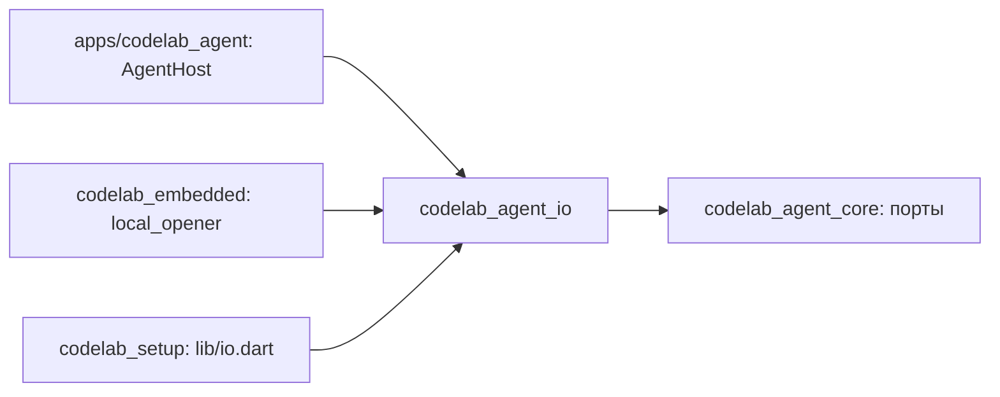
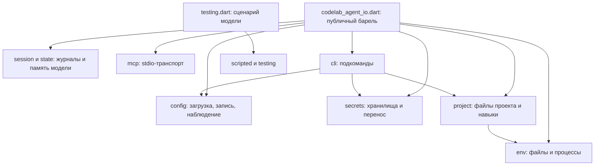

# Обзор пакета

Глава даёт общую картину: зачем нужен `codelab_agent_io`, какие порты ядра он реализует, как устроена папка `lib/src/` и какие правила одинаковы для всего кода пакета.

## Зачем пакет

Ядро агента (`codelab_agent_core`) написано на чистом Dart без `dart:io` и описывает только интерфейсы: «прочитать файл», «открыть журнал сессии», «найти секрет» ([02-assembly-and-hosts.md](../../codelab_agent_core/doc/02-assembly-and-hosts.md)). Настольные хосты хранят всё это на диске и запускают процессы. Этот пакет даёт им реализации портов на `dart:io`.

Пакет решает три задачи:

- **Реализует порты ядра** для настольных хостов: окружение исполнения, журналы сессий, источник конфигурации, файлы проекта, хранилища секретов, транспорт MCP, память последней модели.
- **Читает и пишет форматы на диске**: `config.yaml` с позициями ошибок, `secrets.yaml`, журнал JSONL, `index.json`, `usage.json`, `state/last-model.json`. Ядро формата не знает и не разбирает YAML (нормы CFG-5, PKG-1, PKG-2).
- **Даёт общие подкоманды** `config`, `provider`, `mcp`, `secret`, чтобы тексты и коды выхода `codelab-agent` и `codelab` совпадали.

Чего в пакете нет: схемы конфигурации, доверия к проекту, слияния слоёв, проверки значений, политики разрешений, цикла хода. Это ядро. Пакет только читает файлы, строит из них деревья слоёв и передаёт ядру. Где граница, показывает [глава 3](03-config-loading.md).

## Кто использует пакет

Клиенты (`apps/codelab_desktop`, `apps/codelab_cli`) пакет напрямую не импортируют: им запрещён `package:codelab_agent_*`. Они получают его через мосты `codelab_setup` и `codelab_embedded`. Бинарь агента `apps/codelab_agent` импортирует пакет напрямую.

Что именно берёт каждый потребитель (по вызовам в коде):

| Потребитель | Что вызывает |
|---|---|
| `apps/codelab_agent/lib/src/host/agent_host.dart` | `logConfigWarnings`, `openHostSecrets`, `openHostSessions`, `JsonlUsageLedgerStore`, `LocalExecutionEnv`, `ProjectFilesLoader`, `agentConfigPathsFor`, `FileLastModelStore`, `StdioMcpTransportFactory` |
| `apps/codelab_agent/lib/src/host/serve_config.dart` | `ConfigLoader`, `FileConfigSource` |
| `apps/codelab_agent/lib/src/cli/config_cli.dart` | `ConfigCommands` (и соседние подкоманды) |
| `packages/dart/codelab_embedded/lib/src/io/local_opener.dart` | тот же набор, что у `AgentHost` |
| `packages/dart/codelab_embedded/lib/io.dart`, `src/io/migration_options.dart` | `lib/io.dart` реэкспортирует `SecretMigrator`; `migration_options.dart` лишь строит опции (`secretMigrationOptionsFor`) |
| `packages/dart/codelab_embedded/lib/src/testing/scripted_opener.dart` | `ConfigLoader`, `LocalExecutionEnv`, `ProjectFilesLoader(home: null)`, `openHostSecrets` |
| `packages/dart/codelab_setup/lib/io.dart` | реэкспорт подкоманд `config`, `ClientSecretAccess` для клиентов; `FileAgentConfigStore` использует `ConfigLoader` и `ConfigWriter` |
| `apps/codelab_cli`, `apps/codelab_desktop` | `ConfigCommands`, `ClientSecretAccess.open`, `SecretMigrator` — через мосты |

Сборку ядра и хосты объясняет [глава 2 ядра](../../codelab_agent_core/doc/02-assembly-and-hosts.md#поставщик-портов-codelab_agent_io); здесь она не повторяется.

## Порты ядра и реализации

| Реализация | Порт ядра | Файл | Глава |
|---|---|---|---|
| `LocalExecutionEnv` | `ExecutionEnv`, `DirectoryListing`, `BinaryFiles`, `PathResolver` | `lib/src/env/local_execution_env.dart` | [2](02-environment-and-processes.md) |
| `FileConfigSource` | `ConfigSource`, `ProjectConfigLoader` | `lib/src/config/file_config_source.dart` | [4](04-config-writing-and-reload.md) |
| `ProjectFilesLoader` | `ProjectFilesSource`, `SkillFilesSource` | `lib/src/project/project_files_loader.dart` | [7](07-project-files.md) |
| `EnvSecretStore`, `FileSecretStore` | `DescribedSecretStore` | `lib/src/secrets/` | [5](05-secrets.md) |
| `JsonlSessionStore` | `SessionStore` | `lib/src/session/jsonl_session_store.dart` | [6](06-sessions-and-state.md) |
| `JsonlUsageLedgerStore` | `UsageLedgerStore` | `lib/src/session/jsonl_usage_ledger_store.dart` | [6](06-sessions-and-state.md) |
| `FileLastModelStore` | `LastModelStore` | `lib/src/state/last_model_file.dart` | [6](06-sessions-and-state.md) |
| `StdioMcpTransportFactory` | `McpTransportFactory` | `lib/src/mcp/stdio_process_transport.dart` | [8](08-mcp-stdio.md) |

`ConfigLoader` и `ConfigWriter` не реализуют порт: хост вызывает их напрямую. Ядро получает результат загрузки (`ConfigLoadResult`) готовым.

## Карта `lib/src/`

| Каталог | Строк | Что там |
|---|---|---|
| `config/` | около 4800 | `config_loader.dart` (загрузка слоёв), `yaml_reader.dart` (строгий YAML), `environment_layer.dart` и `provider_preconfig.dart` (слои 6–7), `config_writer.dart` с `config_write_lock.dart` и `yaml_document_edit.dart` (запись), `config_watcher.dart` и `file_config_source.dart` (перезагрузка), `config_link_containment.dart` (ссылки проектных слоёв), `agent_config_paths.dart` (пути для PERM-11), `literal_secret_rule.dart` (правило литеральных секретов), `legacy_notice.dart`, `config_warnings.dart`, `config_paths.dart` |
| `secrets/` | около 4100 | `file_secret_store.dart`, `env_secret_store.dart`, `open_secret_store.dart`, `host_secrets.dart`, `secret_admin.dart`, `client_secret_access.dart`, `secret_migrator.dart` (2300 строк), `secret_process_runner.dart`, `secret_value_checks.dart`, `secrets_backend_problem.dart`, `secret_read_only_hint.dart` |
| `cli/` | около 3800 | `config_commands.dart`, `provider_commands.dart`, `mcp_server_commands.dart`, `secret_commands.dart`, `config_edit_runner.dart`, `config_output.dart` (маскирование вывода), `secret_input.dart`, `exit_codes.dart` |
| `project/` | около 1900 | `project_files_loader.dart` (читает файлы), `skill_roots.dart` (корни навыков), `frontmatter.dart`, `project_extensions.dart`, `project_trust.dart`, `load_agent_definitions.dart` |
| `session/` | около 900 | `jsonl_session_store.dart`, `jsonl_usage_ledger_store.dart`, `write_queue.dart`, `host_sessions.dart` |
| `env/` | около 540 | `local_execution_env.dart`, `process_tree.dart`, `output_buffer.dart`, `host_path.dart`, `host_variables.dart` |
| `mcp/` | 380 | `stdio_process_transport.dart` |
| `state/` | 150 | `last_model_file.dart` |
| `scripted/`, `testing/` | около 350 | сценарий модели (`LlmScript`, `withScriptedProviders`, `CwdTrackingStore`) и `rewriteUntil` |
| `util/` | 30 | `SilentLogger` — тихий логгер подкоманд; из бареля не экспортируется |
| `home/` | — | `home/config.yaml` в корне пакета: одна настройка, `budget.max_steps: 3`; код и тесты пакета на него не ссылаются |

## Два барелья

- `package:codelab_agent_io/codelab_agent_io.dart` — всё, что нужно рабочему хосту. Он импортирует `dart:io`, поэтому не web-безопасен.
- `package:codelab_agent_io/testing.dart` — сценарий модели (`LlmScript`, `withScriptedProviders`, `CwdTrackingStore`) и `rewriteUntil`. Сторож `melos run guard` разрешает импорт только `apps/codelab_agent`, `codelab_embedded/lib/src/testing/` и тестам. Так сценарий не попадает в граф импортов рабочей сборки клиентов ([глава 10](10-scripted-model.md)).

Остальное — `lib/src/` — не публичный API. Внутри пакета файлы импортируют друг друга напрямую. Для ядра рабочий код пакета использует только его барель `package:codelab_agent_core/codelab_agent_core.dart`; единственное исключение — `lib/src/scripted/llm_script.dart`, который импортирует ещё и `package:codelab_agent_core/testing.dart` (сценарий модели живёт в `testing.dart` пакета).

## Зависимости

Список ограничен allowlist сторожа (`pubspec_allowlist_test.dart`). `dependencies` в `pubspec.yaml`:

| Пакет | Для чего |
|---|---|
| `codelab_agent_core` | порты, типы конфигурации, `Result`, `Logger` |
| `yaml` | разбор `config.yaml` и frontmatter с позициями |
| `yaml_edit` | правка `config.yaml` с сохранением комментариев |
| `meta` | аннотации (`@visibleForTesting`, `@internal`) |
| `async` | объявлен в `pubspec.yaml`, но в `lib/` не импортируется |

Пакет не импортирует Flutter, `codelab_acp_*` и `codelab_client_*` (правило сторожа в `codelab_architecture_tests/test/support/rules.dart`).

## Общие правила кода

Эти правила повторяются во всех модулях. Зная их, легче читать любой файл.

**Ожидаемая ошибка — значение, а не исключение.** `LocalExecutionEnv` возвращает `Result<_, FileError>` и `Result<ExecResult, ExecError>` (норма ENV-1). `SecretAdmin` возвращает запечатанные иерархии исходов. Загрузчик отдаёт `ConfigIssue` в результате. Исключениями остаются ошибки использования (`ConfigUsageException`, код `64`), конфликт записи (`ConfigConflictException`) и ошибки программиста.

**Значений секретов нигде нет.** Ни в тексте проблемы, ни в исключении, ни в логе, ни в `toString()` (нормы CFG-2, CFG-10). Проблемы называют путь файла, ключ и фиксированный текст разборщика; фрагменты файлов в них не попадают. Из-за этого сообщения YAML-разборщика заменены фиксированными (`yaml_reader.dart`).

**Ссылки наружу не читаются.** Всё чтение содержимого файлов проекта идёт через `BoundedEnv`; проектные слои конфигурации читаются по реальному пути внутри `<cwd>/.codelab`. Это приоритет 1 репозитория (безопасность).

**Запись атомарна.** Файл либо целиком старый, либо целиком новый: временный файл рядом и `rename`. Конфигурация и `secrets.yaml` ещё и под блокировкой.

**Один код на два бинаря.** Подкоманды живут здесь, а не в приложениях, потому что `codelab` и `codelab-agent` обязаны печатать одно и то же. Тест сравнивает вывод построчно.

**Пути ядра — POSIX.** `LocalExecutionEnv` переводит `C:\proj` в `/c/proj` и обратно (`host_path.dart`). Ядро и инструменты видят один вид пути на всех ОС.

**Комментарии — на русском** и отвечают на вопросы «почему, для чего, как использовать» (`AGENTS.md` репозитория, §15). Они часто ссылаются на решение `design.md` (`D5`) и инвариант (`CFG-9`): по ссылке в `openspec/changes/archive/` находится обоснование.

## Словарь

| Термин | Значение |
|---|---|
| слой (layer) | один источник конфигурации: файл, окружение или флаги; дерево значений с позициями ключей (`ConfigTree`) |
| `CODELAB_HOME` | корень состояния агента: `config.yaml`, `secrets.yaml`, `sessions/`, `state/`, `prompts/`, `agents/`, `skills/` ([каталог для администратора](../../../../docs/ops/codelab-home.md)) |
| containment | ограничение чтения и записи заданным каталогом с учётом символических ссылок |
| отпечаток (fingerprint) | sha256 байтов файла; по нему писатель замечает чужую правку |
| debounce | свёртка пачки событий файловой системы в один сигнал после паузы (300 мс) |
| tmp + `rename` | запись во временный файл рядом и атомарная подмена целевого |
| карантин | перенос повреждённых строк журнала в файл `<журнал>.corrupt` при открытии |
| PERM-11 | норма: инструмент записи агента не правит файлы конфигурации без вопроса человеку; список файлов даёт `agentConfigPathsFor` |
| allowlist окружения | `PATH`, `HOME`, `USER`, `LANG`, `LC_ALL`, `TMPDIR`, `SHELL`: только они проходят из окружения хоста в дочерние процессы |

Дальше читайте главу про нужный модуль. Для сквозного хода запроса, который пользуется всем этим, — [главу 3 ядра](../../codelab_agent_core/doc/03-request-flow.md).
