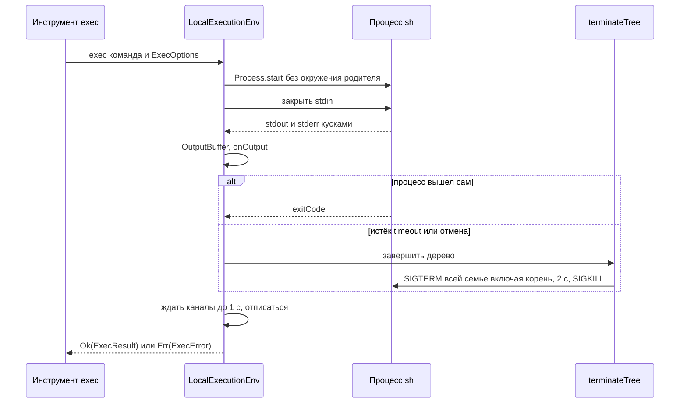

# Файлы и процессы: `LocalExecutionEnv`

Глава про окружение исполнения: как инструменты агента (`read`, `write`, `edit`, `ls`, `search`, `exec`) попадают на настоящий диск и в настоящие процессы. Что такое `ExecutionEnv`, `BoundedEnv` и как инструменты ими пользуются, объясняет [глава 6 ядра](../../codelab_agent_core/doc/06-tools.md#окружение-executionenv). Здесь — только реализация на `dart:io`.

Код: `lib/src/env/`. Нормы: [`agent-execution-env`](../../../../openspec/specs/agent-execution-env/spec.md) (ENV-1…ENV-6).

## Состав

| Файл | Что делает |
|---|---|
| `local_execution_env.dart` | класс `LocalExecutionEnv`: файловые операции и `exec` |
| `host_path.dart` | `toCorePath` и `toHostPath`: перевод путей хоста в POSIX-вид ядра и обратно |
| `host_variables.dart` | `hostEnvironmentAllowlist`: какие переменные видят дочерние процессы |
| `output_buffer.dart` | кольцевой буфер вывода команды |
| `process_tree.dart` | завершение дерева процессов; снимок потомков для MCP |

## Пути ядра и пути хоста

Ядро работает только с путями через `/`. На Windows путь `C:\proj` становится `/c/proj`, и наоборот:

```dart
toCorePath(r'C:\proj\src', windows: true);   // /c/proj/src
toHostPath('/c/proj/src', windows: true);    // C:\proj\src
```

На POSIX обе функции возвращают путь без изменений. Каждая публичная операция `LocalExecutionEnv` принимает путь ядра, внутри переводит его (`_host`) и результат возвращает снова в виде ядра (`_core`). Относительный путь считается от `cwd` окружения. Конструктор тоже переводит `cwd`.

Перевод работает по признаку `Platform.isWindows`, который окружение читает один раз. Остальной код проверок платформы не распространяет (корневой `AGENTS.md`, §11).

## Файловые операции

Все операции возвращают `Result<_, FileError>`: ожидаемая ошибка — значение (ENV-1). Исключение бросается только на ошибках программиста.

| Метод | Поведение |
|---|---|
| `readBytes` | нет файла — `notFound`; каталог — `isDirectory`; прочее — `_error` ниже |
| `readText` | читает байты, декодирует строго; не UTF-8 — `notText`; затем `sliceLines(line, limit)`. BOM в начале файла остаётся в тексте (тест `a BOM at the start of a file is kept by readText`) |
| `writeText` | создаёт недостающие родительские каталоги, пишет байты UTF-8 с `flush: true`; каталог вместо файла — `isDirectory`. Замены через временный файл нет: запись не атомарна |
| `stat` | без перехода по ссылкам: ссылка видна как `FileType.link` |
| `listDir` | без перехода по ссылкам, записи отсортированы по пути; ссылка — `link`. Не каталог — `notDirectory` |
| `realpath` | `File(path).resolveSymbolicLinks()`; ошибка — `FileError` |

Поле `size` у `FileStat` заполняется только для обычных файлов; у ссылки нет ни размера, ни времени изменения.

Перевод ошибки ОС в `FileErrorCode` (`_error`) идёт по числовому коду `errno`:

| `errno` | `FileErrorCode` |
|---|---|
| 2 | `notFound` |
| 13 или 1 | `permissionDenied` |
| 20 | `notDirectory` |
| 21 | `isDirectory` |
| прочие | `io` (с текстом ОС в `message`) |

Коды — POSIX. Ветка Windows проверяется вручную (CI работает на Linux, [`AGENTS.md` пакета](../AGENTS.md)).

`LocalExecutionEnv` сам не ограничивает пути: `../../etc` он откроет. Границу рабочей папки ставит обёртка ядра `BoundedEnv.wrap(env, root)`; хост оборачивает окружение один раз при сборке. `BoundedEnv` опирается на `realpath` этого класса, поэтому `LocalExecutionEnv` реализует `PathResolver` ([глава 7](07-project-files.md) показывает, как это используется).

## `exec`: жизненный цикл команды

```dart
Future<Result<ExecResult, ExecError>> exec(String command, ExecOptions options)
```

Команда запускается оболочкой: `/bin/sh -c <команда>` на POSIX, `cmd.exe /d /s /c <команда>` на Windows. Оболочку можно заменить параметром `shell` конструктора.



Шаги по коду:

1. **Каталог.** Если `options.cwd` не существует, результат — `Err(ExecError(spawnFailed, message: 'working directory does not exist'))`.
2. **Запуск.** `Process.start` с `includeParentEnvironment: false`. Окружение строится из трёх частей, позднее перекрывает раннее: allowlist хоста, фиксированные переменные, `options.env`.
3. **stdin закрывается сразу.** Команда, которая читает ввод, получает EOF, а не зависает. Тест: `stdin is closed: a reading command gets EOF`.
4. **Вывод.** stdout и stderr декодируются `Utf8Decoder(allowMalformed: true)` и складываются в `OutputBuffer` в порядке прихода. Каждый кусок уходит ещё и в `options.onOutput` (живой вывод в клиент).
5. **Конец.** Побеждает первое из трёх событий: выход процесса, `options.timeout`, отмена `options.cancel`.
6. **Завершение дерева.** При таймауте и отмене вызывается `terminateTree`.
7. **Хвост каналов.** Потомок мог унаследовать канал и держать его после выхода родителя. Окружение ждёт каналы не дольше 1 секунды и отписывается.

Исход:

| Событие | Результат |
|---|---|
| процесс вышел с кодом `n >= 0` | `Ok(ExecResult(exitCode: n, …))`; ненулевой код — тоже `Ok` (тест `a non-zero exit code is Ok with the output`) |
| процесс убит сигналом (код `< 0`) | `Ok(ExecResult(signal: 'SIG<n>', exitCode: null))` |
| истёк `timeout` | `Err(ExecError(timeout, outputTail: …, duration: …))` |
| отмена | `Err(ExecError(aborted, outputTail: …))` |
| нет оболочки | `Err(ExecError(shellUnavailable))` — только на POSIX, если файла оболочки нет |
| другая ошибка запуска | `Err(ExecError(spawnFailed, message: …))` |

Норма ENV-5: после таймаута или отмены `exec` возвращается не позднее чем через 5 секунд. Её обеспечивают сумма «2 с на SIGTERM» в `terminateTree` и «1 с на каналы»; тесты задают пределы с запасом.

Тест `cancel kills the grandchildren (T-09)` проверяет, что отмена убивает и внуков. Тест `output over the limit keeps the tail and says truncated` — что при переполнении остаётся конец вывода.

### Окружение процесса

Из окружения хоста проходят только имена из `hostEnvironmentAllowlist`: `PATH`, `HOME`, `USER`, `LANG`, `LC_ALL`, `TMPDIR`, `SHELL`. Ключи облаков и токены не доходят до команды (ENV-6). Поверх идут фиксированные значения, чтобы команда не ждала ввода человека:

| Переменная | Значение |
|---|---|
| `TERM` | `dumb` |
| `PAGER`, `GIT_PAGER` | `cat` |
| `GIT_TERMINAL_PROMPT` | `0` |

Реальный запуск `env | sort | cut -d= -f1` на этом окружении печатает имена `GIT_PAGER`, `GIT_TERMINAL_PROMPT`, `HOME`, `PAGER`, `PATH`, `PWD`, `SHELL`, `SHLVL`, `TERM`, `TMPDIR`, `USER`, `_`. `PWD`, `SHLVL` и `_` добавляет сама оболочка; `LANG` и `LC_ALL` нет в списке, потому что их не было в окружении запускающего процесса.

Чтобы тест увидел «утечку», `LocalExecutionEnv` принимает `hostEnvironment`: тест подставляет туда словарь с «секретной» переменной и проверяет, что команда её не видит (`local_exec_test.dart`).

### Кольцевой буфер вывода

`OutputBuffer(limit)` хранит вывод в порядке прихода и не больше `limit` байт UTF-8, где `limit` — `options.outputByteLimit`. При переполнении отбрасывается начало, причём по границе символа, и выставляется `truncated`. Метод `tail(bytes)` отдаёт последние байты; при ошибках `timeout` и `aborted` в `outputTail` идёт хвост до 64 КиБ (`_tailLimit`).

### Завершение дерева процессов

Dart не умеет запускать процесс в новой группе, поэтому `terminateTree` (`process_tree.dart`) находит потомков по таблице процессов:

1. Снимок `ps -A -o pid=,ppid=` строит карту «родитель → дети»; от корня обходом в ширину собирается семья.
2. Всей семье отправляется `SIGTERM` за один проход. Если сначала убить родителя, дети уйдут к init и пропадут из следующего снимка.
3. Ожидание выхода корня до `grace` (2 секунды по умолчанию).
4. Снимок повторяется: потомки выживших тоже получают `SIGKILL`.

На Windows работает `taskkill /T /F /PID <pid>`. Ветка проверяется вручную.

Две соседние функции нужны транспорту MCP ([глава 8](08-mcp-stdio.md)): `descendantsOf(pid)` берёт снимок потомков, пока корень жив, а `terminatePids` завершает тех, кто пережил корень: `SIGTERM`, ожидание по таблице процессов до 5 секунд, `SIGKILL`.

## Что запомнить

- `LocalExecutionEnv` не ограничивает пути. Границу ставит `BoundedEnv` из ядра.
- Ошибка ОС — `Result`, а не исключение; `exec` с ненулевым кодом — тоже `Ok`.
- Команда видит окружение только из allowlist и фиксированных переменных.
- Запись файла не атомарна; атомарная запись нужна конфигурации и секретам, и там она реализована отдельно ([глава 4](04-config-writing-and-reload.md), [глава 5](05-secrets.md)).
- `exec` возвращается не позднее чем через 5 секунд после таймаута или отмены.

## Смотрите также

- [Инструменты и `ExecutionEnv` в ядре](../../codelab_agent_core/doc/06-tools.md)
- [Контракт окружения: тест ядра](../../codelab_agent_core/test/env/execution_env_contract.dart); пакет прогоняет его на `LocalExecutionEnv` (`test/local_execution_env_test.dart`)
- Спецификация [`agent-execution-env`](../../../../openspec/specs/agent-execution-env/spec.md)
