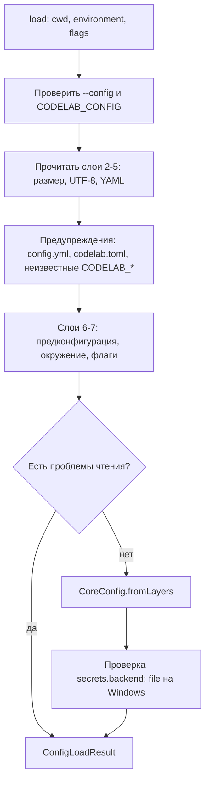

# Загрузка конфигурации: `ConfigLoader`

Глава про то, что делает io-сторона при загрузке конфигурации: где ищет файлы, как их читает и разбирает, какие проблемы называет сама и что передаёт ядру. Схема ключей, доверие к проекту, слияние слоёв, подстановка `${ENV}` и проверка значений — работа ядра; они описаны в [главе 9 ядра](../../codelab_agent_core/doc/09-config-prompts-commands.md#конфигурация-libsrcconfig). Эта глава их не повторяет.

Формат конфигурации для пользователя — [настройка агента](../../../../docs/user/configuration.md). Где лежит `CODELAB_HOME` и какие переменные действуют — [каталог `CODELAB_HOME`](../../../../docs/ops/codelab-home.md) и [переменные окружения](../../../../docs/ops/environment.md). Нормы — [`agent-configuration`](../../../../openspec/specs/agent-configuration/spec.md).

Код: `lib/src/config/config_loader.dart`, `yaml_reader.dart`, `environment_layer.dart`, `provider_preconfig.dart`, `legacy_notice.dart`, `config_link_containment.dart`.

## Что делает загрузчик

Ядро не читает файлы (PKG-1) и не знает YAML (CFG-5). `ConfigLoader` стоит между диском и `CoreConfig.fromLayers`:



Важное следствие: если io-сторона нашла проблему файла (синтаксис, размер, нарушение профиля YAML), ядро **не вызывается**. Проблемы схемы и значений появятся только после исправления файла. Так сделано специально: слой с синтаксической ошибкой нельзя построить, а без него проверка ядра была бы ложной.

## Слои и источники

Порядок слоёв и их смысл (приоритет растёт вниз) описывает ядро. Что читает io-сторона:

| № | Слой | Источник на стороне io | Если файла нет |
|---|---|---|---|
| 1 | умолчания | `ConfigTree.defaults()` | — |
| 2 | `user` | `$CODELAB_HOME/config.yaml` | слой пропускается |
| 3 | `project` | `<cwd>/.codelab/config.yaml` | слой пропускается |
| 4 | `projectLocal` | `<cwd>/.codelab/config.local.yaml` | слой пропускается |
| 5 | `extra` | `--config <путь>` или `CODELAB_CONFIG` | проблема `cannot read the file: <путь>: no such file` |
| 6 | `environment` | `CODELAB_PROVIDER_*`, затем `CODELAB_MODEL` и другие | слоя нет |
| 7 | `flags` | предконфигурация флагов, затем дерево флагов хоста | слоя нет |

`<cwd>` — **канонический** путь корня запуска: символические ссылки раскрыты (`resolveSymbolicLinksSync`). Иначе `trusted_projects` и выбор снимка сравнивали бы разные строки одного каталога.

Слои 6 и 7 строятся так, чтобы более частное значение побеждало. Предконфигурация провайдера идёт первой в своём слое: `CODELAB_MODEL` и `--model` её перекрывают.

Метод `load` принимает:

| Параметр | Для чего |
|---|---|
| `cwd`, `environment` | корень запуска и словарь окружения; в тестах словарь передаётся явно |
| `flags` | дерево флагов, которое строит хост; пустое дерево слоем не становится |
| `preconfigFlags` | `--provider-type` и `--provider-config` у `serve`; если заданы, переменные `CODELAB_PROVIDER_*` не читаются |
| `extraConfig` | `--config`; приоритетнее `CODELAB_CONFIG` |
| `scripted` | режим `--llm-script`: слои 2–4 не читаются, `$CODELAB_HOME` не трогается; `--config` читается |
| `knownVariables` | имена `CODELAB_*`, которые назвал хост (`--token-env`) — не опечатки |
| `platform` | подмена `Platform.operatingSystem` в тестах |
| `pinnedTrustedProjects` | закреплённое доверие: список передаётся в ядро, а доверие считает оно |

## Корень состояния: `codelabHomeOf`

Один способ найти `$CODELAB_HOME` для загрузчика и всех хостов (журналы, файлы проекта, секреты):

- `CODELAB_HOME` задан и не пуст — используется он; `~` и `~/…` раскрываются в домашний каталог `userHomeOf`: на любой ОС `HOME`, а если он не задан или пуст — `USERPROFILE`;
- не задан — `<HOME>/.codelab`; без домашнего каталога — `./.codelab`;
- значение, начинающееся на `~`, но не `~` и не `~/…` (`~bob/x`, `~\x`), — `ConfigUsageException`; без домашнего каталога `~` тоже не раскрывается.

Тильду раскрывает именно пакет, потому что оболочка не раскрывает её в кавычках (`CODELAB_HOME='~/x'`), а относительный `~/x` молча указывал бы на `./~`. Исключение хост переводит в ошибку использования с кодом `64`. Реальные тексты:

```text
$ CODELAB_HOME='~bob/x' codelab-agent config check --cwd .
config check: CODELAB_HOME: ~user is not supported, use an absolute path
$ echo $?
64
```

Другие тексты `ConfigUsageException` (все с кодом `64`):

| Условие | Текст |
|---|---|
| `CODELAB_HOME=~/x` без `HOME` и `USERPROFILE` | `CODELAB_HOME: cannot expand ~ without HOME or USERPROFILE, use an absolute path` |
| `--config` или `CODELAB_CONFIG` с расширением `.toml` | `<источник> needs a .yaml file; codelab.toml is not supported, see agent-core-architecture §15.7` |
| имя файла без `.yaml` и `.yml` | `<источник> needs a .yaml or .yml file` |
| относительный `CODELAB_CONFIG` | `CODELAB_CONFIG must be an absolute path` |

Относительный путь переменной зависел бы от каталога запуска клиента: один и тот же `CODELAB_CONFIG` читал бы разные файлы. Флаг `--config` вводит пользователь, поэтому для него абсолютность не требуется: путь считается от корня запуска.

Рядом живёт `userHomeOf(environment)`: `HOME`, иначе `USERPROFILE`; пустое значение считается отсутствующим. Хост берёт результат из того же словаря, что передаёт в `agentConfigPathsFor` и `ProjectFilesLoader(userHome:)`, — тогда корни навыков и защищённые пути не расходятся.

## Чтение файла слоя

Для каждого файла выполняется один порядок (внутренняя функция `readFile`):

1. **Проектные слои** (3 и 4): проверка ссылок — см. следующий раздел.
2. **Существует ли обычный файл.** Нет файла у слоёв 2–4 — слой молча пропускается; у слоя 5 — проблема чтения.
3. **Размер.** `stat` до чтения: больше 1 МиБ (`maxConfigBytes`) — проблема `the file is larger than 1 MiB`. Файл в гигабайты в память не попадает (CFG-21).
4. **Кодировка.** `utf8.decode` строгий: не UTF-8 — `the file is not valid UTF-8`. Молчаливая замена символов исказила бы ключи.
5. **Ошибка ОС.** `cannot read the file: <путь>: <текст ОС>`. Источником проблемы у явного файла становится имя флага или переменной (`--config`, `CODELAB_CONFIG`), чтобы stderr назвал, откуда пришёл путь.
6. **Разбор YAML** (`readYamlTree`) и, для слоя `user`, канонизация `trusted_projects`: каждая существующая запись заменяется каноническим путём (`~` раскрыт, ссылка разрешена). Запись, которой нет на диске, остаётся как написана. Причина: корень запуска канонический, ядро сравнивает пути лексически, и без канонизации ссылка `trusted → …` доверяла бы не тому каталогу.

Рядом с `config.yaml` могут лежать посторонние файлы. `config.yml`, `config.local.yml` и `.codelab/config.yml` **не читаются**. Угадывать намерение между `.yml` и `.yaml` нельзя, молчать — терять настройки, поэтому загрузчик добавляет предупреждение:

```text
warning: ~/demo/home/config.yml: ignored: only config.yaml and config.local.yaml are read; rename it to ~/demo/home/config.yaml
```

Событие лога — `config.file.ignored` с полями `path` и `hint`. Расширения `.yml` у файла, который вы сами указали через `--config`, это не касается: он читается.

## Строгий профиль YAML: `readYamlTree`

`yaml_reader.dart` превращает текст в `ConfigTree` с позициями ключей (строка и столбец от 1). Он нужен не только конфигурации: тот же разбор применяется к frontmatter шаблонов команд, агентов и навыков ([глава 7](07-project-files.md)). Нарушения профиля возвращаются списком `ConfigIssue`, а не исключением, чтобы `config check` показал все проблемы сразу.

Что запрещено (нормы CFG-1, CFG-21) и как называет это проблема:

| Что в файле | Вид | Текст |
|---|---|---|
| якорь `&`, алиас `*`, ключ слияния `<<`, тег `!` | `profile` | `anchors, aliases, merge keys and tags are not supported` |
| повтор ключа | `profile` | `duplicate mapping key; first defined at <line:col>` |
| несколько документов `---` | `profile` | `multiple YAML documents are not supported` |
| верхний уровень не отображение | `profile` | `the top level must be a mapping` |
| ключ не строка | `profile` | `mapping keys must be strings` |
| вложенность глубже 64 уровней | `profile` | `nesting is deeper than 64 levels` |
| ошибка синтаксиса | `syntax` | текст `package:yaml` (`message`, не `toString()`) |
| вложенность, которую не поймал лексический предел | `syntax` | `the file is nested too deeply to be parsed` |

Реальный вывод `config check` на файле с якорем (`a: &x 1`, `b: *x`):

```text
Sources: defaults, ~/demo/proj/.codelab/config.yaml
~/demo/home/config.yaml:1:4: a: anchors, aliases, merge keys and tags are not supported
~/demo/home/config.yaml:2:1: b: anchors, aliases, merge keys and tags are not supported
Config: invalid (issues: 2)
```

Строка `Sources:` называет слои, которые удалось прочитать; файл с ошибкой в неё не входит. Проектный `.codelab/config.yaml` в примере остался от прежних проверок в том же каталоге; сценарий главы 00 его не создаёт.

Почему так строго:

- **Позиции.** `yaml` отдаёт `span`, поэтому каждая проблема называет файл, строку и столбец (от 1).
- **Нет текста файла в сообщениях.** Сообщения строятся из фиксированных строк. В файле может быть секрет; `YamlException.toString()` цитирует исходный текст, поэтому берётся только `message`, а для нестандартного тега — фиксированная фраза профиля (CFG-2).
- **Защита от рекурсии.** `package:yaml` разбирает рекурсивно, и файл из тысяч `[` валит процесс `StackOverflowError` до проверки профиля. Поэтому до разбора идёт лексическая проверка глубины скобок (`_flowDepthIssue`), а `StackOverflowError` ловится как запасной путь.
- **BOM и сдвиг строк.** BOM снимается до разбора, иначе он сдвинул бы столбец первой строки. Параметр `lineOffset` нужен frontmatter: позиции сразу строятся в координатах файла Markdown.

Пустой файл и файл из одних комментариев — пустой слой, а не ошибка.

## Ссылки проектных слоёв

Репозиторий не должен ссылкой `.codelab/config.yaml → ../../чужое` втянуть чужой файл в конфигурацию (приоритет 1). Для слоёв `project` и `projectLocal` загрузчик вызывает `checkProjectLayer` из `config_link_containment.dart` и получает один из трёх вердиктов:

| Вердикт | Когда | Что делает загрузчик |
|---|---|---|
| `ProjectLayerReadable(realPath)` | файл существует, его реальный путь внутри канонического `<cwd>/.codelab` | читает именно `realPath`: проверенное и открытое совпадают |
| `ProjectLayerAbsent` | файла нет; висячая ссылка (внутрь или наружу) | слой молча отсутствует |
| `ProjectLayerRefused(message)` | существующая цель вне `.codelab`, цикл ссылок, `..` в ещё не созданном хвосте | проблема `syntax` с путём слоя; цель ссылки не называется |

Текст отказа: `the config file resolves outside <dir>/.codelab/; symbolic links of a project config must stay inside .codelab`. Реальный вывод:

```text
$ ls -l .codelab/config.yaml
config.yaml -> ~/demo/outside.yaml
$ codelab-agent config check --cwd .
Sources: defaults, ~/demo/home/config.yaml
~/demo/proj/.codelab/config.yaml: the config file resolves outside ~/demo/proj/.codelab/; symbolic links of a project config must stay inside .codelab
Config: invalid (issues: 1)
```

Слой `user` и файл `--config` не ограничиваются: их выбрал сам пользователь, а раскладка dotfiles с ссылкой на `~/dotfiles/codelab.yaml` обычна.

Тот же код вызывают писатель и наблюдатель ([глава 4](04-config-writing-and-reload.md)): правило одно на чтение, запись и слежение. Проверка идёт по сегментам слева направо, `..` берёт родителя канонического пути, а не лексического; больше 32 переходов по ссылкам — цикл. Разделитель — `/` на POSIX (там `\` — часть имени) и `/` вместе с `\` на Windows.

## Слой окружения

`buildEnvironmentLayer` превращает пять переменных в ключи; таблица `environmentLayerVariables` — единственный источник и для слоя, и для `config get`, который печатает вместо значения `<from env:NAME>`:

| Переменная | Ключ |
|---|---|
| `CODELAB_MODEL` | `agent.default_model` |
| `CODELAB_MAX_STEPS` | `budget.max_steps` |
| `CODELAB_PERMISSION_MODE` | `permissions.mode` |
| `CODELAB_LOG_LEVEL` | `logging.level` (регистр не важен, значение приводится к нижнему) |
| `CODELAB_LOG_FILE` | `logging.file` |

Пустое значение равно отсутствию. Нечисловой `CODELAB_MAX_STEPS` — проблема вида `type` без значения переменной:

```text
env: budget.max_steps: CODELAB_MAX_STEPS must be an integer
```

`autopilot` из `CODELAB_PERMISSION_MODE` отвергает проверка ядра: режим включается только флагом (CFG-4).

### Неизвестные переменные

Опечатка `CODELAB_MAX_STEP` не должна молча игнорироваться. `unknownEnvironmentWarnings` добавляет предупреждение на каждую переменную с префиксом `CODELAB_`, которой нет в списке известных:

```text
warning: env: unknown environment variable CODELAB_FOO
```

Событие — `config.env.unknown` с полем `name`. Значение переменной не читается: она может быть секретом. Известны: `CODELAB_HOME`, `CODELAB_CONFIG`, `CODELAB_MODEL`, `CODELAB_API_KEY`, `CODELAB_PERMISSION_MODE`, `CODELAB_PROFILE`, `CODELAB_LOG_LEVEL`, `CODELAB_LOG_FILE`, `CODELAB_TOOLS`, `CODELAB_MAX_STEPS`, `CODELAB_DEBUG_SECRETS`, `CODELAB_DEBUG_LLM_SNAPSHOT`, `CODELAB_AGENT_TOKEN`, `CODELAB_POWER_HELPER`, `CODELAB_SERVE_ALIAS_ACTIVE` и семейства `CODELAB_SECRET_*`, `CODELAB_PROVIDER_*`, `CODELAB_REDACTED_*`. Правило одно для `serve` и обеих `config check`: иначе `check` молчал бы об опечатке, которую покажет `serve`.

`CODELAB_TEST_SECRET_STORE` известна только в сборке с `--dart-define=CODELAB_ALLOW_TEST_SECRETS=true`: define вычисляется при компиляции, и окружением процесса его не включить. В обычной сборке переменная получает `config.env.unknown`, а `testSecretStorePath(environment)` возвращает `null`. Подробнее — [глава 5](05-secrets.md).

## Предконфигурация провайдера

`CODELAB_PROVIDER_TYPE`, `CODELAB_PROVIDER_CONFIG` (JSON) и `CODELAB_PROVIDER_CONFIG_BASE64` — способ описать одного провайдера без файла: для контейнеров и встроенного агента. Те же данные принимают флаги `--provider-type` и `--provider-config` у `serve`; при флагах переменные не читаются, а в лог идёт `config.preconfig.shadowed`. Тип провайдера — `openai-compatible` или `anthropic`.

`preconfigLayer` превращает пару в таблицу `providers.<id>` и `agent.default_model`. Допустимые поля JSON перечислены в `_fields` (`id`, `base_url`, `model`, `context_window`, `max_output_tokens`, `api_key_env`, `api_key_secret`, `auth_header`, `headers`, таймауты и другие). Секрет значением (`api_key`, `token`, `password`) отвергается проблемой `inlineSecret` с подсказкой `codelab/<id>`. Ошибки не цитируют JSON.

## Подсказка про `codelab.toml`

Python-агент хранил настройки в `codelab.toml`. Dart-агент его не читает (решение о совместимости снято, D12). Чтобы пользователь с настройками только в старом файле не терял их молча, `legacyConfigNotice` проверяет существование четырёх файлов: `$CODELAB_HOME/codelab.toml`, `$CODELAB_HOME/auth.toml`, `<cwd>/codelab.toml`, `<cwd>/codelab.local.toml`. Файл **не открывается**: проверяется только `isFileSync`.

Подсказка выдаётся один раз на корень запуска для каждого экземпляра `ConfigLoader` и только если нет ни одного YAML-файла слоёв 2–4 и не задан `--config`:

```text
warning: ~/demo/home/codelab.toml: codelab.toml is not used by the Dart agent. Move the settings to config.yaml manually; the key mapping is in docs/architecture/proposals/agent-core/15-configuration.md, section 15.7.
```

Событие — `config.legacy_found`, поле `files` содержит все найденные пути.

## Проверка кандидата

`validateCandidate(target, text, cwd:, environment:)` проверяет итоговый текст слоя теми же слоями, окружением и `fromLayers`, что обычная загрузка, не читая файл этого слоя с диска. Им пользуется писатель перед записью ([глава 4](04-config-writing-and-reload.md#проверка-перед-записью)).

- Порядок слоёв и правила доверия принадлежат загрузчику; писатель их не повторяет.
- Проверка идёт в режиме `collectAll` ядра: ошибка ранней ступени не прячет ошибки поздних. Наборы проблем до и после правки получаются полными и сравниваются по сигнатуре.
- Незаданная `${VAR}` — предупреждение, а не проблема: окружение агента может отличаться от окружения писателя. Чтобы следом не посыпались проблемы-последствия, проверка повторяется с подставленным значением.
- `pending` (внутреннее) — итоговые тексты других слоёв, которые та же операция запишет следом (`secret migrate --all`).

## Что получает ядро и что возвращает загрузчик

```dart
final loaded = ConfigLoader().load(cwd: cwd, environment: Platform.environment);
if (loaded.config == null) { /* loaded.issues не пуст */ }
```

`ConfigLoadResult` из ядра: `config` и `host` равны `null` тогда и только тогда, когда `issues` не пуст. `warnings` запуску не мешают; `sources` — список источников для строки `Sources:`; `values` — плоская карта для перезагрузки.

К предупреждениям ядра загрузчик добавляет свои впереди: `config.file.ignored`, `config.legacy_found`, `config.env.unknown`, заметки предконфигурации. Хост печатает их единой функцией `logConfigWarnings(logger, loaded)`: уровень берётся из `ConfigIssue.level`, имя события — из `event` (без имени — `config.warning`), в поле `message` значений ключей нет. Валидный конфиг пишет предупреждения при сборке хоста, невалидный — при отчёте об ошибках; каждое предупреждение пишется ровно один раз.

Внутренний вариант `loadWithLayers` (`@internal`) отдаёт ещё и разобранные слои: `config check` по ним называет файл и строку ключа, на который ссылается предупреждение о секрете, а `config get` ищет значение в слое-победителе. Приложениям он не нужен.

Один последний фильтр: `secrets.backend: file` на Windows превращается в проблему значения конфигурации (`_fileBackendOnWindows`). Права NTFS `dart:io` не проверяет, поэтому открытый файл на Windows недопустим. Текст берёт та же `secretsBackendProblem`, что у `openSecretStore`, чтобы сообщения не расходились ([глава 5](05-secrets.md)).

## Что запомнить

- Загрузчик читает и разбирает, ядро проверяет и применяет. Проблемы файлов (синтаксис, размер, ссылки) останавливают загрузку до ядра.
- Корень запуска канонический; `trusted_projects` слоя `user` канонизируется загрузчиком.
- Проектные слои читаются только по реальному пути внутри `<cwd>/.codelab`.
- В тексте проблемы нет значений и фрагментов файлов.
- `codelabHomeOf` — единственный способ найти `$CODELAB_HOME`.

## Смотрите также

- [Глава 9 ядра: схема, доверие, слияние, перезагрузка](../../codelab_agent_core/doc/09-config-prompts-commands.md)
- [Глава 4: запись и перезагрузка](04-config-writing-and-reload.md)
- [Глава 13: частые проблемы](13-troubleshooting.md)
