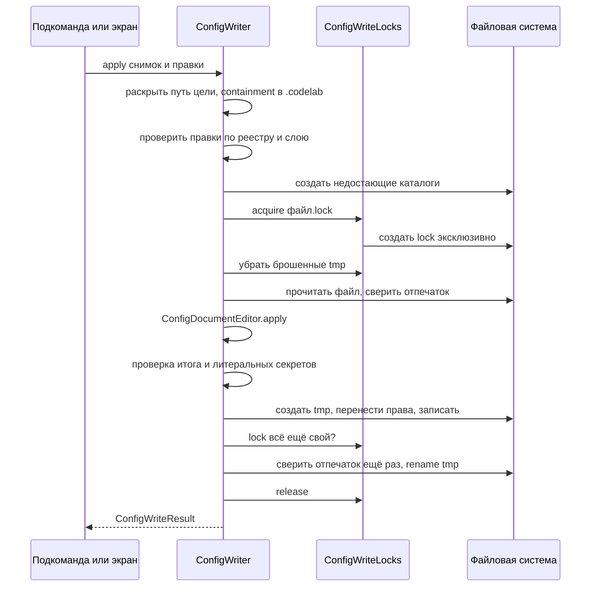
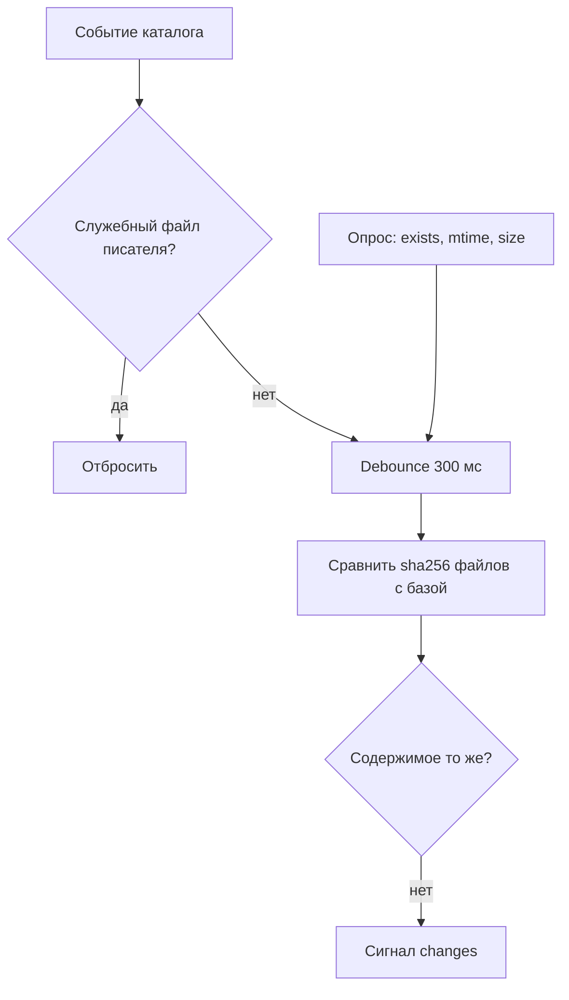

# Запись конфигурации и перезагрузка на лету

Глава про две вещи, которые пакет делает с файлами конфигурации после загрузки: как безопасно их править (`ConfigWriter`) и как заметить правку и сообщить ядру (`ConfigWatcher`, `FileConfigSource`). Третья тема — какие файлы защищает политика разрешений (`agentConfigPathsFor`).

Типы правок (`ConfigEdit`, `ConfigSnapshot`, `ConfigConflictException`) живут в ядре, чтобы клиенты строили и сравнивали их без `dart:io` ([глава 9 ядра](../../codelab_agent_core/doc/09-config-prompts-commands.md#правка-файлов)). Семантику перезагрузки (что применяется сразу, что после перезапуска) описывает ядро; здесь — файловая сторона.

Код: `lib/src/config/config_writer.dart`, `config_write_lock.dart`, `yaml_document_edit.dart`, `literal_secret_rule.dart`, `config_watcher.dart`, `file_config_source.dart`, `agent_config_paths.dart`. Нормы: [`agent-configuration`](../../../../openspec/specs/agent-configuration/spec.md) (CFG-13, CFG-15).

## `ConfigWriter`: единственный путь записи

Правят конфигурацию подкоманды CLI и экраны настроек. У всех должны быть одни гарантии:

- комментарии и порядок ключей остаются (правка через `YamlEditor`, а не пересериализация дерева);
- файл либо целиком старый, либо целиком новый (временный файл и `rename`);
- чужая ручная правка не затирается (отпечаток под блокировкой);
- литеральный секрет и непроверенный итог не доходят до диска.

Использование: один писатель на процесс, затем `read` и `apply`.

```dart
final snapshot = await writer.read(const ConfigTarget.user());
final result = await writer.apply(snapshot, [const SetValue('budget.max_steps', 8)]);
```

`ConfigTarget` выбирает слой: `user`, `project(cwd)`, `projectLocal(cwd)`. Путь файла считает функция `configLayerFilePath` — та же, что у `config path`, чтобы `$EDITOR $(codelab config path --local)` открывал именно тот файл, в который пишет `config set --local`.

Конструктор требует швы: `loader`, `logger`, `processRunner` (для `chmod`), `clock`, `random`. Так тесты подменяют время, случайность и запуск процессов. Относительный `codelabHome` писатель привязывает к каталогу процесса сразу.

### `read`

Возвращает `ConfigSnapshot`: путь после раскрытия ссылок, отпечаток байтов (sha256, `configFingerprint`) и разобранные значения. Файла нет — `fingerprint == null` и пустые значения. Файл с нарушением профиля YAML — `ConfigException`: снимок такого слоя для правки не годится.

### `apply`: порядок шагов



По шагам:

1. **Цель.** Путь раскрывается общим кодом `resolveConfigLinks` (`_targetPath`). Для проектных слоёв цель (и сам `.codelab`, если он ссылка) обязана лежать внутри канонического `<cwd>/.codelab`: репозиторий не должен ссылкой направить запись агента в чужой файл. Это идёт первым, до проверки правок.
2. **Проверка правок** (`_checkEdits`) до lock и до создания каталогов. `SetValue` с ключом из `inlineSecretKeys` (`api_key`, `token` и подобные) отвергается как секрет **раньше**, чем реестр: ответ должен быть «секрет», а не «неизвестный ключ». Неизвестный ключ — `unknown key`; слой, в который ключ писать нельзя, — `can only be written to: user, project, local`. `RemoveTable` принимает только экземпляр именованной таблицы схемы (`providers.<id>`).
3. **Каталоги.** Недостающие создаются и запоминаются: при отказе записи они убираются, и «файл не создан» верно и для `.codelab`. Созданный `$CODELAB_HOME` получает права `0700` через `chmod`, как у хранилища секретов.
4. **Lock** (см. ниже) и чистка брошенных tmp.
5. **Отпечаток.** Файл читается под lock; если его отпечаток не равен отпечатку снимка — `ConfigConflictException`. Файл больше 1 МиБ — отказ.
6. **Правка текста** (`ConfigDocumentEditor`).
7. **Проверка итога** (следующий раздел).
8. **Запись.** Итог совпал с исходным — файл не перезаписывается. Иначе создаётся пустой tmp `<файл>.tmp-<pid>-<случайное>` эксклюзивно, на него **переносятся права существующего файла**, и только потом пишется содержимое с `flush`. Так конфиг с правами `0600` не становится даже на мгновение `0644`. У нового файла права по umask (в прогоне из [главы 00](00-getting-started.md) новый `config.yaml` получил `-rw-r--r--`).
9. **Перед `rename`**: lock всё ещё свой (иначе его сочли устаревшим, и писал другой), и отпечаток файла не изменился с чтения под lock. Это закрывает гонку трёх писателей. Затем `rename` и запись события `config.write` (поля `path`, `keys`; значений нет).
10. **`finally`**: tmp удаляется, lock снимается, при отказе созданные каталоги убираются.

Исключения `apply`:

| Исключение | Когда | Что делает вызывающий |
|---|---|---|
| `ConfigConflictException` | файл изменился после `read` или занят lock | перечитать и повторить (`ConfigEditRunner` повторяет один раз) |
| `ConfigInlineSecretException` | в итоге литеральный секрет | показать подсказку `codelab secret set <имя>` |
| `ConfigException` | итог невалиден; правку нельзя выполнить без потери структуры; нет прав или места | показать проблемы |

Без fsync каталога: `dart:io` его не открывает. При отключении питания можно потерять последнюю правку, повреждённого файла не будет.

### Блокировка `ConfigWriteLocks`

Lock — файл `<файл>.lock`, который создаётся эксклюзивно (`createSync(exclusive: true)`) и содержит `<pid> <nonce>`. Правила:

- Занят свежий lock — `ConfigConflictException`.
- Lock старше `staleAfter` (10 секунд) считается брошенным. Его снимают **без гонки**: `rename` в уникальное имя `<файл>.lock.stale-<nonce>`, повторная проверка возраста и содержимого переименованного файла. Если за это время другой писатель успел создать свой lock и мы переименовали чужой свежий файл, он возвращается на место, а конфликт получает тот, кто ошибся. Событие — `config.write.stale_lock` (warning, поля `path`, `age_ms`).
- Свой lock снимается только если в нём nonce этого писателя (`release`, `isHeldBy`).
- `sweepAbandonedTmp` удаляет брошенные `<файл>.tmp-*` старше 10 секунд — только под своим lock.
- Всё, что писатель делает под lock, включая ожидание `chmod` (предел 5 секунд), укладывается строго короче `staleAfter`; иначе другой писатель имел бы право снять живой lock.

Имена служебных файлов (`.lock`, `.lock.stale-`, `.tmp-`) заданы константами в `config_write_lock.dart`; их же использует наблюдатель, чтобы не принять служебный файл за правку.

### Правка текста: `ConfigDocumentEditor`

`yaml_edit` правит узлы документа, а всё вне изменённых узлов остаётся побайтово тем же: комментарии, порядок, стиль, перевод строк. Что делает редактор:

- путь ключа превращается в узлы; недостающие предки создаются; пустые родители после удаления убираются;
- файл с якорями, тегами, повторами ключей (любое нарушение профиля) править нельзя: `yaml_edit` не гарантирует структуру. Результат — `cannot edit <key> automatically; edit the file manually`;
- новый ключ вставляется по алфавиту, если ключи отображения уже отсортированы, иначе в конец.

Реальный пример: `provider add` создал новый файл с ключами в алфавитном порядке; ручной файл с произвольным порядком получил `api_key_secret` в конец провайдера.

Один побочный эффект `yaml_edit`: строки со слэшем в двойных кавычках получают экранирование `\/`. Это допустимый YAML, значение читается верно:

```yaml
args:
  - -y
  - "@modelcontextprotocol\/server-filesystem"
```

### Проверка перед записью

`_validate` отвечает, можно ли писать итог. Порядок:

1. **Литеральные секреты** (`literalSecretIssues`): сравнивается дерево до и после правки; блокируются только **изменённые** листья. Ручная правка с литералом, сделанная до этого, загружается и не мешает несвязанным записям. Правило ищет секреты по именам (`api_key`, `token`, `password`…), по шаблонам значения (`sk-`, `ghp_`, JWT, PEM) и в заголовках, `env` и `args` MCP-серверов; нормализация имён (`X-API-KEY`, `x_api_key`, `ApiKey` — одно и то же) не даёт обойти правило.
2. **Кандидат.** `ConfigLoader.validateCandidate` строит все слои с итоговым текстом вместо файла.
3. **Доверие.** Если загрузка отбросила записанный ключ предупреждением `config.project.untrusted_key`, запись отклоняется до других проблем с подсказкой: `ignored in an untrusted project; use --local or add the project to trusted_projects in the global config` (для слоя `local` — без `--local`). Слой `user` этой проверке не подчиняется.
4. **Только новые ошибки.** Из проблем кандидата вычитаются проблемы исходного файла по сигнатуре «вид, ключ, файл» (без значений и строк). Блокируют лишь новые. Прежние идут предупреждениями результата: иначе первая запись в пустой слой упиралась бы в `agent.default_model: no model is configured`. Вычитание — по мультимножеству, то есть рост числа одинаковых проблем даёт новые. Исключение: «проверка неполна» в кандидате всегда новая проблема, а в исходном файле правку не блокирует — иначе испорченный элемент нельзя было бы удалить.
5. **Результат.** `warnings` содержит прежние проблемы, незаданные `${VAR}` и предупреждения о затронутых ключах; `restartRequiredKeys` — ключи правок, у которых дескриптор `SettingsRegistry` помечен `restartRequired`.

Реальный пример отказа: модель вне каталога.

```text
[~/demo/home/config.yaml:9:3: agent.default_model: p/zzz is not in the model catalog; declare it in providers.p.models]
```

Тест того же поведения: `model set` с неизвестной моделью даёт код `1` и не меняет файл (скелет — [глава 11](11-extending.md#рецепт-подкоманда-записи-через-configeditrunner)).

Два соседних метода: `validate` проверяет правки так же, как `apply`, но ничего не пишет (нужен `provider add --api-key-stdin`: ключ нельзя сохранять, если итог заведомо невалиден); `preview` отдаёт итоговый текст слоя без проверки (его использует `secret migrate --all`).

## Наблюдение за файлами

Ядро перезагружает конфигурацию по сигналу, не зная ни файлов, ни часов. Сигнал готовит `ConfigWatcher`, а `FileConfigSource` склеивает его с загрузчиком.

### Что нужно от наблюдателя

Файловая система присылает пачку событий (редактор пишет tmp, переименовывает, ставит lock). Ядру нужен **один** сигнал на правку и только если содержимое действительно изменилось. Платформенный `Directory.watch` ещё и ненадёжен: каталога может не быть, поток может закрыться.

### Как устроен `ConfigWatcher`



- **Список файлов** строит `watchedConfigFiles`: `$CODELAB_HOME/config.yaml`; файл `--config`/`CODELAB_CONFIG`; `<cwd>/.codelab/config.yaml` и `config.local.yaml` (в том числе ещё не созданные); `$CODELAB_HOME/secrets.yaml`, если `secrets.backend: file`.
- **Подписки** — `Directory.watch` на родителе каждого файла **и на родителе канонической цели ссылки**: `config.yaml` часто ссылка в dotfiles, и правка цели — событие другого каталога. Цели пересчитываются при каждой перезагрузке и перед каждым сравнением: ссылку могли перенаправить.
- **Фильтр.** События с именами `<файл>.lock`, `<файл>.lock.stale-*`, `<файл>.tmp-*` отбрасываются до debounce. При `rename` источник (tmp) служебный, а цель — наблюдаемый файл: это и есть итоговый сигнал записи писателя. Один `apply` даёт один сигнал.
- **Debounce.** Новое событие перезапускает таймер на 300 мс (`configWatchDebounce`) по `Clock`. Событие `config.watch.debounce` (debug, поле `path`) отмечает замеченную правку; по нему интеграционные тесты узнают, что debounce стартовал.
- **Сравнение.** После таймера считается sha256 каждого файла; если хоть один отличается от базы, база обновляется и в `changes` идёт сигнал. Файл больше 1 МиБ не читается: отпечаток строится по размеру и mtime (`oversized:<size>:<mtime>`), потому что загрузчик всё равно откажется от такого файла.
- **Нечитаемый файл** — отдельное состояние `unreadable` (и предупреждение `config.watch.failed`), не равное ни «нет файла», ни содержимому.

### Деградация до опроса

Если каталога нет, поток событий упал или закрылся без ошибки (inotify при удалении каталога), файлы этого каталога переходят на опрос раз в `config.poll_interval` (по умолчанию 2 секунды) по тройке `(exists, mtime, size)`. Событие — `config.watch.fallback` (info, поля `path` и `reason` — имя типа ошибки). Файл остаётся на опросе до `close`. Исключение замера не останавливает опрос: таймер взводится всегда.

Проверка существования каталога вынесена в `defaultDirectoryEvents` нарочно: на macOS `watch` по несуществующему каталогу не бросает и не сообщает об ошибке, поток молча пуст, и правка была бы пропущена.

### Containment проектных слоёв и наблюдатель

Наблюдатель получает от `FileConfigSource` функцию `readablePath`: тот же вердикт `checkProjectLayer`, что у загрузчика. Файл, который загрузчик не читает (цель вне `.codelab`, цикл, висячая ссылка наружу), не читается, не замеряется и **не наблюдается по каталогу** — подписка на каталог такого файла следила бы за каталогом вне проекта. Такие файлы только опрашиваются как вердикт; смена вердикта даёт сигнал.

### `FileConfigSource`

Реализует два порта ядра: `ConfigSource` (`initial`, `load`, `changes`) и `ProjectConfigLoader` (`loadForProject`).

```dart
FileConfigSource(
  initial: result,           // результат стартовой загрузки
  cwd: cwd, environment: environment,
  clock: clock, logger: logger,
  flags: flags, preconfigFlags: preconfigFlags,
  extraConfig: extraConfig, knownVariables: knownVariables,
)
```

Как он работает:

- **Параметры запуска запоминаются один раз.** Корень, окружение, флаги, предконфигурация, `--config` не меняются за жизнь процесса, поэтому каждая `load` читает слои заново теми же параметрами. Окружение копируется без возможности изменения.
- **Относительный `--config` фиксируется от корня запуска.** У сессии другой папки `cwd` иной, и без этого сессия читала бы другой файл.
- **Доверие закреплено.** Каждая `load` передаёт `pinnedTrustedProjects: initial.config.trustedProjects`: новое значение `trusted_projects` в файле попадает только в `values` и не расширяет доверие до перезапуска. Загрузчик список лишь передаёт, решает ядро.
- **`load(rebase: true)`** сначала делает `rebase` наблюдателя: принимает текущее содержимое файлов за «последнюю загрузку». Собственное чтение тогда не порождает сигнал, а правка во время чтения порождает. Проверка (`rebase: false`, `/config check`) базу **не** переносит: иначе сигнал о неприменённой правке терялся бы.
- **`loadForProject(canonicalCwd)`** читает слои другой папки тем же загрузчиком и теми же параметрами, меняется только `cwd`; предупреждения пишутся `logConfigWarnings` на каждую загрузку. Базу наблюдателя метод не сдвигает: наблюдатель следит только за файлами корня.
- **`config.watch: false`** в `initial.host` — наблюдателя нет, `changes` молчит (отдельный пустой поток), а ручная перезагрузка `/config reload` работает.
- **`close()`** останавливает наблюдение и таймеры; повторный вызов безопасен. Владеет источником хост: после `runtime.dispose()` он зовёт `close`. `--llm-script` источник не создаёт.

## Что защищает политика разрешений: `agentConfigPathsFor`

Принцип PERM-11: то, что агент перечитывает на лету, модель не правит без человека. Инструмент записи (`write`, `edit`) и команды `exec` не должны менять конфигурацию незаметно. Какие пути считаются конфигурацией, решает пакет; как политика ими пользуется — [глава 7 ядра](../../codelab_agent_core/doc/07-permissions.md#правка-конфигурации-агента).

Две функции, и вторая построена поверх первой:

| Функция | Результат | Для чего |
|---|---|---|
| `watchedConfigFiles(cwd, environment, extraConfig, secretsFile)` | лексические пути файлов слоёв | что наблюдает `ConfigWatcher` |
| `agentConfigPathsFor(cwd, environment, extraConfig, skillExtraRoots, caseInsensitive)` | `AgentConfigPaths`: канонические пути и расширения `HOME`/`CODELAB_HOME` | что защищает политика |

Правило «наблюдаемое ⊆ защищаемому» держится построением: защищаемый список включает наблюдаемый. Дополнительно в защищаемый список входят:

- `$CODELAB_HOME/secrets.yaml` **всегда**, независимо от `secrets.backend`: файл остаётся под защитой, и когда бэкенд позже переключат на `file` (наблюдаемым он становится только при `file`);
- `$CODELAB_HOME/state/last-model.json` и весь каталог `$CODELAB_HOME/state`: память последней модели влияет на выбор модели следующих сессий; в наблюдатель она не входит, перезагрузки по ней нет;
- каталоги `$CODELAB_HOME/agents` и `$CODELAB_HOME/prompts` (паритет с проектными `.codelab/agents/**` и `prompts/**`);
- корни навыков: `$CODELAB_HOME/skills`, `<домашний>/.agents/skills` и абсолютные или `~`-элементы `skills.extra_roots` — всем поддеревом, существуют они или нет, независимо от доверия проекту.

Пути канонические: `$CODELAB_HOME/config.yaml` может быть ссылкой на `~/dotfiles/codelab.yaml`, и политика сравнивает цель `write` после канонизации `BoundedEnv`. Ссылки раскрываются по самому глубокому существующему предку, поэтому защищены и ещё не созданные файлы (функция `canonicalPath` из `skill_roots.dart`). Для файлов состояния кладутся и лексический, и канонический путь: `FileLastModelStore.write` заменяет ссылку обычным файлом через `rename`, и защита только по цели перестала бы действовать.

`expansions` — `HOME` и `CODELAB_HOME` в лексической форме: так их видит оболочка при раскрытии `$HOME` в командах `exec`. `caseInsensitive` по умолчанию истинно на macOS и Windows.

Корни навыков, зависящие от `cwd` сессии, в хостовое поле положить нельзя. Их даёт `sessionSkillRootsFor(cwd, extraRoots)`: `.codelab/skills` и `.agents/skills` на каждом уровне от `cwd` до корня git (не выше 64 уровней), затем относительные элементы `extra_roots`. Рантайм добавляет их к политике сессии.

Новый файл или каталог, который агент не должен править, добавляется в список файлов `agentConfigPathsFor` (скелет — [глава 11](11-extending.md#рецепт-защитить-новый-файл-состояния-perm-11)).

## Что запомнить

- Запись конфигурации — только через `ConfigWriter`; он же единственный, кто умеет править YAML с сохранением формата.
- Порядок «lock → отпечаток → правка → проверка → tmp → повторная сверка → `rename`» нельзя упрощать: каждый шаг закрывает конкретную гонку.
- Проверка записи блокирует только **новые** ошибки; прежние — предупреждения.
- Наблюдатель даёт один сигнал на правку и сравнивает содержимое, а не время.
- Доверие закреплено на стартовом снимке: перезагрузка не расширяет его.
- Наблюдаемый список входит в защищаемый, но не наоборот.

## Смотрите также

- [Сквозной алгоритм настроек: перезагрузка и запись из клиента](../../codelab_agent_core/doc/algorithms/settings.md)
- [Глава 3: загрузка](03-config-loading.md)
- [Глава 9 ядра: правка и перезагрузка](../../codelab_agent_core/doc/09-config-prompts-commands.md)
- [Глава 7 ядра: правка конфигурации агента как критическое действие](../../codelab_agent_core/doc/07-permissions.md)
- Тесты: `test/config/config_writer_test.dart`, `config_writer_atomic_test.dart` (гонки через швы `ConfigWriteSeam`), `config_watcher_test.dart` (события вручную, `FakeClock`), `file_config_source_test.dart` (настоящий `Directory.watch` и `rewriteUntil`)
