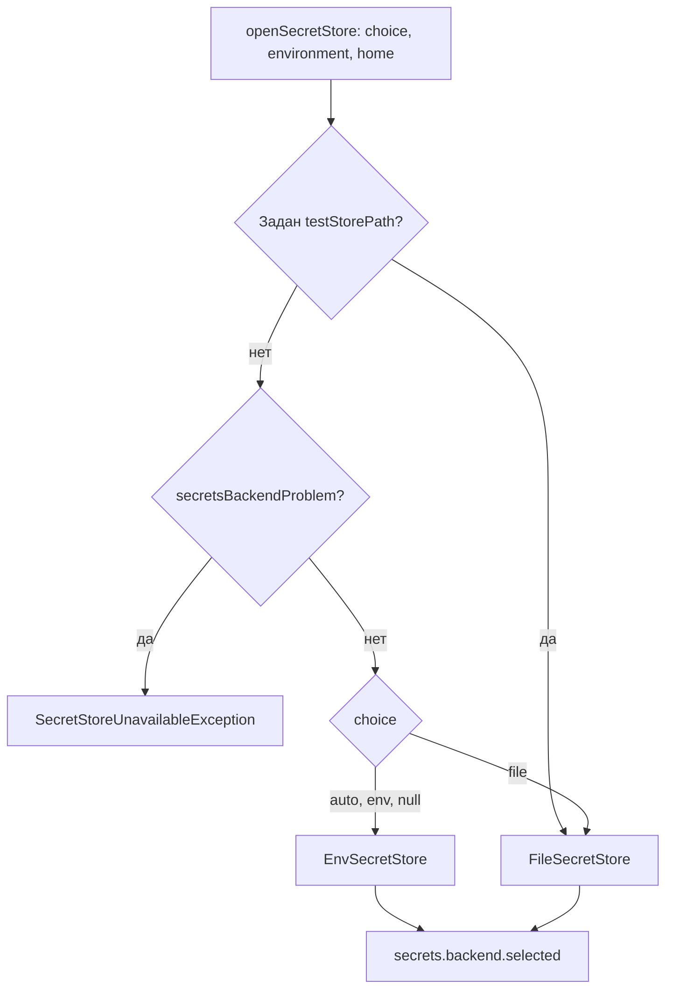
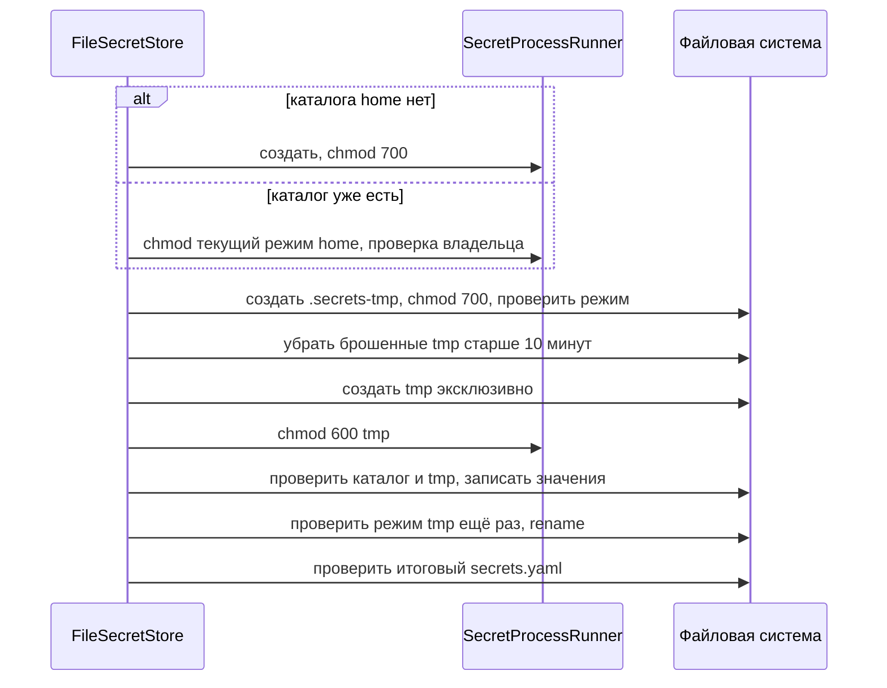

# Секреты: хранилища, администрирование, перенос

Глава про то, как пакет хранит и выдаёт секреты: ключи провайдеров и токены MCP-серверов. Ядро знает только порт `SecretStore`, резолвер `SecretResolver` (порядок поиска, кэш, диагностика без значения) и правила имён `SecretNames`; всё это описывает [глава 9 ядра](../../codelab_agent_core/doc/09-config-prompts-commands.md#секреты-libsrcsecrets). Здесь — бэкенды на `dart:io`, их защита от чужих пользователей, программное администрирование и перенос литералов из конфигурации.

Пользовательский взгляд — [настройка агента](../../../../docs/user/configuration.md). Нормы — [`agent-secrets`](../../../../openspec/specs/agent-secrets/spec.md) (CFG-9, CFG-10, CFG-11).

Код: `lib/src/secrets/`.

## Что где лежит

| Файл | Что это |
|---|---|
| `env_secret_store.dart` | бэкенд `env`: только чтение переменных `CODELAB_SECRET_*` |
| `file_secret_store.dart` | бэкенд `file`: открытый `$CODELAB_HOME/secrets.yaml` |
| `open_secret_store.dart` | `openSecretStore`: выбор бэкенда по `secrets.backend` |
| `host_secrets.dart` | `openHostSecrets`: резолвер секретов хоста |
| `secrets_backend_problem.dart` | `secretsBackendProblem`: единая проверка значения `secrets.backend` |
| `secret_admin.dart` | `SecretAdmin`: `store`, `delete`, `list`, `checkStore` с типизированными исходами |
| `client_secret_access.dart` | `ClientSecretAccess`: единственный путь клиентов к хранилищу |
| `secret_migrator.dart` | `SecretMigrator`: перенос литеральных секретов в хранилище |
| `secret_process_runner.dart` | `SecretProcessRunner`: узкий порт запуска `chmod` |
| `secret_value_checks.dart` | `secretValueProblem`: пределы значения |
| `secret_read_only_hint.dart` | `secretReadOnlyHint`: текст подсказки для хранилища «только чтение» |

## Выбор бэкенда: `openSecretStore`



Правила (нормы CFG-11 и «Выбор бэкенда `secrets.backend`»):

- `null` и `auto` дают **`env`** на всех ОС. `auto` не выбирает `file` никогда: ни сразу, ни запасным вариантом, потому что файл открытый.
- `env` явно — тоже `EnvSecretStore`; `file` — `FileSecretStore` по `$CODELAB_HOME/secrets.yaml`.
- `keychain` пока даёт отказ `keychain is not supported yet (supported: auto, env, file)`; незнакомое значение — `expected one of: auto, keychain, env, file` (само значение в текст не попадает: в нём мог быть секрет); `file` на Windows — `file backend is not supported on Windows; use env with CODELAB_SECRET_* variables`.
- Отказ — `SecretStoreUnavailableException`, а не `UnsupportedError`: сюда значение приходит и из подкоманд `secret`, и из встроенного хоста. Те же тексты даёт загрузчик конфигурации через общую `secretsBackendProblem`.

Выбор логируется один раз: `secrets.backend.selected` (info, поля `backend`, `path`, `reason`). Для `file` добавляется предупреждение `secrets.backend.plaintext` (поле `path`). Для `auto` поле `reason` объясняет, почему не выбрано хранилище ОС:

```text
OS keychain backends are not available in this version; set secrets.backend: file or CODELAB_SECRET_* variables
```

На Windows подсказка про `file` не добавляется.

Параметр `testStorePath` включает бэкенд `file` по заданному пути независимо от `choice`: сборка e2e-тестов не должна трогать настоящий `$CODELAB_HOME`. Его вычисляет `testSecretStorePath(environment)` из переменной `CODELAB_TEST_SECRET_STORE`, но только в сборке с `--dart-define=CODELAB_ALLOW_TEST_SECRETS=true`: define проверяется при компиляции, и в рабочей сборке ветка вычищена. Передаёт его только открыватель встроенного агента.

Фабрику для хостов даёт `openHostSecrets(codelabHome, environment, backend, debug, logger)` — она собирает `SecretResolver` ядра поверх `openSecretStore`. Все входы, кроме `logger`, — сериализуемые данные (`codelabHome`, `environment`, `backend`, `debug`), а глобального состояния у функции нет. Поэтому хост с ядром в отдельном isolate вызывает её внутри isolate из полей `codelabHome`, `environment`, `secretsBackend`, `debugSecrets`; резолвер и кэш через границу не передаются. Одна фабрика на всех нужна, чтобы ключ, сохранённый `codelab secret set`, был виден и `codelab-agent`, и встроенному агенту.

## `EnvSecretStore`

`read(name)` возвращает значение переменной `SecretNames.envOverride(name)`; пустое значение равно отсутствию. Запись и удаление — `SecretStoreUnavailableException('env backend is read-only')`. `names()` пуст: отображение «имя → переменная» необратимо, и список переменных показывает `SecretAdmin.list`.

Отображение имени в переменную: например, `codelab/gw` → `CODELAB_SECRET_CODELAB_GW` (реальный вывод `config check` выше).

## `FileSecretStore`: защита открытого файла

Файл открытый, поэтому работает по правилам ssh: широкие права и символическая ссылка — отказ, а не «чтение с предупреждением». Бэкенд выбирается только явным `secrets.backend: file`.

### Формат

```yaml
# CodeLab secrets in plaintext. Managed by: codelab secret set|delete
"codelab/gw": "<секрет>"
```

По строке на секрет, ключи по алфавиту, значения в двойных кавычках с экранированием JSON. Недопустимые для YAML символы (DEL, C1, U+2028/2029, BOM) экранируются отдельно, иначе разборщик отверг бы файл или склеил строки. Читает файл тот же `readYamlTree` ([глава 3](03-config-loading.md)); структура не «имя → строка», имя вне `SecretNames` или синтаксическая ошибка — `SecretStoreUnavailableException` без строк файла (в них секреты). Файл больше 1 МиБ — отказ.

Файл создаёт только `write`; `read`, `delete` и `names` отсутствующего файла не создают.

### Проверки перед каждым обращением

1. Платформа: на Windows бэкенд отказывает сам (защита в глубину).
2. `$CODELAB_HOME` существует, не ссылка (`<путь> is a symbolic link; refusing to keep secrets there`), это каталог и не доступен на запись группе или остальным (`mode & 0o022`): `<home> is writable by group or others (mode 0775); run: chmod go-w <home>`.
3. `secrets.yaml` не ссылка (`<путь> is a symbolic link; refusing to read secrets`) и без прав для группы и остальных: `<путь> has permissions 0644; run: chmod 600 <путь>`.

Предупреждение `secrets.file.refused` пишут отказы чтения и отказы записи — **не чаще раза на процесс и путь**, чтобы повторы не засоряли журнал. Поле `reason`: `symlink`, `home_symlink`, `home_writable`, `too_large`, `tmp_dir_symlink`, `tmp_dir_mode`, `home_owner`, `wide_after_write`. У отказа по правам файла поля `reason` нет: там только `path` и `mode`.

Реальный вывод на файле с правами `0644` (после `chmod 644 secrets.yaml`):

```text
$ codelab-agent secret list
warning: secrets are stored unencrypted in ~/demo/home/secrets.yaml
cannot list secrets: ~/demo/home/secrets.yaml has permissions 0644; run: chmod 600 ~/demo/home/secrets.yaml
```

### Атомарная запись

Задача: пока у нового файла ещё широкие права (`0666 & ~umask`), посторонний не должен успеть открыть его. Поэтому временный файл лежит не рядом с `secrets.yaml`, а в приватном каталоге `$CODELAB_HOME/.secrets-tmp`.



Шаги и их причины:

| Шаг | Зачем |
|---|---|
| каталог `$CODELAB_HOME`, если нет, создаётся с `chmod 700` независимо от umask | на Debian и Ubuntu umask `0002` дал бы группе запись и отказ следующей же проверки |
| владелец: no-op `chmod <текущий режим> $CODELAB_HOME` | `dart:io` владельца не сообщает; не-владельцу ОС отвечает `EPERM`. Без проверки владелец чужого каталога (`/tmp/codelab` другого пользователя) подменил бы `.secrets-tmp` между `chmod 700` и созданием tmp |
| `.secrets-tmp` — ссылка: отказ без `chmod` | `chmod` пошёл бы по ссылке на чужой каталог |
| имя tmp `secrets.tmp-<pid>-<счётчик>-<случайное>` | уникально; чистятся только файлы с этим префиксом |
| `chmod 600 tmp` **до** записи значения | значение не должно лежать в файле с широкими правами |
| `_verifyTmpDir`, `_verifyTmp` после создания и перед `rename` | каталог могли подменить между проверкой и созданием файла; права — изменить за время записи |
| после `rename` проверка `secrets.yaml` | широкие права (например, ФС без POSIX-прав) сначала исправляются `chmod 600`; файл удаляется, **только** если исправить не удалось — и причина говорит об этом |
| брошенные tmp старше 10 минут удаляются следующей записью | свежие могут принадлежать параллельному процессу; ссылки не разыменовываются |

Каталог `.secrets-tmp` после записи остаётся (в реальном запуске он виден в `ls -a` рядом с `secrets.yaml` и `config.yaml`, права `drwx------`). Это не мусор.

Записи сводятся в **одну очередь на путь** в пределах процесса: ключ очереди строится по абсолютному пути без `.`/`..`, с раскрытым родителем. Несколько экземпляров `FileSecretStore` (подкоманда создаёт его заново на каждый вызов) не теряют обновления друг у друга. Ошибка предыдущей записи следующую не отменяет. Два **разных процесса** могут потерять одно обновление.

Остаточные риски записаны в комментарии класса: владельца самого `secrets.yaml` `dart:io` не сообщает, при чтении владелец `$CODELAB_HOME` не проверяется, root обходит `EPERM`, а между проверкой и чтением остаётся окно TOCTOU того же класса, что у `BoundedEnv`.

### Порт запуска процессов

В `dart:io` нет смены прав файла, поэтому права выставляет утилита `chmod`. Запуск идёт через узкий порт `SecretProcessRunner`; настоящая реализация — `IoSecretProcessRunner`:

- абсолютный путь утилиты (`/bin/chmod`, а если его нет — `/usr/bin/chmod`, например на NixOS), потому что `PATH` дочернему процессу не передаётся;
- без оболочки (`runInShell: false`) и без окружения родителя (`includeParentEnvironment: false`): путь с пробелом или `;` безопасен, `CODELAB_SECRET_*` дочерний процесс не получает;
- в argv только режим и путь; значение секрета в argv не попадает никогда (argv виден через `ps`). Если процессу нужно значение, оно идёт в `stdin`;
- stdout и stderr вычитываются и отбрасываются; результат — только `exitCode` и `timedOut` (код `-1`, процесс убит). Служебные утилиты могут цитировать аргументы, а значит секрет.

Второй потребитель порта — `ConfigWriter` ([глава 4](04-config-writing-and-reload.md)): он переносит права существующего файла на tmp тем же `chmod`. Третий — `FileLastModelStore`. Порт не переименован ради них: имя остаётся узким по смыслу «запуск служебной утилиты без значений секретов в argv».

В тестах порт заменяет `FakeSecretProcessRunner` (`test/support/`): по умолчанию он запускает настоящий `chmod`, но записывает вызовы, порядок и размер tmp в момент `chmod 600`, и может отказать или имитировать «успех без эффекта».

## `SecretAdmin`: программная запись

Страница настроек и `SecretCommands` обязаны давать одинаковые проверки и тексты. Поэтому проверки собраны в `SecretAdmin`, а подкоманда только форматирует результат. Ошибка пользователя — штатный исход, не исключение. Исходы — запечатанные иерархии, поэтому `switch` не даёт забыть ветку:

| Метод | Исходы |
|---|---|
| `store(name, value)` | `SecretStored`, `SecretUpdated` (секрет уже был: перезаписан без вопроса), `SecretInvalidName`, `SecretInvalidValue`, `SecretCollision`, `SecretReadOnly`, `SecretFailed` |
| `checkStore(name)` | то же без значения (нужен, чтобы не просить ввод секрета, который всё равно отвергнут) |
| `delete(name)` | `SecretDeleted`, `SecretNotSet` (идемпотентно), `SecretInvalidName`, `SecretReadOnly`, `SecretFailed` |
| `list()` | `SecretListing(backend, names, overrides)`, `SecretListFailed` |

Порядок проверок `store`: имя, бэкенд только для чтения, значение (пустое — `empty secret value`; `secretValueProblem`), коллизия переменной, запись. Дешёвые проверки идут раньше обращения к хранилищу.

**Коллизия.** Отображение имени в переменную необратимо: `codelab/a-b` и `codelab/a.b` дают одну `CODELAB_SECRET_…`, и переопределение действовало бы на оба секрета сразу. `SecretCollision` называет оба имени и общую переменную.

**Пределы значения** (`secretValueProblem`): одна строка (`secret value must be a single line`), без непарного суррогата (`secret value is not valid Unicode (unpaired surrogate)`), не больше 64 КиБ в UTF-8 (`secret value is longer than 64 KiB`). Непарный суррогат отвергается, а не «чинится»: YAML-запись его не воспроизводит.

**Значения нет нигде.** Результаты не несут значения; `toString` у них единого вида `Класс(поле: значение, …)` без него. Исключение хранилища превращается в `SecretFailed(reason)`: в причину идёт только наш текст или имя типа ошибки (`secret store failed: <тип>`), потому что чужое исключение могло процитировать значение. Имя в `SecretInvalidName` тоже не повторяется: в поле имени нередко вписывают сам ключ.

Запись не сбрасывает кэш резолвера в том же процессе: уже работающий агент старое значение не забывает, нужен перезапуск (`restart the agent to use the moved secrets` в выводе миграции).

Подсказка «хранилище только для чтения» — `secretReadOnlyHint(readOnly, home)`; одна функция на CLI, мастер провайдера и страницы app:

```text
secret store env is read-only. Add 'secrets.backend: file' to ~/demo/home/config.yaml to store secrets in ~/demo/home/secrets.yaml (plaintext, 0600), or set CODELAB_SECRET_CODELAB_GW in the environment
```

## `ClientSecretAccess`: путь клиентов

`openHostSecrets` принадлежит хосту агента и кэширует найденное до конца процесса. Клиенту (`codelab-app`, CLI) кэш вреден: замена секрета в другом процессе (`codelab secret set`) должна быть видна при следующем подключении. Поэтому клиенты ходят **только** через `ClientSecretAccess`:

```dart
final access = await ClientSecretAccess.open(
  codelabHome: home, environment: Platform.environment, logger: logger,
);
await access.isSet('codelab/gw');       // имя в names() или непустая переменная
final key = await access.read('codelab/gw');  // переменная, затем бэкенд, без кэша
await access.admin.store('codelab/gw', value);
```

- `open` читает из `$CODELAB_HOME/config.yaml` **только** `secrets.backend`. Нечитаемый файл, синтаксическая ошибка или недопустимое значение — не исключение, а бэкенд `env` с `unavailableReason` и поле `configProblem`. Пока конфиг сломан, клиент ничего не записывает. Событие — `secrets.client.fallback` (warning, поля `backend`, `reason`). Текст причины фиксирован: `the user config file cannot be read, so secrets are read-only until it is fixed` или `secrets.backend: <причина>`.
- Порядок чтения совпадает с порядком `SecretResolver`: непустая переменная `SecretNames.envOverride(name)` побеждает бэкенд. Иначе клиент и агент разошлись бы.
- `read` возвращает значение только адаптеру, который сразу отдаёт его транспорту или проверочному запросу; в состояния, события и тексты оно не попадает (SETUP-1). `toString()` печатает лишь id бэкенда.
- Чужое исключение бэкенда заменяется на `secret store failed: <тип>`.

## `SecretMigrator`: из конфигурации в хранилище

Если в `config.yaml` лежит литеральный секрет (`api_key: sk-…`, токен в заголовке MCP), его нужно перенести в хранилище, а в файл вписать ссылку. Это делают `codelab secret migrate`, `codelab-agent secret migrate` и кнопка в `codelab-app`; все вызывают один движок.

```dart
final report = await SecretMigrator().run(SecretMigrationOptions(
  cwd: cwd, environment: environment,
  layers: {ConfigLayer.user}, dryRun: false, force: false,
));
```

Исключений для штатных отказов нет: исход в `report` — `exitCode`, `items`, `warnings`, `problems`. Пункты отчёта — запечатанная иерархия без значений (`SecretPlanItem`, `SecretMovedItem`, `SecretReusedItem`, `SecretReplacedItem`, `SecretProviderMovedItem`, `SecretMcpServerMovedItem`, `SecretNotMigratedItem`, `SecretActionRequiredItem`).

Порядок работы (самая важная часть — проверки идут **до** любой записи):

1. Находки `findInlineSecrets` ядра по применяемым слоям.
2. Доверие писателя и пределы значения.
3. Имена: `SecretNames.suggestFor`/`forMcp`; одно имя с разными значениями получает суффикс `-2`.
4. Итог правок **всех** выбранных файлов вместе проверяется через `ConfigLoader.validateCandidate(pending: …)` — до обращения к хранилищу. Без `pending` правка первого файла сливалась бы с ещё не переписанным вторым и давала промежуточный конфликт источников ключа.
5. `SecretAdmin.checkStore`, сравнение с хранилищем, конфликты.
6. Запись: сначала секреты всех файлов, потом конфигурации по одному — `user`, затем `local`, затем `project`. Сбой между записями оставляет рабочий конфиг.

Особые случаи: недоверенный проект и `CODELAB_CONFIG` значений в хранилище не отдают; элементы `args` MCP-серверов не трогаются; провайдер из закоммиченного `config.yaml` с находкой в группе «адрес и ключ» переезжает целиком в `config.local.yaml`, чтобы литерал ушёл из репозитория.

Реальный прогон на файле с `api_key` (`# TODO` стоял в конце удалённой строки и исчез вместе с ней, остальные комментарии на месте):

```text
$ codelab-agent config check --cwd .
warning: ~/demo/home/config.yaml:10:5: providers.gw.api_key: a secret is stored in the config file; move it to the secret store: codelab secret migrate

$ codelab-agent secret migrate --dry-run
~/demo/home/config.yaml: providers.gw.api_key -> api_key_secret: codelab/gw (new)
warning: secrets are stored unencrypted in ~/demo/home/secrets.yaml

$ codelab-agent secret migrate
Moved providers.gw.api_key in ~/demo/home/config.yaml to secret codelab/gw
restart the agent to use the moved secrets
warning: secrets are stored unencrypted in ~/demo/home/secrets.yaml
```

Значения в отчёте нет — ни самого, ни длины, ни префикса, ни хеша. Писатель получает тихий логгер.

## Что запомнить

- `auto` — это `env`. `file` выбирается только явно и никогда не запасным вариантом.
- Файл секретов защищён проверками каталога и файла, приватным `.secrets-tmp`, `chmod 600` до записи значения и очередью записей на путь.
- Значения секретов не попадают в исходы, исключения, `toString` и лог. Если вы добавляете код с секретом, держите это правило.
- Клиенты ходят через `ClientSecretAccess`, хост — через `openHostSecrets`; у первого нет кэша.
- Миграция сначала проверяет все файлы, потом пишет секреты, потом конфиги.

## Смотрите также

- [Глава 9 ядра: секреты и резолвер](../../codelab_agent_core/doc/09-config-prompts-commands.md#секреты-libsrcsecrets)
- [Алгоритм хранения и выдачи секретов](../../codelab_agent_core/doc/algorithms/secrets.md): сквозной путь от `secret set` до запроса провайдера
- [Глава 9: подкоманды `secret`](09-subcommands.md#подкоманды-secret)
- [Глава 13: частые проблемы с секретами](13-troubleshooting.md)
- Тесты: `test/secrets/file_secret_store_test.dart`, `secret_admin_test.dart`, `secret_migrator_test.dart`, `client_secret_access_test.dart`
