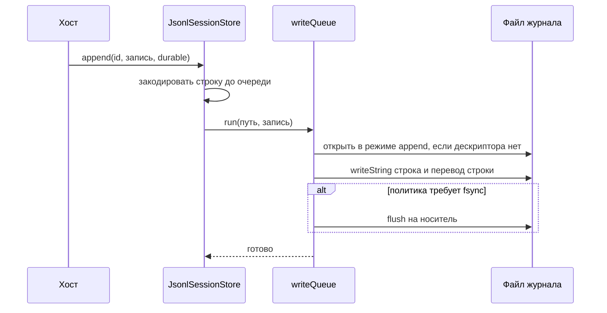
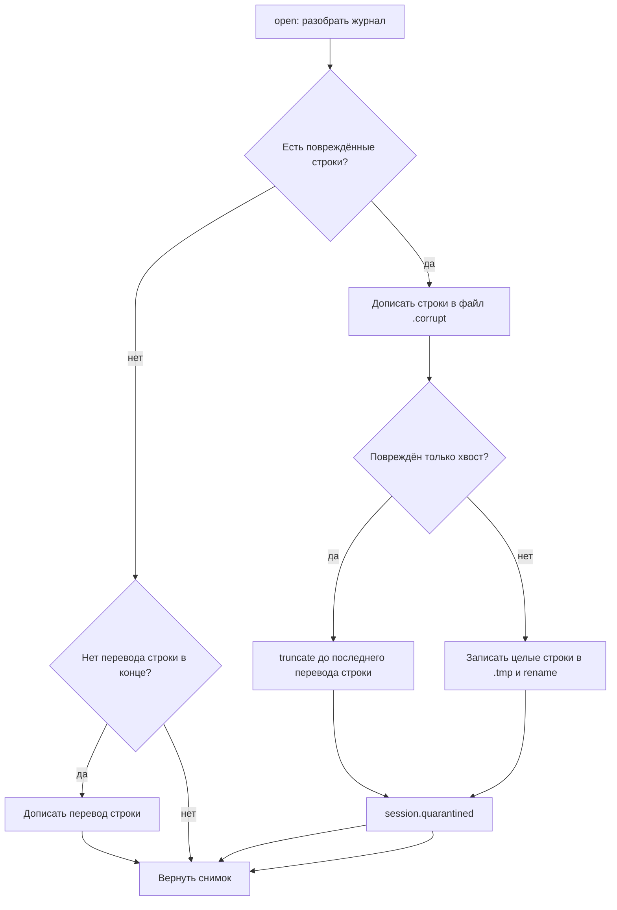

# Сессии и состояние на диске

Глава про файлы, которые агент пишет сам: журнал сессии (`JsonlSessionStore`), журнал расхода токенов (`JsonlUsageLedgerStore`), память последней модели (`FileLastModelStore`). Что такое запись журнала, дерево записей, точка восстановления, как сессия загружается и сжимается, объясняет [глава 8 ядра](../../codelab_agent_core/doc/08-sessions-and-compaction.md). Здесь — только то, что делает io-сторона: раскладка каталогов, очередь записи, `fsync`, карантин, переписывание, кэш списка.

Нормы: [`agent-sessions`](../../../../openspec/specs/agent-sessions/spec.md) (SES-1…SES-9). Код: `lib/src/session/`, `lib/src/state/`.

## Разделение труда с ядром

`JsonlSessionStore` отвечает только за **байты**. Разбор строк, дерево, ремонт в памяти и сводки живут в ядре (`parseSessionLines`, `summarize`, `pageOf`). Поэтому файл ведёт себя так же, как `MemorySessionStore`, и проходит тот же контрактный набор тестов (`session_store_contract.dart` из тестов ядра). Что делает пакет:

| Задача | Где |
|---|---|
| раскладка каталогов и имена файлов | `create`, `_find`, `_journals` |
| очередь записи на путь | `WriteQueue` |
| `fsync` по политике | `_write`, `FsyncPolicy` |
| ремонт файла на диске: карантин и переписывание | `_repair` |
| кэш списка сессий | `index.json` |
| разбор в отдельном isolate | `_readAndParse` |
| журналы потомков (субагентов) | `createChild`, `openChild`, `openChildReadOnly` |

## Раскладка на диске

Хост создаёт одно хранилище на процесс над `$CODELAB_HOME/sessions` (или `sessions.dir` из конфигурации). Хранилище окружение не читает.

```text
sessions/
├── index.json                                   кэш списка сессий
└── work-demo-7b8bd81b/                          слаг рабочей папки
    ├── 2026-10-21T08-00-00-000Z_01JB8Q2W6R9T3M5K7N1P4X8Z0A.jsonl
    ├── 2026-10-21T08-00-00-000Z_01JB8Q2W6R9T3M5K7N1P4X8Z0A.jsonl.corrupt   карантин, если был
    └── 2026-10-21T08-00-00-000Z_01JB8Q2W6R9T3M5K7N1P4X8Z0A/                данные сессии
        ├── usage.json                           журнал расхода (JsonlUsageLedgerStore)
        └── subagents/<время создания>_<id потомка>.jsonl  журналы потомков, плоско
```

Файлы `.jsonl`, `.jsonl.corrupt` и `index.json` получены временным тестом с `JsonlSessionStore` и фиксированными часами. Каталог данных с `usage.json` и `subagents/` создают соответствующие хранилища; его раскладка взята из кода (`dataDirectoryOf`, `createChild`).

- **Слаг** — `cwdSlug(cwd)` ядра: до двух последних сегментов пути, нечитаемые символы заменены на `-`, обрезка до 48 знаков и 8 шестнадцатеричных цифр FNV-1a от полного пути. Читаемая часть помогает человеку, хеш не даёт слиться разным папкам с одинаковым хвостом.
- **Имя файла** — `<время создания, ':' и '.' заменены на '-'>_<идентификатор сессии>.jsonl`. Идентификатор — 26 символов `[0-9A-Z]` (ULID); по нему `_idOf` восстанавливает `SessionId` из имени.
- **Поиск по id** — по суффиксу `_<id>.jsonl` в каталогах слагов (без рекурсии). Найденный путь кэшируется на жизнь хранилища.
- **Журналы потомков** любой глубины лежат **плоско** в `subagents/` каталога данных корневой сессии. Вложенные каталоги дали бы путь длиннее 260 символов Windows.

### Настройки

`openHostSessions(codelabHome, settings, clock, logger)` читает из `HostSettings` два ключа: `sessions.dir` (по умолчанию `<codelabHome>/sessions`) и `sessions.fsync` (по умолчанию `checkpoints`). Её зовут и `codelab-agent`, и встроенный агент, чтобы журнал одного хоста лежал там, где ищет другой.

## Журнал: что реально лежит в файле

Фрагмент созданной сессии из двух сообщений (вывод временного теста, время фиксировано):

```text
{"type":"session","version":1,"id":"01JB8Q2W6R9T3M5K7N1P4X8Z0A","cwd":"/work/demo","created":"2026-10-21T08:00:00.000Z","agent":{"name":"codelab-agent","version":"0.1.0"}}
{"type":"message","id":"aaaaaaaa","parentId":null,"timestamp":"2026-10-21T08:00:00.000Z","message":{"role":"user","content":[{"type":"text","text":"one"}],"timestamp":"2026-10-21T08:00:00.000Z"}}
{"type":"message","id":"bbbbbbbb","parentId":"aaaaaaaa","timestamp":"2026-10-21T08:00:00.000Z","message":{"role":"user","content":[{"type":"text","text":"two"}],"timestamp":"2026-10-21T08:00:00.000Z"}}
```

Формат записей и значение полей — в [главе 8 ядра](../../codelab_agent_core/doc/08-sessions-and-compaction.md#формат-журнала). Для хранилища важно одно: **строка — одна запись, без перевода строки внутри**. `_encode` проверяет это и бросает `StateError`, если `jsonEncode` дал `\n` или `\r` (на практике он их экранирует; тест `text with line breaks takes one line of the file` проверяет, что текст с переводами строк читается обратно без изменений).

## Запись



- **Строка кодируется один раз и до очереди.** Ошибка кодирования не занимает очередь.
- **Очередь** `writeQueue` (`write_queue.dart`) — одна цепочка `Future` на путь, общая для процесса. Писатели сессии (сообщения, план, сжатие) и хранилища над тем же каталогом пишут в один файл, а байты двух строк не должны перемешиваться (SES-4). Ошибка операции уходит только её вызывающему; следующая операция того же пути выполняется как обычно. Межпроцессной блокировки в этой версии нет: **одна сессия — один процесс-писатель**.
- **Дескриптор** открывается лениво (`FileMode.append`) и живёт до `close` или до ошибки операции. Любая ошибка файловой операции закрывает дескриптор (`_guard`) и пробрасывается; следующая операция открывает файл заново.
- **Одна строка — один вызов `writeString`.**

### `fsync`

`writeString` отдаёт байты ОС без буфера процесса, поэтому падение процесса не теряет ничего ни в одном режиме. `fsync` защищает только от отключения питания.

| `FsyncPolicy` | Когда `flush` на носитель | Для чего |
|---|---|---|
| `checkpoints` (по умолчанию) | записи с `durable` (результат инструмента, `compaction`) и `flush(id)` в конце хода | надёжные точки восстановления SES-9 без платы за каждую строку потокового ответа |
| `always` | после каждой записи и на `flush` | максимальная надёжность |
| `never` | никогда; `flush(id)` ничего не делает | сброс решает ОС |

В тестах функцию сброса подменяют параметром `sync` (`@visibleForTesting`), и тест считает вызовы.

## Открытие и ремонт

`open(id)` выполняет в очереди пути: закрывает дескриптор (после ремонта файл мог быть заменён `rename`, а дескриптор старого файла писал бы в удалённый inode), читает и разбирает журнал, чинит файл, возвращает снимок.

### Разбор в отдельном isolate

Встроенный агент живёт в одном isolate с UI клиента. Журнал в тысячи записей читается, декодируется из UTF-8 и разбирается построчно; без переноса `session/load` отнимал бы кадры. Поэтому `_readAndParse` — статический метод с `Isolate.run`:

- в isolate уходят только пересылаемые значения: путь, `SessionId`, `cwd` из кэша, время создания; обратно приходит `ParsedJournal` (записи, карантин, строки);
- логгер хоста в isolate не передаётся (это замыкание, его нельзя переслать), поэтому единственное событие разбора `session.leaf.healed` пишется здесь, по отчёту о ремонте;
- исключения разбора (`SessionOpenException`) остаются теми же типами у вызывающего;
- метод статический, чтобы замыкание не захватило `this` с открытыми дескрипторами.

Сжатие контекста в isolate не переносится. Тест: `jsonl_replay_isolate_test.dart` (результат тот же, что при разборе на месте).

### Карантин и переписывание

Разбор в ядре сообщает, какие строки не читаются (`quarantine`). Дальше работа пакета (шаги 5a–5b §8.6):



- **Оборванный хвост** (процесс убит посреди строки) — самый частый случай. Файл усекается до последнего `\n`, оборванная строка уходит в `.corrupt`. Остальное не переписывается.
- **Мусор в середине** — файл переписывается целиком из целых строк: во временный `<журнал>.jsonl.tmp`, затем `rename`.
- **Нет финального перевода строки** — дописывается `\n`, иначе следующая запись склеилась бы с последней строкой.
- **`.corrupt`** — построчный JSON: `{"line": <номер>, "text": "<строка>", "reason": "<причина>", "at": "<время>"}`.

Реальный прогон (журнал из двух записей и оборванная третья):

```text
{"line":4,"text":"{\"type\":\"message\",\"id\":\"cc","reason":"truncated","at":"2026-10-21T08:00:00.000Z"}
```

После открытия файл снова состоит из заголовка и двух целых записей, рядом появился `…jsonl.corrupt`. Событие `session.quarantined` (warning): поля `session_id`, `lines` — число строк в карантине, `truncated` — чинился ли только хвост. Для лечения листа дерева пишется `session.leaf.healed` (поля `session_id`, `from`, `to`).

Тесты ремонта: `jsonl_repair_test.dart` (каждая ветка), `jsonl_crash_recovery_test.dart` (дочерний процесс `test/session/crash_child.dart` убивается `SIGKILL`; журнал загружается через `AgentRuntime.loadSession`, и ход продолжается).

## Список сессий и `index.json`

`list({cwd, cursor, pageSize})` показывает сводки всех сессий (заголовок, число сообщений, признак «последний ход упал»). Разбирать каждый журнал на каждый вызов дорого, поэтому есть кэш `index.json` в корне хранилища:

```json
{"v":1,"sessions":{"work-demo-7b8bd81b/2026-10-21T08-00-00-000Z_01JB8Q2W6R9T3M5K7N1P4X8Z0A.jsonl":
 {"size":570,"mtime":1795544270319,"id":"01JB8Q2W6R9T3M5K7N1P4X8Z0A","cwd":"/work/demo","title":"one",
  "updatedAt":"2026-10-21T08:00:00.000Z","messageCount":2,"lastTurnFailed":false}}}
```

(формат: ключ — путь файла относительно `sessions/`; перенос строк добавлен для чтения.)

- Запись свежа, если совпали `size` и `mtime` файла. Иначе журнал разбирается **без ремонта на диске** (`list` ничего не чинит) и запись обновляется.
- С фильтром `cwd` записи других каталогов остаются в кэше.
- `index.json` пишется через `index.json.tmp` и `rename`, когда набор записей изменился.
- Кэш — **производный файл**: нечитаемый игнорируется (отладочное событие `session.index.ignored`), и его можно удалить. Список пересоберётся.

## Журналы потомков

Субагенты пишут свои журналы отдельно. `createChild(header)` кладёт файл в `<журнал корня без .jsonl>/subagents/<время создания>_<id>.jsonl` и возвращает ключ вида «путь от корня хранилища». `openChild` и `openChildReadOnly` принимают ключ **из записи журнала корня**, то есть из данных на диске. Поэтому адрес проверяется по форме `_childAddress`: `<слаг>/<время создания>_<id корня>/subagents/<время создания>_<id>.jsonl`, без `..`, без `\`, без начального `/`. Чужие файлы и выход за корень исключены.

Дополнительно файл потомка проверяется `_insideRoot`: реальный путь после раскрытия ссылок обязан лежать внутри `sessions/`. Каталог `subagents/` — каталог данных, и подложенная в нём ссылка не должна вести чтение и ремонт за пределы хранилища.

`openChildReadOnly` нужен для реплея дерева на `session/load`: потомок, переживший `cancel_grace`, может ещё писать в журнал. `_drop`, `_repair` и регистрация пути ему навредили бы, поэтому метод читает в очереди записи пути (снимок не увидит наполовину записанную строку) и ничего не трогает.

## Журнал расхода: `JsonlUsageLedgerStore`

Порт ядра `UsageLedgerStore`: файл `usage.json` в каталоге данных сессии. Путь строит `JsonlSessionStore.dataDirectoryOf(id)` **по индексу хранилища**, а не по строке извне: `SessionId` с `..` или разделителем не выведет запись за `sessions/`.

Файл производный (OBS-10): его можно удалить, ядро пересчитает. Запись идёт без `fsync` через `usage.json.tmp` и `rename`, по очереди пути. Защита от подложенных ссылок:

| Угроза | Защита |
|---|---|
| каталог данных или `usage.json` — ссылка наружу | `read` не читает не-файл (`typeSync(followLinks: false)`); каталог данных проверяется `resolveSymbolicLinks` относительно корня |
| `usage.json.tmp` — ссылка | перед записью удаляется сама ссылка, не цель (`Link.deleteSync`) |
| огромный файл | предел 32 МиБ: замер для 1000 ходов по 40 шагов даёт 5–8 МБ, предел в четыре раза выше. Больший файл — `UsageLedgerStoreException('the ledger file is too large')`, ядро считает его битым и пересчитывает |
| сессии нет | `the session has no journal` |

## Память последней модели: `FileLastModelStore`

Файл `$CODELAB_HOME/state/last-model.json`:

```json
{"v":1,"model":"<провайдер>/<модель>"}
```

Это производное состояние агента, а не настройка (`config.yaml`) и не журнал. Писать выбор в `config.yaml` нельзя: молчаливая правка файла с комментариями, конфликт с `ConfigWriter` и превращение неявного выбора в явный. Файл общий у CLI, бинаря и app, потому что общий `$CODELAB_HOME`. Секретов в нём нет.

**Чтение** (`read`) — без кэша, каждый вызов заново:

| Состояние | Результат |
|---|---|
| файла нет | `null`, тихо |
| не обычный файл (каталог, FIFO) | `null` + событие `model.last_used.ignored {path, reason: 'not a file'}` |
| больше 4 КиБ | `null` + `reason: 'too large'` (без чтения) |
| не JSON или не объект | `reason: 'invalid json'` |
| `v` не равно 1 | `reason: 'unknown version'` |
| `model` не строка или без `/` внутри | `reason: 'invalid model'` |
| ошибка чтения | `reason: 'unreadable'` |

Сначала `stat`: подмена файла каталогом, FIFO или огромным файлом не должна блокировать выбор модели и раздувать память. Чтение ограничено 4 КиБ + 1 байт, потому что файл мог вырасти между `stat` и открытием. Файл при этом **не переписывается**; `reason` — категория без содержимого. Неизвестные поля игнорируются.

**Запись** (`write`) — очередь `writeQueue` по пути, уникальный `<путь>.tmp-<pid>-<случайное>` рядом, `rename`; без `fsync` и без блокировки между процессами (выигрывает последний `rename`; потеря при отключении питания безвредна — выбор модели даст рабочий результат и без файла). Отсутствующий `$CODELAB_HOME` создаётся с правами `0700` через `chmod`, существующий не трогается; каталог `state/` создаётся рекурсивно.

`config check` вызывает только `read` и только если модель конфигурации неявная; поэтому он ничего не создаёт. Путь входит в `agentConfigPathsFor` (PERM-11, [глава 4](04-config-writing-and-reload.md)): инструмент записи не должен переводить будущие сессии на другую модель.

## Что запомнить

- Хранилище отвечает за байты, ядро — за смысл записей. Новую запись в журнал добавляют в ядре; здесь формат не меняется.
- Одна сессия — один процесс-писатель; записи по пути идут через общую очередь.
- Падение процесса ничего не теряет (запись отдана ОС), `fsync` нужен только от отключения питания.
- Повреждённые строки не теряются: они уходят в `.corrupt`; файл чинится один раз при `open`.
- `index.json`, `usage.json` и `last-model.json` — производные файлы; их можно удалить.
- Любой путь, пришедший из данных на диске, проверяется на выход за корень хранилища.

## Смотрите также

- [Глава 8 ядра: сессии и сжатие](../../codelab_agent_core/doc/08-sessions-and-compaction.md)
- [Глава 13: частые проблемы](13-troubleshooting.md)
- Тесты: `test/session/`, `test/state/last_model_file_test.dart`
