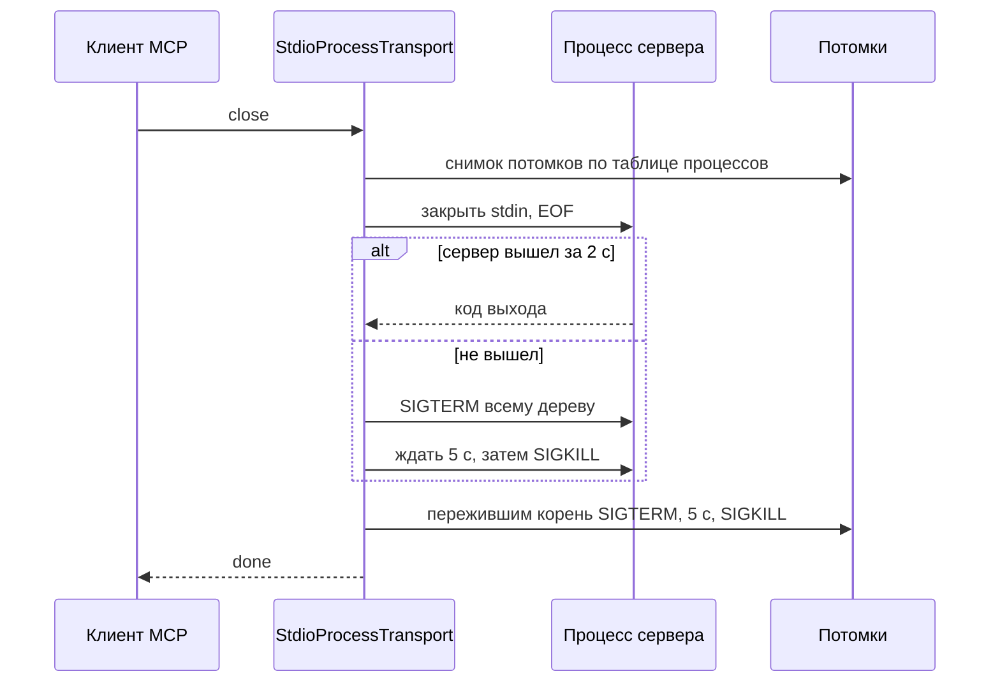

# Запуск MCP-серверов: stdio-транспорт

Глава про одну вещь, которую пакет делает для MCP: запускает сервер как дочерний процесс и передаёт ему строки. Протокол MCP (`initialize`, `tools/list`, `tools/call`), клиент, проекция MCP-инструментов в инструменты ядра и streamable HTTP живут в `codelab_agent_mcp` и ядре ([MCP в главе 6 ядра](../../codelab_agent_core/doc/06-tools.md#mcp), [README `codelab_agent_mcp`](../../codelab_agent_mcp/README.md)). Пакет `codelab_agent_mcp` не знает `dart:io`, поэтому процесс приходит к нему портом ядра `McpTransportFactory`.

Нормы: [`agent-mcp-client`](../../../../openspec/specs/agent-mcp-client/spec.md). Код: `lib/src/mcp/stdio_process_transport.dart` (381 строка), общие `env/host_variables.dart` и `env/process_tree.dart`.

## Два класса

| Класс | Роль |
|---|---|
| `StdioMcpTransportFactory` | реализует порт `McpTransportFactory` для ключа `stdio`; хост создаёт одну на процесс и кладёт в `McpTransports(stdio: …)` |
| `StdioProcessTransport` | транспорт одного сервера поверх stdin/stdout процесса; создаётся `StdioMcpTransportFactory.open` |

```dart
final factory = StdioMcpTransportFactory(hostEnvironment: environment);
// factory.transports == {'stdio'}
```

`hostEnvironment` — окружение, из которого берутся значения allowlist; по умолчанию настоящее, тесты передают своё. Логгер приходит в `open` вместе с `session_id` (`BoundLogger`): транспорт пишет через него события с полем `server`.

Транспорт знает только «строки туда и обратно». Он реализует `McpTransport`: `incoming` (поток строк), `send(message)`, `close()`, `done` (завершается нормально при **любом** конце — выход процесса, `close`, слишком длинная строка). `abortedRequests` у stdio пуст, `abandon` ничего не делает: отмена запроса stdio — уведомление клиента, а не действие транспорта.

## Запуск

`StdioProcessTransport.start`:

- `Process.start(command, args, workingDirectory: cwd, environment: …, includeParentEnvironment: false, runInShell: false)`. Команда без оболочки: аргументы не интерпретируются. Относительная команда ищется в `PATH` из allowlist.
- **Окружение** — только имена `hostEnvironmentAllowlist` (`PATH`, `HOME`, `USER`, `LANG`, `LC_ALL`, `TMPDIR`, `SHELL`) из окружения хоста и `env` сервера поверх. Остальное окружение (токены, ключи облаков) серверу не видно (ENV-6). Тот же allowlist у `exec` ([глава 2](02-environment-and-processes.md)).
- **Рабочий каталог** — `cwd` сессии (путь ядра; на Windows переводится в путь хоста).
- Ошибка запуска — **только** `McpTransportException`: `spawn failed: <сообщение ОС>`. NUL в команде, аргументе или `env` (`ArgumentError`) — `spawn failed: invalid arguments` без текста исключения: оно содержало бы значения, а их в логах быть не должно. Любое другое исключение ломало бы остальные серверы сессии.
- Токен отмены уже сработал — процесс не запускается (`cancelled`); сервер не `stdio` — `not a stdio server`.

## Кадры

Кадр — одна строка UTF-8 на сообщение (`basic/transports/stdio.md` спецификации MCP).

**Исходящие.** `send` отказывает на строке с `\n` или `\r` (`message contains a newline`): спецификация запрещает переводы строк внутри сообщения, а порт принимает любой текст. Записи выстраиваются в цепочку `_writes`: `IOSink` не допускает `add` во время `flush`, а порядок сообщений должен сохраниться. Закрытый транспорт — `transport is closed`; сбой записи — `write failed` без текста ОС (он идёт в лог).

**Входящие.** Читает `_LineReader`, а не `LineSplitter`: сервер недоверенный, и бесконечная строка без `\n` исчерпала бы память до проверки длины. Предел — **16 МиБ** на строку, считается в байтах (строка ровно в 16 МиБ допустима, тест `a line of exactly 16 MiB is delivered`). Превышение закрывает транспорт с причиной `message too large` (`done.reason`). Поток `incoming` ставится на паузу вместе с подпиской на stdout: читатель контролирует обратное давление. Завершающий `\r` отбрасывается, пустые строки пропускаются, UTF-8 декодируется с `allowMalformed`.

**stderr.** Читается **всегда**, чтобы процесс не завис на записи в полный буфер канала. Но в лог строки идут только уровнем `trace` и не длиннее 4 КиБ (событие `mcp.server.stderr`, поля `server`, `line`): в stderr сервера могут быть секреты, а профиль stdio по умолчанию пишет `debug` и не редактирует поля. Длинная строка усекается на стороне читателя, чтобы строка без перевода строки не росла в памяти. Тест `a chatty stderr does not block the process`.

## Закрытие: `close()`

Закрытие идемпотентно (`_closing ??= _shutdown()`). Порядок:



1. **Снимок потомков до закрытия stdin** (`descendantsOf`). Если корень выйдет по EOF, потомки отдадутся init, и найти их по дереву уже нельзя. Типичный случай — обёртка `npx`, которая порождает настоящий сервер, переживающий корень.
2. **EOF в stdin.** Закрытие stdin не ждётся: при полном канале и сервере, который не читает, оно зависло бы навсегда.
3. **До 2 секунд** на выход корня.
4. Не вышел — `terminateTree`: `SIGTERM` дереву, до 5 секунд, `SIGKILL`. Затем ещё до 2 секунд на код выхода; если процесс его так и не отдал (после `SIGKILL` не бывает), закрытие завершается без кода, чтобы не подвешивать закрытие сессии.
5. **Потомки, пережившие корень** (проигнорировали EOF), — `terminatePids`: `SIGTERM`, до 5 секунд по таблице процессов, `SIGKILL`. На Windows `descendantsOf` возвращает пустой список, а `terminateTree` вызывает `taskkill /T /F` (ветка проверяется вручную, см. [главу 13](13-troubleshooting.md#после-закрытия-остались-процессы)).

Тесты: `a server that ignores EOF and SIGTERM is killed with its descendants within 10 s` и `a descendant that ignores EOF and SIGTERM does not outlive a root that left on EOF`.

Когда процесс вышел (сам, по `close` или после слишком длинной строки), `_complete` дочитывает каналы не дольше 1 секунды (потомок мог унаследовать канал), отменяет подписки, закрывает поток, пишет `mcp.server.closed` (info, поля `server`, `transport: stdio`, `exit_code`) и завершает `done` значением `McpTransportClosed(reason, exitCode)`. Причина: `message too large`, `closed` (запрошено `close`) или `process exited`.

## Что запомнить

- Процесс сервера не получает окружение родителя: всё нужное передайте через `env` сервера.
- Строка длиннее 16 МиБ закрывает транспорт; строка с переводом строки не уходит.
- stderr сервера читается всегда, но в журнал попадает только на `trace`.
- `close()` убирает всё дерево процессов, включая потомков, которые пережили корень.
- Ошибка запуска — `McpTransportException` с фиксированным текстом; значения `env` и аргументов в ошибках и логах нет (D13).

## Смотрите также

- [MCP в ядре: коннектор, проекция инструментов](../../codelab_agent_core/doc/06-tools.md#mcp)
- [Подкоманда `mcp`: добавить сервер в конфигурацию](09-subcommands.md#подкоманды-mcp)
- Тесты: `test/mcp/stdio_process_transport_test.dart` на настоящих процессах; дочерний процесс — `test/support/line_echo.dart` (команды `env:NAME`, `pwd`, `big:N`, `stderr:N`, `exit:N`)
