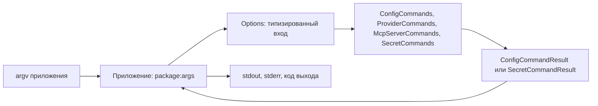

# Подкоманды `config`, `provider`, `mcp`, `secret`

Глава про общий слой команд командной строки. `codelab-agent` и `codelab` умеют одно и то же: проверять и править конфигурацию, добавлять провайдеров и MCP-серверы, хранить секреты. Тексты и коды выхода обязаны совпадать, поэтому реализация лежит здесь, а приложения только разбирают аргументы и печатают результат. Для пользователя те же команды описаны в [настройке агента](../../../../docs/user/configuration.md) и [эксплуатации агента](../../../../apps/codelab_agent/doc/operations.md).

Нормы: [`agent-configuration`](../../../../openspec/specs/agent-configuration/spec.md) («Подкоманды записи и чтения конфига»), [`agent-secrets`](../../../../openspec/specs/agent-secrets/spec.md) («Подкоманды `secret`»). Код: `lib/src/cli/`.

## Схема работы



- **Разбор аргументов — дело приложения.** `package:args` нет в allowlist пакета, поэтому общая часть получает **типизированные опции** (`CheckOptions`, `ConfigSetOptions`, `SecretSetOptions`…). Приложение передаёт то, что получило из argv, а ошибки использования (нет `--kind`, оба флага слоя) определяет общая часть — одинаково для обоих бинарей. Парсер `codelab-agent` лежит в `apps/codelab_agent/lib/src/cli/` (`config_cli.dart`, `provider_cli.dart`, `mcp_cli.dart`, `secret_cli.dart`); парсер `codelab` — `apps/codelab_cli/lib/src/cli_args.dart`.
- **Команда возвращает данные, а не печатает.** `ConfigCommandResult` (`exitCode`, `stdout`, `stderr` — списки строк без перевода строки) и `SecretCommandResult` (то же плюс `showUsage` и `replaced`). Приложение пишет строки в свои потоки, а тест сравнивает вывод `codelab` и `codelab-agent` построчно.
- **Логгер тихий.** `SilentLogger` из `lib/src/util/`: подкоманды печатают результат своими строками, и события лога были бы шумом. В хостах (`serve`) живёт настоящий логгер.
- **Мосты.** Клиенты получают эти классы через `codelab_setup/lib/io.dart` (`ConfigCommands`, опции, `ClientSecretAccess`), а не импортом `codelab_agent_io`.

## Коды выхода

`exit_codes.dart` (экспортируется барелем):

| Константа | Код | Когда |
|---|---|---|
| `configValidExit` | `0` | успех; для `check` — конфигурация валидна (предупреждения проблемами не считаются) |
| `configInvalidExit` | `1` | есть проблемы конфигурации; итог записи невалиден; хранилище секретов отказало; ключа нет в слое |
| `configUsageExit` | `64` | ошибка использования (`EX_USAGE`): нет каталога `--cwd`, оба флага слоя, неверный путь ключа, `ConfigUsageException`, ошибка значения |

Приложение завершается именно этим кодом: `64` отличает «вы неверно вызвали команду» от «команда сработала, а результат плох».

## `ConfigCommands`

| Метод | Что делает | Пишет на диск |
|---|---|---|
| `check(CheckOptions)` | полная загрузка без запуска агента | нет |
| `path(ConfigPathOptions)` | пути файлов слоёв | нет |
| `get(ConfigGetOptions)` | значение ключа и слой-победитель, с маскированием | нет |
| `set(ConfigSetOptions)` | записать значение | да, `ConfigWriter` |
| `unset(ConfigUnsetOptions)` | удалить ключ | да |

### `check`

Печатает слои, проблемы и предупреждения; итог — последней строкой. Порядок строк:

1. `Sources: <слои через запятую>`.
2. Проблемы конфигурации (`<файл>:<строка>:<столбец>: <ключ>: <текст>`).
3. `warning: <предупреждение загрузки>` на каждое.
4. Для **валидного** конфига — диагностика файлов проекта и навыков (`warning:` для `error` и `warning`, `note:` для `untrusted_project`; прочие `info` не печатаются).
5. Для валидного конфига — состояние секретов (`note: secrets backend: …`, `warning: secrets: …`).
6. Для валидного конфига — `Default model: <провайдер>/<модель> (<источник>)`.
7. `Config: valid` или `Config: invalid (issues: N)`.

Флагов у `check` нет: проверяется то, что увидит `serve` без флагов. Реальный вывод на валидном конфиге с бэкендом `file` и недоверенным проектом, у которого есть `.codelab/prompts` и `.codelab/agents`:

```text
Sources: defaults, ~/demo/home/config.yaml, ~/demo/proj/.codelab/config.yaml
warning: ~/demo/proj/.codelab/config.yaml:1:1: providers: ignored: the project is not trusted; add it to trusted_projects in the global config
note: ~/demo/proj/.codelab/prompts: the project is not trusted; add it to trusted_projects
note: ~/demo/proj/.codelab/agents: the project is not trusted; add it to trusted_projects
note: secrets backend: file
warning: secrets: file backend stores secrets unencrypted in ~/demo/home/secrets.yaml
Default model: gw/m1 (config)
Config: valid
```

Три правила:

- **Файлы проекта не мешают коду выхода.** Расчёт идёт через `loadProjectExtensions` ([глава 7](07-project-files.md)) с пределом 5 секунд на фазу. Таймаут или сбой порта — по одной строке `warning:` (`project files were not read within 5 s`, `project files could not be read: <тип>`), а не падение `check`. Исключение разбора шаблона тоже даёт строку с типом.
- **Секреты проверяются только у валидного конфига.** Ссылки собираются в порядке конфига: ключ провайдера, шаблоны его заголовков, затем `env` и `headers` MCP-серверов. Ненайденный секрет — `warning:`, код выхода не меняется: секрет нужен только при выборе этой модели. Для бэкенда `file` строка о хранении в открытом тексте печатается всегда (CFG-11), а права файла проверяются через `names()`: значения не читаются, файл не создаётся.
- **Модель.** Последняя строка перед итогом считается чистой функцией ядра `selectSessionModel`, той же, что в рантайме. Файл `FileLastModelStore` только читается, и только если модель конфигурации неявная; нечитаемый файл — `warning: <путь>: last model state ignored: <причина>`.

### `path`

Без флагов — строка на слой (`user`, `project`, `local`) и, если задан `CODELAB_CONFIG`, на его файл, с пометкой `exists` или `missing`; с `--project` или `--local` — один путь без пометки:

```text
$ codelab-agent config path --cwd .
user: ~/demo/home/config.yaml (exists)
project: ~/demo/proj/.codelab/config.yaml (missing)
local: ~/demo/proj/.codelab/config.local.yaml (missing)
```

Пути считает та же `configLayerFilePath`, что у писателя: `$EDITOR $(codelab config path --local)` открывает файл, в который пишет `config set --local`.

### `get` и маскирование

`get` показывает **сырое** значение ключа из слоя-победителя и имя слоя последней строкой. Подстановки `${VAR}` и `${secret:…}` не раскрываются ни при каком слое: значение переменной — содержимое окружения, а оно может быть секретом. Работает и с невалидным конфигом (так находят ошибку): перечитываются слои, а не итог. Исключение — файл с синтаксической ошибкой: подкоманда называет ошибку вместо ложного «ключ не задан». Слой выбирает `--layer`: `user`, `project`, `local`, `merged` (по умолчанию). Допустимые значения — `ConfigGetLayer.values`; приложение `codelab` держит свой литерал без импорта этого пакета, равенство проверяет тест.

Файл мог быть правлен руками до записи правила литеральных секретов, поэтому `get` и `provider list` печатают значения через одну функцию `maskConfigValue` (`config_output.dart`):

| Что | Что печатается |
|---|---|
| непрозрачное поддерево реестра (`providers.*.auth`, `key_rotation`) и узел без схемы | `<opaque: edit the file>` |
| значение слоя без файла (окружение, флаги) | `<from env:NAME>` или `<from flags>` |
| строка по шаблону секрета (`sk-…`, `ghp_…`, JWT, PEM), в том числе внутри `${secret:<токен>}` | `<redacted>` |
| лист с секретным именем (`api_key`, `token`, нормализация `X-API-KEY`) без `${…}` | `<redacted>` |
| `base_url`, `url` | без userinfo и значений секретных query-параметров; неразбираемый адрес — `<redacted>` |
| элементы `mcp.servers[*].args` | по шаблону, после секретного флага и в `--флаг=значение` |
| отображения и списки | поэлементно на любой глубине |

Листья, описанные схемой (`api_key_secret`, `api_key_env`, `auth_header`, `max_output_tokens`), хранят имена и счётчики и печатаются как есть. Два правила разошлись бы: один вывод печатал бы то, что другой скрывает, поэтому функция одна. Таблица `environmentLayerVariables` ([глава 3](03-config-loading.md)) нужна ей же: новая переменная получает подпись и не утекает.

### `set` и `unset`

`set` разбирает значение `SettingsRegistry.parseCliValue`; неизвестный ключ и неверное значение — код `64`, значение не цитируется. Ключ из `inlineSecretKeys` реестру не предъявляется: ответ должен быть «секрет значением» (код `1`, подсказка `codelab secret set`), а не «неизвестный ключ». Для опечатки есть подсказка «did you mean»: шаблоны с `*` получают сегменты пользователя на месте звёздочек.

```text
$ codelab-agent config set budjet.max_steps 1
config set: unknown key budjet.max_steps; did you mean budget.max_steps?
$ codelab-agent config set providers.gw.api_key sk-abc123
~/demo/home/config.yaml: providers.gw.api_key: secrets are not stored in the config; run: codelab secret set codelab/gw, then reference it with ${secret:codelab/gw}
$ codelab-agent config set secrets.backend file
Updated secrets.backend in ~/demo/home/config.yaml
note: restart the agent to apply: secrets.backend
```

`unset` принимает и ключ вне реестра, если он есть в файле: так удаляются опечатки и запрещённый `api_key`. Наличие определяется по пути, а не по значению (`configKeyPresent`): `max_steps:` со значением `null` в файле есть, и его надо удалить. Ключа нет — код `0` без записи: `budget.max_steps is not set in ~/demo/home/config.yaml` (идемпотентно, как `secret delete`).

## `ConfigEditRunner`: общая часть записи

`config set|unset`, `provider add|remove` и `mcp add|remove` одинаково повторяют правку при конфликте, различают «ошибка использования» (`64`) и «итог невалиден» (`1`), печатают успех. Эту общую часть держит `ConfigEditRunner` (`config_edit_runner.dart`):

1. Слой по флагам: `ConfigFileLayer.fromFlags(project:, local:)`; оба — `<label>: --project and --local cannot be combined`.
2. Каталог `--cwd` существует (`<label>: no such directory: <путь>`).
3. `codelabHomeOf(environment)`; `ConfigUsageException` — код `64`.
4. Свой `ConfigWriter` с тихим логгером.
5. Цикл: `read` снимка, `shortCircuit` (например, `unset` отсутствующего ключа), правки (`edits(snapshot)` вызывается на **каждой** попытке со свежим снимком), `apply` или `validate` при `dryRun`.
6. Один повтор при `ConfigConflictException`; второй — код `1` и `config file changed during the edit; run the command again`.
7. `ConfigException` и `ConfigInlineSecretException` — код `1` и проблемы построчно; типизированные проблемы возвращаются в `EditFinished.issues`, чтобы подкоманда выбирала подсказку по `issue.key`, а не по подстроке текста.

Исход — запечатанная иерархия: `EditWritten(result)` или `EditFinished(result, issues)`. После успеха `ConfigEditRunner.successLines(result)` добавляет `warning:` по предупреждениям писателя и `note: restart the agent to apply: <ключи>`.

Скелет новой подкоманды записи — [глава 11](11-extending.md#рецепт-подкоманда-записи-через-configeditrunner).

## Подкоманды `provider`

Реализует `ProviderCommands`.

| Метод | Что делает |
|---|---|
| `add(ProviderAddOptions, SecretInput)` | одна правка `ConfigWriter.apply` со списком `SetValue`: провайдер, модель, ссылка на ключ, `--default` |
| `list(ProviderListOptions)` | провайдеры из загруженной конфигурации и состояние ключей, без значений |
| `remove(ProviderRemoveOptions)` | `RemoveTable` по `providers.<id>`; идентификатор — `[a-z0-9_-]+` |

Разбор числа (`--context-window`) и ответ «не хватает `--kind`» общие, поэтому опции несут то, что пришло из argv: `kind`, `model`, `contextWindow` могут быть `null`, число — строкой. Из `--api-key-secret`, `--api-key-env`, `--api-key-stdin` допустим не больше одного; заданный способ **заменяет** прежний источник ключа в файле.

Порядок `--api-key-stdin` (D6): сначала проверка кандидата **без записи** (`ConfigWriter.validate` через `dryRun`), затем проверка хранилища, затем чтение ключа через `SecretCommands.set`, и только потом запись конфигурации с `api_key_secret: codelab/<id>`. Если итог заведомо невалиден, ключ не запрашивается и не сохраняется. В конфиг попадает только имя секрета. Реальный отказ на бэкенде `env` (он только читает):

```text
$ printf 'sk-test-123\n' | codelab-agent provider add gw --kind openai-compatible … --api-key-stdin
secret store env is read-only. Add 'secrets.backend: file' to ~/demo/home/config.yaml to store secrets in ~/demo/home/secrets.yaml (plaintext, 0600), or set CODELAB_SECRET_CODELAB_GW in the environment
```

Реальный `provider list` на провайдере с секретом:

```text
Secrets: file
gw  kind: openai-compatible  base_url: https://llm.example.com/v1  models: m1  key: secret codelab/gw: found
```

`list` ищет секрет через резолвер ядра с назначением `provider list`; значение не печатается.

## Подкоманды `mcp`

Реализует `McpServerCommands`. Класс назван не `McpCommands`, чтобы не путать с командой агента `/mcp`.

| Метод | Что делает |
|---|---|
| `add(McpAddOptions, [SecretInput])` | `UpsertMcpServer` в слое файла |
| `list(McpListOptions)` | серверы файлов без подключения к ним |
| `remove(McpRemoveOptions)` | `RemoveMcpServer` по имени (не по номеру) |

Для `stdio` заданы `--command`, `--arg` (повторяемый), `--env KEY=VALUE`; для `http` — `--url`, `--header KEY=VALUE`; `--type` обязателен (`mcp add: --type is required (stdio or http)`), `--disabled` пишет `enabled: false`. Литеральный токен в заголовке или `env` писатель отклоняет с готовой подсказкой (реальный вывод):

```text
$ codelab-agent mcp add gh --type http --url https://mcp.example.com --header 'Authorization=Bearer ghp_…'
~/demo/home/config.yaml: mcp.servers[gh].headers.Authorization: a literal secret in a header; run: codelab secret set codelab/mcp/gh/authorization, then use ${secret:codelab/mcp/gh/authorization} (or reference an environment variable with ${VAR})
```

Чтобы не вводить токен в argv, есть `--header-stdin <Name>` (для `http`) и `--env-stdin <NAME>` (для `stdio`) плюс `--header-scheme <Scheme>`: **одно** значение читается из `SecretInput`, сохраняется как `codelab/mcp/<сервер>/<ключ>`, а в файл пишется ссылка. Больше одного флага `-stdin` за вызов — код `64`. Реальный прогон:

```text
$ printf 'tok-123' | codelab-agent mcp add gh --type http --url https://mcp.example.com --header-stdin Authorization --header-scheme Bearer
Stored secret codelab/mcp/gh/authorization in file
Updated mcp.servers[gh] in ~/demo/home/config.yaml
warning: secrets are stored unencrypted in ~/demo/home/secrets.yaml

$ codelab-agent mcp list
gh  type: http  layer: user  enabled: true
fs  type: stdio  layer: user  enabled: true
```

В файле при этом лежит `Authorization: 'Bearer ${secret:codelab/mcp/gh/authorization}'`.

## Подкоманды `secret`

Реализует `SecretCommands`. Подкоманды работают без запуска агента и без ACP.

| Метод | Что делает |
|---|---|
| `set(SecretSetOptions, SecretInput)` | сохранить значение; оно читается **только** из stdin |
| `delete(SecretDeleteOptions)` | удалить; отсутствующее имя — код `0` |
| `list(SecretListOptions)` | бэкенд, имена и имена заданных переменных `CODELAB_SECRET_*` |
| `migrate(SecretMigrateOptions)` | перенос литералов из конфигурации ([глава 5](05-secrets.md)) |

Бэкенд берётся из `secrets.backend` файлов `$CODELAB_HOME/config.yaml` и `CODELAB_CONFIG` — **и только этот ключ**. Полная загрузка конфигурации заблокировала бы ровно ту команду, которая чинит конфигурацию с ключом, вписанным значением (CFG-9). Неподходящий `CODELAB_CONFIG` пропускается строкой `warning: CODELAB_CONFIG ignored: …`; проверки `checkConfigEnvPath` общие с загрузчиком.

Порядок `set` (D8):

1. Имя проходит `SecretNames.problem`; ошибка — код `64` со справкой (`expected a secret name: lowercase letters, digits and . _ / -, up to 128 characters`).
2. Значение позиционным аргументом **не принимается**: оно виднее в `ps` и истории оболочки. Приложение передаёт лишь факт `hasValueArgument` (сам аргумент не доходит и не может быть напечатан): `pass the secret value on stdin, not as an argument`.
3. Бэкенд открывается; имя, бэкенд «только чтение» и коллизия проверяются **до** чтения значения (`checkStore`): ключ, который всё равно отвергнут, вводить незачем.
4. Значение читается: с терминала скрыто (`readHidden`), иначе весь stdin (`readAll`).
5. Многострочная вставка — `secret value must be a single line` (код `64`); не UTF-8 — `secret value must be valid UTF-8` (код `64`).
6. `SecretAdmin.store`; исход печатается как `Stored secret <имя> in <бэкенд>` или `Updated secret …`.

Реальный вывод `set`, `list`, `delete` на бэкенде `file`:

```text
$ printf 'sk-live-abc' | codelab-agent secret set codelab/gw
Stored secret codelab/gw in file
warning: secrets are stored unencrypted in ~/demo/home/secrets.yaml

$ codelab-agent secret list
Backend: file
codelab/gw
warning: secrets are stored unencrypted in ~/demo/home/secrets.yaml

$ codelab-agent secret delete codelab/gw
Deleted secret codelab/gw from file
$ codelab-agent secret delete codelab/gw
Secret codelab/gw was not set in file
```

`secret list` на бэкенде `env` печатает `Backend: env`; скобки с причиной (`Backend: env (<причина>)`) появляются, только когда `auto` выбрал `env` и есть `unavailableReason`. Строка `Environment overrides: <имена переменных>` печатается при любом бэкенде, если заданы `CODELAB_SECRET_*`; значения не читаются.

## Ввод секрета: `SecretInput` и `StdinSecretInput`

`SecretInput` — интерфейс с тремя членами: `hasTerminal`, `readHidden(prompt)`, `readAll()`. Интерфейс нужен, потому что тесту `SecretCommands` нужен фейк (`test/support/fake_secret_input.dart`): настоящий терминал в тесте недоступен.

`StdinSecretInput` над `dart:io` `stdin` решает три задачи:

- **Скрытый ввод побайтово.** Терминал переводится в неканонический режим (`echoMode = false`, `lineMode = false`). Канонический режим обрезает строку (около 1 КиБ на macOS) и отдаёт вставку нескольких строк по одной; `readLineSync` не прерывается сигналом.
- **Восстановление терминала.** Режимы возвращаются до отмены подписки на stdin (она закрывает fd 0) и по `SIGINT`: прерванный `secret set` иначе оставил бы терминал без эха. Подписка на `SIGINT` оформляется **до** выключения эха. По Ctrl+C процесс выходит с кодом `130`.
- **Многострочная вставка.** После Enter ввод ещё 50 мс (`_drainWindow`) вычитывается: всё, что пришло после, — признак вставки, и `MultilineSecretException` превращается в код `64` (молча сохранить только первую строку значило бы записать неверный секрет и сообщить об успехе). Сброс ограничен 1 МиБ, чтобы бесконечный поток не удержал команду.

Читается не больше `maxSecretValueBytes + 3` байт: бесконечный поток не заполнит память, а значение длиннее предела всё равно отвергнет `SecretAdmin`. Ctrl+D без символов — `null`, Backspace удаляет последнюю кодовую точку.

Тесты: `secret_input_test.dart` — на фейковом `Stdin`; настоящий pty проверяется вручную (задача 8.7 change `add-agent-secret-store`).

## Как подключить подкоманду в приложении

Приложение держит свой `ArgParser`, разбирает флаги, строит опции и вызывает подкоманду:

```dart
final result = await ConfigCommands().check(
  CheckOptions(cwd: cwd, environment: Platform.environment),
);
result.stdout.forEach(stdout.writeln);
result.stderr.forEach(stderr.writeln);
exit(result.exitCode);
```

Для `secret` справку при `showUsage` приложение добавляет в stderr само. Ошибку разбора аргументов приложение превращает в код `64`.

## Что запомнить

- Общая часть возвращает данные, приложение печатает. Новая подкоманда — это опции, метод и результат, а не `print`.
- Код `64` — «неверно вызвано», код `1` — «команда отработала, а результат плох».
- Значения ключей и секретов нигде не печатаются; вывод `get` и `list` идёт через `maskConfigValue`.
- Запись всегда через `ConfigWriter`, с одним повтором при конфликте.
- Секрет читается только из stdin.

## Смотрите также

- [Глава 3: загрузка](03-config-loading.md), [глава 4: запись](04-config-writing-and-reload.md), [глава 5: секреты](05-secrets.md)
- [Эксплуатация агента: подкоманды и флаги](../../../../apps/codelab_agent/doc/operations.md)
- Тесты: `test/cli/` — 15 файлов; `cli_config_commands_test.dart`, `config_commands_test.dart`, `provider_commands_test.dart`, `secret_commands_test.dart`, `secret_migrate_command_test.dart`, `mcp_add_stdin_test.dart`
