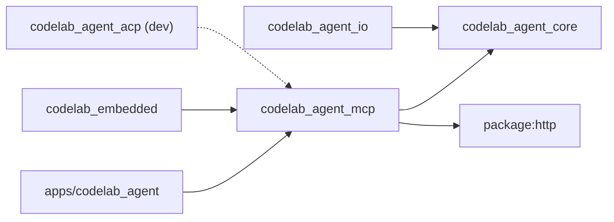
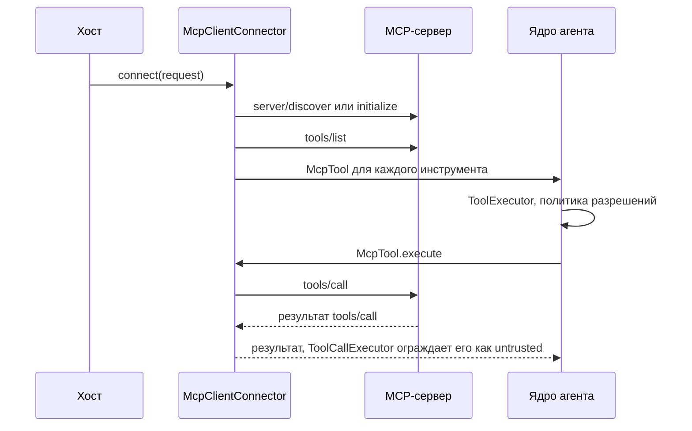

# codelab_agent_mcp

MCP-клиент Dart-агента. MCP (Model Context Protocol) — протокол, по которому агент подключает внешние серверы и получает от них инструменты. Пакет знает протокол MCP, а ядро агента о нём не знает: оно видит только порты `McpConnector` и `McpTransport`.

## Место в архитектуре

Пакет стоит над ядром агента: сторона `agent`, слой `mcp` (ADR-0002). Чистый Dart, без `dart:io`, без Flutter и без ACP; web-безопасен (сторож `melos run guard`).

Схема показывает зависимости из `pubspec.yaml` пакета и пакеты, которые зависят от него.



- `dependencies` пакета: `codelab_agent_core`, `http`, `meta`, `async`. Расширять список можно только через OpenSpec change.
- `codelab_agent_io` на схеме связан только с ядром: процесс stdio-сервера приходит портом ядра, а не зависимостью этого пакета.
- Процесс stdio-сервера запускает не этот пакет, а `codelab_agent_io` (`StdioMcpTransportFactory`). Хост передаёт его в `McpTransports.stdio`.
- `codelab_agent_acp` берёт пакет только в `dev_dependencies` (для тестов).
- Хосты (`apps/codelab_agent`, `codelab_embedded`) собирают `McpClientConnector` и кладут его в `AgentCoreServices.mcp`.

Архитектура: [`agent-core-architecture`](../../../docs/architecture/proposals/agent-core-architecture.md), §1.2, §6.4, §10.3.

## Что внутри

| Часть | Для чего |
|---|---|
| `McpClientConnector` | реализует порт ядра `McpConnector`: подключает серверы сессии параллельно, регистрирует их инструменты и следит за серверами (переподключение с задержкой, `reconnect`, `setEnabled`, `replaceServers`) |
| `McpTransports` | фабрики транспортов по ключам `stdio` и `http`; хост собирает значение один раз |
| `StreamableHttpTransportFactory` | открывает streamable HTTP на `http.Client` хоста; принимает только схемы `http` и `https` |
| `McpClientOptions` | умолчания клиента: `callTimeout` (10 минут), `clientName`, `clientVersion` |
| `McpEraCache` | кэш эпохи протокола сервера по `origin` URL; живёт в памяти, на диск не пишется |

Публичное API экспортирует `lib/codelab_agent_mcp.dart`; дополнительный барель `lib/testing.dart` отдаёт `FakeMcpServer` только для тестов. Клиент (`McpClient`), кодек JSON-RPC и `McpTool` наружу не выходят: пользуются ими через коннектор.

## Какие транспорты и методы поддержаны

Пакет написан по спецификации MCP в `docs/protocols/mcp/` и поддерживает обе эпохи протокола.

| Эпоха | Версия | Спецификация |
|---|---|---|
| modern | `2026-07-28` | [`basic/transports/`](../../../docs/protocols/mcp/specification/basic/transports/index.md) |
| legacy | `2025-11-25`; принимаются также `2025-06-18` и `2025-03-26` | [`2025-11-25/basic/transports.md`](../../../docs/protocols/mcp/specification/2025-11-25/basic/transports.md) |

Клиент сначала пробует `server/discover` (modern). Если сервер не понимает метод, клиент делает legacy-рукопожатие `initialize` + `notifications/initialized`. Эпоха HTTP-сервера запоминается в `McpEraCache`.

Транспорты:

- **stdio** — порт `McpTransport` реализует `codelab_agent_io`, этот пакет использует его через `McpTransports.stdio`.
- **streamable HTTP** — `StreamableHttpTransport`: каждое сообщение клиента — отдельный `POST`, ответ приходит как `application/json` или поток SSE. Редиректы выключены, поток ответа возобновляется (не больше пяти раз), предел тела ответа — 16 МиБ.

Методы и уведомления, которые клиент отправляет или принимает (по `lib/src/mcp_client.dart`):

| Сообщение | Зачем |
|---|---|
| `server/discover` | проба modern-сервера |
| `initialize`, `notifications/initialized` | рукопожатие legacy |
| `tools/list` | список инструментов; постранично по `nextCursor` |
| `tools/call` | вызов инструмента |
| `notifications/cancelled` | отмена вызова |
| `subscriptions/listen`, `notifications/subscriptions/acknowledged` | подписка на изменения (modern) |
| `notifications/tools/list_changed` | сервер сообщает об изменении набора инструментов |

Ресурсы (`resources/*`) и промпты (`prompts/*`) MCP клиент не использует: в пакете только инструменты.

## Как MCP-инструмент становится инструментом ядра

`McpClientConnector` для каждого инструмента из `tools/list` создаёт `McpTool` — наследник `AgentTool` ядра. Модель видит его под именем `mcp__<сервер>__<инструмент>` (функция `mcpToolName` ядра; небезопасные символы заменяются на `_`, длинное имя сокращается с хэшем).

Сервер MCP недоверен, поэтому свойства `McpTool` заданы жёстко и не зависят от аннотаций сервера:

| Свойство | Значение | Почему |
|---|---|---|
| `tier` | `ToolTier.exec` | политика разрешений относится к MCP-инструменту как к исполнению кода |
| `kind` | `ToolKind.other` | подсказки сервера (`readOnlyHint` и др.) могли бы внушить ложную безопасность |
| `outputTrust` | `untrusted` | результат не считается инструкцией |

Вызов не обходит политику: исполняет его только `ToolExecutor` ядра, после проверки разрешений (тест `mcp_tool_goes_through_policy_test.dart`). Описание инструмента длиннее 2048 символов усекается; инструмент без имени или с некорректной `inputSchema` не регистрируется, а в лог пишется `mcp.tool.invalid`.



Если сервер недоступен, сессия всё равно создаётся: коннектор пишет `mcp.server.failed` и повторяет попытки с задержкой не больше 30 секунд. Инструменты упавшего сервера остаются в реестре и отвечают `is not connected (retry in <n>s)`. Автомат состояний сервера — `connecting`, `connected`, `failed`, `disabled`.

## Как использовать

Хост создаёт один коннектор на процесс. Часы, `Random` и `http.Client` приходят от хоста.

```dart
final connector = McpClientConnector(
  transports: McpTransports(
    stdio: StdioMcpTransportFactory(), // из codelab_agent_io
    http: StreamableHttpTransportFactory(client: httpClient, clock: clock),
  ),
  clock: clock,
  random: Random.secure(),
);
// Дальше: AgentCoreServices(mcp: connector, ...); ядро само вызывает connect.
```

Реальные примеры: `apps/codelab_agent/lib/src/host/agent_host.dart` и `packages/dart/codelab_embedded/lib/src/io/local_opener.dart`.

Как пользователь задаёт MCP-серверы (`mcp.servers`) — в разделе [«MCP-серверы»](../../../docs/user/configuration.md#mcp-серверы) руководства по настройке агента.

## Тесты

```bash
cd packages/dart/codelab_agent_mcp
fvm dart test
```

Сервер в тестах — `FakeMcpServer` из `lib/testing.dart`: он умеет эпохи `modern`, `legacy`, `dualEra` и записывает вызовы и отмены. Реального процесса и сети нет; stdio-процесс проверяет `apps/codelab_agent`. Время — `FakeClock`, HTTP — `MockClient`. Тесты супервизора лежат в `test/supervisor/`.

## Руководство разработчика

Устройство пакета по частям — клиент протокола, streamable HTTP, супервизор серверов, тестирование, рецепты расширения и частые проблемы — описано в [`doc/README.md`](doc/README.md).

## Правила пакета

Правила для изменений — в [`AGENTS.md`](AGENTS.md). Главное: пакет не импортирует `dart:io`, Flutter, ACP и клиентские пакеты, а секреты (`env`, `headers`) не попадают в логи и в `lastError`.

## Смотрите также

- [`codelab_agent_core`](../codelab_agent_core/README.md) — порты `McpConnector`, `McpTransport` и `AgentTool`.
- [`codelab_agent_io`](../codelab_agent_io/README.md) — процесс stdio-сервера.
- Спецификации: `openspec/specs/agent-mcp-client/`, `openspec/specs/agent-tools/`.
- Референс MCP: [`docs/protocols/mcp/specification/`](../../../docs/protocols/mcp/specification/index.md).
