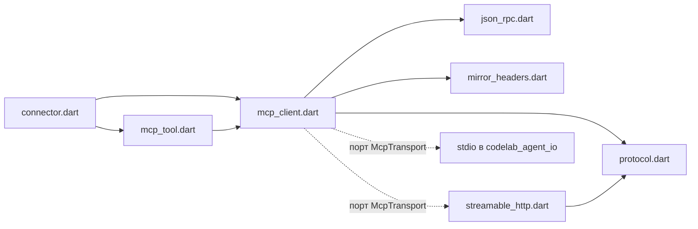
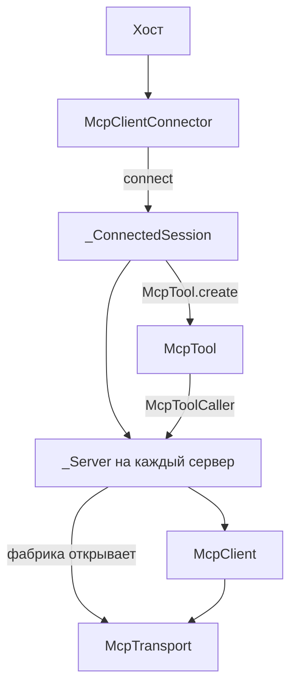
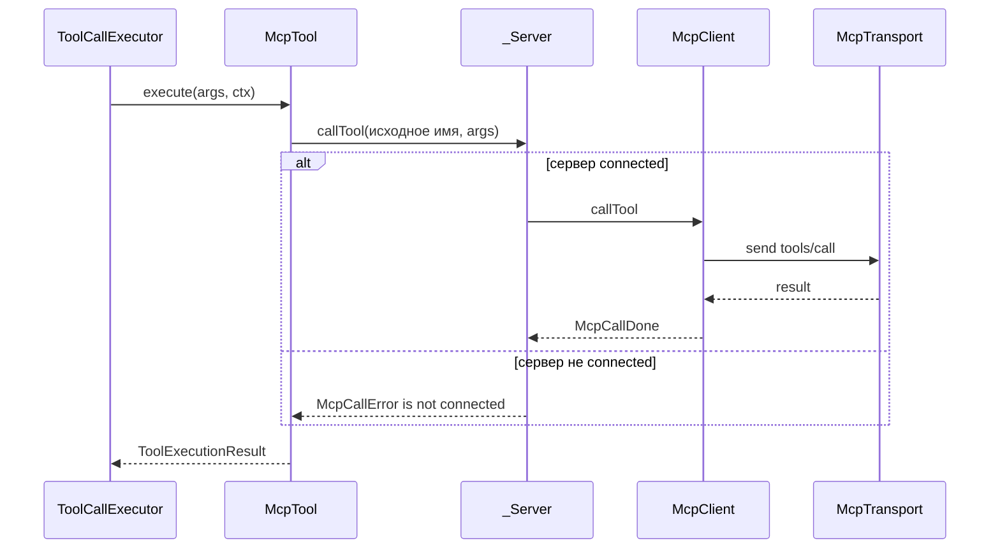

# Обзор пакета

Глава объясняет, из чего состоит `codelab_agent_mcp`, какие порты ядра он реализует, кто кого создаёт и как инструмент MCP-сервера становится инструментом, который видит модель. Протокол и транспорт разобраны в [главе 02](02-client-protocol.md) и [главе 03](03-streamable-http.md), автомат серверов — в [главе 04](04-connector-and-supervisor.md).

Нормы заданы спецификацией [`agent-mcp-client`](../../../../openspec/specs/agent-mcp-client/spec.md) и инструментальной частью [`agent-tools`](../../../../openspec/specs/agent-tools/spec.md) (раздел «MCP-инструменты»). Решения, на которые ссылаются комментарии кода (`D1`–`D15`), записаны в [`design.md` change `add-agent-mcp-client`](../../../../openspec/changes/archive/2026-10-29-add-agent-mcp-client/design.md), решения `D10`–`D11` про супервизор — в [`design.md` change `add-config-writer-and-reload`](../../../../openspec/changes/archive/2026-11-03-add-config-writer-and-reload/design.md). Здесь они не пересказываются.

## Зачем пакет и что он не делает

MCP (Model Context Protocol) — протокол, по которому агент подключает внешние серверы и получает от них инструменты. Пакет реализует клиентскую сторону этого протокола и больше ничего. Он не запускает процессы, не открывает сокеты и не решает, можно ли вызвать инструмент: процесс stdio запускает `codelab_agent_io`, HTTP-клиент приходит от хоста, а решение о разрешении принимает ядро.

Из MCP клиент использует только инструменты. Методы `resources/*` и `prompts/*` он не вызывает, а запросы сервера клиенту (`sampling/createMessage` и подобные) не исполняет: modern-сервер получает молчание, legacy-сервер — ошибку `-32601`, на `ping` клиент отвечает пустым результатом.

## Публичный барель

`lib/codelab_agent_mcp.dart` экспортирует пять имён и константу `codelabAgentMcpPackageName` — всё, что нужно хосту:

| Имя | Что это |
|---|---|
| `McpClientConnector` | реализация порта ядра `McpConnector`; ядро получает его через `AgentCoreServices.mcp` |
| `McpTransports` | фабрики транспортов по ключам `stdio` и `http` |
| `StreamableHttpTransportFactory` | фабрика HTTP-транспорта на `http.Client` хоста |
| `McpClientOptions`, `McpEraCache` | настройки клиента и кэш эпохи серверов |

Клиент (`McpClient`), кодек JSON-RPC, модели ответов и `McpTool` наружу не выходят: тесты пакета импортируют их из `src/` с `// ignore_for_file: implementation_imports`. Второй барель, `lib/testing.dart`, отдаёт фейковый сервер для тестов (`FakeMcpServer`, `FakeMcpTool`, `FakeToolResponse`, `FakeMcpTransportFactory`, перечисления `FakeMcpEra`, `FakeHttpStyle` и другие); хосты подключают его только в тестах и сценарных открывателях.

## Модули `lib/src/`

| Файл | Строк | Что внутри |
|---|---|---|
| `connector.dart` | 953 | `McpClientConnector`, `McpTransports`; закрытые `_ConnectedSession` (сессия и супервизор) и `_Server` (один сервер: состояние, таймер, поколение) |
| `mcp_client.dart` | 1342 | `McpClient`: эпоха, рукопожатие, `tools/list`, подписка, `tools/call`, отмена, таймауты; `McpClientOptions`, `McpEraCache`, `McpToolCaller`, `McpCallOutcome` |
| `streamable_http.dart` | 856 | `StreamableHttpTransport`, `StreamableHttpTransportFactory`, чтение SSE |
| `mirror_headers.dart` | 115 | разбор `x-mcp-header` схемы инструмента и кодирование значений заголовков |
| `mcp_tool.dart` | 240 | `McpTool` — `AgentTool` над одним инструментом сервера; проекция результата |
| `json_rpc.dart` | 209 | кодек JSON-RPC 2.0: разбор входящих без исключений, исходящие `id` и `_meta` |
| `protocol.dart` | 231 | версии протокола, модели `DiscoverResult`, `InitializeResult`, `McpToolDefinition`, `CallToolResult` |
| `text.dart` | 10 | `truncateRunes` — обрезка строк сервера по рунам |
| `fake_mcp_server.dart`, `fake_mcp_http.dart` | 878 и 488 | фейковый сервер и его HTTP-сторона (барель `testing.dart`) |

Как модули связаны между собой:



`McpClient` не знает, какой транспорт под ним: он говорит с портом ядра `McpTransport`. Поэтому сплошной стрелки к `streamable_http.dart` нет. `McpTool` зависит только от узкого порта `McpToolCaller` из `mcp_client.dart`.

## Порты ядра

Ядро знает MCP только через пять типов из `codelab_agent_core/lib/src/mcp/`. Подробнее о том, как рантайм ими пользуется, — в [главе 06 руководства по ядру](../../codelab_agent_core/doc/06-tools.md#mcp).

| Порт ядра | Кто реализует | Что делает |
|---|---|---|
| `McpConnector` | `McpClientConnector` | `connect(McpConnectRequest)` возвращает `McpSessionTools` сессии |
| `McpSessionTools` | закрытый `_ConnectedSession` | `tools`, `servers`, `changes`, `takeUpdate()`, `replaceServers`, `reconnect`, `setEnabled`, `close()` |
| `McpTransportFactory` | `StreamableHttpTransportFactory` (здесь), `StdioMcpTransportFactory` (`codelab_agent_io`) | `open(server, cwd, cancel, logger)` создаёт транспорт на одно соединение |
| `McpTransport` | `StreamableHttpTransport` (здесь), `StdioProcessTransport` (`codelab_agent_io`) | «строки туда и обратно»: `kind`, `send`, `incoming`, `abortedRequests`, `abandon`, `done`, `close` |
| `McpServerConfig` | ядро (ветви `McpStdioServerConfig`, `McpHttpServerConfig`) | описание сервера: имя, происхождение, таймауты, секреты, `enabled`, `blockedReason` |

Порты лежат в ядре по графу пакетов: stdio-реализация живёт в `codelab_agent_io`, который зависит от ядра, но не от этого пакета, а ядро протокола MCP не знает. Пакет `codelab_agent_mcp` в свою очередь не импортирует `codelab_agent_io`. Хост — `apps/codelab_agent` (`lib/src/host/agent_host.dart`) или `codelab_embedded` (`lib/src/io/local_opener.dart`) — собирает обе половины:

```dart
McpClientConnector(
  transports: McpTransports(
    stdio: StdioMcpTransportFactory(),
    http: StreamableHttpTransportFactory(client: client, clock: clock),
  ),
  clock: clock,
  random: Random.secure(), // джиттер задержек повтора
)
```

Источник: `apps/codelab_agent/lib/src/host/agent_host.dart` (создание `McpClientConnector`). Часы, `Random` и `http.Client` приходят от хоста (PKG-6): сам пакет не читает системное время, не создаёт `Timer` и не открывает соединений.

`McpTransports.keys` отдаёт только те ключи, для которых фабрика есть и сама объявляет этот транспорт; `McpClientConnector.transports` возвращает этот набор, а `buildAgentCore` сверяет его с профилем хоста (HOST-3, см. [главу 02 ядра](../../codelab_agent_core/doc/02-assembly-and-hosts.md)).

## Кто кого создаёт



- Хост создаёт один `McpClientConnector` на процесс. Он держит фабрики, часы, `Random` и `McpEraCache`.
- `connect` создаёт `_ConnectedSession` на одну сессию агента и ждёт первую попытку каждого сервера.
- На каждый сервер из списка заводится `_Server`: состояние, таймер повтора, счётчик поколений, текущий `McpClient`.
- Попытка подключения открывает транспорт фабрикой и вызывает `McpClient.connect`. После падения и повтора `_Server` получает нового клиента.
- `McpTool` держит не клиента, а `_Server` как `McpToolCaller`. Поэтому после переподключения старые инструменты работают на новом соединении (почему — в [главе 04](04-connector-and-supervisor.md#переподключение)).

## Как инструмент MCP попадает к модели

Для каждого определения из `tools/list` коннектор строит `McpTool.create(...)`. Результат — `AgentTool`, поэтому дальше он идёт той же дорогой, что встроенные: реестр, проверка аргументов, политика разрешений, `ToolCallExecutor`. Общий путь описан в [главе 06 ядра](../../codelab_agent_core/doc/06-tools.md). Здесь — что делает пакет.

### Имя

Имя инструмента для модели строит функция ядра `mcpToolName(server, tool)` (`codelab_agent_core/lib/src/mcp/mcp_tool_name.dart`): `mcp__<сервер>__<инструмент>`, символы вне `[A-Za-z0-9_-]` заменяются на `_`, имя длиннее 64 символов сокращается до 56 символов, `_` и семи hex-символов SHA-256 от несокращённого имени. Исходное имя инструмента хранится в `McpTool.definition.name` и уходит в `tools/call` без изменений.

Пример из прогона временного теста: сервер `my.srv`, инструменты `shot`, `fail`, `slow`, `rpc` дали имена `mcp__my_srv__shot`, `mcp__my_srv__fail`, `mcp__my_srv__slow`, `mcp__my_srv__rpc`.

Замена символов создаёт коллизии: серверы `my.srv` и `my_srv` с инструментом `t` дают одно имя. Как коннектор их разрешает — в [главе 04](04-connector-and-supervisor.md#коллизии-имён).

### Что принимается и что отбрасывается

`McpTool.create` возвращает `null` и пишет `mcp.tool.invalid` (уровень `warning`) в трёх случаях:

| Причина (`reason`) | Когда |
|---|---|
| `tool has no name` | пустое или нестроковое `name` |
| `inputSchema is not an object` | `inputSchema` не объект JSON |
| `malformed inputSchema` | ключевые слова `type`, `required`, `properties`, `enum` неверной формы (`schemaKeywordViolations` из ядра, `schema_shape.dart`; глубина не больше 32) |

Остальные инструменты сервера при этом регистрируются. Две проверки есть ещё на уровне клиента и тоже пишут `mcp.tool.invalid`: для HTTP — нарушение `x-mcp-header` (`invalid x-mcp-header`, [глава 03](03-streamable-http.md#зеркальные-заголовки)), для legacy — инструмент `execution.taskSupport: required` у сервера, объявившего задачи для `tools/call` (`task support required`).

Пример из прогона: инструмент `bad` с `inputSchema: 'nope'` дал запись

```text
warning mcp.tool.invalid {"session_id":"s1","server":"my.srv","tool":"bad","reason":"inputSchema is not an object"}
```

Описание берётся из `description`, затем из `title`, затем из `name`. Длиннее 2048 рун оно усекается с припиской после переноса строки `[Description truncated: N characters omitted.]`, и пишется `mcp.tool.description_truncated` (`info`, поле `length`). Схема параметров — `inputSchema` как есть.

### Свойства задаёт код, а не сервер

Сервер MCP недоверен, поэтому свойства `McpTool` не зависят от его аннотаций:

| Свойство | Значение | Почему |
|---|---|---|
| `tier` | `ToolTier.exec` | политика относится к MCP-инструменту как к запуску кода |
| `kind` | `ToolKind.other` | `readOnlyHint` и другие подсказки могли бы внушить ложную безопасность (тест `mcp_tool_kind_test.dart`) |
| `outputTrust` | `ContentTrust.untrusted` | результат не считается инструкцией, его огораживает исполнитель |

Заголовок вызова (`ToolPresentation.title`) — полное имя `mcp__…`. Вызов доходит до сервера только после решения политики: проверяет `mcp_tool_goes_through_policy_test.dart` на настоящем `buildAgentCore` (`RecordingGate` фиксирует, сколько вызовов получил сервер в момент вопроса).

### Результат вызова

`McpTool.execute` вызывает `McpToolCaller.callTool`. Ошибки (сервер, таймаут, обрыв, «не подключён») приходят значением `McpCallError` и становятся `ToolExecutionResult([TextContent(text)], isError: true)`: модель видит ошибку, ход не прерывается (TOOL-3). Отмена приходит исключением `CancelledException` и пробрасывается исполнителю.

Успешный `CallToolResult` сводится в один `TextContent`, чтобы весь результат попал в одну ограду недоверенного вывода (P-16), плюс отдельные `ImageContent`:

| Блок `content[*].type` | Что получает модель |
|---|---|
| `text` | текст как есть |
| `image` | `ImageContent`, если модель принимает картинки (`ctx.supportsImages`); иначе `[image omitted: the model does not accept images (<mime>)]` |
| `audio` | `[audio omitted: <mime>, <N> bytes]` |
| `resource` с `text` | `<resource uri="<uri>">`, перенос строки, текст, перенос строки, `</resource>` |
| `resource` без `text` | `[binary resource <uri>, <N> bytes, not shown]` |
| `resource_link` | `[resource link: <uri> (<name>)]` |
| любой другой | `[unsupported content: <type>]` |

Если блоков нет, берётся `structuredContent` в каноническом JSON, а при его отсутствии — `[MCP tool returned no content]`. Флаг `isError` результата переходит в `ToolExecutionResult.isError`. Источник — функции `_project` и `_resource` в `mcp_tool.dart`.

Реальный прогон (временный тест, сервер вернул шесть блоков, модель без картинок):

```text
done
[image omitted: the model does not accept images (image/png)]
[audio omitted: audio/wav, 5 bytes]
<resource uri="file:///a.txt">
hi
</resource>
[resource link: file:///b (b)]
[unsupported content: video]
```

Для модели с картинками блок `image` вместо строки превращается в `ImageContent` (`image/png`) после текста.

## Путь одного вызова

Диаграмма показывает, что происходит между решением модели вызвать `mcp__fake__echo` и ответом сервера. Шаги ядра (политика, ограда) описаны в [главах 06](../../codelab_agent_core/doc/06-tools.md) и [07](../../codelab_agent_core/doc/07-permissions.md).



`_Server.callTool` не ждёт повтора внутри вызова: пока сервер в `failed` или `connecting`, вызов получает готовый текст `MCP server <name> is not connected (retry in <n>s). Continue without it or try later.` без обращения к транспорту.

## Смотрите также

- [Клиент протокола](02-client-protocol.md) — `McpClient` изнутри.
- [Рецепты и частые проблемы](05-extending-and-troubleshooting.md).
- [Глава 06 руководства по ядру](../../codelab_agent_core/doc/06-tools.md#mcp) — как ядро использует эти порты.
