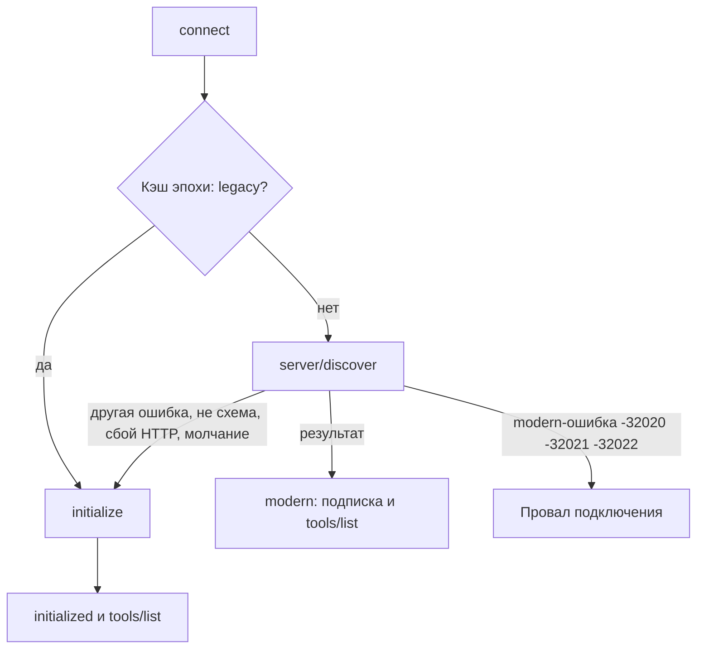
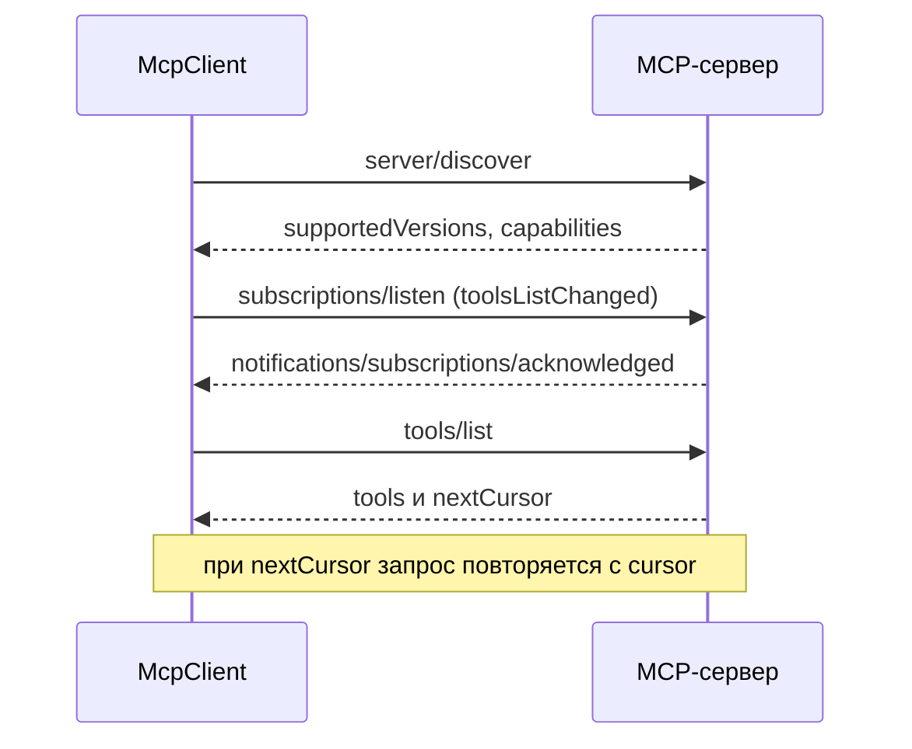
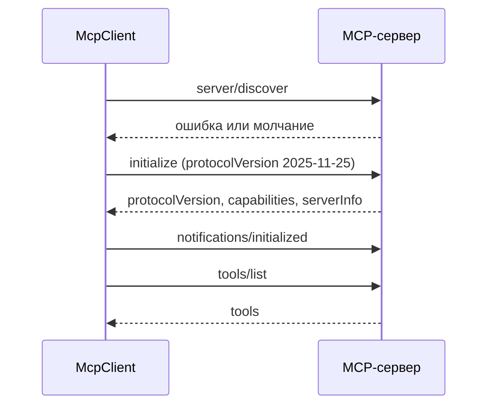

# Клиент протокола: `McpClient`

Глава описывает `McpClient` — соединение с одним MCP-сервером одной сессии: как клиент определяет эпоху протокола, как выполняет рукопожатие, читает список инструментов, подписывается на изменения и вызывает инструменты. Транспорт под клиентом (stdio или HTTP) для клиента прозрачен; HTTP разобран в [главе 03](03-streamable-http.md), повторное подключение — в [главе 04](04-connector-and-supervisor.md).

Нормативный текст MCP лежит в [`docs/protocols/mcp/specification/`](../../../../docs/protocols/mcp/specification/index.md): ревизия `2026-07-28` (в пакете её называют modern) и [`2025-11-25/`](../../../../docs/protocols/mcp/specification/2025-11-25/index.md) (legacy). Методы, поля и коды, которых там нет, клиент не вводит (`AGENTS.md` пакета). Нормы поведения — раздел «Эпоха сервера и версия протокола» и следующие в [`agent-mcp-client`](../../../../openspec/specs/agent-mcp-client/spec.md).

## Две эпохи

Эпоха — это поколение протокола, на котором говорит сервер. Они различаются рукопожатием (`basic/versioning.md`):

| | modern (`2026-07-28`) | legacy (`2025-11-25`; принимаются также `2025-06-18`, `2025-03-26`) |
|---|---|---|
| рукопожатие | `server/discover`, без сессии | `initialize`, затем `notifications/initialized` |
| версия и возможности клиента | в `_meta` каждого запроса | только в `initialize` |
| уведомления об изменении списка | запрос `subscriptions/listen` | общий канал: stdio-поток или HTTP `GET` |
| отмена вызова | stdio: `notifications/cancelled`; HTTP: закрытие потока ответа | `notifications/cancelled` на обоих транспортах |

Константы версий — в `protocol.dart`: `modernProtocolVersion = '2026-07-28'`, `legacyRequestedVersion = '2025-11-25'`, `legacyAcceptedVersions`. Версия `2024-11-05` не поддерживается (тест `mcp_client_connect_test.dart`, `2024-11-05 is not supported`).

## Кодек JSON-RPC

`json_rpc.dart` — свой минимальный кодек JSON-RPC 2.0. Готовый `json_rpc_2` и кодек ACP не подключены: первый — второй фреймворк JSON-RPC (корневой `AGENTS.md` §4), второй тянет `freezed` и `fpdart`, которых нет в allowlist пакета.

- Входящий текст разбирает `decodeMcpMessages`. Она **никогда не бросает исключений**: не JSON, `id: null`, дробный `id`, неизвестная форма дают `McpMalformed(reason)`. Клиент пишет `mcp.message.ignored` с `kind: parse_error` и продолжает работу.
- Поддерживаются массивы (пакеты JSON-RPC `2025-03-26`), но после подтверждения modern-эпохи массив отвергается: в `2026-07-28` пакетов нет (`_onText` в `mcp_client.dart`, тест `a batch is rejected in the modern era, accepted in legacy`).
- `id` — `int` или `String`. Исходящие `id` выдаёт `McpOutbound`: целые числа с 1, возрастающие, без повторов. Один `McpOutbound` — одно соединение.
- Modern-запрос несёт в `params._meta` три ключа: `io.modelcontextprotocol/protocolVersion`, `…/clientCapabilities` (пустой объект) и `…/clientInfo` (`name` и `version` из `McpClientOptions`, по умолчанию `codelab-agent` и версия ядра). Legacy-запрос и любое уведомление `_meta` не несут.
- Если сообщение сервера не разобралось, соединение не рвётся: сервер, присылающий мусор, остаётся подключённым.

## Определение эпохи и рукопожатие

`McpClient.connect` — статический метод: он принимает уже открытый транспорт, подписывается на его потоки и ведёт рукопожатие, а при любом провале закрывает транспорт и бросает `McpConnectException(reason)`. Всё подключение укладывается в `server.connectTimeout` (по умолчанию 10 с).

Клиент всегда сначала пробует modern:



Решение принимает `_handshake` в `mcp_client.dart`:

- Проба `server/discover` ждёт не дольше `min(5 с, connectTimeout / 2, остаток connectTimeout)`.
- Ответ с `result` — modern-сервер. Если среди `supportedVersions` нет `2026-07-28`, подключение проваливается с причиной `no common protocol version: server supports [<версии>]`: версии выводятся только если похожи на дату `YYYY-MM-DD`, остальное — строка сервера, её в лог не пускают.
- Ошибка с кодом `-32020`, `-32021` или `-32022` — тоже modern-сервер, но он отверг пробу: подключение проваливается (`-32022` — с перечнем версий, остальные — `server rejected the probe (code N)`). Назад на legacy клиент не откатывается: сервер уже показал, что он modern.
- Любая другая ошибка, ответ не по схеме, `4xx` без тела JSON-RPC (`404`, `405`) и молчание дольше пробы означают legacy-сервер, который не знает `server/discover`. Клиент переходит на `initialize`; в логе `probe` будет `fallback_error` или `fallback_timeout`.
- Для HTTP-серверов эпоха запоминается в `McpEraCache` по `origin` URL (схема, хост, порт). Следующее подключение к известному legacy-серверу пропускает пробу (`probe: cached`); если `initialize` на нём вдруг вернул ошибку, кэш забывается и эпоха определяется заново. Кэш живёт в коннекторе, в памяти, и для stdio не используется. Тесты — группа `era cache of HTTP servers`.

### Modern

Диаграмма — модерн-сервер с инструментами и `listChanged` (запросы из прогона в [главе 00](00-getting-started.md#увидеть-что-говорят-клиент-и-сервер)):



Если `capabilities` без ключа `tools`, `tools/list` не вызывается и сервер подключается без инструментов. Подписка нужна только при `tools.listChanged: true`.

### Legacy



Версия из ответа `initialize` должна быть одной из трёх принятых, иначе причина `unsupported protocol version <версия>`. `notifications/initialized` уходит строго после ответа. На запрос сервера `ping` legacy-клиент отвечает пустым результатом, в том числе в окне рукопожатия, до ответа на `initialize`: ветку выбирает `_outbound.era`, а она фиксируется с отправки `initialize` (тест `a ping gets an empty result, other requests get -32601`).

Легаси-инструмент с `execution.taskSupport: required` пропускается с `mcp.tool.invalid` (`task support required`), если сервер объявил задачи для `tools/call`: клиент их не умеет. Без этого объявления такой инструмент остаётся (тест `taskSupport required is fine when tasks are not declared`).

### `tools/list`

`_listAll` читает страницы, пока сервер присылает `nextCursor`; не больше 100 страниц, иначе `tools/list pagination did not end`. Курсор непрозрачен: пустая строка — допустимый курсор, а не конец; концом считается `null`. Элемент списка не по схеме не роняет разбор остальных: строковое поле неверного типа читается как отсутствующее (у `name` — как пустая строка), а такой инструмент отсеивает `McpTool.create`. Тип `resultType: input_required` в `tools/list` — ошибка схемы.

После чтения список проходит `_filter`: для HTTP отбрасываются инструменты с нарушением `x-mcp-header`, для legacy — «только задачи». Остальное остаётся в порядке сервера.

Результат подключения логируется:

```text
info mcp.server.connect {"session_id":"s1","server":"fake","transport":"stdio","era":"modern","protocol_version":"2026-07-28","server_info":{"name":"fake-mcp-server","version":"1.0.0"},"tools":1,"duration_ms":0}
```

Источник — прогон временного теста с `FakeMcpServer`. `server_info` берётся из ответа сервера и попадает в лог только как пара `name` и `version`.

## Подписка на изменения (modern)

`subscriptions/listen` — запрос с параметром `notifications: {toolsListChanged: true}`. Ответ на него приходит не сразу: сервер подтверждает подписку уведомлением `notifications/subscriptions/acknowledged` и затем держит запрос открытым, присылая `notifications/tools/list_changed` с `_meta.io.modelcontextprotocol/subscriptionId`. Ответ на сам запрос означает закрытие подписки.

Подписка — удобство, а не условие подключения. `_listenAttempt` ждёт подтверждения не дольше `min(5 с, connectTimeout / 2)` и принимает один из трёх исходов:

| Исход | Когда | Что дальше |
|---|---|---|
| `accepted` | подтверждение с `toolsListChanged: true` и тем же `subscriptionId` | уведомления принимаются |
| `declined` | ошибка, закрытие, молчание, подтверждение без `toolsListChanged` | сервер подключён, но живёт без обновлений; при молчании запросу уходит сигнал отмены (`_signalCancel`): на stdio и в legacy — `notifications/cancelled` с причиной `timeout`, в HTTP modern — закрытие потока ответа |
| `aborted` | поток ответа оборван (HTTP) | подписка переиздаётся один раз с новым `id`; повторный обрыв — `declined` |

Подписка, оборванная уже после подтверждения, тоже переиздаётся один раз, и после нового подтверждения список перечитывается: уведомления из окна обрыва потеряны (`_reissueSubscription`).

Исходы `declined` и `aborted` (и закрытие подписки) пишутся в лог как `mcp.message.ignored` уровня `debug` с `kind: subscription_failed` или `subscription_closed`. Обычным сообщением это не считается, поэтому перечень таких записей в [главе 05](05-extending-and-troubleshooting.md#события-и-тексты-ошибок).

## Обновление списка инструментов

Уведомление `notifications/tools/list_changed` принимается, если это наша подписка (modern: `subscriptionId` совпал с принятым) или любой источник legacy. Чужое уведомление пишется как `unknown_notification` и игнорируется.

`_onToolsListChanged` не запускает `tools/list` параллельно. Повторное уведомление во время перечитывания ставит флаг `_refreshAgain`, а `_refreshLoopBody` повторяет чтение, пока флаг поднимается. Два уведомления подряд дают не больше двух чтений (тест `two notifications in a row make at most two tools/list`). Уведомление, пришедшее во время подключения, откладывается до конца подключения.

После чтения клиент сравнивает старый и новый набор по каноническому JSON определений. После `list_changed` `onToolsChanged(новый список)` зовётся всегда (коннектор помечает сервер «грязным» и сам сравнит наборы); после `-32020` — только если набор изменился; коннектор помечает сервер «грязным», а реестр сессии обновляется только на границе шага через `takeUpdate()` ([глава 04](04-connector-and-supervisor.md#обновление-набора-на-границе-шага)). Если чтение не удалось, прежний набор остаётся, а в лог уходит `mcp.tools.refresh_failed` уровня `warning` с полем `reason`.

## Вызов инструмента

`McpClient.callTool(name, arguments, cancel:, toolCallId:)` отправляет `tools/call {name, arguments}` с исходным именем инструмента и возвращает `McpCallOutcome`:

- `McpCallDone(CallToolResult)` — сервер ответил; флаг `isError` внутри результата остаётся данными (инструмент мог сам сообщить об ошибке);
- `McpCallError(text)` — готовый английский текст для модели. Ошибки — значения, а не исключения хода (TOOL-3);
- исключение `CancelledException` — только при отмене токеном.

Тексты `McpCallError` (подставьте имя сервера из конфигурации вместо `<server>`):

| Ситуация | Текст |
|---|---|
| клиент закрыт или не подключён | `MCP server <server> is not connected. Continue without it.` |
| сервер ответил `resultType: input_required` | `MCP server <server> asked for client input, which is not supported.` |
| таймаут | `MCP server <server> did not answer tools/call within <N> s.` |
| транспорт закрылся во время вызова | `MCP server <server> disconnected during the call: <причина транспорта>` |
| локальный сбой транспорта (например `HTTP 500` без тела JSON-RPC) | `MCP server <server> transport error: <причина>` |
| сервер вернул JSON-RPC-ошибку | `MCP server <server> returned an error: <message сервера> (code <код>)` |
| `result` не по схеме `CallToolResult` | `MCP server <server> returned an invalid tools/call result.` |

Реальные строки из прогона временного теста: ошибка `-32602 Unknown tool` стала `MCP server fake returned an error: Unknown tool (code -32602)`, а вызов без ответа при `callTimeout` 10 минут — `MCP server fake did not answer tools/call within 600 s.` (в тесте время двигали `FakeClock`).

Текст ошибки сервера (`message`) попадает к модели, но не в лог и не в `lastError`. Поэтому в `McpCallError` он есть, а в причинах подключения — нет.

### Таймаут и отмена

Срок вызова — `server.callTimeout`, а если он не задан, `McpClientOptions.callTimeout` (10 минут). В конфигурации это ключ `call_timeout` ([пользовательская сторона](../../../../docs/user/configuration.md#mcp-серверы)).

По таймауту и по отмене клиент снимает ожидание сразу и подаёт сигнал своего транспорта и эпохи один раз (`_signalCancel`):

- stdio и любая legacy-эпоха: уведомление `notifications/cancelled {requestId, reason}` без ожидания ответа; причины — `timeout` и `cancelled by the client`;
- HTTP modern: уведомления нет, клиент закрывает поток ответа этого запроса (`McpTransport.abandon`) — по спецификации это и есть отмена;
- поздний ответ на отменённый запрос игнорируется и пишется как `late_response`.

Записи лога: `mcp.call.timeout` и `mcp.call.cancelled` (оба `info`) с полями `tool_call_id` и `request_id`. Пример из прогона: вызов `slow` получил `request_id: 7`, а сервер записал `cancelledRequestIds = [7]`.

Обрыв вызова не повторяется: у инструмента могли быть побочные эффекты. Повторяются только запросы без побочных эффектов (`server/discover`, `tools/list`, `subscriptions/listen`), и то один раз и только после обрыва потока ответа HTTP.

### Устаревшая схема (`-32020`)

Если HTTP-сервер modern ответил на вызов ошибкой `-32020` (`HeaderMismatch`), схема инструмента могла измениться, а клиент отправил устаревшие `Mcp-Param-*`. Клиент один раз перечитывает `tools/list` (общим циклом перечитывания, чтобы запоздавший старый ответ не перезаписал новый набор), а затем один раз повторяет вызов с новым `id` (`_relistAfterMismatch`). Второй отказ — обычная ошибка `returned an error`.

## Запросы и уведомления сервера

| Что пришло | Modern | Legacy |
|---|---|---|
| запрос сервера (`ping`, `sampling/createMessage`) | ответа нет, пишется `mcp.message.ignored` с `kind: server_request` и методом (до 64 рун) | `ping` — пустой результат, остальное — ошибка `-32601 Method not found` |
| `notifications/tools/list_changed` | только с нашим `subscriptionId` | любое |
| `notifications/cancelled` | принимается, только если `requestId` — наша подписка | то же |
| прочие уведомления | `unknown_notification` | `unknown_notification` |
| ответ на неизвестный или уже закрытый `id` | `late_response` | то же |

## Закрытие

`close()` идемпотентен: отменяет ожидающие запросы ошибкой `client closed` (без `notifications/cancelled`), кроме подписки на stdio — ей уходит `notifications/cancelled` с её `requestId` (только на stdio и только если транспорт жив). Потом отменяются подписки на потоки транспорта и закрывается сам транспорт.

Если транспорт закрылся сам уже после успешного подключения, клиент ровно один раз зовёт `onClosed(McpTransportClosed)` — так супервизор узнаёт о падении ([глава 04](04-connector-and-supervisor.md#как-сервер-падает-и-возвращается)). При прямом `close()` и при провале подключения `onClosed` не зовётся.

## Сроки одним списком

| Что | Предел | Где задан |
|---|---|---|
| всё подключение | `connectTimeout` сервера, 10 с по умолчанию | `defaultMcpConnectTimeout` в ядре, ключ `connect_timeout` |
| проба `server/discover` | `min(5 с, connectTimeout / 2, остаток)` | `_probeTimeout` |
| подтверждение подписки | при подключении как проба; после — `min(5 с, connectTimeout / 2)` | `_ackTimeout` |
| `initialize` и `notifications/initialized` | остаток `connectTimeout` | `_legacyHandshake` |
| `tools/list` на живом соединении | `connectTimeout`, с сигналом отмены | `_listAll` |
| `tools/call` | `callTimeout` сервера или 10 мин | `_callTimeout` |
| страниц `tools/list` | 100 | `_maxPages` |

## Что не вводить

Клиент не вводит ни методов, ни полей, ни кодов, которых нет в `docs/protocols/mcp/`. Если спецификации не хватает, сначала дополняется документация и [`design.md`](../../../../openspec/changes/archive/2026-10-29-add-agent-mcp-client/design.md), потом пишется код (`AGENTS.md` пакета, «Источники»).

## Смотрите также

- [Обзор](01-overview.md) — где `McpClient` в пакете.
- [Streamable HTTP](03-streamable-http.md) — транспорт под клиентом.
- [Рецепты](05-extending-and-troubleshooting.md) — как добавить метод или тест.
