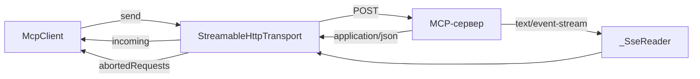

# Транспорты: streamable HTTP и stdio через порт

Глава описывает транспорт под `McpClient`. Пакет реализует один транспорт — streamable HTTP (`StreamableHttpTransport`) — и пользуется портом для второго: stdio-процесс запускает `codelab_agent_io`. Нормы — раздел «Транспорт streamable HTTP» спецификации [`agent-mcp-client`](../../../../openspec/specs/agent-mcp-client/spec.md), текст протокола — [`basic/transports/streamable-http.md`](../../../../docs/protocols/mcp/specification/basic/transports/streamable-http.md) (modern) и [`2025-11-25/basic/transports.md`](../../../../docs/protocols/mcp/specification/2025-11-25/basic/transports.md) (legacy).

## Контракт порта `McpTransport`

Клиент говорит с транспортом на языке «строки туда и обратно» (`codelab_agent_core/lib/src/mcp/mcp_transport.dart`):

| Член | Что значит |
|---|---|
| `kind` | `stdio` или `http`; от него зависят зеркальные заголовки, сигнал отмены и фильтр `x-mcp-header` |
| `incoming` | по одному JSON-тексту сообщения сервера (или пакета legacy `2025-03-26`) |
| `send(message, headers:)` | отправить один JSON-текст; `headers` — зеркальные заголовки, stdio их игнорирует |
| `abortedRequests` | запросы, оставшиеся без ответа при живом транспорте: оборвался поток ответа (`retryable: true`) или локальный сбой (`retryable: false`, `reason`) |
| `abandon(requestId)` | перестать ждать ответ: HTTP закрывает поток этого ответа, stdio ничего не делает |
| `done` | завершается один раз со значением `McpTransportClosed(reason, exitCode)` |
| `close()` | идемпотентно останавливает процесс или HTTP-сессию |

Контракт безопасности: `McpTransportClosed.reason` и `McpTransportException.message` — тексты кода CodeLab, а не сервера. Без URL, аргументов, значений `env` и `headers`, stderr и тел ответов: эти тексты попадают в `lastError` сводки сервера и в интерфейс. Ядро и коннектор причину не фильтруют, поэтому ответственность на реализации транспорта (D13).

## stdio: что даёт порт

Этот пакет процессов не запускает. `StdioMcpTransportFactory` из `codelab_agent_io` (`lib/src/mcp/stdio_process_transport.dart`) открывает процесс сервера в рабочей папке сессии и реализует `McpTransport` для ключа `stdio`. Что важно знать клиенту:

- сообщение — одна строка UTF-8; входящая строка длиннее 16 МиБ закрывает транспорт;
- stderr процесса пишется в лог как `mcp.server.stderr` уровня `trace`, строка не длиннее 4 КиБ;
- закрытие: закрыть stdin, ждать выхода 2 с, `SIGTERM` дереву процессов, ещё 5 с, `SIGKILL`;
- ошибка запуска — `McpTransportException` с текстом `spawn failed: …`.

Это описание тестируют в `codelab_agent_io` и в `apps/codelab_agent/test/mcp_stdio_process_test.dart`; здесь оно дано для понимания контракта. Подробности — в [README `codelab_agent_io`](../../codelab_agent_io/README.md).

## Как устроен `StreamableHttpTransport`

Каждое сообщение клиента — отдельный HTTP `POST` на один URL сервера. Ответ запроса приходит одним JSON-документом или потоком SSE (Server-Sent Events — события в теле ответа, по строкам). Транспорт складывает всё пришедшее в `incoming`.



Транспорт создаёт `StreamableHttpTransportFactory.open` для серверов `type: http`. Фабрика принимает только схемы `http` и `https` и непустой хост, иначе бросает `McpTransportException('invalid url')`: сервер не подключается, а сессия создаётся. `http.Client` приходит от хоста и остаётся у него: ни фабрика, ни транспорт его не закрывают. Поэтому пакет работает и в web-сборке: в нём нет `dart:io`, а в тестах клиент — `MockClient`.

### Заголовки запроса

Порядок наложения: сначала заголовки сервера из конфигурации (`McpHttpServerConfig.headers`), затем служебные; поздние перекрывают ранние без учёта регистра.

| Заголовок | Когда |
|---|---|
| `Content-Type: application/json` | каждый `POST` |
| `Accept: application/json, text/event-stream` | каждый `POST` |
| `MCP-Protocol-Version: 2026-07-28`, `Mcp-Method: <метод>` | каждый modern-запрос |
| `Mcp-Name`, `Mcp-Param-<Имя>` | modern `tools/call`, см. [зеркальные заголовки](#зеркальные-заголовки) |
| `Mcp-Session-Id` | legacy, после `initialize`, если сервер выдал сессию |
| `MCP-Protocol-Version: <версия>` | legacy, версия из ответа `initialize`, если она не раньше `2025-06-18` |

Значения заголовков сервера и `Mcp-Session-Id` не попадают ни в лог, ни в причины ошибок. Сессия принимается, только если состоит из видимых ASCII-символов (`^[\x21-\x7E]+$`).

Реальные заголовки из прогона временного теста против `FakeMcpServer` (HTTP, modern, вызов `query` с `region: eu-west`, URL заменён на `https://mcp.example.com/mcp`):

```text
POST {"content-type":"application/json","accept":"application/json, text/event-stream","mcp-protocol-version":"2026-07-28","mcp-method":"server/discover"}
POST {…,"mcp-protocol-version":"2026-07-28","mcp-method":"tools/list"}
POST {…,"mcp-protocol-version":"2026-07-28","mcp-method":"tools/call","mcp-name":"query","mcp-param-region":"eu-west"}
```

Тот же клиент против legacy-сервера с сессией (`FakeMcpServer(era: FakeMcpEra.legacy, httpSessionId: 'sess-1', listChanged: true)`). Каждая строка — метод HTTP, заголовки запроса и метод JSON-RPC из тела (у `GET` и `DELETE` тела нет). Проба идёт modern-заголовками, `initialize` — без сессии, всё после него — с `mcp-session-id`; затем открывается поток `GET`, а при закрытии уходит `DELETE`:

```text
POST {"content-type":"application/json","accept":"application/json, text/event-stream","mcp-protocol-version":"2026-07-28","mcp-method":"server/discover"} server/discover
POST {"content-type":"application/json","accept":"application/json, text/event-stream"} initialize
POST {"content-type":"application/json","accept":"application/json, text/event-stream","mcp-session-id":"sess-1","mcp-protocol-version":"2025-11-25"} notifications/initialized
GET {"mcp-session-id":"sess-1","mcp-protocol-version":"2025-11-25","accept":"text/event-stream"} 
POST {"content-type":"application/json","accept":"application/json, text/event-stream","mcp-session-id":"sess-1","mcp-protocol-version":"2025-11-25"} tools/list
DELETE {"mcp-session-id":"sess-1","mcp-protocol-version":"2025-11-25"} 
```

### Обработка ответа

`send` для запроса (есть `id`) регистрирует «обмен» (`_Exchange`) и возвращается, когда получены заголовки ответа: тело читается в фоне. Что дальше, решает `_readResponse`:

| Ответ | Что делает транспорт |
|---|---|
| не `2xx` | читает тело (до 64 КиБ). Если там JSON-RPC-ошибка с `code` и `message`, отдаёт её клиенту как ответ на этот запрос (даже если `id` в теле `null` или чужой). Иначе — локальный сбой `HTTP <статус>` |
| `200` и `text/event-stream` | читает события SSE; каждое событие `message` с данными уходит в `incoming` |
| `200` и `application/json` | читает тело (до 16 МиБ), проверяет JSON, отдаёт в `incoming`. Если в теле нет ответа на свой запрос: ошибка без `id` привязывается к запросу, иначе — локальный сбой `unexpected response (HTTP 200)` |
| иное | локальный сбой `unexpected response (HTTP <статус>)` |
| `3xx` | `HTTP redirect (<статус>) is not followed` — редиректы выключены, значит, секрет не уйдёт на другой адрес |
| `404` при открытой legacy-сессии | `HTTP session expired`, транспорт закрывается |

Уведомления и ответы клиента (нет `id`) ждут `2xx` (по спецификации `202`), иначе `HTTP <статус>`.

Локальный сбой — это не ответ сервера: он не получает кода JSON-RPC, а идёт в `abortedRequests` как `McpRequestAbort(retryable: false, reason: …)`. Клиент превращает его в `<метод> failed: <reason>` при подключении и в `MCP server <server> transport error: <reason>` при вызове. Сбой соединения при отправке — `connection failed: <тип исключения>`: текст исключения пакета `http` содержит URL, а в нём бывают секреты (тест `a refused connection: connection failed with the runtimeType only`).

Пример реальной причины из теста `streamable_http_test.dart`: сервер ответил `HTTP 500` без тела JSON-RPC на `tools/list`, подключение закончилось причиной `tools/list failed: HTTP 500`; слишком большое тело даёт `MCP server fake transport error: response body too large`.

### Лимиты и устойчивость

| Что | Значение | Константа |
|---|---|---|
| одно JSON-тело ответа или одно событие SSE | 16 МиБ | `defaultMaxResponseBytes` |
| тело не-`2xx` ответа | 64 КиБ | в `_readResponse` |
| сколько раз возобновляется поток одного ответа | 5 | `maxStreamResumes` |
| пауза до возобновления без `retry` | 1 с | `defaultResumePause` |
| потолок паузы из `retry` сервера | `connectTimeout` сервера | `resumePauseLimit` |
| ожидание `DELETE` при закрытии | 2 с | в `_deleteSession` |

Поток SSE в целом не ограничен: подписка `subscriptions/listen` живёт часами. Лимит действует на одно событие: счётчик обнуляется, когда событие собрано.

Чтение SSE — отдельный класс `_SseReader`. Он не соединяет `bytes.transform(...).listen(...)` одним конвейером: отмена подписки на асинхронный генератор не доходит до источника, пока генератор ждёт данные, и закрытие потока ответа (отмена в modern) зависло бы на молчащем сервере. `_SseReader` отменяет подписку на сами байты, а декодер получает конец потока. Событие без данных (в legacy — «заправка» опроса с `id`) сообщением не считается, но `id` и `retry` запоминаются. Событие с типом, отличным от `message`, игнорируется. Разбор событий делает `SseDecoder` из ядра.

### Отмена и закрытие

`abandon(requestId)` помечает обмен брошенным, отменяет паузу возобновления, обрывает ещё не начавшийся запрос (`abortTrigger`) и закрывает поток ответа. После этого поздний ответ клиент проигнорирует.

`close()` для legacy-сессии шлёт `DELETE` с `Mcp-Session-Id` (best effort, до 2 с; `405` — нормально), затем завершает `done` значением `McpTransportClosed('closed')`, обрывает все запросы и закрывает потоки. `done` завершается раньше остального: клиент должен увидеть закрытие до того, как следующий вызов попадёт в уже закрытый транспорт.

### Только legacy: сессия, поток `GET`, возобновление

Эти три механизма относятся только к legacy-эпохе; в modern сессий нет.

- **Сессия.** `Mcp-Session-Id` запоминается из ответа на `initialize`. `404` на запрос с сессией — сессия истекла: транспорт пишет `mcp.server.closed` (`info`, `reason: HTTP session expired`), закрывается, клиент получает `done`, а супервизор — падение (`lastError` — `HTTP session expired`; префикс `disconnected:` бывает только при сбое во время подключения).
- **Поток `GET`.** Если сервер объявил `tools.listChanged`, после `notifications/initialized` транспорт открывает `GET` с `Accept: text/event-stream`; через него приходят `notifications/tools/list_changed`. `405` означает «потока нет», уведомления не придут. Оборвавшийся поток заново не открывается. Причина пишется как `mcp.message.ignored` с `kind: notification_stream_closed`.
- **Возобновление.** Если поток ответа закрылся до ответа, а в нём было событие с `id`, транспорт после паузы шлёт `GET` с `Last-Event-ID` и дочитывает тот же ответ. Новый запрос не уходит, поэтому `tools/call` не выполняется дважды. Не вышло — `kind: stream_resume_failed` и обрыв запроса.

## Зеркальные заголовки

Modern HTTP-сервер требует, чтобы клиент продублировал часть запроса в заголовках, чтобы шлюзы могли маршрутизировать без разбора тела (`streamable-http.md`, «Request Metadata»). Их считает `McpClient._mirrorHeaders`, а не транспорт:

- `MCP-Protocol-Version` и `Mcp-Method` — в каждом modern-запросе по HTTP;
- у `tools/call` — ещё `Mcp-Name` (имя инструмента) и `Mcp-Param-<Имя>` для каждого свойства схемы, помеченного расширением `x-mcp-header`.

Разбор схемы — `parseMirroredParams` в `mirror_headers.dart`. Описание считается нарушающим ограничения, если:

- имя заголовка пустое, не `1*tchar` или повторяется без учёта регистра;
- тип свойства не `string`, `integer` или `boolean` (`number` и составные типы запрещены);
- аннотация стоит вне цепочки `properties` (в `items`, `oneOf`, `$ref`) или на корне схемы.

Такой инструмент клиент HTTP **обязан** исключить из списка (спецификация MUST): `mcp.tool.invalid` с причиной `invalid x-mcp-header`, остальные инструменты сервера регистрируются. Для stdio аннотации игнорируются.

Значение берётся из аргументов по пути свойств: строка как есть, целое — десятичной записью, булево — `true` или `false`; нет значения, `null` или значение другого типа — заголовка нет. Кодирование (`encodeHeaderValue`): значение вне печатного ASCII (`0x20`–`0x7E`), с пробелами по краям или похожее на маркер `=?base64?…?=` отправляется как `=?base64?<Base64 от UTF-8>?=`.

## Безопасность транспорта

- Редиректы выключены: `3xx` — ошибка, а не переход на другой адрес.
- Значения `headers` сервера и `Mcp-Session-Id` не попадают в лог. Тест `mcp_logs_no_secrets_test.dart` проверяет логи и журнал целиком.
- Причины ошибок строит код транспорта (`connection failed: <тип>`, `HTTP <статус>`, `invalid url`), а не исключение библиотеки и не строки сервера.
- Версия сервера в `MCP-Protocol-Version` — только из принятых `legacyAcceptedVersions`: строка сервера в заголовок не попадёт.

## Смотрите также

- [Клиент протокола](02-client-protocol.md) — что клиент делает с сообщениями.
- [Рецепт «Новый транспорт»](05-extending-and-troubleshooting.md#рецепт-новый-транспорт).
