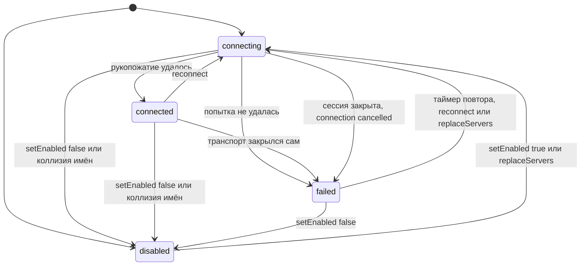

# Коннектор и супервизор серверов

Глава описывает `McpClientConnector` и сессию, которую он возвращает. Сессия — не просто список подключённых серверов: она сама следит за серверами, переподключает упавшие и показывает хосту их состояние. Всё это живёт в `connector.dart`. Нормы — разделы «Переподключение и состояние серверов сессии» и «Поток состояний серверов сессии» спецификации [`agent-mcp-client`](../../../../openspec/specs/agent-mcp-client/spec.md); решения — `D10`, `D11` в [`design.md` change `add-config-writer-and-reload`](../../../../openspec/changes/archive/2026-11-03-add-config-writer-and-reload/design.md) и `D12` в [`add-provider-setup-ui`](../../../../openspec/changes/archive/2026-11-09-add-provider-setup-ui/design.md).

Как ядро зовёт коннектор — в [главе 06 руководства по ядру](../../codelab_agent_core/doc/06-tools.md#mcp); здесь описано, что делает сам коннектор.

## Что получает коннектор

`McpConnector.connect(McpConnectRequest)` вызывает ядро при создании и загрузке сессии. Запрос несёт:

| Поле | Что это |
|---|---|
| `sessionId`, `cwd` | идентификатор сессии для логов; рабочая папка, в которой стартует stdio-процесс |
| `servers` | уже слитый и отфильтрованный список `McpServerConfig` в порядке регистрации: серверы конфигурации, затем серверы клиента |
| `reservedNames` | имена встроенных инструментов: совпадение с ними отключает сервер |
| `logger` | логгер сессии |
| `cancel` | токен сессии: отменяется при `AgentSession.close()` и `AgentRuntime.dispose()` |
| `expandSecrets` | замыкание ядра, раскрывающее `${secret:…}` перед каждой попыткой; `null` — серверы пришли раскрытыми |

Результат — `McpSessionTools`. Его реализует закрытый класс `_ConnectedSession`: он и есть супервизор.

## Первое подключение

`connect` создаёт `_Server` на каждый элемент списка, затем `_start` параллельно запускает первую попытку каждого сервера, который не выключен. Ответ ждёт **только первую попытку** каждого сервера. Если сервер не подключился, сессия всё равно создаётся: сервер получает состояние `failed` и таймер повтора, а его инструменты регистрируются позже, когда он поднимется.

Регистрация инструментов идёт строго в порядке списка, независимо от того, какой сервер ответил быстрее. Поэтому при коллизии имён побеждает сервер, стоящий раньше (HOST-5, E-05), а фикстуры детерминированы. Сбой одного сервера не затрагивает остальные: любое чужое исключение фабрики или клиента превращается в `unexpected error: <тип>` для этого сервера (`_connectOnce`).

Если токен сессии отменён во время первых попыток, `_start` закрывает уже подключившихся: возвращать их некому.

## Автомат состояний

Состояние сервера — перечисление ядра `McpServerState`: `connecting`, `connected`, `failed`, `disabled`. Переход фиксирует `_setState`, который пишет `mcp.server.state` уровня `debug` с полями `from` и `to` и рассылает [`changes`](#поток-changes).



Стрелка `[*] --> disabled` — сервер с `enabled: false` в конфигурации: он стартует выключенным, без процесса и сетевых обращений, и начальное состояние не пишется как переход. Выключенный сервер остаётся в списке: `/mcp list` показывает его, а `setEnabled(name, true)` подключает его в этой сессии, не меняя конфигурацию.

Почему `disabled` — три разных состояния (`_Off` в коде), хотя наружу видно одно:

| Причина | Откуда | `lastError` | Что делает `replaceServers` |
|---|---|---|---|
| `config` | `enabled: false` в конфигурации | пусто | неизменённый остаётся выключенным; смена `enabled` — другой сервер |
| `command` | `setEnabled(name, false)` (`/mcp disable`) | `disabled by /mcp disable` | остаётся выключенным, пока элемент сервера в конфиге не изменился |
| `collision` | коллизия имён инструментов | `tool name collision: <имя>` | пробуется заново: то, что его вытесняло, могло исчезнуть |

## Попытка подключения

`_attempt(server, register:)` — единственная точка, где сервер уходит в `connecting`. Она не бросает исключений: итог — `connected` или `failed` с таймером. `_connectOnce` делает шаги строго в этом порядке:

1. **`blockedReason`.** Если загрузка конфигурации пометила сервер заблокированным (ссылка на секрет проектного слоя не привязана к адресу сервера), попытка сразу кончается: `failed`, `lastError` равен тексту причины, повтор идёт по расписанию, но без раскрытия секретов, транспорта и сети. Свойство безопасности держит загрузка конфигурации; коннектор только показывает причину (change `bind-mcp-secrets-to-origin`, D4).
2. **Раскрытие секретов.** Только если сервер из конфигурации (`origin == config`), у него есть `secretValues`, а ядро передало `expandSecrets`. Значения раскрываются заново перед каждой попыткой и живут только в копии `effective` этой попытки: коннектор их не хранит, а после смены значения в хранилище следующая попытка берёт новое. Серверы клиента (`session/new`) не раскрываются: `${secret:…}` от клиента — литерал. Ожидание ограничено отменой сессии, чтобы зависшее хранилище не держало `close()`. Неудача — `McpSecretsException`, её текст (`secret <имя> is not set`, `secret <имя> cannot be read: …`) становится `lastError`.
3. **Фабрика.** По `effective.transport` берётся фабрика из `McpTransports`; нет её — `transport <ключ> is not available`.
4. **Транспорт.** `factory.open(effective, cwd:, cancel:, logger:)`; логгер обёрнут в `BoundLogger`, чтобы транспорт писал `session_id`. `McpTransportException` из `open` — причина сбоя (`spawn failed: …`, `invalid url`).
5. **Клиент.** `McpClient.connect(..., logFailures: false)`: записи `failed` и `retry` пишет супервизор, потому что только он считает сбои подряд. Подключение гонится с отменой сессии: если она сработала, транспорт закрывается, а достроившийся позже клиент закрывается сам.

### Поколения

У каждого `_Server` есть счётчик `generation`. Он растёт при каждой попытке, сбое, выключении и закрытии. Результат попытки с чужим номером считается устаревшим: клиент закрывается сразу и нигде не регистрируется. Так `close()` сессии, `reconnect` и `replaceServers` не оставляют процессов без владельца и не дают позднему результату перезаписать новое состояние (`AGENTS.md` корня, §9). Тот же счётчик проверяют колбэки `onToolsChanged` и `onClosed` клиента.

## Переподключение

### Как сервер падает и возвращается

Клиент зовёт `onClosed`, когда транспорт закрылся сам (процесс вышел, HTTP-сессия истекла). Супервизор в `_dropped` закрывает клиента, считает, сколько соединение прожило, и вызывает `_fail`: состояние `failed`, `lastError` из причины транспорта, лог и таймер повтора. Таймер повтора срабатывает на `Clock.timer` хоста и запускает новую `_attempt`.

### Формула задержки

```text
delay = min(30 с, 2^attempt с × (1 + 0.2 × r)),   r ∈ [0, 1)
```

`attempt` — число сбоев подряд до этого, `r` — `random.nextDouble()` от хоста (показатель степени ограничен 10 до взятия минимума, чтобы не переполнить число). Без джиттера последовательность — 1, 2, 4, 8, 16, 30, 30 с. Группа тестов `delays` в `test/supervisor/mcp_reconnect_test.dart` проверяет, что каждая задержка лежит в `[base, base × 1,2]` и не превышает 30 с.

Реальный прогон временного теста (стенд `SupervisorRig`: `FakeClock`, `Random(0)`, `FakeMcpServer.crash`), три падения подряд — `retryIn` из сводки сервера:

```text
state=failed retryIn=0:00:01.165000 err=process exited with code 1
state=failed retryIn=0:00:02.355000 err=process exited with code 1
state=failed retryIn=0:00:04.340000 err=process exited with code 1
```

### Счётчик и сброс

Каждый сбой увеличивает счётчик `failures`. Он обнуляется **только** если оборвавшееся соединение прожило не меньше 10 с (`_stableConnection`): сервер, который падает сразу после подключения, не дёргается раз в секунду. Неудачная попытка подключения, не дошедшая до `connected`, счётчик не сбрасывает.

Записей в журнал меньше, чем сбоев. На 1-м и каждом 10-м сбое подряд пишется `mcp.server.failed` (`warning`, поля `transport` и `reason`), на остальных — `mcp.server.retry` (`info`, поля `attempt` и `delay_ms`). Реальный фрагмент того же прогона (`session_id` и `server` — поля каждой записи):

```text
debug mcp.server.state {"session_id":"s1","server":"docs","from":"connected","to":"failed"}
warning mcp.server.failed {"session_id":"s1","server":"docs","transport":"stdio","reason":"process exited with code 1"}
debug mcp.server.state {"session_id":"s1","server":"docs","from":"failed","to":"connecting"}
info mcp.server.connect {"session_id":"s1","server":"docs","transport":"stdio","era":"modern","protocol_version":"2026-07-28","server_info":{"name":"fake-mcp-server","version":"1.0.0"},"tools":1,"duration_ms":0}
debug mcp.server.state {"session_id":"s1","server":"docs","from":"connecting","to":"connected"}
debug mcp.server.state {"session_id":"s1","server":"docs","from":"connected","to":"failed"}
info mcp.server.retry {"session_id":"s1","server":"docs","attempt":2,"delay_ms":2355}
```

### Вызов во время простоя

Пока сервер не `connected`, `_Server.callTool` отвечает без обращения к транспорту: `MCP server <имя> is not connected (retry in <n>s). Continue without it or try later.`, где `<n>` — оставшиеся до повтора секунды, не меньше 1. Инструменты упавшего сервера остаются в реестре, чтобы схемы не менялись под моделью; возвращается сервер — они снова работают, потому что `McpTool` держит `_Server`, а не мёртвого клиента.

### Ручные действия

| Метод | Что делает |
|---|---|
| `reconnect(name)` | закрывает клиента сервера и сразу подключает заново, не ожидая таймер; неизвестное имя и выключенный сервер — ничего. Инструменты регистрируются сразу |
| `setEnabled(name, false)` | закрывает транспорт, снимает таймер, убирает инструменты, состояние `disabled` с `lastError` `disabled by /mcp disable`; помечает выбор как ручной |
| `setEnabled(name, true)` | подключает выключенный сервер (конфигом, командой или коллизией); для заблокированного сервера даёт `failed` с причиной |
| `replaceServers(list)` | приводит серверы к новому списку (перезагрузка конфигурации, `session/load`, `setMcpServers`) |
| `close()` | идемпотентно: отменяет таймеры и идущие рукопожатия, закрывает клиентов параллельно, закрывает поток `changes` |

Все они — действия человека или перезагрузки и не подпадают под ограничения таймера. Ни одно не бросает исключений: сбой — состояние `failed`.

## `replaceServers`

Метод сравнивает новый список со старым по имени и правилам `McpServerConfig.sameConnection` (имя, `blockedReason`, шаблоны секретов и параметры соединения: `command`, `args`, `env` у stdio, `url`, `headers` у HTTP; `enabled`, `origin` и сроки не входят).

- Неизменный сервер остаётся как есть: перезапуск процесса стёр бы его состояние и лишил модель инструментов без причины.
- Сервер с тем же именем, но другими параметрами — другой сервер: старый закрывается, новый подключается.
- Смена `enabled` — тоже другой сервер: `true → false` закрывает, `false → true` подключает.
- Неизменный сервер в `failed` просыпается сразу, не дожидаясь таймера (R6-2, OQ8).
- Ручной выбор (`setEnabled`) сохраняется, пока элемент сервера (параметры, `enabled`, сроки) не изменился. Правка только сроков (`connect_timeout`, `call_timeout`) нетронутого человеком сервера соединение не сбрасывает, а следующая попытка берёт новые значения.
- Порядок: сначала закрываются исчезнувшие и изменившиеся, затем параллельно подключаются новые. Новые серверы занимают имена последними, поэтому коллизию получает новый сервер, а не работающий.
- Флаг `removed` ставится до первого `await`: параллельные `setEnabled` и `reconnect` и идущая попытка видят, что сервер уходит, и не оживляют его.

Тесты — `test/connector_replace_servers_test.dart` и `test/supervisor/mcp_cancel_races_test.dart` (гонки).

## Коллизии имён

После подключения `_resolve` проверяет, что имена инструментов уникальны. Сервер, чей инструмент занят, отключается **целиком**, а не по одному инструменту. Проверки по порядку для каждого инструмента сервера:

| Причина | Текст в `mcp.server.failed` (`reason`) |
|---|---|
| совпало с встроенным | `tool name <имя> collides with built-in tool <имя>` |
| совпало с инструментом другого сервера, стоящего раньше | `tool name <имя> collides with MCP server "<другой>"` |
| два инструмента одного сервера дают одно имя | `tool name <имя> collides with another tool of MCP server "<сервер>"` |

В `lastError` попадает короткая форма `tool name collision: <имя>`. Реальный прогон: серверы `my.srv` и `my_srv` с инструментом `t` дали одно имя `mcp__my_srv__t`.

```text
my.srv connected tools=1 err=null
my_srv disabled tools=0 err=tool name collision: mcp__my_srv__t
warning mcp.server.failed {"session_id":"s1","server":"my_srv","transport":"stdio","reason":"tool name mcp__my_srv__t collides with MCP server \"my.srv\""}
```

Порядок проверки при первом подключении — порядок списка. Для обновлений (`list_changed`, `reconnect`, новые серверы) сервер, приславший обновление, обрабатывается **последним**: коллизию получает он, а не более поздний по списку сервер, который уже работает. Отключённый коллизией сервер пробуется заново при `setEnabled(name, true)` и при `replaceServers`.

## Обновление набора на границе шага

Новый набор инструментов не попадает в реестр модели сразу. Если сервер прислал `list_changed` или вернулся после падения с другим набором, коннектор только помечает сервер (`dirty`), а реестр обновляется, когда ядро на границе шага зовёт `takeUpdate()`. Так набор не меняется посреди шага и не ломает кэш префикса промпта.

- `takeUpdate()` возвращает `McpToolsUpdate(tools, servers)` или `null`, если менять нечего. Неизменённый после переподключения набор обновления не даёт (`_sameDefinitions` сравнивает канонический JSON определений).
- Выключение сервера, коллизия и `replaceServers` тоже ставят `_refreshPending`: следующий `takeUpdate()` вернёт актуальный список.
- На каждый обновлённый сервер пишется `mcp.tools.changed` (`info`) с отсортированными списками `added` и `removed` имён.
- Ручные действия (`reconnect`, `setEnabled(true)`, `replaceServers`) регистрируют инструменты сразу: ход в этот момент не идёт.

Тесты — `test/mcp_list_changed_boundary_test.dart` (граница шага на настоящем ядре) и группа `tools/list_changed` в `test/connector_test.dart`.

## Поток `changes`

`McpSessionTools.changes` — широковещательный поток полных списков сводок (`List<McpServerSummary>`). Событие шлётся после каждой смены состояния, числа инструментов, `lastError` или состава серверов. Правила (change `add-provider-setup-ui`, D12):

- последнее значение новому подписчику не повторяется: снимок — `servers`;
- событие асинхронное: обработчик подписчика не выполняется внутри автомата, повторный вход в супервизор исключён;
- после `close()` поток ничего не шлёт и закрывается;
- `lastError` в событиях — тот же текст кода CodeLab, что в `servers`.

Хост получает поток через `McpStatusPort` рантайма, а не напрямую (`EmbeddedAgent.mcpStatus(sessionId)` у встроенного агента). Тесты — `test/connector_changes_test.dart`.

`McpServerSummary` (тип ядра) несёт `name`, `toolCount`, `origin`, `transport`, `state`, `lastError`, `retryIn`. Число инструментов у `disabled` — 0. `retryIn` есть только у `failed`. `lastError` обрезается до 200 рун (`truncateRunes`) и не содержит значений `env`, `headers` и секретов.

## События лога

События, которые пишет коннектор и клиент. Общие поля — `session_id` и `server` (имя сервера из конфигурации); поле `transport` есть у записей `McpClient` (`mcp.server.connect`, `mcp.server.era`, `mcp.server.failed` клиента) и транспорта (`mcp.server.closed`); у `mcp.server.state` и `mcp.server.retry` его нет, а `mcp.server.failed` супервизора пишет `transport` сам.

| Событие | Уровень | Когда | Поля сверх общих |
|---|---|---|---|
| `mcp.server.connect` | info | рукопожатие выполнено | `era`, `protocol_version`, `server_info`, `tools`, `duration_ms` |
| `mcp.server.era` | info | эпоха определена | `era`, `protocol_version`, `probe` |
| `mcp.server.state` | debug | переход автомата | `from`, `to` |
| `mcp.server.failed` | warning | 1-й и каждый 10-й сбой подряд; коллизия; сбой закрытия | `reason`, `transport` |
| `mcp.server.retry` | info | остальные сбои | `attempt`, `delay_ms` |
| `mcp.tools.changed` | info | набор сервера обновлён на границе шага | `added`, `removed` |
| `mcp.tools.refresh_failed` | warning | перечитывание не удалось, прежний набор остался | `reason` |
| `mcp.tool.invalid` | warning | инструмент не зарегистрирован | `tool`, `reason` |
| `mcp.tool.description_truncated` | info | описание усечено | `tool`, `length` |
| `mcp.call.timeout`, `mcp.call.cancelled` | info | вызов не уложился в срок или отменён | `tool_call_id`, `request_id` |
| `mcp.message.ignored` | debug | клиент отбросил сообщение | `kind` и контекст |
| `mcp.server.closed` | info | HTTP-сессия истекла или процесс stdio вышел (транспорт) | `transport`, `reason`; у stdio ещё `exit_code` (`codelab_agent_io`) |
| `mcp.server.stderr` | trace | строка stderr stdio-процесса (`codelab_agent_io`) | строка |

Значения `kind` у `mcp.message.ignored`: `parse_error`, `late_response`, `server_request`, `unknown_notification`, `subscription_failed`, `subscription_closed` (клиент) и `stream_resume_failed`, `notification_stream_closed` (HTTP-транспорт). Строки сервера в поля попадают только короткими (`tool` — до 64 рун, `method` — до 64 рун). Общие правила журнала и маскирования — в [главе 10 руководства по ядру](../../codelab_agent_core/doc/10-observability-and-errors.md#журнал-диагностики).

## Смотрите также

- [Клиент протокола](02-client-protocol.md) — что происходит внутри одной попытки.
- [Рецепты и частые проблемы](05-extending-and-troubleshooting.md).
- [`AGENTS.md` пакета](../AGENTS.md), раздел 1 — инварианты супервизора.
