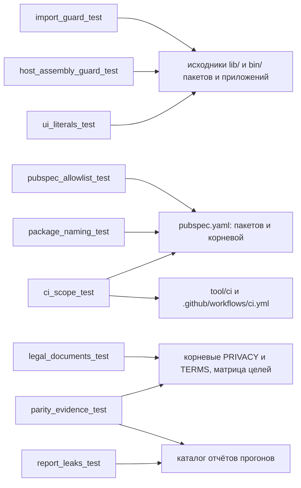
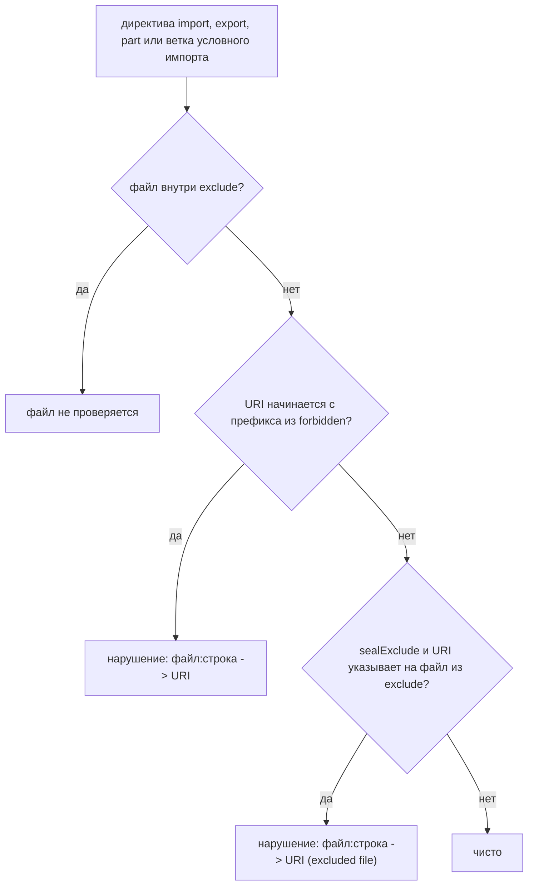

# Устройство сторожа и расширение правил

Глава объясняет, откуда каждый тест берёт данные, как сканер применяет правило, что проверяет каждый файл пакета и как сам сторож проверен. В конце — рецепты: новый пакет, новое правило, разрешённый литерал, новый тест-правило. Запуск и разбор сообщений о нарушениях — в [главе 00](00-getting-started.md).

## Общая картина

Сторож читает репозиторий как текст. Каждый тест берёт свой источник и сверяет его с правилом, которое записано в самом тесте или в `test/support/`. Схема показывает, что читает каждый тест.



Корень репозитория находит `repoRoot()` (`test/support/repo_root.dart`): ближайший каталог вверх от текущего, в `pubspec.yaml` которого есть секция `workspace:`. Поэтому тесты работают и из корня (`melos run guard`), и из каталога пакета.

Сам пакет не входит в граф рабочего кода: его никто не импортирует. В `pubspec.yaml` у него только `dev_dependencies` — `test`, `path`, `lints`. Исключение по ссылкам — `ci_scope_test.dart`: он импортирует `tool/ci/ci_scope.dart` из корня репозитория относительным путём.

## Правила импортов

Правила импортов собраны в одной таблице `rules` (`test/support/rules.dart`). Это список `PackageRule`. Тест `import_guard_test.dart` создаёт по одному тесту на каждое правило.

### Как сканер читает правило

`PackageRule` состоит из четырёх полей:

| Поле | Значение |
|---|---|
| `dir` | пакет или каталог внутри пакета от корня репозитория |
| `forbidden` | запрещённые префиксы URI: `dart:io`, `package:flutter/`, `package:codelab_client_` |
| `exclude` | файлы и каталоги (с `/` на конце), на которые запрет не действует |
| `sealExclude` | `true` (по умолчанию) — остальной код не может ссылаться на `exclude`; `false` — `exclude` только снимает запрет |

Что сканируется, определяет `dir` (`scan` в `test/support/import_scanner.dart`):

- если в пути `dir` нет сегмента `lib` или `bin` (то есть это пакет целиком), сканируется `<dir>/lib`;
- если сегмент есть (`apps/codelab_desktop/lib/features/onboarding`, `apps/codelab_cli/bin`), сканируется сам каталог.

Пути в `exclude` считаются от `dir`, если `dir` — пакет (`lib/io.dart`, `lib/src/io/`), и от самого каталога, если `dir` лежит в `lib`/`bin` (`app/`, `src/run.dart`).

Сканер обходит все `*.dart`, включая `part`-файлы и сгенерированные. Для каждой строки он ищет директиву `import`, `export` или `part` в начале строки и условную альтернативу `if (…) 'uri'`. Затем применяет правило, как на схеме.



Три следствия:

- файл из `exclude` не проверяется вообще. Поэтому рядом с правилом, которое снимает запреты с `io.dart`, стоит второе правило без `exclude` на запреты, которые к `io.dart` тоже относятся (Flutter, клиентские пакеты): так сделано у `codelab_embedded` и `codelab_setup`;
- запечатывание сравнивает не только пакетные URI (`package:<имя этого пакета>/…`), но и относительные пути, которые указывают на файл из `exclude`;
- `forbidden` — префиксы строк, а не имена пакетов. `package:val_highlight/` не совпадает с `package:val_highlight_flutter/`, а `package:codelab_acp_` покрывает все пакеты `codelab_acp_*`.

### Таблица правил по пакетам

Таблица сжата: полный перечень, причины и ссылки на changes — в комментариях `test/support/rules.dart`. `webUnsafe` — список префиксов, которые ломают web-компиляцию или тянут Flutter: `dart:io`, `dart:isolate`, `dart:ffi`, `dart:html`, `dart:js_interop`, `package:web/`, `package:flutter/`, `package:codelab_acp_transports/io.dart`.

| `dir` | Запрещено | Исключения |
|---|---|---|
| `codelab_agent_core` | `webUnsafe`, `codelab_acp_protocol`, `codelab_acp_transports`, `yaml`, `yaml_edit`, `toml` | нет |
| `codelab_acp_transports` | `webUnsafe` | `lib/io.dart`, `lib/src/io/` (запечатаны) |
| `codelab_client_acp`, `codelab_client_core` | `webUnsafe`, `intl`, `flutter_localizations` | нет |
| `codelab_client_io` | `package:flutter/` | нет |
| `codelab_agent_io` | `package:flutter/`, `codelab_acp_*`, `codelab_client_*` | нет |
| `codelab_agent_io` (второе правило) | ничего; только запечатывание | `lib/testing.dart`, `lib/src/scripted/` — сценарий модели |
| `codelab_agent_acp` | `webUnsafe` | нет |
| `codelab_agent_mcp` | `webUnsafe`, `codelab_acp_*`, `codelab_client_*`, `package:codelab_agent_io/` | нет |
| `codelab_embedded` | `webUnsafe`, `codelab_agent_io/`, `codelab_client_*` | `lib/io.dart`, `lib/src/io/`, `lib/testing.dart`, `lib/src/testing/` (запечатаны) |
| `codelab_embedded` (второе правило) | Flutter, `fluent_ui`, `codelab_ui`, `codelab_client_*` | нет |
| `codelab_embedded/lib` | `codelab_agent_io/testing.dart`, `codelab_agent_mcp/testing.dart` | `testing.dart`, `src/testing/` (запечатаны) |
| `codelab_setup` | `webUnsafe`, `codelab_agent_io/`, `codelab_acp_*`, `codelab_client_*` | `lib/io.dart`, `lib/src/io/` (запечатаны) |
| `codelab_setup` (ещё два правила) | Flutter, ACP, клиенты, `codelab_agent_io/testing.dart` во всём пакете; `http/io_client.dart` и `http/browser_client.dart` вне `io` | `lib/io.dart`, `lib/src/io/` у правила про `http` |
| `apps/codelab_agent` | Flutter, `fluent_ui`, `codelab_client_acp`, `codelab_ui` | нет |
| `apps/codelab_cli` | Flutter, `fluent_ui`, `codelab_ui`, `codelab_agent_*` | нет |
| `apps/codelab_cli/lib/src` | `codelab_acp_testing`; `dart_tui` | `scenario/`; `tui/` (без запечатывания) |
| `apps/codelab_cli/lib` | `codelab_setup/io.dart`; `codelab_embedded/io.dart`; `codelab_embedded/testing.dart` | `src/run.dart`; `src/composition_root.dart`; `src/scenario/` (без запечатывания) |
| `apps/codelab_cli/bin` | `codelab_setup/io.dart`, `codelab_embedded/io.dart`, `codelab_embedded/testing.dart` | нет |
| `apps/codelab_cli/lib/src/tui/core` | `dart_tui`, `dart:io` | нет |
| `apps/codelab_desktop` | `package:codelab_agent_` | нет |
| `apps/codelab_desktop/lib` | `codelab_embedded/io.dart` и `codelab_setup/io.dart` вне `app/`; `codelab_embedded/testing.dart` везде; `xterm2_core`, `xterm2`, `pty2`, `file_selector`, `system_theme`, `desktop_drop`, `url_launcher`, `dart:ffi` вне своих адаптеров; `zmodem`; транзитивные пакеты `gpt_markdown` | адаптеры — `features/terminal/`, `core/platform/…` |
| `apps/codelab_desktop/lib/features/…` | `dart:io` в `onboarding`, `project_files`, `settings/presentation` (и `codelab_setup/io.dart` там же); в `terminal/application` — только `package:flutter/`; в `usage/application` — `package:flutter/` и `dart:io`; в `protocol/application` — `package:flutter/`, `dart:io`, `structured_log_flutter/` и `structured_log_fluent/` | нет |
| `packages/flutter/codelab_ui/lib` | `desktop_drop`; `gpt_markdown`, `val_highlight` вне `src/rendering/`; транзитивные пакеты `gpt_markdown` везде | `src/rendering/` без запечатывания |

Для `apps/codelab_desktop/lib` в таблице 13 отдельных `PackageRule`. Те из них, у которых есть `exclude`, заданы с `sealExclude: false`: адаптер получает право на пакет, а остальной код вправе ссылаться на сам адаптер. Список исключений по каждому плагину читайте в `rules.dart`: там у каждого правила стоит комментарий с причиной и ссылкой на решение `design.md`.

Откуда берутся нормы. Сами границы описывает [`AGENTS.md`](../../../../AGENTS.md) §5 («Клиенты НЕ ДОЛЖНЫ импортировать `package:codelab_agent_*` напрямую», «IO-барель ДОЛЖЕН импортироваться только composition root», web-безопасные барели). Сценарии и перечень правил — требование «Автоматический сторож границ пакетов» в [`workspace-architecture`](../../../../openspec/specs/workspace-architecture/spec.md). Что сторож проверяет и чего нет, сводит таблица в [`layers-and-dependencies.md`](../../../../docs/architecture/layers-and-dependencies.md) §42.

## Допустимые зависимости

`pubspec_allowlist_test.dart` читает секцию `dependencies:` из `pubspec.yaml` пакета (функция `dependencyKeys`: ключи с отступом в два пробела) и требует, чтобы они были подмножеством `*Allowlist` этого пакета. Секции `dev_dependencies` и `dependency_overrides` не проверяются.

| Константа | Пакет | Допустимые зависимости |
|---|---|---|
| `coreAllowlist` | `codelab_agent_core` | `http`, `meta`, `collection`, `async`, `crypto` (PKG-2) |
| `ioAllowlist` | `codelab_agent_io` | `codelab_agent_core`, `path`, `meta`, `async`, `yaml`, `yaml_edit` |
| `acpAllowlist` | `codelab_agent_acp` | ядро агента, `codelab_acp_protocol`, `codelab_acp_transports`, `meta`, `async` |
| `mcpAllowlist` | `codelab_agent_mcp` | `codelab_agent_core`, `http`, `meta`, `async` |
| `binaryAllowlist` | `apps/codelab_agent` | пакеты агента, `codelab_acp_protocol`, `codelab_acp_transports`, `args`, `http`, `async`, `meta` |
| `kitAllowlist` | `codelab_client_core` | `codelab_client_acp`, ACP-пакеты, `freezed_annotation`, `meta`, `collection`, `async` |
| `clientIoAllowlist` | `codelab_client_io` | `codelab_client_core`, `codelab_client_acp`, ACP-пакеты, `path`, `meta` |
| `cliAllowlist` | `apps/codelab_cli` | клиентские пакеты, ACP-пакеты, `codelab_acp_testing`, `codelab_embedded`, `codelab_setup`, `dart_tui`, `args`, `async`, `path`, `meta` |
| `setupAllowlist` | `codelab_setup` | `codelab_agent_core`, `codelab_agent_io`, `http`, `meta` |
| `embeddedAllowlist` | `codelab_embedded` | пакеты агента, ACP-пакеты, `http`, `meta`, `async` |
| `desktopAllowlist` | `apps/codelab_desktop` | только пакеты `codelab_*`: клиентские, ACP, `codelab_embedded`, `codelab_setup`, `codelab_ui` |

У `codelab_acp_protocol`, `codelab_acp_transports`, `codelab_client_acp`, `codelab_ui` и `codelab_acp_testing` allowlist нет. У app проверяются только зависимости с префиксом `codelab_`: пакеты `codelab_agent_*` в `dependencies` desktop не попадают, а сторонние (`flutter_bloc`, `fluent_ui`) не ограничиваются.

Точные множества читайте в константах: они сопровождены комментариями с причиной. Расширять любое множество можно только через OpenSpec change ([`AGENTS.md`](../../../../AGENTS.md) §4, §17; `workspace-architecture`, «Расширение allowlist»).

## Имена пакетов

`package_naming_test.dart` проверяет два инварианта ADR-0002 ([`0002-name-packages-codelab-side-layer.md`](../../../../docs/architecture/adr/0002-name-packages-codelab-side-layer.md)):

1. Каждый член pub workspace называется `codelab_…`, а имя в `pubspec.yaml` совпадает с именем каталога. Список членов берётся из секции `workspace:` корневого `pubspec.yaml` (`workspaceMembers`), а не задаётся вручную: новый пакет попадает под проверку сам.
2. Каждый префикс `package:codelab_…` в `forbidden` всех правил и в `webUnsafe` указывает на существующий пакет. С `/` на конце требуется пакет с точным именем, без `/` — хотя бы один пакет, имя которого начинается с префикса. Внешние пакеты (`package:flutter/`) не проверяются.

Второй тест защищает от тихой поломки: после переименования пакета строковый запрет не падает, а просто перестаёт что-либо запрещать.

## Сборка ядра агента: HOST-6

`host_assembly_guard_test.dart` и `test/support/host_assembly.dart` проверяют требование HOST-6: хосты собирают ядро только через `buildAgentCore`. В `apps/codelab_agent` (`lib/`, `bin/`) и `codelab_embedded` (`lib/`) не должно быть вызовов `ToolRegistry(`, `Agent(` и `AgentRuntime(`. Регулярное выражение требует, чтобы перед именем не было буквы, цифры или `_`: `AcpAgentServer(` нарушением не считается. Строки, начинающиеся с `//` (в том числе `///`), пропускаются.

Тест для `codelab_embedded` сначала проверяет, что каталог `lib/` существует: сканер молча пропускает отсутствующий каталог, и без этой проверки правило было бы зелёным впустую. Нормы — [руководство ядра агента, сборка и хосты](../../codelab_agent_core/doc/02-assembly-and-hosts.md) и [`workspace-architecture`](../../../../openspec/specs/workspace-architecture/spec.md).

## Литералы интерфейса

`ui_literals_test.dart` и `test/support/ui_literals.dart` ловят английские строки интерфейса, написанные мимо каталогов ARB (change `add-desktop-localization`, D10). Это эвристика по регулярным выражениям, а не разбор AST.

Откуда данные. Каталоги `apps/codelab_desktop/lib/app`, `apps/codelab_desktop/lib/features` и `packages/flutter/codelab_ui/lib/src` (константа `uiLiteralDirs`). `lib/app` проверяется целиком, в `features/` — только `presentation/`. Файлы `*_previews.dart` и каталоги `l10n/` пропускаются.

Что считается литералом интерфейса:

- первый аргумент `Text(` и `CodeLabText(`;
- именованные аргументы `label:`, `tooltip:`, `placeholder:`, `title:`, `message:`, `content:`, `description:`;
- сама строка должна начинаться с буквы. Строки с интерполяцией в начале (`'$count items'`), идентификаторы (`l10n.save`), числа и строки внутри `//`-комментария пропускаются.

Тест состоит из двух проверок: «литералов вне allowlist нет» и «у каждой записи allowlist есть причина и запись жива». Ключ записи — `путь|литерал` без номера строки, чтобы правка соседнего кода не ломала allowlist. Нормы — [`docs/architecture/testing.md`](../../../../docs/architecture/testing.md) §71 и §30а (пункт «Литералы мимо каталога»). В `openspec/specs/` отдельного требования к этому тесту нет.

## Правовые документы

`legal_documents_test.dart` проверяет форму четырёх корневых файлов `PRIVACY.md`, `PRIVACY.ru.md`, `TERMS.md`, `TERMS.ru.md` (требование «Политика конфиденциальности и условия использования» в [`licensing-and-attribution`](../../../../openspec/specs/licensing-and-attribution/spec.md)):

- файл существует;
- первая строка — `Last revised: ГГГГ-ММ-ДД` (английские файлы) или `Редакция от ГГГГ-ММ-ДД` (русские);
- заголовки второго уровня идут первыми и в порядке из константы `_headings`;
- слов согласия (`I agree`, `accept these terms`, `--accept-terms`, `Принимаю`) нет: условия справочные, принимать нечего;
- у пары `PRIVACY.md`/`PRIVACY.ru.md` и пары `TERMS` одна дата;
- корневой `README.md` ссылается на `PRIVACY.md` и `TERMS.md`.

Тест проверяет форму, а не смысл. Копии документов в `apps/codelab_desktop/assets/legal/` сверяет `legal_assets_test.dart` приложения.

## Доказательства матрицы целей и отчёты прогонов

Две проверки о том, что у каждой строки Must матрицы целей агента (`docs/architecture/proposals/agent-parity-goals.md`) есть доказательство. Подробные правила, статусы и источники — [`docs/architecture/testing.md`](../../../../docs/architecture/testing.md) §74.1 и требование «Проверка доказательств матрицы целей» в [`testing-quality`](../../../../openspec/specs/testing-quality/spec.md). Здесь — устройство кода.

`parity_evidence_test.dart` состоит из двух групп:

| Группа | Когда идёт | Что проверяет |
|---|---|---|
| `matrix evidence exists` | в каждом прогоне сторожа | матрица разобрана, число строк Must равно итогу сводки §7; каждое доказательство существует |
| `matrix evidence passed` | только при `CODELAB_PARITY_RESULTS=<каталог>` | статус каждого доказательства по отчётам ночного прогона; в отчётах нет секретов и домашних путей |

Логика лежит в `test/support/parity/`:

| Файл | Ответственность |
|---|---|
| `matrix_parser.dart` | разбор таблиц §3 и §4.1 матрицы, строки Must; ошибка с номером строки на любую неожиданную таблицу |
| `evidence.dart` | извлечение доказательств из ячейки «Критерий приёмки» (`acp/<id>`, `cli/<id>`, `core/<id>`, `app:<файл>`, путь теста, шаблоны `acp/*` и `app:*`) и проверка существования |
| `reports.dart` | чтение отчётов: JSON-репортёр `package:test` и JUnit от `codelab test-scenario --junit`; `findSecretLeaks` |
| `verdict.dart` | свёртка отчётов в статусы `pass`, `failed`, `skipped`, `not-run`, `missing`, `deferred` |
| `allowed_skips.dart` | перечень пропусков, допустимых по спецификации, у каждого — требование-источник |

Переменные окружения:

| Переменная | Эффект |
|---|---|
| `CODELAB_PARITY_RESULTS` | каталог `parity-results` с отчётами и `meta.json`; включает группу статуса; без `meta.json` — ошибка |
| `CODELAB_PARITY_APP_RESULTS` | каталог отчётов app; без него доказательства `app:` получают статус `deferred` и тест не роняют |
| `CODELAB_REPORT_LEAKS_DIR` | каталог отчётов для `report_leaks_test.dart`; без неё тест пропущен |

`report_leaks_test.dart` вызывает `findSecretLeaks`: она ищет в файлах каталога значения переменных окружения с именами на `TOKEN`, `KEY`, `SECRET`, `PASSWORD`, `PASS`, `PAT`, `CREDENTIAL(S)`, `AUTH` (значения от восьми символов, в сыром, JSON- и XML-экранированном виде) и символические ссылки. Вымышленный секрет тестов `sk-test-leak-…` в отчёте CI даёт предупреждение, а в отчётах app — ошибку; отчёты app проверяются ещё и на пути домашних каталогов пользователей (под `/Users` и `/home`). Сообщение называет файл и переменную, но не значение. Шаг CI запускает тест в окружении того джоба, который породил отчёт, и публикует артефакт только при зелёном результате.

## Охват CI

`ci_scope_test.dart` проверяет логику `tool/ci/ci_scope.dart`: какие джобы CI запускать по списку изменённых файлов. Логика лежит в корне репозитория, потому что её запускает лёгкий джоб `scope` на SDK из `setup-dart`, без FVM и `pub get`; тест живёт в сторожевом пакете. Скрипт `tool/ci/affected.dart` читает граф через `readWorkspace`, берёт изменённые файлы из `git diff` и пишет матрицу джобов и Step Summary.

Правила (`ciScope`, `AGENTS.md` §21):

| Условие | Результат |
|---|---|
| задан `fullReason` (push, `release/*`, ночь) или файл вне пакетов, документации и `site/` | полный прогон `fullJobs` и джоб сайта |
| только документация, которая Dart не меняет (`docs/`, `openspec/`, `.claude/`, `*.md` в корне, `AGENTS.md`, `README.md` и `CHANGELOG.md` пакетов) | нет Dart-джобов, кроме `guard` при правке матрицы целей |
| опубликованная на сайте документация (`docs/`, `openspec/`, `README.md` и `doc/` приложений и пакетов) и `site/` | признак `site`: запускается джоб `site`. `doc/**` внутри пакета для Dart-матрицы считается файлом пакета, а не документацией |
| изменены пакеты | `format` целиком, `analyze` и `test` для затронутых и зависящих от них пакетов, `guard` всегда, остальное — по границе |

Новый пакет попадает в охват без правки `ci_scope.dart`: список членов берётся из секции `workspace:`, зависимости — из `pubspec.yaml`. Править файл нужно, когда появляется новый джоб или новая граница («изменён пакет X — запусти скрипт Y»).

Две проверки в `ci_scope_test.dart` стерегут согласованность:

- «Полный прогон CI совпадает с check»: шаги `check` из корневого `pubspec.yaml` равны скриптам всех `fullJobs`; среди них нет `test:e2e:app:*` и `test:e2e:cli:python-agent`;
- «Джобов на macOS нет»: все `runs-on` в `.github/workflows/ci.yml` — `ubuntu-latest`, а джобы `scope`, `checks`, `site`, `parity`, `ci` на месте.

Добавили шаг в `check` — добавьте его и в `fullJobs`, иначе полный прогон CI разойдётся с локальным.

## Как сторож проверен сам

Правило, которое никогда не краснеет, ничего не доказывает. Поэтому у каждого вида проверки есть негативные тесты: они создают во временном каталоге (`Directory.systemTemp.createTempSync`, `addTearDown` удаляет) файл с нарушением и требуют, чтобы сторож его нашёл.

| Что проверено | Где |
|---|---|
| сканер: `import`, `export`, `part`, ветки условного импорта; `exclude`; `sealExclude: true` и `false`; пакетные и относительные URI | `test/import_scanner_test.dart` |
| каждое правило из таблицы `rules` на настоящих пакетах и негативные случаи для правил (временный пакет, формат `файл:строка -> URI`) | `test/import_guard_test.dart` |
| `dependencyKeys` и границы allowlist на текстах `pubspec.yaml` в строках | `test/pubspec_allowlist_test.dart` |
| `danglingPrefixes` на наборе имён | `test/package_naming_test.dart` |
| `scanHostAssembly` на временном `lib/` | `test/host_assembly_guard_test.dart` |
| сканер литералов и `parseAllowlist` | `test/ui_literals_test.dart`, группа «сканер» |
| разбор матрицы, доказательства, отчёты, вердикты, утечки — на временных деревьях и сконструированных отчётах, без настоящей матрицы | `test/support/parity/*_test.dart` |

Файлы `*_test.dart` внутри `test/support/parity/` запускаются вместе с остальными: `dart test` ищет их рекурсивно. Построители отчётов и временных деревьев лежат в `parity_test_kit.dart`.

Негативные тесты следуют двум приёмам:

- для правила из `rules.dart` тест берёт его из таблицы (`rules.firstWhere((r) => r.dir == '…')`) и применяет к временному пакету, поэтому тест и правило не могут разойтись. Нет правила — `firstWhere` бросает, тест красный;
- там, где важны `exclude` и `sealExclude`, правило переносится на временный каталог вместе с этими полями: `PackageRule('.', forbidden: rule.forbidden, exclude: rule.exclude, sealExclude: rule.sealExclude)`.

## Рецепты

### Как добавить правило для нового пакета

Проверено запуском на временном пакете `codelab_agent_foo` (удалён).

1. Добавьте пакет в `workspace:` корневого `pubspec.yaml`. Имя совпадает с именем каталога и подчиняется схеме `codelab_<сторона>_<слой>` (ADR-0002, `AGENTS.md` §5). Мост между сторонами не получает префикс `codelab_agent_`.
2. Добавьте `PackageRule` в конец списка `rules` в `test/support/rules.dart`. Если у пакета есть IO-барель или тестовый слой, перечислите их в `exclude`:

   ```dart
   // Почему правило нужно: пакет web-безопасен, ACP и клиенты ему неизвестны
   // (change `add-foo`, D3).
   PackageRule(
     'packages/dart/codelab_agent_foo',
     forbidden: [
       ...webUnsafe,
       'package:codelab_acp_',
       'package:codelab_client_',
     ],
     exclude: ['lib/io.dart', 'lib/src/io/'],
   ),
   ```

3. Добавьте негативный тест в `test/import_guard_test.dart` внутри `main()`: он применяет правило из таблицы к временному пакету и проверяет формат нарушения.

   ```dart
   test('reports dart:io, a client package and a reference to io.dart in '
       'codelab_agent_foo', () {
     final tmp = Directory.systemTemp.createTempSync('guard_foo_');
     addTearDown(() => tmp.deleteSync(recursive: true));
     File(p.join(tmp.path, 'pubspec.yaml')).writeAsStringSync('name: pkg\n');
     File(p.join(tmp.path, 'lib', 'foo.dart'))
       ..createSync(recursive: true)
       ..writeAsStringSync(
         "import 'dart:io';\n"
         "import 'package:codelab_client_core/codelab_client_core.dart';\n"
         "export 'io.dart';\n",
       );
     File(p.join(tmp.path, 'lib', 'io.dart'))
         .writeAsStringSync("import 'dart:io';\n");
     final rule = rules.firstWhere(
       (r) => r.dir == 'packages/dart/codelab_agent_foo',
     );

     final violations = scan(
       tmp.path,
       PackageRule(
         '.',
         forbidden: rule.forbidden,
         exclude: rule.exclude,
         sealExclude: rule.sealExclude,
       ),
     );

     expect(violations, [
       'lib/foo.dart:1 -> dart:io',
       'lib/foo.dart:2 -> package:codelab_client_core/codelab_client_core.dart',
       'lib/foo.dart:3 -> io.dart (excluded file)',
     ]);
   });
   ```

   `pubspec.yaml` во временном каталоге нужен сканеру, чтобы запечатывание узнало имя пакета для URI `package:<имя>/…`.
4. Если пакет ограничивает зависимости, добавьте константу в начало `test/pubspec_allowlist_test.dart`, тест на настоящий `pubspec.yaml` и негативный тест на тексте:

   ```dart
   const fooAllowlist = {'codelab_agent_core', 'meta'};

   test('codelab_agent_foo depends only on its allowlist', () {
     final pubspec = File(
       p.join(root, 'packages/dart/codelab_agent_foo/pubspec.yaml'),
     ).readAsStringSync();

     final extra = dependencyKeys(pubspec).difference(fooAllowlist);

     expect(extra, isEmpty, reason: 'not in allowlist: ${extra.join(', ')}');
   });

   test('reports a package outside the allowlist of codelab_agent_foo', () {
     const pubspec = '''
   name: codelab_agent_foo
   dependencies:
     codelab_agent_core:
       path: ../codelab_agent_core
     yaml: ^3.1.3
   ''';

     expect(dependencyKeys(pubspec).difference(fooAllowlist), {'yaml'});
   });
   ```

5. `ci_scope.dart` править не нужно: граф берётся из `workspace:`. Править его надо только для нового джоба или границы.
6. Обновите описание пакета: строку и граф зависимостей в корневом `README.md` (секция «Структура»), запись в структуре и назначении пакетов корневого `AGENTS.md` §5. Выполните `fvm dart run melos bootstrap` (`AGENTS.md` §20).
7. Запустите `fvm dart run melos run guard`. Тест правила падает, если `dir` не существует, а `package_naming_test.dart` — если префикс в `forbidden` не указывает ни на один пакет.

Новый `*Allowlist` — норма требования «Автоматический сторож границ пакетов» в [`workspace-architecture`](../../../../openspec/specs/workspace-architecture/spec.md) (перечень допустимых зависимостей записан в нём). Поэтому правило и allowlist нового пакета идут через OpenSpec change (`AGENTS.md` §17), а не отдельной правкой.

Если пакет клиентский, desktop или CLI, проверьте ещё `desktopAllowlist` и `cliAllowlist`: они ограничивают, какие пакеты `codelab_*` клиент вправе подключить. Новый пакет сначала описывается в [`layers-and-dependencies.md`](../../../../docs/architecture/layers-and-dependencies.md) §43 (десять вопросов перед созданием).

### Как добавить правило в существующий пакет

1. Найдите ближайшее правило в `rules.dart`: у того же `dir` или того же запрета.
2. Если запрет относится ко всему пакету, добавьте префикс в `forbidden`. Если к каталогу внутри `lib/`, добавьте новый `PackageRule('<пакет>/lib/<каталог>', …)`. Если «разрешено только одному файлу», используйте `exclude` и решите, нужен ли `sealExclude`: `false` — остальной код вправе ссылаться на этот файл (адаптер платформы), `true` — нет (IO-барель, тестовый слой).
3. Напишите в комментарии над правилом: почему оно нужно и в каком change или документе принято решение.
4. Добавьте негативный тест по образцу из рецепта выше, группируя тесты одной темы в `group`.
5. Прогоните правило на настоящем коде: если оно красное, в репозитории уже есть нарушение. Исправляйте код, а не правило.

Каждое новое правило — это ограничение для всех разработчиков. Не вводите правило, которого нет в `AGENTS.md`, спецификации или `design.md` принятого change.

### Как разрешить литерал интерфейса

Добавьте строку в `test/support/ui_literals_allowlist.txt`. Формат: `путь от корня репозитория | литерал | причина`. Причина обязательна, `#` начинает комментарий. Разделитель — ` | ` с пробелами, поэтому литерал может содержать `|`.

```text
apps/codelab_desktop/lib/features/settings/presentation/add_profile_dialog.dart | WebSocket | название протокола, не переводится (D7)
```

Допустимые причины: имя продукта, название протокола, пример значения поля, значение из конфигурации агента, показываемое как есть, эталонный текст кита для превью. Перевод в ARB сюда не переносится: переводимый текст принадлежит каталогу. Запись, которой в коде больше нет, роняет тест: удаляя строку интерфейса, удалите и запись.

### Как добавить новый тест-правило

Когда проверка не про импорты и не про `dependencies`, заведите отдельный файл `test/<имя>_test.dart`. Логику сканера вынесите в `test/support/`, чтобы её можно было проверить на временном дереве. Скелет проверен запуском (правило условное: запрет вызова `debugger()` в `lib/` CLI).

`test/support/forbidden_call.dart`:

```dart
import 'dart:io';

import 'package:path/path.dart' as p;

/// Вызовы `debugger()` в файлах `*.dart` каталога [dir] в виде
/// `файл:строка -> debugger()`; строки комментариев пропускаются.
List<String> scanDebugger(String dir) {
  final directory = Directory(dir);
  if (!directory.existsSync()) return const [];
  final pattern = RegExp(r'(?<![A-Za-z0-9_])debugger\(\)');
  final violations = <String>[];
  final files =
      directory
          .listSync(recursive: true)
          .whereType<File>()
          .where((f) => f.path.endsWith('.dart'))
          .toList()
        ..sort((a, b) => a.path.compareTo(b.path));
  for (final file in files) {
    for (final (i, line) in file.readAsLinesSync().indexed) {
      if (line.trimLeft().startsWith('//')) continue;
      if (pattern.hasMatch(line)) {
        violations.add(
          '${p.relative(file.path, from: p.dirname(dir))}:${i + 1} -> debugger()',
        );
      }
    }
  }
  return violations;
}
```

`test/debugger_guard_test.dart`:

```dart
import 'dart:io';

import 'package:path/path.dart' as p;
import 'package:test/test.dart';

import 'support/forbidden_call.dart';
import 'support/repo_root.dart';

void main() {
  final root = repoRoot();

  test('apps/codelab_cli has no debugger() calls', () {
    final lib = p.join(root, 'apps', 'codelab_cli', 'lib');
    // Сканер молча пропускает отсутствующий каталог: без этой проверки тест
    // был бы зелёным впустую.
    expect(Directory(lib).existsSync(), isTrue, reason: '$lib не существует');

    final violations = scanDebugger(lib);

    expect(violations, isEmpty, reason: violations.join('\n'));
  });

  test('reports debugger() with file and line', () {
    final tmp = Directory.systemTemp.createTempSync('guard_debugger_');
    addTearDown(() => tmp.deleteSync(recursive: true));
    File(p.join(tmp.path, 'lib', 'a.dart'))
      ..createSync(recursive: true)
      ..writeAsStringSync(
        '// debugger() в комментарии не считается\ndebugger();\n',
      );

    final violations = scanDebugger(p.join(tmp.path, 'lib'));

    expect(violations.single, endsWith('lib/a.dart:2 -> debugger()'));
  });
}
```

Порядок такой же, как у `host_assembly_guard_test.dart`: проверка на настоящем коде, проверка существования каталога, негативный тест на временном дереве. Требования к нарушению:

- сообщение называет файл, строку и причину (`файл:строка -> …`);
- нет молчаливых пропусков: отсутствующий каталог — красный тест;
- есть комментарий «почему»: на какое требование и в каком change опирается правило.

Новый файл `*_test.dart` подхватывается `melos run guard` сам: скрипт запускает весь пакет. Что проверяет тест, добавьте в [README пакета](../README.md) (таблица «Что проверяют тесты») и, если проверка меняет норму, — в требование «Автоматический сторож границ пакетов» через OpenSpec change.

### Как изменить охват CI

`tool/ci/ci_scope.dart` — единственное место, где список изменённых файлов превращается в матрицу джобов. Порядок:

1. Меняйте `ciScope` или константы рядом (`fullJobs`, `_conformance`, `_cliE2e`, `_embeddedCli`, `_l10nPackages`).
2. Добавьте тест в `test/ci_scope_test.dart` по образцу существующих: `_scope([файлы])` считает охват на упрощённом графе `_graph`, `_byName(scope)` — карта джобов.
3. Если добавили скрипт в `check` корневого `pubspec.yaml`, добавьте его в `fullJobs` (тест «Полный прогон CI совпадает с check» иначе красный).
4. Посмотрите расчёт на реальном изменении: `fvm dart run tool/ci/affected.dart --base origin/develop`.

## Нормы и источники

- [`AGENTS.md`](../../../../AGENTS.md): §5 (границы пакетов, имена, web-безопасные барели, `io.dart` и `testing.dart` мостов, запрет `codelab_agent_*` в клиентах), §4 и §17 (расширение allowlist), §21 (проверка перед pull request).
- [ADR-0002](../../../../docs/architecture/adr/0002-name-packages-codelab-side-layer.md) — схема имён пакетов.
- [`docs/architecture/layers-and-dependencies.md`](../../../../docs/architecture/layers-and-dependencies.md) §42 (что сторож проверяет и чего нет), §43 (добавление пакета).
- [`docs/architecture/testing.md`](../../../../docs/architecture/testing.md) §71 (архитектурные тесты), §74 (уровни CI), §74.1 (доказательства матрицы).
- Спецификации: [`workspace-architecture`](../../../../openspec/specs/workspace-architecture/spec.md) («Автоматический сторож границ пакетов»), [`testing-quality`](../../../../openspec/specs/testing-quality/spec.md) («Проверки workspace», «Непрерывная интеграция», «Проверка доказательств матрицы целей», «Машинные отчёты прогонов»), [`licensing-and-attribution`](../../../../openspec/specs/licensing-and-attribution/spec.md) (правовые документы).
- Руководство ядра агента, где описана сборка через `buildAgentCore`: [`codelab_agent_core/doc`](../../codelab_agent_core/doc/README.md).
