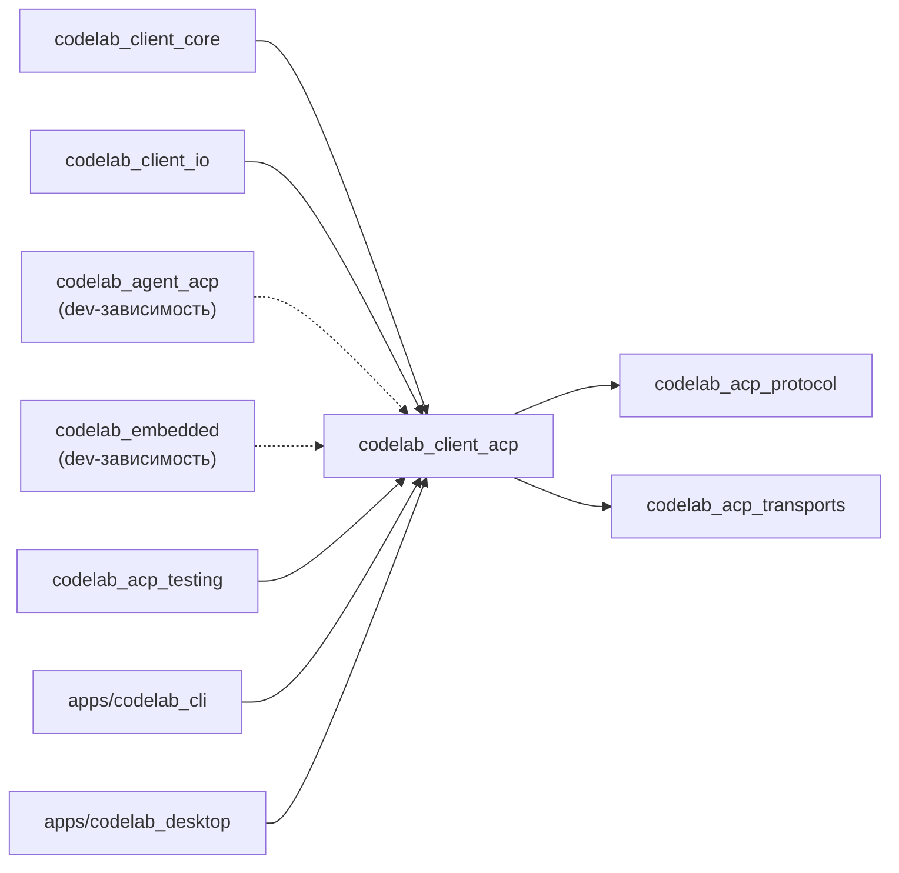
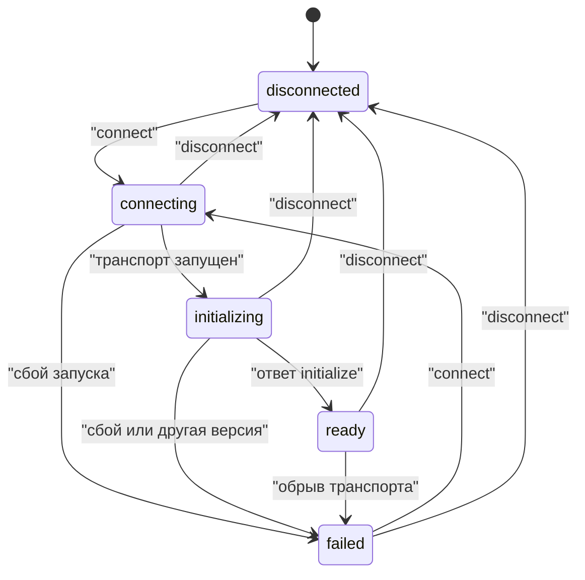
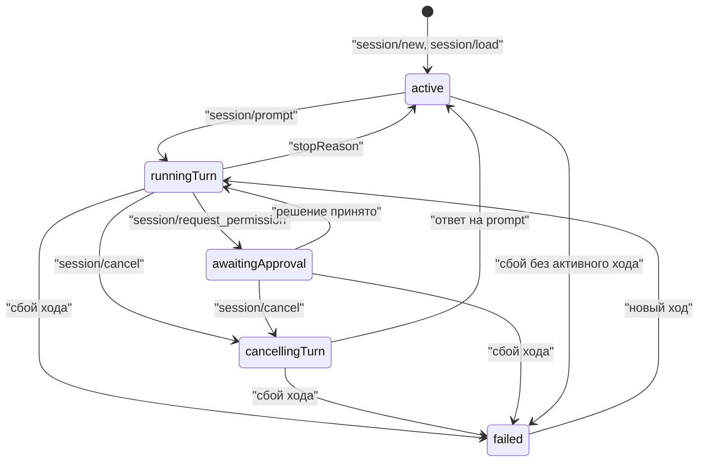

# codelab_client_acp

Протокольный клиент ACP (Agent Client Protocol — протокол, по которому клиент и агент обмениваются сообщениями JSON-RPC). Пакет держит соединение с агентом, ведёт сессии и ходы, отвечает на запросы агента к клиенту (`fs/*`, `terminal/*`, `session/request_permission`) и отдаёт состояние потоками. Он отдельный, чтобы приложение и терминальный клиент делили одну реализацию протокола, а `dart:io` оставался в адаптерах.

## Место в архитектуре

Пакет называется по ADR-0002: сторона `client`, слой `acp` — проекция клиентской стороны в протокол. Это чистый Dart, `dart:io` и Flutter не используются; файлы и процессы пакет получает портами (`TextFileReader`, `TextFileWriter`, `TerminalProcessRunner`).

Схема показывает зависимости из `pubspec.yaml` пакетов: стрелка идёт от пакета к тому, от чего он зависит.



Напрямую от пакета зависят `codelab_client_core`, `codelab_client_io`, `codelab_acp_testing`, `apps/codelab_cli` и `apps/codelab_desktop`. `codelab_agent_acp` и `codelab_embedded` подключают его только как `dev_dependency` (пунктир на схеме): первый — для тестов, второй — для замера задержки потока. Клиентское состояние для интерфейса собирает `codelab_client_core`; этот пакет ничего не знает об интерфейсе.

Правила границы с протоколом — [`docs/architecture/acp-boundary.md`](../../../docs/architecture/acp-boundary.md). Модели протокола — в [`codelab_acp_protocol`](../codelab_acp_protocol/README.md), транспорты — в [`codelab_acp_transports`](../codelab_acp_transports/README.md).

## Что внутри

| Часть | Для чего |
|---|---|
| `AcpClientApplication` | Ядро клиента: подключение, `initialize`, сессии, ходы, ответы на запросы агента. Потоки `sessionChanges`, `connectionStateChanges`, `diagnosticChanges`, `usageNotifications` |
| `CreateSession`, `LoadSession`, `SendPrompt`, `SetSessionConfigOption`, `CancelTurn`, `Reconnect`, `RespondToPermission` | Сценарии-обёртки над методами ядра: возвращают `TaskEither<AcpClientApplicationFailure, …>` вместо исключений |
| `CreateSessionCommand`, `SendPromptCommand`, `ReconnectCommand` и др. | Команды сценариев (freezed) |
| `ClientConnectionState`, `AcpSession`, `PromptTurn`, `ApprovalRequest`, `ToolCallRecord` | Доменное состояние, независимое от DTO протокола |
| `ConnectionStateMachine`, `SessionStateMachine`, `PromptTurnStateMachine` | Чистые функции переходов; результат — `StateTransitionResult` (применён, проигнорирован, отклонён) |
| `ApprovalPolicy`, `ApprovalRiskLevel` | Классификация риска вызова инструмента (`ApprovalPolicy.classifyToolCall`) по уровням `ApprovalRiskLevel` |
| `TextFileReader`, `TextFileWriter`, `TerminalProcessRunner`, `TerminalProcessHandle` | Порты файлов и процессов; реализует адаптер вне пакета (`codelab_client_io`) |
| `resolveWithinWorkingDirectory` | Проверка, что путь лежит внутри рабочей папки сессии |
| `SecretRedactor`, `Logger`, `StructuredLogLogger` | Маскирование секретов и журнал на `structured_log` |
| `CodelabExtensions`, `UsageNotification`, `UsageLedgerReply` | Расширения CodeLab поверх ACP (`_codelab/*`) |

Публичное API экспортирует `lib/codelab_client_acp.dart`. Барель также реэкспортирует `AcpTransport`, `AcpTransportState`, `AcpTransportException`, `AcpTransportErrorCode` и `acpTransportsPackageName` из `codelab_acp_transports`, а из `codelab_acp_protocol` — `acpProtocolPackageName`. Других барелей нет.

## Как использовать

Хост (composition root) создаёт ядро с транспортом и адаптерами, подключается и открывает сессию. Большинство исключений ядра — подтипы `AcpClientApplicationException`; недопустимые переходы бросают `StateTransitionException`, сбои транспорта — `AcpTransportException`. Сценарии `CreateSession` и другие переводят всё это в `AcpClientApplicationFailure`.

```dart
import 'package:codelab_acp_protocol/codelab_acp_protocol.dart';
import 'package:codelab_client_acp/codelab_client_acp.dart';

Future<void> run(AcpTransport transport) async {
  final client = AcpClientApplication(
    transport: transport,
    // Без адаптера клиент не объявляет возможность агенту (см. ниже).
    textFileReader: myReader,
    textFileWriter: myWriter,
    terminalProcessRunner: myRunner,
  );

  final state = await client.connect(transport);
  if (state is! ClientConnectionReady) return;

  final session = await client.createSession(
    const CreateSessionCommand(cwd: '/abs/project'),
  );
  client.sessionChanges.listen((s) { /* показать состояние */ });

  await client.sendPrompt(
    SendPromptCommand(sessionId: session.id, prompt: [/* ContentBlock */]),
  );
  await client.dispose();
}
```

`myReader`, `myWriter`, `myRunner` — реализации портов; пример не самодостаточен, это порядок вызовов. Ядро принимает транспорт и в конструкторе, и в `connect(transport)`: `connect` заменяет транспорт и запускает `initialize`. Версия протокола — `AcpClientApplication.supportedProtocolVersion`; если агент согласовал другую, `connect` падает с `UnsupportedProtocolVersionException`. Запрос, кроме `session/prompt`, снимается по таймауту (`requestTimeout`, по умолчанию 60 с) с `AcpRequestTimeoutException`: ход длится сколько угодно и прерывается `session/cancel`.

`reconnect(ReconnectCommand)` берёт фабрику транспорта из команды или из конструктора (`reconnectTransport`); без фабрики бросает `StateTransitionException`. Порядок параллельных попыток задаёт последняя замена транспорта: транспорт вызова `connect()` или `reconnect()`, вытесненного более новым, закрывается, а сам вызов не меняет состояние соединения и завершается `StateTransitionException` («operation is stale»). Окно до замены — пока фабрика `reconnect` открывает транспорт — сериализует вызывающий; `ClientWorkspace` из `codelab_client_core` делает это сам, и вытесненная попытка завершается у него молча. `dispose` окончателен и идемпотентен: завершает terminal-процессы и закрывает транспорт.

## Жизненный цикл

Ядро ведёт три независимых автомата (`lib/src/domain/state_machines.dart`). Недопустимый переход возвращает `RejectedStateTransition`, повторный — `IgnoredStateTransition`; состояние не портится (AGENTS.md §8). Подробно — [`session-lifecycle.md`](../../../docs/architecture/session-lifecycle.md) и [`state-management.md`](../../../docs/architecture/state-management.md).

### Соединение (`ClientConnectionState`)



Перед новым подключением ядро переводит живое состояние в `disconnected`, затем в `connecting` (`_establishConnection`). Причина `failed` — `ConnectionFailureReason` (`startFailed`, `sendFailed`, `receiveFailed`, `protocolViolation`, `unsupportedProtocolVersion`, `disconnected`, `closed`, `timeout`, `unknown`). При обрыве из `ready` или `initializing` ядро завершает ожидающие запросы ошибкой `AcpConnectionLostException` и снимает неотвеченные одобрения; активные ходы помечаются прерванными, и после `session/load` последний ход реплея показывается отменённым. Каждая замена транспорта увеличивает `generation`: поздний ответ или событие старого соединения состояние не меняет (AGENTS.md §9).

### Сессия (`SessionLifecycleStatus`)



Значение `idle` — состояние по умолчанию `AcpSession`; `createSession` сразу создаёт сессию `active`. Новый ход допустим из `idle`, `active` и из `failed`, когда активного хода нет. Пока ход в `cancellingTurn`, новый не начинается: агент должен ответить на отменённый `session/prompt`.

### Ход (`PromptTurnStatus`)

Состояния хода: `pending`, `running`, `awaitingApproval`, `cancelling` и терминальные `completed`, `failed`, `refused`, `maxed`, `cancelled`. Терминальное состояние выбирается по `stopReason` ответа: `end_turn` — `completed`, `max_tokens` и `max_turn_requests` — `maxed`, `refusal` — `refused`, `cancelled` — `cancelled`. Ход переходит в `awaitingApproval`, пока есть неотвеченные одобрения, и возвращается в `running`, когда их не осталось. `cancel` оставляет ход открытым в `cancelling`: обновления до ответа агента всё ещё принадлежат ему (`05-Prompt Turn.md#cancellation`).

## Запросы агента к клиенту

Диспетчер входящих сообщений — `_handleInboundMessage` в `lib/src/application/acp_client_application.dart`. Запрос неизвестного метода получает `-32601 Method not found`, неизвестное уведомление игнорируется.

| Метод | Что делает клиент |
|---|---|
| `session/request_permission` | Решения не принимает: превращает запрос в `ApprovalRequest` активного хода и переводит сессию в `awaitingApproval`. Решение хоста приходит через `respondToPermission` |
| `fs/read_text_file`, `fs/write_text_file` | Проверяет путь, вызывает порт `TextFileReader`/`TextFileWriter` |
| `terminal/create`, `terminal/output`, `terminal/wait_for_exit`, `terminal/kill`, `terminal/release` | Ведёт реестр процессов по сессиям и `TerminalId`, вызывает `TerminalProcessRunner` и `TerminalProcessHandle` |

### Одобрения

Политика разрешений принадлежит хосту, ядро её не навязывает ([`permissions.md`](../../../docs/architecture/permissions.md)). Ядро связывает запрос с правильной сессией, ходом и вызовом инструмента: `approvalId` строится из id JSON-RPC запроса, а решение для одного запроса не применяется к другому. Запрос без активной сессии или хода, а также во время `cancelling` получает ответ `cancelled`. `respondToPermission` принимает `SelectPermissionCommand` (выбранный вариант проверяется по списку вариантов запроса) или `CancelPermissionCommand`; для уже решённого запроса бросает `StateTransitionException`. Риск вызова считает `ApprovalPolicy.classifyToolCall`; вызов вида `other` или с незнакомым видом получает уровень `unknown`. Ядро только классифицирует риск: решение об одобрении принимают агент и пользователь, автоматическая политика — флаг `--approve` CLI.

### Файлы и процессы без собственного одобрения

Для `fs/*` и `terminal/*` клиент не вводит гейт одобрения: ACP делает `session/request_permission` для них решением агента (AGENTS.md §10, исключение). Вместо этого обязательно ограничение рабочей папкой сессии (`AcpSession.cwd`):

- `path` в `fs/*` и `cwd` в `terminal/create` проходят `resolveWithinWorkingDirectory` до обращения к порту. Путь нормализуется (`.`, `..`, разделители) и должен совпадать с корнем или лежать внутри него. Выход наружу даёт `PathOutsideWorkingDirectoryFailure`: агент получает ошибку `invalid params`, операция не выполняется, в журнал пишется предупреждение.
- Если `cwd` в `terminal/create` не указан, берётся рабочая папка сессии.
- Проверка лексическая, символические ссылки она не разрешает: пакет не использует `dart:io`. Это принятый остаточный риск (`openspec/changes/archive/2026-09-04-add-acp-fs-client-support/design.md`, Risks).
- Неизвестная сессия — ошибка `invalid params`. Отсутствующий файл (`FsNotFoundFailure`) — `-32002 Resource not found`, сбой ввода-вывода (`FsIoFailure`) — внутренняя ошибка.
- Если порт не передан, клиент не объявляет возможность в `initialize` (`fs.readTextFile`, `fs.writeTextFile`, `terminal` равны `false`), а входящий запрос получает внутреннюю ошибку «not supported by this client».
- Процесс получает `kill()` при `terminal/kill`, `terminal/release`, обрыве соединения, замене транспорта и `dispose`; `TerminalProcessState` — два состояния, `running` и `exited`. Запрос `terminal/*` к неизвестному `TerminalId` (не создан или уже освобождён) отклоняется как неизвестный терминал.

Рабочая папка — единственный рубеж для этих методов; более жёсткие ограничения (например, `BoundedEnv` на стороне агента) пакет не заменяет. Адаптеры портов — [`codelab_client_io`](../codelab_client_io/); правила платформы — [`platform-integration.md`](../../../docs/architecture/platform-integration.md).

## Тесты

```bash
cd packages/dart/codelab_client_acp
fvm dart test
```

Набор `test/fixtures/client_fixture_conformance_test.dart` проигрывает золотые фикстуры ACP против `AcpClientApplication`. Из корня репозитория его запускает скрипт Melos:

```bash
fvm dart run melos run conformance:client
```

С переменной `CODELAB_TEST_REPORT_DIR` скрипт дополнительно пишет отчёт `dart/codelab_client_acp.conformance.json`. Фикстуры, фальшивые транспорты и помощники берутся из [`codelab_acp_testing`](../codelab_acp_testing/README.md) (`dev_dependency`).

## Правила пакета

Правила пакета — в его [`AGENTS.md`](AGENTS.md), он дополняет корневой [`AGENTS.md`](../../../AGENTS.md). Главные: пакет остаётся чистым Dart без `dart:io`; виджеты и приложения не разбирают ACP-сообщения; внешние эффекты — только через порты.

## Смотрите также

- [Руководство разработчика](doc/README.md) — слои, жизненный цикл соединения, сессии и хода, `fs/*` и `terminal/*` с ограничением рабочей папкой, тесты, рецепты и частые проблемы.
- [`codelab_acp_protocol`](../codelab_acp_protocol/README.md), [`codelab_acp_transports`](../codelab_acp_transports/README.md), [`codelab_acp_testing`](../codelab_acp_testing/README.md) — модели, транспорты, фикстуры.
- [`codelab_agent_acp`](../codelab_agent_acp/README.md) — противоположная сторона протокола.
- `openspec/specs/acp-protocol-client/spec.md`, `acp-fs-client`, `acp-terminal-client`, `acp-golden-fixtures` — спецификации поведения.
- [`streaming.md`](../../../docs/architecture/streaming.md) — потоковые обновления и идемпотентность.
