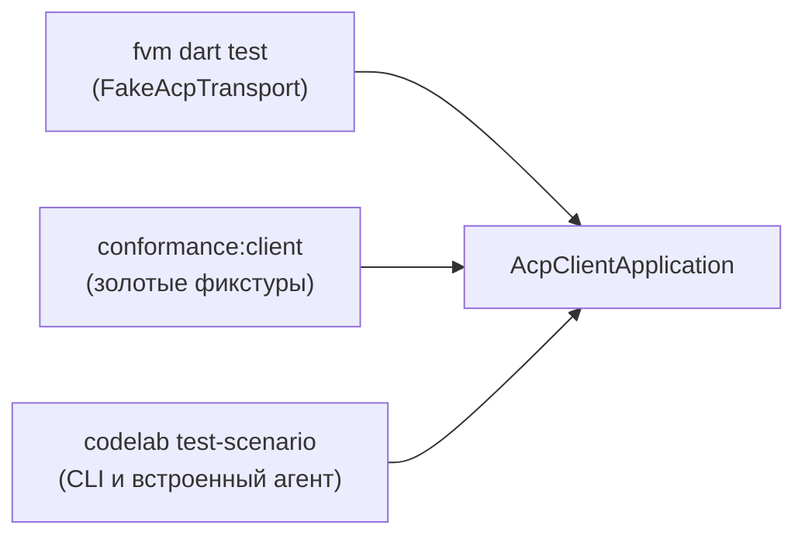

# Начало работы с кодом клиентского ACP-слоя

Эта глава для разработчика, который впервые открыл `codelab_client_acp`. Она отвечает на практические вопросы: как подготовить репозиторий, как «запустить» пакет, у которого нет `bin/`, как увидеть, что клиент отправляет и получает, и в какой файл идти с задачей. Устройство слоёв объясняет [следующая глава](01-overview.md), поток ходов — [третья](02-connection-and-turns.md).

## Подготовка репозитория

Шаги подготовки описаны в [запуске из исходников](../../../../docs/user/run-from-source.md#1-подготовка). Здесь конспект для работы с этим пакетом; команды выполняются из корня репозитория.

1. Установите [FVM](https://fvm.app). Версия Flutter SDK лежит в `.fvmrc`; все команды Dart идут через `fvm`.
2. Поставьте SDK и свяжите пакеты:

   ```bash
   fvm install
   fvm flutter pub get
   fvm dart run melos bootstrap
   ```

3. Создайте сгенерированный код (freezed). Без него пакет не соберётся:

   ```bash
   fvm dart run melos exec -c 1 --depends-on=build_runner -- "fvm dart run build_runner build --delete-conflicting-outputs"
   ```

В пакете шесть сгенерированных файлов `*.freezed.dart`: `domain_models`, `state_machines`, `prompt_failure`, `terminal_access` в `lib/src/domain/` и `application_models`, `protocol_frame` в `lib/src/application/`. Три из них (`domain_models`, `state_machines`, `application_models`) лежат в git, остальные нет (`.gitignore` исключает `*.freezed.dart`). Поэтому правка модели с `@freezed` даёт в diff и исходник, и сгенерированный файл. Чтобы пересоздать код только в этом пакете, выполните ту же команду в его каталоге:

```bash
cd packages/dart/codelab_client_acp
fvm dart run build_runner build --delete-conflicting-outputs
```

Пакет — чистый Dart без Flutter и без `dart:io`. Все проверки идут обычным `fvm dart`.

## Как «запустить» пакет

У пакета нет точки входа: это библиотека, которую создаёт хост (CLI или app). Работу ядра видно тремя способами.



Схема показывает три входа в одно и то же ядро клиента: тесты и фикстуры собирают его сами, `test-scenario` — через composition root CLI.

### Тесты пакета

```bash
cd packages/dart/codelab_client_acp
fvm dart test
```

Полный прогон идёт около 13 секунд. Последний конец вывода:

```text
00:08 +518 ~37: All tests passed!
```

`+518` — прошедшие тесты, `~37` — пропущенные. Пропущенные — фикстуры, у которых в `roles` нет `client`: сценарий написан только для агента (см. [главу о тестировании](04-testing-extending-troubleshooting.md#золотые-фикстуры-и-conformanceclient)).

Один файл или один тест по части названия:

```bash
fvm dart test test/fs_access_test.dart
fvm dart test test/fs_access_test.dart --name "escapes"
```

Анализ и форматирование — по [корневому `AGENTS.md`](../../../../AGENTS.md) §21:

```bash
fvm dart analyze
fvm dart format --set-exit-if-changed lib test
```

### Фикстуры клиента

Корпус золотых фикстур ACP проигрывается против `AcpClientApplication`. Из корня репозитория:

```bash
fvm dart run melos run conformance:client
```

Скрипт запускает `fvm dart test packages/dart/codelab_client_acp/test/fixtures`. Результат на момент написания:

```text
00:05 +48 ~37: All tests passed!
```

### Сценарий через CLI

`codelab test-scenario` проигрывает фикстуру в рабочем бинаре: клиент здесь — настоящий `AcpClientApplication` из composition root CLI, агент — встроенный, модель — сценарий из фикстуры. Живой провайдер и ключи не нужны. Запуск из корня репозитория с пустым `CODELAB_HOME`:

```bash
fvm dart run apps/codelab_cli/bin/codelab.dart test-scenario packages/dart/codelab_acp_testing/fixtures/acp/prompt-tool-permission-allow.json packages/dart/codelab_acp_testing/fixtures/acp/prompt-cancel-mid-tool.json --agent embedded
```

```text
PASS acp/prompt-cancel-mid-tool (0.4s)
PASS acp/prompt-tool-permission-allow (0.2s)
2 passed, 0 failed, 0 skipped
```

Эти две фикстуры затрагивают разрешение и отмену. Что они проверяют, смотрите в их поле `description`. Команды CLI описывает [руководство `codelab`](../../../../apps/codelab_cli/doc/README.md).

## Отладка

Ядро ничего не печатает само: события идут в `Logger`, а кадры и диагностика — в потоки. Чтобы разобраться, где что-то пошло не так, смотрите четыре источника.

| Источник | Что в нём | Как включить |
|---|---|---|
| Журнал `Logger` | События ядра: переходы соединения, устаревшие события, таймауты, отброшенные обновления. Уровни `trace`…`critical` | Конструктор `AcpClientApplication(logger:)` или глобальная настройка `configureCodeLabLogging` |
| Журнал протокола | Запись `protocol_message` на каждое сообщение: направление, вид, метод, размер, корреляция. Это `category=protocol`, уровень `trace`, по умолчанию выключен | `configureCodeLabLogging(protocolTracingEnabledByDefault: true)` или `setProtocolTracingEnabled(true)` |
| `diagnostics` и `diagnosticChanges` | Последние 500 записей `DiagnosticEntry`: ошибки разбора, отказы запросов агента, сбои транспорта | Читайте геттер или подпишитесь на поток |
| `protocolFrames` | Поток `ProtocolFrame` для панели Protocol: метод, id, сессия, поколение, размер и, если политика позволяет, payload | Подпишитесь до `connect`; `setFrameTrace(true)` включает полный payload |

Без настройки `StructuredLogLogger` пишет JSON-строки в stdout процесса. Тест, который не вызвал `configureCodeLabLogging`, поэтому засоряет вывод. CLI передаёт собственный `Logger` именно по этой причине (комментарий в `apps/codelab_cli/lib/src/composition_root.dart`).

Пример настройки для отладки. Он выводит оба журнала в консоль:

```dart
import 'dart:convert';

import 'package:codelab_client_acp/codelab_client_acp.dart';

void enableDebugLogs() {
  configureCodeLabLogging(
    applicationOutput: (entry, level) => print('APP ${jsonEncode(entry)}'),
    protocolTraceOutput: (entry, level) => print('TRACE ${jsonEncode(entry)}'),
    protocolTracingEnabledByDefault: true,
  );
}
```

В тестах после настройки вызовите `StructlogConfiguration.reset()` из `package:structured_log/structured_log.dart` в `tearDown`: настройка глобальная и переживёт тест.

Реальный фрагмент вывода при такой настройке, `connect` и `createSession` на `FakeAcpTransport` (политика payload — по умолчанию `metadataOnly`):

```text
APP {"logger":"codelab_client_acp","category":"application","component":"client","from":"ClientConnectionDisconnected","to":"ClientConnectionConnecting","connection_generation":1,"event":"connection_state_changed","level":"info","timestamp":"2026-11-24T18:20:18.440969Z"}
TRACE {"logger":"codelab_client_acp","category":"protocol","direction":"outbound","kind":"request","method":"initialize","size":293,"request_id":"1","connection_generation":1,"event":"protocol_message","level":"trace","timestamp":"2026-11-24T18:20:18.455534Z"}
TRACE {"logger":"codelab_client_acp","category":"protocol","direction":"inbound","kind":"result","method":"initialize","size":259,"request_id":"1","connection_generation":1,"event":"protocol_message","level":"trace","timestamp":"2026-11-24T18:20:18.457402Z"}
TRACE {"logger":"codelab_client_acp","category":"protocol","direction":"outbound","kind":"request","method":"session/new","size":93,"request_id":"2","connection_generation":1,"event":"protocol_message","level":"trace","timestamp":"2026-11-24T18:20:18.461494Z"}
```

Полей `payload` нет: при `metadataOnly` содержимое сообщений в журнал не попадает. Полный payload включает хост явным решением (`ProtocolPayloadPolicy.full`: CLI делает это с `--verbose`), и всё равно он проходит через `SecretRedactor`. Подробнее о политике и маскировании — в [главе об обзоре](01-overview.md#наблюдаемость-кадры-диагностика-журнал).

Журнал соединения читается по `connection_generation`: событие с номером старого поколения — устаревшее (см. [главу о соединении](02-connection-and-turns.md#поколение-соединения)).

## Что изменить — куда смотреть

| Задача | Файл в `lib/src/` | Что ещё затронуть |
|---|---|---|
| Новое поле или вариант команды (`SendPromptCommand` и др.) | `application/application_models.dart` | сценарий в `application/use_cases.dart`, метод ядра, перегенерация freezed |
| Новое состояние соединения, сессии или хода | `domain/domain_models.dart` (типы), `domain/state_machines.dart` (переходы) | `_sessionStatusForTurn`, диаграмма в README пакета, `docs/architecture/session-lifecycle.md` |
| Как `session/update` меняет ход | `domain/state_machines.dart`: `_applyUpdateToTurn` (ход) и `_applySessionScopedUpdate` (сессия) | список видов `SessionUpdate.knownKinds` в `codelab_acp_protocol` |
| Приём нового запроса агента к клиенту | `application/acp_client_application.dart`: `_handleInboundMessage` и обработчик | модели в `codelab_acp_protocol`, возможность в `initialize`, порт в `domain/` |
| Проверка путей рабочей папкой | `domain/fs_access.dart`: `resolveWithinWorkingDirectory` | тест `test/fs_access_test.dart` |
| Порты файлов и процессов | `domain/fs_access.dart`, `domain/terminal_access.dart` | адаптеры в [`codelab_client_io`](../../codelab_client_io/doc/README.md) |
| Уровень риска вызова | `domain/approval_policy.dart` | `ApprovalRiskLevel` в `domain_models.dart` |
| Причина сбоя хода | `domain/prompt_failure.dart`, `_promptFailureOf` в ядре | потребители в [`codelab_client_core`](../../codelab_client_core/doc/README.md) |
| Маскирование секретов | `domain/secret_redaction.dart` | `test/secret_redaction_test.dart` |
| Расширения CodeLab (`_meta.codelab`) | `domain/codelab_extensions.dart`, хелперы `subagentMetaOf`/`outcomeOf` в `domain/domain_models.dart` | фикстуры расширений |
| Журнал, кадры протокола | `infrastructure/structured_log_logger.dart`, `application/protocol_frame*.dart` | `docs/architecture/observability.md` |
| Преобразование исключений в `AcpClientApplicationFailure` | `application/use_cases.dart`: `_mapApplicationFailure` | `application/application_models.dart` |

Рецепты со скелетами кода — в [главе о тестировании и расширении](04-testing-extending-troubleshooting.md#рецепты-расширения).

## Что читать дальше

- [01. Обзор и слои](01-overview.md) — карта пакета, слои, словарь.
- [02. Соединение, сессия, ход](02-connection-and-turns.md) — как ядро ведёт `session/prompt`, `session/update`, отмену и одобрения.
- [03. Запросы агента: файлы и терминал](03-agent-requests-fs-terminal.md) — `fs/*`, `terminal/*` и ограничение рабочей папкой.
