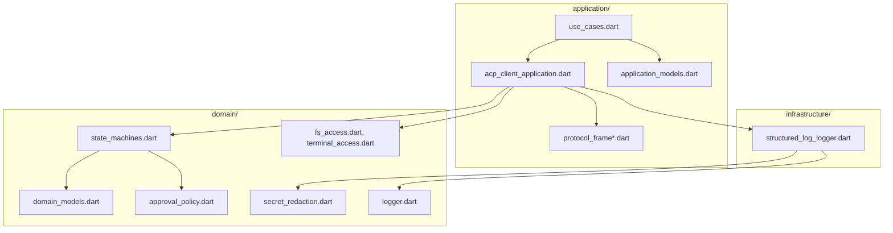

# Обзор и слои

Эта глава объясняет, из чего состоит `codelab_client_acp`, как устроены его слои, кто чем владеет и какие слова в коде что значат. Она нужна, чтобы потом читать [главу о ходах](02-connection-and-turns.md) и [главу о запросах агента](03-agent-requests-fs-terminal.md) без догадок. Схему зависимостей пакета и таблицу публичного API смотрите в [README пакета](../README.md): здесь они не повторяются.

## Что делает пакет

ACP (Agent Client Protocol) — протокол, по которому клиент и агент обмениваются сообщениями JSON-RPC. `codelab_client_acp` — клиентская сторона этого обмена в виде одного класса `AcpClientApplication`. Он:

- принимает транспорт и ведёт соединение: `initialize`, переподключение, закрытие;
- открывает и загружает сессии, отправляет промпты, отменяет ходы, меняет опции;
- превращает входящие `session/update` в неизменяемое состояние сессии и отдаёт его потоком;
- отвечает на запросы агента к клиенту: `session/request_permission`, `fs/*`, `terminal/*`;
- пишет журнал, диагностику и кадры протокола.

Чего пакет не делает. Он не рисует интерфейс, не хранит профили и недавние проекты, не решает, разрешать ли действие, и не трогает файловую систему. Состояние для интерфейса собирает [`codelab_client_core`](../../codelab_client_core/doc/README.md), файлы и процессы реализует [`codelab_client_io`](../../codelab_client_io/doc/README.md), решение об одобрении принимает пользователь или политика хоста.

Клиентское состояние принадлежит ядру, а не виджетам (корневой [`AGENTS.md`](../../../../AGENTS.md) §8). Cubit-ы app и REPL CLI только отображают то, что ядро публикует.

## Слои внутри `lib/src/`

В пакете три каталога слоёв, как в [`layers-and-dependencies.md`](../../../../docs/architecture/layers-and-dependencies.md). На схеме стрелка идёт от файла к тому, что он импортирует.

Схема показывает направление зависимостей: `domain/` не знает про остальные слои, `application/` собирает всё в ядро, `infrastructure/` реализует порт журнала.

- **`domain/`** — типы состояния, автоматы переходов, политика риска, порты файлов и процессов, типизированные отказы, маскирование секретов. Здесь нет транспорта и нет асинхронности: автоматы — чистые функции.
- **`application/`** — `AcpClientApplication` с потоками, команды, сценарии `use_cases.dart`, кадры протокола. Здесь живёт вся асинхронность и вся работа с `AcpTransport`.
- **`infrastructure/`** — один файл: адаптер `Logger` на `structured_log` и настройка приёмников. Ядро по умолчанию создаёт `StructuredLogLogger` само, поэтому `acp_client_application.dart` импортирует этот слой напрямую.

Границу пакета держит сторож: `lib/**` не импортирует `dart:io`, Flutter и `package:codelab_acp_transports/io.dart` ([`AGENTS.md`](../AGENTS.md) §2). Файлы и процессы приходят портами, поэтому пакет работает и в web-сборке.

## Карта `lib/src/`

| Файл | О чём | Строк |
|---|---|---|
| `application/acp_client_application.dart` | ядро: соединение, сессии, ходы, одобрения, ответы на `fs/*` и `terminal/*`, диагностика | ~3200 |
| `application/application_models.dart` | команды (`CreateSessionCommand`, `SendPromptCommand`, `CancelTurnCommand`, `ReconnectCommand`, `RespondToPermissionCommand` и др.), `AcpClientApplicationFailure`, `SessionListPage` | ~150 |
| `application/use_cases.dart` | сценарии `CreateSession`, `LoadSession`, `SendPrompt`, `CancelTurn`, `Reconnect`, `RespondToPermission`, `SetSessionConfigOption` | ~160 |
| `application/protocol_frame.dart`, `protocol_frame_recorder.dart` | `ProtocolFrame` и построитель кадров | ~100, ~270 |
| `application/usage_notification.dart`, `usage_ledger_reply.dart` | сырые данные расширения usage | по ~30 |
| `application/standard_error_names.dart` | имена стандартных кодов JSON-RPC для `detail` кадра | ~20 |
| `domain/domain_models.dart` | `ClientConnectionState`, `AcpSession`, `PromptTurn`, `ApprovalRequest`, `ToolCallRecord`, `DiagnosticEntry` | ~350 |
| `domain/state_machines.dart` | `ConnectionStateMachine`, `PromptTurnStateMachine`, `SessionStateMachine`, события, `StateTransitionResult` | ~1450 |
| `domain/approval_policy.dart` | `ApprovalPolicy`: уровень риска вызова | ~220 |
| `domain/fs_access.dart` | порты `TextFileReader`/`TextFileWriter`, отказы `FsAccessFailure`, `resolveWithinWorkingDirectory` | ~100 |
| `domain/terminal_access.dart` | порт `TerminalProcessRunner`, `TerminalProcessHandle`, `TerminalProcessState`, отказы `TerminalAccessFailure` | ~100 |
| `domain/prompt_failure.dart` | `PromptFailure`: типизированная причина сбоя хода | ~70 |
| `domain/codelab_extensions.dart` | `CodelabExtensions`, блок `codelabClientExtensionsMeta` в `initialize` | ~110 |
| `domain/secret_redaction.dart` | `SecretRedactor` | ~310 |
| `domain/logger.dart` | порт `Logger` | ~45 |
| `infrastructure/structured_log_logger.dart` | `StructuredLogLogger`, `configureCodeLabLogging`, константы категорий и компонентов | ~200 |

Файлы `*.freezed.dart` сгенерированы и в таблицу не вошли. Число строк приблизительное, оно нужно только для масштаба: ядро — самый большой файл, и читать его удобнее по обработчикам.

## Словарь

| Термин | Что это в коде |
|---|---|
| Ядро клиента | `AcpClientApplication`. Единственный владелец состояния соединения и сессий |
| Хост | тот, кто создаёт ядро: composition root CLI (`apps/codelab_cli/lib/src/composition_root.dart`) или app. Передаёт транспорт, порты, логгер и политику payload |
| Команда | неизменяемый запрос к ядру (`SendPromptCommand`). Её поля — это то, что хост хочет, а не то, что уйдёт на провод |
| Сценарий (use case) | тонкая обёртка над методом ядра: `SendPrompt(client)(command)` возвращает `TaskEither`, а не бросает исключение |
| Снимок | `AcpSession` — неизменяемое состояние сессии. Ядро заменяет его целиком и публикует в `sessionChanges` |
| Ход | `PromptTurn` — один `session/prompt` от запроса до ответа со `stopReason`; хранит обновления, вызовы инструментов, одобрения |
| Автомат | чистая функция `(состояние, событие) → StateTransitionResult`. Результат: применён, проигнорирован (повтор, поздний кадр) или отклонён (недопустимый переход) |
| Поколение | число `generation`: растёт при каждой замене транспорта. Операции и события старого поколения отбрасываются |
| Порт | интерфейс во внешний мир: `TextFileReader`, `TextFileWriter`, `TerminalProcessRunner`, `Logger` |
| Диагностика | `DiagnosticEntry` — запись в ограниченном буфере ядра, видимая хосту |
| Кадр | `ProtocolFrame` — проекция одного сообщения JSON-RPC для панели Protocol: метод, id, сессия, размер, payload по политике |
| Одобрение | `ApprovalRequest` — запрос агента `session/request_permission`, ожидающий решения хоста |

## Публичные потоки и геттеры

Хост получает данные из ядра так. Все потоки — broadcast, значение «снимком» не повторяется: подписывайтесь до `connect`.

| Член ядра | Что отдаёт |
|---|---|
| `sessionChanges` | новый `AcpSession` на каждое изменение сессии. Поток синхронный |
| `connectionState`, `connectionStateChanges` | текущее `ClientConnectionState` и поток его смен. Синхронный |
| `usageNotifications` | сырые снимки расхода `_codelab/session/usage` вместе с поколением. Синхронный |
| `protocolFrames` | `ProtocolFrame` на каждое отправленное и принятое сообщение текущего поколения. Асинхронный |
| `diagnostics`, `diagnosticChanges` | буфер последних 500 записей и поток новых. Синхронный |
| `sessions`, `sessionById(id)` | текущие снимки сессий |
| `generation` | номер текущего поколения соединения |

«Синхронный» значит, что подписчик вызывается внутри `add`, то есть в середине обработки входящего кадра. Поэтому в обработчике `sessionChanges` лучше не вызывать методы ядра и не делать долгой работы: отложите её (`scheduleMicrotask`, свой `StreamController`). `protocolFrames` сделан асинхронным именно ради этого: подписчик не может «войти обратно» из обработчика транспорта (комментарий к полю в ядре).

## Исключения и сбои

Метод ядра сообщает об ошибке исключением, сценарий из `use_cases.dart` — значением `AcpClientApplicationFailure`.

| Исключение ядра | Когда | В сценарии становится |
|---|---|---|
| `AcpClientApplicationException` | запрос не ушёл, ответ-ошибка агента (`cause` — `JsonRpcError`), не разобрался ответ, ядро закрыто | `AcpClientTransportFailure`, если `cause` — `AcpTransportException`, иначе `AcpClientUnexpectedFailure` |
| `AcpConnectionLostException` | транспорт отказал, пока запрос ждал ответа | `AcpClientUnexpectedFailure` (подтип `AcpClientApplicationException`) |
| `AcpRequestTimeoutException` | агент не ответил за `requestTimeout` (60 с по умолчанию; `session/prompt` не снимается) | `AcpClientUnexpectedFailure` |
| `UnsupportedProtocolVersionException` | агент согласовал не версию 1 | `AcpClientProtocolFailure` |
| `MissingAcpSessionException` | сессии нет в ядре | `AcpClientMissingSessionFailure` |
| `StateTransitionException` | недопустимый переход, устаревшая операция, «одобрение не ожидает решения» | `AcpClientStateRejectedFailure` |
| `AcpTransportException` | сбой самого транспорта | `AcpClientTransportFailure` |

Правило отображения — функция `_mapApplicationFailure` в `use_cases.dart`. Исключения типизированы: строки и общий `Exception` не бросаются (корневой [`AGENTS.md`](../../../../AGENTS.md) §15, [`error-handling.md`](../../../../docs/architecture/error-handling.md)).

Сбой самого хода хранится в `PromptTurn.failure` — это `PromptFailure`. Четыре варианта:

| Вариант | Откуда |
|---|---|
| `AgentPromptFailure` | ответ-ошибка агента с расширением `data.codelab` (`errorClass`, `message`, `retryable`) |
| `RequestPromptFailure` | JSON-RPC ошибка без расширения CodeLab: `code` и `message` |
| `ConnectionLostPromptFailure` | ход прервал отказ транспорта |
| `UnknownPromptFailure` | таймаут, ошибка разбора, любое другое исключение |

Разбор `data.codelab` терпим: поле неожиданного типа считается отсутствующим, а не ломает показ сбоя (`PromptFailure.fromJsonRpcError`).

## Что на проводе и что в состоянии

Протокольные DTO (`NewSessionResponse`, `SessionUpdate`, `ToolCall`) живут в [`codelab_acp_protocol`](../../codelab_acp_protocol/README.md); ядро не отдаёт их хосту как долгоживущее состояние ([`acp-boundary.md`](../../../../docs/architecture/acp-boundary.md) §5–§7). Исключения из правила — те части DTO, которые безопасно хранить как есть: `ContentBlock`, `SessionUpdate` в списке `PromptTurn.updates`, `PermissionOption`. Сами записи вызовов (`ToolCallRecord`), одобрений (`ApprovalRequest`) и ходов (`PromptTurn`) — доменные типы пакета.

Три вещи, которые пакет помнит про агента, потому что они приходят в `initialize`:

- `ClientConnectionReady.capabilities` — `AgentCapabilities` (например, `loadSession`, `sessionCapabilities.list`);
- `ClientConnectionReady.agentInfo` — `Implementation` агента;
- `ClientConnectionReady.codelabExtensions` — какие расширения CodeLab агент объявил в `agentCapabilities._meta.codelab`. Разбор терпимый: неверная форма означает «расширение не согласовано», а не ошибку `initialize`.

## Наблюдаемость: кадры, диагностика, журнал

Ядро ведёт три независимых канала. Они отвечают на разные вопросы, поэтому не заменяют друг друга.

| Канал | Для кого | Что в нём | Политика payload |
|---|---|---|---|
| Журнал (`Logger`) | разработчик, баг-репорт | события жизненного цикла, устаревшие кадры, таймауты, предупреждения о containment | содержимое сообщений в записи не кладётся; сырые данные добавляются только при `full` |
| Запись `protocol_message` | разработчик (`category=protocol`, уровень `trace`) | направление, вид, метод, размер, корреляция | `payload` только при базовой политике `full` |
| `protocolFrames` | панель Protocol хоста | `ProtocolFrame` | `payload` при `full` или включённом Trace; выше 256 KiB не хранится (`payloadOmitted: tooLarge`) |
| `diagnostics` | панель диагностики, отчёты об ошибках | `DiagnosticEntry`: сообщение, серьёзность, источник, контекст, причина | текст причины и сырые данные — только при `full`, иначе класс ошибки и размер |

Решение о политике принимает хост при создании ядра: `ProtocolPayloadPolicy.metadataOnly` (по умолчанию) или `full` (debug, `--verbose`). Режим Trace — это временное «как `full`» только для кадров: `setFrameTrace(true)` включает его, запись `protocol_message` он не меняет. Если базовая политика уже `full`, `setFrameTrace` ничего не делает, а `traceAvailable` равен `false`. Правило: Trace никогда не включается сам.

Диагностика проходит `SecretRedactor` в самом ядре, журнал — процессор `secretRedactionProcessor`, который подключает `configureCodeLabLogging`. Редактор скрывает значения по имени ключа (`token`, `api_key`, `authorization`…), заголовки авторизации, учётные данные в адресах, PEM-блоки и присваивания `имя=значение`. Редактор не хранит состояния: `const SecretRedactor()`. Правила имён описаны в спецификации `approval-safety` («Редактирование секретов»). Подробнее о том, что логировать, — [`observability.md`](../../../../docs/architecture/observability.md); трассировка протокола — §10, политика payload в журнале и диагностике — §48а там же.

Корреляция в журнале: поля `session_id`, `request_id`, `tool_call_id`, `connection_generation`. По `connection_generation` отличают события нового соединения от устаревших.

## Где править и что читать дальше

- Состояние и переходы — [глава 02](02-connection-and-turns.md).
- Файлы и терминал — [глава 03](03-agent-requests-fs-terminal.md).
- Тесты, рецепты, частые проблемы — [глава 04](04-testing-extending-troubleshooting.md).
- Спецификации: [`acp-protocol-client`](../../../../openspec/specs/acp-protocol-client/spec.md), [`acp-fs-client`](../../../../openspec/specs/acp-fs-client/spec.md), [`acp-terminal-client`](../../../../openspec/specs/acp-terminal-client/spec.md), [`acp-client-kit`](../../../../openspec/specs/acp-client-kit/spec.md).
