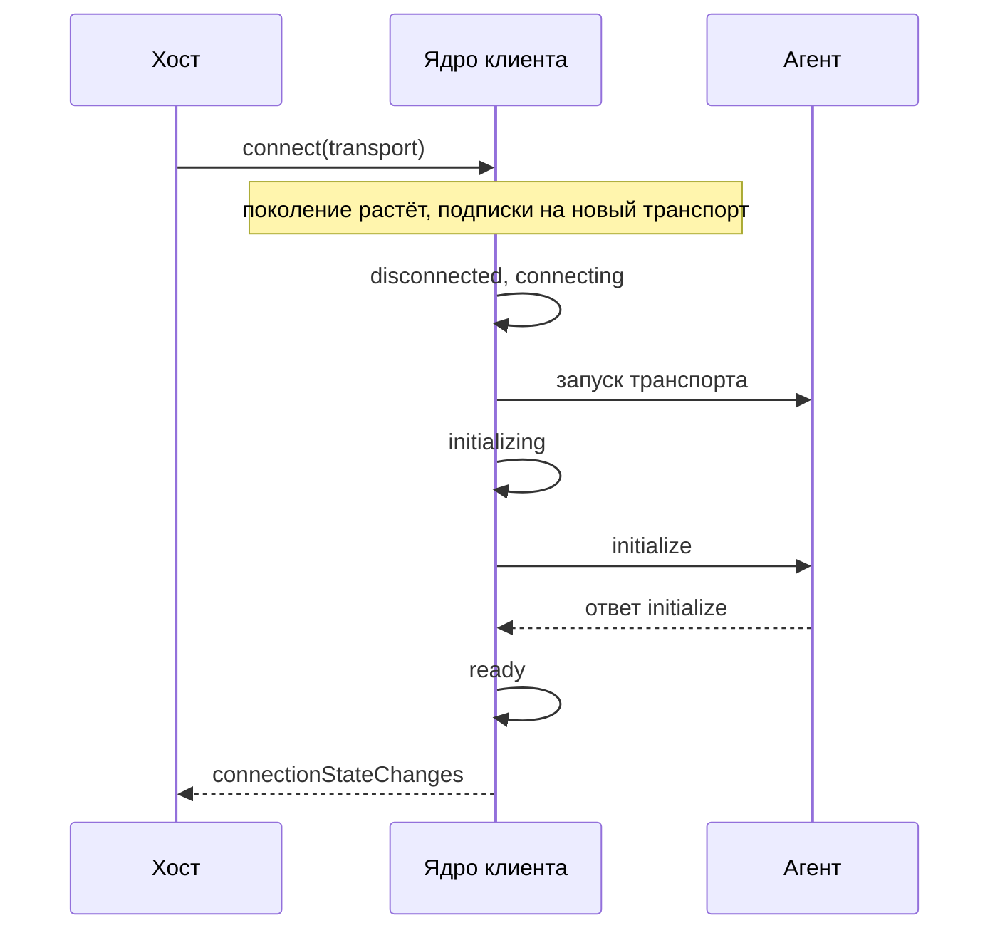
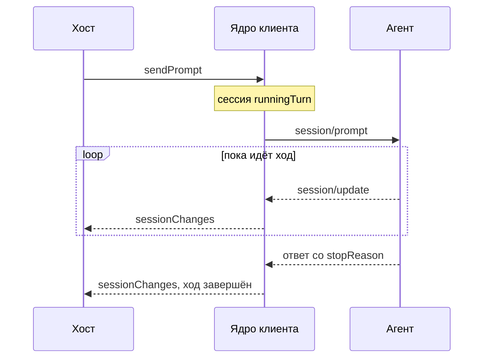
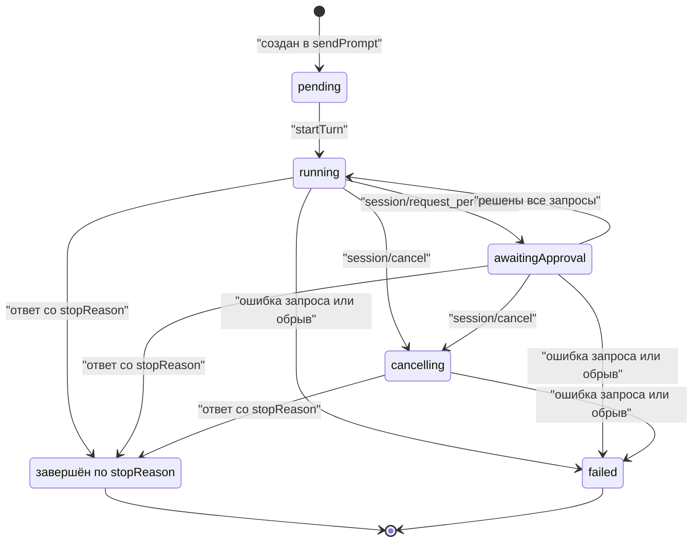
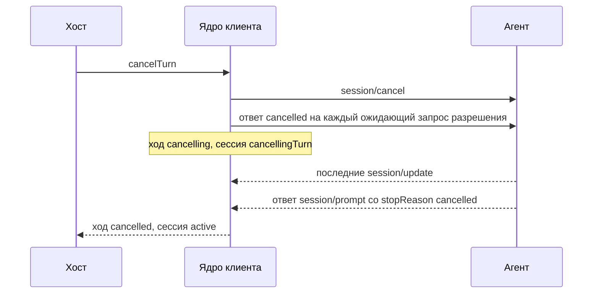
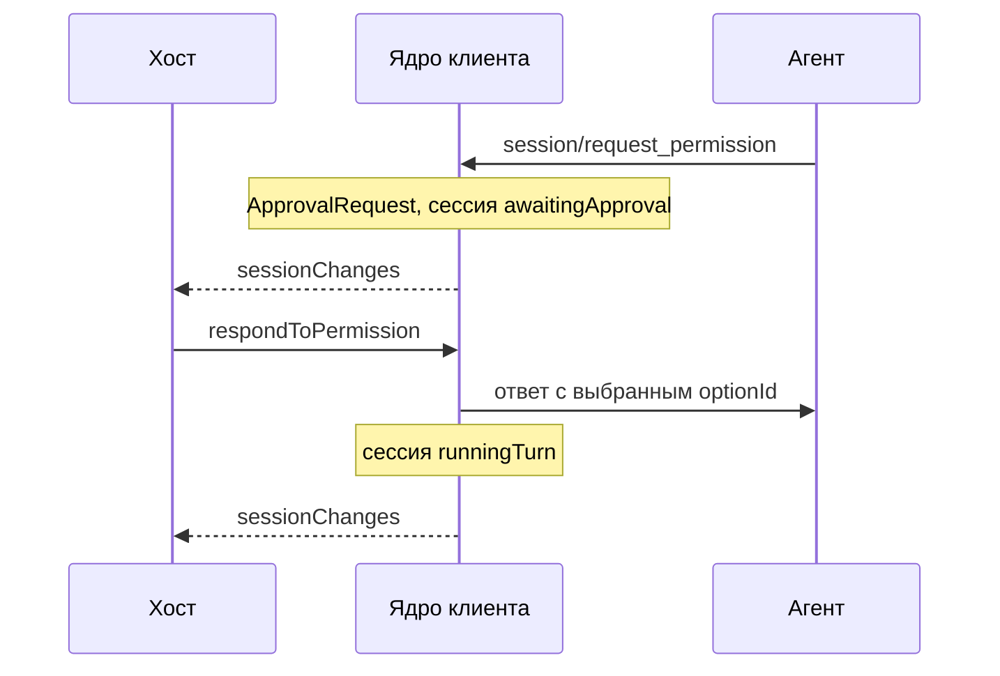
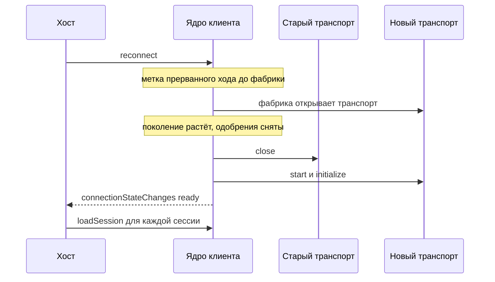

# Соединение, сессия, ход

Эта глава проводит по жизненному циклу: как ядро подключается к агенту, открывает сессию, ведёт `session/prompt` и `session/update`, отменяет ход, спрашивает одобрения и переживает обрыв. Она опирается на [обзор](01-overview.md): ядро — единственный владелец состояния, автоматы — чистые функции, поколение отсекает устаревшее.

Нормы — спецификация [`acp-protocol-client`](../../../../openspec/specs/acp-protocol-client/spec.md) и документы [`session-lifecycle.md`](../../../../docs/architecture/session-lifecycle.md), [`streaming.md`](../../../../docs/architecture/streaming.md), [`permissions.md`](../../../../docs/architecture/permissions.md). Протокол — `docs/protocols/acp/protocol/` (`02-Initialization.md`, `03-Session Setup.md`, `05-Prompt Turn.md`, `08-Tool Calls.md`).

Кадры в примерах сняты прогоном теста на `FakeAcpTransport` (шаблон такого теста — в [главе 04](04-testing-extending-troubleshooting.md#шаблон-теста-клиента)); этот же обмен зафиксирован в золотой фикстуре `acp/prompt-tool-permission-allow`. Номера `id` в примерах — из прогона.

## Один владелец состояния

Все изменения проходят одним путём: ядро получает событие (вызов метода хоста, кадр от агента, отказ транспорта), прогоняет его через автомат и публикует результат.

```text
событие → автомат (чистая функция) → StateTransitionResult → _storeSession → sessionChanges
```

Автомат возвращает один из трёх результатов (`StateTransitionResult`):

| Результат | Что значит | Что делает ядро |
|---|---|---|
| `AppliedStateTransition` | переход выполнен, есть новое состояние | сохраняет и публикует |
| `IgnoredStateTransition` | повтор, поздний кадр, нет цели; состояние то же | сохраняет то же состояние |
| `RejectedStateTransition` | переход недопустим | `stateOrThrow` бросает `StateTransitionException` |

`stateOrThrow` в ядре вызывается на всех путях: «проигнорировано» — не ошибка, «отклонено» — исключение с причиной.

Три автомата работают на разных уровнях:

- `ConnectionStateMachine` — `ClientConnectionState` (`disconnected`, `connecting`, `initializing`, `ready`, `failed`);
- `SessionStateMachine` — `AcpSession` и его `SessionLifecycleStatus`;
- `PromptTurnStateMachine` — `PromptTurn` и его `PromptTurnStatus`.

Автомат сессии вызывает автомат хода и выводит статус сессии из статуса хода (`_sessionStatusForTurn`):

| Статус хода | Статус сессии |
|---|---|
| `pending`, `running` | `runningTurn` |
| `awaitingApproval` | `awaitingApproval` |
| `cancelling` | `cancellingTurn` |
| `failed` | `failed` |
| `completed`, `refused`, `maxed`, `cancelled` | `active` |

Диаграммы соединения и сессии — в [README пакета](../README.md#жизненный-цикл); здесь они не дублируются. Диаграмма хода ниже.

## Подключение

`connect(transport)` заменяет транспорт ядра и запускает `initialize`. Конструктору тоже нужен транспорт, но настоящий передают в `connect`.



Что происходит по шагам (`connect` → `_replaceTransport` → `_establishConnection`):

1. `_replaceTransport` увеличивает `generation`, помечает сессии с идущим ходом прерванными, снимает ожидающие одобрения и ожидающие запросы старого соединения, отписывается от старого транспорта и закрывает его. Потом привязывает новый (`_bindTransport`).
2. `_establishConnection` переводит автомат в `connecting`, запускает транспорт (`start`), затем `initializing` и отправляет `initialize`.
3. Ответ проверяется: версия протокола должна совпасть с `AcpClientApplication.supportedProtocolVersion` (1). Иначе переход в `failed` с причиной `unsupportedProtocolVersion`, транспорт закрывается, `connect` бросает `UnsupportedProtocolVersionException`.
4. Успех — `ready` с `capabilities` и `agentInfo` из ответа.

Ошибки подключения: сбой `start` даёт `failed` с причиной `startFailed` и `AcpClientApplicationException`. Любой сбой ответа на `initialize` — отказ агента, таймаут, ошибка разбора — даёт `failed` с причиной `protocolViolation`.

Нельзя передавать в `connect` тот же объект, что и в конструктор: `connect` сначала закрывает прежний транспорт, то есть закроет его же. `connect` тогда бросит `AcpClientApplicationException` с причиной `AcpTransportException`, а состояние станет `failed`.

Кадр `initialize`, который реально уходит агенту (клиент без `clientInfo`, порты файлов и терминала переданы):

```text
C→A {"jsonrpc":"2.0","id":1,"method":"initialize","params":{"protocolVersion":1,"clientCapabilities":{"fs":{"readTextFile":true,"writeTextFile":true},"terminal":true,"_meta":{"codelab":{"tasks":{"version":1},"subagents":{"version":1},"subagentToolCalls":{"version":1},"usage":{"version":1}}}}}}
```

Возможности клиента честные: `fs.readTextFile` равно `true`, только если передан `TextFileReader`; `fs.writeTextFile` — только если передан `TextFileWriter`; `terminal` — только если передан `TerminalProcessRunner`. Блок `_meta.codelab` объявляет расширения CodeLab (`codelabClientExtensionsMeta`): агент присылает свои данные только объявившему клиенту. ACP разрешает такие объявления лишь в `_meta` (`15-Extensibility.md`).

### Отказ транспорта

Транспорт сообщает о сбое событием `AcpTransportFailure`. Ядро (`_handleTransportEvent`):

1. записывает диагностику;
2. если соединение было `ready`, помечает все сессии с идущим ходом прерванными;
3. переводит автомат в `failed` с причиной из кода ошибки транспорта (`_connectionFailureReasonFor`), если состояние не `disconnected`;
4. если соединение было `ready` или `initializing`, завершает все ожидающие запросы `AcpConnectionLostException` и снимает ожидающие одобрения.

Из-за шага 4 `sendPrompt` не зависает: ожидающий `session/prompt` падает, и ход получает `PromptFailure.connectionLost`. Прогон этого сценария:

```text
CONN ClientConnectionFailed disconnected
SESSION failed turn=failed stop=null failure=ConnectionLostPromptFailure
PROMPT ERROR AcpConnectionLostException
```

## Поколение соединения

`generation` — номер попытки подключения. Он растёт на единицу при каждом `connect()` и `reconnect()` (после первого `connect` он равен 1). Правило из [`AGENTS.md`](../../../../AGENTS.md) §9: поздние события старого соединения не меняют актуальное состояние. Где оно проверяется:

| Место | Что происходит при несовпадении |
|---|---|
| Подписки на транспорт (`_bindTransport`) | кадр и событие старого транспорта отбрасываются, в журнал уходит `event_ignored` с `reason=stale_generation` |
| `sendPrompt`, `cancelTurn`, `respondToPermission` | после `await` проверяется поколение: операция бросает `StateTransitionException` («operation is stale…»). Ход при этом не помечается `failed` |
| `connect`, `reconnect` | вытесненная попытка закрывает свой транспорт, не делает переходов и бросает `StateTransitionException` |
| Обработчики `terminal/*` | ответ в соединение, которого уже нет, не отправляется |
| `ProtocolFrameRecorder` | карта соответствия запросов и ответов очищается |
| `usageNotifications`, `UsageLedgerReply` | поколение уходит вместе с данными, потребитель сравнивает его сам |

Пример вытеснения: два `reconnect` подряд. Побеждает последний, первый получает исключение, состояние остаётся состоянием победителя (прогон двух параллельных вызовов):

```text
first=StateTransitionException operation is stale: ACP transport was reconnected while this operation was in flight
second=ClientConnectionReady
```

Окно, пока фабрика транспорта в `reconnect` ещё открывает его, ядро не покрывает: порядок параллельных вызовов там обеспечивает вызывающий (`ClientWorkspace` в [`codelab_client_core`](../../codelab_client_core/doc/README.md) делает это сам).

## Сессии

### `session/new`

`createSession(CreateSessionCommand)` отправляет `session/new` и после ответа создаёт `AcpSession` в статусе `active` с режимами и опциями из ответа. Рабочая папка сессии `cwd` берётся из команды. Эта папка потом ограничивает `fs/*` и `terminal/*` (см. [главу 03](03-agent-requests-fs-terminal.md)).

Агент вправе прислать `session/update` сразу за ответом на `session/new` (например, `available_commands_update`). Транспорт доставляет оба кадра раньше, чем `createSession` вернёт управление, поэтому ядро держит буфер `_earlyUpdates`: пока в полёте хотя бы один `session/new`, обновления неизвестных сессий складываются туда и применяются после ответа к созданной сессии. Когда запросов в полёте нет, буфер очищается: обновления так и не созданных сессий отбрасываются.

### `session/load`

`loadSession(LoadSessionCommand)` восстанавливает сессию по реплею: агент повторяет историю уведомлениями `session/update` до ответа (`03-Session Setup.md`). До ответа сессии в ядре ещё нет, поэтому обновления идут в буфер `_sessionReplays`. После ответа `SessionStateMachine.replayHistory` раскладывает их в завершённые ходы:

- ход открывает `user_message_chunk`, пришедший после ответа агента; подряд идущие чанки пользователя — один ход;
- ходы реплея закрыты как `completed` без `stopReason`: границ ходов и причин остановки реплей не несёт;
- режимы и опции из ответа главнее тех, что пришли в реплее.

Если ход этой сессии прервала замена транспорта (метка в `_interruptedTurns`), последний ход реплея показывается `cancelled` со `stopReason` `cancelled`. Метка применяется один раз, переживает неудачную загрузку и снимается новым `session/prompt`. Причина: агент отменяет ход вместе с соединением, но ACP об этом не сообщает ([`acp-protocol-client`](../../../../openspec/specs/acp-protocol-client/spec.md), «Ход, прерванный заменой транспорта»).

### Остальные методы сессии

| Метод ядра | Что отправляет | Особенности |
|---|---|---|
| `listSessions` | `session/list` | без `sessionCapabilities.list` в ответе `initialize` запрос не уходит, бросается `AcpClientApplicationException` |
| `setSessionConfigOption` | `session/set_config_option` | заменяет `configOptions` сессии ответом |
| `requestUsageLedger` | `_codelab/session/usage/ledger` | расширение CodeLab; без объявленного агентом `usageLedger` запрос не уходит |

Каждый запрос, кроме `session/prompt`, снимается таймером `requestTimeout` (60 с по умолчанию): `AcpRequestTimeoutException`. Поздний ответ на снятый запрос состояние не меняет, а пишет в журнал `response_ignored`.

## Ход: `session/prompt`



`sendPrompt` создаёт `PromptTurn`, переводит сессию в `runningTurn`, затем ждёт ответа. Ответ со `stopReason` закрывает ход:

| `stopReason` | Статус хода |
|---|---|
| `end_turn` | `completed` |
| `max_tokens`, `max_turn_requests` | `maxed` |
| `refusal` | `refused` |
| `cancelled` | `cancelled` |

Для `max_turn_requests` ядро ещё читает `_meta.codelab.budgetExceeded` ответа: строка с причиной остановки по бюджету. Она осмысленна только при этом `stopReason` и хранится в `PromptTurn.budgetExceeded`.

Новый ход не начнётся, пока предыдущий не закончен: `startTurn` из статуса `runningTurn`, `awaitingApproval` и `cancellingTurn` отклоняется (`StateTransitionException`), а `session/prompt` не отправляется. Из `failed` без активного хода новый ход допустим: иначе после любой ошибки сессия не принимала бы промпты.

Реальный обмен ключевых кадров хода (id запроса `session/prompt` — 3):

```text
C→A {"jsonrpc":"2.0","id":3,"method":"session/prompt","params":{"sessionId":"sess-1","prompt":[{"type":"text","text":"Замени foo на bar"}]}}
A→C {"jsonrpc":"2.0","method":"session/update","params":{"sessionId":"sess-1","update":{"sessionUpdate":"agent_message_chunk","content":{"type":"text","text":"Заменю слово."}}}}
…
A→C {"jsonrpc":"2.0","id":3,"result":{"stopReason":"end_turn"}}
```

### Что делает ядро с `session/update`

Обработчик `_handleSessionUpdate` решает по порядку:

1. Вид обновления незнаком (нет в `SessionUpdate.knownKinds` из `codelab_acp_protocol`, например `usage_update`): обновление пропускается, в журнал уходит одна запись `debug` без содержимого, диагностика не создаётся. Содержимое — только в журнале протокола.
2. Разбор не удался: диагностика `error` «Failed to handle ACP session update.».
3. Если это `tool_call` или `tool_call_update`, ядро сверяет сырой `kind` с известными. Незнакомый вид (кодек сводит его к `other`) пишется в журнал `warning`. У `tool_call_update` запись вызова сохраняет прежний вид, у `tool_call` вид — `other`; риск в обоих случаях не ниже `unknown`.
4. Идёт `session/load` этой сессии — обновление уходит в буфер реплея.
5. Сессии нет, но идёт `session/new` — обновление уходит в `_earlyUpdates`. Иначе отбрасывается молча.
6. Иначе `SessionStateMachine.applyUpdate` и публикация.

Что делает автомат с каждым видом (`state_machines.dart`, `_applySessionScopedUpdate` и `_applyUpdateToTurn`):

| `sessionUpdate` | Куда пишется | Правило идемпотентности |
|---|---|---|
| `user_message_chunk`, `agent_message_chunk`, `agent_thought_chunk` | `PromptTurn.updates` | всегда дописывается, без дедупликации |
| `tool_call` | `PromptTurn.toolCalls` и `updates` | повтор с теми же данными ничего не меняет; уже показанный риск не снижается |
| `tool_call_update` | слияние в запись вызова | вызов, отменённый клиентом, не возвращается в работу нетерминальным статусом; `completed` снимает признак отмены |
| `plan` | `PromptTurn.updates` | дубль — это обновление, равное последнему `plan` хода; возврат A → B → A применяется |
| `available_commands_update` | `AcpSession.availableCommands` | применяется в любой момент, в том числе до первого хода |
| `config_option_update` | `AcpSession.configOptions` | то же |
| `current_mode_update` | `AcpSession.modes.currentModeId` | то же |
| `session_info_update` | `AcpSession.title` | без `title` заголовок не стирается |

Чанки не дедуплицируются сознательно: у них нет ключа, по которому повторную доставку можно отличить от следующей дельты с тем же текстом ([`streaming.md`](../../../../docs/architecture/streaming.md) §8). Для остальных обновлений: обновление терминального хода игнорируется, а обновление без активного хода (кроме сессионных) игнорируется с причиной «session has no active prompt turn».

Данные расширений CodeLab из `_meta.codelab` (`subagent`, `outcome`, `parentToolCallId`, `critical`) читаются терпимо: неверная форма — это отсутствие данных, а не ошибка. Функции разбора — `subagentMetaOf`, `outcomeOf`, `parentToolCallIdOf` в `domain_models.dart`.

### Автомат хода



Диаграмма упрощена: автомат хода принимает завершение, ошибку и отмену и из `pending` (`_complete`, `_fail`, `_cancel`), но в `sendPrompt` ход стартует сразу и в `pending` практически не бывает. Состояние `done` обобщает четыре терминальных статуса: `completed`, `maxed`, `refused`, `cancelled`. Автомат хода сам переводит `pending` в `running` на первом обновлении, которое что-то меняет; в `sendPrompt` ход стартует сразу (`startTurn`), так что на практике `pending` длится только до этого вызова. Терминальный ход игнорирует поздние обновления, повторное завершение и отмену.

## Отмена

`cancelTurn(CancelTurnCommand)` не закрывает ход: он остаётся открытым в `cancelling`, пока агент не ответит на отменённый `session/prompt` (`05-Prompt Turn.md`, «Cancellation»). Обновления до этого ответа ещё принадлежат ходу.



Порядок в коде: сначала `session/cancel` (уведомление), затем для каждого ожидающего одобрения отправляется ответ `cancelled`, затем автомат переводит ход в `cancelling`. При переходе автомат помечает вызовы `pending` и `in_progress` как `failed` с признаком `cancelledByClient` (в ACP нет статуса `cancelled` у вызова), а ожидающие одобрения — `cancelled`.

Краевые случаи:

- повторная отмена хода в `cancelling` ничего не отправляет и возвращает тот же ход;
- отмена без активного хода: если последний ход уже `cancelled`, возвращается он, иначе `StateTransitionException`;
- запрос `session/request_permission` во время `cancelling` сразу получает ответ `cancelled`, одобрение не создаётся;
- если ответ на `session/prompt` пришёл раньше, чем `cancelTurn` обновил состояние, автомат игнорирует отмену: ход остаётся таким, каким его закончил агент;
- поздний `tool_call_update` с `completed` снимает признак отмены клиентом.

Реальный обмен (отмена, ответ `cancelled`):

```text
C→A {"jsonrpc":"2.0","method":"session/cancel","params":{"sessionId":"s1"}}
SESSION cancellingTurn turn=cancelling
SESSION active turn=cancelled stop=cancelled
```

## Одобрения

Агент просит решение запросом `session/request_permission`. Ядро не решает за пользователя: оно превращает запрос в `ApprovalRequest`, связывает его с сессией, ходом и вызовом и ждёт решения хоста.



Что сохраняется в `ApprovalRequest`: `id` (`permission-` и id JSON-RPC запроса), `sessionId`, `turnId`, `toolCall` (запись вызова), `options`, `riskLevel`, `critical` и `subagentRequester`. Риск считает `ApprovalPolicy.classifyToolCallUpdateWithin`: итог — не ниже риска уже известной записи вызова; вид `other`, отсутствующий и `switchMode` дают `unknown`; `execute` — `shell`, `delete` — `destructive`, `fetch` — `network`, `edit` и `move` — `localWrite`, `read`, `search`, `think` — `readOnly`. Строки заголовка, путей и содержимого вызова дополнительно повышают риск по ключевым словам. Признак `critical` берётся из `_meta.codelab.critical: true` запроса или его `toolCall`; только булево `true`.

Реальный запрос и ответ (запрос `id` 7, вызов вида `edit`):

```text
A→C {"jsonrpc":"2.0","id":7,"method":"session/request_permission","params":{"sessionId":"sess-1","toolCall":{"toolCallId":"call_1","title":"Edit README.md","kind":"edit","status":"pending"},"options":[{"optionId":"allow","name":"Allow once","kind":"allow_once"},{"optionId":"reject","name":"Reject","kind":"reject_once"}]}}
APPROVAL id=permission-7 risk=localWrite
C→A {"jsonrpc":"2.0","id":7,"result":{"outcome":{"outcome":"selected","optionId":"allow"}}}
```

Последовательность статусов у хоста в этом ходе (по `sessionChanges`):

```text
SESSION runningTurn turn=running approvals=[]
SESSION awaitingApproval turn=awaitingApproval approvals=[pending]
SESSION runningTurn turn=running approvals=[selected]
SESSION active turn=completed approvals=[selected]
```

Безопасность решений держится на нескольких правилах кода:

- Решение связано с запросом по `approvalId`. `respondToPermission` для запроса, которого нет или который уже решён, бросает `StateTransitionException` («permission request is not pending»). Выбранный `optionId` обязан быть среди `options` запроса, иначе исключение («permission option is not available for this request»).
- Запрос без сессии, без активного хода или во время `cancelling` сразу получает `cancelled` (отказ по умолчанию).
- Любой сбой разбора запроса тоже заканчивается ответом `cancelled` и диагностикой.
- Каждый запрос отвечается ровно один раз: id решённых и отменённых запросов хранятся в `_handledPermissionRequests`, повтор того же id игнорируется.
- При замене транспорта и при потере соединения ожидающие одобрения становятся `cancelled`, а карты запросов очищаются синхронно, до первого `await`. Иначе решение пользователя ушло бы в чужое соединение, а старый id проглотил бы запрос нового соединения с тем же JSON-RPC id.
- Ответ отправляется до того, как состояние меняется. Если соединение сменилось, пока ответ уходил, состояние не трогается (`_requireCurrentGeneration`).

Исключение для `fs/*` и `terminal/*` — отдельная тема: у них нет одобрения клиента, ограничение — рабочая папка. См. [главу 03](03-agent-requests-fs-terminal.md).

## Переподключение

`reconnect(ReconnectCommand)` берёт фабрику транспорта из команды или из конструктора (`reconnectTransport`); без неё бросает `StateTransitionException`.



Порядок важен. Метку «ход прерван» ставят до вызова фабрики, потому что открытие нового агента (встроенного) может освободить прежнего, а это отменяет ход и приводит ответ `session/prompt` раньше замены транспорта. Если фабрика бросила исключение, метка откатывается у сессий, чей ход ещё идёт. Метка у ходов, которые уже закончились в этом окне, остаётся: следующий `session/load` покажет их `cancelled`, а не «неизвестно».

После `reconnect` состояние сессий не восстанавливается само: хост (в приложении — `ClientWorkspace`) загружает нужные сессии через `loadSession`. Пока этого нет, ход, шедший в момент замены, остаётся `running`: ответ на его запрос уже не придёт, а `sendPrompt` из-за смены поколения не помечает его `failed`. Прогон:

```text
PROMPT ERROR AcpClientApplicationException: AcpClientApplicationException: ACP transport was replaced.
TURN running
```

Если ядро закрыли, пока фабрика открывала транспорт, новый транспорт не привязывается, а закрывается; `reconnect` бросает `AcpClientApplicationException` «ACP application disposed.».

## Закрытие

`dispose({closeTimeout})` окончателен и идемпотентен: повторный вызов возвращает тот же `Future`. Порядок:

1. сразу ставится флаг `_disposed`: идущие операции видят его после своего `await` и не привязывают новый транспорт и не регистрируют процесс;
2. снимаются подписки на транспорт и завершаются ожидающие запросы («ACP application disposed.»);
3. параллельно: завершение terminal-процессов, ожидание стартующих `terminal/create`, ожидание уже запущенных массовых завершений, закрытие транспорта с `closeTimeout`;
4. закрываются контроллеры потоков.

Параллельность нужна, чтобы уложиться в общий предел выхода приложения: завершение процесса занимает до ~2 с (`SIGTERM`, затем `SIGKILL`), закрытие stdio-транспорта — ещё до 2 + 2 с.

## Что дальше

- Как ядро обрабатывает `fs/*` и `terminal/*` и где проверяется рабочая папка — [глава 03](03-agent-requests-fs-terminal.md).
- Как проверять поведение этой главы тестами — [глава 04](04-testing-extending-troubleshooting.md).
