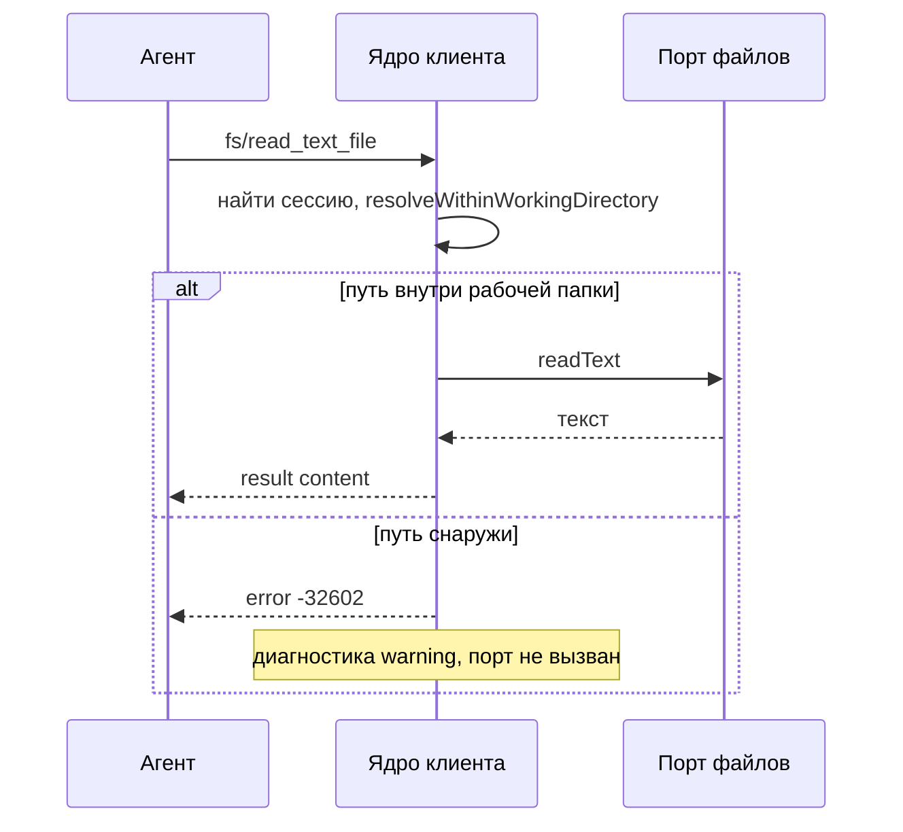
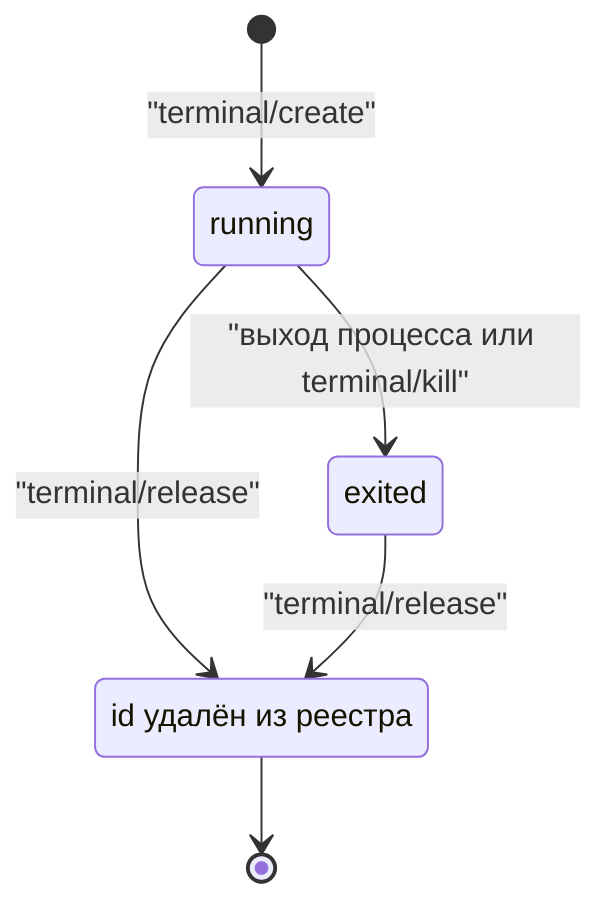
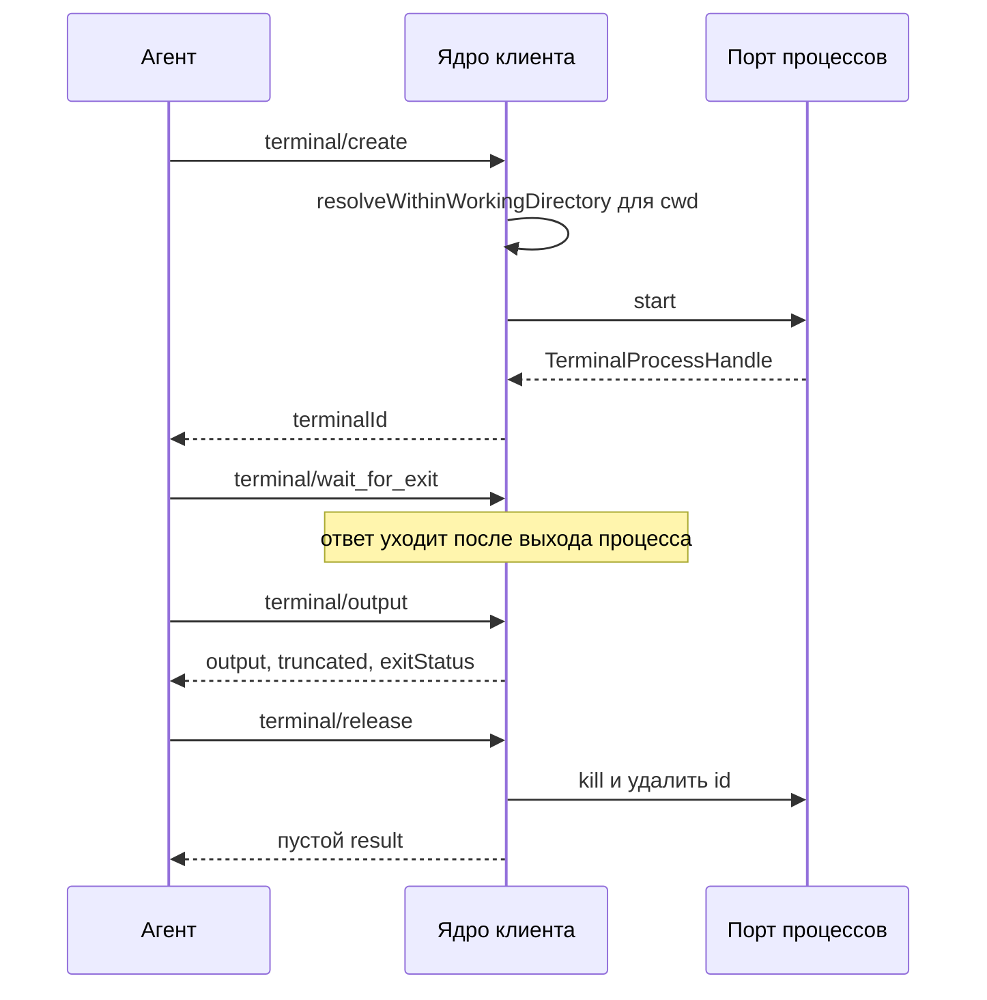

# Запросы агента: файлы и терминал

В ACP агент не только отвечает клиенту, но и сам шлёт ему запросы: прочитать файл, записать файл, запустить процесс. Эта глава объясняет, как `AcpClientApplication` их принимает, где проверяет, что агент не выходит за рабочую папку сессии, какие ошибки возвращает и как ведёт процессы. Запрос `session/request_permission` разобран в [главе 02](02-connection-and-turns.md#одобрения).

Нормы: спецификации [`acp-fs-client`](../../../../openspec/specs/acp-fs-client/spec.md) и [`acp-terminal-client`](../../../../openspec/specs/acp-terminal-client/spec.md). Обоснование решений — `design.md` изменений [`add-acp-fs-client-support`](../../../../openspec/changes/archive/2026-09-04-add-acp-fs-client-support/design.md) и [`add-acp-terminal-client-support`](../../../../openspec/changes/archive/2026-09-04-add-acp-terminal-client-support/design.md). Протокол — `docs/protocols/acp/protocol/09-File System.md` и `10-Terminal.md`.

## Почему нет одобрения

Корневой [`AGENTS.md`](../../../../AGENTS.md) §10 требует, чтобы опасные действия агента проходили через политику разрешений. Для `fs/*` и `terminal/*` сделано явное исключение: сам ACP делает `session/request_permission` для них необязательным (`MAY`) решением агента, а не шагом клиента. Поэтому клиент не вводит собственный гейт одобрения.

Вместо одобрения обязательно ограничение: `path` и `cwd` из запроса должны лежать внутри рабочей папки активной сессии. Выход наружу отклоняется как ошибка протокола до выполнения операции. Это единственный рубеж клиента для этих методов; жёсткие ограничения самого агента (например, `BoundedEnv` у агента CodeLab) он не заменяет. Подробно — [`permissions.md`](../../../../docs/architecture/permissions.md), раздел «Исключение: ACP client-side `fs/*` и `terminal/*` методы».

## Какие методы принимает ядро

Диспетчер входящих сообщений — `_handleInboundMessage`. Для методов агента он вызывает обработчик без ожидания (`unawaited`): ответ уходит, когда обработчик закончит.

| Метод | Обработчик | Порт | Условие объявления в `initialize` |
|---|---|---|---|
| `fs/read_text_file` | `_handleReadTextFileRequest` | `TextFileReader` | `fs.readTextFile` |
| `fs/write_text_file` | `_handleWriteTextFileRequest` | `TextFileWriter` | `fs.writeTextFile` |
| `terminal/create` | `_handleCreateTerminalRequest` | `TerminalProcessRunner` | `terminal` |
| `terminal/output` | `_handleTerminalOutputRequest` | `TerminalProcessHandle` | `terminal` |
| `terminal/wait_for_exit` | `_handleWaitForTerminalExitRequest` | `TerminalProcessHandle` | `terminal` |
| `terminal/kill` | `_handleKillTerminalCommandRequest` | `TerminalProcessHandle` | `terminal` |
| `terminal/release` | `_handleReleaseTerminalRequest` | `TerminalProcessHandle` | `terminal` |
| любой другой запрос | `_rejectUnsupportedRequest` | — | — |

Запрос неизвестного метода получает `-32601 Method not found` с тем же `id`, потому что JSON-RPC требует ответ на каждый запрос, а молчание оставило бы агента ждать вечно. В журнал и диагностику попадает только метод и id: параметры чужого запроса могут содержать секреты. Неизвестное уведомление (нет `id`) игнорируется без ответа.

Если порт не передан хосту, возможность не объявляется в `initialize`, а пришедший всё же запрос получает `-32603 Internal error` с текстом вида «fs/read_text_file is not supported by this client.».

## Где проверяется рабочая папка

Проверка — функция `resolveWithinWorkingDirectory(path:, workingDirectory:)` из `domain/fs_access.dart`. Алгоритм:

1. Корень (`AcpSession.cwd`) и путь нормализуются `package:path` (`.`, `..`, повторные разделители).
2. Путь допустим, если он равен корню или начинается с корня плюс разделитель. Разделитель в конце важен: корень `/work/demo` не пропускает `/work/demo-evil/x`.
3. Иначе бросается `PathOutsideWorkingDirectoryFailure`. Иначе возвращается нормализованный путь, и именно он передаётся порту.

Вызывают её обработчики `fs/read_text_file`, `fs/write_text_file` (поле `path`) и `terminal/create` (поле `cwd`, если оно задано; без него процесс стартует в `cwd` сессии). Запрос к порту идёт только после проверки.

Результаты функции на реальном прогоне (`resolveWithinWorkingDirectory` вызвана напрямую):

```text
/work/demo/src/a.dart          | корень /work/demo   -> /work/demo/src/a.dart
/work/demo                     | корень /work/demo   -> /work/demo
/work/demo/./src/../a.dart     | корень /work/demo   -> /work/demo/a.dart
/work/demo/../etc/passwd       | корень /work/demo   -> вне корня
/work/demo-evil/x              | корень /work/demo   -> вне корня
/etc/passwd                    | корень /work/demo   -> вне корня
src/a.dart                     | корень /work/demo   -> вне корня
/anything                      | корень /          -> /anything
```



### Ошибки, которые видит агент

Все ответы-ошибки строятся через `_sendAcpMethodError`. Коды — стандартные коды JSON-RPC и `-32002` из схемы ACP (`17-Schema.md`, `resource_not_found`).

| Ситуация | Ответ агенту | Что делает ядро |
|---|---|---|
| Сессия неизвестна ядру (`fs/*`, `terminal/create`) | `-32602 Invalid params`, «Unknown session» | порт не вызывается |
| Путь или `cwd` вне рабочей папки | `-32602 Invalid params`, «Path … is outside the session working directory …» | диагностика `warning` (`application.fs` / `application.terminal`); порт не вызывается |
| `fs/read_text_file`: файла нет (`FsNotFoundFailure`) | `-32002 Resource not found` | агент по коду понимает, что файл нужно создать |
| Сбой ввода-вывода порта (`FsIoFailure`) | `-32603 Internal error` с текстом отказа | — |
| Неизвестный терминал (`UnknownTerminalFailure`) | `-32602 Invalid params`, «Unknown terminal …» | — |
| Процесс не стартовал (`TerminalStartFailure`) | `-32603 Internal error` с текстом отказа | — |
| Любое другое исключение | `-32603 Internal error`, текст вида `Failed to read file: …` с описанием исключения | диагностика `error` |
| Порт не передан | `-32603 Internal error`, «… is not supported by this client.» | — |

Реальные кадры (сессия с рабочей папкой `/work/demo`):

```text
A→C {"jsonrpc":"2.0","id":120,"method":"fs/read_text_file","params":{"sessionId":"sess-1","path":"/work/demo/README.md"}}
C→A {"jsonrpc":"2.0","id":120,"result":{"content":"# foo\n"}}

A→C {"jsonrpc":"2.0","id":124,"method":"fs/read_text_file","params":{"sessionId":"sess-1","path":"/work/demo/../etc/passwd"}}
C→A {"jsonrpc":"2.0","id":124,"error":{"code":-32602,"message":"Invalid params","data":{"kind":"invalidAcpParams","message":"Path \"/work/demo/../etc/passwd\" is outside the session working directory \"/work/demo\".","method":"fs/read_text_file"}}}

A→C {"jsonrpc":"2.0","id":2,"method":"fs/read_text_file","params":{"sessionId":"s1","path":"/work/demo/none.txt"}}
C→A {"jsonrpc":"2.0","id":2,"error":{"code":-32002,"message":"Resource not found","data":{"kind":"resourceNotFound","message":"No such file: /work/demo/none.txt"}}}

A→C {"jsonrpc":"2.0","id":1,"method":"fs/write_text_file","params":{"sessionId":"s1","path":"/work/demo/a.txt","content":"x"}}
C→A {"jsonrpc":"2.0","id":1,"result":{}}
```

Неабсолютный путь (`README.md` вместо `/work/demo/README.md`) до проверки рабочей папки не доходит: модели `codelab_acp_protocol` требуют абсолютный путь и отклоняют запрос при разборе. Агент получает `-32603 Internal error` с текстом «Failed to read file: … path must be a non-empty absolute path.» Так ядро отвечает сейчас: ошибка в параметрах приходит как внутренняя (`-32603`), а не как `-32602`.

### Что проверка не покрывает

- **Символические ссылки.** Проверка лексическая: пакет не использует `dart:io`, поэтому ссылку внутри рабочей папки, указывающую наружу, он не разрешает. Адаптер `IoTextFileIo` читает и пишет по полученному пути, ссылки следует ОС. Это принятый остаточный риск (раздел Risks в `design.md` `add-acp-fs-client-support`).
- **Команда процесса.** Ограничен только `cwd` процесса. Команда, аргументы и переменные окружения из `terminal/create` ядро не проверяет: запущенный процесс может обращаться к любым файлам, которые доступны пользователю. Фильтрация `env` и список запрещённых команд в design помечены как открытые вопросы.
- **Сама рабочая папка.** `AcpSession.cwd` берётся из команды хоста (`CreateSessionCommand.cwd`, `LoadSessionCommand.cwd`) без проверки: корень `/` пропускает любой абсолютный путь, а относительный корень отклоняет все запросы. Хост отвечает за то, чтобы папка была настоящей рабочей папкой проекта.
- **Платформа.** Сравнение идёт по строкам после нормализации в стиле платформы (`package:path`), регистр не приводится. Тесты пакета проверяют только posix-пути.

## Терминал

В отличие от `fs/*`, терминал — процесс с жизненным циклом. `terminal/create` возвращает `TerminalId` сразу, не дожидаясь конца команды, а остальные методы адресуются к этому идентификатору.

### Реестр процессов

Ядро держит реестр `_terminals`: сессия → `TerminalId` → `TerminalProcessHandle`. Идентификатор строится из id JSON-RPC запроса `terminal/create`: запрос с `id` 11 даёт `term-11`. Терминал ищется по паре (сессия, идентификатор): чужая сессия или освобождённый идентификатор дают одну и ту же ошибку «Unknown terminal».

`TerminalProcessState` — два состояния, `running` и `exited`. Состояния «убит» и «освобождён» не заведены сознательно (корневой [`AGENTS.md`](../../../../AGENTS.md) §8, не набор булевых флагов): `kill` переводит `running` в `exited`, а `release` просто удаляет идентификатор из реестра.



Схема показывает жизнь одного `TerminalId`. После `released` идентификатор недействителен для всех методов, как будто его не было.

Выход по сигналу в схеме ACP — это `exitCode` равный `null` и `signal` с именем (`SIGTERM`). Адаптер обязан выдерживать этот инвариант: ядро поля не правит.

### Обмен



Реальные кадры (сессия `sess-1`, рабочая папка `/work/demo`, процесс подменён `FakeTerminalProcessRunner`):

```text
A→C {"jsonrpc":"2.0","id":11,"method":"terminal/create","params":{"sessionId":"sess-1","command":"dart","args":["test"]}}
C→A {"jsonrpc":"2.0","id":11,"result":{"terminalId":"term-11"}}

A→C {"jsonrpc":"2.0","id":12,"method":"terminal/create","params":{"sessionId":"sess-1","command":"ls","cwd":"/tmp"}}
C→A {"jsonrpc":"2.0","id":12,"error":{"code":-32602,"message":"Invalid params","data":{"kind":"invalidAcpParams","message":"Path \"/tmp\" is outside the session working directory \"/work/demo\".","method":"terminal/create"}}}

C→A {"jsonrpc":"2.0","id":13,"result":{"output":"ok\n","truncated":false}}
C→A {"jsonrpc":"2.0","id":14,"result":{"exitCode":0}}
C→A {"jsonrpc":"2.0","id":15,"result":{}}
C→A {"jsonrpc":"2.0","id":16,"error":{"code":-32602,"message":"Invalid params","data":{"kind":"invalidAcpParams","message":"Unknown terminal \"term-11\".","method":"terminal/output"}}}
```

Первый запрос стартовал процесс с `cwd` сессии `/work/demo`: у `terminal/create` без поля `cwd` рабочая папка сессии подставляется. Ответы с `id` 13–16 относятся к `terminal/output`, `terminal/wait_for_exit`, `terminal/release` и повторному `terminal/output` после освобождения.

### `kill` и `release`

| Метод | Что делает | Идентификатор после вызова |
|---|---|---|
| `terminal/kill` | завершает процесс, ответ пустой | остаётся: агент ещё читает вывод |
| `terminal/release` | завершает процесс и удаляет идентификатор | недействителен |

`kill` вышедшего процесса — не ошибка, а пустая операция (атомарность относительно естественного выхода). Агент по ACP обязан вызвать `terminal/release`, когда терминал больше не нужен.

### Завершение процессов и гонки

Процесс не должен пережить соединение или закрытие приложения. Ядро завершает все процессы реестра в двух случаях:

- автомат соединения перешёл в `disconnected` или `failed` (`_transitionConnection`): обрыв, новый `connect` или `reconnect` поверх прежнего;
- вызван `dispose`.

В обоих случаях `_killAllTerminalProcesses` сначала очищает реестр один раз, запускает все `kill()` параллельно, пишет в журнал `terminal_processes_killed` (число и причина, без команд и путей) и ждёт завершения. Сбой одного `kill()` изолирован (`_killIsolated`): остальные процессы он не останавливает.

Три гонки закрыты явно:

1. **`terminal/create` против `dispose` или смены соединения.** Старт процесса асинхронный. Если за это время ядро закрыто или поколение сменилось, процесс завершается, в реестр не попадает, ответ не отправляется, в журнал идёт `event_ignored`. Стартующие `terminal/create` ядро ждёт в `dispose`, чтобы процесс не осиротел.
2. **Ответ старому соединению.** `terminal/wait_for_exit`, `kill` и `release` ждут процесс, и за это время соединение может смениться. У нового агента нумерация id начинается заново, и ответ старого запроса подменил бы результат чужого. `_sendTerminalResponse` сверяет поколение и не отправляет устаревший ответ.
3. **`release` против `reconnect`.** После `kill()` идентификатор из реестра удаляется только если в нём всё ещё тот же `handle`: за это время новый агент мог создать процесс с тем же `TerminalId`.

### Что обязан делать адаптер

Контракт `TerminalProcessHandle` и `TerminalProcessRunner` (`domain/terminal_access.dart`) — это то, что реализует [`IoTerminalProcessRunner`](../../codelab_client_io/doc/README.md):

- `output` — объединённый stdout и stderr; при `outputByteLimit` обрезается с начала по границе символа UTF-8, а `truncated` сообщает, была ли обрезка;
- `state` — `running` или `exited`; при выходе по сигналу `exitCode` равен `null`, а `signal` — имя (`SIGTERM`) или `SIG<n>`;
- `waitForExit()` завершается после выхода, сразу — если процесс уже вышел;
- `kill()` посылает `SIGTERM`, а если процесс не вышел, `SIGKILL`; `Future` завершается не позже чем через ~2 с; для вышедшего процесса — пустая операция; параллельные вызовы делят одно завершение;
- не стартовавший процесс — `TerminalStartFailure`, а не общее исключение.

Для чтения и записи файлов контракт проще: `TextFileReader.readText({path, line, limit})` и `TextFileWriter.writeText({path, content})`. Нет файла — `FsNotFoundFailure` (только при чтении), любой другой сбой — `FsIoFailure`. Путь адаптер получает уже нормализованным и проверенным; повторно рабочую папку он не проверяет. Реализация на `dart:io` — `IoTextFileIo` в [`codelab_client_io`](../../codelab_client_io/doc/README.md); пример адаптера в памяти для тестов — в [рецептах](04-testing-extending-troubleshooting.md#рецепт-порт-файлов-в-памяти).

## Что логируется

Каждый шаг пишется в диагностику (`DiagnosticEntry`, источники `application.fs` и `application.terminal`) и в журнал:

| Событие | Уровень | Что в записи |
|---|---|---|
| успешная запись `fs/write_text_file` | `info` | id сессии и запроса; путь и содержимое не пишутся |
| `terminal/create` выполнен | `info` | сессия, `terminalId`, команда, аргументы, `cwd` |
| отказ по рабочей папке | `warning` | id запроса |
| сбой обработчика | `error` | причина по политике payload |
| массовое завершение процессов | `info` | число и причина `connection_closed` или `dispose` |

Запись `terminal/create` содержит команду и аргументы: это сознательно: одобрения нет, и журнал — единственный след для разбора (рекомендация раздела Risks в `design.md` `add-acp-terminal-client-support`, [`AGENTS.md`](../../../../AGENTS.md) §16). Запись проходит маскирование `SecretRedactor`. Содержимое файлов в журнал не попадает; сырые данные в диагностику идут только при политике `full` (см. [обзор](01-overview.md#наблюдаемость-кадры-диагностика-журнал)).

## Где смотреть тесты

| Файл | Что проверяет |
|---|---|
| `test/fs_access_test.dart` | чтение, запись, выход за папку, `-32002`, сбой порта |
| `test/terminal_access_test.dart` | весь жизненный цикл `terminal/*`, `outputByteLimit`, завершение при обрыве |
| `test/application/terminal_stale_response_test.dart` | ответ только в соединение запроса, сбой журнала при завершении |
| `test/application/dispose_shutdown_test.dart` | `dispose`, `connect` и `reconnect` во время старта процесса |
| `test/unsupported_agent_requests_test.dart` | `-32601` на неизвестный метод |
