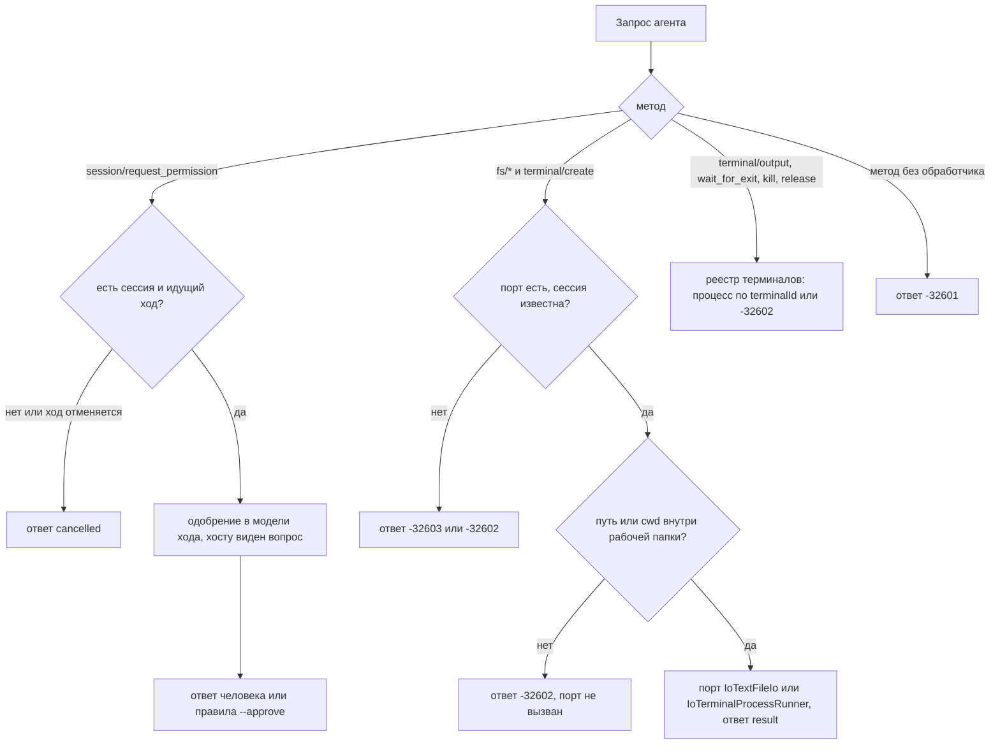

# Исполнение на клиенте: вопросы, файлы и терминалы по запросу агента

Документ описывает клиентскую половину сквозного вопроса «кто и где»: что делает клиент, когда агент присылает `session/request_permission`, `fs/*` или `terminal/*`, чего он не делает никогда и чем это отличается для встроенного агента, `codelab-agent` и чужого агента. Агентская половина и матрица транспортов — в [алгоритме исполнения](../../codelab_agent_core/doc/algorithms/execution-sides.md); здесь она не повторяется.

Справочники по частям существуют и сюда не копируются:

- вопрос и его жизнь в модели хода — [глава 02, «Одобрения»](02-connection-and-turns.md#одобрения);
- `fs/*` и `terminal/*`, containment, реестр терминалов, ошибки для агента — [глава 03](03-agent-requests-fs-terminal.md);
- как хост показывает одобрение и отвечает на него — [`codelab_client_core`, глава 08](../../codelab_client_core/doc/08-approvals.md);
- нормы — [`acp-protocol-client`](../../../../openspec/specs/acp-protocol-client/spec.md), [`acp-fs-client`](../../../../openspec/specs/acp-fs-client/spec.md), [`acp-terminal-client`](../../../../openspec/specs/acp-terminal-client/spec.md), [`approval-safety`](../../../../openspec/specs/approval-safety/spec.md); исключение для `fs/*` и `terminal/*` — [`AGENTS.md`](../../../../AGENTS.md) §10 и [`permissions.md`](../../../../docs/architecture/permissions.md); методы ACP — `docs/protocols/acp/protocol/08-Tool Calls.md`, `09-File System.md`, `10-Terminal.md`.

Пути в псевдокоде даны от `packages/dart/codelab_client_acp/lib/src/`.

## Что клиент решает, а что нет

| Вопрос | Кто отвечает | Где |
|---|---|---|
| Можно ли агенту выполнить действие | агент: `PermissionPolicy` ядра агента. Клиент не знает правил и режимов | [`codelab_agent_core`, глава 07](../../codelab_agent_core/doc/07-permissions.md) |
| Показать вопрос человеку | клиент: хост (REPL, TUI, окно app) берёт `PendingApprovalView` из `SessionView` | [`codelab_client_core`, глава 08](../../codelab_client_core/doc/08-approvals.md) |
| Ответить без человека | клиент, только если хост так устроен: `codelab -p --approve reject, read-only, allow-all`. ACP это разрешает клиенту (`MAY`, `08-Tool Calls.md`). У app автоответа нет: режим разрешений выбирают у агента | `apps/codelab_cli/lib/src/headless/approval_policy.dart`: `decideApproval` |
| Запомнить «разрешить всегда» | никто на клиенте: клиент передаёт выбранный `optionId`, ключ и память сессии у агента | `domain/approval_policy.dart` только считает риск для показа, ничего не решает |
| Исполнить `fs/read_text_file`, `fs/write_text_file`, `terminal/*` | клиент, если объявил возможность и агент прислал запрос | `application/acp_client_application.dart`: `_handleInboundMessage` |
| Ограничить путь и `cwd` рабочей папкой | клиент: единственный рубеж для запросов `fs/*` и `terminal/create`; у агента CodeLab есть свой рубеж, у чужого агента может не быть | `domain/fs_access.dart`: `resolveWithinWorkingDirectory` |
| Показать листинг каталога | никто: в ACP нет такого метода | см. алгоритм исполнения |
| Выбрать, ходит ли агент к клиенту за файлами | агент: объявленные возможности разрешают запросы, но не обязывают к ним | `embedded-agent` «Локальное исполнение и containment» |

Риск `ApprovalRiskLevel` (`readOnly`, `unknown`, `localWrite`, `network`, `shell`, `destructive`) — подсказка человеку и вход для `--approve read-only`. Он считается по виду вызова, заголовку, `content`, путям, `rawInput` и `rawOutput` запроса и не заменяет решение агента. Вид `other`, `switch_mode` или отсутствие вида даёт `unknown`: недоверенный сервер не может объявить себя безопасным.

## Что клиент объявляет

Клиент объявляет `fs` и `terminal` по тому, переданы ли хостом порты. Объявление уходит в `initialize` один раз на соединение.

```text
initialize(transport)
  // application/acp_client_application.dart: _establishConnection
  clientCapabilities = ClientCapabilities(
      fs: FileSystemCapabilities(
          readTextFile:  _textFileReader != null,
          writeTextFile: _textFileWriter != null),
      terminal: _terminalProcessRunner != null,
      meta: codelabClientExtensionsMeta)
```

Обе точки сборки клиентов передают все три порта всегда: терминальный клиент — в `apps/codelab_cli/lib/src/composition_root.dart` (`IoTextFileIo`, `IoTerminalProcessRunner`), app — в `apps/codelab_desktop/lib/app/app_scope.dart`. Поэтому `codelab` и app объявляют `fs.readTextFile`, `fs.writeTextFile` и `terminal: true` любому агенту, в том числе встроенному. Встроенный агент `embedded-*` эти возможности не использует (запросов `fs/*` и `terminal/*` от него нет), но и не мешает их объявлению. Хост без порта (например, web) не объявляет возможность, и агент по-прежнему может прислать запрос: ответ — `-32603` «… is not supported by this client.» ([глава 03](03-agent-requests-fs-terminal.md#какие-методы-принимает-ядро)).

## Что приходит от какого агента

| Агент | `session/request_permission` | `fs/*` | `terminal/*` |
|---|---|---|---|
| Встроенный (`embedded-cli`, `embedded-app-desktop`) | да, по `InProcessAcpLink` | нет: файлы читает и пишет сам агент в процессе клиента | нет: команды запускает сам агент |
| `codelab-agent serve --stdio` | да | да: `read`, `write`, `edit`, чтение для diff и содержимого при `search` | да: `exec` |
| `codelab-agent serve --ws` | да | да: `read`, `write`, `edit`, чтение для diff; `ls` и `search` нет | да, как по stdio |
| Чужой агент | если сам решит спросить (`MAY`) | если сам решит | если сам решит |

Клиент одинаков для всех строк: у него нет режима «встроенный» или «внешний». Различие создаёт агент тем, какие запросы он шлёт.

## Псевдокод

### А. Диспетчер входящих сообщений агента

```text
onInbound(message)
  // application/acp_client_application.dart: _handleInboundMessage
  switch message:
    ответ                                → завершить ожидающий запрос клиента
    запрос session/request_permission    → _handlePermissionRequest(message)            // синхронно
    запрос fs/read_text_file             → unawaited(_handleReadTextFileRequest)
    запрос fs/write_text_file            → unawaited(_handleWriteTextFileRequest)
    запрос terminal/create               → unawaited(_handleCreateTerminalRequest)
    запрос terminal/output               → unawaited(_handleTerminalOutputRequest)
    запрос terminal/wait_for_exit        → unawaited(_handleWaitForTerminalExitRequest)
    запрос terminal/kill                 → unawaited(_handleKillTerminalCommandRequest)
    запрос terminal/release              → unawaited(_handleReleaseTerminalRequest)
    уведомление session/update           → _handleSessionUpdate
    уведомление _codelab/session/usage   → _handleUsageNotification
    другое уведомление                   → игнорировать
    другой запрос                        → _rejectUnsupportedRequest: ответ -32601 Method not found
```

Обработчики `fs/*` и `terminal/*` идут без ожидания: ответ уходит, когда порт закончил. Поэтому ответы клиента не обязаны идти в порядке запросов агента.

### Б. Вопрос `session/request_permission`

```text
_handlePermissionRequest(request)
  // application/acp_client_application.dart: _handlePermissionRequest
  1. params = decode(request); approvalId = permission-<id запроса>
     если approvalId в _handledPermissionRequests: return                  // повтор того же id
  2. session = _sessions[params.sessionId]; turn = session?.activeTurn
     если сессии нет, хода нет или ход в cancelling:
         ответить cancelled; пометить approvalId обработанным; return      // отказ по умолчанию
  3. approval = ApprovalRequest(id, sessionId, turnId, toolCall, options,
                                riskLevel, subagentRequester, critical, requestedAt)
         // critical — булево true в _meta.codelab запроса или его toolCall
  4. session' = SessionStateMachine.requestApproval(session, approval)       // ход awaitingApproval
     _pendingPermissionRequests[approvalId] = id запроса
     _storeSession(session')                                                // хост видит одобрение
  5. любое исключение в шагах 1–4: ответить cancelled, диагностика error

респонс: хост → respondToPermission(command)
  // application/acp_client_application.dart: respondToPermission
  1. approval = turn.approvals[command.approvalId]
     нет хода, нет одобрения или оно решено: throw StateTransitionException('permission request is not pending')
  2. SelectPermissionCommand: optionId обязан быть среди approval.options, иначе исключение
     CancelPermissionCommand: outcome cancelled
  3. отправить ответ агенту (_sendPermissionResponse)
  4. _requireCurrentGeneration: если соединение сменилось, пока ответ уходил, бросает
     StateTransitionException('operation is stale: ACP transport was reconnected …'); состояние не трогать
  5. применить решение к модели хода (selectApproval | cancelApproval); ход снова running

отмена хода: хост → cancelTurn(command)
  // application/acp_client_application.dart: cancelTurn
  1. отправить уведомление session/cancel
  2. на каждый ожидающий вопрос хода отправить ответ cancelled
  3. перевести ход в cancelled

смена соединения или обрыв
  // application/acp_client_application.dart: _dropPendingApprovals (до первого await замены транспорта)
  ожидающие одобрения становятся cancelled в модели; ответа агенту нет: соединения, куда его слать, уже нет
```

### В. Файл и терминал: одна и та же рамка

```text
_handleReadTextFileRequest / _handleWriteTextFileRequest / _handleCreateTerminalRequest
  // application/acp_client_application.dart; domain/fs_access.dart: resolveWithinWorkingDirectory
  1. порта нет → ответ -32603 «… is not supported by this client.»
  2. сессия не найдена → ответ -32602 «Unknown session»
  3. путь (fs/*) или cwd (terminal/create) → resolveWithinWorkingDirectory(path, session.cwd)
         terminal/create без cwd → процесс стартует в session.cwd, проверки нет
         вне рабочей папки → ответ -32602, диагностика warning, порт НЕ вызывается
  4. порт: readText | writeText | start        // IoTextFileIo, IoTerminalProcessRunner
         FsNotFoundFailure → -32002; FsIoFailure, TerminalStartFailure → -32603
  5. ответ result
```

Одобрения здесь нет по правилу `AGENTS.md` §10: ACP делает `session/request_permission` для этих методов решением агента. Подробности, ошибки и реестр терминалов — [глава 03](03-agent-requests-fs-terminal.md).

## Как это выглядит у человека

| Хост | Кто показывает вопрос | Как отвечает |
|---|---|---|
| REPL `codelab` | `ApprovalPrompt` (`apps/codelab_cli/lib/src/repl/approval_prompt.dart`): заголовок, риск, команда, `cwd` | клавиши `y`, `a`, `n`, `N` по предложенным вариантам, `?` — `rawInput` с маскированием, `Esc` — отмена хода |
| TUI `codelab --ui=tui` | тот же `ApprovalPrompt` в зоне одобрения | те же клавиши, `RespondCmd` → `SessionHandle.respond` |
| Headless `codelab -p` | человека нет: `decideApproval` по правилу `--approve` | `reject` (по умолчанию) отвечает `reject_once`, `read-only` разрешает вызов вида `read` с риском `readOnly`, `allow-all` выбирает `allow_once`, кроме критических; если `allow_once` не предложен, выбирается `reject_*`, а если нет и его — отмена хода |
| App | `CodeLabApprovalPrompt` в ленте у строки вызова | кнопки и сочетания клавиш; ответ `SessionHandle.respond` |

Хост предлагает только варианты, которые прислал агент: клавиша непредложенного варианта ничего не отправляет. Если агент не предложил `allow_always`, клавиши `a` нет.

## Схема

На схеме — что клиент делает с запросом агента, от диспетчера до ответа.



## Разобранный пример: чужой агент

Источник: настоящий `codelab` (собран из ветки) запущен как `codelab -p "проверка" -C ~/projects/demo -a "stdio:<агент>"`, правило `--approve` не задано. Роль агента играет скрипт на Python, не имеющий отношения к `codelab-agent`: после `session/prompt` он шлёт запросы по очереди и пишет обмен. Временные каталоги удалены, `CODELAB_HOME` изолирован.

```text
codelab: permission "Delete hello.txt": reject_once (policy)
codelab: empty response
```

Кадры (`A->C` — агент клиенту, `C->A` — ответ клиента; путь рабочей папки заменён на `~/projects/demo`):

```text
A->C {"jsonrpc":"2.0","id":"a1","method":"fs/read_text_file","params":{"sessionId":"ext-1","path":"~/projects/demo/hello.txt"}}
C->A {"jsonrpc":"2.0","id":"a1","result":{"content":"hello\n"}}
A->C {"jsonrpc":"2.0","id":"a2","method":"fs/read_text_file","params":{"sessionId":"ext-1","path":"~/projects/demo/../outside.txt"}}
C->A {"jsonrpc":"2.0","id":"a2","error":{"code":-32602,"message":"Invalid params","data":{"kind":"invalidAcpParams","message":"Path \"~/projects/demo/../outside.txt\" is outside the session working directory \"~/projects/demo\".","method":"fs/read_text_file"}}}
A->C {"jsonrpc":"2.0","id":"a3","method":"terminal/create","params":{"sessionId":"ext-1","command":"ls","cwd":"/tmp"}}
C->A {"jsonrpc":"2.0","id":"a3","error":{"code":-32602,"message":"Invalid params","data":{"kind":"invalidAcpParams","message":"Path \"/tmp\" is outside the session working directory \"~/projects/demo\".","method":"terminal/create"}}}
A->C {"jsonrpc":"2.0","id":"a4","method":"vendor/unknown","params":{}}
C->A {"jsonrpc":"2.0","id":"a4","error":{"code":-32601,"message":"Method not found","data":{"kind":"unknownMethod","message":"Method not found: vendor/unknown.","method":"vendor/unknown"}}}
A->C {"jsonrpc":"2.0","id":"a5","method":"fs/read_text_file","params":{"sessionId":"nope","path":"~/projects/demo/hello.txt"}}
C->A {"jsonrpc":"2.0","id":"a5","error":{"code":-32602,"message":"Invalid params","data":{"kind":"invalidAcpParams","message":"Unknown session \"nope\".","method":"fs/read_text_file"}}}
A->C {"jsonrpc":"2.0","id":"a6","method":"session/request_permission","params":{"sessionId":"ext-1","toolCall":{"toolCallId":"t1","title":"Delete hello.txt","kind":"delete","status":"pending"},"options":[{"optionId":"yes","name":"Yes","kind":"allow_once"},{"optionId":"no","name":"No","kind":"reject_once"}]}}
C->A {"jsonrpc":"2.0","id":"a6","result":{"outcome":{"outcome":"selected","optionId":"no"}}}
```

Шесть запросов — шесть ответов клиента:

| Запрос | Ответ клиента | Правило |
|---|---|---|
| `fs/read_text_file` внутри папки | `result.content`, порт вызван | шаги 3–5 блока В |
| `fs/read_text_file` с `../` наружу | `-32602`, порт не вызван | `resolveWithinWorkingDirectory` |
| `terminal/create` с `cwd: /tmp` | `-32602`, процесс не запущен | то же правило для `cwd` |
| `vendor/unknown` | `-32601` | `_rejectUnsupportedRequest` |
| `fs/read_text_file` в неизвестной сессии | `-32602` «Unknown session» | шаг 2 блока В |
| `session/request_permission` | `selected` `no`: правило `--approve reject` выбрало `reject_once` из предложенных | `decideApproval` |

Запрос `a6` не привязан к вызову, который агент объявил кадром `tool_call`: ACP это разрешает, и клиент всё равно показывает одобрение ([глава 08](../../codelab_client_core/doc/08-approvals.md#привязка-к-вызову)).

Реальные ответы клиента на запросы `codelab-agent` (`fs-4` — `result: {}`, `term-6` — `terminalId`, `term-8` — вывод) приведены в [примерах алгоритма исполнения](../../codelab_agent_core/doc/algorithms/execution-sides.md#разобранные-примеры).

## Граничные случаи и отказы

| Ситуация | Что делает клиент | Где |
|---|---|---|
| Агент прислал вопрос, а хода нет или ход отменяется | сразу `cancelled`, без показа человеку | `_handlePermissionRequest` |
| Разбор вопроса упал | `cancelled` и диагностика `error` | `_handlePermissionRequest` |
| Тот же id вопроса пришёл дважды | второй игнорируется | `_handledPermissionRequests` |
| Человек ответил позже обрыва или замены соединения | `respond` падает с `permission request is not pending`, ответ никуда не уходит | `_dropPendingApprovals`, `respondToPermission` |
| Человек выбрал вариант, которого нет в запросе | исключение `permission option is not available for this request` | `_requirePermissionOption` |
| Отмена хода при ожидающем вопросе | `session/cancel`, затем `cancelled` на каждый вопрос | `cancelTurn` |
| Клиент без порта файлов или терминала | `-32603` «… is not supported by this client.» | `_handleReadTextFileRequest` и соседи |
| Путь или `cwd` вне папки, символическая ссылка внутри папки наружу | вне — `-32602`; ссылка не раскрывается и проходит: проверка лексическая | `resolveWithinWorkingDirectory` ([глава 03](03-agent-requests-fs-terminal.md#что-проверка-не-покрывает)) |
| Соединение закрыто, процессы терминалов ещё живы | `_killAllTerminalProcesses`: `SIGTERM`, через 2 с `SIGKILL`; агент ответа не получит | `_transitionConnection`, `dispose` |
| Ответ на `terminal/wait_for_exit` отправляется одновременно с ответом на `terminal/kill` по stdio | запись второго ответа в `stdin` агента может упасть `sendFailed`, клиент отвечает `-32603`; воспроизводилось в отмене `exec` ([пример](../../codelab_agent_core/doc/algorithms/execution-sides.md#пример-4-отмена-во-время-exec)) | `codelab_acp_transports`: `StdioAcpTransport.send` |
| Команда терминала видит секреты клиента | `Process.start` без `includeParentEnvironment: false`: процесс получает всё окружение клиента, включая `CODELAB_SECRET_*` и `*_API_KEY` | `codelab_client_io`: `IoTerminalProcessRunner.start` ([пределы секретов](../../codelab_agent_core/doc/algorithms/secrets.md)) |

## Параметры

| Что | Значение | Где |
|---|---|---|
| `--approve` | `reject` (по умолчанию), `read-only`, `allow-all` | `codelab`, только headless |
| Объявление `fs.readTextFile`, `fs.writeTextFile`, `terminal` | есть ли порт у хоста | `AcpClientApplication(textFileReader:, textFileWriter:, terminalProcessRunner:)` |
| Предел `SIGTERM` → `SIGKILL` | 2 с | `IoTerminalProcessRunner` |
| Ожидание конца потоков после выхода процесса | 2 с | `IoTerminalProcessRunner` |
| `outputByteLimit` | задаёт агент; терминал клиента обрезает вывод с начала по границе символа UTF-8 | `terminal/create` |
| Таймаут вопроса | нет | клиент ждёт человека, агент не торопит; ключ агента `permissions.timeout` не применяется (`applied: false`) |

Ключей конфигурации у клиентского слоя для этих запросов нет: поведение задают порты и правило `--approve`.

## Как расширить

**Новый запрос агента к клиенту.** Рецепт со скелетом — [глава 04](04-testing-extending-troubleshooting.md#рецепт-принять-новый-запрос-агента-к-клиенту). Кратко: метод и модели в `codelab_acp_protocol`; возможность в `ClientCapabilities` и условие объявления в `_establishConnection`; ветка `switch` в `_handleInboundMessage` (без неё запрос получит `-32601`); порт в `domain/` и адаптер в `codelab_client_io`; ограничение рабочей папкой, если в запросе есть путь; тесты `test/*_access_test.dart`, фикстура корпуса и `melos run conformance:client`.

**Новый способ показать вопрос.** Хост берёт `PendingApprovalView` из `SessionView.pendingApprovals` и зовёт `SessionHandle.respond`; логику ответа, привязку к вызову и снятие при обрыве он не пишет: это делают [`codelab_client_core`](../../codelab_client_core/doc/08-approvals.md) и ядро клиента.

**Новый порт платформы** (web, мобильный хост): реализовать `TextFileReader`, `TextFileWriter`, `TerminalProcessRunner` или не передавать порт, и тогда возможность не объявляется. Что вернёт агенту отсутствующая возможность — в [алгоритме исполнения](../../codelab_agent_core/doc/algorithms/execution-sides.md#граничные-случаи-и-отказы).

## Смотрите также

- [Алгоритм исполнения: кто решает, спрашивает, показывает и исполняет](../../codelab_agent_core/doc/algorithms/execution-sides.md).
- [Запросы агента: файлы и терминал](03-agent-requests-fs-terminal.md), [Соединение, сессия, ход](02-connection-and-turns.md).
- [Одобрения в `codelab_client_core`](../../codelab_client_core/doc/08-approvals.md).
- [`codelab_client_io`](../../codelab_client_io/doc/README.md): `IoTextFileIo`, `IoTerminalProcessRunner`.
