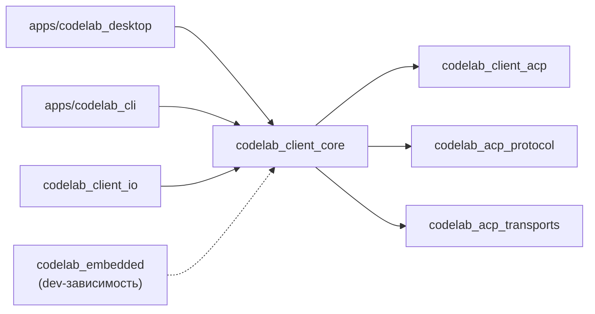

# codelab_client_core

Общий клиентский слой ACP без UI. Он владеет состоянием клиента — соединением, сессиями, транскриптом, очередью промптов, одобрениями — и политикой работы с агентом. Десктопное приложение и терминальный клиент только отображают это состояние, поэтому ведут себя одинаково.

## Место в архитектуре

Чистый Dart, сторона `client`, слой `core` (ADR-0002). Пакет web-безопасен: в `lib/**` нельзя импортировать `dart:io`, Flutter и `package:codelab_acp_transports/io.dart` — это проверяет сторож (`packages/dart/codelab_architecture_tests/test/support/rules.dart`). Процессов, сокетов и файлов пакет не открывает: всё внешнее приходит портами, которые реализуют `codelab_client_io` и composition root хоста.

На схеме — зависимости из `pubspec.yaml` и пакеты, которые зависят от этого.



Протокол ACP (отправка запросов, поколения соединения, отбрасывание поздних кадров) делает `codelab_client_acp`; этот пакет строит над ним состояние для отображения. Пакеты `codelab_agent_*` пакет не использует: клиенты получают агента через мосты `codelab_setup` и `codelab_embedded`. Источник архитектуры — `docs/architecture/proposals/dart-agent-and-clients/09-10-stage-5-client-kit.md`; поведение — `openspec/specs/acp-client-kit/spec.md`.

## Что внутри

Публичное API экспортирует `lib/codelab_client_core.dart`. Дополнительных барелей нет.

| Область | Главные типы | Для чего |
|---|---|---|
| Рабочее пространство | `ClientWorkspace`, `SessionHandle`, `WorkspaceState`, `SessionSummaryView`, `SessionView`, `SessionStatusView`, `ClientWorkspaceException` | одно соединение с агентом и его сессии; `ClientWorkspace.state` публикует `WorkspaceState`, `SessionHandle.view` — `SessionView` |
| Источник данных | `AgentBackend`, `AcpClientBackend` | порт к ACP-клиенту; `AcpClientBackend` работает поверх `AcpClientApplication` |
| Соединение | `ConnectionView` (`Disconnected`, `Connecting`, `Connected`, `Reconnecting`, `ConnectionLost`, `ConnectionFailed`), `ConnectionProfile` (`StdioProfile`, `WebSocketProfile`, `EmbeddedProfile`), `TransportResolver`, `ConfigTransportResolver` | состояние соединения как закрытая иерархия, профили и открытие транспорта |
| Профили и секреты | `ProfileDraft`, `ProfileCommitter`, `ProfileTokenRef`, `ProfileSecretSource`, `ProfileSecrets`, `SecretText`, `isValidProfileId`, `suggestProfileId`, `profileOrigin` | черновик профиля формы, правила id, ссылки на токен, политика «токен ↔ профиль»; у `ProfileSaveFailed` поле `storeReason` — причина, названная самим хранилищем секретов при `secretReadOnly` (`null` — хранилище причины не назвало); app показывает её как есть, CLI — прежнее `message` |
| Транскрипт | `TranscriptItem`, `NoticeItem`, `NoticeReason`, `ToolCallView`, `ApprovalStateView`, `ToolRowView`, `parseSubagentCall` и родственные | готовые к отображению элементы ленты; у заметки `NoticeItem.reason` — необязательная типизированная причина (`EmptyTurnReason`, `TurnStoppedReason`, `SessionRestoreReason`), по ней хост строит текст на своём языке, а `text` остаётся английским для CLI, который `reason` не использует; у решённого одобрения `ResolvedApprovalView.agentLabel` — подпись агента (название варианта или его id), `null` для запасных подписей ядра `Cancelled`/`Resolved`, которые хост строит сам; разбор `_meta.codelab.*` — только здесь и в `codelab_client_acp` |
| Очередь промптов | `PromptQueue`, `QueuedPrompt`, `PromptOutcome` (`PromptQueued`, `PromptCompleted`, `PromptFailed`) | промпт, отправленный в занятую сессию, ждёт в очереди |
| Опции, команды, план | `ConfigOptionView`, `AgentCommandView`, `PlanEntryView`, `ApprovalWaitView`, `SubagentRowView` | управляющие элементы сессии |
| Каталог команд палитры | `CommandCatalog`, `HostCommand`, `CatalogCommand` | слияние команд хоста и агента, конфликты имён, нечёткий поиск; `HostCommand.searchAliases` — дополнительные строки поиска (например, английская подпись при локализованной), по умолчанию пусты, CLI их не заполняет |
| Расход (usage) | `UsageView`, `UsageDecoder`, `UsageFold`, `UsageLedgerDecoder`, `UsageLedgerState` | разбор `_codelab/session/usage` и журнала расхода; деньги — целые микроединицы |
| Инспектор | `InspectorProjection`, `InspectorEntry`, `InspectorCategory` | записи для панели инспектора |
| Диагностика | `WorkspaceDiagnostic`, `describeFailure` | события, которыми владеет пакет, без секретов |
| Файлы проекта | `ProjectFiles`, `ProjectEntry`, `DirectoryListing`, `FilePreview`, `normalizeRelativePath`, `classifyPreview`, `isMaybeSecretFileName`, `sortProjectEntries` | порт чтения папки проекта и чистые правила превью |
| Восстановление | `WorkspaceSnapshot`, `WorkspaceSnapshotStore`, `InMemoryWorkspaceSnapshotStore` | снимок «проект, активная сессия, открытые сессии» после перезапуска хоста |
| Хранилища | `ProfileStore`, `RecentProjectsStore`, `RecentProject` | порты постоянных данных клиента |

`TranscriptProjector` и `WorkspaceRestorer` — внутренние: барель их не экспортирует.

## Как использовать

Composition root создаёт рабочее пространство, а хост подписывается на состояние. Порядок такой: `connect`, затем `newSession` или `activate`, в конце `dispose`.

```dart
final workspace = ClientWorkspace(
  backend: AcpClientBackend(application), // AcpClientApplication из codelab_client_acp
  resolvers: [ioTransportResolver(secrets: secrets)], // из codelab_client_io
  snapshots: snapshotStore, // необязательно: включает восстановление
);

workspace.state.listen((WorkspaceState s) => render(s.connection, s.sessions));

await workspace.connect(profile, projectDirectory: '/path/to/project');
final session = await workspace.newSession();
final outcome = await session.send('Привет'); // занятая сессия ставит промпт в очередь

await workspace.dispose(); // бэкенд закрывает его владелец
```

Что важно знать хосту:

- `ClientWorkspace.state` доставляет состояние синхронно, чтобы хост видел переход соединения сразу.
- Ошибки транспорта и агента `connect` бросает исключениями `codelab_client_acp` после публикации `ConnectionFailed`. Отказы самого пакета — `ClientWorkspaceException`.
- Восстановление после перезапуска (при заданных `snapshots`): при старте хост вызывает ровно один из двух методов. `restoreProject()` читает снимок и возвращает его проект, остальное восстановление идёт при первом успешном `connect`. `startWithoutRestore()` снимок не читает и ничего по нему не восстанавливает, но запись снимка разрешена: первая запись заменяет снимок прошлого запуска текущим. Повторный и одновременный `restoreProject()` возвращает результат первого без повторного чтения; повторный `startWithoutRestore()` и вызов второго метода после первого — пустая операция.
- Повторный `connect` или `reconnect`, пока прежний идёт, вытесняет его: прежний `Future` завершается без ошибки и без изменения состояния, итог читается из `state`.
- `ClientWorkspace.diagnostics` отдаёт `WorkspaceDiagnostic` об исходах ходов, отмене, одобрениях и потере соединения. Хост пишет их в свой журнал.
- Секреты в профилях не хранятся: у `WebSocketProfile` только ссылка `tokenRef` (`env:<NAME>` или `secret:<имя>`), значение даёт `SecretSource` в момент открытия транспорта.

Правила обработки позднего кадра, отмены и переподключения — в `docs/architecture/session-lifecycle.md`, `docs/architecture/state-management.md` и `docs/architecture/concurrency.md`.

## Порты и их реализации

Пакет объявляет порты. Реализации лежат вне него.

| Порт | Реализации |
|---|---|
| `TransportResolver` | `ConfigTransportResolver` (в пакете, принимает фабрики транспортов); `ioTransportResolver` в `codelab_client_io` собирает его с настоящими stdio и WebSocket; `EmbeddedTransportResolver` в composition root app и CLI открывает встроенного агента |
| `ProfileStore` | `JsonFileProfileStore` (`codelab_client_io`, файл `profiles.json` в `CODELAB_HOME`); в app при недоступном файле — `UnavailableProfileStore` |
| `RecentProjectsStore` | `JsonFileRecentProjectsStore` (`codelab_client_io`); в app — `SharedPreferencesRecentProjectsStore` |
| `WorkspaceSnapshotStore` | `SharedPreferencesWorkspaceSnapshotStore` в app; `InMemoryWorkspaceSnapshotStore` в пакете — для тестов |
| `ProjectFiles` | `IoProjectFiles` (`codelab_client_io`) |
| `ProfileSecrets` | реализации composition root app и CLI поверх хранилища секретов |
| `SecretSource` | `ProfileSecretSource` (общий для app и CLI), `InMemorySecretSource` |
| `AgentBackend` | `AcpClientBackend` |

## Как app и CLI используют слой

- `apps/codelab_desktop` оборачивает `ClientWorkspace` в Cubit-ы рабочего места и фасад `CodeLabShellCubit`; Cubit-ы только отображают состояние. См. [`apps/codelab_desktop/doc/development.md`](../../../apps/codelab_desktop/doc/development.md).
- `apps/codelab_cli` держит `ClientWorkspace` в REPL, headless-режиме `-p` и драйвере фикстур `test-scenario`. См. [`apps/codelab_cli/doc/development.md`](../../../apps/codelab_cli/doc/development.md).
- Оба приложения регистрируют резолверы и порты в composition root и не разбирают `_meta.codelab.*` сами.

## Тесты

Тесты идут на `FakeAcpTransport` из [`codelab_acp_testing`](../codelab_acp_testing/README.md) (dev-зависимость). Перед первым запуском в чистом worktree сгенерируйте код freezed: шаг генерации описан в [`docs/user/run-from-source.md`](../../../docs/user/run-from-source.md).

```bash
cd packages/dart/codelab_client_core
fvm dart test
```

Тесты разложены по областям в `test/`: `approvals`, `commands`, `connection`, `restore`, `sessions`, `transcript`, `usage` и другие.

Границы проверяет сторож (`melos run guard`): запрещённые импорты и allowlist зависимостей. Скрипт `web-compile` собирает только web-smoke пакетов `codelab_agent_core`, `codelab_embedded` и `codelab_setup`; у этого пакета своей web-точки нет, его web-безопасность держит сторож.

## Правила пакета

Правила для изменений — в [`AGENTS.md`](AGENTS.md). Главные: `dependencies` пакета — только утверждённое подмножество (расширение требует OpenSpec change), а секретные значения живут только в `SecretText`, и `reveal()` вызывает лишь адаптер хранилища.

## Смотрите также

- [`codelab_client_acp`](../codelab_client_acp/README.md) — протокольный клиент, на котором стоит слой.
- [`codelab_acp_protocol`](../codelab_acp_protocol/README.md), [`codelab_acp_transports`](../codelab_acp_transports/README.md), [`codelab_acp_testing`](../codelab_acp_testing/README.md).
- [`codelab_embedded`](../codelab_embedded/README.md) — встроенный агент, профиль по умолчанию в app и CLI.
- [`codelab_setup`](../codelab_setup/README.md) — мост настроек агента для клиентов.
- `openspec/specs/acp-client-kit/spec.md`, `docs/architecture/acp-boundary.md`.
