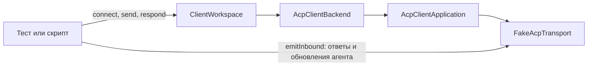

# Начало работы с кодом клиентского слоя

Эта глава для разработчика, который впервые открыл `codelab_client_core`. Она отвечает на практические вопросы: как подготовить репозиторий, как прогнать тесты, как увидеть работу слоя без живого агента, куда смотреть при отладке и в какой файл идти с задачей. Устройство слоя объясняют остальные главы; сюда они ссылаются по месту.

## Подготовка репозитория

Шаги подготовки описаны в [запуске из исходников](../../../../docs/user/run-from-source.md#1-подготовка). Здесь — конспект для разработчика; команды выполняются из корня репозитория.

1. Установите [FVM](https://fvm.app). Версия Flutter SDK лежит в `.fvmrc`; все команды Dart идут через `fvm`.
2. Поставьте SDK и свяжите пакеты:

   ```bash
   fvm install
   fvm flutter pub get
   fvm dart run melos bootstrap
   ```

3. Создайте сгенерированный код. Модели слоя — `freezed`, а `*.freezed.dart` в git не хранятся (`.gitignore`), поэтому без генерации пакет не соберётся:

   ```bash
   fvm dart run melos exec -c 1 --depends-on=build_runner -- "fvm dart run build_runner build --delete-conflicting-outputs"
   ```

Слой — чистый Dart без Flutter и без `dart:io`. Его тесты запускаются в каталоге пакета командой `fvm dart test`; для них нужны только эти три шага.

## Прогнать тесты пакета

```bash
cd packages/dart/codelab_client_core
fvm dart test
```

Полный прогон на момент написания — около 13 секунд. Он заканчивается строкой:

```text
00:08 +1029 ~37: All tests passed!
```

`~37` — пропущенные тесты: это фикстуры корпуса, которые не относятся к роли клиента (тест проекции вызывает `markTestSkipped`, [глава 14](14-testing.md)). Тесты печатают в stdout JSON-записи журнала: ядро клиента (`codelab_client_acp`) и сам `ClientWorkspace` без параметра `logger` пишут их через `StructuredLogLogger` (для слоя — `StructuredLogLogger('codelab_client_core')`). Чтобы читать ход тестов, отфильтруйте вывод или запустите один каталог с репортёром `expanded`:

```bash
fvm dart test test/queue --reporter expanded
```

```text
00:00 +0: loading test/queue/prompt_queue_test.dart
00:00 +0: test/queue/prompt_queue_test.dart: queued prompt is sent after the turn ends
00:00 +1: test/queue/prompt_queue_test.dart: send() completes after the whole queue of its session has drained
…
00:00 +7: All tests passed!
```

Один тест по имени:

```bash
fvm dart test test/queue/prompt_queue_test.dart --name "queued prompt is sent"
```

Остальные проверки пакета — [глава 14](14-testing.md) и раздел «Проверки перед pull request» ниже.

## Увидеть работу слоя без агента

Живой агент для разработки слоя не нужен. Тесты подключают `ClientWorkspace` к `FakeAcpTransport` из [`codelab_acp_testing`](../../codelab_acp_testing/README.md) и сами играют агента: отвечают на запросы и шлют `session/update`. Обвязка `KitAgent` (`test/support/kit_agent.dart`) делает это в несколько строк.

На схеме — как устроен такой стенд. Хост, то есть тест или скрипт, управляет `ClientWorkspace`, а за агента отвечает через `FakeAcpTransport`.



Скрипт ниже подключается, открывает сессию, отправляет два промпта, из которых второй встаёт в очередь, и печатает то, что видит хост. Он собран на `KitAgent`, поэтому сохраните его в `packages/dart/codelab_client_core/test/scratch/turn.dart` (каталог лишний, не коммитьте его):

```dart
import 'package:codelab_acp_protocol/codelab_acp_protocol.dart';
import 'package:codelab_client_core/codelab_client_core.dart';

import '../support/kit_agent.dart';

Future<void> main() async {
  // Агента играет скрипт: KitAgent — рабочее пространство на FakeAcpTransport.
  final agent = KitAgent();
  agent.workspace.state
      .map((state) => state.connection)
      .distinct()
      .listen((connection) => print('connection: ${connection.runtimeType}'));
  await agent.start();

  final session = await agent.newSession('s-1');
  session.view.listen((view) {
    final items = [
      for (final item in view.transcript)
        switch (item) {
          UserItem(:final text) => 'user "$text"',
          AgentTextItem(:final text) => 'agent "$text"',
          _ => item.runtimeType.toString(),
        },
    ];
    print(
      'rev=${view.revision} status=${view.status.name} '
      'queue=${view.queue.length} items=$items',
    );
  });

  // Промпт уходит сразу: сессия свободна.
  final first = await agent.prompt(session, 'first');
  // Второй промпт сессия ставит в очередь: ход ещё идёт.
  final queued = await session.send('second');
  print('send -> ${queued.runtimeType}');

  // Агент стримит ответ двумя кусками, затем завершает ход.
  for (final chunk in ['Hel', 'lo']) {
    agent.update('s-1', {
      'sessionUpdate': 'agent_message_chunk',
      'content': {'type': 'text', 'text': chunk},
    });
  }
  final second = agent.next(sessionPromptMethod);
  agent.respond(first.request, {'stopReason': 'end_turn'});
  final secondRequest = await second;
  agent.update('s-1', {
    'sessionUpdate': 'agent_message_chunk',
    'content': {'type': 'text', 'text': 'Hi'},
  });
  agent.respond(secondRequest, {'stopReason': 'end_turn'});
  await first.done;
  await Future<void>.delayed(Duration.zero);

  print('--- кадры');
  for (final frame in agent.workspace.protocolFrames.frames) {
    print(
      '#${frame.seq} ${frame.direction.name} ${frame.kind.name} '
      '${frame.method ?? ''} ${frame.detail ?? ''}',
    );
  }
  await agent.dispose();
}
```

Запуск (из каталога пакета; JSON-записи журнала ядра клиента отфильтрованы):

```bash
fvm dart run test/scratch/turn.dart
```

```text
connection: Connecting
connection: Connected
rev=1 status=running queue=0 items=[user "first"]
rev=2 status=running queue=1 items=[user "first"]
send -> PromptQueued
rev=3 status=running queue=1 items=[user "first", agent "Hel"]
rev=4 status=running queue=1 items=[user "first", agent "Hello"]
rev=5 status=idle queue=1 items=[user "first", agent "Hello"]
rev=6 status=idle queue=0 items=[user "first", agent "Hello"]
rev=7 status=running queue=0 items=[user "first", agent "Hello", user "second"]
rev=8 status=running queue=0 items=[user "first", agent "Hello", user "second", agent "Hi"]
rev=9 status=idle queue=0 items=[user "first", agent "Hello", user "second", agent "Hi"]
--- кадры
#0 outbound request initialize
#1 inbound result initialize
#2 outbound request session/new
#3 inbound result session/new
#4 outbound request session/prompt
#5 inbound notification session/update agent_message_chunk
#6 inbound notification session/update agent_message_chunk
#7 inbound result session/prompt
#8 outbound request session/prompt
#9 inbound notification session/update agent_message_chunk
#10 inbound result session/prompt
```

Что в этом выводе важно:

- `rev` растёт на каждое изменение сессии. Два куска ответа `Hel` и `lo` — два представления, но в ленте один элемент `agent "Hello"` ([глава 7](07-transcript.md)).
- Второй промпт ждёт в очереди: `queue=1`, пока идёт первый ход.
- На `rev=5` ход закончился, а очередь ещё не слита: сессия `idle` и `queue=1`. На `rev=6` элемент вышел из очереди, на `rev=7` ушёл второй `session/prompt` ([глава 6](06-prompt-and-queue.md)).
- Кадры — то, что хранит `ProtocolFrameLog` ([глава 11](11-inspector-diagnostics-frames.md)): `initialize`, `session/new`, `session/prompt` и ответы. Кадр `session/prompt` с `#8` — слитый из очереди.

Прогон выше сделан 2026-11-25.

## Что смотреть при отладке

Слой не пишет подробный журнал соединения: это делает `codelab_client_acp`. От него и от самого слоя доступны четыре источника.

| Что нужно увидеть | Где |
|---|---|
| какие кадры ACP ушли и пришли | `ClientWorkspace.protocolFrames`: `frames`, `revision`, `changes`; режим Trace добавляет payload ([глава 11](11-inspector-diagnostics-frames.md)) |
| исходы ходов, отмену, ответы на одобрения, потерю соединения | `ClientWorkspace.diagnostics`: `WorkspaceDiagnostic` без секретов |
| что решил слой про usage | журнал kit: событие `usage.stale`, `usage.decode_failed`, `usage.ledger.*`; задаётся параметром `logger` у `ClientWorkspace` ([глава 10](10-usage.md)) |
| почему транскрипт такой | `InspectorProjection` и `SessionView.transcript`; эталонный пересчёт `projectTranscript` в тестах ([глава 7](07-transcript.md)) |

В тестах журнал kit собирает `RecordingLogger` из `test/support/usage_agent.dart`. Хосты передают свой `Logger` из `codelab_client_acp`.

## Карта «что изменить — куда смотреть»

| Задача | Файл или каталог | Глава |
|---|---|---|
| поведение подключения, переподключения, `ensureAgent` | `lib/src/workspace/client_workspace.dart` (`_connect`, `_reconnect`, `_handleConnectionState`) | [03](03-connection.md) |
| состояния соединения | `lib/src/connection/connection_view.dart` | [03](03-connection.md) |
| открытие сессии, `session/list`, `session/load`, статусы | `client_workspace.dart`, `lib/src/workspace/workspace_state.dart` | [04](04-sessions.md) |
| восстановление после перезапуска, формат снимка | `lib/src/restore/` | [05](05-restore.md) |
| очередь, отмена, повтор, слив очереди | `client_workspace.dart` (`_SessionHandle`), `lib/src/queue/prompt_queue.dart` | [06](06-prompt-and-queue.md) |
| что попадает в ленту, заметки, дерево вызовов | `lib/src/transcript/` | [07](07-transcript.md) |
| одобрения: фокус, вид, подпись | `lib/src/transcript/transcript_projector.dart`, `lib/src/transcript/transcript_item.dart` | [08](08-approvals.md) |
| опции, команды агента, план, палитра | `lib/src/session/session_views.dart`, `lib/src/commands/command_catalog.dart` | [09](09-options-commands-plan.md) |
| расход токенов и денег | `lib/src/usage/` | [10](10-usage.md) |
| буфер кадров, диагностика, инспектор | `lib/src/protocol/`, `lib/src/diagnostics/`, `lib/src/inspector/` | [11](11-inspector-diagnostics-frames.md) |
| профили, токены, запись профиля | `lib/src/connection/profile_*.dart`, `secret_source.dart`, `token_rejection.dart` | [12](12-profiles-and-secrets.md) |
| порты хранилищ, файлы проекта, темы | `lib/src/stores/`, `lib/src/files/`, `lib/src/themes/` | [13](13-ports-and-stores.md) |
| порт к ACP-клиенту | `lib/src/backend/agent_backend.dart` | [02](02-state-ownership.md), [15](15-extending.md) |
| публичное API | `lib/codelab_client_core.dart` | [01](01-overview.md) |

Правила пакета — в [`AGENTS.md`](../AGENTS.md); перечитайте его перед правкой.

## Проверки перед pull request

Перед pull request из `feature/*` запускается только затронутое (`AGENTS.md` репозитория, §21). Для этого пакета набор такой:

1. Формат изменённых файлов: `fvm dart format --set-exit-if-changed <файлы>`.
2. Анализ в пакете и в зависящих от него, если менялось публичное API: `fvm dart analyze` в `packages/dart/codelab_client_core`, `packages/dart/codelab_client_io`, `apps/codelab_cli`, `apps/codelab_desktop`.
3. Тесты пакета: `fvm dart test`. Если менялось публичное API — ещё тесты `codelab_client_io` и приложений.
4. Сторож `fvm dart run melos run guard`, если менялись `pubspec.yaml` или импорты: он проверяет запрещённые импорты и список разрешённых зависимостей пакета.
5. `conformance:embedded` и `test:e2e:cli:embedded` — если изменились `codelab_embedded`, встроенный агент или слой, через который с ним работает CLI; `test:e2e:cli:dart-agent` — если изменился слой, через который работают `apps/codelab_cli` и `apps/codelab_agent` (корневой `AGENTS.md` §21).

Поведение десктопного приложения на время переноса логики в слой защищают характеризационные тесты `apps/codelab_desktop/test/features/workbench/application/shell_cubit_characterization/`; запуск:

```bash
cd apps/codelab_desktop
fvm flutter test test/features/workbench/application/shell_cubit_characterization
```

На момент написания они проходят (`+32: All tests passed!`). Менять их текст можно только явно и с обоснованием в `design.md` change (`AGENTS.md` пакета, §6).
