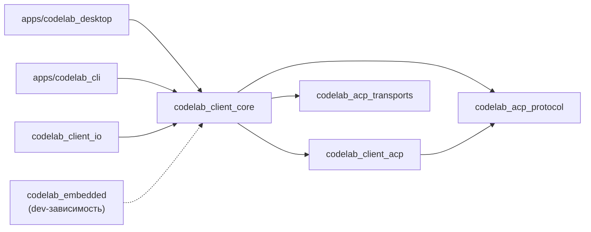
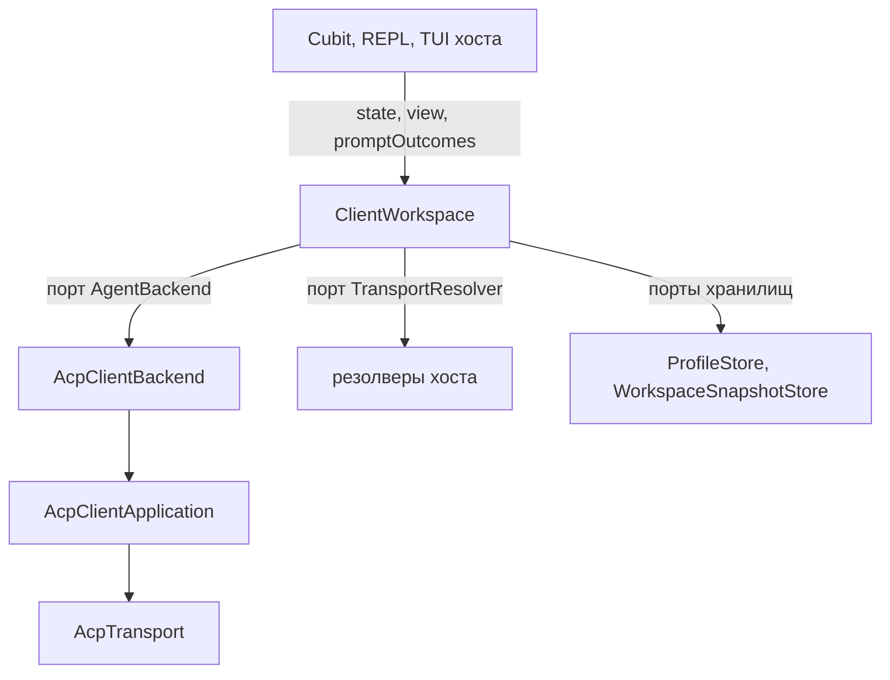

# Обзор: место в слоях, пакеты, карта кода

Глава даёт общую картину клиентского слоя: что это за пакет, на чём он стоит, кто на нём стоит и где в `lib/src/` лежит каждая часть. Остальные главы разбирают части подробно; читать их удобнее, когда карта уже в голове. Оглавление руководства — [README](README.md).

## Что такое клиентский слой

`codelab_client_core` — общая логика ACP-клиента без интерфейса. ACP (Agent Client Protocol) — протокол, по которому клиент и агент обмениваются сообщениями. Слой держит то, что нужно любому клиенту, будь то окно приложения или терминал: одно соединение с агентом, его сессии, ленту сообщений, очередь промптов, ожидающие одобрения, опции и команды агента, расход токенов.

Слой владеет этим состоянием. Хост — десктопное приложение или терминальный клиент — только подписывается на готовые неизменяемые значения `WorkspaceState` и `SessionView` и рисует их. Политика «когда отправлять промпт, что делать при обрыве, что значит „сессия занята“» живёт здесь, поэтому app и CLI ведут себя одинаково ([глава 2](02-state-ownership.md)).

Что слой **не** делает:

- не открывает процессы, сокеты и файлы: всё внешнее приходит портами, которые реализуют `codelab_client_io` и composition root хоста ([глава 13](13-ports-and-stores.md));
- не разговаривает по JSON-RPC сам: протокол, поколения соединения и отбрасывание поздних кадров делает `codelab_client_acp`;
- не рисует и не переводит: тексты заметок остаются английскими, а причины даются типами, по которым хост строит текст на своём языке ([глава 7](07-transcript.md));
- не знает агента: пакеты `codelab_agent_*` слой не использует (корневой `AGENTS.md` §5).

## Место в слоях

На схеме — зависимости из `pubspec.yaml` и пакеты, которые зависят от этого. Стрелка идёт от зависящего к зависимости.

`codelab_embedded` берёт слой только в `dev_dependencies`: замер задержки потока в `benchmark/` использует настоящий клиентский слой. Приложения получают встроенного агента через `codelab_embedded`, а слой — через composition root.

Пакет чистый Dart, сторона `client`, слой `core` (ADR-0002). Его границы держит сторож `melos run guard` (`packages/dart/codelab_architecture_tests`):

- в `lib/**` запрещены `dart:io`, `dart:isolate`, `dart:ffi`, `dart:html`, `dart:js_interop`, `package:web`, `package:flutter`, `package:codelab_acp_transports/io.dart`, а также `package:intl` и `package:flutter_localizations` (список `webUnsafe` и `uiLanguageForbidden` в `test/support/rules.dart`);
- `dependencies` — только подмножество `codelab_client_acp`, `codelab_acp_protocol`, `codelab_acp_transports`, `freezed_annotation`, `meta`, `collection`, `async` (`kitAllowlist` в `test/pubspec_allowlist_test.dart`). Сейчас `pubspec.yaml` объявляет первые пять; расширение набора требует OpenSpec change.

Слой ведёт к хосту так:

`ClientWorkspace` открывает транспорт не сам: профиль превращает в `AcpTransport` резолвер, который регистрирует composition root, а `AcpClientApplication` ведёт обмен. Хранилища (`ProfileStore`, `WorkspaceSnapshotStore`) слой лишь объявляет.

## Карта `lib/src/`

Публичное API экспортирует один барель `lib/codelab_client_core.dart`. Дополнительных барелей нет. Константа `acpClientKitPackageName` в нём — единственное значение, не относящееся к типам слоя.

| Каталог | Что внутри | Глава |
|---|---|---|
| `workspace/` | `ClientWorkspace` (интерфейс), `DefaultClientWorkspace` и закрытый `_SessionHandle` в одном файле `client_workspace.dart`; `WorkspaceState`, `SessionView`, `SessionStatusView`; `ClientWorkspaceException` | [02](02-state-ownership.md), [03](03-connection.md), [04](04-sessions.md), [06](06-prompt-and-queue.md) |
| `backend/` | порт `AgentBackend` и реализация `AcpClientBackend` | [02](02-state-ownership.md) |
| `connection/` | `ConnectionView`, `ConnectionProfile`, `TransportResolver`, `ConfigTransportResolver`; ссылки на токен, `SecretSource`, `ProfileSecrets`; `ProfileDraft`, `ProfileCommitter`; разбор строк формы; текст отказа по токену | [03](03-connection.md), [12](12-profiles-and-secrets.md) |
| `session/` | `ConfigOptionView`, `AgentCommandView`, `PlanEntryView`, `ApprovalWaitView`, `SubagentRowView` и обход для панели Agents | [09](09-options-commands-plan.md) |
| `transcript/` | `TranscriptItem` и его виды, проектор, дерево вызовов потомков, операции со списком задач, строка инструмента, виды субагентов | [07](07-transcript.md), [08](08-approvals.md) |
| `queue/` | `PromptQueue`, `QueuedPrompt`, `PromptOutcome` | [06](06-prompt-and-queue.md) |
| `restore/` | `WorkspaceSnapshot`, `WorkspaceSnapshotStore`, закрытый `WorkspaceRestorer` | [05](05-restore.md) |
| `commands/` | `CommandCatalog`, `HostCommand`, `CatalogCommand` | [09](09-options-commands-plan.md) |
| `usage/` | `UsageView`, `UsageFold`, `UsageDecoder`, журнал расхода, форматирование | [10](10-usage.md) |
| `inspector/`, `diagnostics/`, `protocol/` | `InspectorProjection`; `WorkspaceDiagnostic`, `describeFailure`; `ProtocolFrameLog` | [11](11-inspector-diagnostics-frames.md) |
| `stores/` | `ProfileStore`, `RecentProjectsStore`, `mergeRecentProjects` | [13](13-ports-and-stores.md) |
| `files/` | порт `ProjectFiles`, модели и чистые правила превью | [13](13-ports-and-stores.md) |
| `themes/` | формат и разбор пользовательской темы, порт `ThemeLibrary` | [13](13-ports-and-stores.md) |

Не экспортируются из бареля: `TranscriptProjector` и `projectTranscript` (`transcript_projector.dart`), `WorkspaceRestorer` и `RestoreHost` (`workspace_restorer.dart`), `buildToolCallTree`, `taskOperationsOf` и вспомогательные файлы разбора. Из `subagent_rows.dart` наружу выходят только `SubagentRowState` и `SubagentRowView` (`show` в барели). Тесты импортируют внутреннее прямо из `package:codelab_client_core/src/…`.

## Главные типы одним взглядом

| Тип | Роль |
|---|---|
| `ClientWorkspace` | владелец состояния: соединение, список сессий, активная сессия, потоки `state`, `promptOutcomes`, `diagnostics`; фабрика создаёт `DefaultClientWorkspace` |
| `SessionHandle` | сессия: `current`, `view`, `queue`, `send`, `cancel`, `retry`, `respond`, `setConfigOption` |
| `WorkspaceState` | снимок рабочего пространства: `connection`, `profile`, `projectDirectory`, `agentDirectory`, `sessions`, `activeSessionId`, `hasMoreSessions` |
| `SessionView` | снимок одной сессии: `revision`, `status`, `transcript`, `queue`, опции, команды, одобрения, план, `usage`, `usageLedger` |
| `ConnectionView` | закрытая иерархия состояния соединения |
| `AgentBackend` | порт к ACP-клиенту; единственная реализация — `AcpClientBackend` |
| `TransportResolver` | порт «профиль → транспорт» |
| `TranscriptItem` | закрытая иерархия элементов ленты |

Состояния, которые строит `ClientWorkspace`, — не DTO протокола. Модели `codelab_acp_protocol` и read-модель `AcpSession` из `codelab_client_acp` — протокольные данные; слой превращает их в представления для отображения (корневой `AGENTS.md` §7).

## Словарь

| Термин | Что значит |
|---|---|
| хост | то, что использует слой: Cubit-ы app, REPL, TUI и headless-режим CLI |
| composition root | место, где хост собирает `ClientWorkspace`, резолверы и хранилища: `apps/codelab_cli/lib/src/composition_root.dart`, `apps/codelab_desktop/lib/app/app_scope.dart` |
| kit | сокращённое имя слоя («ACP client kit»); так он назван в коде, спецификации и комментариях |
| ядро клиента | `AcpClientApplication` из `codelab_client_acp`: JSON-RPC, read-модель сессий, поколения |
| порт | интерфейс, который слой объявляет, а хост или `codelab_client_io` реализует |
| резолвер | реализация `TransportResolver`: профиль → `AcpTransport` |
| профиль | чистые данные о том, куда подключаться: `StdioProfile`, `WebSocketProfile`, `EmbeddedProfile` |
| поколение соединения | число, которое растёт при каждой замене транспорта; по нему отбрасываются поздние события старого соединения |
| вытеснение | новый `connect` или `reconnect` делает идущую попытку устаревшей |
| `revision` | счётчик изменений `SessionView`; растёт на каждую публикацию |
| статус сессии | `SessionStatusView`: `idle`, `running`, `cancelling`, `failed`, `notLoaded`, `detached` |
| `detached` | сессия открыта, но новое соединение её не знает |
| `notLoaded` | сессия есть у агента (`session/list`), но в этом запуске не открыта |
| проекция | чистое преобразование снимка сессии в элементы ленты |
| снимок рабочего пространства | то, что пишется на диск для восстановления: проект, активная сессия, открытые сессии |
| поздний кадр | событие старого соединения или запроса, пришедшее после замены |

## Источники норм

- Поведение: [`openspec/specs/acp-client-kit/spec.md`](../../../../openspec/specs/acp-client-kit/spec.md). Часть возможностей слоя описана в соседних спецификациях: [`client-themes`](../../../../openspec/specs/client-themes/spec.md), [`workspace-file-browser`](../../../../openspec/specs/workspace-file-browser/spec.md), [`app-settings`](../../../../openspec/specs/app-settings/spec.md).
- Правила пакета: [`AGENTS.md`](../AGENTS.md).
- Архитектура: [`state-management.md`](../../../../docs/architecture/state-management.md), [`session-lifecycle.md`](../../../../docs/architecture/session-lifecycle.md), [`streaming.md`](../../../../docs/architecture/streaming.md), [`concurrency.md`](../../../../docs/architecture/concurrency.md), [`acp-boundary.md`](../../../../docs/architecture/acp-boundary.md).
- Идентификаторы вида `D5` и `design.md change …` в комментариях кода ссылаются на решения архивных OpenSpec changes `openspec/changes/archive/`.
