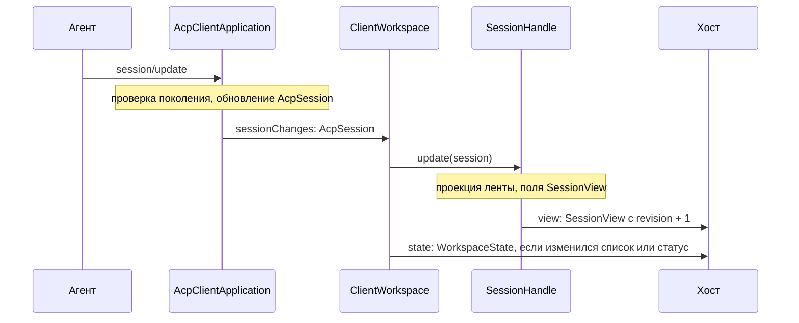

# Владение состоянием

Глава объясняет главный принцип слоя: клиентское состояние принадлежит `ClientWorkspace`, а Cubit-ы app и REPL с TUI в CLI только отображают его. Здесь же разобрано, как состояние публикуется, из чего складывается `SessionView`, в каком порядке подписываются потребители и чем завершается жизнь рабочего пространства. Соединение, сессии и очередь описаны в следующих главах; здесь — общая механика.

## Кто чем владеет

Каждый кусок состояния имеет одного владельца (корневой `AGENTS.md` §8, [`state-management.md`](../../../../docs/architecture/state-management.md)). Таблица показывает, где что лежит.

| Состояние | Владелец | Как хост его читает |
|---|---|---|
| соединение, профиль, папки, список сессий, активная сессия | `DefaultClientWorkspace` | `ClientWorkspace.state`, `current` |
| модель сессии: ходы, обновления, одобрения, статус жизненного цикла | `AcpClientApplication` (`codelab_client_acp`) | не читает: слой превращает её в `SessionView` |
| лента, очередь, опции, команды, одобрения, план, расход | `_SessionHandle` (закрытый класс слоя) | `SessionHandle.current`, `view` |
| буфер кадров ACP | `ProtocolFrameLog`, которым владеет `ClientWorkspace` | `ClientWorkspace.protocolFrames` |
| снимок для восстановления | `WorkspaceRestorer`, которым владеет `ClientWorkspace` | не читает: пишет слой в `WorkspaceSnapshotStore` хоста |
| профили на диске, недавние проекты, секреты | хранилища хоста (порты) | через порты, слой их не держит |
| выбор в интерфейсе, фокус, раскрытые панели | Cubit-ы и виджеты хоста | — |

Следствия:

- Cubit хоста не копирует транскрипт, очередь или статус соединения в своё состояние как первичные данные. Он держит выбор пользователя и производные значения для экрана, а источник истины читает из слоя.
- Политика находится в слое: когда сессия занята, что делать с промптом в занятой сессии, какое сообщение показать при потере соединения. Хост получает готовое решение (`PromptQueued`, `ConnectionLost`) и рисует его.
- Хост не парсит ACP и `_meta.codelab.*`: ни виджеты, ни Cubit-ы. Готовые поля — `ToolCallView`, `PlanEntryView`, `SubagentRowView`, `ApprovalStateView` (`AGENTS.md` пакета, §5).

## Как хост подключается

Composition root создаёт рабочее пространство и передаёт его Cubit-ам. В CLI это `apps/codelab_cli/lib/src/composition_root.dart`: `ClientWorkspace(backend: AcpClientBackend(application), resolvers: [...], logger: ...)`. В app — `apps/codelab_desktop/lib/app/app_scope.dart`: app передаёт только `backend`, `resolvers` и `snapshots` (хранилище снимка), без `logger`: рабочее пространство создаёт `StructuredLogLogger('codelab_client_core')` само.

Пример подключения хоста:

```dart
final application = AcpClientApplication(transport: notConnectedTransport);
final workspace = ClientWorkspace(
  backend: AcpClientBackend(application),
  resolvers: [ioTransportResolver(secrets: secrets), embeddedResolver],
  snapshots: snapshotStore, // необязательно
  logger: logger, // необязательно
);

final sub = workspace.state.listen((WorkspaceState s) => render(s));
await workspace.connect(profile, projectDirectory: projectDirectory);
```

`AcpClientApplication` требует транспорт при создании, а настоящий транспорт откроет резолвер по профилю при `connect`, поэтому CLI передаёт ему «ненастоящий» транспорт, который никогда не стартует (`_NotConnectedTransport` в `composition_root.dart`). Владелец `application` — тот, кто его создал: ни `AcpClientBackend`, ни `ClientWorkspace.dispose` его не закрывают.

## Порт `AgentBackend`

Слой не обращается к `AcpClientApplication` напрямую, а работает через порт `AgentBackend` (`lib/src/backend/agent_backend.dart`). Единственная реализация — `AcpClientBackend`, тонкая обёртка: каждый член порта делегирует одноимённому члену ядра клиента.

| Член порта | Для чего |
|---|---|
| `connectionStates`, `sessionChanges`, `usageNotifications`, `protocolFrames` | входящие потоки: состояние соединения, снимки сессий, уведомления расхода, кадры |
| `generation` | поколение текущего соединения |
| `traceAvailable`, `setFrameTrace` | режим Trace кадров |
| `connect`, `reconnect` | замена транспорта и рукопожатие |
| `createSession`, `loadSession`, `listSessions` | жизненный цикл сессий |
| `sendPrompt`, `cancelTurn`, `respondToPermission`, `setSessionConfigOption` | действия пользователя |
| `requestUsageLedger` | запрос журнала расхода |

Поздние события старого соединения отбрасывает реализация порта: после `reconnect` потоки несут только события нового поколения (`AGENTS.md` пакета, §3). Слой на это опирается и проверяет тестами. Новый член порта обязателен для любого фейка бэкенда ([глава 14](14-testing.md)).

## Путь одного обновления

На схеме — как `session/update` от агента становится представлением, которое видит хост.



Ядро клиента проверяет поколение и обновляет модель `AcpSession`, затем отдаёт её по потоку `sessionChanges`. `DefaultClientWorkspace` подписан на этот поток с момента создания (конструктор, `backend.sessionChanges.listen(_handleSession)`). Он находит или создаёт `_SessionHandle`, тот строит новое представление и публикует его. `WorkspaceState` публикуется, только если поменялся статус или заголовок сессии (`_handleSession`).

## Публикация: синхронно и без повторов

- Потоки `state`, `promptOutcomes`, `diagnostics` и `SessionHandle.view` — `StreamController.broadcast(sync: true)`. Подписчик получает событие внутри вызова, который его породил, поэтому хост видит переход соединения сразу после события транспорта.
- Подписок на один поток может быть несколько (broadcast). `current` всегда возвращает последнее опубликованное значение.
- `DefaultClientWorkspace._publish` ничего не делает, если новое `WorkspaceState` равно текущему (`next == _current`): `freezed` даёт равенство по значению, и подписчик не видит повторов. В `SessionHandle` повтор того же `AcpSession` (`identical`) — тоже пустая операция, а любое реальное изменение даёт `revision + 1`.
- Так как `SessionView` сравнивается по значению, хост может отличать новое представление от повтора по `==`; `revision` нужен, чтобы сравнивать дёшево, не обходя поля.

Следствие синхронности: обработчик подписки выполняется внутри публикации. Поэтому слой сам не отправляет промпт из обработчика `sessionChanges`: слив очереди проверяет условие после каждого хода, а не реагирует на событие статуса — иначе получилась бы вложенная публикация в тот же поток (комментарий к `_dispatch`, [глава 6](06-prompt-and-queue.md)).

## Из чего складывается `SessionView`

`SessionView` собирает `_SessionHandle._sessionFields` из снимка `AcpSession`. Не всё в нём выводится из снимка: часть полей живёт только в слое.

| Поле `SessionView` | Откуда | Глава |
|---|---|---|
| `status` | `AcpSession.status` через `SessionStatusView.of`; `detached`, если сессия потеряла связь | [04](04-sessions.md) |
| `transcript` | проекция ходов `AcpSession` плюс уведомление `NoticeItem` о связи | [07](07-transcript.md) |
| `pendingApprovals`, `approvalWaits` | ходы `AcpSession` | [08](08-approvals.md) |
| `configOptions`, `agentCommands`, `plan`, `subagents` | `AcpSession` | [09](09-options-commands-plan.md) |
| `canRetry` | последний ход, связь сессии и статус | [06](06-prompt-and-queue.md) |
| `queue` | **только слой**: очередь не в `AcpSession` | [06](06-prompt-and-queue.md) |
| `configOptionInFlight` | **только слой**: запрос `session/set_config_option` в полёте | [09](09-options-commands-plan.md) |
| `usage` | **только слой**: свёртка `UsageFold` | [10](10-usage.md) |
| `usageLedger` | **только слой**: автомат запроса журнала | [10](10-usage.md) |

Поля «только слой» поэтому не восстанавливаются из `AcpSession`: `_sessionFields` их не трогает. Сбрасываются только `usage` и `usageLedger`: при новом соединении и в начале `session/load` (`resetUsage`). `queue` переживает `reload` и переподключение, а `configOptionInFlight` снимает только ответ на запрос `session/set_config_option`.

## Порядок подписок и порядок создания

Рабочее пространство подписывается на `sessionChanges` в конструкторе. Из этого вытекает правило создания: `SessionHandle.current` обновлён к моменту, когда сигнал получают подписчики, которые подписались на `sessionChanges` позже (design D6 change `extract-acp-client-kit`; в `SessionHandle` — комментарий «обновляется синхронно… до остальных подписчиков»).

Поэтому composition root создаёт `ClientWorkspace` раньше Cubit-ов, которые читают сессии. В app это сказано прямо: пять Cubit-ов рабочего места «собираются после `ClientWorkspace`, чтобы рабочее пространство раньше них подписалось на `sessionChanges`» (`app_scope.dart`, комментарий к `bind<CodeLabShellParts>`).

## Конец жизни

`ClientWorkspace.dispose()` (идемпотентный):

1. помечает рабочее пространство закрытым и увеличивает номер попытки подключения, чтобы любая идущая попытка стала устаревшей ([глава 3](03-connection.md));
2. дожидается последней записи снимка (`flush`), если включено восстановление ([глава 5](05-restore.md));
3. отменяет подписки на потоки бэкенда: `connectionStates`, `sessionChanges`, `usageNotifications`;
4. закрывает `ProtocolFrameLog`;
5. закрывает потоки представлений всех `SessionHandle` и потоки `state`, `promptOutcomes`, `diagnostics`.

Бэкенд и `AcpClientApplication` слой не закрывает: их закрывает владелец. Событие, которое пришло уже после закрытия, не бросает: публикация проверяет `isClosed` потока, а запрос журнала расхода при закрытом рабочем пространстве ничего не отправляет (`refreshUsageLedger`).

## Что хост обязан и чего не должен

Обязан:

- создавать `ClientWorkspace` один раз на окно и закрывать его при выходе;
- подписываться на `state`, `view`, `promptOutcomes`, `diagnostics` и отменять подписки при закрытии владельца (корневой `AGENTS.md` §9);
- записывать `diagnostics` в свой журнал: слой публикует события, но не пишет их сам;
- показывать каждое состояние `ConnectionView` и каждый статус `SessionStatusView`: иерархии закрытые, пропуск ловит компилятор.

Не должен:

- создавать транспорты, процессы и сокеты в виджетах и Cubit-ах: это дело резолверов composition root;
- держать копию ленты и очереди как источник истины;
- разбирать `_meta.codelab.*` и сырые кадры;
- печатать или хранить значение токена: оно живёт только в `SecretText` и в адаптере хранилища ([глава 12](12-profiles-and-secrets.md)).
